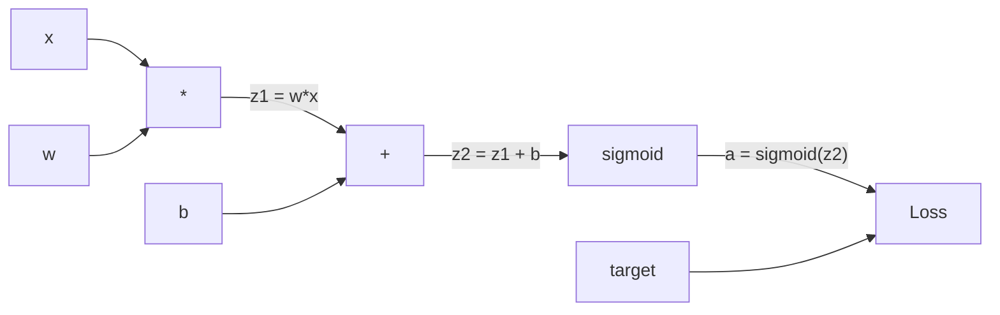
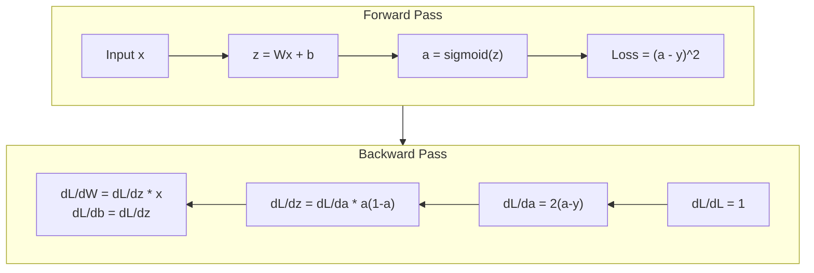
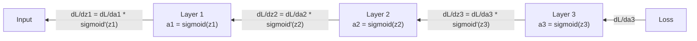

# 從零實作 Backpropagation (Backpropagation from Scratch)

> Backpropagation 是讓學習成為可能的演算法。沒有它，神經網路只是昂貴的亂數產生器。

**Type:** Build
**Languages:** Python
**Prerequisites:** Lesson 03.02 (Multi-Layer Networks)
**Time:** ~120 分鐘

## 學習目標 (Learning Objectives)

- 實作以 Value 為基礎的 autograd 引擎，建立 computational graph，並透過 topological sort 計算 gradient
- 用 chain rule 推導加法、乘法與 sigmoid 的 backward pass
- 只用你從零寫的 backpropagation 引擎，訓練多層網路解決 XOR 與圓形分類
- 找出深層 sigmoid 網路中的 vanishing gradient 問題，並說明 gradient 為什麼會呈指數級縮小

## 問題 (The Problem)

你的網路有一個 hidden layer，輸入 768 個，輸出 3072 個。那就是 2,359,296 個 weights。它做出了錯誤的預測。是哪些 weights 造成了錯誤？如果逐一測試每個 weight，就需要 230 萬次 forward pass。Backpropagation 只用一次 backward pass，就算出全部 230 萬個 gradient。這不只是最佳化，而是「能訓練」和「不可能」之間的差別。

天真的做法是：挑一個 weight，稍微動一點點，再跑一次 forward pass，看 loss 是變大還是變小。這樣你就得到那個 weight 的 gradient。接著對網路裡每一個 weight 都這樣做。再乘上幾千個訓練步驟和上百萬筆資料。你得花上地質年代那麼久，才能訓練出任何有用的東西。

Backpropagation 解決了這個問題。一次 forward pass，一次 backward pass，所有 gradient 就都算出來了。訣竅是把微積分的 chain rule，有系統地套用在 computational graph 上。這個演算法讓 deep learning 變得可行。沒有它，我們還會卡在玩具問題上。

## 核心概念 (The Concept)

### 套用在網路上的 Chain Rule (The Chain Rule, Applied to Networks)

你在 Phase 01 的第 05 課看過 chain rule。快速複習：如果 $y = f(g(x))$，那麼 $\frac{dy}{dx} = f'(g(x)) \cdot g'(x)$。你沿著這條鏈把導數相乘。

在神經網路裡，「鏈」就是從輸入到 loss 的一連串運算。每一層套用 weights、加上 biases、通過 activation。loss function 再把最終輸出和目標做比較。Backpropagation 沿著這條鏈往回追，計算每個運算對 error 的貢獻。

### Computational Graph (Computational Graphs)

每次 forward pass 都會建出一張圖。每個節點是一個運算（乘、加、sigmoid）。每條邊往前帶著 value，往後帶著 gradient。



Forward pass：value 由左往右流動。$x$ 和 $w$ 產生 $z_1 = w x$。加上 $b$ 得到 $z_2$。sigmoid 給出 activation $a$。再用 loss function 比較 $a$ 與目標 $y$。

Backward pass：gradient 由右往左流動。從 $\partial L/\partial a$ 開始（loss 如何隨 activation 改變）。乘上 $\partial a/\partial z_2$（sigmoid 的導數），得到 $\partial L/\partial z_2$。再分成 $\partial L/\partial b$（等於 $\partial L/\partial z_2$，因為 $z_2 = z_1 + b$）和 $\partial L/\partial z_1$。接著 $\partial L/\partial w = \partial L/\partial z_1 \cdot x$，而 $\partial L/\partial x = \partial L/\partial z_1 \cdot w$。

圖裡每個節點在 backward pass 都只有一件事要做：接住從上面傳來的 gradient，乘上自己的局部導數，再往下傳。

### Forward 與 Backward (Forward vs Backward)



forward pass 會儲存每個中間值：z、a，以及每一層的輸入。backward pass 需要這些儲存下來的值才能算出 gradient。這就是 backprop 核心的記憶體與運算取捨。你用記憶體（儲存 activation）換取速度（一次 pass，而不是上百萬次）。

### Gradient 在網路中的流動 (Gradient Flow Through a Network)

對一個 3 層網路來說，gradient 會一路串過每一層：



在每一層，gradient 都會乘上 sigmoid 的導數。sigmoid 的導數是 $a(1 - a)$，最大值是 0.25（當 $a = 0.5$ 時）。深入三層後，gradient 最多被乘上 $0.25^3 = 0.0156$。深入十層：$0.25^{10} = 0.000001$。

### Vanishing Gradient (Vanishing Gradients)

這就是 vanishing gradient 問題。Sigmoid 把輸出壓在 0 到 1 之間。它的導數永遠小於 0.25。把足夠多的 sigmoid layer 疊起來，gradient 就會縮到近乎消失。前面的 layer 幾乎學不到東西，因為它們收到的 gradient 趨近於零。

```
sigmoid(z):     Output range [0, 1]
sigmoid'(z):    Max value 0.25 (at z = 0)

After 5 layers:   gradient * 0.25^5 = 0.001x original
After 10 layers:  gradient * 0.25^10 = 0.000001x original
```

這就是為什麼深層 sigmoid 網路幾乎不可能訓練。解法是 ReLU 和它的各種變體，那是第 04 課的主題。現在先了解：backprop 本身運作得完美無缺。問題出在它所經過的東西。

### 推導雙層網路的 Gradient (Deriving Gradients for a 2-Layer Network)

以下是具體的數學：一個網路有輸入 $x$、使用 sigmoid 的 hidden layer、使用 sigmoid 的 output layer，以及 MSE loss。

Forward pass：

```math
\begin{aligned}
z_1 &= W_1 x + b_1 \\
a_1 &= \text{sigmoid}(z_1) \\
z_2 &= W_2 a_1 + b_2 \\
a_2 &= \text{sigmoid}(z_2) \\
L &= (a_2 - y)^2
\end{aligned}
```

Backward pass（一步一步套用 chain rule）：

```math
\begin{aligned}
\frac{\partial L}{\partial a_2} &= 2(a_2 - y) \\
\frac{\partial a_2}{\partial z_2} &= a_2 (1 - a_2) \\
\frac{\partial L}{\partial z_2} &= \frac{\partial L}{\partial a_2} \cdot \frac{\partial a_2}{\partial z_2} = 2(a_2 - y) \cdot a_2 (1 - a_2) \\[6pt]
\frac{\partial L}{\partial W_2} &= \frac{\partial L}{\partial z_2} \cdot a_1 \\
\frac{\partial L}{\partial b_2} &= \frac{\partial L}{\partial z_2} \\[6pt]
\frac{\partial L}{\partial a_1} &= \frac{\partial L}{\partial z_2} \cdot W_2 \\
\frac{\partial a_1}{\partial z_1} &= a_1 (1 - a_1) \\
\frac{\partial L}{\partial z_1} &= \frac{\partial L}{\partial a_1} \cdot \frac{\partial a_1}{\partial z_1} \\[6pt]
\frac{\partial L}{\partial W_1} &= \frac{\partial L}{\partial z_1} \cdot x \\
\frac{\partial L}{\partial b_1} &= \frac{\partial L}{\partial z_1}
\end{aligned}
```

每個 gradient 都是從 loss 往回追溯的局部導數的乘積。Backpropagation 就只是這樣。

```figure
backprop-vanishing
```

## 動手做 (Build It)

### 步驟 1：Value 節點 (The Value Node)

我們運算中的每個數字都會變成一個 Value。它儲存自己的 data、自己的 gradient，以及自己是怎麼被建立的（這樣它才知道如何往回計算 gradient）。

```python
class Value:
    def __init__(self, data, children=(), op=''):
        self.data = data
        self.grad = 0.0
        self._backward = lambda: None
        self._children = set(children)
        self._op = op

    def __repr__(self):
        return f"Value(data={self.data:.4f}, grad={self.grad:.4f})"
```

目前還沒有 gradient（0.0）。也還沒有 backward 函數（no-op）。`_children` 記錄是哪些 Value 產生了這一個，這樣我們之後才能對圖做 topological sort。

### 步驟 2：帶有 Backward 函數的運算 (Operations with Backward Functions)

每個運算都會建立一個新的 Value，並定義 gradient 如何往回流過它。

```python
def __add__(self, other):
    other = other if isinstance(other, Value) else Value(other)
    out = Value(self.data + other.data, (self, other), '+')

    def _backward():
        self.grad += out.grad
        other.grad += out.grad

    out._backward = _backward
    return out

def __mul__(self, other):
    other = other if isinstance(other, Value) else Value(other)
    out = Value(self.data * other.data, (self, other), '*')

    def _backward():
        self.grad += other.data * out.grad
        other.grad += self.data * out.grad

    out._backward = _backward
    return out
```

加法：$\partial(a+b)/\partial a = 1$，$\partial(a+b)/\partial b = 1$。所以兩個輸入都直接拿到輸出的 gradient。

乘法：$\partial(ab)/\partial a = b$，$\partial(ab)/\partial b = a$。每個輸入拿到的是另一個輸入的值乘上輸出的 gradient。

`+=` 很關鍵。一個 Value 可能被用在多個運算裡。它的 gradient 是所有路徑 gradient 的總和。

### 步驟 3：Sigmoid 與 Loss

```python
import math

def sigmoid(self):
    x = self.data
    x = max(-500, min(500, x))
    s = 1.0 / (1.0 + math.exp(-x))
    out = Value(s, (self,), 'sigmoid')

    def _backward():
        self.grad += (s * (1 - s)) * out.grad

    out._backward = _backward
    return out
```

Sigmoid 的導數：$\text{sigmoid}(x) \cdot (1 - \text{sigmoid}(x))$。我們在 forward pass 已經算出 $\text{sigmoid}(x) = s$。直接重用，不用額外工作。

```python
def mse_loss(predicted, target):
    diff = predicted + Value(-target)
    return diff * diff
```

單一輸出的 MSE：$(\text{predicted} - \text{target})^2$。我們把減法寫成加上一個取負號的 Value。

### 步驟 4：Backward Pass

Topological sort 確保我們以正確的順序處理節點，也就是在往下傳遞之前，節點的 gradient 已經完整累加完畢。

```python
def backward(self):
    topo = []
    visited = set()

    def build_topo(v):
        if v not in visited:
            visited.add(v)
            for child in v._children:
                build_topo(child)
            topo.append(v)

    build_topo(self)
    self.grad = 1.0
    for v in reversed(topo):
        v._backward()
```

從 loss 開始（gradient = 1.0，因為 $dL/dL = 1$）。沿著排序後的圖往回走。每個節點的 `_backward` 會把 gradient 推給它的 children。

### 步驟 5：Layer 與 Network

```python
import random

class Neuron:
    def __init__(self, n_inputs):
        scale = (2.0 / n_inputs) ** 0.5
        self.weights = [Value(random.uniform(-scale, scale)) for _ in range(n_inputs)]
        self.bias = Value(0.0)

    def __call__(self, x):
        act = sum((wi * xi for wi, xi in zip(self.weights, x)), self.bias)
        return act.sigmoid()

    def parameters(self):
        return self.weights + [self.bias]


class Layer:
    def __init__(self, n_inputs, n_outputs):
        self.neurons = [Neuron(n_inputs) for _ in range(n_outputs)]

    def __call__(self, x):
        out = [n(x) for n in self.neurons]
        return out[0] if len(out) == 1 else out

    def parameters(self):
        params = []
        for n in self.neurons:
            params.extend(n.parameters())
        return params


class Network:
    def __init__(self, sizes):
        self.layers = []
        for i in range(len(sizes) - 1):
            self.layers.append(Layer(sizes[i], sizes[i + 1]))

    def __call__(self, x):
        for layer in self.layers:
            x = layer(x)
            if not isinstance(x, list):
                x = [x]
        return x[0] if len(x) == 1 else x

    def parameters(self):
        params = []
        for layer in self.layers:
            params.extend(layer.parameters())
        return params

    def zero_grad(self):
        for p in self.parameters():
            p.grad = 0.0
```

Neuron 接收輸入，計算加權總和加 bias，再套用 sigmoid。weight 初始化會乘上 $\sqrt{2/n_{\text{inputs}}}$ 的縮放，避免較深的網路中 sigmoid 飽和。Layer 是一串 Neuron。Network 是一串 Layer。`parameters()` 方法會收集所有可學習的 Value，讓我們可以更新它們。

### 步驟 6：在 XOR 上訓練

```python
random.seed(42)
net = Network([2, 4, 1])

xor_data = [
    ([0.0, 0.0], 0.0),
    ([0.0, 1.0], 1.0),
    ([1.0, 0.0], 1.0),
    ([1.0, 1.0], 0.0),
]

learning_rate = 1.0

for epoch in range(1000):
    total_loss = Value(0.0)
    for inputs, target in xor_data:
        x = [Value(i) for i in inputs]
        pred = net(x)
        loss = mse_loss(pred, target)
        total_loss = total_loss + loss

    net.zero_grad()
    total_loss.backward()

    for p in net.parameters():
        p.data -= learning_rate * p.grad

    if epoch % 100 == 0:
        print(f"Epoch {epoch:4d} | Loss: {total_loss.data:.6f}")

print("\nXOR Results:")
for inputs, target in xor_data:
    x = [Value(i) for i in inputs]
    pred = net(x)
    print(f"  {inputs} -> {pred.data:.4f} (expected {target})")
```

看著 loss 下降。從隨機的預測到正確的 XOR 輸出，完全是由 backpropagation 計算 gradient、並把 weights 往正確方向推動所驅動的。

### 步驟 7：圓形分類 (Circle Classification)

在第 02 課，你是手動調整 weights 來做圓形分類。現在讓網路自己學。

```python
random.seed(7)

def generate_circle_data(n=100):
    data = []
    for _ in range(n):
        x1 = random.uniform(-1.5, 1.5)
        x2 = random.uniform(-1.5, 1.5)
        label = 1.0 if x1 * x1 + x2 * x2 < 1.0 else 0.0
        data.append(([x1, x2], label))
    return data

circle_data = generate_circle_data(80)

circle_net = Network([2, 8, 1])
learning_rate = 0.5

for epoch in range(2000):
    random.shuffle(circle_data)
    total_loss_val = 0.0
    for inputs, target in circle_data:
        x = [Value(i) for i in inputs]
        pred = circle_net(x)
        loss = mse_loss(pred, target)
        circle_net.zero_grad()
        loss.backward()
        for p in circle_net.parameters():
            p.data -= learning_rate * p.grad
        total_loss_val += loss.data

    if epoch % 200 == 0:
        correct = 0
        for inputs, target in circle_data:
            x = [Value(i) for i in inputs]
            pred = circle_net(x)
            predicted_class = 1.0 if pred.data > 0.5 else 0.0
            if predicted_class == target:
                correct += 1
        accuracy = correct / len(circle_data) * 100
        print(f"Epoch {epoch:4d} | Loss: {total_loss_val:.4f} | Accuracy: {accuracy:.1f}%")
```

這裡我們用 online SGD：每處理一筆樣本就更新 weights，而不是累積整個 batch。這樣能更快打破對稱性，並避免在整個 loss 地形上出現 sigmoid 飽和。每個 epoch 都把資料洗牌，可以避免網路記住資料的順序。

不需要手動調整。網路自己發現了圓形的決策邊界。這就是 backpropagation 的威力：你定義架構、loss function 和資料，演算法會自己找出 weights。

## 實際使用 (Use It)

PyTorch 只用幾行就能做完上面所有事。核心概念完全相同：autograd 在 forward pass 時建立 computational graph，再沿著它往回追溯來計算 gradient。

```python
import torch
import torch.nn as nn

model = nn.Sequential(
    nn.Linear(2, 4),
    nn.Sigmoid(),
    nn.Linear(4, 1),
    nn.Sigmoid(),
)
optimizer = torch.optim.SGD(model.parameters(), lr=1.0)
criterion = nn.MSELoss()

X = torch.tensor([[0,0],[0,1],[1,0],[1,1]], dtype=torch.float32)
y = torch.tensor([[0],[1],[1],[0]], dtype=torch.float32)

for epoch in range(1000):
    pred = model(X)
    loss = criterion(pred, y)
    optimizer.zero_grad()
    loss.backward()
    optimizer.step()

print("PyTorch XOR Results:")
with torch.no_grad():
    for i in range(4):
        pred = model(X[i])
        print(f"  {X[i].tolist()} -> {pred.item():.4f} (expected {y[i].item()})")
```

`loss.backward()` 就是你的 `total_loss.backward()`。`optimizer.step()` 就是你手動寫的 `p.data -= lr * p.grad`。`optimizer.zero_grad()` 就是你的 `net.zero_grad()`。演算法相同，只是實作達到工業級強度。PyTorch 處理 GPU 加速、mixed precision、gradient checkpointing，以及上百種 layer 類型。但 backward pass 仍然是把同一個 chain rule 套用在同一張 computational graph 上。

訓練會先跑 forward pass，再跑 backward pass，然後更新 weights。Inference 只跑 forward pass。沒有 gradient，也不更新。這個區別很重要，因為正式環境裡發生的就是 inference。當你呼叫 Claude 或 GPT 這類 API 時，你跑的是 inference：你的 prompt 向前流過網路，token 從另一端出來。沒有任何 weight 會改變。理解 backprop 之所以重要，是因為網路裡的每個 weight 都是它塑造出來的。

## 交付 (Ship It)

這堂課產出：
- `outputs/prompt-gradient-debugger.md` -- 一個可重複使用的 prompt，用來診斷任何神經網路中的 gradient 問題（vanishing、exploding、NaN）

## 練習 (Exercises)

1. 為 Value class 加上 `__sub__` 方法 $(a - b = a + (-1 \cdot b))$。接著實作 `__neg__` 方法。拿一個簡單的式子，例如 $(a - b)^2$，和手算結果比對，驗證 gradient 是否正確。

2. 為 Value 加上 `relu` 方法（輸出 $\max(0, x)$，若 $x \gt 0$ 則導數為 1，否則為 0）。在 hidden layer 用 relu 取代 sigmoid，再訓練一次 XOR。比較收斂速度。你應該會看到訓練變快，這是第 04 課的預告。

3. 在 Value 上實作整數次方的 `__pow__` 方法。用它把 `mse_loss` 換成正式的 `(predicted - target) ** 2` 運算式。驗證 gradient 和原本的實作一致。

4. 在訓練迴圈加上 gradient clipping：呼叫 `backward()` 之後，把所有 gradient 裁剪到 [-1, 1]。訓練一個更深的網路（4 層以上的 sigmoid），比較有無 clipping 的 loss 曲線。這是你對抗 exploding gradient 的第一道防線。

5. 做一個視覺化：在 XOR 訓練完成後，印出網路中每個參數的 gradient。找出哪一層的 gradient 最小。這可以示範你在核心概念一節讀到的 vanishing gradient 問題。

## 關鍵術語 (Key Terms)

| Term | 一般說法 | 實際意義 |
|------|----------------|----------------------|
| Backpropagation | 「網路在學習」 | 一種演算法，沿著 computational graph 反向套用 chain rule，為每個 weight 計算 $\partial L/\partial w$ |
| Computational graph | 「網路結構」 | 一張有向無環圖，節點是運算，邊往前帶 value、往後帶 gradient |
| Chain rule | 「把導數相乘」 | 若 $y = f(g(x))$，則 $\frac{dy}{dx} = f'(g(x)) \cdot g'(x)$ -- backpropagation 的數學基礎 |
| Gradient | 「最陡上升的方向」 | loss 對某個參數的偏導數 -- 告訴你該如何改變這個參數來降低 loss |
| Vanishing gradient | 「深層網路學不會」 | 當 gradient 通過 sigmoid 這類會飽和的 activation 時，會隨層數呈指數級縮小 |
| Forward pass | 「執行網路」 | 依序套用每一層的運算，從輸入算出輸出，並儲存中間值 |
| Backward pass | 「計算 gradient」 | 反向走過 computational graph，用 chain rule 在每個節點累加 gradient |
| Learning rate | 「學得多快」 | 控制更新 weights 時步伐大小的純量：$w_{\text{new}} = w_{\text{old}} - \text{lr} \cdot \text{gradient}$ |
| Topological sort | 「正確的順序」 | 對圖節點的一種排序，每個節點都排在它所依賴的所有節點之後 -- 確保 gradient 在傳遞之前已完整累加 |
| Autograd | 「自動微分」 | 一種系統，在 forward 運算時建立 computational graph，並自動計算 gradient -- 也就是 PyTorch 引擎做的事 |

## 延伸閱讀 (Further Reading)

- Rumelhart, Hinton & Williams, "Learning representations by back-propagating errors" (1986) -- 讓 backpropagation 成為主流、並解鎖多層網路訓練的那篇論文
- 3Blue1Brown, "Neural Networks" series (https://www.youtube.com/playlist?list=PLZHQObOWTQDNU6R1_67000Dx_ZCJB-3pi) -- 對 backpropagation 與 gradient 在網路中流動最好的視覺化解說
