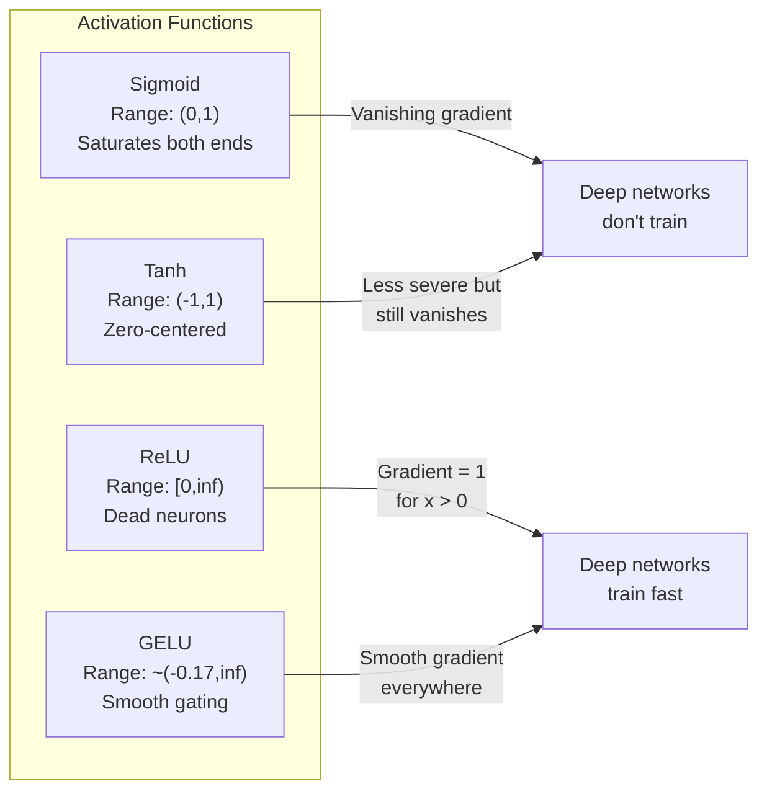
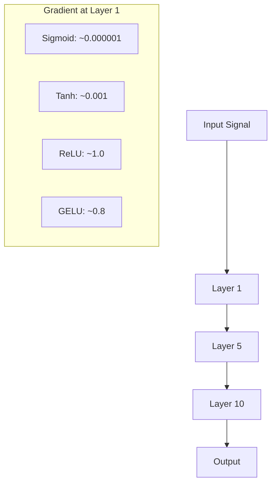
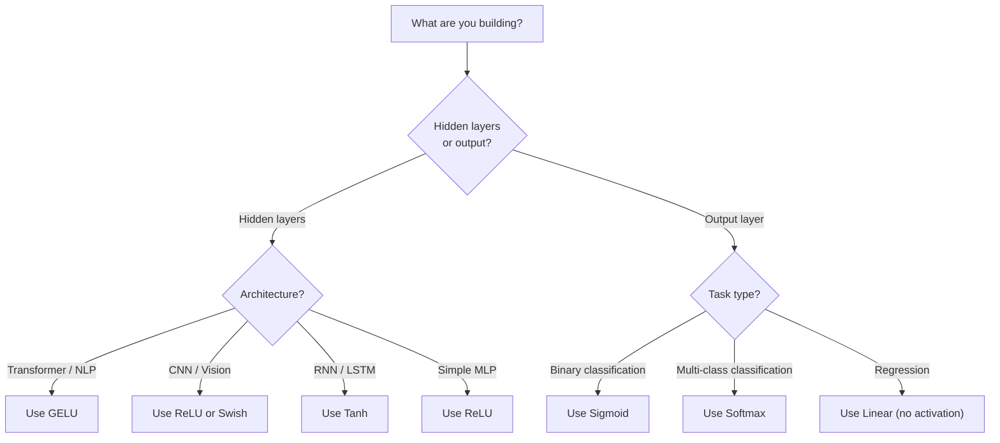

# Activation Function (Activation Functions)

> 沒有非線性，你的 100 層網路只是一個花俏的 matrix 乘法。Activation 是讓神經網路能用曲線思考的閘門。

**Type:** Build
**Languages:** Python
**Prerequisites:** Lesson 03.03 (Backpropagation)
**Time:** ~75 分鐘

## 學習目標 (Learning Objectives)

- 從零實作 sigmoid、tanh、ReLU、Leaky ReLU、GELU、Swish 和 softmax，以及它們的導數
- 透過量測不同 activation 在 10 層以上網路中的 activation 大小，診斷 vanishing gradient 問題
- 在 ReLU 網路中偵測 dead neuron，並說明 GELU 為什麼能避免這種失效模式
- 為特定架構（transformer、CNN、RNN、輸出層）選出正確的 activation function

## 問題 (The Problem)

把兩個線性轉換疊起來：$y = W_2(W_1 x + b_1) + b_2$。展開它：$y = W_2 W_1 x + W_2 b_1 + b_2$。這只是 $y = Ax + c$，也就是單一個線性轉換。不管你疊多少個線性 layer，結果都會塌縮成一次 matrix 乘法。你的 100 層網路，表示能力和單一層一模一樣。

這不是理論上的小趣聞。它意味著深層線性網路真的學不會 XOR、分不了螺旋形資料集、認不出人臉。沒有 activation function，深度只是幻覺。

Activation function 打破線性。它們用非線性函數扭曲每一層的輸出，讓網路有能力彎折決策邊界、逼近任意函數，並真正學到東西。但如果選錯 activation，你的 gradient 可能消失成零（深層網路裡的 sigmoid）、爆炸成無限大（沒有仔細初始化的無界 activation），或是 neuron 永久死亡（bias 為很大負值的 ReLU）。activation function 的選擇，直接決定你的網路到底學不學得起來。

## 核心概念 (The Concept)

### 為什麼非線性是必要的 (Why Nonlinearity Is Necessary)

Matrix 乘法是可組合的。把向量先乘上 matrix $A$ 再乘上 matrix $B$，等同於乘上 $AB$。這表示疊十個線性 layer，在數學上等價於一個帶有一個大 matrix 的線性 layer。所有那些參數、所有那些深度，都白費了。你需要某個東西來打斷這條鏈。這就是 activation function 的工作。

證明如下。線性 layer 計算 $f(x) = Wx + b$。疊兩層：

```math
\begin{aligned}
\text{Layer 1:} \quad h &= W_1 x + b_1 \\
\text{Layer 2:} \quad y &= W_2 h + b_2
\end{aligned}
```

代入：

```math
\begin{aligned}
y &= W_2 (W_1 x + b_1) + b_2 \\
y &= (W_2 W_1) x + (W_2 b_1 + b_2) \\
y &= A x + c
\end{aligned}
```

變成一層。在 layer 之間插入非線性 activation $g()$：

```math
\begin{aligned}
h &= g(W_1 x + b_1) \\
y &= W_2 h + b_2
\end{aligned}
```

現在代入的招數失效了。$W_2 g(W_1 x + b_1) + b_2$ 無法化簡成單一個線性轉換。網路可以表示非線性函數。每多一層帶 activation 的 layer，就多一分表示能力。

### Sigmoid

神經網路最早的 activation function。

```math
\text{sigmoid}(x) = \frac{1}{1 + e^{-x}}
```

輸出範圍：(0, 1)。平滑、可微分，能把任何實數對應成類似機率的值。

導數：

```math
\text{sigmoid}'(x) = \text{sigmoid}(x) \cdot (1 - \text{sigmoid}(x))
```

這個導數的最大值是 0.25，出現在 $x = 0$。在 backpropagation 中，gradient 會一層層相乘。十層 sigmoid 表示 gradient 最多被乘上十次 0.25：

```math
0.25^{10} = 0.000000953674
```

不到原始訊號的百萬分之一。這就是 vanishing gradient 問題。前面幾層的 gradient 變得非常小，weights 幾乎不會更新。網路看起來在學習，因為後面幾層的 loss 在下降，但最前面幾層是凍結的。深層 sigmoid 網路就是訓練不起來。

另一個問題：sigmoid 的輸出永遠是正的（0 到 1），這表示 weights 上的 gradient 永遠是同一個正負號。這會讓 gradient descent 出現鋸齒狀的來回震盪。

### Tanh

Sigmoid 的置中版本。

```math
\tanh(x) = \frac{e^x - e^{-x}}{e^x + e^{-x}}
```

輸出範圍：(-1, 1)。以零為中心，消除了鋸齒問題。

導數：

```math
\tanh'(x) = 1 - \tanh(x)^2
```

最大導數是在 $x = 0$ 的 1.0，比 sigmoid 好四倍。但 vanishing gradient 問題仍然存在。輸入是很大的正數或負數時，導數會趨近零。十層還是會壓垮 gradient，只是沒那麼嚴重。

### ReLU：突破 (ReLU: The Breakthrough)

Rectified Linear Unit。由 Nair 和 Hinton 在 2010 年推廣到 deep learning（這個函數本身可追溯到 Fukushima 1969 年的研究），它改變了一切。

```math
\text{relu}(x) = \max(0, x)
```

輸出範圍：$[0, \infty)$。導數簡單得不得了：

```math
\text{relu}'(x) = \begin{cases} 1 & \text{if } x > 0 \\ 0 & \text{if } x \le 0 \end{cases}
```

輸入為正時沒有 vanishing gradient。gradient 恰好是 1，直接穿過去。這就是深層網路變得可訓練的原因：ReLU 能在各層之間保留 gradient 的大小。

但它有一種失效模式：dead neuron 問題。如果某個 neuron 的加權輸入永遠是負的（因為很大的負 bias 或不幸的 weight 初始化），它的輸出永遠是零，gradient 永遠是零，也永遠不會更新。它就永久死亡了。實務上，ReLU 網路在訓練過程中可能有 10-40% 的 neuron 死亡。

### Leaky ReLU

對付 dead neuron 最簡單的修法。

```math
\text{leaky\_relu}(x) = \begin{cases} x & \text{if } x > 0 \\ \alpha x & \text{if } x \le 0 \end{cases}
```

其中 $\alpha$ 是一個很小的常數，通常是 0.01。負的那一側有個小斜率，而不是零，所以 dead neuron 仍然能收到 gradient 訊號，並有機會復原。

### GELU：現代預設 (GELU: The Modern Default)

Gaussian Error Linear Unit。由 Hendrycks 和 Gimpel 在 2016 年提出。是 BERT、GPT 和大多數現代 transformer 的預設 activation。

```math
\text{gelu}(x) = x \cdot \Phi(x)
```

其中 $\Phi(x)$ 是標準常態分布的累積分布函數。實務上使用的近似式：

```math
\text{gelu}(x) \approx 0.5 \cdot x \cdot \left(1 + \tanh\left(\sqrt{2/\pi} \cdot (x + 0.044715 \cdot x^3)\right)\right)
```

GELU 處處平滑，允許小的負值（不像 ReLU 硬性截成零），並且有機率上的解讀：它依照每個輸入在高斯分布下為正的可能性來加權。這種平滑的 gating 在 transformer 架構中表現優於 ReLU，因為它提供更好的 gradient 流動，也完全避免了 dead neuron 問題。

### Swish / SiLU

由 Ramachandran 等人在 2017 年透過自動搜尋發現的 self-gated activation。

```math
\text{swish}(x) = x \cdot \text{sigmoid}(x)
```

Swish 的正式定義是 $x \cdot \text{sigmoid}(x)$。Google 是在 activation function 的空間裡做自動搜尋而發現它的：這是用神經網路設計神經網路的一部分。

和 GELU 一樣，它平滑、非單調，並允許小的負值。差異很細微：Swish 用 sigmoid 做 gating，GELU 則用 Gaussian CDF。實務上表現幾乎相同。Swish 用在 EfficientNet 和一些視覺模型中。GELU 則主宰語言模型。

### Softmax：輸出端的 Activation (Softmax: The Output Activation)

不會用在 hidden layer。Softmax 把一個原始分數（logits）的向量轉換成機率分布。

```math
\text{softmax}(x_i) = \frac{e^{x_i}}{\sum_j e^{x_j}}
```

每個輸出都在 0 到 1 之間。所有輸出加起來等於 1。這讓它成為多類別分類的標準最終 activation。最大的 logit 會得到最高的機率，但和 argmax 不同，softmax 是可微分的，並保留了相對信心程度的資訊。

### 形狀比較 (Comparison of Shapes)



### Gradient 流動比較 (Gradient Flow Comparison)



### 什麼時候用哪一個 (Which Activation When)



```figure
softmax-temperature
```

## 動手做 (Build It)

### 步驟 1：實作所有 Activation Function 與它們的導數

每個函數接收一個 float，回傳一個 float。每個導數函數接收相同的輸入，回傳 gradient。

```python
import math

def sigmoid(x):
    x = max(-500, min(500, x))
    return 1.0 / (1.0 + math.exp(-x))

def sigmoid_derivative(x):
    s = sigmoid(x)
    return s * (1 - s)

def tanh_act(x):
    return math.tanh(x)

def tanh_derivative(x):
    t = math.tanh(x)
    return 1 - t * t

def relu(x):
    return max(0.0, x)

def relu_derivative(x):
    return 1.0 if x > 0 else 0.0

def leaky_relu(x, alpha=0.01):
    return x if x > 0 else alpha * x

def leaky_relu_derivative(x, alpha=0.01):
    return 1.0 if x > 0 else alpha

def gelu(x):
    return 0.5 * x * (1 + math.tanh(math.sqrt(2 / math.pi) * (x + 0.044715 * x ** 3)))

def gelu_derivative(x):
    phi = 0.5 * (1 + math.erf(x / math.sqrt(2)))
    pdf = math.exp(-0.5 * x * x) / math.sqrt(2 * math.pi)
    return phi + x * pdf

def swish(x):
    return x * sigmoid(x)

def swish_derivative(x):
    s = sigmoid(x)
    return s + x * s * (1 - s)

def softmax(xs):
    max_x = max(xs)
    exps = [math.exp(x - max_x) for x in xs]
    total = sum(exps)
    return [e / total for e in exps]
```

### 步驟 2：視覺化 Gradient 在哪裡消失 (Visualize Where Gradients Die)

在 -5 到 5 之間均勻取 100 個點，計算 gradient。印出文字直方圖，顯示每個 activation 的 gradient 在哪裡接近零。

```python
def gradient_scan(name, derivative_fn, start=-5, end=5, n=100):
    step = (end - start) / n
    near_zero = 0
    healthy = 0
    for i in range(n):
        x = start + i * step
        g = derivative_fn(x)
        if abs(g) < 0.01:
            near_zero += 1
        else:
            healthy += 1
    pct_dead = near_zero / n * 100
    print(f"{name:15s}: {healthy:3d} healthy, {near_zero:3d} near-zero ({pct_dead:.0f}% dead zone)")

gradient_scan("Sigmoid", sigmoid_derivative)
gradient_scan("Tanh", tanh_derivative)
gradient_scan("ReLU", relu_derivative)
gradient_scan("Leaky ReLU", leaky_relu_derivative)
gradient_scan("GELU", gelu_derivative)
gradient_scan("Swish", swish_derivative)
```

### 步驟 3：Vanishing Gradient 實驗 (Vanishing Gradient Experiment)

用 sigmoid 對上 ReLU，讓訊號 forward pass 通過 N 層。量測 activation 大小如何變化。

```python
import random

def vanishing_gradient_experiment(activation_fn, name, n_layers=10, n_inputs=5):
    random.seed(42)
    values = [random.gauss(0, 1) for _ in range(n_inputs)]

    print(f"\n{name} through {n_layers} layers:")
    for layer in range(n_layers):
        weights = [random.gauss(0, 1) for _ in range(n_inputs)]
        z = sum(w * v for w, v in zip(weights, values))
        activated = activation_fn(z)
        magnitude = abs(activated)
        bar = "#" * int(magnitude * 20)
        print(f"  Layer {layer+1:2d}: magnitude = {magnitude:.6f} {bar}")
        values = [activated] * n_inputs

vanishing_gradient_experiment(sigmoid, "Sigmoid")
vanishing_gradient_experiment(relu, "ReLU")
vanishing_gradient_experiment(gelu, "GELU")
```

### 步驟 4：Dead Neuron 偵測器 (Dead Neuron Detector)

建立一個 ReLU 網路，餵入隨機輸入，數一數有多少 neuron 從未被觸發。

```python
def dead_neuron_detector(n_inputs=5, hidden_size=20, n_samples=1000):
    random.seed(0)
    weights = [[random.gauss(0, 1) for _ in range(n_inputs)] for _ in range(hidden_size)]
    biases = [random.gauss(0, 1) for _ in range(hidden_size)]

    fire_counts = [0] * hidden_size

    for _ in range(n_samples):
        inputs = [random.gauss(0, 1) for _ in range(n_inputs)]
        for neuron_idx in range(hidden_size):
            z = sum(w * x for w, x in zip(weights[neuron_idx], inputs)) + biases[neuron_idx]
            if relu(z) > 0:
                fire_counts[neuron_idx] += 1

    dead = sum(1 for c in fire_counts if c == 0)
    rarely_fire = sum(1 for c in fire_counts if 0 < c < n_samples * 0.05)
    healthy = hidden_size - dead - rarely_fire

    print(f"\nDead Neuron Report ({hidden_size} neurons, {n_samples} samples):")
    print(f"  Dead (never fired):     {dead}")
    print(f"  Barely alive (<5%):     {rarely_fire}")
    print(f"  Healthy:                {healthy}")
    print(f"  Dead neuron rate:       {dead/hidden_size*100:.1f}%")

    for i, c in enumerate(fire_counts):
        status = "DEAD" if c == 0 else "WEAK" if c < n_samples * 0.05 else "OK"
        bar = "#" * (c * 40 // n_samples)
        print(f"  Neuron {i:2d}: {c:4d}/{n_samples} fires [{status:4s}] {bar}")

dead_neuron_detector()
```

### 步驟 5：訓練比較：Sigmoid vs ReLU vs GELU (Training Comparison -- Sigmoid vs ReLU vs GELU)

用三種不同的 activation，在圓形資料集（圓內的點 = 類別 1，圓外 = 類別 0）上訓練同一個雙層網路。比較收斂速度。

```python
def make_circle_data(n=200, seed=42):
    random.seed(seed)
    data = []
    for _ in range(n):
        x = random.uniform(-2, 2)
        y = random.uniform(-2, 2)
        label = 1.0 if x * x + y * y < 1.5 else 0.0
        data.append(([x, y], label))
    return data


class ActivationNetwork:
    def __init__(self, activation_fn, activation_deriv, hidden_size=8, lr=0.1):
        random.seed(0)
        self.act = activation_fn
        self.act_d = activation_deriv
        self.lr = lr
        self.hidden_size = hidden_size

        self.w1 = [[random.gauss(0, 0.5) for _ in range(2)] for _ in range(hidden_size)]
        self.b1 = [0.0] * hidden_size
        self.w2 = [random.gauss(0, 0.5) for _ in range(hidden_size)]
        self.b2 = 0.0

    def forward(self, x):
        self.x = x
        self.z1 = []
        self.h = []
        for i in range(self.hidden_size):
            z = self.w1[i][0] * x[0] + self.w1[i][1] * x[1] + self.b1[i]
            self.z1.append(z)
            self.h.append(self.act(z))

        self.z2 = sum(self.w2[i] * self.h[i] for i in range(self.hidden_size)) + self.b2
        self.out = sigmoid(self.z2)
        return self.out

    def backward(self, target):
        error = self.out - target
        d_out = error * self.out * (1 - self.out)

        for i in range(self.hidden_size):
            d_h = d_out * self.w2[i] * self.act_d(self.z1[i])
            self.w2[i] -= self.lr * d_out * self.h[i]
            for j in range(2):
                self.w1[i][j] -= self.lr * d_h * self.x[j]
            self.b1[i] -= self.lr * d_h
        self.b2 -= self.lr * d_out

    def train(self, data, epochs=200):
        losses = []
        for epoch in range(epochs):
            total_loss = 0
            correct = 0
            for x, y in data:
                pred = self.forward(x)
                self.backward(y)
                total_loss += (pred - y) ** 2
                if (pred >= 0.5) == (y >= 0.5):
                    correct += 1
            avg_loss = total_loss / len(data)
            accuracy = correct / len(data) * 100
            losses.append(avg_loss)
            if epoch % 50 == 0 or epoch == epochs - 1:
                print(f"    Epoch {epoch:3d}: loss={avg_loss:.4f}, accuracy={accuracy:.1f}%")
        return losses


data = make_circle_data()

configs = [
    ("Sigmoid", sigmoid, sigmoid_derivative),
    ("ReLU", relu, relu_derivative),
    ("GELU", gelu, gelu_derivative),
]

results = {}
for name, act_fn, act_d_fn in configs:
    print(f"\n=== Training with {name} ===")
    net = ActivationNetwork(act_fn, act_d_fn, hidden_size=8, lr=0.1)
    losses = net.train(data, epochs=200)
    results[name] = losses

print("\n=== Final Loss Comparison ===")
for name, losses in results.items():
    print(f"  {name:10s}: start={losses[0]:.4f} -> end={losses[-1]:.4f} (improvement: {(1 - losses[-1]/losses[0])*100:.1f}%)")
```

## 實際使用 (Use It)

PyTorch 把這些全都提供了，有 functional 和 module 兩種形式：

```python
import torch
import torch.nn as nn
import torch.nn.functional as F

x = torch.randn(4, 10)

relu_out = F.relu(x)
gelu_out = F.gelu(x)
sigmoid_out = torch.sigmoid(x)
swish_out = F.silu(x)

logits = torch.randn(4, 5)
probs = F.softmax(logits, dim=1)

model = nn.Sequential(
    nn.Linear(10, 64),
    nn.GELU(),
    nn.Linear(64, 32),
    nn.GELU(),
    nn.Linear(32, 5),
)
```

transformer 的 hidden layer：GELU。CNN 的 hidden layer：ReLU。分類的輸出層：softmax。迴歸的輸出層：不用（linear）。機率的輸出層：sigmoid。就這樣。從這些預設值開始。除非你有證據，否則不要改。

RNN 和 LSTM 用 tanh 做 hidden state、用 sigmoid 做 gate，但如果你今天是從零開始建構，大概不會用 RNN。如果你的 ReLU 網路裡有 neuron 在死亡，就換成 GELU。除非有特殊理由，不要去用 Leaky ReLU：GELU 能解決 dead neuron 問題，還提供更好的 gradient 流動。

## 交付 (Ship It)

這堂課產出：
- `outputs/prompt-activation-selector.md` -- 一個可重複使用的 prompt，幫你為任何架構挑出正確的 activation function

## 練習 (Exercises)

1. 實作 Parametric ReLU（PReLU），其中負側的斜率 $\alpha$ 是可學習的參數。在圓形資料集上訓練它，並與固定的 Leaky ReLU 比較。

2. 用 50 層而不是 10 層來跑 vanishing gradient 實驗。畫出 sigmoid、tanh、ReLU 和 GELU 在每一層的大小。每個 activation 的訊號是在哪一層實質上歸零的？

3. 實作 ELU（Exponential Linear Unit）：$\text{elu}(x) = x$ 當 $x \gt 0$，$\alpha (e^x - 1)$ 當 $x \le 0$。在同一個網路上，把它的 dead neuron 比率和 ReLU 比較。

4. 做一個在訓練期間執行的「gradient 健康監控器」：每個 epoch，計算每一層的平均 gradient 大小。當任何一層的 gradient 掉到 0.001 以下或超過 100 時，印出警告。

5. 修改訓練比較，改用第 01 課的 XOR 資料集，而不是圓形。哪個 activation 在 XOR 上收斂最快？為什麼這和圓形的結果不同？

## 關鍵術語 (Key Terms)

| Term | 一般說法 | 實際意義 |
|------|----------------|----------------------|
| Activation function | 「非線性的部分」 | 套用在每個 neuron 輸出上的函數，用來打破線性，讓網路能學到非線性的映射 |
| Vanishing gradient | 「深層網路裡 gradient 消失」 | 當 activation 的導數小於 1 時，gradient 會隨層數呈指數級縮小，讓前面幾層無法訓練 |
| Exploding gradient | 「gradient 爆炸」 | 當有效的乘數超過 1 時，gradient 會隨層數呈指數級成長，造成訓練不穩定 |
| Dead neuron | 「停止學習的 neuron」 | 輸入永遠為負的 ReLU neuron，輸出為零、gradient 也為零 |
| Sigmoid | 「把數值壓到 0-1」 | logistic 函數 $1/(1+e^{-x})$，歷史上很重要，但在深層網路中會造成 vanishing gradient |
| ReLU | 「把負數截成零」 | $\max(0, x)$ -- 因為保留了 gradient 大小，而讓 deep learning 變得可行的 activation |
| GELU | 「transformer 的 activation」 | Gaussian Error Linear Unit，一種平滑的 activation，依輸入為正的機率來加權 |
| Swish/SiLU | 「self-gated 的 ReLU」 | $x \cdot \text{sigmoid}(x)$，透過自動搜尋發現，用於 EfficientNet |
| Softmax | 「把分數變成機率」 | 把 logits 向量正規化成機率分布，所有值都在 (0,1) 之間且總和為 1 |
| Leaky ReLU | 「不會死的 ReLU」 | $\max(\alpha x, x)$，其中 $\alpha$ 很小（0.01），允許小的負 gradient 以防止 dead neuron |
| Saturation | 「sigmoid 平坦的部分」 | activation 的導數趨近零的區域，會阻擋 gradient 流動 |
| Logit | 「softmax 之前的原始分數」 | 最後一層在套用 softmax 或 sigmoid 之前、未經正規化的輸出 |

## 延伸閱讀 (Further Reading)

- Nair & Hinton, "Rectified Linear Units Improve Restricted Boltzmann Machines" (2010) -- 引入 ReLU 並讓深層網路得以訓練的論文
- Hendrycks & Gimpel, "Gaussian Error Linear Units (GELUs)" (2016) -- 提出了後來成為 transformer 預設值的 activation function
- Ramachandran et al., "Searching for Activation Functions" (2017) -- 用自動搜尋發現 Swish，顯示 activation 的設計可以自動化
- Glorot & Bengio, "Understanding the difficulty of training deep feedforward neural networks" (2010) -- 診斷 vanishing/exploding gradient 並提出 Xavier 初始化的論文
- Goodfellow, Bengio, Courville, "Deep Learning" Chapter 6.3 (https://www.deeplearningbook.org/) -- 對 hidden unit 與 activation function 的嚴謹討論
