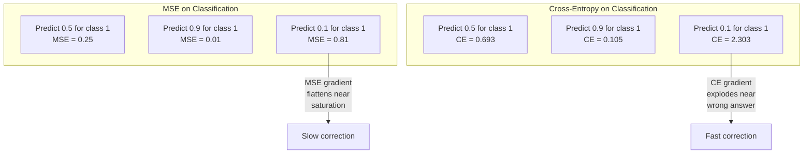
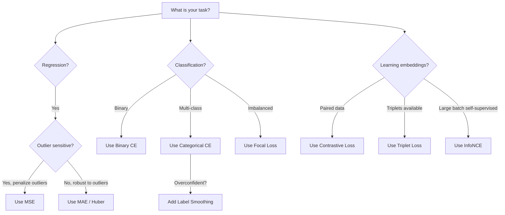
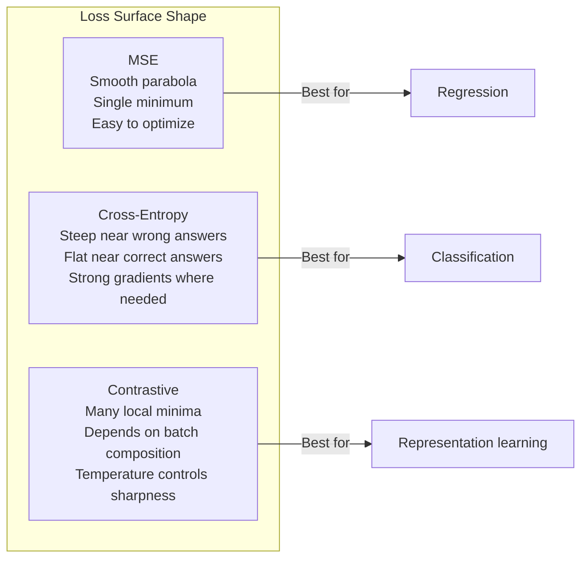

# Loss Function (Loss Functions)

> 你的網路做出預測。ground truth 卻說不是這樣。到底錯得多離譜？那個數字就是 loss。選錯 loss function，你的模型就會完全朝著錯誤的目標去最佳化。

**Type:** Build
**Languages:** Python
**Prerequisites:** Lesson 03.04 (Activation Functions)
**Time:** ~75 分鐘

## 學習目標 (Learning Objectives)

- 從零實作 MSE、binary cross-entropy、categorical cross-entropy 和 contrastive loss (InfoNCE)，以及它們的 gradient
- 透過示範「對所有東西都預測 0.5」的失效模式，說明 MSE 為什麼不適合分類
- 對 cross-entropy 套用 label smoothing，並說明它如何避免過度自信的預測
- 為迴歸、二元分類、多類別分類與 embedding 學習任務，選出正確的 loss function

## 問題 (The Problem)

在分類問題上最小化 MSE 的模型，會很有自信地對所有東西預測 0.5。它在最小化 loss。它也毫無用處。

loss function 是你的模型唯一真正在最佳化的東西。不是 accuracy。不是 F1 score。也不是你向主管報告的任何指標。optimizer 取 loss function 的 gradient，再調整 weights 讓那個數字變小。如果 loss function 沒有抓到你在乎的東西，模型就會找出在數學上最省力的方式來滿足它，而那種方式幾乎從來不是你想要的。

舉個具體的例子。你有一個二元分類任務。兩個類別，50/50 分布。你用 MSE 當 loss。模型對每一筆輸入都預測 0.5。平均 MSE 是 0.25，這是不真正學到任何東西時可能達到的最小值。模型完全沒有區辨能力，但技術上它已經把你的 loss function 最小化了。換成 cross-entropy，同一個模型就被迫把預測推向 0 或 1，因為 -log(0.5) = 0.693 是很糟的 loss，而 -log(0.99) = 0.01 則獎勵有信心且正確的預測。loss function 的選擇，決定了你得到的是一個真正在學習的模型，還是一個鑽指標漏洞的模型。

還有更糟的。在 self-supervised learning 中，你甚至沒有 label。Contrastive loss 完全定義了學習訊號：什麼算相似、什麼算不同，以及模型該用多大力道把它們推開。contrastive loss 設錯，你的 embedding 會塌縮成單一一點：每個輸入都對應到同一個向量。技術上 loss 為零。完全沒有價值。

## 核心概念 (The Concept)

### Mean Squared Error (MSE)

迴歸的預設選擇。計算預測與目標之間差的平方，再對所有樣本取平均。

```math
\text{MSE} = \frac{1}{n} \sum (y_{\text{pred}} - y_{\text{true}})^2
```

為什麼平方很重要：它以二次方的方式懲罰大的 error。誤差 2 的代價是誤差 1 的 4 倍。誤差 10 的代價是 100 倍。這讓 MSE 對 outlier 很敏感：單一一個錯得離譜的預測就會主宰 loss。

實際數字：如果你的模型預測房價，大部分房子差 $10,000，但有一棟豪宅差了 $200,000，MSE 會很積極地想修正那棟豪宅，可能反而傷害其他 99 棟房子的表現。

MSE 對預測值的 gradient 是：

```math
\frac{\partial \text{MSE}}{\partial y_{\text{pred}}} = \frac{2}{n} (y_{\text{pred}} - y_{\text{true}})
```

與 error 成線性關係。error 越大，gradient 越大。這對迴歸是優點（大的 error 需要大的修正），對分類卻是缺點（你想要以指數方式而非線性方式去懲罰有信心的錯誤答案）。

### Cross-Entropy Loss

分類用的 loss function。根源於 information theory：它衡量預測的機率分布與真實分布之間的差異。

**Binary Cross-Entropy (BCE)：**

```math
\text{BCE} = -\left(y \log(p) + (1 - y) \log(1 - p)\right)
```

其中 $y$ 是真實 label（0 或 1），$p$ 是預測的機率。

為什麼 $-\log(p)$ 有效：當真實 label 是 1 而你預測 $p = 0.99$，loss 是 $-\log(0.99) = 0.01$。當你預測 $p = 0.01$，loss 是 $-\log(0.01) = 4.6$。這 460 倍的差距就是 cross-entropy 有效的原因。它殘酷地懲罰有信心的錯誤預測，同時幾乎不懲罰有信心的正確預測。

gradient 說的也是同一件事：

```math
\frac{\partial \text{BCE}}{\partial p} = -\frac{y}{p} + \frac{1-y}{1-p}
```

當 $y = 1$ 且 $p$ 接近零時，gradient 是 $-1/p$，趨近負無限大。模型會收到巨大的訊號去修正它的錯誤。當 $p$ 接近 1 時，gradient 很小。已經正確了，沒什麼要修的。

**Categorical Cross-Entropy：**

用於 one-hot 編碼目標的多類別分類。

```math
\text{CCE} = -\sum_i y_i \log(p_i)
```

只有真實類別會對 loss 有貢獻（因為其他所有 $y_i$ 都是零）。如果有 10 個類別，而正確類別得到的機率是 0.1（隨機猜），loss 是 $-\log(0.1) = 2.3$。如果正確類別得到的機率是 0.9，loss 是 $-\log(0.9) = 0.105$。模型學會把機率質量集中在正確答案上。

### 為什麼 MSE 不適合分類 (Why MSE Fails for Classification)



當預測值接近 0 或 1 時（由於 sigmoid 飽和），MSE 的 gradient 會變平。Cross-entropy 的 gradient 補償了這一點：$-\log$ 抵消了 sigmoid 平坦的區域，在最需要的地方給出強烈的 gradient。

### Label Smoothing

標準的 one-hot label 是在說「這 100% 是類別 3，其他全是 0%。」這是個很強的主張。Label smoothing 把它軟化：

```math
\text{smooth\_label} = (1 - \alpha) \cdot \text{one\_hot} + \frac{\alpha}{\text{num\_classes}}
```

在 $\alpha = 0.1$ 且有 10 個類別時：目標不再是 [0, 0, 1, 0, ...]，而是 [0.01, 0.01, 0.91, 0.01, ...]。模型瞄準的是 0.91，而不是 1.0。

為什麼有效：模型想透過 softmax 輸出恰好 1.0，就得把 logits 推向無限大。這會造成過度自信、傷害泛化能力，並讓模型在分布偏移時很脆弱。Label smoothing 把目標上限壓在 0.9（當 $\alpha = 0.1$ 時），讓 logits 保持在合理範圍。GPT 和大多數現代模型都使用 label smoothing 或其等價做法。

### Contrastive Loss

沒有 label。沒有類別。只有成對的輸入，以及一個問題：這兩個是相似還是不同？

**SimCLR 風格的 contrastive loss (NT-Xent / InfoNCE)：**

拿一張圖片。為它製造兩個 augmented view（裁切、旋轉、顏色抖動）。這兩個就是「positive pair」：它們的 embedding 應該相似。batch 裡的其他每一張圖片則組成「negative pair」：它們的 embedding 應該不同。

```math
L = -\log \frac{\exp(\text{sim}(z_i, z_j) / \tau)}{\sum_k \exp(\text{sim}(z_i, z_k) / \tau)}
```

其中 $\text{sim}()$ 是 cosine similarity，$z_i$ 和 $z_j$ 是 positive pair，總和涵蓋所有 negative，而 $\tau$（temperature）控制分布有多尖銳。temperature 越低，negative 越難，分離也越積極。

實際數字：batch size 256 表示每個 positive pair 有 255 個 negative。temperature $\tau = 0.07$（SimCLR 預設值）。這個 loss 看起來就像對相似度做 softmax：它要 positive pair 的相似度在全部 256 個選項中是最高的。

**Triplet Loss：**

接收三個輸入：anchor、positive（同類別）、negative（不同類別）。

```math
L = \max\left(0, d(\text{anchor}, \text{positive}) - d(\text{anchor}, \text{negative}) + \text{margin}\right)
```

margin（通常是 0.2-1.0）強制 positive 與 negative 的距離之間要有最小差距。如果 negative 已經夠遠，loss 就是零：沒有 gradient，也不更新。這讓訓練很有效率，但需要仔細的 triplet mining（挑選靠近 anchor 的 hard negative）。

### Focal Loss

用於不平衡的資料集。標準的 cross-entropy 對所有分類正確的樣本一視同仁。Focal loss 會降低容易樣本的權重：

```math
\text{FL} = -\alpha (1 - p_t)^\gamma \log(p_t)
```

其中 $p_t$ 是真實類別的預測機率，$\gamma$ 控制聚焦的程度。$\gamma = 0$ 時，這就是標準的 cross-entropy。$\gamma = 2$（預設值）時：

- 容易的樣本（$p_t = 0.9$）：權重 $= (0.1)^2 = 0.01$。實質上被忽略。
- 困難的樣本（$p_t = 0.1$）：權重 $= (0.9)^2 = 0.81$。完整的 gradient 訊號。

Focal loss 是 Lin 等人為 object detection 提出的，在那裡 99% 的候選區域都是背景（容易的 negative）。沒有 focal loss，模型會淹沒在容易的背景樣本裡，永遠學不會偵測物體。有了它，模型就把容量集中在那些重要的、困難而模糊的案例上。

### Loss Function 決策樹 (Loss Function Decision Tree)



### Loss 地形 (Loss Landscape)



```figure
cross-entropy-loss
```

## 動手做 (Build It)

### 步驟 1：MSE 與它的 Gradient

```python
def mse(predictions, targets):
    n = len(predictions)
    total = 0.0
    for p, t in zip(predictions, targets):
        total += (p - t) ** 2
    return total / n

def mse_gradient(predictions, targets):
    n = len(predictions)
    grads = []
    for p, t in zip(predictions, targets):
        grads.append(2.0 * (p - t) / n)
    return grads
```

### 步驟 2：Binary Cross-Entropy

log(0) 的問題是真實存在的。如果模型對一個正樣本預測恰好為 0，$\log(0) = -\infty$。clipping 可以避免這個問題。

```python
import math

def binary_cross_entropy(predictions, targets, eps=1e-15):
    n = len(predictions)
    total = 0.0
    for p, t in zip(predictions, targets):
        p_clipped = max(eps, min(1 - eps, p))
        total += -(t * math.log(p_clipped) + (1 - t) * math.log(1 - p_clipped))
    return total / n

def bce_gradient(predictions, targets, eps=1e-15):
    grads = []
    for p, t in zip(predictions, targets):
        p_clipped = max(eps, min(1 - eps, p))
        grads.append(-(t / p_clipped) + (1 - t) / (1 - p_clipped))
    return grads
```

### 步驟 3：搭配 Softmax 的 Categorical Cross-Entropy

Softmax 把原始 logits 轉成機率。接著我們針對 one-hot 目標計算 cross-entropy。

```python
def softmax(logits):
    max_val = max(logits)
    exps = [math.exp(x - max_val) for x in logits]
    total = sum(exps)
    return [e / total for e in exps]

def categorical_cross_entropy(logits, target_index, eps=1e-15):
    probs = softmax(logits)
    p = max(eps, probs[target_index])
    return -math.log(p)

def cce_gradient(logits, target_index):
    probs = softmax(logits)
    grads = list(probs)
    grads[target_index] -= 1.0
    return grads
```

softmax + cross-entropy 的 gradient 會簡化得非常漂亮：對真實類別就是（預測機率 - 1），對所有其他類別就是（預測機率）。這個優雅的簡化不是巧合：這正是 softmax 和 cross-entropy 會被配成一對的原因。

### 步驟 4：Label Smoothing

```python
def label_smoothed_cce(logits, target_index, num_classes, alpha=0.1, eps=1e-15):
    probs = softmax(logits)
    loss = 0.0
    for i in range(num_classes):
        if i == target_index:
            smooth_target = 1.0 - alpha + alpha / num_classes
        else:
            smooth_target = alpha / num_classes
        p = max(eps, probs[i])
        loss += -smooth_target * math.log(p)
    return loss
```

### 步驟 5：Contrastive Loss（簡化版 InfoNCE）

```python
def cosine_similarity(a, b):
    dot = sum(x * y for x, y in zip(a, b))
    norm_a = math.sqrt(sum(x * x for x in a))
    norm_b = math.sqrt(sum(x * x for x in b))
    if norm_a < 1e-10 or norm_b < 1e-10:
        return 0.0
    return dot / (norm_a * norm_b)

def contrastive_loss(anchor, positive, negatives, temperature=0.07):
    sim_pos = cosine_similarity(anchor, positive) / temperature
    sim_negs = [cosine_similarity(anchor, neg) / temperature for neg in negatives]

    max_sim = max(sim_pos, max(sim_negs)) if sim_negs else sim_pos
    exp_pos = math.exp(sim_pos - max_sim)
    exp_negs = [math.exp(s - max_sim) for s in sim_negs]
    total_exp = exp_pos + sum(exp_negs)

    return -math.log(max(1e-15, exp_pos / total_exp))
```

### 步驟 6：在分類上比較 MSE 與 Cross-Entropy (MSE vs Cross-Entropy on Classification)

用兩種 loss function 訓練第 04 課的同一個網路（圓形資料集）。看看 cross-entropy 收斂得更快。

```python
import random

def sigmoid(x):
    x = max(-500, min(500, x))
    return 1.0 / (1.0 + math.exp(-x))

def make_circle_data(n=200, seed=42):
    random.seed(seed)
    data = []
    for _ in range(n):
        x = random.uniform(-2, 2)
        y = random.uniform(-2, 2)
        label = 1.0 if x * x + y * y < 1.5 else 0.0
        data.append(([x, y], label))
    return data


class LossComparisonNetwork:
    def __init__(self, loss_type="bce", hidden_size=8, lr=0.1):
        random.seed(0)
        self.loss_type = loss_type
        self.lr = lr
        self.hidden_size = hidden_size

        self.w1 = [[random.gauss(0, 0.5) for _ in range(2)] for _ in range(hidden_size)]
        self.b1 = [0.0] * hidden_size
        self.w2 = [random.gauss(0, 0.5) for _ in range(hidden_size)]
        self.b2 = 0.0

    def forward(self, x):
        self.x = x
        self.z1 = []
        self.h = []
        for i in range(self.hidden_size):
            z = self.w1[i][0] * x[0] + self.w1[i][1] * x[1] + self.b1[i]
            self.z1.append(z)
            self.h.append(max(0.0, z))

        self.z2 = sum(self.w2[i] * self.h[i] for i in range(self.hidden_size)) + self.b2
        self.out = sigmoid(self.z2)
        return self.out

    def backward(self, target):
        if self.loss_type == "mse":
            d_loss = 2.0 * (self.out - target)
        else:
            eps = 1e-15
            p = max(eps, min(1 - eps, self.out))
            d_loss = -(target / p) + (1 - target) / (1 - p)

        d_sigmoid = self.out * (1 - self.out)
        d_out = d_loss * d_sigmoid

        for i in range(self.hidden_size):
            d_relu = 1.0 if self.z1[i] > 0 else 0.0
            d_h = d_out * self.w2[i] * d_relu
            self.w2[i] -= self.lr * d_out * self.h[i]
            for j in range(2):
                self.w1[i][j] -= self.lr * d_h * self.x[j]
            self.b1[i] -= self.lr * d_h
        self.b2 -= self.lr * d_out

    def compute_loss(self, pred, target):
        if self.loss_type == "mse":
            return (pred - target) ** 2
        else:
            eps = 1e-15
            p = max(eps, min(1 - eps, pred))
            return -(target * math.log(p) + (1 - target) * math.log(1 - p))

    def train(self, data, epochs=200):
        losses = []
        for epoch in range(epochs):
            total_loss = 0.0
            correct = 0
            for x, y in data:
                pred = self.forward(x)
                self.backward(y)
                total_loss += self.compute_loss(pred, y)
                if (pred >= 0.5) == (y >= 0.5):
                    correct += 1
            avg_loss = total_loss / len(data)
            accuracy = correct / len(data) * 100
            losses.append((avg_loss, accuracy))
            if epoch % 50 == 0 or epoch == epochs - 1:
                print(f"    Epoch {epoch:3d}: loss={avg_loss:.4f}, accuracy={accuracy:.1f}%")
        return losses
```

## 實際使用 (Use It)

PyTorch 提供所有標準的 loss function，並內建數值穩定性：

```python
import torch
import torch.nn as nn
import torch.nn.functional as F

predictions = torch.tensor([0.9, 0.1, 0.7], requires_grad=True)
targets = torch.tensor([1.0, 0.0, 1.0])

mse_loss = F.mse_loss(predictions, targets)
bce_loss = F.binary_cross_entropy(predictions, targets)

logits = torch.randn(4, 10)
labels = torch.tensor([3, 7, 1, 9])
ce_loss = F.cross_entropy(logits, labels)
ce_smooth = F.cross_entropy(logits, labels, label_smoothing=0.1)
```

請用 `F.cross_entropy`（而不是 `F.nll_loss` 加上手動 softmax）。它把 log-softmax 和 negative log-likelihood 結合成一個數值穩定的運算。先單獨套用 softmax 再取 log，穩定性比較差：在大的指數相減時你會損失精度。

對於 contrastive learning，大多數團隊使用自訂實作，或像 `lightly`、`pytorch-metric-learning` 這樣的函式庫。核心迴圈永遠相同：計算成對相似度、對 positive 和 negative 建立 softmax、做 backpropagation。

## 交付 (Ship It)

這堂課產出：
- `outputs/prompt-loss-function-selector.md` -- 一個可重複使用的 prompt，用來選擇正確的 loss function
- `outputs/prompt-loss-debugger.md` -- 當你的 loss 曲線看起來不對勁時，用來診斷的 prompt

## 練習 (Exercises)

1. 實作 Huber loss（smooth L1 loss），它對小的 error 是 MSE，對大的 error 是 MAE。訓練一個預測 $y = \sin(x)$ 的迴歸網路，在 5% 的訓練目標被加上隨機雜訊（outlier）的情況下，比較用 MSE 與 Huber 訓練的結果。比較最終的測試誤差。

2. 把 focal loss 加到二元分類的訓練迴圈裡。建立一個不平衡的資料集（90% 類別 0，10% 類別 1）。比較標準 BCE 與 focal loss（$\gamma = 2$）在 200 個 epoch 後對少數類別的 recall。

3. 實作帶有 semi-hard negative mining 的 triplet loss。為 5 個類別產生 2D embedding 資料。對每個 anchor，找出仍比 positive 更遠的最難 negative（semi-hard）。與隨機選取 triplet 比較收斂情況。

4. 執行 MSE 與 cross-entropy 的比較，但在訓練期間追蹤每一層的 gradient 大小。畫出每個 epoch 的平均 gradient norm。驗證在模型最不確定的早期 epoch，cross-entropy 會產生較大的 gradient。

5. 實作 KL divergence loss，並驗證當真實分布是 one-hot 時，最小化 $\mathrm{KL}(\text{true} \Vert \text{predicted})$ 得到的 gradient 與 cross-entropy 相同。接著試試 soft target（像 knowledge distillation 那樣），讓「真實」分布來自 teacher 模型的 softmax 輸出。

## 關鍵術語 (Key Terms)

| Term | 一般說法 | 實際意義 |
|------|----------------|----------------------|
| Loss function | 「模型錯得多離譜」 | 一個可微分的函數，把預測與目標對應成一個純量，讓 optimizer 去最小化 |
| MSE | 「平均平方誤差」 | 預測與目標之差的平方的平均值；以二次方的方式懲罰大的 error |
| Cross-entropy | 「分類用的 loss」 | 用 $-\log(p)$ 衡量預測機率分布與真實分布之間的差異 |
| Binary cross-entropy | 「BCE」 | 兩個類別的 cross-entropy：$-(y \log(p) + (1-y) \log(1-p))$ |
| Label smoothing | 「軟化目標」 | 把硬性的 0/1 目標換成軟值（例如 0.1/0.9），以避免過度自信並改善泛化 |
| Contrastive loss | 「拉近、推遠」 | 一種透過讓相似的配對在 embedding 空間中靠近、不相似的配對遠離，來學習表示的 loss |
| InfoNCE | 「CLIP/SimCLR 用的 loss」 | 對相似度分數做正規化、帶 temperature 縮放的 cross-entropy；把 contrastive learning 視為分類問題 |
| Focal loss | 「處理不平衡資料的方法」 | 以 $(1-p_t)^\gamma$ 加權的 cross-entropy，降低容易樣本的權重，專注在困難樣本上 |
| Triplet loss | 「Anchor-positive-negative」 | 在 embedding 空間中，把 anchor 推到比 negative 更接近 positive，且至少差一個 margin |
| Temperature | 「尖銳度旋鈕」 | 作用在 logits/相似度上的純量除數，控制所得分布有多尖；越低越尖 |

## 延伸閱讀 (Further Reading)

- Lin et al., "Focal Loss for Dense Object Detection" (2017) -- 為處理 object detection 中極端的類別不平衡而提出 focal loss（RetinaNet）
- Chen et al., "A Simple Framework for Contrastive Learning of Visual Representations" (SimCLR, 2020) -- 以 NT-Xent loss 定義了現代 contrastive learning 的流程
- Szegedy et al., "Rethinking the Inception Architecture" (2016) -- 提出 label smoothing 作為正則化技術，現在已是大多數大型模型的標準做法
- Hinton et al., "Distilling the Knowledge in a Neural Network" (2015) -- 使用 soft target 與 KL divergence 的 knowledge distillation，是模型壓縮的基礎
