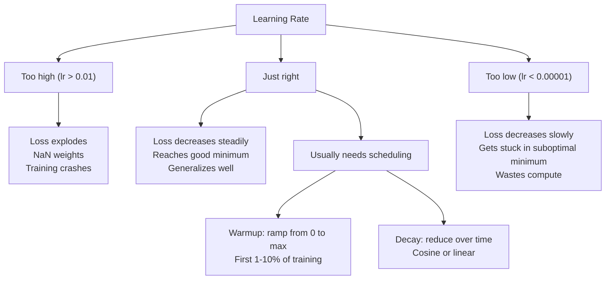
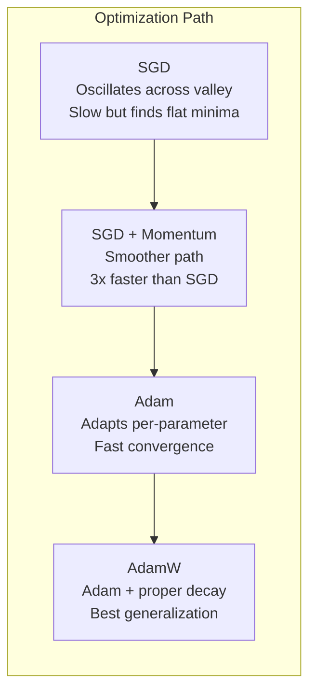
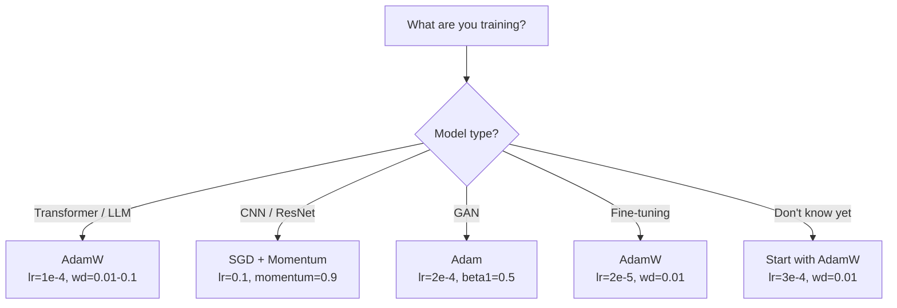

# Optimizer (Optimizers)

> Gradient descent 告訴你該往哪個方向走，但沒說要走多遠、多快。SGD 是指南針。Adam 是附帶即時路況的 GPS。

**Type:** Build
**Languages:** Python
**Prerequisites:** Lesson 03.05 (Loss Functions)
**Time:** ~75 分鐘

## 學習目標 (Learning Objectives)

- 用 Python 從零實作 SGD、帶 momentum 的 SGD、Adam 和 AdamW optimizer
- 說明 Adam 的 bias correction 如何補償訓練初期以零初始化的 moment 估計值
- 示範為什麼在同一個任務上，AdamW 的泛化能力比使用 L2 regularization 的 Adam 更好
- 為 transformer、CNN、GAN 和 fine-tuning 選擇合適的 optimizer 與預設 hyperparameter

## 問題 (The Problem)

你已經算出 gradient 了。你知道 weight #4,721 應該減少 0.003 才能降低 loss。但 0.003 是什麼單位？用什麼來縮放？而且第 1 步和第 1,000 步，應該移動一樣多嗎？

單純的 gradient descent 在每一步，對每一個參數都套用同一個 learning rate：$w = w - \text{lr} \cdot \text{gradient}$。這會造成三個問題，讓實務上訓練神經網路相當痛苦。

第一，震盪。loss 地形很少是平滑的碗狀。它更像一條又長又窄的山谷。gradient 指向橫越山谷的方向（陡的方向），而不是沿著山谷的方向（緩的方向）。Gradient descent 在窄的那個維度上來回彈跳，卻在有用的那個維度上只前進一點點。你應該看過這種情況：loss 快速下降，然後進入停滯期，不是因為模型收斂了，而是因為它在震盪。

第二，所有參數共用一個 learning rate 是錯的。有些 weight 需要大幅更新（它們還在早期、欠擬合的階段）。其他的則需要微小更新（它們已經接近最佳值）。對前者有效的 learning rate 會毀掉後者，反之亦然。

第三，saddle point。在高維度下，loss 地形有大片平坦區域，gradient 接近零。單純的 SGD 以 gradient 的速度爬過這些區域，也就是實質上為零。模型看起來卡住了。其實它沒有卡住：它在一片平坦區域裡，另一側還有可以下降的路。但 SGD 沒有任何機制可以推它穿過去。

Adam 解決了這三個問題。它為每個參數維護兩個移動平均：平均 gradient（momentum，處理震盪）和平均平方 gradient（adaptive rate，處理不同的尺度）。再搭配前幾步的 bias correction，它給你一個單一的 optimizer，用預設 hyperparameter 就能處理 80% 的問題。這堂課從零打造它，讓你確切了解它在另外那 20% 什麼時候、為什麼會失敗。

## 核心概念 (The Concept)

### Stochastic Gradient Descent (SGD)

最簡單的 optimizer。在一個 mini-batch 上計算 gradient，然後朝相反方向走一步。

```math
w = w - \text{lr} \cdot \text{gradient}
```

「stochastic」的意思是，你用資料的隨機子集（mini-batch）來估計 gradient，而不是用整個資料集。這種雜訊其實有用：它能幫助跳出尖銳的 local minimum。但雜訊也會造成震盪。

Learning rate 是唯一的旋鈕。太高：loss 發散。太低：訓練永遠跑不完。最佳值取決於架構、資料、batch size，以及目前訓練所處的階段。對現代網路使用單純 SGD，典型值在 0.01 到 0.1 之間。但即使在同一次訓練中，理想的 learning rate 也會變。

### Momentum

球滾下山的比喻已經被用到爛，但很準確。你不是只照 gradient 走一步，而是維護一個累積過去 gradient 的速度。

```math
\begin{aligned}
m_t &= \beta \, m_{t-1} + \text{gradient} \\
w &= w - \text{lr} \cdot m_t
\end{aligned}
```

Beta（通常是 0.9）控制要保留多少歷史。$\beta = 0.9$ 時，momentum 大致是最近 10 個 gradient 的平均（$1 / (1 - 0.9) = 10$）。

為什麼這能修正震盪：指向同一方向的 gradient 會累積。方向反轉的 gradient 會互相抵消。在那條窄谷裡，「橫越」的分量每一步都會反號，因此被抑制。「沿著」的分量保持一致，因此被放大。結果是在有用的方向上平順地加速。

實際數字：在條件很差的 loss 地形上，單用 SGD 可能要 10,000 步。帶 momentum 的 SGD（$\beta = 0.9$）在同一個問題上通常要 3,000-5,000 步。這個加速並不是小小的改善。

### RMSProp

第一個真正有效的 per-parameter adaptive learning rate 方法。由 Hinton 在 Coursera 課程中提出（從未正式發表）。

```math
\begin{aligned}
s_t &= \beta \, s_{t-1} + (1 - \beta) \cdot \text{gradient}^2 \\
w &= w - \text{lr} \cdot \frac{\text{gradient}}{\sqrt{s_t} + \epsilon}
\end{aligned}
```

$s_t$ 追蹤平方 gradient 的移動平均。gradient 一直很大的參數，會被除以一個大數（有效 learning rate 較小）。gradient 很小的參數，會被除以一個小數（有效 learning rate 較大）。

這解決了「所有參數共用一個 learning rate」的問題。一個一直在拿到大幅更新的 weight，大概已經接近目標了，該讓它慢下來。一個一直只拿到微小更新的 weight，可能訓練不足，該讓它加速。

Epsilon（通常是 1e-8）用來避免在參數尚未被更新時除以零。

### Adam：Momentum + RMSProp

Adam 結合了這兩個想法。它為每個參數維護兩個 exponential moving average：

```math
\begin{aligned}
m_t &= \beta_1 m_{t-1} + (1 - \beta_1) \cdot \text{gradient} && \text{(first moment: mean)} \\
v_t &= \beta_2 v_{t-1} + (1 - \beta_2) \cdot \text{gradient}^2 && \text{(second moment: variance)}
\end{aligned}
```

**Bias correction** 是大多數說明都略過的關鍵細節。在第 1 步，$m_1 = (1 - \beta_1) \cdot \text{gradient}$。$\beta_1 = 0.9$ 時，那就是 $0.1 \cdot \text{gradient}$，小了十倍。移動平均還沒暖機完成。Bias correction 補償了這一點：

```math
\begin{aligned}
\hat{m} &= \frac{m_t}{1 - \beta_1^t} \\
\hat{v} &= \frac{v_t}{1 - \beta_2^t}
\end{aligned}
```

在第 1 步、$\beta_1 = 0.9$ 時：$\hat{m} = m_1 / (1 - 0.9) = m_1 / 0.1 =$ 真正的 gradient。在第 100 步：$(1 - 0.9^{100})$ 大約是 1.0，所以修正就消失了。Bias correction 在前 ~10 步很重要，過了 ~50 步就無關緊要了。

更新式：

```math
w = w - \text{lr} \cdot \frac{\hat{m}}{\sqrt{\hat{v}} + \epsilon}
```

Adam 預設值：$\text{lr} = 0.001$、$\beta_1 = 0.9$、$\beta_2 = 0.999$、$\epsilon = 10^{-8}$。這些預設值適用於 80% 的問題。不適用時，先改 lr。再改 $\beta_2$。幾乎不要改 $\beta_1$ 或 $\epsilon$。

### AdamW：把 Weight Decay 做對 (AdamW: Weight Decay Done Right)

L2 regularization 會在 loss 上加 $\lambda w^2$。在單純的 SGD 中，這等價於 weight decay（每一步從 weight 中減去 $\lambda w$）。在 Adam 裡，這個等價性就破局了。

Loshchilov 和 Hutter 的洞見是：當你把 L2 加到 loss 上，再讓 Adam 處理 gradient 時，adaptive learning rate 也會縮放正則化項。gradient 變異大的參數，得到的正則化較少。變異小的參數，得到的正則化較多。這不是你想要的：你要的是不管 gradient 統計量如何，都一致的正則化。

AdamW 的修正方法是：在 Adam 更新之後，直接對 weights 套用 weight decay：

```math
w = w - \text{lr} \cdot \frac{\hat{m}}{\sqrt{\hat{v}} + \epsilon} - \text{lr} \cdot \lambda w
```

weight decay 這一項（$\text{lr} \cdot \lambda w$）不會被 Adam 的 adaptive 因子縮放。每個參數都得到同樣比例的收縮。

這看起來是個小細節。其實不是。在幾乎所有任務上，AdamW 都比 Adam + L2 regularization 收斂到更好的解。它是 PyTorch 中訓練 transformer、diffusion model 和大多數現代架構的預設 optimizer。BERT、GPT、LLaMA、Stable Diffusion 全都是用 AdamW 訓練的。

### Learning Rate：最重要的 Hyperparameter (Learning Rate: The Most Important Hyperparameter)



如果你只調一個 hyperparameter，就調 learning rate。learning rate 變動 10 倍，比你會做的任何架構決策都更重要。常見的預設值：

- SGD：lr = 0.01 到 0.1
- Adam/AdamW：lr = 1e-4 到 3e-4
- Fine-tuning 預訓練模型：lr = 1e-5 到 5e-5
- Learning rate warmup：在前 1-10% 的步驟內線性上升

### Optimizer 比較 (Optimizer Comparison)



### 各個 Optimizer 什麼時候勝出 (When Each Optimizer Wins)



```figure
optimizer-trajectory
```

## 動手做 (Build It)

### 步驟 1：單純的 SGD (Vanilla SGD)

```python
class SGD:
    def __init__(self, lr=0.01):
        self.lr = lr

    def step(self, params, grads):
        for i in range(len(params)):
            params[i] -= self.lr * grads[i]
```

### 步驟 2：帶 Momentum 的 SGD

```python
class SGDMomentum:
    def __init__(self, lr=0.01, beta=0.9):
        self.lr = lr
        self.beta = beta
        self.velocities = None

    def step(self, params, grads):
        if self.velocities is None:
            self.velocities = [0.0] * len(params)
        for i in range(len(params)):
            self.velocities[i] = self.beta * self.velocities[i] + grads[i]
            params[i] -= self.lr * self.velocities[i]
```

### 步驟 3：Adam

```python
import math

class Adam:
    def __init__(self, lr=0.001, beta1=0.9, beta2=0.999, epsilon=1e-8):
        self.lr = lr
        self.beta1 = beta1
        self.beta2 = beta2
        self.epsilon = epsilon
        self.m = None
        self.v = None
        self.t = 0

    def step(self, params, grads):
        if self.m is None:
            self.m = [0.0] * len(params)
            self.v = [0.0] * len(params)

        self.t += 1

        for i in range(len(params)):
            self.m[i] = self.beta1 * self.m[i] + (1 - self.beta1) * grads[i]
            self.v[i] = self.beta2 * self.v[i] + (1 - self.beta2) * grads[i] ** 2

            m_hat = self.m[i] / (1 - self.beta1 ** self.t)
            v_hat = self.v[i] / (1 - self.beta2 ** self.t)

            params[i] -= self.lr * m_hat / (math.sqrt(v_hat) + self.epsilon)
```

### 步驟 4：AdamW

```python
class AdamW:
    def __init__(self, lr=0.001, beta1=0.9, beta2=0.999, epsilon=1e-8, weight_decay=0.01):
        self.lr = lr
        self.beta1 = beta1
        self.beta2 = beta2
        self.epsilon = epsilon
        self.weight_decay = weight_decay
        self.m = None
        self.v = None
        self.t = 0

    def step(self, params, grads):
        if self.m is None:
            self.m = [0.0] * len(params)
            self.v = [0.0] * len(params)

        self.t += 1

        for i in range(len(params)):
            self.m[i] = self.beta1 * self.m[i] + (1 - self.beta1) * grads[i]
            self.v[i] = self.beta2 * self.v[i] + (1 - self.beta2) * grads[i] ** 2

            m_hat = self.m[i] / (1 - self.beta1 ** self.t)
            v_hat = self.v[i] / (1 - self.beta2 ** self.t)

            params[i] -= self.lr * m_hat / (math.sqrt(v_hat) + self.epsilon)
            params[i] -= self.lr * self.weight_decay * params[i]
```

### 步驟 5：訓練比較 (Training Comparison)

用全部四個 optimizer，在第 05 課的圓形資料集上訓練同一個雙層網路。比較收斂情況。

```python
import random

def sigmoid(x):
    x = max(-500, min(500, x))
    return 1.0 / (1.0 + math.exp(-x))

def make_circle_data(n=200, seed=42):
    random.seed(seed)
    data = []
    for _ in range(n):
        x = random.uniform(-2, 2)
        y = random.uniform(-2, 2)
        label = 1.0 if x * x + y * y < 1.5 else 0.0
        data.append(([x, y], label))
    return data


class OptimizerTestNetwork:
    def __init__(self, optimizer, hidden_size=8):
        random.seed(0)
        self.hidden_size = hidden_size
        self.optimizer = optimizer

        self.w1 = [[random.gauss(0, 0.5) for _ in range(2)] for _ in range(hidden_size)]
        self.b1 = [0.0] * hidden_size
        self.w2 = [random.gauss(0, 0.5) for _ in range(hidden_size)]
        self.b2 = 0.0

    def get_params(self):
        params = []
        for row in self.w1:
            params.extend(row)
        params.extend(self.b1)
        params.extend(self.w2)
        params.append(self.b2)
        return params

    def set_params(self, params):
        idx = 0
        for i in range(self.hidden_size):
            for j in range(2):
                self.w1[i][j] = params[idx]
                idx += 1
        for i in range(self.hidden_size):
            self.b1[i] = params[idx]
            idx += 1
        for i in range(self.hidden_size):
            self.w2[i] = params[idx]
            idx += 1
        self.b2 = params[idx]

    def forward(self, x):
        self.x = x
        self.z1 = []
        self.h = []
        for i in range(self.hidden_size):
            z = self.w1[i][0] * x[0] + self.w1[i][1] * x[1] + self.b1[i]
            self.z1.append(z)
            self.h.append(max(0.0, z))

        self.z2 = sum(self.w2[i] * self.h[i] for i in range(self.hidden_size)) + self.b2
        self.out = sigmoid(self.z2)
        return self.out

    def compute_grads(self, target):
        eps = 1e-15
        p = max(eps, min(1 - eps, self.out))
        d_loss = -(target / p) + (1 - target) / (1 - p)
        d_sigmoid = self.out * (1 - self.out)
        d_out = d_loss * d_sigmoid

        grads = [0.0] * (self.hidden_size * 2 + self.hidden_size + self.hidden_size + 1)
        idx = 0
        for i in range(self.hidden_size):
            d_relu = 1.0 if self.z1[i] > 0 else 0.0
            d_h = d_out * self.w2[i] * d_relu
            grads[idx] = d_h * self.x[0]
            grads[idx + 1] = d_h * self.x[1]
            idx += 2

        for i in range(self.hidden_size):
            d_relu = 1.0 if self.z1[i] > 0 else 0.0
            grads[idx] = d_out * self.w2[i] * d_relu
            idx += 1

        for i in range(self.hidden_size):
            grads[idx] = d_out * self.h[i]
            idx += 1

        grads[idx] = d_out
        return grads

    def train(self, data, epochs=300):
        losses = []
        for epoch in range(epochs):
            total_loss = 0.0
            correct = 0
            for x, y in data:
                pred = self.forward(x)
                grads = self.compute_grads(y)
                params = self.get_params()
                self.optimizer.step(params, grads)
                self.set_params(params)

                eps = 1e-15
                p = max(eps, min(1 - eps, pred))
                total_loss += -(y * math.log(p) + (1 - y) * math.log(1 - p))
                if (pred >= 0.5) == (y >= 0.5):
                    correct += 1
            avg_loss = total_loss / len(data)
            accuracy = correct / len(data) * 100
            losses.append((avg_loss, accuracy))
            if epoch % 75 == 0 or epoch == epochs - 1:
                print(f"    Epoch {epoch:3d}: loss={avg_loss:.4f}, accuracy={accuracy:.1f}%")
        return losses
```

## 實際使用 (Use It)

PyTorch 的 optimizer 會處理 parameter group、gradient clipping 和 learning rate scheduling：

```python
import torch
import torch.optim as optim

model = torch.nn.Sequential(
    torch.nn.Linear(784, 256),
    torch.nn.ReLU(),
    torch.nn.Linear(256, 10),
)

optimizer = optim.AdamW(model.parameters(), lr=3e-4, weight_decay=0.01)

scheduler = optim.lr_scheduler.CosineAnnealingLR(optimizer, T_max=100)

for epoch in range(100):
    optimizer.zero_grad()
    output = model(torch.randn(32, 784))
    loss = torch.nn.functional.cross_entropy(output, torch.randint(0, 10, (32,)))
    loss.backward()
    torch.nn.utils.clip_grad_norm_(model.parameters(), max_norm=1.0)
    optimizer.step()
    scheduler.step()
```

固定的模式永遠是：zero_grad、forward、loss、backward、（clip）、step、（schedule）。把這個順序背起來。順序錯了（例如在 optimizer.step() 之前先呼叫 scheduler.step()），是很常見的隱微 bug 來源。

對於 CNN，許多實務工作者仍偏好 SGD + momentum（lr=0.1、momentum=0.9、weight_decay=1e-4）搭配 step 或 cosine schedule。SGD 會找到更平坦的 minimum，通常泛化得更好。對於 transformer 和 LLM，帶 warmup + cosine decay 的 AdamW 是通用的預設。沒有量測過的理由，不要和共識對著幹。

## 交付 (Ship It)

這堂課產出：
- `outputs/prompt-optimizer-selector.md` -- 一個決策用的 prompt，為任何架構選出正確的 optimizer 與 learning rate

## 練習 (Exercises)

1. 實作 Nesterov momentum，也就是在「前瞻」位置（$w - \text{lr} \cdot \beta v$）而不是目前位置計算 gradient。在圓形資料集上，與標準 momentum 比較收斂情況。

2. 實作 learning rate warmup schedule：在前 10% 的訓練步驟內從 0 線性上升到 max_lr，然後 cosine decay 到 0。比較使用 warmup 與不使用 warmup 的 Adam。量測在圓形資料集上達到 90% accuracy 需要多少個 epoch。

3. 在 Adam 訓練期間，追蹤每個參數的有效 learning rate。有效速率是 $\text{lr} \cdot \hat{m} / (\sqrt{\hat{v}} + \epsilon)$。畫出 10、50 和 200 步之後有效速率的分布。所有參數都以相同的速度在更新嗎？

4. 實作 gradient clipping（依全域 norm 裁剪）。把最大 gradient norm 設為 1.0。使用很高的 learning rate（Adam 用 lr=0.01）分別在有和沒有 clipping 的情況下訓練。在 10 個隨機 seed 中，數數有 clipping 與無 clipping 各有幾次執行發散（loss 變成 NaN）。

5. 在一個 weight 很大的網路上比較 Adam 與 AdamW。把所有 weight 初始化為 [-5, 5] 的隨機值（遠大於正常值）。以 weight_decay=0.1 訓練 200 個 epoch。畫出兩個 optimizer 在訓練過程中 weight 的 L2 norm。AdamW 應該顯示出更快的 weight 收縮。

## 關鍵術語 (Key Terms)

| Term | 一般說法 | 實際意義 |
|------|----------------|----------------------|
| Learning rate | 「步長」 | gradient 更新的純量乘數；訓練中影響最大的單一 hyperparameter |
| SGD | 「基本的 gradient descent」 | Stochastic gradient descent：用在 mini-batch 上算出的 $\text{lr} \cdot \text{gradient}$ 來減去 weights 以更新 |
| Momentum | 「滾球的比喻」 | 過去 gradient 的 exponential moving average；抑制震盪並加速一致的方向 |
| RMSProp | 「adaptive learning rate」 | 把每個參數的 gradient 除以其近期 gradient 的移動 RMS；讓各參數的 learning rate 趨於一致 |
| Adam | 「預設的 optimizer」 | 結合 momentum（first moment）與 RMSProp（second moment），並對初始步驟做 bias correction |
| AdamW | 「做對的 Adam」 | 帶有 decoupled weight decay 的 Adam；把正則化直接施加在 weights 上，而不是透過 gradient |
| Bias correction | 「移動平均的暖機」 | 除以 $(1 - \beta^t)$，以補償 Adam 的 moment 估計值以零初始化的偏差 |
| Weight decay | 「縮小 weights」 | 每一步減去 weight 值的一部分；一種懲罰大 weight 的正則化手段 |
| Learning rate schedule | 「讓 lr 隨時間改變」 | 在訓練期間調整 learning rate 的函數；warmup + cosine decay 是現代的預設 |
| Gradient clipping | 「限制 gradient norm」 | 當 gradient 向量的 norm 超過門檻時將其縮小；防止 gradient 更新爆炸 |

## 延伸閱讀 (Further Reading)

- Kingma & Ba, "Adam: A Method for Stochastic Optimization" (2014) -- Adam 的原始論文，含收斂分析與 bias correction 的推導
- Loshchilov & Hutter, "Decoupled Weight Decay Regularization" (2017) -- 證明在 Adam 中 L2 regularization 與 weight decay 並不等價，並提出 AdamW
- Smith, "Cyclical Learning Rates for Training Neural Networks" (2017) -- 提出 LR range test 與 cyclical schedule，免去調整固定 learning rate 的需要
- Ruder, "An Overview of Gradient Descent Optimization Algorithms" (2016) -- 涵蓋所有 optimizer 變體的最佳單篇綜述，有清楚的比較與直覺說明
