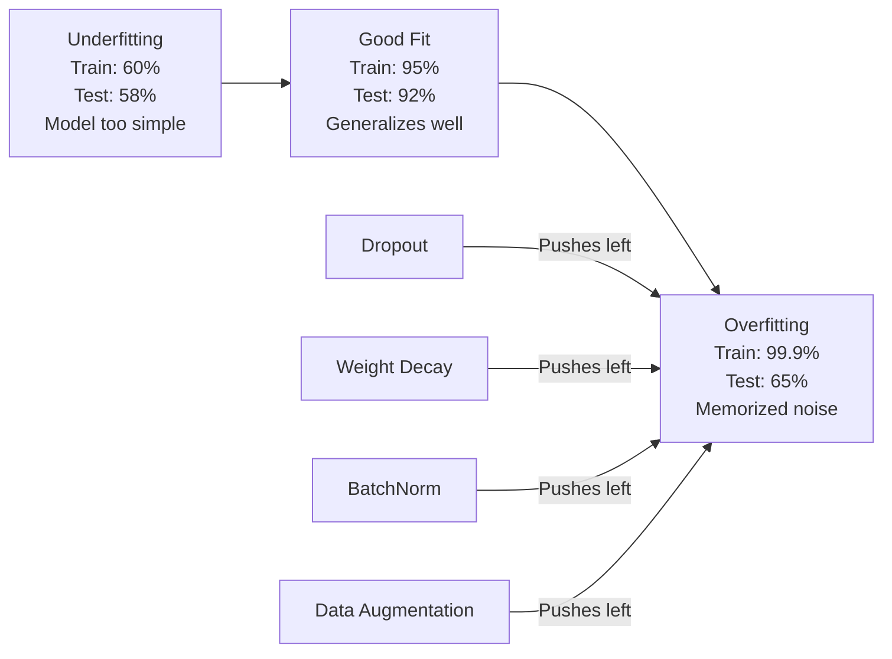
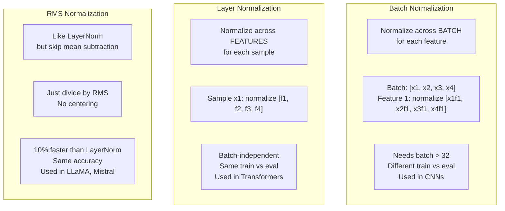
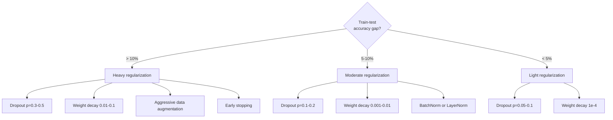

# Regularization (Regularization)

> 你的模型在訓練資料上拿到 99%，在測試資料上只有 60%。它是在背答案，而不是在學習。Regularization 就是你對複雜度課的稅，用來逼模型做到泛化。

**Type:** Build
**Languages:** Python
**Prerequisites:** Lesson 03.06 (Optimizers)
**Time:** ~75 分鐘

## 學習目標 (Learning Objectives)

- 從零實作帶 inverted scaling 的 dropout、L2 weight decay、batch normalization、layer normalization 和 RMSNorm
- 量測訓練與測試的 accuracy 差距，並透過 regularization 實驗診斷 overfitting
- 說明 transformer 為什麼使用 LayerNorm 而不是 BatchNorm，以及現代 LLM 為什麼偏好 RMSNorm
- 依照 overfitting 的嚴重程度，套用正確的 regularization 技術組合

## 問題 (The Problem)

只要參數夠多，神經網路可以背下任何資料集。這不是假設：Zhang 等人 (2017) 用標準網路在帶有隨機 label 的 ImageNet 上訓練，證明了這件事。這些網路在完全隨機指派的 label 上，達到接近零的訓練 loss。它們背下了一百萬組沒有任何規律可學的隨機輸入輸出配對。訓練 loss 完美。測試 accuracy 為零。

這就是 overfitting 問題，而且模型越大越嚴重。GPT-3 有 1750 億個參數。訓練集大約有 5000 億個 token。有這麼多參數，模型的容量足以逐字背下訓練資料中的大段內容。沒有 regularization，它就只會把訓練範例吐出來，而不是學會可泛化的規律。

訓練表現與測試表現之間的差距，就是 overfitting gap。這堂課的每一種技術，都從不同角度攻擊這個差距。Dropout 逼網路不要依賴任何單一 neuron。Weight decay 避免任何單一 weight 長得太大。Batch normalization 讓 loss 地形變平滑，讓 optimizer 找到更平坦、更能泛化的 minimum。Layer normalization 做同樣的事，但在 batch normalization 失效的地方（小 batch、變長序列）依然有效。RMSNorm 則省掉計算平均值，快了 10%。每種技術都很簡單。合在一起，它們就是背答案的模型和能泛化的模型之間的差別。

## 核心概念 (The Concept)

### Overfitting 光譜 (The Overfitting Spectrum)

每個模型都落在從 underfitting（太簡單，抓不到規律）到 overfitting（複雜到連雜訊都抓進去）的光譜上某處。最佳點在中間，而 regularization 是從 overfit 那一側把模型往最佳點推。



### Dropout

最簡單的 regularization 技術，卻有最優雅的詮釋。訓練期間，以機率 $p$ 隨機把每個 neuron 的輸出設為零。

```math
\text{output} = \text{activation}(z) \cdot \text{mask} \quad \text{where }\text{mask}[i] \sim \text{Bernoulli}(1 - p)
```

$p = 0.5$ 時，每次 forward pass 都有一半的 neuron 被歸零。網路必須學出冗餘的表示，因為它無法預測哪些 neuron 會在。這避免了 co-adaptation：也就是 neuron 學會依賴特定的其他 neuron 存在。

Ensemble 的詮釋：一個有 $N$ 個 neuron 並使用 dropout 的網路，會產生 $2^N$ 種可能的子網路（每一種 neuron 開或關的組合）。用 dropout 訓練，大約等於同時訓練全部 $2^N$ 個子網路，每個都在不同的 mini-batch 上。測試時，你使用所有 neuron（不 dropout），並把輸出乘上 $(1 - p)$，來符合訓練期間的期望值。這等價於把 $2^N$ 個子網路的預測取平均：從單一模型得到一個巨大的 ensemble。

實務上，縮放是在訓練時而不是測試時做的（inverted dropout）：

```math
\begin{aligned}
\text{During training:} \quad & \text{output} = \text{activation}(z) \cdot \text{mask} / (1 - p) \\
\text{During testing:} \quad & \text{output} = \text{activation}(z) \quad \text{(no change needed)}
\end{aligned}
```

這樣比較乾淨，因為測試用的程式完全不需要知道 dropout 的存在。

預設比率：transformer 用 p = 0.1，MLP 用 p = 0.5，CNN 用 p = 0.2-0.3。Dropout 越高，regularization 越強，underfitting 的風險也越大。

### Weight Decay（L2 Regularization）

把所有 weight 的平方大小加進 loss：

```math
\text{total\_loss} = \text{task\_loss} + \frac{\lambda}{2} \sum_i w_i^2
```

regularization 項的 gradient 是 $\lambda w$。這表示在每一步，每個 weight 都會朝零收縮，收縮的比例與它的大小成正比。大的 weight 受到更多懲罰。模型被推向沒有任何單一 weight 佔主導地位的解。

為什麼這有助於泛化：overfit 的模型往往有很大的 weight，會放大訓練資料中的雜訊。Weight decay 讓 weight 保持較小，限制了模型的有效容量，並逼它依賴穩健、可泛化的 feature，而不是背下來的怪癖。

$\lambda$ 這個 hyperparameter 控制強度。典型值：

- transformer 上的 AdamW 用 0.01
- CNN 上的 SGD 用 1e-4
- 嚴重 overfit 的模型用 0.1

如第 06 課所討論：weight decay 與 L2 regularization 在 SGD 中等價，但在 Adam 中並不等價。用 Adam 訓練時，一律使用 AdamW（decoupled weight decay）。

### Batch Normalization

在把每一層的輸出傳給下一層之前，先沿著 mini-batch 做正規化。

對某一層的一個 mini-batch activation：

```math
\begin{aligned}
\mu &= \frac{1}{B} \sum_i x_i && \text{(batch mean)} \\
\sigma^2 &= \frac{1}{B} \sum_i (x_i - \mu)^2 && \text{(batch variance)} \\
\hat{x} &= \frac{x_i - \mu}{\sqrt{\sigma^2 + \epsilon}} && \text{(normalize)} \\
y &= \gamma \hat{x} + \beta && \text{(scale and shift)}
\end{aligned}
```

Gamma 和 beta 是可學習的參數，讓網路在最佳狀態需要時可以把正規化還原。沒有它們，你就是強迫每一層的輸出都是零平均、單位變異數，而這可能不是網路想要的。

**訓練與推論的分歧：** 訓練期間，$\mu$ 和 $\sigma$ 來自目前的 mini-batch。推論時，你使用訓練期間累積的移動平均（exponential moving average，momentum = 0.1，意思是 90% 舊值 + 10% 新值）。

BatchNorm 為什麼有效，至今仍有爭論。原始論文宣稱它減少了「internal covariate shift」（前面的層更新時，後面各層輸入的分布會改變）。Santurkar 等人 (2018) 證明這個解釋是錯的。真正的原因是：BatchNorm 讓 loss 地形更平滑。gradient 更具預測性，Lipschitz 常數更小，optimizer 可以安全地踏出更大的步伐。這就是 BatchNorm 讓你用更高的 learning rate 並更快收斂的原因。

BatchNorm 有個根本的限制：它依賴 batch 統計量。batch size 為 1 時，平均值和變異數毫無意義。batch 很小（< 32）時，統計量有雜訊，會損害表現。這對 object detection（記憶體限制了 batch size）和語言建模（序列長度不一）這類任務很重要。

### Layer Normalization

沿著 feature 而不是沿著 batch 做正規化。對單一樣本：

```math
\begin{aligned}
\mu &= \frac{1}{D} \sum_j x_j && \text{(feature mean)} \\
\sigma^2 &= \frac{1}{D} \sum_j (x_j - \mu)^2 && \text{(feature variance)} \\
\hat{x} &= \frac{x_j - \mu}{\sqrt{\sigma^2 + \epsilon}} \\
y &= \gamma \hat{x} + \beta
\end{aligned}
```

$D$ 是 feature 維度。每個樣本各自獨立正規化，不依賴 batch size。這就是 transformer 使用 LayerNorm 而不是 BatchNorm 的原因。序列長度不一，batch size 通常很小（生成時甚至是 1），而且訓練和推論的計算完全相同。

Transformer 中的 LayerNorm 會套用在每個 self-attention block 和每個 feed-forward block 之後（Post-LN），或是之前（Pre-LN，訓練起來更穩定）。

### RMSNorm

沒有減去平均值的 LayerNorm。由 Zhang 和 Sennrich (2019) 提出。

```math
\begin{aligned}
\text{rms} &= \sqrt{\frac{1}{D} \sum_j x_j^2} \\
y &= \gamma \cdot \frac{x}{\text{rms}}
\end{aligned}
```

就這樣。不用算平均，也沒有 beta 參數。觀察結果是：LayerNorm 中的重新置中（減去平均）對模型表現的貢獻非常小，卻要花運算。拿掉它能得到相同的 accuracy，並少約 10% 的開銷。

LLaMA、LLaMA 2、LLaMA 3、Mistral 和大多數現代 LLM 都用 RMSNorm 而不是 LayerNorm。在數十億參數、數兆 token 的規模下，這 10% 的節省相當可觀。

### Normalization 比較 (Normalization Comparison)



### 把 Data Augmentation 當作 Regularization (Data Augmentation as Regularization)

這不是修改模型，而是修改資料。在保留 label 的前提下轉換訓練輸入：

- 影像：隨機裁切、翻轉、旋轉、顏色抖動、cutout
- 文字：同義詞替換、回譯 (back-translation)、隨機刪除
- 音訊：時間伸縮、音高偏移、加入雜訊

效果與 regularization 相同：它增加訓練集的有效大小，讓模型更難背下特定的範例。只看過每張圖片原始形式一次的模型，可以把它背下來。看過每張圖片 50 種 augmented 版本的模型，則被迫學習不變的結構。

### Early Stopping

最簡單的 regularizer：當 validation loss 開始上升時就停止訓練。此時模型還沒有 overfit。實務上，你每個 epoch 都追蹤 validation loss，儲存最佳模型，並在一個「patience」視窗（通常是 5-20 個 epoch）內繼續訓練。如果 validation loss 在 patience 視窗內沒有改善，就停止並載入已儲存的最佳模型。

### 什麼時候用什麼 (When to Apply What)



```figure
l2-regularization
```

## 動手做 (Build It)

### 步驟 1：Dropout（訓練與評估模式）

```python
import random
import math


class Dropout:
    def __init__(self, p=0.5):
        self.p = p
        self.training = True
        self.mask = None

    def forward(self, x):
        if not self.training:
            return list(x)
        self.mask = []
        output = []
        for val in x:
            if random.random() < self.p:
                self.mask.append(0)
                output.append(0.0)
            else:
                self.mask.append(1)
                output.append(val / (1 - self.p))
        return output

    def backward(self, grad_output):
        grads = []
        for g, m in zip(grad_output, self.mask):
            if m == 0:
                grads.append(0.0)
            else:
                grads.append(g / (1 - self.p))
        return grads
```

### 步驟 2：L2 Weight Decay

```python
def l2_regularization(weights, lambda_reg):
    penalty = 0.0
    for w in weights:
        penalty += w * w
    return lambda_reg * 0.5 * penalty

def l2_gradient(weights, lambda_reg):
    return [lambda_reg * w for w in weights]
```

### 步驟 3：Batch Normalization

```python
class BatchNorm:
    def __init__(self, num_features, momentum=0.1, eps=1e-5):
        self.gamma = [1.0] * num_features
        self.beta = [0.0] * num_features
        self.eps = eps
        self.momentum = momentum
        self.running_mean = [0.0] * num_features
        self.running_var = [1.0] * num_features
        self.training = True
        self.num_features = num_features

    def forward(self, batch):
        batch_size = len(batch)
        if self.training:
            mean = [0.0] * self.num_features
            for sample in batch:
                for j in range(self.num_features):
                    mean[j] += sample[j]
            mean = [m / batch_size for m in mean]

            var = [0.0] * self.num_features
            for sample in batch:
                for j in range(self.num_features):
                    var[j] += (sample[j] - mean[j]) ** 2
            var = [v / batch_size for v in var]

            for j in range(self.num_features):
                self.running_mean[j] = (1 - self.momentum) * self.running_mean[j] + self.momentum * mean[j]
                self.running_var[j] = (1 - self.momentum) * self.running_var[j] + self.momentum * var[j]
        else:
            mean = list(self.running_mean)
            var = list(self.running_var)

        self.x_hat = []
        output = []
        for sample in batch:
            normalized = []
            out_sample = []
            for j in range(self.num_features):
                x_h = (sample[j] - mean[j]) / math.sqrt(var[j] + self.eps)
                normalized.append(x_h)
                out_sample.append(self.gamma[j] * x_h + self.beta[j])
            self.x_hat.append(normalized)
            output.append(out_sample)
        return output
```

### 步驟 4：Layer Normalization

```python
class LayerNorm:
    def __init__(self, num_features, eps=1e-5):
        self.gamma = [1.0] * num_features
        self.beta = [0.0] * num_features
        self.eps = eps
        self.num_features = num_features

    def forward(self, x):
        mean = sum(x) / len(x)
        var = sum((xi - mean) ** 2 for xi in x) / len(x)

        self.x_hat = []
        output = []
        for j in range(self.num_features):
            x_h = (x[j] - mean) / math.sqrt(var + self.eps)
            self.x_hat.append(x_h)
            output.append(self.gamma[j] * x_h + self.beta[j])
        return output
```

### 步驟 5：RMSNorm

```python
class RMSNorm:
    def __init__(self, num_features, eps=1e-6):
        self.gamma = [1.0] * num_features
        self.eps = eps
        self.num_features = num_features

    def forward(self, x):
        rms = math.sqrt(sum(xi * xi for xi in x) / len(x) + self.eps)
        output = []
        for j in range(self.num_features):
            output.append(self.gamma[j] * x[j] / rms)
        return output
```

### 步驟 6：有無 Regularization 的訓練 (Training With and Without Regularization)

```python
def sigmoid(x):
    x = max(-500, min(500, x))
    return 1.0 / (1.0 + math.exp(-x))


def make_circle_data(n=200, seed=42):
    random.seed(seed)
    data = []
    for _ in range(n):
        x = random.uniform(-2, 2)
        y = random.uniform(-2, 2)
        label = 1.0 if x * x + y * y < 1.5 else 0.0
        data.append(([x, y], label))
    return data


class RegularizedNetwork:
    def __init__(self, hidden_size=16, lr=0.05, dropout_p=0.0, weight_decay=0.0):
        random.seed(0)
        self.hidden_size = hidden_size
        self.lr = lr
        self.dropout_p = dropout_p
        self.weight_decay = weight_decay
        self.dropout = Dropout(p=dropout_p) if dropout_p > 0 else None

        self.w1 = [[random.gauss(0, 0.5) for _ in range(2)] for _ in range(hidden_size)]
        self.b1 = [0.0] * hidden_size
        self.w2 = [random.gauss(0, 0.5) for _ in range(hidden_size)]
        self.b2 = 0.0

    def forward(self, x, training=True):
        self.x = x
        self.z1 = []
        self.h = []
        for i in range(self.hidden_size):
            z = self.w1[i][0] * x[0] + self.w1[i][1] * x[1] + self.b1[i]
            self.z1.append(z)
            self.h.append(max(0.0, z))

        if self.dropout and training:
            self.dropout.training = True
            self.h = self.dropout.forward(self.h)
        elif self.dropout:
            self.dropout.training = False
            self.h = self.dropout.forward(self.h)

        self.z2 = sum(self.w2[i] * self.h[i] for i in range(self.hidden_size)) + self.b2
        self.out = sigmoid(self.z2)
        return self.out

    def backward(self, target):
        eps = 1e-15
        p = max(eps, min(1 - eps, self.out))
        d_loss = -(target / p) + (1 - target) / (1 - p)
        d_sigmoid = self.out * (1 - self.out)
        d_out = d_loss * d_sigmoid

        for i in range(self.hidden_size):
            d_relu = 1.0 if self.z1[i] > 0 else 0.0
            d_h = d_out * self.w2[i] * d_relu
            self.w2[i] -= self.lr * (d_out * self.h[i] + self.weight_decay * self.w2[i])
            for j in range(2):
                self.w1[i][j] -= self.lr * (d_h * self.x[j] + self.weight_decay * self.w1[i][j])
            self.b1[i] -= self.lr * d_h
        self.b2 -= self.lr * d_out

    def evaluate(self, data):
        correct = 0
        total_loss = 0.0
        for x, y in data:
            pred = self.forward(x, training=False)
            eps = 1e-15
            p = max(eps, min(1 - eps, pred))
            total_loss += -(y * math.log(p) + (1 - y) * math.log(1 - p))
            if (pred >= 0.5) == (y >= 0.5):
                correct += 1
        return total_loss / len(data), correct / len(data) * 100

    def train_model(self, train_data, test_data, epochs=300):
        history = []
        for epoch in range(epochs):
            total_loss = 0.0
            correct = 0
            for x, y in train_data:
                pred = self.forward(x, training=True)
                self.backward(y)
                eps = 1e-15
                p = max(eps, min(1 - eps, pred))
                total_loss += -(y * math.log(p) + (1 - y) * math.log(1 - p))
                if (pred >= 0.5) == (y >= 0.5):
                    correct += 1
            train_loss = total_loss / len(train_data)
            train_acc = correct / len(train_data) * 100
            test_loss, test_acc = self.evaluate(test_data)
            history.append((train_loss, train_acc, test_loss, test_acc))
            if epoch % 75 == 0 or epoch == epochs - 1:
                gap = train_acc - test_acc
                print(f"    Epoch {epoch:3d}: train_acc={train_acc:.1f}%, test_acc={test_acc:.1f}%, gap={gap:.1f}%")
        return history
```

## 實際使用 (Use It)

PyTorch 把所有的 normalization 與 regularization 都做成 module：

```python
import torch
import torch.nn as nn

model = nn.Sequential(
    nn.Linear(784, 256),
    nn.BatchNorm1d(256),
    nn.ReLU(),
    nn.Dropout(0.3),
    nn.Linear(256, 128),
    nn.BatchNorm1d(128),
    nn.ReLU(),
    nn.Dropout(0.3),
    nn.Linear(128, 10),
)

model.train()
out_train = model(torch.randn(32, 784))

model.eval()
out_test = model(torch.randn(1, 784))
```

`model.train()` / `model.eval()` 的切換非常關鍵。它會開關 dropout，並告訴 BatchNorm 要用 batch 統計量還是移動平均統計量。推論前忘了呼叫 `model.eval()`，是 deep learning 裡最常見的 bug 之一。你的測試 accuracy 會隨機起伏，因為 dropout 還開著，而且 BatchNorm 用的是 mini-batch 統計量。

對 transformer 來說，模式不一樣：

```python
class TransformerBlock(nn.Module):
    def __init__(self, d_model=512, nhead=8, dropout=0.1):
        super().__init__()
        self.attention = nn.MultiheadAttention(d_model, nhead, dropout=dropout)
        self.norm1 = nn.LayerNorm(d_model)
        self.ff = nn.Sequential(
            nn.Linear(d_model, d_model * 4),
            nn.GELU(),
            nn.Linear(d_model * 4, d_model),
            nn.Dropout(dropout),
        )
        self.norm2 = nn.LayerNorm(d_model)
        self.dropout = nn.Dropout(dropout)

    def forward(self, x):
        attended, _ = self.attention(x, x, x)
        x = self.norm1(x + self.dropout(attended))
        x = self.norm2(x + self.ff(x))
        return x
```

用 LayerNorm，不是 BatchNorm。Dropout 用 p=0.1，不是 p=0.5。這些就是 transformer 的預設值。

## 交付 (Ship It)

這堂課產出：
- `outputs/prompt-regularization-advisor.md` -- 一個 prompt，用來診斷 overfitting 並建議正確的 regularization 策略

## 練習 (Exercises)

1. 為 2D 資料實作 spatial dropout：不是丟掉個別 neuron，而是丟掉整個 feature channel。把連續的幾個 feature 視為一個 channel，整組一起丟掉來模擬。在 hidden_size=32 的圓形資料集上，與標準 dropout 比較訓練與測試的差距。

2. 把第 05 課的 label smoothing 與這堂課的 dropout 結合。用四種設定訓練：兩者都不用、只用 dropout、只用 label smoothing、兩者都用。量測每一種設定最終的訓練與測試 accuracy 差距。哪種組合的差距最小？

3. 在你的圓形資料集網路中，於 hidden layer 與 activation 之間加入一層 BatchNorm。分別在 learning rate 0.01、0.05 和 0.1 下，有無 BatchNorm 各訓練一次。BatchNorm 應該能讓網路在較高的 learning rate 下穩定訓練，而單純的網路在那裡會發散。

4. 實作 early stopping：每個 epoch 追蹤測試 loss，儲存最佳 weights，如果測試 loss 連續 20 個 epoch 沒有改善就停止。讓帶 regularization 的網路跑 1000 個 epoch。回報哪個 epoch 的測試 accuracy 最佳，以及你省下了多少個 epoch 的運算。

5. 在 4 層網路（不只 2 層）上比較 LayerNorm 與 RMSNorm。兩者用相同的 weights 初始化。訓練 200 個 epoch，比較最終 accuracy、訓練速度（每個 epoch 的時間）和第一層的 gradient 大小。驗證 RMSNorm 在相同 accuracy 下更快。

## 關鍵術語 (Key Terms)

| Term | 一般說法 | 實際意義 |
|------|----------------|----------------------|
| Overfitting | 「模型背下了資料」 | 當模型的訓練表現明顯超過測試表現，表示它學到的是雜訊而不是訊號 |
| Regularization | 「防止 overfitting」 | 任何限制模型複雜度以改善泛化的技術：dropout、weight decay、normalization、augmentation |
| Dropout | 「隨機刪除 neuron」 | 訓練期間以機率 $p$ 把隨機的 neuron 歸零，迫使模型學出冗餘的表示；等價於訓練一個 ensemble |
| Weight decay | 「L2 懲罰」 | 每一步減去 $\lambda w$，把所有 weight 往零收縮；透過 weight 的大小來懲罰複雜度 |
| Batch normalization | 「依 batch 正規化」 | 沿著 batch 維度正規化 layer 輸出：訓練時用 batch 統計量，推論時用移動平均 |
| Layer normalization | 「依樣本正規化」 | 在每個樣本內沿著 feature 做正規化；不依賴 batch，用於 batch size 不固定的 transformer |
| RMSNorm | 「沒有平均的 LayerNorm」 | Root mean square normalization；去掉 LayerNorm 的減平均步驟，在同樣 accuracy 下快 10% |
| Early stopping | 「在 overfit 之前停下」 | 當 validation loss 不再改善時停止訓練；最簡單的 regularizer，常和其他方法搭配使用 |
| Data augmentation | 「用少量資料變出更多」 | 轉換訓練輸入（翻轉、裁切、雜訊），以增加有效資料集大小並迫使模型學習不變性 |
| Generalization gap | 「訓練與測試的落差」 | 訓練表現與測試表現之間的差異；regularization 的目標就是縮小這個差距 |

## 延伸閱讀 (Further Reading)

- Srivastava et al., "Dropout: A Simple Way to Prevent Neural Networks from Overfitting" (2014) -- dropout 的原始論文，含 ensemble 詮釋與大量實驗
- Ioffe & Szegedy, "Batch Normalization: Accelerating Deep Network Training by Reducing Internal Covariate Shift" (2015) -- 提出 BatchNorm 及其訓練流程，是被引用最多的 deep learning 論文之一
- Zhang & Sennrich, "Root Mean Square Layer Normalization" (2019) -- 證明 RMSNorm 在減少運算的情況下，accuracy 與 LayerNorm 相當；被 LLaMA 和 Mistral 採用
- Zhang et al., "Understanding Deep Learning Requires Rethinking Generalization" (2017) -- 具里程碑意義的論文，顯示神經網路能背下隨機 label，挑戰了傳統的泛化觀點
