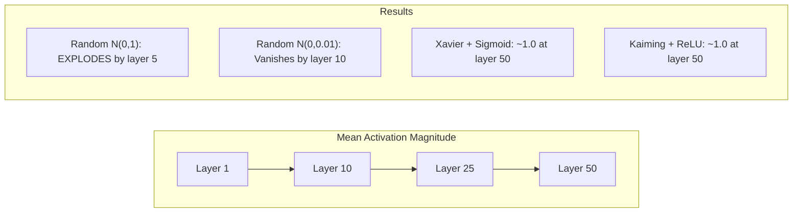
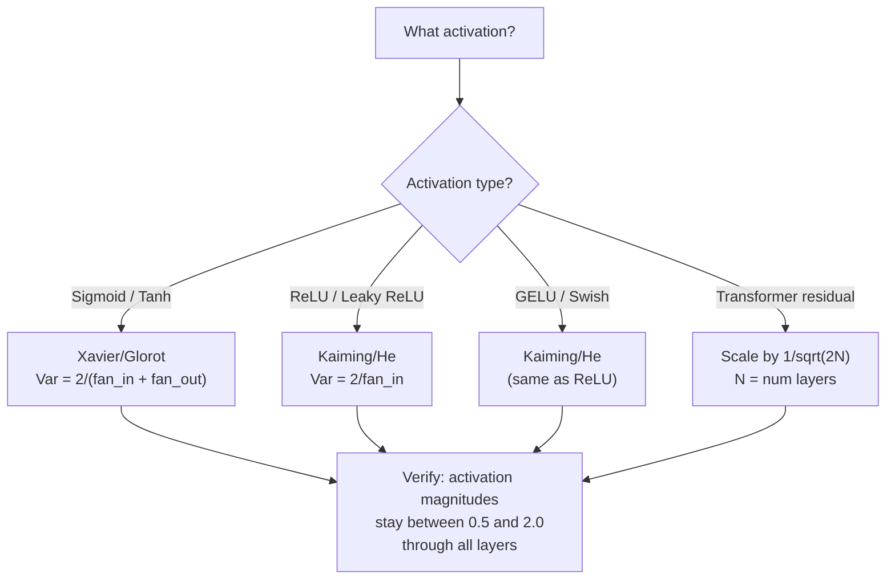

# Weight 初始化與訓練穩定性 (Weight Initialization and Training Stability)

> 初始化錯了，訓練根本不會開始。初始化對了，50 層也能像 3 層一樣順利訓練。

**Type:** Build
**Languages:** Python
**Prerequisites:** Lesson 03.04 (Activation Functions), Lesson 03.07 (Regularization)
**Time:** ~90 分鐘

## 學習目標 (Learning Objectives)

- 實作 zero、random、Xavier/Glorot 和 Kaiming/He 初始化策略，並量測它們對 50 層網路中 activation 大小的影響
- 推導為什麼 Xavier init 使用 Var(w) = 2/(fan_in + fan_out)，而 Kaiming 使用 Var(w) = 2/fan_in
- 示範 zero 初始化的對稱性問題，並說明為什麼只調整隨機的尺度並不夠
- 把正確的初始化策略對應到 activation function：sigmoid/tanh 用 Xavier，ReLU/GELU 用 Kaiming

## 問題 (The Problem)

把所有 weight 初始化為零。什麼都學不到。每個 neuron 都計算相同的函數，收到相同的 gradient，更新的幅度也完全一樣。跑了 10,000 個 epoch 之後，你那有 512 個 neuron 的 hidden layer，還是 512 份相同的 neuron。你付出了 512 個參數的代價，卻只得到 1 個。

把它們初始化得太大。activation 會在網路中爆炸。到第 10 層，數值就達到 1e15。到第 20 層，就溢位成無限大。gradient 在反向走的時候也是同樣的軌跡。

從標準常態分布隨機初始化。3 層可以運作。到了 50 層，訊號會塌縮成零，或是爆炸成無限大，取決於隨機的尺度是稍微太小還是稍微太大。「能運作」和「壞掉」之間的界線薄如刀刃。

Weight 初始化是 deep learning 裡最被低估的決定。架構有論文。Optimizer 有部落格文章。初始化只有一個註腳。但是一旦搞錯，其他一切都不重要了：你的網路在訓練開始之前就已經死了。

## 核心概念 (The Concept)

### 對稱性問題 (The Symmetry Problem)

一個 layer 裡的每個 neuron 結構都相同：把輸入乘上 weight、加 bias、套用 activation。如果所有 weight 一開始都是相同的值（零是極端的情況），每個 neuron 都會算出相同的輸出。在 backpropagation 期間，每個 neuron 都收到相同的 gradient。在更新步驟中，每個 neuron 改變的量也相同。

你卡住了。網路有數百個參數，但它們全都步調一致地移動。這稱為對稱性 (symmetry)，而隨機初始化是打破它的暴力解法。每個 neuron 在 weight 空間中從不同的點出發，所以每個都學到不同的 feature。

但是「隨機」還不夠。隨機的 *尺度* 決定了網路訓不訓練得起來。

### 通過各層的變異數傳播 (Variance Propagation Through Layers)

考慮一個有 fan_in 個輸入的單一 layer：

```math
z = w_1 x_1 + w_2 x_2 + \cdots + w_n x_n
```

如果每個 weight $w_i$ 都是從變異數為 $\mathrm{Var}(w)$ 的分布抽出，而每個輸入 $x_i$ 的變異數為 $\mathrm{Var}(x)$，輸出的變異數為：

```math
\mathrm{Var}(z) = \text{fan}_{\text{in}} \cdot \mathrm{Var}(w) \cdot \mathrm{Var}(x)
```

如果 $\mathrm{Var}(w) = 1$ 且 $\text{fan}_{\text{in}} = 512$，輸出變異數是輸入變異數的 512 倍。經過 10 層：$512^{10} = 1.2 \times 10^{27}$。你的訊號已經爆炸了。

如果 $\mathrm{Var}(w) = 0.001$，輸出變異數每層會縮小 $0.001 \cdot 512 = 0.512$ 倍。經過 10 層：$0.512^{10} = 0.00013$。你的訊號已經消失了。

目標是：選擇 $\mathrm{Var}(w)$，使得 $\mathrm{Var}(z) = \mathrm{Var}(x)$。訊號大小在各層之間保持不變。

### Xavier/Glorot 初始化 (Xavier/Glorot Initialization)

Glorot 和 Bengio (2010) 為 sigmoid 與 tanh activation 推導出解法。為了在 forward 和 backward pass 中都保持變異數不變：

```math
\mathrm{Var}(w) = \frac{2}{\text{fan}_{\text{in}} + \text{fan}_{\text{out}}}
```

實務上，weight 從以下分布抽取：

```math
w \sim \text{Uniform}(-\text{limit}, \text{limit}) \quad \text{where } \text{limit} = \sqrt{\frac{6}{\text{fan}_{\text{in}} + \text{fan}_{\text{out}}}}
```

或：

```math
w \sim \text{Normal}\left(0, \sqrt{\frac{2}{\text{fan}_{\text{in}} + \text{fan}_{\text{out}}}}\right)
```

這之所以有效，是因為 sigmoid 和 tanh 在零附近大致是線性的，而初始化得宜的 activation 就落在那裡。變異數在幾十層之間都保持穩定。

### Kaiming/He 初始化 (Kaiming/He Initialization)

ReLU 會殺掉一半的輸出（所有負數都變成零）。有效的 fan_in 因此減半，因為平均來說有一半的輸入被歸零。Xavier init 沒有考慮到這一點：它低估了所需的變異數。

He 等人 (2015) 調整了公式：

```math
\mathrm{Var}(w) = \frac{2}{\text{fan}_{\text{in}}}
```

weight 從以下分布抽取：

```math
w \sim \text{Normal}\left(0, \sqrt{\frac{2}{\text{fan}_{\text{in}}}}\right)
```

係數 2 補償了 ReLU 把一半 activation 歸零的效果。沒有它，訊號每層會縮小 ~0.5 倍。50 層的話：$0.5^{50} = 8.8 \times 10^{-16}$。Kaiming init 防止了這種情況。

### Transformer 初始化 (Transformer Initialization)

GPT-2 引入了不同的模式。Residual connection 會把每個 sub-layer 的輸出加回它的輸入：

```math
x = x + \text{sublayer}(x)
```

每次相加都會增加變異數。有 $N$ 個 residual layer 時，變異數會正比於 $N$ 成長。GPT-2 把 residual layer 的 weight 縮放 $1/\sqrt{2N}$，其中 $N$ 是 layer 的數量。這讓累積的訊號大小保持穩定。

Llama 3（4050 億參數、126 層）使用類似的做法。沒有這種縮放，residual stream 會在 126 層 attention 與 feedforward block 中無限制地成長。

```mermaid
flowchart TD
    subgraph "Zero Init"
        Z1["Layer 1<br/>All weights = 0"] --> Z2["Layer 2<br/>All neurons identical"]
        Z2 --> Z3["Layer 3<br/>Still identical"]
        Z3 --> ZR["Result: 1 effective neuron<br/>regardless of width"]
    end

    subgraph "Xavier Init"
        X1["Layer 1<br/>Var = 2/(fan_in+fan_out)"] --> X2["Layer 2<br/>Signal stable"]
        X2 --> X3["Layer 50<br/>Signal stable"]
        X3 --> XR["Result: Trains with<br/>sigmoid/tanh"]
    end

    subgraph "Kaiming Init"
        K1["Layer 1<br/>Var = 2/fan_in"] --> K2["Layer 2<br/>Signal stable"]
        K2 --> K3["Layer 50<br/>Signal stable"]
        K3 --> KR["Result: Trains with<br/>ReLU/GELU"]
    end
```



### 通過 50 層的 Activation 大小 (Activation Magnitude Through 50 Layers)



### 選擇正確的初始化 (Choosing the Right Init)



```figure
weight-init-variance
```

## 動手做 (Build It)

### 步驟 1：初始化策略 (Initialization Strategies)

四種初始化 weight matrix 的方式。每一種都回傳 list of lists（2D matrix），有 fan_in 個 column 和 fan_out 個 row。

```python
import math
import random


def zero_init(fan_in, fan_out):
    return [[0.0 for _ in range(fan_in)] for _ in range(fan_out)]


def random_init(fan_in, fan_out, scale=1.0):
    return [[random.gauss(0, scale) for _ in range(fan_in)] for _ in range(fan_out)]


def xavier_init(fan_in, fan_out):
    std = math.sqrt(2.0 / (fan_in + fan_out))
    return [[random.gauss(0, std) for _ in range(fan_in)] for _ in range(fan_out)]


def kaiming_init(fan_in, fan_out):
    std = math.sqrt(2.0 / fan_in)
    return [[random.gauss(0, std) for _ in range(fan_in)] for _ in range(fan_out)]
```

### 步驟 2：Activation Function

我們需要 sigmoid、tanh 和 ReLU，才能用各自對應的 activation 測試每一種 init 策略。

```python
def sigmoid(x):
    x = max(-500, min(500, x))
    return 1.0 / (1.0 + math.exp(-x))


def tanh_act(x):
    return math.tanh(x)


def relu(x):
    return max(0.0, x)
```

### 步驟 3：通過 50 層的 Forward Pass

讓隨機資料通過一個深層網路，並量測每一層的平均 activation 大小。

```python
def forward_deep(init_fn, activation_fn, n_layers=50, width=64, n_samples=100):
    random.seed(42)
    layer_magnitudes = []

    inputs = [[random.gauss(0, 1) for _ in range(width)] for _ in range(n_samples)]

    for layer_idx in range(n_layers):
        weights = init_fn(width, width)
        biases = [0.0] * width

        new_inputs = []
        for sample in inputs:
            output = []
            for neuron_idx in range(width):
                z = sum(weights[neuron_idx][j] * sample[j] for j in range(width)) + biases[neuron_idx]
                output.append(activation_fn(z))
            new_inputs.append(output)
        inputs = new_inputs

        magnitudes = []
        for sample in inputs:
            magnitudes.append(sum(abs(v) for v in sample) / width)
        mean_mag = sum(magnitudes) / len(magnitudes)
        layer_magnitudes.append(mean_mag)

    return layer_magnitudes
```

### 步驟 4：實驗 (The Experiment)

跑完所有組合：zero init、random N(0,1)、random N(0,0.01)、Xavier 搭配 sigmoid、Xavier 搭配 tanh、Kaiming 搭配 ReLU。印出關鍵層的大小。

```python
def run_experiment():
    configs = [
        ("Zero init + Sigmoid", lambda fi, fo: zero_init(fi, fo), sigmoid),
        ("Random N(0,1) + ReLU", lambda fi, fo: random_init(fi, fo, 1.0), relu),
        ("Random N(0,0.01) + ReLU", lambda fi, fo: random_init(fi, fo, 0.01), relu),
        ("Xavier + Sigmoid", xavier_init, sigmoid),
        ("Xavier + Tanh", xavier_init, tanh_act),
        ("Kaiming + ReLU", kaiming_init, relu),
    ]

    print(f"{'Strategy':<30} {'L1':>10} {'L5':>10} {'L10':>10} {'L25':>10} {'L50':>10}")
    print("-" * 80)

    for name, init_fn, act_fn in configs:
        mags = forward_deep(init_fn, act_fn)
        row = f"{name:<30}"
        for idx in [0, 4, 9, 24, 49]:
            val = mags[idx]
            if val > 1e6:
                row += f" {'EXPLODED':>10}"
            elif val < 1e-6:
                row += f" {'VANISHED':>10}"
            else:
                row += f" {val:>10.4f}"
        print(row)
```

### 步驟 5：對稱性示範 (Symmetry Demonstration)

示範 zero init 會產生完全相同的 neuron。

```python
def symmetry_demo():
    random.seed(42)
    weights = zero_init(2, 4)
    biases = [0.0] * 4

    inputs = [0.5, -0.3]
    outputs = []
    for neuron_idx in range(4):
        z = sum(weights[neuron_idx][j] * inputs[j] for j in range(2)) + biases[neuron_idx]
        outputs.append(sigmoid(z))

    print("\nSymmetry Demo (4 neurons, zero init):")
    for i, out in enumerate(outputs):
        print(f"  Neuron {i}: output = {out:.6f}")
    all_same = all(abs(outputs[i] - outputs[0]) < 1e-10 for i in range(len(outputs)))
    print(f"  All identical: {all_same}")
    print(f"  Effective parameters: 1 (not {len(weights) * len(weights[0])})")
```

### 步驟 6：逐層大小報告 (Layer-by-Layer Magnitude Report)

印出 50 層 activation 大小的視覺化長條圖。

```python
def magnitude_report(name, magnitudes):
    print(f"\n{name}:")
    for i, mag in enumerate(magnitudes):
        if i % 5 == 0 or i == len(magnitudes) - 1:
            if mag > 1e6:
                bar = "X" * 50 + " EXPLODED"
            elif mag < 1e-6:
                bar = "." + " VANISHED"
            else:
                bar_len = min(50, max(1, int(mag * 10)))
                bar = "#" * bar_len
            print(f"  Layer {i+1:3d}: {bar} ({mag:.6f})")
```

## 實際使用 (Use It)

PyTorch 把這些做成內建函數：

```python
import torch
import torch.nn as nn

layer = nn.Linear(512, 256)

nn.init.xavier_uniform_(layer.weight)
nn.init.xavier_normal_(layer.weight)

nn.init.kaiming_uniform_(layer.weight, nonlinearity='relu')
nn.init.kaiming_normal_(layer.weight, nonlinearity='relu')

nn.init.zeros_(layer.bias)
```

當你呼叫 `nn.Linear(512, 256)` 時，PyTorch 預設使用 Kaiming uniform 初始化。這就是為什麼大多數簡單的網路「直接就能跑」：PyTorch 已經做出了正確的選擇。但當你建構自訂架構，或是深度超過 20 層時，你就需要了解背後發生了什麼事，並且可能需要覆寫預設值。

對 transformer 來說，HuggingFace 的模型通常在它們的 `_init_weights` 方法中處理初始化。GPT-2 的實作把 residual projection 縮放 $1/\sqrt{N}$。如果你是從零打造 transformer，就得自己加上這個。

## 交付 (Ship It)

這堂課產出：
- `outputs/prompt-init-strategy.md` -- 一個 prompt，用來診斷 weight 初始化問題並建議正確的策略

## 練習 (Exercises)

1. 加入 LeCun 初始化（$\mathrm{Var} = 1/\text{fan}_{\text{in}}$，為 SELU activation 設計）。用 LeCun init + tanh 跑 50 層的實驗，並與 Xavier + tanh 比較。

2. 實作 GPT-2 的 residual 縮放：在加進 residual stream 之前，把每一層的輸出乘上 $1/\sqrt{2N}$。分別在有縮放和沒有縮放的情況下跑 50 層，量測 residual 大小成長得多快。

3. 建立一個「init 健康檢查」函數，輸入網路的 layer 維度與 activation 類型，然後建議正確的初始化方式，並在目前的 init 會造成問題時發出警告。

4. 用 $\text{fan} _{\text{in}} = 16$ 與 $\text{fan} _{\text{in}} = 1024$ 分別跑實驗。Xavier 和 Kaiming 會適應 fan_in，但 random init 不會。示範「能運作」和「壞掉」之間的差距如何隨著 layer 變大而擴大。

5. 實作 orthogonal 初始化（產生一個隨機 matrix，計算它的 SVD，使用正交矩陣 U）。在 50 層的 ReLU 網路上，與 Kaiming 比較。

## 關鍵術語 (Key Terms)

| Term | 一般說法 | 實際意義 |
|------|----------------|----------------------|
| Weight initialization | 「隨機設定起始 weight」 | 選擇初始 weight 值的策略，它決定一個網路到底能不能訓練 |
| Symmetry breaking | 「讓 neuron 彼此不同」 | 用隨機初始化確保 neuron 學到不同的 feature，而不是計算相同的函數 |
| Fan-in | 「neuron 的輸入數量」 | 進入的連線數量，決定輸入變異數如何在加權總和中累積 |
| Fan-out | 「neuron 的輸出數量」 | 出去的連線數量，與在 backpropagation 期間維持 gradient 變異數有關 |
| Xavier/Glorot init | 「sigmoid 用的初始化」 | $\mathrm{Var}(w) = 2/(\text{fan} _{\text{in}} + \text{fan} _{\text{out}})$，設計來讓變異數在 sigmoid 與 tanh activation 之間保持不變 |
| Kaiming/He init | 「ReLU 用的初始化」 | $\mathrm{Var}(w) = 2/\text{fan}_{\text{in}}$，考慮到 ReLU 會把一半的 activation 歸零 |
| Variance propagation | 「訊號如何在各層間成長或縮小」 | 對 activation 變異數如何依 weight 尺度逐層變化的數學分析 |
| Residual scaling | 「GPT-2 的 init 技巧」 | 把 residual connection 的 weight 縮放 $1/\sqrt{2N}$，防止變異數在 $N$ 層 transformer 中成長 |
| Dead network | 「什麼都訓練不了」 | 因為初始化不良，導致所有 gradient 為零或所有 activation 都飽和的網路 |
| Exploding activations | 「數值跑到無限大」 | 當 weight 變異數太高時，造成 activation 大小隨層數呈指數級成長 |

## 延伸閱讀 (Further Reading)

- Glorot & Bengio, "Understanding the difficulty of training deep feedforward neural networks" (2010) -- Xavier 初始化的原始論文，含變異數分析
- He et al., "Delving Deep into Rectifiers" (2015) -- 為 ReLU 網路提出 Kaiming 初始化
- Radford et al., "Language Models are Unsupervised Multitask Learners" (2019) -- GPT-2 論文，含 residual 縮放初始化
- Mishkin & Matas, "All You Need is a Good Init" (2016) -- layer-sequential unit-variance 初始化，是解析公式之外的經驗性替代方案
