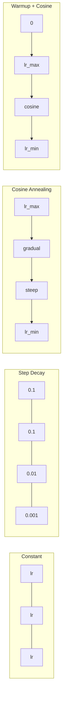
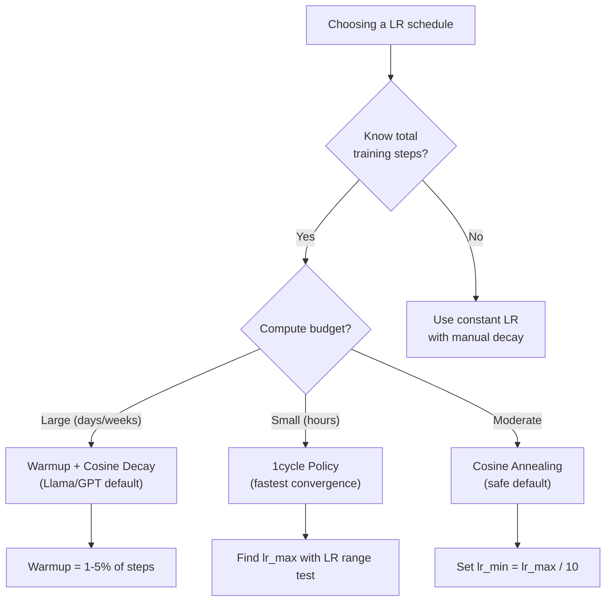
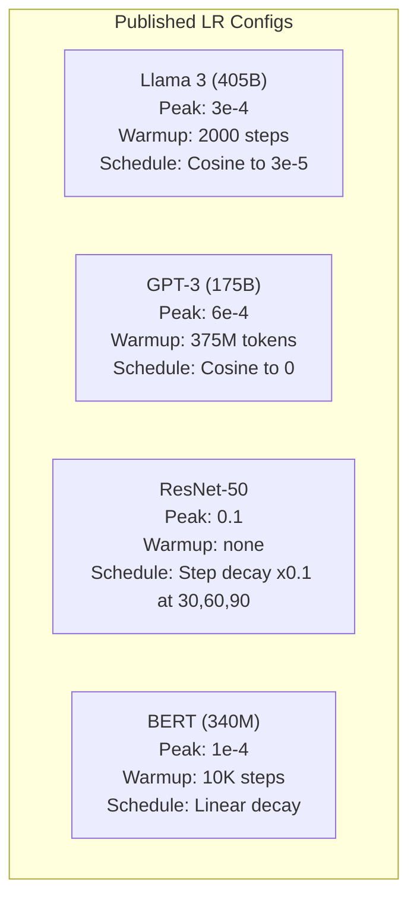

# Learning Rate Schedule 與 Warmup (Learning Rate Schedules and Warmup)

> Learning rate 是最重要的單一 hyperparameter。不是架構。不是資料集大小。不是 activation function。是 learning rate。如果其他都不調，也要調這個。

**Type:** Build
**Languages:** Python
**Prerequisites:** Lesson 03.06 (Optimizers), Lesson 03.08 (Weight Initialization)
**Time:** ~90 分鐘

## 學習目標 (Learning Objectives)

- 從零實作 constant、step decay、cosine annealing、warmup + cosine 和 1cycle 這幾種 learning rate schedule
- 示範選擇 learning rate 的三種失效模式：發散（太高）、停滯（太低）和震盪（沒有 decay）
- 說明為什麼以 Adam 為基礎的 optimizer 需要 warmup，以及它如何穩定訓練初期
- 在同一個任務上比較五種 schedule 的收斂速度，並依照訓練預算選出合適的一種

## 問題 (The Problem)

把 learning rate 設成 0.1。訓練發散：loss 在 3 步之內就衝到無限大。設成 0.0001。訓練爬得很慢：跑了 100 個 epoch，模型幾乎還沒離開隨機狀態。設成 0.01。訓練前 50 個 epoch 可以運作，然後 loss 繞著一個它永遠到不了的 minimum 震盪，因為步伐太大了。

最佳的 learning rate 不是常數。它在訓練過程中會改變。早期你想要大步伐，快速走過大片區域。訓練後期你想要微小的步伐，安頓進一個尖銳的 minimum。90% accuracy 的模型和 95% accuracy 的模型之間的差別，常常只是 schedule。

過去三年發表的每一個主要模型都使用 learning rate schedule。Llama 3 使用 peak lr=3e-4，2000 步 warmup，並以 cosine decay 降到 3e-5。GPT-3 使用 lr=6e-4，warmup 涵蓋 3.75 億個 token。這些不是隨意的選擇。它們是花費數百萬美元的大量 hyperparameter 掃描的結果。

你需要了解 schedule，因為預設值不會適用於你的問題。當你 fine-tune 預訓練模型時，正確的 schedule 和從頭訓練不同。當你增加 batch size 時，warmup 期間也需要改變。當訓練在第 10,000 步壞掉時，你需要知道那是 schedule 的問題還是其他原因。

## 核心概念 (The Concept)

### Constant Learning Rate

最簡單的做法。選一個數字，每一步都用它。

```math
\text{lr}(t) = \text{lr}_0
```

很少是最佳的。它要不是在訓練尾聲太高（繞著 minimum 震盪），就是在開頭太低（把運算浪費在微小的步伐上）。對小模型和除錯來說沒問題。對任何訓練超過一小時的東西來說，這是很糟的選擇。

### Step Decay

ResNet 時代的老派做法。在固定的 epoch 把 learning rate 縮減某個倍數（通常是 10 倍）。

```math
\text{lr}(t) = \text{lr}_0 \cdot \gamma^{\lfloor \text{epoch} / \text{step\_size} \rfloor}
```

當 $\gamma = 0.1$ 且 step_size = 30 時，意思是：lr 每 30 個 epoch 掉 10 倍。ResNet-50 就是這樣用的：lr=0.1，在第 30、60 和 90 個 epoch 掉 10 倍。

問題是：最佳的 decay 時間點取決於資料集和架構。換到不同的問題，你得重新調整什麼時候要降。轉換很突然，rate 突然改變時 loss 可能會暴衝。

### Cosine Annealing

從最大 learning rate 平滑地 decay 到最小值，沿著 cosine 曲線：

```math
\text{lr}(t) = \text{lr}_{\min} + 0.5 \cdot (\text{lr}_{\max} - \text{lr}_{\min}) \cdot \left(1 + \cos\left(\frac{\pi t}{T}\right)\right)
```

其中 $t$ 是目前的步數，$T$ 是總步數。

在 $t=0$ 時，cosine 項是 1，所以 $\text{lr} = \text{lr} _{\max}$。在 $t=T$ 時，cosine 項是 -1，所以 $\text{lr} = \text{lr} _{\min}$。decay 一開始很平緩，在中間加速，接近尾聲時又變得平緩。

這是大多數現代訓練的預設值。除了 $\text{lr} _{\max}$ 和 $\text{lr} _{\min}$ 之外，沒有其他 hyperparameter 要調。cosine 的形狀符合經驗上的觀察：大部分的學習發生在訓練的中段，你希望在那個關鍵時期有合理的步伐大小。

### Warmup：為什麼要從小開始 (Warmup: Why You Start Small)

Adam 和其他 adaptive optimizer 會維護 gradient 平均值和變異數的移動估計值。在第 0 步，這些估計值被初始化為零。最初幾次 gradient 更新是基於垃圾統計量。如果這段期間你的 learning rate 很大，模型就會踏出巨大且方向很差的步伐。

Warmup 修正了這一點。從很小的 learning rate 開始（通常是 lr_max / warmup_steps，甚至是零），在前 $N$ 步內線性上升到 $\text{lr}_{\max}$。等到你達到完整的 learning rate 時，Adam 的統計量已經穩定了。

```math
\text{lr}(t) = \text{lr}_{\max} \cdot \frac{t}{\text{warmup\_steps}} \quad \text{for } t < \text{warmup\_steps}
```

典型的 warmup：佔總訓練步數的 1-5%。Llama 3 訓練了 ~1.8 兆個 token，並 warmup 了 2000 步。GPT-3 的 warmup 涵蓋 3.75 億個 token。

### Linear Warmup + Cosine Decay

現代的預設做法。線性上升，然後用 cosine decay：

```
if t < warmup_steps:
    lr(t) = lr_max * (t / warmup_steps)
else:
    progress = (t - warmup_steps) / (total_steps - warmup_steps)
    lr(t) = lr_min + 0.5 * (lr_max - lr_min) * (1 + cos(pi * progress))
```

Llama、GPT、PaLM 和大多數現代 transformer 都用這個。warmup 防止早期的不穩定。cosine decay 讓模型安頓進一個好的 minimum。

### 1cycle Policy

Leslie Smith 的發現 (2018)：在訓練的前半段把 learning rate 從低值拉到高值，然後在後半段再降回來。這違反直覺：為什麼要在中途 *提高* learning rate？

理論是：高 learning rate 透過對最佳化軌跡加入雜訊而充當 regularization。模型在上升階段探索更多 loss 地形，找到更好的盆地。下降階段再於找到的最佳盆地內做精修。

```
Phase 1 (0 to T/2):    lr ramps from lr_max/25 to lr_max
Phase 2 (T/2 to T):    lr ramps from lr_max to lr_max/10000
```

在固定的運算預算下，1cycle 通常比 cosine annealing 訓練得更快。代價是：你必須事先知道總步數。

### Schedule 形狀 (Schedule Shapes)



### 決策流程圖 (Decision Flowchart)



### 已發表模型的實際數字 (Real Numbers from Published Models)



```figure
lr-schedule
```

## 動手做 (Build It)

### 步驟 1：Schedule 函數 (Schedule Functions)

每個函數接收目前的步數，並回傳該步的 learning rate。

```python
import math


def constant_schedule(step, lr=0.01, **kwargs):
    return lr


def step_decay_schedule(step, lr=0.1, step_size=100, gamma=0.1, **kwargs):
    return lr * (gamma ** (step // step_size))


def cosine_schedule(step, lr=0.01, total_steps=1000, lr_min=1e-5, **kwargs):
    if step >= total_steps:
        return lr_min
    return lr_min + 0.5 * (lr - lr_min) * (1 + math.cos(math.pi * step / total_steps))


def warmup_cosine_schedule(step, lr=0.01, total_steps=1000, warmup_steps=100, lr_min=1e-5, **kwargs):
    if total_steps <= warmup_steps:
        return lr * (step / max(warmup_steps, 1))
    if step < warmup_steps:
        return lr * step / warmup_steps
    progress = (step - warmup_steps) / (total_steps - warmup_steps)
    return lr_min + 0.5 * (lr - lr_min) * (1 + math.cos(math.pi * progress))


def one_cycle_schedule(step, lr=0.01, total_steps=1000, **kwargs):
    mid = max(total_steps // 2, 1)
    if step < mid:
        return (lr / 25) + (lr - lr / 25) * step / mid
    else:
        progress = (step - mid) / max(total_steps - mid, 1)
        return lr * (1 - progress) + (lr / 10000) * progress
```

### 步驟 2：視覺化所有 Schedule (Visualize All Schedules)

印出文字形式的圖，顯示每種 schedule 在訓練過程中如何演變。

```python
def visualize_schedule(name, schedule_fn, total_steps=500, **kwargs):
    steps = list(range(0, total_steps, total_steps // 20))
    if total_steps - 1 not in steps:
        steps.append(total_steps - 1)

    lrs = [schedule_fn(s, total_steps=total_steps, **kwargs) for s in steps]
    max_lr = max(lrs) if max(lrs) > 0 else 1.0

    print(f"\n{name}:")
    for s, lr_val in zip(steps, lrs):
        bar_len = int(lr_val / max_lr * 40)
        bar = "#" * bar_len
        print(f"  Step {s:4d}: lr={lr_val:.6f} {bar}")
```

### 步驟 3：訓練網路 (Training Network)

在圓形資料集上訓練一個簡單的雙層網路，和之前的課程相同，但這次我們改變 schedule。

```python
import random


def sigmoid(x):
    x = max(-500, min(500, x))
    return 1.0 / (1.0 + math.exp(-x))


def relu(x):
    return max(0.0, x)


def relu_deriv(x):
    return 1.0 if x > 0 else 0.0


def make_circle_data(n=200, seed=42):
    random.seed(seed)
    data = []
    for _ in range(n):
        x = random.uniform(-2, 2)
        y = random.uniform(-2, 2)
        label = 1.0 if x * x + y * y < 1.5 else 0.0
        data.append(([x, y], label))
    return data


def train_with_schedule(schedule_fn, schedule_name, data, epochs=300, base_lr=0.05, **kwargs):
    random.seed(0)
    hidden_size = 8
    total_steps = epochs * len(data)

    std = math.sqrt(2.0 / 2)
    w1 = [[random.gauss(0, std) for _ in range(2)] for _ in range(hidden_size)]
    b1 = [0.0] * hidden_size
    w2 = [random.gauss(0, std) for _ in range(hidden_size)]
    b2 = 0.0

    step = 0
    epoch_losses = []

    for epoch in range(epochs):
        total_loss = 0
        correct = 0

        for x, target in data:
            lr = schedule_fn(step, lr=base_lr, total_steps=total_steps, **kwargs)

            z1 = []
            h = []
            for i in range(hidden_size):
                z = w1[i][0] * x[0] + w1[i][1] * x[1] + b1[i]
                z1.append(z)
                h.append(relu(z))

            z2 = sum(w2[i] * h[i] for i in range(hidden_size)) + b2
            out = sigmoid(z2)

            error = out - target
            d_out = error * out * (1 - out)

            for i in range(hidden_size):
                d_h = d_out * w2[i] * relu_deriv(z1[i])
                w2[i] -= lr * d_out * h[i]
                for j in range(2):
                    w1[i][j] -= lr * d_h * x[j]
                b1[i] -= lr * d_h
            b2 -= lr * d_out

            total_loss += (out - target) ** 2
            if (out >= 0.5) == (target >= 0.5):
                correct += 1
            step += 1

        avg_loss = total_loss / len(data)
        accuracy = correct / len(data) * 100
        epoch_losses.append(avg_loss)

    return epoch_losses
```

### 步驟 4：比較所有 Schedule (Compare All Schedules)

用每一種 schedule 訓練同一個網路，比較最終 loss 與收斂行為。

```python
def compare_schedules(data):
    configs = [
        ("Constant", constant_schedule, {}),
        ("Step Decay", step_decay_schedule, {"step_size": 15000, "gamma": 0.1}),
        ("Cosine", cosine_schedule, {"lr_min": 1e-5}),
        ("Warmup+Cosine", warmup_cosine_schedule, {"warmup_steps": 3000, "lr_min": 1e-5}),
        ("1cycle", one_cycle_schedule, {}),
    ]

    print(f"\n{'Schedule':<20} {'Start Loss':>12} {'Mid Loss':>12} {'End Loss':>12} {'Best Loss':>12}")
    print("-" * 70)

    for name, schedule_fn, extra_kwargs in configs:
        losses = train_with_schedule(schedule_fn, name, data, epochs=300, base_lr=0.05, **extra_kwargs)
        mid_idx = len(losses) // 2
        best = min(losses)
        print(f"{name:<20} {losses[0]:>12.6f} {losses[mid_idx]:>12.6f} {losses[-1]:>12.6f} {best:>12.6f}")
```

### 步驟 5：LR 太高 vs 太低 (LR Too High vs Too Low)

示範三種失效模式：太高（發散）、太低（龜速爬行）和剛剛好。

```python
def lr_sensitivity(data):
    learning_rates = [1.0, 0.1, 0.01, 0.001, 0.0001]

    print("\nLR Sensitivity (constant schedule, 100 epochs):")
    print(f"  {'LR':>10} {'Start Loss':>12} {'End Loss':>12} {'Status':>15}")
    print("  " + "-" * 52)

    for lr in learning_rates:
        losses = train_with_schedule(constant_schedule, f"lr={lr}", data, epochs=100, base_lr=lr)
        start = losses[0]
        end = losses[-1]

        if end > start or math.isnan(end) or end > 1.0:
            status = "DIVERGED"
        elif end > start * 0.9:
            status = "BARELY MOVED"
        elif end < 0.15:
            status = "CONVERGED"
        else:
            status = "LEARNING"

        end_str = f"{end:.6f}" if not math.isnan(end) else "NaN"
        print(f"  {lr:>10.4f} {start:>12.6f} {end_str:>12} {status:>15}")
```

## 實際使用 (Use It)

PyTorch 在 `torch.optim.lr_scheduler` 中提供 scheduler：

```python
import torch
import torch.optim as optim
from torch.optim.lr_scheduler import CosineAnnealingLR, OneCycleLR, StepLR

model = nn.Sequential(nn.Linear(10, 64), nn.ReLU(), nn.Linear(64, 1))
optimizer = optim.Adam(model.parameters(), lr=3e-4)

scheduler = CosineAnnealingLR(optimizer, T_max=1000, eta_min=1e-5)

for step in range(1000):
    loss = train_step(model, optimizer)
    scheduler.step()
```

要做 warmup + cosine，可以使用 lambda scheduler，或是 HuggingFace 的 `get_cosine_schedule_with_warmup`：

```python
from transformers import get_cosine_schedule_with_warmup

scheduler = get_cosine_schedule_with_warmup(
    optimizer,
    num_warmup_steps=2000,
    num_training_steps=100000,
)
```

HuggingFace 的這個函數，是大多數 Llama 和 GPT fine-tuning 腳本使用的。有疑問時，就用 warmup + cosine，warmup 設為總步數的 3-5%。它幾乎適用於所有情況。

## 交付 (Ship It)

這堂課產出：
- `outputs/prompt-lr-schedule-advisor.md` -- 一個 prompt，針對你的訓練設定推薦正確的 learning rate schedule 與 hyperparameter

## 練習 (Exercises)

1. 實作 exponential decay：$\text{lr}(t) = \text{lr}_0 \cdot \gamma^t$，其中 $\gamma = 0.999$。在圓形資料集上與 cosine annealing 比較。

2. 實作 learning rate range test（Leslie Smith）：訓練幾百步，同時把 LR 從 1e-7 以指數方式增加到 1。畫出 loss 對 LR 的圖。最佳的最大 LR 就在 loss 開始上升之前。

3. 用 warmup + cosine 訓練，但改變 warmup 的長度：總步數的 0%、1%、5%、10%、20%。找出訓練最穩定的最佳點。

4. 實作帶 warm restart 的 cosine annealing (SGDR)：每 $T$ 步把 learning rate 重設為 $\text{lr}_{\max}$ 再 decay 一次。在較長的訓練上與標準 cosine 比較。

5. 做一個「schedule 外科醫生」：它監控訓練 loss，當 loss 穩定時自動從 warmup 切換到 cosine，並在 loss 停滯太久時降低 lr。

## 關鍵術語 (Key Terms)

| Term | 一般說法 | 實際意義 |
|------|----------------|----------------------|
| Learning rate | 「模型學得多快」 | 乘在 gradient 上、決定參數更新大小的純量 |
| Schedule | 「讓 LR 隨時間改變」 | 把訓練步數對應到 learning rate 的函數，為最佳化收斂而設計 |
| Warmup | 「從小的 LR 開始」 | 在前 $N$ 步內把 LR 從接近零線性拉到目標值，以穩定 optimizer 的統計量 |
| Cosine annealing | 「平滑的 LR decay」 | 在訓練過程中，沿著 cosine 曲線把 LR 從 $\text{lr} _{\max}$ 降到 $\text{lr} _{\min}$ |
| Step decay | 「在里程碑處降 LR」 | 在固定的 epoch 間隔把 LR 乘上一個係數（通常是 0.1） |
| 1cycle policy | 「先升後降」 | Leslie Smith 的方法：在單一週期內先升後降 LR，以加快收斂 |
| LR range test | 「找出最佳 learning rate」 | 短暫訓練並逐步增加 LR，找出 loss 開始發散的值 |
| Cosine with warm restarts | 「重設再重來」 | 週期性地把 LR 重設為 $\text{lr} _{\max}$ 再 decay（SGDR） |
| Eta min | 「LR 的下限」 | schedule 最終 decay 到的最小 learning rate |
| Peak learning rate | 「最大的 LR」 | 訓練期間達到的最高 LR，通常出現在 warmup 之後 |

## 延伸閱讀 (Further Reading)

- Loshchilov & Hutter, "SGDR: Stochastic Gradient Descent with Warm Restarts" (2017) -- 提出 cosine annealing 與 warm restart
- Smith, "Super-Convergence: Very Fast Training of Neural Networks Using Large Learning Rates" (2018) -- 1cycle policy 的論文
- Touvron et al., "Llama 2: Open Foundation and Fine-Tuned Chat Models" (2023) -- 記錄了大規模使用的 warmup + cosine schedule
- Goyal et al., "Accurate, Large Minibatch SGD: Training ImageNet in 1 Hour" (2017) -- 大 batch 訓練用的 linear scaling rule 與 warmup
