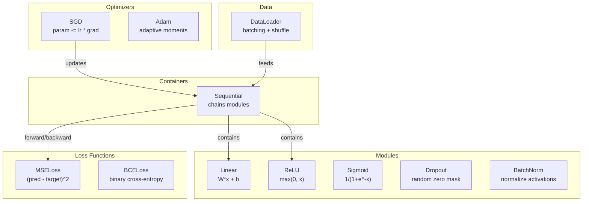
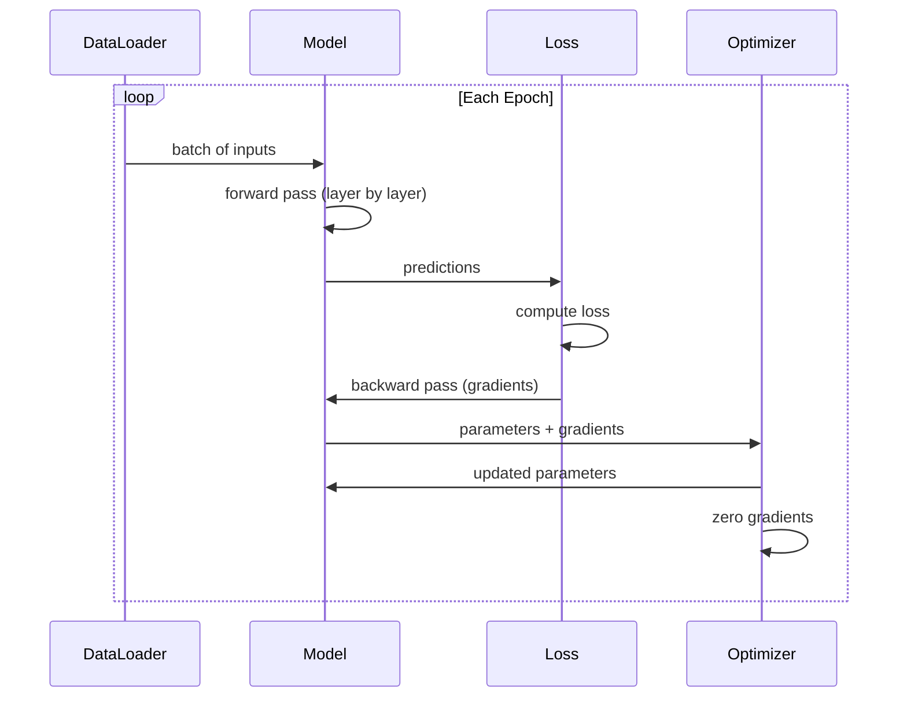
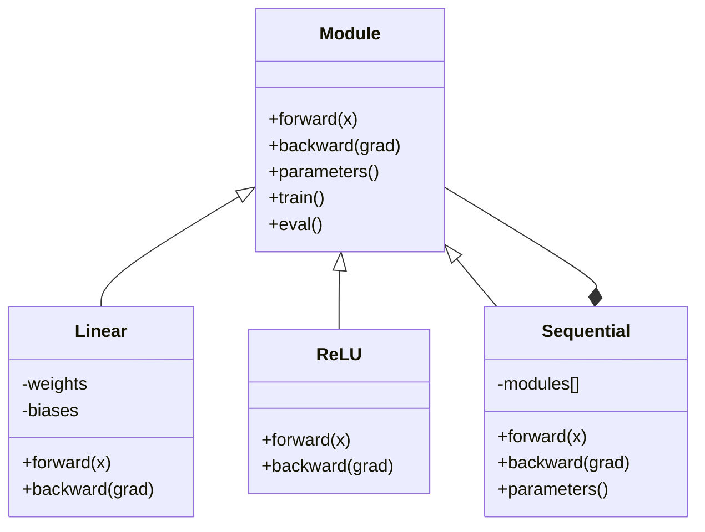

# 打造你自己的 Mini Framework (Build Your Own Mini Framework)

> 你已經打造過 neuron、layer、網路、backprop、activation、loss function、optimizer、regularization、初始化和 LR schedule。全部都是分開的零件。現在把它們串成一個 framework。不是 PyTorch。不是 TensorFlow。是你自己的。

**Type:** Build
**Languages:** Python
**Prerequisites:** All of Phase 03 (Lessons 01-09)
**Time:** ~120 分鐘

## 學習目標 (Learning Objectives)

- 打造一個完整的 deep learning framework（約 500 行），包含 Module、Linear、ReLU、Sigmoid、Dropout、BatchNorm、Sequential、loss function、optimizer 和 DataLoader
- 說明 Module 抽象（forward、backward、parameters），以及為什麼需要切換 train/eval 模式
- 把所有元件串成可運作的訓練迴圈，在圓形分類上訓練一個 4 層網路
- 把你 framework 的每個元件對應到它的 PyTorch 版本（nn.Module、nn.Sequential、optim.Adam、DataLoader）

## 問題 (The Problem)

你有十堂課的積木，散落在不同的檔案裡。這裡有個 `Value` class，那裡有個訓練迴圈，weight 初始化在另一個檔案，learning rate schedule 又在別處。要訓練一個網路，你得從五堂不同的課複製貼上，再手動把它們接在一起。

這正是 framework 要解決的問題。PyTorch 給你 `nn.Module`、`nn.Sequential`、`optim.Adam`、`DataLoader`，以及把它們串在一起的訓練迴圈模式。TensorFlow 給你 `keras.Layer`、`keras.Sequential`、`keras.optimizers.Adam`。這些不是魔法。它們是一些組織上的模式，讓你可以定義、訓練與評估網路，而不用每次都重新發明管線。

你將用約 500 行 Python 打造同樣的東西。不用 numpy。沒有外部依賴。這個 framework 可以定義任何 feedforward 網路，用 SGD 或 Adam 訓練它，把資料分 batch，套用 dropout 和 batch normalization，使用任何 activation，並排定 learning rate。

完成後，你會確切了解當你在 PyTorch 寫下 `model = nn.Sequential(...)` 時發生了什麼事。你會了解為什麼有 `model.train()` 和 `model.eval()`。你會了解為什麼 `optimizer.zero_grad()` 是獨立的呼叫。你會全部都懂，因為全部都是你自己打造的。

## 核心概念 (The Concept)

### Module 抽象 (The Module Abstraction)

PyTorch 中的每個 layer 都繼承自 `nn.Module`。一個 Module 有三項職責：

1. **forward()**：給定輸入，計算輸出
2. **parameters()**：回傳所有可訓練的 weight
3. **backward()**：計算 gradient（在 PyTorch 中由 autograd 處理，我們這裡則是明確寫出來）

Linear layer 是一個 Module。ReLU activation 是一個 Module。dropout layer 是一個 Module。batch normalization layer 是一個 Module。它們都有相同的介面。

### Sequential 容器 (Sequential Container)

`nn.Sequential` 把 Module 串起來。Forward pass：把資料依序送過 Module 1、Module 2、Module 3。Backward pass：反轉整條鏈。容器本身也是一個 Module：它有 forward()、parameters() 和 backward()。這就是 composite pattern：一串 Module 本身也是一個 Module。

### 訓練與評估模式 (Training vs Evaluation Mode)

Dropout 在訓練時會隨機把 neuron 歸零，但在評估時全部放行。Batch normalization 在訓練時使用 batch 統計量，在評估時則使用移動平均。`train()` 和 `eval()` 方法負責切換這個行為。每個 Module 都有一個 `training` 旗標。

### Optimizer

Optimizer 用 gradient 更新參數。SGD：`param -= lr * grad`。Adam：維護 momentum 與變異數估計，然後更新。Optimizer 不知道網路的架構，它只看到一份平坦的參數清單和它們的 gradient。

### DataLoader

分 batch 很重要，有兩個原因。第一，對大型問題來說，你無法把整個資料集放進記憶體。第二，mini-batch gradient descent 帶來的雜訊有助於跳出 local minimum。DataLoader 把資料切成多個 batch，並可選擇在 epoch 之間洗牌。

### Framework 架構 (Framework Architecture)



### 訓練迴圈 (Training Loop)



### Module 階層 (Module Hierarchy)



```figure
gradient-clipping
```

## 動手做 (Build It)

### 步驟 1：Module 基底 Class (Module Base Class)

每個 layer 都要實作的抽象介面。

```python
class Module:
    def __init__(self):
        self.training = True

    def forward(self, x):
        raise NotImplementedError

    def backward(self, grad):
        raise NotImplementedError

    def parameters(self):
        return []

    def train(self):
        self.training = True

    def eval(self):
        self.training = False
```

### 步驟 2：Linear Layer

最基本的積木。儲存 weight 和 bias，forward 時計算 Wx + b，backward 時計算 weight 與輸入的 gradient。

```python
import math
import random


class Linear(Module):
    def __init__(self, fan_in, fan_out):
        super().__init__()
        std = math.sqrt(2.0 / fan_in)
        self.weights = [[random.gauss(0, std) for _ in range(fan_in)] for _ in range(fan_out)]
        self.biases = [0.0] * fan_out
        self.weight_grads = [[0.0] * fan_in for _ in range(fan_out)]
        self.bias_grads = [0.0] * fan_out
        self.fan_in = fan_in
        self.fan_out = fan_out
        self.input = None

    def forward(self, x):
        self.input = x
        output = []
        for i in range(self.fan_out):
            val = self.biases[i]
            for j in range(self.fan_in):
                val += self.weights[i][j] * x[j]
            output.append(val)
        return output

    def backward(self, grad):
        input_grad = [0.0] * self.fan_in
        for i in range(self.fan_out):
            self.bias_grads[i] += grad[i]
            for j in range(self.fan_in):
                self.weight_grads[i][j] += grad[i] * self.input[j]
                input_grad[j] += grad[i] * self.weights[i][j]
        return input_grad

    def parameters(self):
        params = []
        for i in range(self.fan_out):
            for j in range(self.fan_in):
                params.append((self.weights, i, j, self.weight_grads))
            params.append((self.biases, i, None, self.bias_grads))
        return params
```

### 步驟 3：Activation Module (Activation Modules)

把 ReLU、Sigmoid 和 Tanh 做成 Module。每一個都會快取 backward pass 需要的東西。

```python
class ReLU(Module):
    def __init__(self):
        super().__init__()
        self.mask = None

    def forward(self, x):
        self.mask = [1.0 if v > 0 else 0.0 for v in x]
        return [max(0.0, v) for v in x]

    def backward(self, grad):
        return [g * m for g, m in zip(grad, self.mask)]


class Sigmoid(Module):
    def __init__(self):
        super().__init__()
        self.output = None

    def forward(self, x):
        self.output = []
        for v in x:
            v = max(-500, min(500, v))
            self.output.append(1.0 / (1.0 + math.exp(-v)))
        return self.output

    def backward(self, grad):
        return [g * o * (1 - o) for g, o in zip(grad, self.output)]


class Tanh(Module):
    def __init__(self):
        super().__init__()
        self.output = None

    def forward(self, x):
        self.output = [math.tanh(v) for v in x]
        return self.output

    def backward(self, grad):
        return [g * (1 - o * o) for g, o in zip(grad, self.output)]
```

### 步驟 4：Dropout Module

訓練時隨機把元素歸零。把剩下的元素乘上 1/(1-p)，讓期望值維持不變。評估時什麼都不做。

```python
class Dropout(Module):
    def __init__(self, p=0.5):
        super().__init__()
        self.p = p
        self.mask = None

    def forward(self, x):
        if not self.training:
            return x
        self.mask = [0.0 if random.random() < self.p else 1.0 / (1 - self.p) for _ in x]
        return [v * m for v, m in zip(x, self.mask)]

    def backward(self, grad):
        if self.mask is None:
            return grad
        return [g * m for g, m in zip(grad, self.mask)]
```

### 步驟 5：BatchNorm Module

沿著 batch 對每個 feature 把 activation 正規化成零平均、單位變異數。維護移動統計量供 eval 模式使用。

```python
class BatchNorm(Module):
    def __init__(self, size, momentum=0.1, eps=1e-5):
        super().__init__()
        self.size = size
        self.gamma = [1.0] * size
        self.beta = [0.0] * size
        self.gamma_grads = [0.0] * size
        self.beta_grads = [0.0] * size
        self.running_mean = [0.0] * size
        self.running_var = [1.0] * size
        self.momentum = momentum
        self.eps = eps
        self.x_norm = None
        self.std_inv = None
        self.batch_input = None

    def forward_batch(self, batch):
        batch_size = len(batch)
        output_batch = []

        if self.training:
            mean = [0.0] * self.size
            for sample in batch:
                for j in range(self.size):
                    mean[j] += sample[j]
            mean = [m / batch_size for m in mean]

            var = [0.0] * self.size
            for sample in batch:
                for j in range(self.size):
                    var[j] += (sample[j] - mean[j]) ** 2
            var = [v / batch_size for v in var]

            self.std_inv = [1.0 / math.sqrt(v + self.eps) for v in var]

            self.x_norm = []
            self.batch_input = batch
            for sample in batch:
                normed = [(sample[j] - mean[j]) * self.std_inv[j] for j in range(self.size)]
                self.x_norm.append(normed)
                output = [self.gamma[j] * normed[j] + self.beta[j] for j in range(self.size)]
                output_batch.append(output)

            for j in range(self.size):
                self.running_mean[j] = (1 - self.momentum) * self.running_mean[j] + self.momentum * mean[j]
                self.running_var[j] = (1 - self.momentum) * self.running_var[j] + self.momentum * var[j]
        else:
            std_inv = [1.0 / math.sqrt(v + self.eps) for v in self.running_var]
            for sample in batch:
                normed = [(sample[j] - self.running_mean[j]) * std_inv[j] for j in range(self.size)]
                output = [self.gamma[j] * normed[j] + self.beta[j] for j in range(self.size)]
                output_batch.append(output)

        return output_batch

    def forward(self, x):
        result = self.forward_batch([x])
        return result[0]

    def backward(self, grad):
        if self.x_norm is None:
            return grad
        for j in range(self.size):
            self.gamma_grads[j] += self.x_norm[0][j] * grad[j]
            self.beta_grads[j] += grad[j]
        return [grad[j] * self.gamma[j] * self.std_inv[j] for j in range(self.size)]

    def parameters(self):
        params = []
        for j in range(self.size):
            params.append((self.gamma, j, None, self.gamma_grads))
            params.append((self.beta, j, None, self.beta_grads))
        return params
```

### 步驟 6：Sequential 容器 (Sequential Container)

把 module 串起來。Forward 由左到右，backward 由右到左。

```python
class Sequential(Module):
    def __init__(self, *modules):
        super().__init__()
        self.modules = list(modules)

    def forward(self, x):
        for module in self.modules:
            x = module.forward(x)
        return x

    def backward(self, grad):
        for module in reversed(self.modules):
            grad = module.backward(grad)
        return grad

    def parameters(self):
        params = []
        for module in self.modules:
            params.extend(module.parameters())
        return params

    def train(self):
        self.training = True
        for module in self.modules:
            module.train()

    def eval(self):
        self.training = False
        for module in self.modules:
            module.eval()
```

### 步驟 7：Loss Function (Loss Functions)

MSE 和 Binary Cross-Entropy。每個都回傳 loss 值，並提供 backward() 來回傳 gradient。

```python
class MSELoss:
    def __call__(self, predicted, target):
        self.predicted = predicted
        self.target = target
        n = len(predicted)
        self.loss = sum((p - t) ** 2 for p, t in zip(predicted, target)) / n
        return self.loss

    def backward(self):
        n = len(self.predicted)
        return [2 * (p - t) / n for p, t in zip(self.predicted, self.target)]


class BCELoss:
    def __call__(self, predicted, target):
        self.predicted = predicted
        self.target = target
        eps = 1e-7
        n = len(predicted)
        self.loss = 0
        for p, t in zip(predicted, target):
            p = max(eps, min(1 - eps, p))
            self.loss += -(t * math.log(p) + (1 - t) * math.log(1 - p))
        self.loss /= n
        return self.loss

    def backward(self):
        eps = 1e-7
        n = len(self.predicted)
        grads = []
        for p, t in zip(self.predicted, self.target):
            p = max(eps, min(1 - eps, p))
            grads.append((-t / p + (1 - t) / (1 - p)) / n)
        return grads
```

### 步驟 8：SGD 與 Adam Optimizer (SGD and Adam Optimizers)

兩者都接收參數清單，並用 gradient 更新 weight。

```python
class SGD:
    def __init__(self, parameters, lr=0.01):
        self.params = parameters
        self.lr = lr

    def step(self):
        for container, i, j, grad_container in self.params:
            if j is not None:
                container[i][j] -= self.lr * grad_container[i][j]
            else:
                container[i] -= self.lr * grad_container[i]

    def zero_grad(self):
        for container, i, j, grad_container in self.params:
            if j is not None:
                grad_container[i][j] = 0.0
            else:
                grad_container[i] = 0.0


class Adam:
    def __init__(self, parameters, lr=0.001, beta1=0.9, beta2=0.999, eps=1e-8):
        self.params = parameters
        self.lr = lr
        self.beta1 = beta1
        self.beta2 = beta2
        self.eps = eps
        self.t = 0
        self.m = [0.0] * len(parameters)
        self.v = [0.0] * len(parameters)

    def step(self):
        self.t += 1
        for idx, (container, i, j, grad_container) in enumerate(self.params):
            if j is not None:
                g = grad_container[i][j]
            else:
                g = grad_container[i]

            self.m[idx] = self.beta1 * self.m[idx] + (1 - self.beta1) * g
            self.v[idx] = self.beta2 * self.v[idx] + (1 - self.beta2) * g * g

            m_hat = self.m[idx] / (1 - self.beta1 ** self.t)
            v_hat = self.v[idx] / (1 - self.beta2 ** self.t)

            update = self.lr * m_hat / (math.sqrt(v_hat) + self.eps)

            if j is not None:
                container[i][j] -= update
            else:
                container[i] -= update

    def zero_grad(self):
        for container, i, j, grad_container in self.params:
            if j is not None:
                grad_container[i][j] = 0.0
            else:
                grad_container[i] = 0.0
```

### 步驟 9：DataLoader

把資料切成 batch，可選擇每個 epoch 洗牌。

```python
class DataLoader:
    def __init__(self, data, batch_size=32, shuffle=True):
        self.data = data
        self.batch_size = batch_size
        self.shuffle = shuffle

    def __iter__(self):
        indices = list(range(len(self.data)))
        if self.shuffle:
            random.shuffle(indices)
        for start in range(0, len(indices), self.batch_size):
            batch_indices = indices[start:start + self.batch_size]
            batch = [self.data[i] for i in batch_indices]
            inputs = [item[0] for item in batch]
            targets = [item[1] for item in batch]
            yield inputs, targets

    def __len__(self):
        return (len(self.data) + self.batch_size - 1) // self.batch_size
```

### 步驟 10：在圓形分類上訓練 4 層網路 (Train a 4-Layer Network on Circle Classification)

把一切串起來。定義模型、選 loss、選 optimizer、跑訓練迴圈。

```python
def make_circle_data(n=500, seed=42):
    random.seed(seed)
    data = []
    for _ in range(n):
        x = random.uniform(-2, 2)
        y = random.uniform(-2, 2)
        label = 1.0 if x * x + y * y < 1.5 else 0.0
        data.append(([x, y], [label]))
    return data


def train():
    random.seed(42)

    model = Sequential(
        Linear(2, 16),
        ReLU(),
        Linear(16, 16),
        ReLU(),
        Linear(16, 8),
        ReLU(),
        Linear(8, 1),
        Sigmoid(),
    )

    criterion = BCELoss()
    optimizer = Adam(model.parameters(), lr=0.01)

    data = make_circle_data(500)
    split = int(len(data) * 0.8)
    train_data = data[:split]
    test_data = data[split:]

    loader = DataLoader(train_data, batch_size=16, shuffle=True)

    model.train()

    for epoch in range(100):
        total_loss = 0
        total_correct = 0
        total_samples = 0

        for batch_inputs, batch_targets in loader:
            batch_loss = 0
            for x, t in zip(batch_inputs, batch_targets):
                pred = model.forward(x)
                loss = criterion(pred, t)
                batch_loss += loss

                optimizer.zero_grad()
                grad = criterion.backward()
                model.backward(grad)
                optimizer.step()

                predicted_class = 1.0 if pred[0] >= 0.5 else 0.0
                if predicted_class == t[0]:
                    total_correct += 1
                total_samples += 1

            total_loss += batch_loss

        avg_loss = total_loss / total_samples
        accuracy = total_correct / total_samples * 100

        if epoch % 10 == 0 or epoch == 99:
            print(f"Epoch {epoch:3d} | Loss: {avg_loss:.6f} | Train Accuracy: {accuracy:.1f}%")

    model.eval()
    correct = 0
    for x, t in test_data:
        pred = model.forward(x)
        predicted_class = 1.0 if pred[0] >= 0.5 else 0.0
        if predicted_class == t[0]:
            correct += 1
    test_accuracy = correct / len(test_data) * 100
    print(f"\nTest Accuracy: {test_accuracy:.1f}% ({correct}/{len(test_data)})")

    return model, test_accuracy
```

## 實際使用 (Use It)

以下是你剛剛打造的東西的 PyTorch 對應版本：

```python
import torch
import torch.nn as nn
from torch.utils.data import DataLoader, TensorDataset

model = nn.Sequential(
    nn.Linear(2, 16),
    nn.ReLU(),
    nn.Linear(16, 16),
    nn.ReLU(),
    nn.Linear(16, 8),
    nn.ReLU(),
    nn.Linear(8, 1),
    nn.Sigmoid(),
)

criterion = nn.BCELoss()
optimizer = torch.optim.Adam(model.parameters(), lr=0.01)

for epoch in range(100):
    model.train()
    for inputs, targets in dataloader:
        optimizer.zero_grad()
        predictions = model(inputs)
        loss = criterion(predictions, targets)
        loss.backward()
        optimizer.step()

    model.eval()
    with torch.no_grad():
        test_predictions = model(test_inputs)
```

結構完全相同。`Sequential`、`Linear`、`ReLU`、`Sigmoid`、`BCELoss`、`Adam`、`zero_grad`、`backward`、`step`、`train`、`eval`。每個概念都一對一對應。差別在於 PyTorch 自動處理 autograd（不需要在每個 module 實作 backward()）、能在 GPU 上執行，而且已經被最佳化多年。但骨架是一樣的。

現在當你看到 PyTorch 程式碼時，你會確切知道每一行在發生什麼事。這份理解就是重點所在。

## 交付 (Ship It)

這堂課產出：
- `outputs/prompt-framework-architect.md` -- 一個 prompt，用 framework 抽象來設計神經網路架構

## 練習 (Exercises)

1. 為多類別分類加入 `SoftmaxCrossEntropyLoss` class。對預測做 softmax、計算 cross-entropy loss，並處理合併後的 backward pass。在 3 類螺旋資料集上測試。

2. 在 optimizer 中實作 learning rate scheduling：加入 `set_lr()` 方法，並接上第 09 課的 cosine schedule。用 warmup + cosine 訓練圓形分類器，並與固定 LR 比較。

3. 為 Sequential 加上 `save()` 和 `load()` 方法，把所有 weight 序列化成 JSON 檔再載回。驗證載入的模型產生與原始模型相同的預測。

4. 在 Adam optimizer 中實作 weight decay（L2 regularization）。加入 `weight_decay` 參數，每一步把 weight 往零收縮。比較 decay=0 與 decay=0.01 的訓練。

5. 把逐樣本的訓練迴圈換成正式的 mini-batch gradient accumulation：在一個 batch 的所有樣本間累積 gradient，再除以 batch size，只做一次 optimizer step。量測這是否改變收斂速度。

## 關鍵術語 (Key Terms)

| Term | 一般說法 | 實際意義 |
|------|----------------|----------------------|
| Module | 「一個 layer」 | framework 中的基本抽象：任何具備 forward()、backward() 和 parameters() 的東西 |
| Sequential | 「依序堆疊 layer」 | 一個把 module 串起來的容器，forward 時依序套用，backward 時反向套用 |
| Forward pass | 「執行網路」 | 讓輸入依序通過每個 module 來計算輸出 |
| Backward pass | 「計算 gradient」 | 讓 loss 的 gradient 反向通過每個 module，以計算參數的 gradient |
| Parameters | 「可訓練的 weight」 | 網路中所有 optimizer 可以更新的值：weight 和 bias |
| Optimizer | 「更新 weight 的東西」 | 用 gradient 更新參數的演算法，實作 SGD、Adam 或其他規則 |
| DataLoader | 「餵資料的東西」 | 一個 iterator，把資料集切成 batch，並可選擇在 epoch 之間洗牌 |
| Training mode | 「model.train()」 | 一個旗標，啟用 dropout 這類隨機行為，以及使用 batch 統計量的 batch normalization |
| Evaluation mode | 「model.eval()」 | 一個旗標，停用 dropout，並讓 batch normalization 使用移動統計量 |
| Zero grad | 「清除 gradient」 | 在計算下一個 batch 的 gradient 之前，把所有參數 gradient 重設為零 |

## 延伸閱讀 (Further Reading)

- Paszke et al., "PyTorch: An Imperative Style, High-Performance Deep Learning Library" (2019) -- 描述 PyTorch 設計決策的論文
- Chollet, "Deep Learning with Python, Second Edition" (2021) -- 第 3 章介紹 Keras 內部機制，使用同樣的 module/layer 抽象
- Johnson, "Tiny-DNN" (https://github.com/tiny-dnn/tiny-dnn) -- 一個 header-only 的 C++ deep learning framework，適合用來理解 framework 內部
