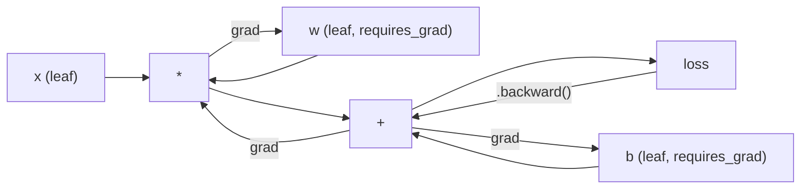
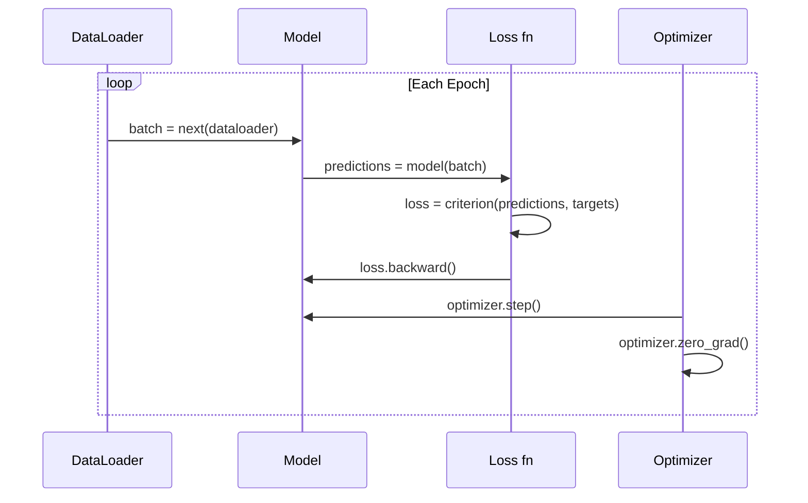

# PyTorch 入門 (Introduction to PyTorch)

> 你用活塞和曲軸親手打造了引擎。現在來學大家真正在開的那一台。

**Type:** Build
**Languages:** Python
**Prerequisites:** Lesson 03.10 (Build Your Own Mini Framework)
**Time:** ~75 分鐘

## 學習目標 (Learning Objectives)

- 使用 PyTorch 的 nn.Module、nn.Sequential 和 autograd 建構並訓練神經網路
- 使用 PyTorch tensor、GPU 加速，以及標準的訓練迴圈（zero_grad、forward、loss、backward、step）
- 把你從零打造的 mini framework 元件，轉換成它們的 PyTorch 對應版本
- 在同一個任務上分析並比較純 Python framework 與 PyTorch 的訓練速度

## 問題 (The Problem)

你有一個能運作的 mini framework。Linear layer、ReLU、dropout、batch norm、Adam、DataLoader、訓練迴圈。它能用純 Python 在圓形分類問題上訓練一個 4 層網路。

它在同一個問題上，也比 PyTorch 慢 500 倍。

你的 mini framework 用巢狀的 Python 迴圈一次處理一筆樣本。PyTorch 則把同樣的運算派送給最佳化過的 C++/CUDA kernel，在 GPU 上執行。在單張 NVIDIA A100 上，PyTorch 大約 6 小時就能在 ImageNet（128 萬張影像）上訓練 ResNet-50（2560 萬個參數）。你的 framework 在同樣的任務上大約需要 3,000 小時，前提是它沒先把記憶體耗盡。

速度不是唯一的差距。你的 framework 沒有 GPU 支援。沒有自動微分：你為每個 module 手寫了 backward()。沒有序列化。沒有分散式訓練。沒有 mixed precision。想除錯 gradient 流動，除了 print 敘述之外別無他法。

PyTorch 補上了每一個缺口。而且它在這麼做的同時，保留了你已經建立的那套心智模型：Module、forward()、parameters()、backward()、optimizer.step()。這些概念一對一地轉移過來。語法幾乎一模一樣。差別在於，PyTorch 把十年的系統工程，包在你從零設計出來的同一個介面後面。

## 核心概念 (The Concept)

### PyTorch 為什麼勝出 (Why PyTorch Won)

2015 年，TensorFlow 要求你在執行任何東西之前，先定義一個靜態的 computation graph。你要建圖、編譯，再把資料餵進去。除錯意味著盯著圖的視覺化看。更改架構意味著從頭重建整張圖。

PyTorch 在 2017 年推出，抱持不同的哲學：eager execution。你寫 Python，它立刻執行。`y = model(x)` 真的就在當下算出 y，而不是「在圖上新增一個節點，之後才會算出 y」。這代表標準的 Python 除錯工具都能用。print() 可以用。pdb 可以用。forward pass 裡的 if/else 也可以用。

到了 2020 年，市場已經表態。PyTorch 在 ML 研究論文中的占比，從 7%（2017）成長到超過 75%（2022）。Meta、Google DeepMind、OpenAI、Anthropic 和 Hugging Face 都把 PyTorch 當作主要 framework。TensorFlow 2.x 為了回應而採用了 eager execution，等於默認 PyTorch 的設計是對的。

教訓是：開發者體驗會複利成長。一個慢 10% 但除錯快 50% 的 framework，每次都會贏。

### Tensor

Tensor 是一個多維陣列，有三個關鍵屬性：shape、dtype 和 device。

```python
import torch

x = torch.zeros(3, 4)           # shape: (3, 4), dtype: float32, device: cpu
x = torch.randn(2, 3, 224, 224) # batch of 2 RGB images, 224x224
x = torch.tensor([1, 2, 3])     # from a Python list
```

**Shape** 是維度。純量的 shape 是 ()，向量是 (n,)，matrix 是 (m, n)，一批影像是 (batch, channels, height, width)。

**Dtype** 控制精度與記憶體。

| dtype | Bits | 範圍 | 使用情境 |
|-------|------|-------|----------|
| float32 | 32 | ~7 位十進位有效數字 | 預設訓練 |
| float16 | 16 | ~3.3 位十進位有效數字 | Mixed precision |
| bfloat16 | 16 | 與 float32 相同的範圍，精度較低 | LLM 訓練 |
| int8 | 8 | -128 到 127 | 量化後的推論 |

**Device** 決定運算在哪裡進行。

```python
device = torch.device("cuda" if torch.cuda.is_available() else "cpu")
x = torch.randn(3, 4, device=device)
x = x.to("cuda")
x = x.cpu()
```

每個運算都要求所有 tensor 位於同一個 device。這是初學者碰到的第一名 PyTorch 錯誤：`RuntimeError: Expected all tensors to be on the same device`。解法是在運算之前，先把所有東西搬到同一個 device。

**Reshape** 是常數時間：它改變的是 metadata，不是資料。

```python
x = torch.randn(2, 3, 4)
x.view(2, 12)      # reshape to (2, 12) -- must be contiguous
x.reshape(6, 4)    # reshape to (6, 4) -- works always
x.permute(2, 0, 1) # reorder dimensions
x.unsqueeze(0)     # add dimension: (1, 2, 3, 4)
x.squeeze()        # remove size-1 dimensions
```

### Autograd

你的 mini framework 要求你為每個 module 實作 backward()。PyTorch 不用。它把 tensor 上的每個運算記錄成一張有向無環圖（computational graph），再反向走訪這張圖，自動計算 gradient。



和你的 framework 的關鍵差異是：PyTorch 使用 tape-based 的 autodiff。每個運算在 forward pass 期間都會附加到一卷「tape」上。呼叫 `.backward()` 就是把 tape 反向重播。

```python
x = torch.randn(3, requires_grad=True)
y = x ** 2 + 3 * x
z = y.sum()
z.backward()
print(x.grad)  # dz/dx = 2x + 3
```

Autograd 的三條規則：

1. 只有 `requires_grad=True` 的 leaf tensor 會累積 gradient
2. Gradient 預設會累積，所以每次 backward pass 之前都要呼叫 `optimizer.zero_grad()`
3. `torch.no_grad()` 會停用 gradient 追蹤（評估期間使用）

### nn.Module

`nn.Module` 是 PyTorch 中每個神經網路元件的基底 class。你已經在第 10 課打造過這個抽象。PyTorch 的版本多了自動的參數註冊、遞迴的 module 探索、device 管理，以及 state dict 序列化。

```python
import torch.nn as nn

class MLP(nn.Module):
    def __init__(self, input_dim, hidden_dim, output_dim):
        super().__init__()
        self.layer1 = nn.Linear(input_dim, hidden_dim)
        self.relu = nn.ReLU()
        self.layer2 = nn.Linear(hidden_dim, output_dim)

    def forward(self, x):
        x = self.layer1(x)
        x = self.relu(x)
        x = self.layer2(x)
        return x
```

當你在 `__init__` 中把 `nn.Module` 或 `nn.Parameter` 指派為屬性時，PyTorch 會自動註冊它。`model.parameters()` 會遞迴收集每個已註冊的參數。這就是為什麼你再也不需要像在 mini framework 中那樣，手動收集 weight。

主要的積木：

| Module | 功能 | 參數數量 |
|--------|-------------|------------|
| nn.Linear(in, out) | $Wx + b$ | in*out + out |
| nn.Conv2d(in_ch, out_ch, k) | 2D convolution | in_ch*out_ch*k*k + out_ch |
| nn.BatchNorm1d(features) | 正規化 activation | 2 * features |
| nn.Dropout(p) | 隨機歸零 | 0 |
| nn.ReLU() | $\max(0, x)$ | 0 |
| nn.GELU() | Gaussian error linear | 0 |
| nn.Embedding(vocab, dim) | 查找表 | vocab * dim |
| nn.LayerNorm(dim) | 逐樣本正規化 | 2 * dim |

### Loss Function 與 Optimizer (Loss Functions and Optimizers)

PyTorch 內建了你所打造的每一樣東西的正式上線版本。

**Loss function**（來自 `torch.nn`）：

| Loss | 任務 | 輸入 |
|------|------|-------|
| nn.MSELoss() | 迴歸 | 任何 shape |
| nn.CrossEntropyLoss() | 多類別分類 | Logits（不是 softmax） |
| nn.BCEWithLogitsLoss() | 二元分類 | Logits（不是 sigmoid） |
| nn.L1Loss() | 迴歸（穩健） | 任何 shape |
| nn.CTCLoss() | 序列對齊 | Log probabilities |

注意：`CrossEntropyLoss` 內部結合了 `LogSoftmax` + `NLLLoss`。要傳入原始 logits，而不是 softmax 的輸出。這是個常見的錯誤，會悄悄產生錯誤的 gradient。

**Optimizer**（來自 `torch.optim`）：

| Optimizer | 何時使用 | 典型 LR |
|-----------|-------------|-----------|
| SGD(params, lr, momentum) | CNN、調校良好的 pipeline | 0.01--0.1 |
| Adam(params, lr) | 預設的起點 | 1e-3 |
| AdamW(params, lr, weight_decay) | Transformer、fine-tuning | 1e-4--1e-3 |
| LBFGS(params) | 小規模、二階方法 | 1.0 |

### 訓練迴圈 (The Training Loop)

每個 PyTorch 訓練迴圈都遵循相同的 5 步驟模式。你在第 10 課已經知道了。



標準模式：

```python
for epoch in range(num_epochs):
    model.train()
    for inputs, targets in train_loader:
        inputs, targets = inputs.to(device), targets.to(device)
        optimizer.zero_grad()
        outputs = model(inputs)
        loss = criterion(outputs, targets)
        loss.backward()
        optimizer.step()
```

batch 迴圈裡只有五行。這五行訓練出了 GPT-4、Stable Diffusion 和 LLaMA。架構會變。資料會變。這五行不會變。

### Dataset 與 DataLoader (Dataset and DataLoader)

PyTorch 的 `Dataset` 是一個抽象 class，有兩個方法：`__len__` 和 `__getitem__`。`DataLoader` 包住它，提供 batching、shuffling 和多行程的資料載入。

```python
from torch.utils.data import Dataset, DataLoader

class MNISTDataset(Dataset):
    def __init__(self, images, labels):
        self.images = images
        self.labels = labels

    def __len__(self):
        return len(self.labels)

    def __getitem__(self, idx):
        return self.images[idx], self.labels[idx]

loader = DataLoader(dataset, batch_size=64, shuffle=True, num_workers=4)
```

`num_workers=4` 會啟動 4 個行程，在 GPU 對目前 batch 訓練的同時，並行載入資料。在受限於磁碟的工作負載（大型影像、音訊）上，光靠這個就能讓訓練速度加倍。

### GPU 訓練 (GPU Training)

把模型搬到 GPU：

```python
device = torch.device("cuda" if torch.cuda.is_available() else "cpu")
model = model.to(device)
```

這會遞迴地把每個參數和 buffer 搬到 GPU。接著在訓練時搬動每個 batch：

```python
inputs, targets = inputs.to(device), targets.to(device)
```

**Mixed precision** 讓 forward/backward 以 float16 執行，同時把主 weight 保留在 float32，在現代 GPU（A100、H100、RTX 4090）上讓記憶體用量減半、吞吐量加倍：

```python
from torch.amp import autocast, GradScaler

scaler = GradScaler()
for inputs, targets in loader:
    with autocast(device_type="cuda"):
        outputs = model(inputs)
        loss = criterion(outputs, targets)
    scaler.scale(loss).backward()
    scaler.step(optimizer)
    scaler.update()
    optimizer.zero_grad()
```

### 比較：Mini Framework vs PyTorch vs JAX (Comparison: Mini Framework vs PyTorch vs JAX)

| 特性 | Mini Framework (L10) | PyTorch | JAX |
|---------|---------------------|---------|-----|
| Autodiff | 手動 backward() | Tape-based autograd | Functional transform |
| 執行方式 | Eager（Python 迴圈） | Eager（C++ kernel） | Traced + JIT 編譯 |
| GPU 支援 | 無 | 有（CUDA、ROCm、MPS） | 有（CUDA、TPU） |
| 速度（MNIST MLP） | ~300s/epoch | ~0.5s/epoch | ~0.3s/epoch |
| Module 系統 | 自訂 Module class | nn.Module | 無狀態函數（Flax/Equinox） |
| 除錯 | print() | print()、pdb、breakpoint() | 較困難（JIT tracing 會讓 print 失效） |
| 生態系 | 無 | Hugging Face、Lightning、timm | Flax、Optax、Orbax |
| 學習曲線 | 你自己打造的 | 中等 | 陡峭（functional 範式） |
| 正式上線使用 | 玩具問題 | Meta、OpenAI、Anthropic、HF | Google DeepMind、Midjourney |

```figure
dropout-mask
```

## 動手做 (Build It)

只使用 PyTorch 基本元件，在 MNIST 上訓練一個 3 層 MLP。不用高階包裝。不用 `torchvision.datasets`。我們自己下載並解析原始資料。

### 步驟 1：從原始檔案載入 MNIST (Load MNIST From Raw Files)

MNIST 以 4 個 gzip 壓縮檔提供：訓練影像（60,000 x 28 x 28）、訓練 label、測試影像（10,000 x 28 x 28）、測試 label。我們下載它們並解析二進位格式。

```python
import torch
import torch.nn as nn
import struct
import gzip
import urllib.request
import os

def download_mnist(path="./mnist_data"):
    base_url = "https://storage.googleapis.com/cvdf-datasets/mnist/"
    files = [
        "train-images-idx3-ubyte.gz",
        "train-labels-idx1-ubyte.gz",
        "t10k-images-idx3-ubyte.gz",
        "t10k-labels-idx1-ubyte.gz",
    ]
    os.makedirs(path, exist_ok=True)
    for f in files:
        filepath = os.path.join(path, f)
        if not os.path.exists(filepath):
            urllib.request.urlretrieve(base_url + f, filepath)

def load_images(filepath):
    with gzip.open(filepath, "rb") as f:
        magic, num, rows, cols = struct.unpack(">IIII", f.read(16))
        data = f.read()
        images = torch.frombuffer(bytearray(data), dtype=torch.uint8)
        images = images.reshape(num, rows * cols).float() / 255.0
    return images

def load_labels(filepath):
    with gzip.open(filepath, "rb") as f:
        magic, num = struct.unpack(">II", f.read(8))
        data = f.read()
        labels = torch.frombuffer(bytearray(data), dtype=torch.uint8).long()
    return labels
```

### 步驟 2：定義模型 (Define the Model)

3 層 MLP：784 -> 256 -> 128 -> 10。ReLU activation。用 dropout 做 regularization。為了簡單起見不用 batch norm。

```python
class MNISTModel(nn.Module):
    def __init__(self):
        super().__init__()
        self.net = nn.Sequential(
            nn.Linear(784, 256),
            nn.ReLU(),
            nn.Dropout(0.2),
            nn.Linear(256, 128),
            nn.ReLU(),
            nn.Dropout(0.2),
            nn.Linear(128, 10),
        )

    def forward(self, x):
        return self.net(x)
```

輸出層產生 10 個原始 logit（每個數字一個）。沒有 softmax：`CrossEntropyLoss` 會在內部處理。

參數數量：$784 \cdot 256 + 256 + 256 \cdot 128 + 128 + 128 \cdot 10 + 10 = 235{,}146$。以現代標準來看很小。GPT-2 small 有 1.24 億。這個幾秒就訓練完了。

### 步驟 3：訓練迴圈 (Training Loop)

標準的 forward-loss-backward-step 模式。

```python
def train_one_epoch(model, loader, criterion, optimizer, device):
    model.train()
    total_loss = 0
    correct = 0
    total = 0
    for images, labels in loader:
        images, labels = images.to(device), labels.to(device)
        optimizer.zero_grad()
        outputs = model(images)
        loss = criterion(outputs, labels)
        loss.backward()
        optimizer.step()
        total_loss += loss.item() * images.size(0)
        _, predicted = outputs.max(1)
        correct += predicted.eq(labels).sum().item()
        total += labels.size(0)
    return total_loss / total, correct / total


def evaluate(model, loader, criterion, device):
    model.eval()
    total_loss = 0
    correct = 0
    total = 0
    with torch.no_grad():
        for images, labels in loader:
            images, labels = images.to(device), labels.to(device)
            outputs = model(images)
            loss = criterion(outputs, labels)
            total_loss += loss.item() * images.size(0)
            _, predicted = outputs.max(1)
            correct += predicted.eq(labels).sum().item()
            total += labels.size(0)
    return total_loss / total, correct / total
```

注意評估期間使用 `torch.no_grad()`。它會停用 autograd，減少記憶體用量並加快推論。沒有它的話，PyTorch 會建出一張你根本用不到的 computational graph。

### 步驟 4：把一切接在一起 (Wire Everything Together)

```python
def main():
    device = torch.device("cuda" if torch.cuda.is_available() else "cpu")

    download_mnist()
    train_images = load_images("./mnist_data/train-images-idx3-ubyte.gz")
    train_labels = load_labels("./mnist_data/train-labels-idx1-ubyte.gz")
    test_images = load_images("./mnist_data/t10k-images-idx3-ubyte.gz")
    test_labels = load_labels("./mnist_data/t10k-labels-idx1-ubyte.gz")

    train_dataset = torch.utils.data.TensorDataset(train_images, train_labels)
    test_dataset = torch.utils.data.TensorDataset(test_images, test_labels)
    train_loader = torch.utils.data.DataLoader(
        train_dataset, batch_size=64, shuffle=True
    )
    test_loader = torch.utils.data.DataLoader(
        test_dataset, batch_size=256, shuffle=False
    )

    model = MNISTModel().to(device)
    criterion = nn.CrossEntropyLoss()
    optimizer = torch.optim.Adam(model.parameters(), lr=1e-3)

    num_params = sum(p.numel() for p in model.parameters())
    print(f"Device: {device}")
    print(f"Parameters: {num_params:,}")
    print(f"Train samples: {len(train_dataset):,}")
    print(f"Test samples: {len(test_dataset):,}")
    print()

    for epoch in range(10):
        train_loss, train_acc = train_one_epoch(
            model, train_loader, criterion, optimizer, device
        )
        test_loss, test_acc = evaluate(
            model, test_loader, criterion, device
        )
        print(
            f"Epoch {epoch+1:2d} | "
            f"Train Loss: {train_loss:.4f} | Train Acc: {train_acc:.4f} | "
            f"Test Loss: {test_loss:.4f} | Test Acc: {test_acc:.4f}"
        )

    torch.save(model.state_dict(), "mnist_mlp.pt")
    print(f"\nModel saved to mnist_mlp.pt")
    print(f"Final test accuracy: {test_acc:.4f}")
```

預期 10 個 epoch 後的輸出：測試 accuracy 約 97.8%。CPU 上的訓練時間：約 30 秒。GPU 上：約 5 秒。用你的 mini framework 跑同樣的架構：約 45 分鐘。

## 實際使用 (Use It)

### 快速比較：Mini Framework vs PyTorch (Quick Comparison: Mini Framework vs PyTorch)

| Mini Framework (第 10 課) | PyTorch |
|---------------------------|---------|
| `model = Sequential(Linear(784, 256), ReLU(), ...)` | `model = nn.Sequential(nn.Linear(784, 256), nn.ReLU(), ...)` |
| `pred = model.forward(x)` | `pred = model(x)` |
| `optimizer.zero_grad()` | `optimizer.zero_grad()` |
| `grad = criterion.backward()` then `model.backward(grad)` | `loss.backward()` |
| `optimizer.step()` | `optimizer.step()` |
| 無 GPU | `model.to("cuda")` |
| 每個 module 都要手動寫 backward | Autograd 全部處理 |

介面幾乎相同。差別在於底層的一切。

### 儲存與載入模型 (Saving and Loading Models)

```python
torch.save(model.state_dict(), "model.pt")

model = MNISTModel()
model.load_state_dict(torch.load("model.pt", weights_only=True))
model.eval()
```

一律儲存 `state_dict()`（參數字典），而不是模型物件。儲存模型物件會用到 pickle，當你重構程式碼時就會壞掉。State dict 是可攜的。

### Learning Rate Scheduling

```python
scheduler = torch.optim.lr_scheduler.CosineAnnealingLR(
    optimizer, T_max=10
)
for epoch in range(10):
    train_one_epoch(model, train_loader, criterion, optimizer, device)
    scheduler.step()
```

PyTorch 內建 15 種以上的 scheduler：StepLR、ExponentialLR、CosineAnnealingLR、OneCycleLR、ReduceLROnPlateau。它們全都接到同一個 optimizer 介面上。

## 交付 (Ship It)

這堂課產出兩份成品：

- `outputs/prompt-pytorch-debugger.md` -- 一個 prompt，用來診斷常見的 PyTorch 訓練失敗
- `outputs/skill-pytorch-patterns.md` -- 一份 PyTorch 訓練模式的 skill 參考

## 練習 (Exercises)

1. **加入 batch normalization。** 在每個 linear layer 之後（activation 之前）插入 `nn.BatchNorm1d`。與只用 dropout 的版本比較測試 accuracy 和訓練速度。Batch norm 應該能在更少的 epoch 內達到 98% 以上。

2. **實作 learning rate finder。** 用指數增加的 learning rate（從 1e-7 到 1.0）訓練一個 epoch。畫出 loss 對 LR 的圖。最佳 LR 就在 loss 開始攀升之前。用這個為 MNIST 模型挑選更好的 LR。

3. **用 mixed precision 移植到 GPU。** 在訓練迴圈中加入 `torch.amp.autocast` 和 `GradScaler`。在 GPU 上量測有無 mixed precision 的吞吐量（樣本/秒）。在 A100 上，預期約有 2 倍加速。

4. **建立自訂 Dataset。** 下載 Fashion-MNIST（和 MNIST 同樣的格式，但內容是衣物）。實作一個帶有 `__getitem__` 和 `__len__` 的 `FashionMNISTDataset(Dataset)` class。訓練同一個 MLP 並比較 accuracy。Fashion-MNIST 比較難：預期約 88%，而 MNIST 約 98%。

5. **把 Adam 換成 SGD + momentum。** 用 `SGD(params, lr=0.01, momentum=0.9)` 訓練。比較收斂曲線。然後加上 `CosineAnnealingLR` scheduler，看看 SGD 能不能在第 10 個 epoch 追上 Adam。

## 關鍵術語 (Key Terms)

| Term | 一般說法 | 實際意義 |
|------|----------------|----------------------|
| Tensor | 「多維陣列」 | 一種有型別、感知 device 的陣列，每個運算都內建自動微分支援 |
| Autograd | 「自動 backprop」 | 一個 tape-based 系統，在 forward pass 期間記錄運算，再反向重播以計算精確的 gradient |
| nn.Module | 「一個 layer」 | 任何可微分運算區塊的基底 class：註冊參數、支援巢狀、處理 train/eval 模式 |
| state_dict | 「模型的 weight」 | 一個把參數名稱對應到 tensor 的 OrderedDict：訓練後模型可攜、可序列化的表示 |
| .backward() | 「計算 gradient」 | 反向走訪 computational graph，為每個 requires_grad=True 的 leaf tensor 計算並累積 gradient |
| .to(device) | 「搬到 GPU」 | 遞迴地把所有參數和 buffer 傳送到指定的 device（CPU、CUDA、MPS） |
| DataLoader | 「資料管線」 | 一個 iterator，從 Dataset 做 batching、shuffling，並可選擇性地平行載入資料 |
| Mixed precision | 「用 float16」 | forward/backward 用 float16 以求速度，同時保留 float32 的主 weight 以維持數值穩定 |
| Eager execution | 「立刻執行」 | 運算在被呼叫時立即執行，而不是延後到稍後的編譯步驟：這是讓 PyTorch 與 TF 1.x 有所區別的核心設計選擇 |
| zero_grad | 「重設 gradient」 | 在下一次 backward pass 之前，把所有參數 gradient 設為零，因為 PyTorch 預設會累積 gradient |

## 延伸閱讀 (Further Reading)

- Paszke et al., "PyTorch: An Imperative Style, High-Performance Deep Learning Library" (2019) -- 解釋 PyTorch 設計取捨的原始論文
- PyTorch Tutorials: "Learning PyTorch with Examples" (https://pytorch.org/tutorials/beginner/pytorch_with_examples.html) -- 從 tensor 到 nn.Module 的官方學習路徑
- PyTorch Performance Tuning Guide (https://pytorch.org/tutorials/recipes/recipes/tuning_guide.html) -- mixed precision、DataLoader worker、pinned memory，以及其他正式環境的最佳化
- Horace He, "Making Deep Learning Go Brrrr" (https://horace.io/brrr_intro.html) -- 說明 GPU 訓練為什麼快，並附帶 PyTorch 專屬的最佳化策略
