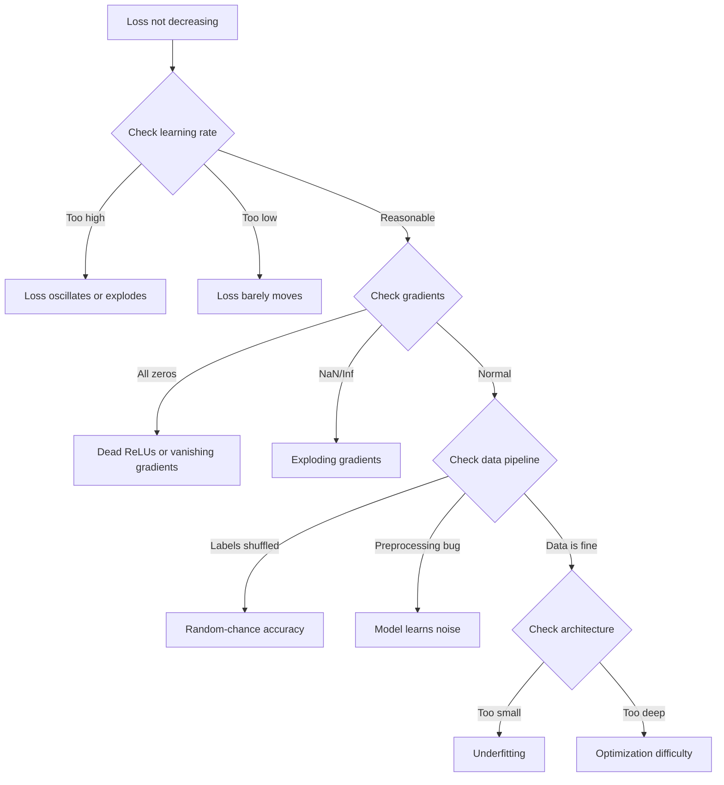
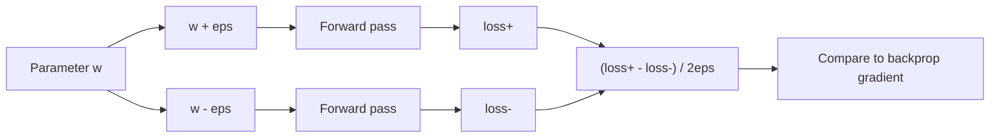
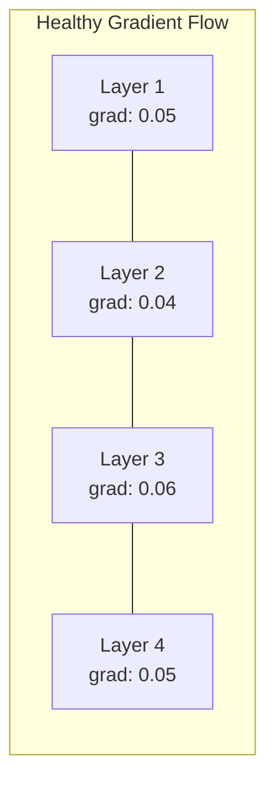
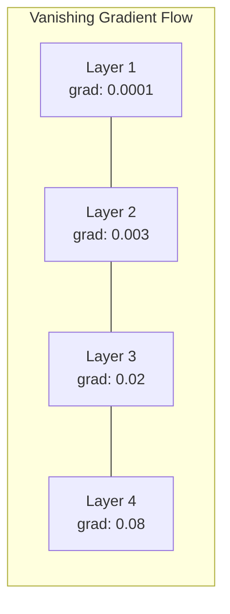
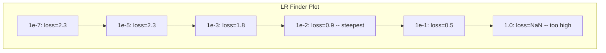

# 除錯神經網路 (Debugging Neural Networks)

> 你的網路編譯成功了。它跑完了。它吐出一個數字。這個數字是錯的，而且沒有任何東西當掉。歡迎來到最難的那種除錯：完全沒有錯誤訊息的那種。

**Type:** Build
**Languages:** Python, PyTorch
**Prerequisites:** Phase 03 Lessons 01-10 (especially backpropagation, loss functions, optimizers)
**Time:** ~90 分鐘

## 學習目標 (Learning Objectives)

- 用系統化的除錯策略，診斷常見的神經網路失效狀況（NaN loss、平坦的 loss 曲線、overfitting、震盪）
- 套用「overfit one batch」技巧，驗證你的模型架構與訓練迴圈是正確的
- 檢查 gradient 大小、activation 分布和 weight norm，找出 vanishing/exploding gradient 問題
- 建立一份除錯檢查表，涵蓋資料管線、模型架構、loss function、optimizer 和 learning rate 的問題

## 問題 (The Problem)

傳統軟體壞掉的時候會當機。null pointer 會丟出例外。型別不符會在編譯時失敗。off-by-one 錯誤會產生明顯錯誤的輸出。

神經網路不會給你這種待遇。

一個壞掉的神經網路會跑完整個流程，印出 loss 值，並輸出預測。loss 可能還在下降。預測看起來也許還算合理。但模型其實默默地錯了：它在學捷徑、背雜訊，或是收斂到一個沒用的 local minimum。Google 的研究人員估計，ML 除錯時間有 60-70% 都花在那些「無聲」的 bug 上：它們不產生任何錯誤，卻會降低模型品質。

一個能運作的模型和一個壞掉的模型之間的差別，常常只是放錯位置的一行：漏掉的 `zero_grad()`、轉置錯誤的維度、差了 10 倍的 learning rate。經典的「Recipe for Training Neural Networks」(2019) 開頭就說：「最常見的神經網路錯誤，是不會讓程式當掉的 bug。」

這堂課教你找出那些 bug。

## 核心概念 (The Concept)

### 除錯的心態 (The Debugging Mindset)

忘掉印出來碰運氣的除錯方式吧。神經網路的除錯需要系統化的方法，因為回饋迴圈很慢（每次訓練要幾分鐘到幾小時），而且症狀很模糊（loss 不好可能代表 20 種不同的原因）。

黃金法則：**從簡單開始，一次只加一個複雜度，並獨立驗證每一個部分。**



### 症狀 1：Loss 沒有下降 (Symptom 1: Loss Not Decreasing)

這是最常見的抱怨。訓練迴圈在跑，epoch 一個個過去，loss 卻維持平坦或劇烈震盪。

**Learning rate 不對。** 太高：loss 震盪或跳到 NaN。太低：loss 下降得太慢，看起來像平的。Adam 從 1e-3 開始。SGD 從 1e-1 或 1e-2 開始。在斷定是別的問題之前，一定要先試 3 個各差 10 倍的 learning rate（例如 1e-2、1e-3、1e-4）。

**Dead ReLU。** 如果 ReLU neuron 收到很大的負輸入，它輸出 0，gradient 也是 0。它再也不會被 activate。如果夠多 neuron 死掉，網路就學不起來。檢查方式：印出每個 ReLU layer 之後恰好為 0 的 activation 比例。如果 >50% 都死了，就換成 LeakyReLU 或降低 learning rate。

**Vanishing gradient。** 在使用 sigmoid 或 tanh activation 的深層網路中，gradient 往回傳的過程中會呈指數級縮小。等到它們抵達第一層，已經趨近 ~0。最前面的 layer 就停止學習了。修法：使用 ReLU/GELU、加入 residual connection，或使用 batch normalization。

**Exploding gradient。** 相反的問題：gradient 呈指數級成長。常見於 RNN 和非常深的網路。Loss 跳到 NaN。修法：gradient clipping（`torch.nn.utils.clip_grad_norm_`）、降低 learning rate，或加入 normalization。

### 症狀 2：Loss 在下降但模型很差 (Symptom 2: Loss Decreasing But Model is Bad)

Loss 往下走。訓練 accuracy 達到 99%。但測試 accuracy 是 55%。或者模型在真實資料上產生毫無意義的輸出。

**Overfitting。** 模型背下了訓練資料，而不是學到規律。訓練與驗證 loss 之間的差距隨時間擴大。修法：更多資料、dropout、weight decay、early stopping、data augmentation。

**Data leakage。** 測試資料洩漏到訓練中。Accuracy 高得可疑。常見原因：在切分之前先洗牌、用完整資料集的統計量做前處理、各個切分之間有重複樣本。修法：先切分，再前處理，並檢查重複。

**Label 錯誤。** 大多數真實資料集中有 5-10% 的 label 是錯的（Northcutt et al., 2021 -- "Pervasive Label Errors in Test Sets"）。模型學到了雜訊。修法：用 confident learning 找出並修正標錯的範例，或用 loss truncation 忽略 loss 很高的樣本。

### 症狀 3：Loss 出現 NaN 或 Inf (Symptom 3: NaN or Inf in Loss)

Loss 值變成 `nan` 或 `inf`。訓練就此死亡。

**Learning rate 太高。** Gradient 更新衝過頭，讓 weight 爆炸。修法：降低 10 倍。

**log(0) 或 log(負數)。** Cross-entropy loss 計算 `log(p)`。如果你的模型輸出恰好是 0 或負的機率，log 就會爆炸。修法：把預測值 clamp 到 `[eps, 1-eps]`，其中 `eps=1e-7`。

**除以零。** Batch normalization 會除以標準差。一個值全都相同的 batch，其 std=0。修法：在分母加上 epsilon（PyTorch 預設會這麼做，但自訂實作可能沒有）。

**數值溢位。** 把很大的 activation 餵進 `exp()` 會產生 Inf。Softmax 特別容易遇到。修法：在取指數之前先減去最大值（log-sum-exp 技巧）。

### 技巧 1：Gradient Checking (Technique 1: Gradient Checking)

把你的解析 gradient（來自 backprop）與數值 gradient（來自有限差分）做比較。如果兩者不一致，你的 backward pass 就有 bug。

參數 `w` 的數值 gradient：

```math
\text{grad\_numerical} = \frac{\text{loss}(w + \text{eps}) - \text{loss}(w - \text{eps})}{2 \cdot \text{eps}}
```

一致性指標（相對差異）：

```math
\text{rel\_diff} = \frac{\lvert \text{grad\_analytical} - \text{grad\_numerical} \rvert}{\max(\lvert \text{grad\_analytical} \rvert, \lvert \text{grad\_numerical} \rvert, 10^{-8})}
```

如果 `rel_diff < 1e-5`：正確。如果 `rel_diff > 1e-3`：幾乎可以確定有 bug。



### 技巧 2：Activation 統計量 (Technique 2: Activation Statistics)

訓練期間監控每一層之後 activation 的平均值與標準差。健康的網路會讓 activation 的平均值接近 0、std 接近 1（正規化之後），或至少是有界的。

| 健康指標 | Mean | Std | 診斷 |
|-----------------|------|-----|-----------|
| 健康 | ~0 | ~1 | 網路正常學習中 |
| 飽和 | >>0 或 <<0 | ~0 | Activation 卡在極端值 |
| 死亡 | 0 | 0 | Neuron 已死（全為零） |
| 爆炸 | >>10 | >>10 | Activation 無限制地成長 |

### 技巧 3：Gradient 流動視覺化 (Technique 3: Gradient Flow Visualization)

畫出每一層的平均 gradient 大小。在健康的網路中，各層的 gradient 大小應該大致相近。如果前面幾層的 gradient 比後面幾層小 1000 倍，你就有 vanishing gradient。





### 技巧 4：Overfit-One-Batch 測試 (Technique 4: The Overfit-One-Batch Test)

deep learning 中最重要的單一除錯技巧。

拿一個小 batch（8-32 筆樣本）。在上面訓練 100 次以上的迭代。loss 應該降到接近零，訓練 accuracy 應該達到 100%。如果沒有，你的模型或訓練迴圈有根本上的 bug：不要繼續進行完整訓練。

這個測試能抓到：
- 壞掉的 loss function
- 壞掉的 backward pass
- 架構太小，無法表示這些資料
- Optimizer 沒有連接到模型參數
- 資料與 label 沒有對齊

這個測試跑起來只要 30 秒，卻能省下好幾個小時除錯完整訓練的時間。

### 技巧 5：Learning Rate Finder (Technique 5: Learning Rate Finder)

Leslie Smith (2017) 提出：在一個 epoch 內，把 learning rate 從非常小（1e-7）掃到非常大（10），同時記錄 loss。畫出 loss 對 learning rate 的圖。最佳 learning rate 大約比 loss 下降最快的那個 rate 小 10 倍。



這個例子中最佳的 LR：約 1e-3（在最陡的那一點之前一個數量級）。

### 常見的 PyTorch Bug (Common PyTorch Bugs)

這些是在 PyTorch 社群中浪費最多集體時間的 bug：

| Bug | 症狀 | 修法 |
|-----|---------|-----|
| 忘了 `optimizer.zero_grad()` | Gradient 在各個 batch 之間累積，loss 震盪 | 在 `loss.backward()` 之前加上 `optimizer.zero_grad()` |
| 測試時忘了 `model.eval()` | Dropout 和 batch norm 的行為不同，各次執行的測試 accuracy 不一致 | 加上 `model.eval()` 和 `torch.no_grad()` |
| Tensor shape 錯誤 | 悄悄的 broadcasting 產生錯誤的結果，卻沒有錯誤訊息 | 除錯時在每個運算之後印出 shape |
| CPU/GPU 不一致 | `RuntimeError: expected CUDA tensor` | 對模型「和」資料都使用 `.to(device)` |
| 沒有 detach tensor | Computation graph 無限成長，OOM | 使用 `.detach()` 或 `with torch.no_grad()` |
| In-place 運算破壞 autograd | `RuntimeError: modified by in-place operation` | 把 `x += 1` 換成 `x = x + 1` |
| 資料沒有正規化 | Loss 卡在隨機猜測的水準 | 把輸入正規化成 mean=0、std=1 |
| Label 的 dtype 錯誤 | Cross-entropy 預期 `Long`，卻拿到 `Float` | 轉型 label：`labels.long()` |

### 終極除錯表 (The Master Debugging Table)

| 症狀 | 可能原因 | 第一件要試的事 |
|---------|-------------|-------------------|
| Loss 卡在 -log(1/num_classes) | 模型在預測均勻分布 | 檢查資料管線，確認 label 與輸入相符 |
| Loss 在幾步之後變成 NaN | Learning rate 太高 | 把 LR 降低 10 倍 |
| Loss 立刻變成 NaN | log(0) 或除以零 | 在 log/除法運算中加上 epsilon |
| Loss 劇烈震盪 | LR 太高或 batch size 太小 | 降低 LR，增加 batch size |
| Loss 下降後進入平原期 | 對 fine-tuning 階段來說 LR 太高 | 加上 LR schedule（cosine 或 step decay） |
| 訓練 acc 高，測試 acc 低 | Overfitting | 加入 dropout、weight decay、更多資料 |
| 訓練 acc = 測試 acc = 隨機猜測 | 模型什麼都沒學到 | 執行 overfit-one-batch 測試 |
| 訓練 acc = 測試 acc 但兩者都低 | Underfitting | 更大的模型、更多層、更多 feature |
| Gradient 全為零 | Dead ReLU 或 computation graph 被 detach | 換成 LeakyReLU，檢查 `.requires_grad` |
| 訓練時記憶體不足 | Batch 太大或 graph 沒有釋放 | 降低 batch size，評估時使用 `torch.no_grad()` |

```figure
learning-curves
```

## 動手做 (Build It)

一套診斷工具組，用來監控 activation、gradient 和 loss 曲線。你會刻意弄壞一個網路，並用這套工具組診斷每一個問題。

### 步驟 1：NetworkDebugger Class

掛接到 PyTorch 模型，逐層記錄 activation 和 gradient 的統計量。

```python
import torch
import torch.nn as nn
import math


class NetworkDebugger:
    def __init__(self, model):
        self.model = model
        self.activation_stats = {}
        self.gradient_stats = {}
        self.loss_history = []
        self.lr_losses = []
        self.hooks = []
        self._register_hooks()

    def _register_hooks(self):
        for name, module in self.model.named_modules():
            if isinstance(module, (nn.Linear, nn.Conv2d, nn.ReLU, nn.LeakyReLU)):
                hook = module.register_forward_hook(self._make_activation_hook(name))
                self.hooks.append(hook)
                hook = module.register_full_backward_hook(self._make_gradient_hook(name))
                self.hooks.append(hook)

    def _make_activation_hook(self, name):
        def hook(module, input, output):
            with torch.no_grad():
                out = output.detach().float()
                self.activation_stats[name] = {
                    "mean": out.mean().item(),
                    "std": out.std().item(),
                    "fraction_zero": (out == 0).float().mean().item(),
                    "min": out.min().item(),
                    "max": out.max().item(),
                }
        return hook

    def _make_gradient_hook(self, name):
        def hook(module, grad_input, grad_output):
            if grad_output[0] is not None:
                with torch.no_grad():
                    grad = grad_output[0].detach().float()
                    self.gradient_stats[name] = {
                        "mean": grad.mean().item(),
                        "std": grad.std().item(),
                        "abs_mean": grad.abs().mean().item(),
                        "max": grad.abs().max().item(),
                    }
        return hook

    def record_loss(self, loss_value):
        self.loss_history.append(loss_value)

    def check_loss_health(self):
        if len(self.loss_history) < 2:
            return "NOT_ENOUGH_DATA"
        recent = self.loss_history[-10:]
        if any(math.isnan(v) or math.isinf(v) for v in recent):
            return "NAN_OR_INF"
        if len(self.loss_history) >= 20:
            first_half = sum(self.loss_history[:10]) / 10
            second_half = sum(self.loss_history[-10:]) / 10
            if second_half >= first_half * 0.99:
                return "NOT_DECREASING"
        if len(recent) >= 5:
            diffs = [recent[i+1] - recent[i] for i in range(len(recent)-1)]
            if max(diffs) - min(diffs) > 2 * abs(sum(diffs) / len(diffs)):
                return "OSCILLATING"
        return "HEALTHY"

    def check_activations(self):
        issues = []
        for name, stats in self.activation_stats.items():
            if stats["fraction_zero"] > 0.5:
                issues.append(f"DEAD_NEURONS: {name} has {stats['fraction_zero']:.0%} zero activations")
            if abs(stats["mean"]) > 10:
                issues.append(f"EXPLODING_ACTIVATIONS: {name} mean={stats['mean']:.2f}")
            if stats["std"] < 1e-6:
                issues.append(f"COLLAPSED_ACTIVATIONS: {name} std={stats['std']:.2e}")
        return issues if issues else ["HEALTHY"]

    def check_gradients(self):
        issues = []
        grad_magnitudes = []
        for name, stats in self.gradient_stats.items():
            grad_magnitudes.append((name, stats["abs_mean"]))
            if stats["abs_mean"] < 1e-7:
                issues.append(f"VANISHING_GRADIENT: {name} abs_mean={stats['abs_mean']:.2e}")
            if stats["abs_mean"] > 100:
                issues.append(f"EXPLODING_GRADIENT: {name} abs_mean={stats['abs_mean']:.2e}")
        if len(grad_magnitudes) >= 2:
            first_mag = grad_magnitudes[0][1]
            last_mag = grad_magnitudes[-1][1]
            if last_mag > 0 and first_mag / last_mag > 100:
                issues.append(f"GRADIENT_RATIO: first/last = {first_mag/last_mag:.0f}x (vanishing)")
        return issues if issues else ["HEALTHY"]

    def print_report(self):
        print("\n=== NETWORK DEBUGGER REPORT ===")
        print(f"\nLoss health: {self.check_loss_health()}")
        if self.loss_history:
            print(f"  Last 5 losses: {[f'{v:.4f}' for v in self.loss_history[-5:]]}")
        print("\nActivation diagnostics:")
        for item in self.check_activations():
            print(f"  {item}")
        print("\nGradient diagnostics:")
        for item in self.check_gradients():
            print(f"  {item}")
        print("\nPer-layer activation stats:")
        for name, stats in self.activation_stats.items():
            print(f"  {name}: mean={stats['mean']:.4f} std={stats['std']:.4f} zero={stats['fraction_zero']:.1%}")
        print("\nPer-layer gradient stats:")
        for name, stats in self.gradient_stats.items():
            print(f"  {name}: abs_mean={stats['abs_mean']:.2e} max={stats['max']:.2e}")

    def remove_hooks(self):
        for hook in self.hooks:
            hook.remove()
        self.hooks.clear()
```

### 步驟 2：Overfit-One-Batch 測試

```python
def overfit_one_batch(model, x_batch, y_batch, criterion, lr=0.01, steps=200):
    optimizer = torch.optim.Adam(model.parameters(), lr=lr)
    model.train()
    print("\n=== OVERFIT ONE BATCH TEST ===")
    print(f"Batch size: {x_batch.shape[0]}, Steps: {steps}")

    for step in range(steps):
        optimizer.zero_grad()
        output = model(x_batch)
        loss = criterion(output, y_batch)
        loss.backward()
        optimizer.step()

        if step % 50 == 0 or step == steps - 1:
            with torch.no_grad():
                preds = (output > 0).float() if output.shape[-1] == 1 else output.argmax(dim=1)
                targets = y_batch if y_batch.dim() == 1 else y_batch.squeeze()
                acc = (preds.squeeze() == targets).float().mean().item()
            print(f"  Step {step:3d} | Loss: {loss.item():.6f} | Accuracy: {acc:.1%}")

    final_loss = loss.item()
    if final_loss > 0.1:
        print(f"\n  FAIL: Loss did not converge ({final_loss:.4f}). Model or training loop is broken.")
        return False
    print(f"\n  PASS: Loss converged to {final_loss:.6f}")
    return True
```

### 步驟 3：Learning Rate Finder

```python
def find_learning_rate(model, x_data, y_data, criterion, start_lr=1e-7, end_lr=10, steps=100):
    import copy
    original_state = copy.deepcopy(model.state_dict())
    optimizer = torch.optim.SGD(model.parameters(), lr=start_lr)
    lr_mult = (end_lr / start_lr) ** (1 / steps)

    model.train()
    results = []
    best_loss = float("inf")
    current_lr = start_lr

    print("\n=== LEARNING RATE FINDER ===")

    for step in range(steps):
        optimizer.zero_grad()
        output = model(x_data)
        loss = criterion(output, y_data)

        if math.isnan(loss.item()) or loss.item() > best_loss * 10:
            break

        best_loss = min(best_loss, loss.item())
        results.append((current_lr, loss.item()))

        loss.backward()
        optimizer.step()

        current_lr *= lr_mult
        for param_group in optimizer.param_groups:
            param_group["lr"] = current_lr

    model.load_state_dict(original_state)

    if len(results) < 10:
        print("  Could not complete LR sweep -- loss diverged too quickly")
        return results

    min_loss_idx = min(range(len(results)), key=lambda i: results[i][1])
    suggested_lr = results[max(0, min_loss_idx - 10)][0]

    print(f"  Swept {len(results)} steps from {start_lr:.0e} to {results[-1][0]:.0e}")
    print(f"  Minimum loss {results[min_loss_idx][1]:.4f} at lr={results[min_loss_idx][0]:.2e}")
    print(f"  Suggested learning rate: {suggested_lr:.2e}")

    return results
```

### 步驟 4：Gradient Checker

```python
def _flat_to_multi_index(flat_idx, shape):
    multi_idx = []
    remaining = flat_idx
    for dim in reversed(shape):
        multi_idx.insert(0, remaining % dim)
        remaining //= dim
    return tuple(multi_idx)


def gradient_check(model, x, y, criterion, eps=1e-4):
    model.train()
    x_double = x.double()
    y_double = y.double()
    model_double = model.double()

    print("\n=== GRADIENT CHECK ===")
    overall_max_diff = 0
    checked = 0

    for name, param in model_double.named_parameters():
        if not param.requires_grad:
            continue

        layer_max_diff = 0

        model_double.zero_grad()
        output = model_double(x_double)
        loss = criterion(output, y_double)
        loss.backward()
        analytical_grad = param.grad.clone()

        num_checks = min(5, param.numel())
        for i in range(num_checks):
            idx = _flat_to_multi_index(i, param.shape)
            original = param.data[idx].item()

            param.data[idx] = original + eps
            with torch.no_grad():
                loss_plus = criterion(model_double(x_double), y_double).item()

            param.data[idx] = original - eps
            with torch.no_grad():
                loss_minus = criterion(model_double(x_double), y_double).item()

            param.data[idx] = original

            numerical = (loss_plus - loss_minus) / (2 * eps)
            analytical = analytical_grad[idx].item()

            denom = max(abs(numerical), abs(analytical), 1e-8)
            rel_diff = abs(numerical - analytical) / denom

            layer_max_diff = max(layer_max_diff, rel_diff)
            checked += 1

        overall_max_diff = max(overall_max_diff, layer_max_diff)
        status = "OK" if layer_max_diff < 1e-5 else "MISMATCH"
        print(f"  {name}: max_rel_diff={layer_max_diff:.2e} [{status}]")

    model.float()

    print(f"\n  Checked {checked} parameters")
    if overall_max_diff < 1e-5:
        print("  PASS: Gradients match (rel_diff < 1e-5)")
    elif overall_max_diff < 1e-3:
        print("  WARN: Small differences (1e-5 < rel_diff < 1e-3)")
    else:
        print("  FAIL: Gradient mismatch detected (rel_diff > 1e-3)")
    return overall_max_diff
```

### 步驟 5：刻意弄壞的網路 (Deliberately Broken Networks)

現在把工具組套用到壞掉的網路上，診斷每一個問題。

```python
def demo_broken_networks():
    torch.manual_seed(42)
    x = torch.randn(64, 10)
    y = (x[:, 0] > 0).long()

    print("\n" + "=" * 60)
    print("BUG 1: Learning rate too high (lr=10)")
    print("=" * 60)
    model1 = nn.Sequential(nn.Linear(10, 32), nn.ReLU(), nn.Linear(32, 2))
    debugger1 = NetworkDebugger(model1)
    optimizer1 = torch.optim.SGD(model1.parameters(), lr=10.0)
    criterion = nn.CrossEntropyLoss()
    for step in range(20):
        optimizer1.zero_grad()
        out = model1(x)
        loss = criterion(out, y)
        debugger1.record_loss(loss.item())
        loss.backward()
        optimizer1.step()
    debugger1.print_report()
    debugger1.remove_hooks()

    print("\n" + "=" * 60)
    print("BUG 2: Dead ReLUs from bad initialization")
    print("=" * 60)
    model2 = nn.Sequential(nn.Linear(10, 32), nn.ReLU(), nn.Linear(32, 32), nn.ReLU(), nn.Linear(32, 2))
    with torch.no_grad():
        for m in model2.modules():
            if isinstance(m, nn.Linear):
                m.weight.fill_(-1.0)
                m.bias.fill_(-5.0)
    debugger2 = NetworkDebugger(model2)
    optimizer2 = torch.optim.Adam(model2.parameters(), lr=1e-3)
    for step in range(50):
        optimizer2.zero_grad()
        out = model2(x)
        loss = criterion(out, y)
        debugger2.record_loss(loss.item())
        loss.backward()
        optimizer2.step()
    debugger2.print_report()
    debugger2.remove_hooks()

    print("\n" + "=" * 60)
    print("BUG 3: Missing zero_grad (gradients accumulate)")
    print("=" * 60)
    model3 = nn.Sequential(nn.Linear(10, 32), nn.ReLU(), nn.Linear(32, 2))
    debugger3 = NetworkDebugger(model3)
    optimizer3 = torch.optim.SGD(model3.parameters(), lr=0.01)
    for step in range(50):
        out = model3(x)
        loss = criterion(out, y)
        debugger3.record_loss(loss.item())
        loss.backward()
        optimizer3.step()
    debugger3.print_report()
    debugger3.remove_hooks()

    print("\n" + "=" * 60)
    print("HEALTHY NETWORK: Correct setup for comparison")
    print("=" * 60)
    model_good = nn.Sequential(nn.Linear(10, 32), nn.ReLU(), nn.Linear(32, 2))
    debugger_good = NetworkDebugger(model_good)
    optimizer_good = torch.optim.Adam(model_good.parameters(), lr=1e-3)
    for step in range(50):
        optimizer_good.zero_grad()
        out = model_good(x)
        loss = criterion(out, y)
        debugger_good.record_loss(loss.item())
        loss.backward()
        optimizer_good.step()
    debugger_good.print_report()
    debugger_good.remove_hooks()

    print("\n" + "=" * 60)
    print("OVERFIT-ONE-BATCH TEST (healthy model)")
    print("=" * 60)
    model_test = nn.Sequential(nn.Linear(10, 32), nn.ReLU(), nn.Linear(32, 2))
    overfit_one_batch(model_test, x[:8], y[:8], criterion)

    print("\n" + "=" * 60)
    print("LEARNING RATE FINDER")
    print("=" * 60)
    model_lr = nn.Sequential(nn.Linear(10, 32), nn.ReLU(), nn.Linear(32, 2))
    find_learning_rate(model_lr, x, y, criterion)

    print("\n" + "=" * 60)
    print("GRADIENT CHECK")
    print("=" * 60)
    model_grad = nn.Sequential(nn.Linear(10, 8), nn.ReLU(), nn.Linear(8, 2))
    gradient_check(model_grad, x[:4], y[:4], criterion)
```

## 實際使用 (Use It)

### PyTorch 內建工具 (PyTorch Built-in Tools)

```python
import torch
import torch.nn as nn

model = nn.Sequential(
    nn.Linear(768, 256),
    nn.ReLU(),
    nn.Linear(256, 10),
)

with torch.autograd.detect_anomaly():
    output = model(input_tensor)
    loss = criterion(output, target)
    loss.backward()

for name, param in model.named_parameters():
    if param.grad is not None:
        print(f"{name}: grad_mean={param.grad.abs().mean():.2e}")
```

### 整合 Weights & Biases (Weights & Biases Integration)

```python
import wandb

wandb.init(project="debug-training")

for epoch in range(100):
    loss = train_one_epoch()
    wandb.log({
        "loss": loss,
        "lr": optimizer.param_groups[0]["lr"],
        "grad_norm": torch.nn.utils.clip_grad_norm_(model.parameters(), float("inf")),
    })

    for name, param in model.named_parameters():
        if param.grad is not None:
            wandb.log({f"grad/{name}": wandb.Histogram(param.grad.cpu().numpy())})
```

### TensorBoard

```python
from torch.utils.tensorboard import SummaryWriter

writer = SummaryWriter("runs/debug_experiment")

for epoch in range(100):
    loss = train_one_epoch()
    writer.add_scalar("Loss/train", loss, epoch)

    for name, param in model.named_parameters():
        writer.add_histogram(f"weights/{name}", param, epoch)
        if param.grad is not None:
            writer.add_histogram(f"gradients/{name}", param.grad, epoch)
```

### 除錯檢查表（完整訓練之前）(The Debug Checklist (Before Full Training))

1. 執行 overfit-one-batch 測試。如果失敗，就停下來。
2. 印出模型摘要，確認參數量合理。
3. 用隨機資料跑一次 forward pass，檢查輸出 shape。
4. 訓練 5 個 epoch，確認 loss 有下降。
5. 檢查 activation 統計量：沒有死掉的 layer，沒有爆炸。
6. 檢查 gradient 流動：沒有 vanishing，沒有 exploding。
7. 驗證資料管線：印出 5 筆隨機樣本與它們的 label。

## 交付 (Ship It)

這堂課產出：
- `outputs/prompt-nn-debugger.md` -- 一個 prompt，用來診斷神經網路訓練失敗
- `outputs/skill-debug-checklist.md` -- 一份決策樹形式的檢查表，用來除錯訓練問題

除錯的關鍵部署模式：
- 把監控 hook 加到正式的訓練腳本中
- 每 N 步把 activation 和 gradient 統計量記錄到 W&B 或 TensorBoard
- 針對 NaN loss、dead neuron（>80% 為零）或 gradient 爆炸，實作自動警示
- 每當更改架構或資料管線時，一定要執行 overfit-one-batch 測試

## 練習 (Exercises)

1. **加入 exploding gradient 偵測器。** 修改 `NetworkDebugger`，讓它在 gradient 超過門檻時偵測到，並自動建議 gradient clipping 的值。在一個沒有 normalization 的 20 層網路上測試。

2. **建立 dead neuron 復活器。** 寫一個函數，找出 dead ReLU neuron（永遠輸出 0），並用 Kaiming 初始化重新初始化它們的輸入 weight。示範這能讓一個 >70% neuron 都已死亡的網路恢復。

3. **實作附帶繪圖的 learning rate finder。** 擴充 `find_learning_rate`，把結果存成 CSV，再寫一個獨立的腳本讀取該 CSV，並用 matplotlib 顯示 LR 對 loss 的曲線。找出 ResNet-18 在 CIFAR-10 上的最佳 LR。

4. **建立資料管線驗證器。** 寫一個函數，檢查：train/test 切分之間的重複樣本、label 分布不平衡（>10:1 的比例）、輸入正規化（mean 接近 0、std 接近 1），以及資料中的 NaN/Inf 值。在一個刻意損壞的資料集上執行它。

5. **除錯一個真實的失敗。** 拿第 10 課的 mini-framework，引入一個細微的 bug（例如在 backward 中轉置 weight matrix），並用 gradient checking 精確找出哪個參數的 gradient 不正確。記錄你的除錯過程。

## 關鍵術語 (Key Terms)

| Term | 一般說法 | 實際意義 |
|------|----------------|----------------------|
| Silent bug | 「程式能跑但結果很差」 | 不產生任何錯誤、卻會降低模型品質的 bug：ML 中最主要的失效模式 |
| Dead ReLU | 「neuron 死掉了」 | 輸入永遠為負的 ReLU neuron，因此輸出 0，並永久收到 0 的 gradient |
| Vanishing gradients | 「前面的 layer 停止學習」 | Gradient 在各層之間呈指數級縮小，讓前面 layer 的 weight 實質上被凍結 |
| Exploding gradients | 「Loss 變成 NaN」 | Gradient 在各層之間呈指數級成長，造成大到溢位的 weight 更新 |
| Gradient checking | 「驗證 backprop 是對的」 | 把 backprop 算出的解析 gradient，與有限差分算出的數值 gradient 做比較 |
| Overfit-one-batch | 「最重要的除錯測試」 | 在單一小 batch 上訓練，驗證模型「能夠」學習：如果做不到，代表有根本性的問題 |
| LR finder | 「掃描以找出正確的 learning rate」 | 在一個 epoch 內以指數方式增加 learning rate，並挑選 loss 發散之前的那個 rate |
| Data leakage | 「測試資料洩漏到訓練中」 | 當測試集的資訊污染了訓練，產生人為偏高的 accuracy |
| Activation statistics | 「監控 layer 的健康狀態」 | 追蹤每一層輸出的 mean、std 與零值比例，以偵測 dead、飽和或爆炸的 neuron |
| Gradient clipping | 「限制 gradient 大小」 | 當 gradient 的 norm 超過門檻時將其縮小，防止 gradient 更新爆炸 |

## 延伸閱讀 (Further Reading)

- Smith, "Cyclical Learning Rates for Training Neural Networks" (2017) -- 提出 learning rate range test（LR finder）的論文
- Northcutt et al., "Pervasive Label Errors in Test Sets Destabilize Machine Learning Benchmarks" (2021) -- 證明 ImageNet、CIFAR-10 和其他主要 benchmark 中有 3-6% 的 label 是錯的
- Zhang et al., "Understanding Deep Learning Requires Rethinking Generalization" (2017) -- 顯示神經網路能背下隨機 label 的論文，這也是 overfit-one-batch 測試之所以有效的原因
- PyTorch documentation on `torch.autograd.detect_anomaly` and `torch.autograd.set_detect_anomaly` for built-in NaN/Inf detection
