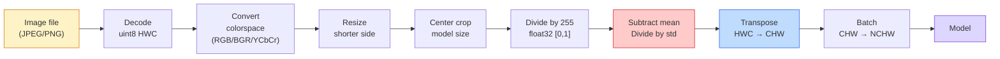
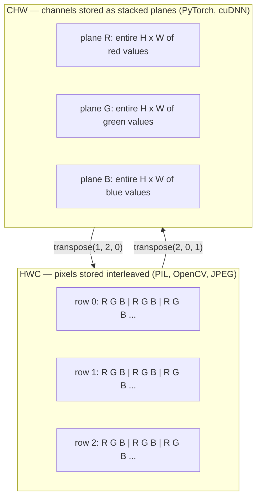

# 影像基礎：像素、通道、色彩空間 (Image Fundamentals — Pixels, Channels, Color Spaces)

> 影像就是一個由光線取樣值組成的 tensor。你會用到的每一個視覺模型，都從這個事實出發。

**Type:** Build
**Languages:** Python
**Prerequisites:** Phase 1 Lesson 12 (Tensor Operations), Phase 3 Lesson 11 (Intro to PyTorch)
**Time:** ~45 分鐘

## 學習目標 (Learning Objectives)

- 說明連續的場景如何被離散化成像素，以及為什麼取樣與量化的決定，會替所有下游模型設下上限
- 把影像當成 NumPy 陣列來讀取、切片與檢查，並能流暢地在 HWC 與 CHW 排列方式之間切換
- 在 RGB、grayscale、HSV 與 YCbCr 之間轉換，並說明每一種色彩空間為什麼存在
- 用預訓練 PyTorch 視覺模型所期待的方式，做像素層級的前處理（normalize、standardize、resize、channel-first）

## 問題 (The Problem)

你讀到的每一篇論文、下載的每一份預訓練權重、呼叫的每一個視覺 API，都假設輸入有特定的編碼方式。模型要的是 `float32`，你卻傳 `uint8` 影像進去，它照樣會跑，然後默默吐出一堆垃圾。把 BGR 餵給用 RGB 訓練的網路，準確率會掉十個百分點。模型期待 channels-first，你卻給 channels-last，第一層 conv 就會把高度當成特徵通道。這些都不會丟出錯誤，只會把你的指標搞爛，然後你花一整個禮拜去抓一個其實出在讀檔方式的 bug。

只要知道卷積 (convolution) 是在什麼東西上滑動，它並不複雜。困難的地方在於，「影像」對相機、JPEG decoder、PIL、OpenCV、torchvision 和 CUDA kernel 來說，意思都不一樣。每個工具堆疊都有自己的軸順序、位元組範圍與通道慣例。分不清這些的視覺工程師，交付出去的就是壞掉的 pipeline。

這堂課先把地基打穩，讓這個階段 (phase) 後面的內容可以在上面蓋。學完之後，你會知道像素是什麼、為什麼每個像素有三個數字而不是一個、「用 ImageNet 統計值做 normalize」實際上在做什麼，以及怎麼在這個階段其他課程會假設的兩三種排列方式之間轉換。

## 核心概念 (The Concept)

### 完整前處理 pipeline 一覽 (The full preprocessing pipeline at a glance)

每一個正式上線的視覺系統，都是同一串可逆轉換。只要錯一步，模型看到的輸入就和訓練時不一樣。



圖中紅色和藍色的方塊，就是 80% 默默失敗發生的地方：少了 standardization，以及排列方式錯誤。

### 像素是一個取樣，不是一個方塊 (A pixel is a sample, not a square)

相機感光元件會計算落在一格格微小偵測器上的光子數。每個偵測器在幾分之一秒內累積光線，並輸出與光子數成正比的電壓。感光元件接著把這個電壓離散化成整數。一個偵測器就變成一個像素。

```
Continuous scene                 Sensor grid                     Digital image
(infinite detail)                (H x W detectors)               (H x W integers)

    ~~~~~                        +--+--+--+--+--+                 210 198 180 155 120
   ~   ~   ~                     |  |  |  |  |  |                 205 195 178 152 118
  ~ light ~      ---->           +--+--+--+--+--+     ---->       200 190 175 150 115
   ~~~~~                         |  |  |  |  |  |                 195 185 170 148 112
                                 +--+--+--+--+--+                 188 180 165 145 108
```

這一步有兩個選擇，它們決定了所有下游工作的上限：

- **空間取樣 (Spatial sampling)** 決定場景中每一度要放多少偵測器。太少，邊緣會變成鋸齒狀 (aliasing)。太多，儲存與運算量就會爆炸。
- **強度量化 (Intensity quantization)** 決定電壓要分成多細的級距。8 bits 有 256 個等級，是顯示器的標準。10、12、16 bits 的漸層更平滑，在醫學影像、HDR 和 raw sensor pipeline 中很重要。

像素不是一個有面積的彩色方塊，它只是一個單一的量測值。當你 resize 或旋轉時，其實是在對這個量測網格重新取樣。

### 為什麼是三個通道 (Why three channels)

一個偵測器會計算整個可見光譜的光子，這就是 grayscale。要得到顏色，感光元件會在網格上蓋一層紅、綠、藍濾鏡的馬賽克。經過 demosaicing 之後，每個空間位置都有三個整數：紅色濾鏡偵測器、綠色濾鏡偵測器、藍色濾鏡偵測器（在附近）的響應值。這三個整數就是一個像素的 RGB triplet。

```
One pixel in memory:

    (R, G, B) = (210, 140, 30)   <- reddish-orange

An H x W RGB image:

    shape (H, W, 3)     stored as   H rows of W pixels of 3 values
                                    each in [0, 255] for uint8
```

三並不是什麼魔法數字。深度相機會多加一個 Z 通道。衛星會加上紅外線和紫外線波段。醫學掃描常常只有一個通道（X 光、CT），或有很多通道（hyperspectral）。通道數是最後一個軸，conv 層會學著在這個軸上做混合。

### 兩種排列慣例：HWC 和 CHW (Two layout conventions: HWC and CHW)

同一個 tensor，兩種排列順序。每個函式庫各選一種。

```
HWC (height, width, channels)           CHW (channels, height, width)

   W ->                                    H ->
  +-----+-----+-----+                     +-----+-----+
H |R G B|R G B|R G B|                   C |R R R R R R|
| +-----+-----+-----+                   | +-----+-----+
v |R G B|R G B|R G B|                   v |G G G G G G|
  +-----+-----+-----+                     +-----+-----+
                                          |B B B B B B|
                                          +-----+-----+

   PIL, OpenCV, matplotlib,              PyTorch, most deep learning
   almost every image file on disk       frameworks, cuDNN kernels
```

CHW 會存在，是因為 convolution kernel 是在 H 和 W 上滑動。把通道軸放在最前面，代表每個 kernel 看到的是每個通道一整塊連續的 2D 平面，這樣可以乾淨地向量化。磁碟格式維持 HWC，是因為這和 scanline 從感光元件出來的方式一致。

你會打上千遍的一行轉換：

```
img_chw = img_hwc.transpose(2, 0, 1)      # NumPy
img_chw = img_hwc.permute(2, 0, 1)        # PyTorch tensor
```

記憶體排列的視覺化：



### 位元組範圍與 dtype (Byte ranges and dtype)

主要有三種慣例：

| 慣例 | dtype | 範圍 | 你會在哪裡看到 |
|------------|-------|-------|------------------|
| Raw | `uint8` | [0, 255] | 磁碟上的檔案、PIL、OpenCV 輸出 |
| Normalized | `float32` | [0.0, 1.0] | 執行 `img.astype('float32') / 255` 之後 |
| Standardized | `float32` | 大約 [-2, +2] | 減去 mean 並除以 std 之後 |

卷積網路是用 standardized 的輸入訓練的。ImageNet 統計值 `mean=[0.485, 0.456, 0.406]`、`std=[0.229, 0.224, 0.225]`，是整個 ImageNet 訓練集上三個通道的算術平均與標準差，是以 [0, 1] normalized 後的像素計算出來的。把原始 `uint8` 餵進期待 standardized float 的模型，是應用視覺中最常見的默默失敗。

### 色彩空間與它們存在的原因 (Color spaces and why they exist)

RGB 是擷取格式，但對模型來說不一定是最好用的表示方式。

```
 RGB               HSV                       YCbCr / YUV

 R red             H hue (angle 0-360)       Y luminance (brightness)
 G green           S saturation (0-1)        Cb chroma blue-yellow
 B blue            V value/brightness (0-1)  Cr chroma red-green

 Linear to         Separates color from      Separates brightness from
 sensor output     brightness. Useful for    color. JPEG and most video
                   color thresholding, UI    codecs compress the chroma
                   sliders, simple filters   channels harder because the
                                             human eye is less sensitive
                                             to chroma detail than to Y.
```

大多數現代 CNN 你餵的就是 RGB。遇到下面這些情況時，你才會碰到其他色彩空間：

- **HSV**：傳統 CV 程式、以顏色為基礎的 segmentation、白平衡。
- **YCbCr**：讀 JPEG 內部結構、影片 pipeline、只對 Y 運作的 super-resolution 模型。
- **Grayscale**：OCR、文件模型，以及顏色是干擾變數而不是訊號的任何情況。

由 RGB 轉 grayscale 是加權總和，不是平均，因為人眼對綠色比對紅色或藍色更敏感：

```math
Y = 0.299 R + 0.587 G + 0.114 B \qquad \text{(ITU-R BT.601, the classic weights)}
```

### 長寬比、resize 與 interpolation (Aspect ratio, resizing, and interpolation)

每個模型都有固定的輸入大小（大多數 ImageNet 分類器是 224x224，現代 detector 是 384x384 或 512x512）。你的影像很少剛好符合。重要的三種 resize 選擇：

- **先 resize 短邊，再 center crop**：標準的 ImageNet 做法。保留長寬比，但會丟掉邊緣的一條像素。
- **Resize 後補邊 (pad)**：保留長寬比與每一個像素，但會加上黑邊。是 detection 和 OCR 的標準做法。
- **直接 resize 到目標大小**：把影像拉伸。成本低，會扭曲幾何，對很多分類任務來說沒問題。

當新網格和舊網格沒有對齊時，interpolation 的方法決定中間像素怎麼算：

```
Nearest neighbour     fastest, blocky, only choice for masks/labels
Bilinear              fast, smooth, default for most image resizing
Bicubic               slower, sharper on upscaling
Lanczos               slowest, best quality, used for final display
```

經驗法則：訓練用 bilinear，要給人看的素材用 bicubic 或 lanczos，任何含有整數類別 ID 的資料用 nearest。

```figure
conv-output-size
```

## 動手做 (Build It)

### 步驟 1：建立影像 tensor 並檢查它的 shape (Step 1: Build an image tensor and inspect its shape)

從一張固定的合成影像開始，讓第一個實驗只需要 NumPy 就能離線執行。檔案解碼是另一個獨立的邊界：一旦 JPEG 或 PNG decoder 傳回 RGB 位元組，下面所有的 tensor 運算都一樣。

```python
import numpy as np

def synthetic_rgb(h=128, w=192, seed=0):
    rng = np.random.default_rng(seed)
    yy, xx = np.meshgrid(np.linspace(0, 1, h), np.linspace(0, 1, w), indexing="ij")
    r = (np.sin(xx * 6) * 0.5 + 0.5) * 255
    g = yy * 255
    b = (1 - yy) * xx * 255
    rgb = np.stack([r, g, b], axis=-1) + rng.normal(0, 6, (h, w, 3))
    return np.clip(rgb, 0, 255).astype(np.uint8)

arr = synthetic_rgb()

print(f"type:   {type(arr).__name__}")
print(f"dtype:  {arr.dtype}")
print(f"shape:  {arr.shape}     # (H, W, C)")
print(f"min:    {arr.min()}")
print(f"max:    {arr.max()}")
print(f"pixel at (0, 0): {arr[0, 0]}")
```

預期輸出：`shape: (H, W, 3)`、`dtype: uint8`、範圍 `[0, 255]`。無論位元組來自相機、影像 decoder，還是這個合成產生器，這都是標準的解碼後表示方式。

### 步驟 2：拆開通道並重新排列 layout (Step 2: Split channels and re-order layout)

把 R、G、B 分別取出來，再從 HWC 轉成 PyTorch 用的 CHW。

```python
R = arr[:, :, 0]
G = arr[:, :, 1]
B = arr[:, :, 2]
print(f"R shape: {R.shape}, mean: {R.mean():.1f}")
print(f"G shape: {G.shape}, mean: {G.mean():.1f}")
print(f"B shape: {B.shape}, mean: {B.mean():.1f}")

arr_chw = arr.transpose(2, 0, 1)
print(f"\nHWC shape: {arr.shape}")
print(f"CHW shape: {arr_chw.shape}")
```

三個 grayscale 平面，每個通道一個。CHW 只是重新排列軸；只要記憶體排列允許，嚴格來說不需要複製資料。

### 步驟 3：Grayscale 與 HSV 轉換 (Step 3: Grayscale and HSV conversions)

先做加權總和的 grayscale，再手動做 RGB 轉 HSV。

```python
def rgb_to_grayscale(rgb):
    weights = np.array([0.299, 0.587, 0.114], dtype=np.float32)
    return (rgb.astype(np.float32) @ weights).astype(np.uint8)

def rgb_to_hsv(rgb):
    rgb_f = rgb.astype(np.float32) / 255.0
    r, g, b = rgb_f[..., 0], rgb_f[..., 1], rgb_f[..., 2]
    cmax = np.max(rgb_f, axis=-1)
    cmin = np.min(rgb_f, axis=-1)
    delta = cmax - cmin

    h = np.zeros_like(cmax)
    mask = delta > 0
    argmax = np.argmax(rgb_f, axis=-1)
    rmax = mask & (argmax == 0)
    gmax = mask & (argmax == 1)
    bmax = mask & (argmax == 2)
    h[rmax] = ((g[rmax] - b[rmax]) / delta[rmax]) % 6
    h[gmax] = ((b[gmax] - r[gmax]) / delta[gmax]) + 2
    h[bmax] = ((r[bmax] - g[bmax]) / delta[bmax]) + 4
    h = h * 60.0

    s = np.divide(delta, cmax, out=np.zeros_like(delta), where=cmax > 0)
    v = cmax
    return np.stack([h, s, v], axis=-1)

gray = rgb_to_grayscale(arr)
hsv = rgb_to_hsv(arr)
print(f"gray shape: {gray.shape}, range: [{gray.min()}, {gray.max()}]")
print(f"hsv   shape: {hsv.shape}")
print(f"hue range: [{hsv[..., 0].min():.1f}, {hsv[..., 0].max():.1f}] degrees")
print(f"sat range: [{hsv[..., 1].min():.2f}, {hsv[..., 1].max():.2f}]")
print(f"val range: [{hsv[..., 2].min():.2f}, {hsv[..., 2].max():.2f}]")
```

Hue 以度數表示，saturation 和 value 在 [0, 1] 之間。這符合 OpenCV 的 `hsv_full` 慣例。

### 步驟 4：Normalize、standardize，再還原 (Step 4: Normalize, standardize, and reverse it)

從原始位元組，轉成預訓練 ImageNet 模型所期待的那個確切 tensor，再轉回來。

```python
mean = np.array([0.485, 0.456, 0.406], dtype=np.float32)
std = np.array([0.229, 0.224, 0.225], dtype=np.float32)

def preprocess_imagenet(rgb_uint8):
    x = rgb_uint8.astype(np.float32) / 255.0
    x = (x - mean) / std
    x = x.transpose(2, 0, 1)
    return x

def deprocess_imagenet(chw_float32):
    x = chw_float32.transpose(1, 2, 0)
    x = x * std + mean
    x = np.clip(x * 255.0, 0, 255).astype(np.uint8)
    return x

x = preprocess_imagenet(arr)
print(f"preprocessed shape: {x.shape}     # (C, H, W)")
print(f"preprocessed dtype: {x.dtype}")
print(f"preprocessed mean per channel:  {x.mean(axis=(1, 2)).round(3)}")
print(f"preprocessed std  per channel:  {x.std(axis=(1, 2)).round(3)}")

roundtrip = deprocess_imagenet(x)
max_diff = np.abs(roundtrip.astype(int) - arr.astype(int)).max()
print(f"roundtrip max pixel diff: {max_diff}    # should be 0 or 1")
```

每個通道的 mean 應該接近零，std 應該接近一。這組 preprocess/deprocess，正是每一次 torchvision `transforms.Normalize` 呼叫在底層做的事。

### 步驟 5：從零實作 resize (Step 5: Resize from scratch)

Nearest neighbor 會把每個輸出座標四捨五入到一個來源像素。Bilinear interpolation 則找出周圍四個像素，依距離混合。下面兩種實作都使用端點對齊 (endpoint-aligned) 的座標，所以第一個和最後一個來源像素會保持固定。

```python
def resize_coordinates(source_length, target_length):
    if target_length == 1:
        return np.zeros(1, dtype=np.float32)
    return np.linspace(0, source_length - 1, target_length, dtype=np.float32)

def nearest_resize(image, target_height, target_width):
    y = np.rint(resize_coordinates(image.shape[0], target_height)).astype(int)
    x = np.rint(resize_coordinates(image.shape[1], target_width)).astype(int)
    return image[y[:, None], x[None, :]]

def bilinear_resize(image, target_height, target_width):
    y = resize_coordinates(image.shape[0], target_height)
    x = resize_coordinates(image.shape[1], target_width)
    y0 = np.floor(y).astype(int)
    x0 = np.floor(x).astype(int)
    y1 = np.minimum(y0 + 1, image.shape[0] - 1)
    x1 = np.minimum(x0 + 1, image.shape[1] - 1)
    wy = (y - y0)[:, None, None]
    wx = (x - x0)[None, :, None]

    source = image.astype(np.float32)
    top = source[y0[:, None], x0[None, :]] * (1 - wx)
    top += source[y0[:, None], x1[None, :]] * wx
    bottom = source[y1[:, None], x0[None, :]] * (1 - wx)
    bottom += source[y1[:, None], x1[None, :]] * wx
    result = top * (1 - wy) + bottom * wy
    return np.clip(np.rint(result), 0, 255).astype(image.dtype)

target_height = arr.shape[0] * 3
target_width = arr.shape[1] * 3
nearest = nearest_resize(arr, target_height, target_width)
bilinear = bilinear_resize(arr, target_height, target_width)

def local_roughness(x):
    gy = np.diff(x.astype(float), axis=0)
    gx = np.diff(x.astype(float), axis=1)
    return float(np.abs(gy).mean() + np.abs(gx).mean())

for name, out in [("nearest", nearest), ("bilinear", bilinear)]:
    print(f"{name:>8}  shape={out.shape}  roughness={local_roughness(out):6.2f}")
```

Nearest 在粗糙度上得分最高，因為它保留了銳利的邊緣。Bilinear 比較平滑，因為每個新像素在每個軸上都混合了兩個位置。可執行的附屬程式把同樣的可分離 (separable) 概念，延伸到每個軸四個鄰居、使用 Catmull-Rom cubic kernel，然後在不使用任何影像函式庫的情況下印出全部三種結果。

## 實際使用 (Use It)

PyTorch 對 batch 且支援裝置 (device-aware) 的 tensor 做同樣的運算。下面的程式會 resize 短邊、取 center crop、對每個通道做 standardize，然後產生預訓練模型所期待的 NCHW tensor。

```python
import torch
import torch.nn.functional as F

image_hwc = torch.from_numpy(synthetic_rgb(256, 320))
batch = image_hwc.permute(2, 0, 1).unsqueeze(0).float() / 255.0

height, width = batch.shape[-2:]
scale = 256 / min(height, width)
resized_height = round(height * scale)
resized_width = round(width * scale)
batch = F.interpolate(
    batch,
    size=(resized_height, resized_width),
    mode="bilinear",
    align_corners=False,
    antialias=True,
)

top = (resized_height - 224) // 2
left = (resized_width - 224) // 2
batch = batch[:, :, top:top + 224, left:left + 224]

mean = torch.tensor([0.485, 0.456, 0.406]).view(1, 3, 1, 1)
std = torch.tensor([0.229, 0.224, 0.225]).view(1, 3, 1, 1)
batch = (batch - mean) / std

print(f"tensor dtype: {batch.dtype}")
print(f"batched shape: {tuple(batch.shape)}")
print(f"per-channel mean: {batch.mean(dim=(0, 2, 3)).tolist()}")
print(f"per-channel std:  {batch.std(dim=(0, 2, 3)).tolist()}")
```

四個步驟，順序必須完全一致：把位元組轉成 float 並把 HWC 換成 NCHW、把短邊 resize 到 256、取 224x224 的 center crop，然後減去 ImageNet mean 並除以它的標準差。順序一反，送進模型的內容就會默默改變。

## 交付 (Ship It)

這堂課會產出：

- `outputs/prompt-vision-preprocessing-audit.md`：一個 prompt，能把任何 model card 或 dataset card，變成團隊必須遵守的前處理不變條件 (invariants) 檢查清單。
- `outputs/skill-image-tensor-inspector.md`：一個 skill，給它任何影像形狀的 tensor 或陣列，它會回報 dtype、layout、範圍，以及看起來是 raw、normalized 還是 standardized。

## 練習 (Exercises)

1. **（簡單）** 建立一個 2x2 的 RGB `uint8` 陣列，包含四種不同的顏色。把 HWC 轉成 CHW 再轉回來，印出兩者的 shape，並證明這趟來回轉換保留了每一個值。
2. **（中等）** 寫出 `standardize(img, mean, std)` 以及它的反函式，兩者合起來要能對任何 uint8 影像通過 `roundtrip_max_diff <= 1` 的測試。你的函式必須用同一個呼叫，同時處理 HWC 的單張影像和 NCHW 的 batch。
3. **（困難）** 拿一個 3 通道、經過 ImageNet standardize 的 tensor，通過一個 1x1 conv，讓它學習把 RGB 加權混合成單一 grayscale 通道。把權重初始化為 `[0.299, 0.587, 0.114]` 並凍結，然後驗證輸出和你手寫的 `rgb_to_grayscale` 在浮點誤差範圍內一致。還有哪些經典的色彩空間轉換，可以寫成 1x1 convolution？

## 關鍵術語 (Key Terms)

| 術語 | 大家常說的 | 實際意義 |
|------|----------------|----------------------|
| Pixel | 「一個彩色方塊」 | 在一個網格位置上的一個光強度取樣：彩色要三個數字，grayscale 要一個 |
| Channel | 「顏色」 | 堆疊成影像 tensor 的平行空間網格之一；在 HWC 是最後一個軸，在 CHW 是第一個軸 |
| HWC / CHW | 「那個 shape」 | 影像 tensor 的軸順序；磁碟與 PIL 用 HWC，PyTorch 與 cuDNN 用 CHW |
| Normalize | 「縮放影像」 | 除以 255，讓像素落在 [0, 1]：必要，但還不夠 |
| Standardize | 「置中到零」 | 對每個通道減去 mean 並除以 std，讓輸入分布符合模型訓練時的分布 |
| Grayscale conversion | 「把通道平均」 | 用係數 0.299/0.587/0.114 的加權總和，符合人類對亮度的感知 |
| Interpolation | 「resize 怎麼挑像素」 | 當新網格和舊網格沒對齊時，決定輸出值的規則：label 用 nearest、訓練用 bilinear、顯示用 bicubic |
| Aspect ratio | 「寬除以高」 | 用來區分「resize 並補邊」和「resize 並拉伸」的比例 |

## 延伸閱讀 (Further Reading)

- [Charles Poynton — A Guided Tour of Color Space](https://web.archive.org/web/20251220000525/https://poynton.ca/PDFs/Guided_tour.pdf)：把「為什麼有這麼多色彩空間、各自什麼時候重要」講得最清楚的技術文章
- [PyTorch Vision Transforms Docs](https://pytorch.org/vision/stable/transforms.html)：你在正式環境中真的會組合起來用的完整 transforms pipeline
- [How JPEG Works (Colt McAnlis)](https://www.youtube.com/watch?v=F1kYBnY6mwg)：用視覺化方式精彩導覽 chroma subsampling、DCT，以及為什麼 JPEG 編碼 YCbCr 而不是 RGB
- [ImageNet Preprocessing Conventions (torchvision models)](https://pytorch.org/vision/stable/models.html)：`mean=[0.485, 0.456, 0.406]` 的權威來源，以及為什麼 model zoo 裡的每個模型都期待它
