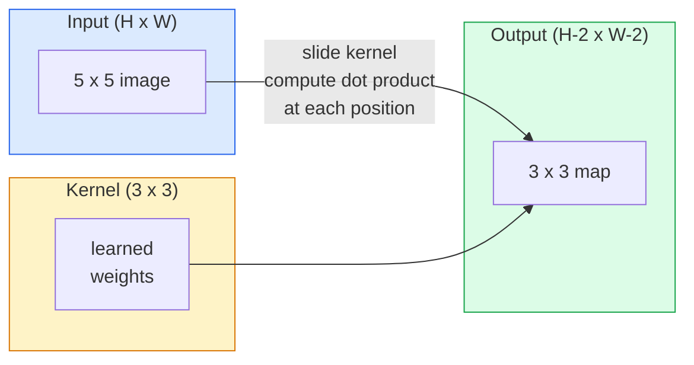
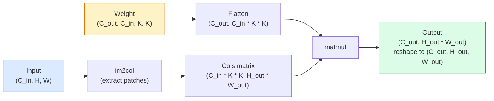

# 從零實作卷積 (Convolutions from Scratch)

> 卷積就是一個很小的 dense layer，在影像上滑動，並在每個位置共用同一組權重。

**Type:** Build
**Languages:** Python
**Prerequisites:** Phase 3 (Deep Learning Core), Phase 4 Lesson 01 (Image Fundamentals)
**Time:** ~75 分鐘

## 學習目標 (Learning Objectives)

- 只用 NumPy 從零實作 2D convolution，包括巢狀迴圈版本，以及向量化的 `im2col` 版本
- 對任意組合的輸入大小、kernel 大小、padding 與 stride，計算輸出的空間大小，並說明 `(H - K + 2P) / S + 1` 這條公式為什麼成立
- 手動設計 kernel（edge、blur、sharpen、Sobel），並解釋每一種為什麼會產生那樣的 activation 模式
- 把多個 convolution 疊成 feature extractor，並把堆疊的深度和 receptive field 的大小連結起來

## 問題 (The Problem)

對 224x224 的 RGB 影像用全連接層，每個神經元需要 224 * 224 * 3 = 150,528 個輸入權重。一個有 1,000 個單元的 hidden layer，在你還沒學到任何有用的東西之前，就已經有 1.5 億個參數。更糟的是，這一層完全沒有「左上角的狗和右下角的狗是同一種 pattern」的概念。它把每個像素位置都當成互相獨立，這對影像來說剛好是錯的：把貓平移三個像素，不應該逼網路重新學一次這個概念。

影像模型需要兩個性質：**translation equivariance**（輸入平移，輸出就跟著平移）和 **parameter sharing**（同一個特徵偵測器在每個位置都執行）。Dense layer 兩個都沒有，convolution 兩個都免費給你。

Convolution 並不是為了深度學習才發明的。JPEG 壓縮、Photoshop 的 Gaussian blur、工業視覺的邊緣偵測，以及所有出貨過的音訊濾波器，用的都是同一個運算。CNN 在 2012 到 2020 年稱霸 ImageNet，原因在於：對於「鄰近的值彼此相關、同一個 pattern 可能出現在任何地方」的資料，convolution 是正確的先驗 (prior)。

## 核心概念 (The Concept)

### 一個 kernel，滑動 (One kernel, sliding)

2D convolution 取一個小的權重矩陣，稱為 kernel（或 filter），在輸入上滑動，並在每個位置計算逐元素相乘後的總和。這個總和就是一個輸出像素。



在 5x5 輸入上用 3x3 kernel 的具體例子（沒有 padding，stride 為 1）：

```
Input X (5 x 5):                Kernel W (3 x 3):

  1  2  0  1  2                   1  0 -1
  0  1  3  1  0                   2  0 -2
  2  1  0  2  1                   1  0 -1
  1  0  2  1  3
  2  1  1  0  1

The kernel slides across every valid 3 x 3 window. Output Y is 3 x 3:

 Y[0,0] = sum( W * X[0:3, 0:3] )
 Y[0,1] = sum( W * X[0:3, 1:4] )
 Y[0,2] = sum( W * X[0:3, 2:5] )
 Y[1,0] = sum( W * X[1:4, 0:3] )
 ... and so on
```

這一條公式，也就是 **共用權重、區域性 (locality)、滑動視窗**，就是整個核心想法。其他都只是記帳。

### 輸出大小公式 (Output size formula)

給定輸入空間大小 `H`、kernel 大小 `K`、padding `P`、stride `S`：

```math
H_{\text{out}} = \left\lfloor \frac{H - K + 2P}{S} \right\rfloor + 1
```

把它背起來。每個架構你都會算上幾十次。

| 情境 | H | K | P | S | H_out |
|----------|---|---|---|---|-------|
| Valid conv，沒有 padding | 32 | 3 | 0 | 1 | 30 |
| Same conv（保持大小） | 32 | 3 | 1 | 1 | 32 |
| 降採樣 2 倍 | 32 | 3 | 1 | 2 | 16 |
| Pool 2x2 | 32 | 2 | 0 | 2 | 16 |
| 大的 receptive field | 32 | 7 | 3 | 2 | 16 |

「Same padding」的意思是選一個 $P$，讓 $S = 1$ 時 $H_{\text{out}} = H$。當 $K$ 是奇數時，$P = (K - 1) / 2$。這就是 3x3 kernel 會佔主導地位的原因：它是仍然有中心點的最小奇數 kernel。

### Padding

沒有 padding 的話，每做一次 convolution，feature map 就會縮小。疊 20 層之後，224x224 的影像會變成 184x184，這會在邊界上浪費運算，也會讓需要形狀相符的 residual connection 變得複雜。

```
Zero padding (P = 1) on a 5 x 5 input:

  0  0  0  0  0  0  0
  0  1  2  0  1  2  0
  0  0  1  3  1  0  0
  0  2  1  0  2  1  0       Now the kernel can centre on pixel
  0  1  0  2  1  3  0       (0, 0) and still have three rows and
  0  2  1  1  0  1  0       three columns of values to multiply.
  0  0  0  0  0  0  0
```

實務上會遇到的模式：`zero`（最常見）、`reflect`（把邊緣鏡射，在生成模型中避免出現硬邊界）、`replicate`（複製邊緣）、`circular`（環繞，用在環面 (toroidal) 問題）。

### Stride

Stride 是滑動的步長。`stride=1` 是預設值。`stride=2` 會把空間維度減半，是在 CNN 內部降採樣、又不需要另外的 pooling layer 的經典做法。每個現代架構（ResNet、ConvNeXt、MobileNet）都會在某處用 strided conv 取代 max-pool。

```
Stride 1 on a 5 x 5 input, 3 x 3 kernel:

  starts: (0,0) (0,1) (0,2)        -> output row 0
          (1,0) (1,1) (1,2)        -> output row 1
          (2,0) (2,1) (2,2)        -> output row 2

  Output: 3 x 3

Stride 2 on the same input:

  starts: (0,0) (0,2)              -> output row 0
          (2,0) (2,2)              -> output row 1

  Output: 2 x 2
```

### 多個輸入通道 (Multiple input channels)

真實的影像有三個通道。對 RGB 輸入做 3x3 convolution，實際上是一個 3x3x3 的體積：每個輸入通道各有一片 3x3 切片。在每個空間位置，你把三片切片全部相乘後加總，再加上一個 bias。

```
Input:   (C_in,  H,  W)        3 x 5 x 5
Kernel:  (C_in,  K,  K)        3 x 3 x 3 (one kernel)
Output:  (1,     H', W')       2D map

For a layer that produces C_out output channels, you stack C_out kernels:

Weight:  (C_out, C_in, K, K)   e.g. 64 x 3 x 3 x 3
Output:  (C_out, H', W')       64 x 3 x 3

Parameter count: C_out * C_in * K * K + C_out   (the + C_out is biases)
```

最後那一行是你在規劃模型時會去計算的。對 3 通道輸入用 64 通道的 3x3 conv，有 `64 * 3 * 3 * 3 + 64 = 1,792` 個參數。很便宜。

### im2col 技巧 (The im2col trick)

巢狀迴圈容易讀但很慢。GPU 想要的是大型矩陣乘法。技巧是：把輸入中每個 receptive-field 視窗攤平成大矩陣的一欄，把 kernel 攤平成一列，整個 convolution 就變成一次 matmul。



每個正式上線的 conv 實作，都是這個方法加上 cache-tiling 技巧的某種變體（direct conv、Winograd、大 kernel 用的 FFT conv）。搞懂 im2col，你就搞懂了核心。

### Receptive field

單一個 3x3 conv 看 9 個輸入像素。疊兩個 3x3 conv，第二層的神經元看的是 5x5 的輸入像素。三個 3x3 conv 是 7x7。一般來說：

```
RF after L stacked K x K convs (stride 1) = 1 + L * (K - 1)

With strides:   RF grows multiplicatively with stride along each layer.
```

「全部都用 3x3」(VGG、ResNet、ConvNeXt) 之所以行得通，整個原因就是：兩個 3x3 conv 看到的輸入範圍和一個 5x5 conv 一樣，但參數更少，中間還多一個非線性。

```figure
convolution-kernel
```

## 動手做 (Build It)

### 步驟 1：對陣列做 padding (Step 1: Pad an array)

從最小的基本元件開始：一個在 H x W 陣列周圍補零的函式。

```python
import numpy as np

def pad2d(x, p):
    if p == 0:
        return x
    h, w = x.shape[-2:]
    out = np.zeros(x.shape[:-2] + (h + 2 * p, w + 2 * p), dtype=x.dtype)
    out[..., p:p + h, p:p + w] = x
    return out

x = np.arange(9).reshape(3, 3)
print(x)
print()
print(pad2d(x, 1))
```

尾端軸的技巧 `x.shape[:-2]` 代表同一個函式不需修改，就能處理 `(H, W)`、`(C, H, W)` 或 `(N, C, H, W)`。

### 步驟 2：用巢狀迴圈實作 2D convolution (Step 2: 2D convolution with nested loops)

參考實作：很慢，但毫不含糊。原則上，`torch.nn.functional.conv2d` 做的就是這件事。

```python
def conv2d_naive(x, w, b=None, stride=1, padding=0):
    c_in, h, w_in = x.shape
    c_out, c_in_w, kh, kw = w.shape
    assert c_in == c_in_w

    x_pad = pad2d(x, padding)
    h_out = (h + 2 * padding - kh) // stride + 1
    w_out = (w_in + 2 * padding - kw) // stride + 1

    out = np.zeros((c_out, h_out, w_out), dtype=np.float32)
    for oc in range(c_out):
        for i in range(h_out):
            for j in range(w_out):
                hs = i * stride
                ws = j * stride
                patch = x_pad[:, hs:hs + kh, ws:ws + kw]
                out[oc, i, j] = np.sum(patch * w[oc])
        if b is not None:
            out[oc] += b[oc]
    return out
```

四層巢狀迴圈（輸出通道、列、欄，再加上對 C_in、kh、kw 的隱含加總）。這是你要拿來檢查每個更快實作的基準答案 (ground truth)。

### 步驟 3：用手動設計的 kernel 驗證 (Step 3: Verify with a hand-designed kernel)

建立一個垂直的 Sobel kernel，套用在合成的階梯影像上，看垂直邊緣亮起來。

```python
def synthetic_step_image():
    img = np.zeros((1, 16, 16), dtype=np.float32)
    img[:, :, 8:] = 1.0
    return img

sobel_x = np.array([
    [[-1, 0, 1],
     [-2, 0, 2],
     [-1, 0, 1]]
], dtype=np.float32)[None]

x = synthetic_step_image()
y = conv2d_naive(x, sobel_x, padding=1)
print(y[0].round(1))
```

預期第 7 欄會有很大的正值（由左到右亮度增加），其他地方都是零。光是這一次 print，就能確認數學是對的。

### 步驟 4：im2col (Step 4: im2col)

把輸入中每個 kernel 大小的視窗，轉成矩陣的一欄。當 `C_in=3, K=3` 時，每一欄有 27 個數字。

```python
def im2col(x, kh, kw, stride=1, padding=0):
    c_in, h, w = x.shape
    x_pad = pad2d(x, padding)
    h_out = (h + 2 * padding - kh) // stride + 1
    w_out = (w + 2 * padding - kw) // stride + 1

    cols = np.zeros((c_in * kh * kw, h_out * w_out), dtype=x.dtype)
    col = 0
    for i in range(h_out):
        for j in range(w_out):
            hs = i * stride
            ws = j * stride
            patch = x_pad[:, hs:hs + kh, ws:ws + kw]
            cols[:, col] = patch.reshape(-1)
            col += 1
    return cols, h_out, w_out
```

這仍然是 Python 迴圈，但接下來的重活會變成一次向量化的 matmul。

### 步驟 5：透過 im2col + matmul 做快速 conv (Step 5: Fast conv via im2col + matmul)

用一次矩陣乘法取代四層迴圈。

```python
def conv2d_im2col(x, w, b=None, stride=1, padding=0):
    c_out, c_in, kh, kw = w.shape
    cols, h_out, w_out = im2col(x, kh, kw, stride, padding)
    w_flat = w.reshape(c_out, -1)
    out = w_flat @ cols
    if b is not None:
        out += b[:, None]
    return out.reshape(c_out, h_out, w_out)
```

正確性檢查：兩個實作都跑，然後比較。

```python
rng = np.random.default_rng(0)
x = rng.normal(0, 1, (3, 16, 16)).astype(np.float32)
w = rng.normal(0, 1, (8, 3, 3, 3)).astype(np.float32)
b = rng.normal(0, 1, (8,)).astype(np.float32)

y_naive = conv2d_naive(x, w, b, padding=1)
y_im2col = conv2d_im2col(x, w, b, padding=1)

print(f"max abs diff: {np.max(np.abs(y_naive - y_im2col)):.2e}")
```

`max abs diff` 應該在 `1e-5` 左右。差異來自浮點數累加的順序，不是 bug。

### 步驟 6：一組手動設計的 kernel (Step 6: A bank of hand-designed kernels)

五個 filter，展示單一 conv 層在還沒訓練前能表達什麼。

```python
KERNELS = {
    "identity": np.array([[0, 0, 0], [0, 1, 0], [0, 0, 0]], dtype=np.float32),
    "blur_3x3": np.ones((3, 3), dtype=np.float32) / 9.0,
    "sharpen": np.array([[0, -1, 0], [-1, 5, -1], [0, -1, 0]], dtype=np.float32),
    "sobel_x": np.array([[-1, 0, 1], [-2, 0, 2], [-1, 0, 1]], dtype=np.float32),
    "sobel_y": np.array([[-1, -2, -1], [0, 0, 0], [1, 2, 1]], dtype=np.float32),
}

def apply_kernel(img2d, kernel):
    x = img2d[None].astype(np.float32)
    w = kernel[None, None]
    return conv2d_im2col(x, w, padding=1)[0]
```

套用在任何 grayscale 影像上：blur 讓影像變柔和，sharpen 讓邊緣更清晰，Sobel-x 讓垂直邊緣亮起來，Sobel-y 讓水平邊緣亮起來。這些正是 AlexNet 和 VGG 中 *第一層* 訓練好的 conv 最後學到的 pattern，因為不論後面要做什麼任務，好的影像模型都需要邊緣和 blob 偵測器。

## 實際使用 (Use It)

PyTorch 的 `nn.Conv2d` 把同一個運算包起來，加上 autograd、CUDA kernel 和 cuDNN 最佳化。Shape 的語意完全相同。

```python
import torch
import torch.nn as nn

conv = nn.Conv2d(in_channels=3, out_channels=64, kernel_size=3, stride=1, padding=1)
print(conv)
print(f"weight shape: {tuple(conv.weight.shape)}   # (C_out, C_in, K, K)")
print(f"bias shape:   {tuple(conv.bias.shape)}")
print(f"param count:  {sum(p.numel() for p in conv.parameters())}")

x = torch.randn(8, 3, 224, 224)
y = conv(x)
print(f"\ninput  shape: {tuple(x.shape)}")
print(f"output shape: {tuple(y.shape)}")
```

把 `padding=1` 換成 `padding=0`，輸出會降到 222x222。把 `stride=1` 換成 `stride=2`，會降到 112x112。就是你前面背起來的同一條公式。

## 交付 (Ship It)

這堂課會產出：

- `outputs/prompt-cnn-architect.md`：一個 prompt，給它輸入大小、參數預算與目標 receptive field，它會設計一疊每一步都有正確 K/S/P 的 `Conv2d` 層。
- `outputs/skill-conv-shape-calculator.md`：一個 skill，逐層走過一份網路規格，並對每個 block 回傳輸出 shape、receptive field 與參數數量。

## 練習 (Exercises)

1. **（簡單）** 給定 128x128 的 grayscale 輸入，以及一疊 `[Conv3x3(s=1,p=1), Conv3x3(s=2,p=1), Conv3x3(s=1,p=1), Conv3x3(s=2,p=1)]`，用手算出每一層的輸出空間大小與 receptive field。再用 PyTorch 的 `nn.Sequential` 搭配假的 conv 來驗證。
2. **（中等）** 擴充 `conv2d_naive` 和 `conv2d_im2col`，讓它們接受 `groups` 參數。證明 `groups=C_in=C_out` 會重現 depthwise convolution，而且它的參數數量是 `C * K * K`，而不是 `C * C * K * K`。
3. **（困難）** 手動實作 `conv2d_im2col` 的 backward pass：給定輸出的 gradient，計算 `x` 和 `w` 的 gradient。用 `torch.autograd.grad` 在相同輸入與權重上驗證。技巧在於：im2col 的 gradient 是 `col2im`，而且它必須累加重疊的視窗。

## 關鍵術語 (Key Terms)

| 術語 | 大家常說的 | 實際意義 |
|------|----------------|----------------------|
| Convolution | 「滑動一個 filter」 | 在每個空間位置用共用權重做的可學習內積；數學上是 cross-correlation，但大家都叫它 convolution |
| Kernel / filter | 「特徵偵測器」 | 形狀為 (C_in, K, K) 的小權重 tensor，它和一個輸入視窗的內積會產生一個輸出像素 |
| Stride | 「一次跳多遠」 | 連續兩次 kernel 擺放位置之間的步長；stride 2 會讓每個空間維度減半 |
| Padding | 「邊緣補零」 | 在輸入周圍加的額外值，讓 kernel 可以以邊界像素為中心；`same` padding 會讓輸出大小等於輸入大小 |
| Receptive field | 「神經元看到多少」 | 某個輸出 activation 所依賴的原始輸入區塊，會隨深度與 stride 增長 |
| im2col | 「GEMM 技巧」 | 把每個 receptive 視窗重排成欄，讓 convolution 變成一次大型矩陣乘法，是每個快速 conv kernel 的核心 |
| Depthwise conv | 「每個通道一個 kernel」 | `groups == C_in` 的 conv，每個輸出通道只由對應的輸入通道算出；MobileNet 與 ConvNeXt 的骨幹 |
| Translation equivariance | 「進去平移，出來也平移」 | 輸入平移 k 個像素，輸出也平移 k 個像素的性質；共用權重就免費得到 |

## 延伸閱讀 (Further Reading)

- [A guide to convolution arithmetic for deep learning (Dumoulin & Visin, 2016)](https://arxiv.org/abs/1603.07285)：padding/stride/dilation 的權威圖解，每門課都默默抄過
- [CS231n: Convolutional Neural Networks for Visual Recognition](https://cs231n.github.io/convolutional-networks/)：經典的課程講義，包含 im2col 的原始說明
- [The Annotated ConvNet (fast.ai)](https://nbviewer.org/github/fastai/fastbook/blob/master/13_convolutions.ipynb)：一份 notebook，從手動 convolution 一路走到訓練好的數字分類器
- [Receptive Field Arithmetic for CNNs (Dang Ha The Hien)](https://distill.pub/2019/computing-receptive-fields/)：論文等級的互動式說明，講解 receptive field 的計算
