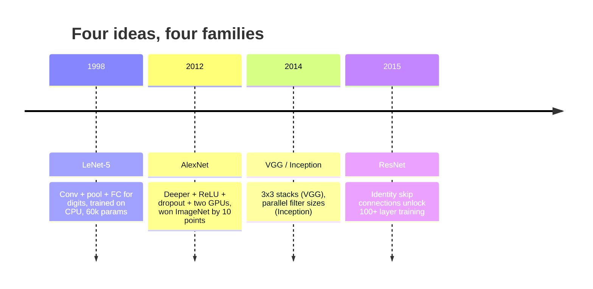
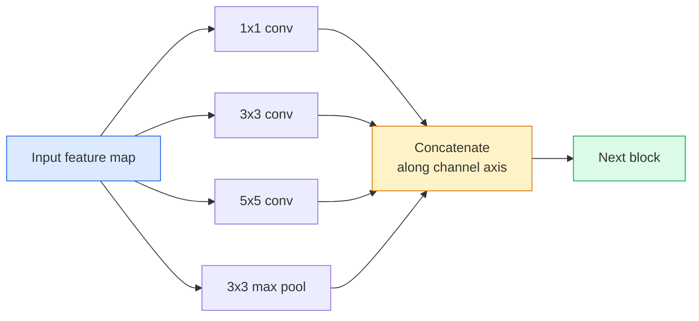
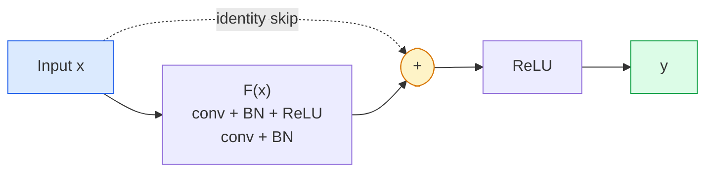

# CNN：從 LeNet 到 ResNet (CNNs — LeNet to ResNet)

> 過去三十年每個重要的 CNN，都是同一套 conv、非線性、降採樣的配方，再加上一個新點子。按順序學這些點子。

**Type:** Learn + Build
**Languages:** Python
**Prerequisites:** Phase 3 Lesson 11 (PyTorch), Phase 4 Lesson 01 (Image Fundamentals), Phase 4 Lesson 02 (Convolutions from Scratch)
**Time:** ~75 分鐘

## 學習目標 (Learning Objectives)

- 追溯架構的脈絡 LeNet-5 -> AlexNet -> VGG -> Inception -> ResNet，並說出每個系列貢獻的那一個新點子
- 在 PyTorch 中實作 LeNet-5、VGG 風格的 block，以及 ResNet BasicBlock，每個都在 40 行以內
- 解釋為什麼 residual connection 能讓 1,000 層的網路從無法訓練變成 state-of-the-art
- 閱讀現代 backbone（ResNet-18、ResNet-50），並在看原始碼之前先預測它的輸出 shape、receptive field 與參數數量

## 問題 (The Problem)

2011 年，最好的 ImageNet 分類器 top-5 準確率約 74%。2012 年 AlexNet 拿到 85%。2015 年 ResNet 拿到 96%。沒有新資料，也沒有新一代 GPU，進步來自架構上的點子。一個合格的視覺工程師必須知道哪個點子出自哪篇論文，因為你在 2026 年交付的每個正式 backbone，都是這些同樣元件的重新組合。而且這些點子一直在互相轉移：grouped conv 從 CNN 走到 transformer，residual connection 從 ResNet 走進現存的每一個 LLM，batch normalisation 則存在於 diffusion 模型裡。

按順序研究這些網路，也能讓你免於一個常見的錯誤：明明 LeNet 大小的網路就能解決問題，卻去拿手邊最大的模型。MNIST 不需要 ResNet。知道每個系列的 scaling 曲線，你就知道自己該坐在曲線的哪個位置。

## 核心概念 (The Concept)

### 改變視覺領域的四個點子 (The four ideas that changed vision)



古典視覺裡沒有任何其他東西，像這四次跳躍一樣重要。

### LeNet-5 (1998)

Yann LeCun 的數字辨識器。60,000 個參數。兩個 conv-pool block、兩個全連接層、tanh activation。它定義了每個 CNN 都繼承的模板：

```
input (1, 32, 32)
  conv 5x5 -> (6, 28, 28)
  avg pool 2x2 -> (6, 14, 14)
  conv 5x5 -> (16, 10, 10)
  avg pool 2x2 -> (16, 5, 5)
  flatten -> 400
  dense -> 120
  dense -> 84
  dense -> 10
```

現代世界所稱的 CNN，也就是交替的 convolution 與降採樣，接上一個小的分類器 head，都是 LeNet 加上更多層、更大的通道數和更好的 activation。

### AlexNet (2012)

三個改變合在一起，攻破了 ImageNet：

1. **ReLU** 取代 tanh。Gradient 不再消失，訓練速度加快六倍。
2. 全連接 head 中的 **Dropout**。Regularisation 變成一個 layer，而不是一個技巧。
3. **深度與寬度**。五個 conv 層、三個 dense 層、6,000 萬個參數，在兩張 GPU 上訓練，模型被拆開放在兩張卡上。

論文的 Figure 2 仍然把 GPU 拆分畫成兩條平行的串流。那種平行是硬體上的權宜之計，不是架構上的洞見，但上面這三個點子，仍然出現在你用的每個模型裡。

### VGG (2014)

VGG 問：如果只用 3x3 convolution，然後一路做深，會怎樣？

```
stack:   conv 3x3 -> conv 3x3 -> pool 2x2
repeat:  16 or 19 conv layers
```

兩個 3x3 conv 看到的 5x5 輸入範圍和一個 5x5 conv 相同，但參數更少（$2 \cdot 9 \cdot C^2 = 18C^2$ 對 $25 \cdot C^2$），中間還多一個 ReLU。VGG 把這個觀察變成一整個架構。它的簡單，也就是只有一種 block 不斷重複，讓它成為後續一切的參考基準。

代價：1.38 億個參數，訓練很慢，推論很貴。

### Inception (2014，同一年)

Google 對「我該用多大的 kernel？」的回答是：全部都用，而且並行。



每個分支各有專長：1x1 負責通道混合、3x3 負責局部紋理、5x5 負責較大的 pattern、pooling 負責具平移不變性的特徵。Concat 讓下一層自己挑有用的分支。Inception v1 在每個分支裡用 1x1 convolution 當 bottleneck，讓參數數量維持在合理範圍。

### 退化問題 (The degradation problem)

到了 2015 年，VGG-19 行得通，VGG-32 卻不行。深度本來應該有幫助，但超過約 20 層之後，訓練與測試的 loss 都變差。這不是 overfitting，而是 optimiser 找不到有用的權重，因為 gradient 在每一層都以相乘的方式縮小。

```
Plain deep network:
  y = f_L( f_{L-1}( ... f_1(x) ... ) )

Gradient wrt early layer:
  dL/dW_1 = dL/dy * df_L/df_{L-1} * ... * df_2/df_1 * df_1/dW_1

Each multiplicative term has magnitude roughly (weight magnitude) * (activation gain).
Stack 100 of them with gains < 1 and the gradient is effectively zero.
```

VGG 能在 19 層運作，是因為 batch norm（同時期發表）讓 activation 保持在合理的尺度。但就算是 batch norm，也救不了超過 30 層左右的深度。

### ResNet (2015)

He、Zhang、Ren、Sun 提出了一個修正一切的改變：

```math
\begin{aligned}
\text{standard block:} \quad & y = F(x) \\
\text{residual block:} \quad & y = F(x) + x
\end{aligned}
```

那個 `+ x` 代表這一層永遠可以選擇什麼都不做，只要把 `F(x)` 推向零就行。1,000 層的 ResNet 現在最多就是跟 1 層網路一樣差，因為每個多出來的 block 都有一個輕鬆的逃生口。有了這個保證，optimiser 就願意讓每個 block 都 *稍微* 有用，而稍微有用的 block 疊 100 次，就是 state-of-the-art。



這個 block 有兩種變體，到處都會看到：

- **BasicBlock**（ResNet-18、ResNet-34）：兩個 3x3 conv，skip 繞過兩個。
- **Bottleneck**（ResNet-50、-101、-152）：1x1 往下降維、3x3 在中間、1x1 往上升維，skip 繞過這三個。通道數很高時比較便宜。

當 skip 必須跨過降採樣 (stride=2) 時，identity 路徑會換成 1x1 stride=2 的 conv 來對齊 shape。

### 為什麼 residual 的重要性不只在視覺 (Why residuals matter beyond vision)

這個點子其實不是關於影像分類。它是把深度網路從「祈禱 gradient 能存活」，變成可靠、可擴展的工程工具。你下一個階段會讀到的每一個 transformer，每個 block 裡都有完全一樣的 skip connection。沒有 ResNet，就沒有 GPT。

```figure
pooling
```

## 動手做 (Build It)

### 步驟 1：LeNet-5 (Step 1: LeNet-5)

一個最小而忠實的 LeNet。Tanh activation、average pooling。唯一向現代做的讓步，是下游改用 `nn.CrossEntropyLoss`，而不是原本的 Gaussian connection。

```python
import torch
import torch.nn as nn
import torch.nn.functional as F

class LeNet5(nn.Module):
    def __init__(self, num_classes=10):
        super().__init__()
        self.conv1 = nn.Conv2d(1, 6, kernel_size=5)
        self.conv2 = nn.Conv2d(6, 16, kernel_size=5)
        self.pool = nn.AvgPool2d(2)
        self.fc1 = nn.Linear(16 * 5 * 5, 120)
        self.fc2 = nn.Linear(120, 84)
        self.fc3 = nn.Linear(84, num_classes)

    def forward(self, x):
        x = self.pool(torch.tanh(self.conv1(x)))
        x = self.pool(torch.tanh(self.conv2(x)))
        x = torch.flatten(x, 1)
        x = torch.tanh(self.fc1(x))
        x = torch.tanh(self.fc2(x))
        return self.fc3(x)

net = LeNet5()
x = torch.randn(1, 1, 32, 32)
print(f"output: {net(x).shape}")
print(f"params: {sum(p.numel() for p in net.parameters()):,}")
```

預期輸出：`output: torch.Size([1, 10])`、`params: 61,706`。這就是啟動現代視覺的整個數字分類器。

### 步驟 2：VGG block (Step 2: A VGG block)

一個可重複使用的 block：兩個 3x3 conv、ReLU、batch norm、max pool。

```python
class VGGBlock(nn.Module):
    def __init__(self, in_c, out_c):
        super().__init__()
        self.conv1 = nn.Conv2d(in_c, out_c, kernel_size=3, padding=1)
        self.bn1 = nn.BatchNorm2d(out_c)
        self.conv2 = nn.Conv2d(out_c, out_c, kernel_size=3, padding=1)
        self.bn2 = nn.BatchNorm2d(out_c)
        self.pool = nn.MaxPool2d(2)

    def forward(self, x):
        x = F.relu(self.bn1(self.conv1(x)))
        x = F.relu(self.bn2(self.conv2(x)))
        return self.pool(x)

class MiniVGG(nn.Module):
    def __init__(self, num_classes=10):
        super().__init__()
        self.stack = nn.Sequential(
            VGGBlock(3, 32),
            VGGBlock(32, 64),
            VGGBlock(64, 128),
        )
        self.head = nn.Sequential(
            nn.AdaptiveAvgPool2d(1),
            nn.Flatten(),
            nn.Linear(128, num_classes),
        )

    def forward(self, x):
        return self.head(self.stack(x))

net = MiniVGG()
x = torch.randn(1, 3, 32, 32)
print(f"output: {net(x).shape}")
print(f"params: {sum(p.numel() for p in net.parameters()):,}")
```

在 CIFAR 大小的輸入上用三個 VGG block、一個 adaptive pool、一個 linear 層。約 29 萬個參數。對 CIFAR-10 綽綽有餘。

### 步驟 3：ResNet BasicBlock (Step 3: A ResNet BasicBlock)

ResNet-18 和 ResNet-34 的核心建構單元。

```python
class BasicBlock(nn.Module):
    def __init__(self, in_c, out_c, stride=1):
        super().__init__()
        self.conv1 = nn.Conv2d(in_c, out_c, kernel_size=3, stride=stride, padding=1, bias=False)
        self.bn1 = nn.BatchNorm2d(out_c)
        self.conv2 = nn.Conv2d(out_c, out_c, kernel_size=3, stride=1, padding=1, bias=False)
        self.bn2 = nn.BatchNorm2d(out_c)
        if stride != 1 or in_c != out_c:
            self.shortcut = nn.Sequential(
                nn.Conv2d(in_c, out_c, kernel_size=1, stride=stride, bias=False),
                nn.BatchNorm2d(out_c),
            )
        else:
            self.shortcut = nn.Identity()

    def forward(self, x):
        out = F.relu(self.bn1(self.conv1(x)))
        out = self.bn2(self.conv2(out))
        out = out + self.shortcut(x)
        return F.relu(out)
```

conv 層設 `bias=False` 是 batch-norm 的慣例：BN 的 beta 參數已經負責 bias，所以再帶一個 conv bias 是浪費。`shortcut` 只有在 stride 或通道數改變時才需要真正的 conv，否則就是什麼都不做的 identity。

### 步驟 4：小型 ResNet (Step 4: A tiny ResNet)

疊四組 BasicBlock，就得到一個能用在 CIFAR 大小輸入的 ResNet。

```python
class TinyResNet(nn.Module):
    def __init__(self, num_classes=10):
        super().__init__()
        self.stem = nn.Sequential(
            nn.Conv2d(3, 32, kernel_size=3, stride=1, padding=1, bias=False),
            nn.BatchNorm2d(32),
            nn.ReLU(inplace=True),
        )
        self.layer1 = self._make_group(32, 32, num_blocks=2, stride=1)
        self.layer2 = self._make_group(32, 64, num_blocks=2, stride=2)
        self.layer3 = self._make_group(64, 128, num_blocks=2, stride=2)
        self.layer4 = self._make_group(128, 256, num_blocks=2, stride=2)
        self.head = nn.Sequential(
            nn.AdaptiveAvgPool2d(1),
            nn.Flatten(),
            nn.Linear(256, num_classes),
        )

    def _make_group(self, in_c, out_c, num_blocks, stride):
        blocks = [BasicBlock(in_c, out_c, stride=stride)]
        for _ in range(num_blocks - 1):
            blocks.append(BasicBlock(out_c, out_c, stride=1))
        return nn.Sequential(*blocks)

    def forward(self, x):
        x = self.stem(x)
        x = self.layer1(x)
        x = self.layer2(x)
        x = self.layer3(x)
        x = self.layer4(x)
        return self.head(x)

net = TinyResNet()
x = torch.randn(1, 3, 32, 32)
print(f"output: {net(x).shape}")
print(f"params: {sum(p.numel() for p in net.parameters()):,}")
```

四組，每組兩個 block。第 2、3、4 組一開始用 stride 2。每次降採樣，通道數加倍。大約 280 萬個參數。這是能乾淨地擴展到 ResNet-152 的標準配方。

### 步驟 5：比較參數與特徵的效率 (Step 5: Compare parameter-to-feature efficiency)

把同一個輸入跑過這三個網路，比較參數數量。

```python
def summary(name, net, x):
    y = net(x)
    params = sum(p.numel() for p in net.parameters())
    print(f"{name:12s}  input {tuple(x.shape)} -> output {tuple(y.shape)}  params {params:>10,}")

x = torch.randn(1, 3, 32, 32)
summary("LeNet5",     LeNet5(),       torch.randn(1, 1, 32, 32))
summary("MiniVGG",    MiniVGG(),      x)
summary("TinyResNet", TinyResNet(),   x)
```

三個模型、三個年代、參數數量差了三個數量級。以 CIFAR-10 準確率來說，訓練幾個 epoch 之後大致是：LeNet 60%、MiniVGG 89%、TinyResNet 93%。

## 實際使用 (Use It)

`torchvision.models` 提供以上所有模型的預訓練版本。呼叫簽章在各系列之間完全一致，這正是 backbone 抽象的重點。

```python
from torchvision.models import resnet18, ResNet18_Weights, vgg16, VGG16_Weights

r18 = resnet18(weights=ResNet18_Weights.IMAGENET1K_V1)
r18.eval()

print(f"ResNet-18 params: {sum(p.numel() for p in r18.parameters()):,}")
print(r18.layer1[0])
print()

v16 = vgg16(weights=VGG16_Weights.IMAGENET1K_V1)
v16.eval()
print(f"VGG-16   params: {sum(p.numel() for p in v16.parameters()):,}")
```

ResNet-18 有 1,170 萬個參數。VGG-16 有 1.38 億個。ImageNet top-1 準確率相近（69.8% 對 71.6%）。Residual connection 讓你賺到 12 倍的參數效率。這就是為什麼 ResNet 系列從 2016 年一直稱霸到 2021 年 ViT 出現，而且在算力有限的真實部署中依然佔主導地位。

做 transfer learning 時，配方永遠相同：載入預訓練模型、凍結 backbone、替換分類器 head。

```python
for p in r18.parameters():
    p.requires_grad = False
r18.fc = nn.Linear(r18.fc.in_features, 10)
```

三行。你現在有一個 10 類的 CIFAR 分類器，繼承了 ImageNet 花錢學來的表示 (representation)。

## 交付 (Ship It)

這堂課會產出：

- `outputs/prompt-backbone-selector.md`：一個 prompt，根據任務、資料集大小與算力預算，挑選合適的 CNN 系列（LeNet/VGG/ResNet/MobileNet/ConvNeXt）。
- `outputs/skill-residual-block-reviewer.md`：一個 skill，讀取 PyTorch module，並標出 skip-connection 的錯誤（stride 改變時缺少 shortcut、shortcut 的 activation 順序、BN 相對於加法的位置）。

## 練習 (Exercises)

1. **（簡單）** 用手算 `TinyResNet` 每一層的參數數量。和 `sum(p.numel() for p in net.parameters())` 比較。大部分的參數預算花在哪裡：conv、BN，還是分類器 head？
2. **（中等）** 實作 Bottleneck block（1x1 -> 3x3 -> 1x1，加上 skip），並用它建一個給 CIFAR 用的 ResNet-50 風格網路。和 `TinyResNet` 比較參數。
3. **（困難）** 把 `BasicBlock` 的 skip connection 拿掉，各自在 CIFAR-10 上訓練 10 個 epoch：一個 34 個 block 的「plain」網路，和一個 34 個 block 的 ResNet。畫出兩者的 training loss 對 epoch 曲線。重現 He et al. Figure 1 的結果：plain 的深層網路收斂到的 loss，比它較淺的孿生網路更高。

## 關鍵術語 (Key Terms)

| 術語 | 大家常說的 | 實際意義 |
|------|----------------|----------------------|
| Backbone | 「那個模型」 | 產生 feature map、餵給任務 head 的那一疊 convolutional block |
| Residual connection | 「Skip connection」 | `y = F(x) + x`；讓 optimiser 把 F 設為零就能學到 identity，使任意深度都能訓練 |
| BasicBlock | 「兩個 3x3 conv 加一個 skip」 | ResNet-18/34 的建構單元：conv-BN-ReLU-conv-BN-add-ReLU |
| Bottleneck | 「1x1 降維、3x3、1x1 升維」 | ResNet-50/101/152 的 block；通道數高時很便宜，因為 3x3 是在縮減後的寬度上執行 |
| Degradation problem | 「越深越差」 | 超過約 20 層的 plain conv 之後，訓練與測試誤差都上升；靠 residual connection 解決，不是靠更多資料 |
| Stem | 「第一層」 | 把 3 通道輸入轉成基礎 feature 寬度的第一個 conv；ImageNet 通常是 7x7 stride 2，CIFAR 是 3x3 stride 1 |
| Head | 「分類器」 | 最後一個 backbone block 之後的層：adaptive pool、flatten、linear |
| Transfer learning | 「預訓練權重」 | 載入在 ImageNet 上訓練好的 backbone，只對你的任務微調 (fine-tune) head |

## 延伸閱讀 (Further Reading)

- [Deep Residual Learning for Image Recognition (He et al., 2015)](https://arxiv.org/abs/1512.03385)：ResNet 論文，每張圖都值得研究
- [Very Deep Convolutional Networks (Simonyan & Zisserman, 2014)](https://arxiv.org/abs/1409.1556)：VGG 論文，至今仍是回答「為什麼用 3x3」的最佳參考
- [ImageNet Classification with Deep CNNs (Krizhevsky et al., 2012)](https://papers.nips.cc/paper_files/paper/2012/hash/c399862d3b9d6b76c8436e924a68c45b-Abstract.html)：AlexNet，終結手工特徵時代的論文
- [Going Deeper with Convolutions (Szegedy et al., 2014)](https://arxiv.org/abs/1409.4842)：Inception v1，至今仍出現在 vision transformer 裡的平行 filter 概念
