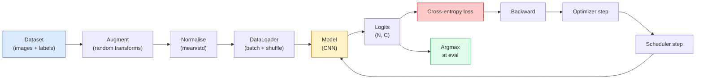

# 影像分類 (Image Classification)

> 分類器就是一個函式，把像素對應到類別上的機率分布。其他一切都只是水電管線。

**Type:** Build
**Languages:** Python
**Prerequisites:** Phase 2 Lesson 09 (Model Evaluation), Phase 3 Lesson 10 (Mini Framework), Phase 4 Lesson 03 (CNNs)
**Time:** ~75 分鐘

## 學習目標 (Learning Objectives)

- 在 CIFAR-10 上建立端到端的影像分類 pipeline：dataset、augmentation、模型、訓練迴圈、評估
- 說明每個元件（dataloader、loss、optimizer、scheduler、augmentation）的角色，並預測其中任何一個壞掉時，loss 曲線會怎麼表現
- 從零實作 mixup、cutout 與 label smoothing，並說明什麼時候值得加上它們
- 閱讀 confusion matrix 與每個類別的 precision/recall 表，診斷整體準確率看不出來的資料集與模型問題

## 問題 (The Problem)

每個出貨的視覺任務，在某個層面上都可以化約成影像分類。Detection 是對區域分類，segmentation 是對像素分類，retrieval 是依據與類別中心的相似度排序。把分類做對，包括資料迴圈、augmentation 策略、loss、評估，是可以轉移到這個階段其他所有任務的技能。

大多數分類的 bug 不在模型裡，而在 pipeline：壞掉的 normalisation、沒有 shuffle 的訓練集、扭曲標籤的 augmentation、被訓練資料污染的驗證集切分、在第 30 個 epoch 之後默默發散的 learning rate。一個設定正確時能在 CIFAR-10 拿到 93% 的 CNN，設定壞掉時常常只有 70 到 75%，而且 loss 曲線從頭到尾看起來都很合理。

這堂課親手把整條 pipeline 串起來，讓每個部分都能被檢視。你不會用到 `torchvision.datasets` 裡任何可能藏住 bug 的東西。

## 核心概念 (The Concept)

### 分類 pipeline (The classification pipeline)



這個迴圈裡的每一行，都可能藏著 bug。Cross-entropy 吃的是原始 logits，不是 softmax 輸出，所以在 loss 之前做任何 `model(x).softmax()`，都會默默算出錯誤的 gradient。Augmentation 只套用在輸入上，不套用在標籤上，除了 mixup，它會同時混合兩者。`optimizer.zero_grad()` 每個 step 必須執行一次；跳過它會累積 gradient，看起來就像 learning rate 極度不穩。這些 bug 都會讓學習曲線變平，卻不會丟出任何錯誤。

### Cross-entropy、logits 與 softmax (Cross-entropy, logits, and softmax)

分類器對每張影像產生 `C` 個數字，稱為 logits。套用 softmax 就把它們轉成機率分布：

```math
\mathop{\mathrm{softmax}}(z)_i = \frac{\exp(z_i)}{\sum_j \exp(z_j)}
```

Cross-entropy 衡量正確類別的負對數機率：

```math
\begin{aligned}
\mathrm{CE}(z, y) &= -\log\left( \mathop{\mathrm{softmax}}(z)_y \right) \\
&= -z_y + \log\left( \sum_j \exp(z_j) \right)
\end{aligned}
```

右邊那種形式在數值上是穩定的 (log-sum-exp)。PyTorch 的 `nn.CrossEntropyLoss` 把 softmax + NLL 融合成一個運算，並直接吃原始 logits。自己先套 softmax 幾乎一定是 bug，因為你算的是 $\log(\mathop{\mathrm{softmax}}(\mathop{\mathrm{softmax}}(z)))$，那是一個沒有意義的量。

### 為什麼 augmentation 有效 (Why augmentation works)

CNN 對平移有 inductive bias（來自權重共用），但對裁切、翻轉、色彩抖動或遮擋，沒有內建的不變性。教它這些不變性的唯一方法，是讓它看到會用到這些不變性的像素。訓練中每一個隨機轉換，都是在說：「這兩張影像有相同的標籤，請學會忽略差異的特徵。」

```
Original crop:  "dog facing left"
Flip:           "dog facing right"       <- same label, different pixels
Rotate(+15):    "dog, slight tilt"
Colour jitter:  "dog in warmer light"
RandomErasing:  "dog with patch missing"
```

規則是：augmentation 必須保留標籤。對數字做 cutout 和旋轉，可能把「6」變成「9」；對那種資料集，你要用較小的旋轉範圍，並選擇尊重數字特有不變性的 augmentation。

### Mixup 與 cutmix (Mixup and cutmix)

一般的 augmentation 轉換像素，但標籤維持 one-hot。**Mixup** 和 **cutmix** 打破這一點，同時對兩者做內插。

```
Mixup:
  lambda ~ Beta(a, a)
  x = lambda * x_i + (1 - lambda) * x_j
  y = lambda * y_i + (1 - lambda) * y_j

Cutmix:
  paste a random rectangle of x_j into x_i
  y = area-weighted mix of y_i and y_j
```

為什麼有幫助：模型不再死記尖銳的 one-hot 目標，而是學會在類別之間內插。Training loss 會上升，test accuracy 會上升。這是任何分類器最便宜的穩健性升級。

### Label smoothing

mixup 的近親。與其對 `[0, 0, 1, 0, 0]` 訓練，改成對 `[eps/C, eps/C, 1-eps+eps/C, eps/C, eps/C]` 訓練，`eps` 取像 0.1 這樣的小值（one-hot 目標和均勻分布混合，所以總和仍然是 1）。這能防止模型產生任意尖銳的 logits，幾乎不花成本就改善 calibration。自 PyTorch 1.10 起，內建於 `nn.CrossEntropyLoss(label_smoothing=0.1)`。

### 準確率以外的評估 (Evaluation beyond accuracy)

整體準確率會掩蓋不平衡。一個 90-10 的二元分類器，如果永遠預測多數類別，就能拿 90%。真正能告訴你發生什麼事的工具：

- **每類準確率 (Per-class accuracy)**：每個類別一個數字，立刻揭露表現不佳的類別。
- **Confusion matrix**：$C \times C$ 的格子，第 $i$ 列第 $j$ 欄 = 真實類別 $i$ 被預測成類別 $j$ 的數量；對角線是正確的，非對角線則是你的模型出狀況的地方。
- **Top-1 / Top-5**：正確類別是否在前 1 或前 5 個預測之中；Top-5 對 ImageNet 很重要，因為像「Norwich terrier」和「Norfolk terrier」這種類別，本來就真的很模糊。
- **Calibration (ECE)**：0.8 信心度的預測，真的有 80% 的時間是對的嗎？現代網路系統性地過度自信；可用 temperature scaling 或 label smoothing 修正。

```figure
receptive-field
```

## 動手做 (Build It)

### 步驟 1：固定的合成資料集 (Step 1: A deterministic synthetic dataset)

CIFAR-10 存在磁碟上。為了讓這堂課可重現又快速，我們建立一個看起來像 CIFAR 的合成資料集：32x32 的 RGB 影像，帶有模型必須學習的類別專屬結構。完全相同的 pipeline 不用修改，就能用在真正的 CIFAR-10 上。

```python
import numpy as np
import torch
from torch.utils.data import Dataset


def synthetic_cifar(num_per_class=1000, num_classes=10, seed=0):
    rng = np.random.default_rng(seed)
    X = []
    Y = []
    for c in range(num_classes):
        centre = rng.uniform(0, 1, (3,))
        freq = 2 + c
        for _ in range(num_per_class):
            yy, xx = np.meshgrid(np.linspace(0, 1, 32), np.linspace(0, 1, 32), indexing="ij")
            r = np.sin(xx * freq) * 0.5 + centre[0]
            g = np.cos(yy * freq) * 0.5 + centre[1]
            b = (xx + yy) * 0.5 * centre[2]
            img = np.stack([r, g, b], axis=-1)
            img += rng.normal(0, 0.08, img.shape)
            img = np.clip(img, 0, 1)
            X.append(img.astype(np.float32))
            Y.append(c)
    X = np.stack(X)
    Y = np.array(Y)
    idx = rng.permutation(len(X))
    return X[idx], Y[idx]


class ArrayDataset(Dataset):
    def __init__(self, X, Y, transform=None):
        self.X = X
        self.Y = Y
        self.transform = transform

    def __len__(self):
        return len(self.X)

    def __getitem__(self, i):
        img = self.X[i]
        if self.transform is not None:
            img = self.transform(img)
        img = torch.from_numpy(img).permute(2, 0, 1)
        return img, int(self.Y[i])
```

每個類別有自己的調色盤和頻率 pattern，再加上 Gaussian noise，逼模型去學訊號，而不是死記像素。十個類別，每類一千張影像，打散順序。

### 步驟 2：Normalisation 與 augmentation (Step 2: Normalisation and augmentation)

每個視覺 pipeline 都有的兩種轉換。

```python
def standardize(mean, std):
    mean = np.array(mean, dtype=np.float32)
    std = np.array(std, dtype=np.float32)
    def _fn(img):
        return (img - mean) / std
    return _fn


def random_hflip(p=0.5):
    def _fn(img):
        if np.random.random() < p:
            return img[:, ::-1, :].copy()
        return img
    return _fn


def random_crop(pad=4):
    def _fn(img):
        h, w = img.shape[:2]
        padded = np.pad(img, ((pad, pad), (pad, pad), (0, 0)), mode="reflect")
        y = np.random.randint(0, 2 * pad)
        x = np.random.randint(0, 2 * pad)
        return padded[y:y + h, x:x + w, :]
    return _fn


def compose(*fns):
    def _fn(img):
        for fn in fns:
            img = fn(img)
        return img
    return _fn
```

裁切之前用 reflect pad，不要用 zero pad，因為黑色邊界是一種訊號，模型會學著以沒有用處的方式忽略它。

### 步驟 3：Mixup (Step 3: Mixup)

在訓練 step 內混合兩張影像和兩個標籤。實作成 batch transform，所以它和 forward pass 放在一起，而不是放在 dataset 裡面。

```python
def mixup_batch(x, y, num_classes, alpha=0.2):
    if alpha <= 0:
        return x, torch.nn.functional.one_hot(y, num_classes).float()
    lam = float(np.random.beta(alpha, alpha))
    idx = torch.randperm(x.size(0), device=x.device)
    x_mixed = lam * x + (1 - lam) * x[idx]
    y_onehot = torch.nn.functional.one_hot(y, num_classes).float()
    y_mixed = lam * y_onehot + (1 - lam) * y_onehot[idx]
    return x_mixed, y_mixed


def soft_cross_entropy(logits, soft_targets):
    log_probs = torch.log_softmax(logits, dim=-1)
    return -(soft_targets * log_probs).sum(dim=-1).mean()
```

`soft_cross_entropy` 是對 soft-label 分布的 cross-entropy。當目標剛好是 one-hot 時，它會退化成一般的 one-hot 情況。

### 步驟 4：訓練迴圈 (Step 4: The training loop)

完整配方：對資料跑一遍，每個 batch 做一次 gradient，scheduler 每個 epoch 前進一步。

```python
import torch
import torch.nn as nn
from torch.utils.data import DataLoader
from torch.optim import SGD
from torch.optim.lr_scheduler import CosineAnnealingLR

def train_one_epoch(model, loader, optimizer, device, num_classes, use_mixup=True):
    model.train()
    total, correct, loss_sum = 0, 0, 0.0
    for x, y in loader:
        x, y = x.to(device), y.to(device)
        if use_mixup:
            x_m, y_soft = mixup_batch(x, y, num_classes)
            logits = model(x_m)
            loss = soft_cross_entropy(logits, y_soft)
        else:
            logits = model(x)
            loss = nn.functional.cross_entropy(logits, y, label_smoothing=0.1)
        optimizer.zero_grad()
        loss.backward()
        optimizer.step()
        loss_sum += loss.item() * x.size(0)
        total += x.size(0)
        # Training accuracy vs the un-mixed labels `y` is only an approximation
        # when mixup is on (the model saw soft targets, not y). Treat it as a
        # rough progress signal; rely on val accuracy for real performance.
        with torch.no_grad():
            pred = logits.argmax(dim=-1)
            correct += (pred == y).sum().item()
    return loss_sum / total, correct / total


@torch.no_grad()
def evaluate(model, loader, device, num_classes):
    model.eval()
    total, correct = 0, 0
    loss_sum = 0.0
    cm = torch.zeros(num_classes, num_classes, dtype=torch.long)
    for x, y in loader:
        x, y = x.to(device), y.to(device)
        logits = model(x)
        loss = nn.functional.cross_entropy(logits, y)
        pred = logits.argmax(dim=-1)
        for t, p in zip(y.cpu(), pred.cpu()):
            cm[t, p] += 1
        loss_sum += loss.item() * x.size(0)
        total += x.size(0)
        correct += (pred == y).sum().item()
    return loss_sum / total, correct / total, cm
```

每次寫訓練迴圈，你都要檢查的五個不變條件：

1. 訓練前 `model.train()`，評估前 `model.eval()`，這會切換 dropout 和 batchnorm 的行為。
2. `.backward()` 之前先 `.zero_grad()`。
3. 累加指標時用 `.item()`，這樣就不會有東西讓 computation graph 一直活著。
4. 評估期間用 `@torch.no_grad()`，節省記憶體與時間，也避免微妙的意外。
5. 對原始 logits 做 argmax，不要對 softmax 做：結果相同，少一個運算。

### 步驟 5：全部組起來 (Step 5: Put it together)

使用上一課的 `TinyResNet`，訓練幾個 epoch，然後評估。

```python
from main import synthetic_cifar, ArrayDataset
from main import standardize, random_hflip, random_crop, compose
from main import mixup_batch, soft_cross_entropy
from main import train_one_epoch, evaluate
# TinyResNet comes from the previous lesson (03-cnns-lenet-to-resnet).
# Adjust the import path to wherever you stored the previous lesson's code.
from cnns_lenet_to_resnet import TinyResNet  # example placeholder

X, Y = synthetic_cifar(num_per_class=500)
split = int(0.9 * len(X))
X_train, Y_train = X[:split], Y[:split]
X_val, Y_val = X[split:], Y[split:]

mean = [0.5, 0.5, 0.5]
std = [0.25, 0.25, 0.25]
train_tf = compose(random_hflip(), random_crop(pad=4), standardize(mean, std))
eval_tf = standardize(mean, std)

train_ds = ArrayDataset(X_train, Y_train, transform=train_tf)
val_ds = ArrayDataset(X_val, Y_val, transform=eval_tf)

train_loader = DataLoader(train_ds, batch_size=128, shuffle=True, num_workers=0)
val_loader = DataLoader(val_ds, batch_size=256, shuffle=False, num_workers=0)

device = "cuda" if torch.cuda.is_available() else "cpu"
model = TinyResNet(num_classes=10).to(device)
optimizer = SGD(model.parameters(), lr=0.1, momentum=0.9, weight_decay=5e-4, nesterov=True)
scheduler = CosineAnnealingLR(optimizer, T_max=10)

for epoch in range(10):
    tr_loss, tr_acc = train_one_epoch(model, train_loader, optimizer, device, 10, use_mixup=True)
    va_loss, va_acc, _ = evaluate(model, val_loader, device, 10)
    scheduler.step()
    print(f"epoch {epoch:2d}  lr {scheduler.get_last_lr()[0]:.4f}  "
          f"train {tr_loss:.3f}/{tr_acc:.3f}  val {va_loss:.3f}/{va_acc:.3f}")
```

在合成資料集上，這會在五個 epoch 內達到接近完美的 validation 準確率，這正是重點：pipeline 是正確的，模型能學會可學的東西。把資料集換成真正的 CIFAR-10，同一個迴圈不用修改就能訓練到約 90%。

### 步驟 6：閱讀 confusion matrix (Step 6: Read the confusion matrix)

光看準確率，永遠不會告訴你模型在哪裡失敗。Confusion matrix 會。

```python
def print_confusion(cm, labels=None):
    c = cm.shape[0]
    labels = labels or [str(i) for i in range(c)]
    print(f"{'':>6}" + "".join(f"{l:>5}" for l in labels))
    for i in range(c):
        row = cm[i].tolist()
        print(f"{labels[i]:>6}" + "".join(f"{v:>5}" for v in row))
    print()
    tp = cm.diag().float()
    fp = cm.sum(dim=0).float() - tp
    fn = cm.sum(dim=1).float() - tp
    prec = tp / (tp + fp).clamp_min(1)
    rec = tp / (tp + fn).clamp_min(1)
    f1 = 2 * prec * rec / (prec + rec).clamp_min(1e-9)
    for i in range(c):
        print(f"{labels[i]:>6}  prec {prec[i]:.3f}  rec {rec[i]:.3f}  f1 {f1[i]:.3f}")

_, _, cm = evaluate(model, val_loader, device, 10)
print_confusion(cm)
```

列是真實類別，欄是預測。類別 3 和 5 之間出現一群非對角線的計數，代表模型混淆了這兩類，也給你一個起點，去做有針對性的資料蒐集，或針對特定類別的 augmentation。

## 實際使用 (Use It)

`torchvision` 把上面的一切包成慣用的元件。對真正的 CIFAR-10，完整的 pipeline 是四行加上一個訓練迴圈。

```python
from torchvision.datasets import CIFAR10
from torchvision.transforms import Compose, RandomCrop, RandomHorizontalFlip, ToTensor, Normalize

mean = (0.4914, 0.4822, 0.4465)
std = (0.2470, 0.2435, 0.2616)
train_tf = Compose([
    RandomCrop(32, padding=4, padding_mode="reflect"),
    RandomHorizontalFlip(),
    ToTensor(),
    Normalize(mean, std),
])
eval_tf = Compose([ToTensor(), Normalize(mean, std)])

train_ds = CIFAR10(root="./data", train=True,  download=True, transform=train_tf)
val_ds   = CIFAR10(root="./data", train=False, download=True, transform=eval_tf)
```

要注意兩件事：mean/std 是 **針對資料集的**，是在 CIFAR-10 訓練集上算出來的，不是 ImageNet 的；而 reflect pad 是社群預設的裁切策略。在這裡直接複製貼上 ImageNet 的統計值，會有約 1% 的準確率流失，沒人會發現，除非有人去 profile 這個模型。

## 交付 (Ship It)

這堂課會產出：

- `outputs/prompt-classifier-pipeline-auditor.md`：一個 prompt，依據上面的五個不變條件稽核訓練腳本，並指出第一個違規之處。
- `outputs/skill-classification-diagnostics.md`：一個 skill，給它一個 confusion matrix 和類別名稱清單，它會總結每個類別的失敗情形，並提出影響最大的單一修正。

## 練習 (Exercises)

1. **（簡單）** 在合成資料集上，用和不用 mixup 各訓練同一個模型五個 epoch。畫出兩者的 train 與 val loss。解釋為什麼用 mixup 的 train loss 比較高，但 val 準確率卻相近或更好。
2. **（中等）** 實作 Cutout，也就是在每張訓練影像中把一個隨機的 8x8 方塊歸零，然後和無 augmentation、hflip+crop、hflip+crop+cutout、hflip+crop+mixup 做 ablation。回報每一種的 val 準確率。
3. **（困難）** 建立 CIFAR-100 的 pipeline（100 個類別，輸入大小相同），並重現 ResNet-34 的訓練結果，與公開發表的準確率相差在 1% 以內。加分項目：掃過三種 learning rate 和兩種 weight decay，記錄到本機 CSV，產出最後的 confusion-matrix-top-confusions 表。

## 關鍵術語 (Key Terms)

| 術語 | 大家常說的 | 實際意義 |
|------|----------------|----------------------|
| Logits | 「原始輸出」 | softmax 之前、每張影像 C 個數字的向量；cross-entropy 期待的是這個，不是經過 softmax 的值 |
| Cross-entropy | 「那個 loss」 | 正確類別的負對數機率；把 log-softmax 和 NLL 結合成一個穩定的運算 |
| DataLoader | 「分批器」 | 包住 dataset，提供 shuffle、batching 與（可選的）多 worker 載入；一半的訓練 bug 都被怪在它頭上 |
| Augmentation | 「隨機轉換」 | 訓練時任何保留標籤的像素層級轉換；教會 CNN 它原本沒有的不變性 |
| Mixup / Cutmix | 「混合兩張影像」 | 同時混合輸入與標籤，讓分類器學到平滑的內插，而不是硬邊界 |
| Label smoothing | 「比較軟的目標」 | 把 one-hot 換成 (1-eps+eps/C, eps/C, ...)；改善 calibration，並稍微提升準確率 |
| Top-k accuracy | 「Top-5」 | 正確類別落在機率最高的 k 個預測之中；用於類別本來就模糊的資料集 |
| Confusion matrix | 「錯誤在哪裡」 | C x C 的表，第 (i, j) 項計算真實類別 i 被預測成 j 的影像數；對角線是對的，非對角線告訴你該修什麼 |

## 延伸閱讀 (Further Reading)

- [CS231n: Training Neural Networks](https://cs231n.github.io/neural-networks-3/)：至今仍是單頁內最清楚的訓練 pipeline 導覽
- [Bag of Tricks for Image Classification (He et al., 2019)](https://arxiv.org/abs/1812.01187)：每個小技巧合起來，能讓 ResNet 在 ImageNet 上的準確率提升 3 到 4%
- [mixup: Beyond Empirical Risk Minimization (Zhang et al., 2017)](https://arxiv.org/abs/1710.09412)：原始的 mixup 論文，三頁理論加上有說服力的實驗
- [Why temperature scaling matters (Guo et al., 2017)](https://arxiv.org/abs/1706.04599)：證明現代網路 calibration 不佳、並用一個純量參數修正的論文
