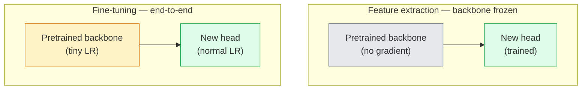

# Transfer Learning 與 Fine-Tuning (Transfer Learning & Fine-Tuning)

> 別人已經花了一百萬個 GPU 小時，教網路認識邊緣、紋理和物體的各個部分。在訓練自己的特徵之前，你應該先借用那些特徵。

**Type:** Build
**Languages:** Python
**Prerequisites:** Phase 4 Lesson 03 (CNNs), Phase 4 Lesson 04 (Image Classification)
**Time:** ~75 分鐘

## 學習目標 (Learning Objectives)

- 區分 feature extraction 與 fine-tuning，並依據資料集大小、domain 距離與算力預算選出合適的做法
- 載入預訓練 backbone、替換分類器 head，並在 20 行內只訓練 head，得到可用的 baseline
- 搭配 discriminative learning rate 逐步解凍各層，讓早期通用的特徵得到比後期任務專用的特徵更小的更新
- 診斷三個常見的失敗：解凍的 block 上 LR 太高造成的 feature drift、小資料集上的 BN 統計值崩壞，以及 catastrophic forgetting

## 問題 (The Problem)

在 ImageNet 上訓練 ResNet-50 大約要 2,000 個 GPU 小時。很少有團隊能為每個出貨的任務都負擔這個預算。幾乎每個團隊實際出貨的，是一個預訓練 backbone，加上用幾百或幾千張任務專屬影像訓練出來的新 head。

這不是走捷徑。任何在 ImageNet 上訓練的 CNN，第一個 conv block 學到的是邊緣和類 Gabor 的 filter。接下來幾個 block 學到紋理和簡單的 motif。中間的 block 學到物體的各個部分。最後幾個 block 學到的組合，開始長得像那 1,000 個 ImageNet 類別。這個階層的前 90% 幾乎不用改，就能轉移到醫學影像、工業檢測、衛星資料，以及每個其他視覺任務，因為大自然的邊緣與紋理詞彙是有限的。後 10% 才是你真正要訓練的。

要把 transfer 做對，有三個 bug 在等你：用太高的 learning rate 毀掉預訓練特徵、凍結太多讓模型缺乏資訊，以及讓 BatchNorm 的 running statistics 漂向一個網路其餘部分從沒學過的小資料集。這堂課會刻意逐一走過它們。

## 核心概念 (The Concept)

### Feature extraction 對 fine-tuning (Feature extraction vs fine-tuning)

兩種模式，取決於你有多信任預訓練特徵，以及你有多少資料。



經驗法則：

| 資料集大小 | Domain 距離 | 做法 |
|--------------|-----------------|--------|
| < 1k 張影像 | 接近 ImageNet | 凍結 backbone，只訓練 head |
| 1k-10k | 接近 | 凍結前 2-3 個 stage，fine-tune 其餘部分 |
| 10k-100k | 任何 | 搭配 discriminative LR 做端到端 fine-tune |
| 100k+ | 遠 | 全部 fine-tune；如果 domain 夠遠，可以考慮從頭訓練 |

「接近 ImageNet」大致上是指帶有物體內容的自然 RGB 照片。醫學 CT 掃描、俯拍衛星影像和顯微鏡影像都是遠的 domain：特徵仍然有幫助，但你需要讓更多層去適應。

### 為什麼凍結到底行得通 (Why freezing works at all)

CNN 學到的 ImageNet 特徵，並不是專屬於那 1,000 個類別。它們專屬於自然影像的統計特性：特定方向的邊緣、紋理、對比 pattern、形狀基本元素。這些統計特性，在人類說得出名字的幾乎每個視覺 domain 之間都很穩定。這就是為什麼一個在 ImageNet 上訓練的模型，只換一個新的 linear head（不 fine-tune backbone），在 CIFAR-10 上 zero-shot 評估就能達到 80% 以上的準確率。Head 學的是，對這個任務而言，已經學好的特徵中該給哪些加權。

### Discriminative learning rate

解凍時，早期的層應該比後期的層訓練得更慢。早期的層編碼你想保留的通用特徵；後期的層編碼你需要大幅移動的任務專屬結構。

```
Typical recipe:

  stage 0 (stem + first group): lr = base_lr / 100    (mostly fixed)
  stage 1:                       lr = base_lr / 10
  stage 2:                       lr = base_lr / 3
  stage 3 (last backbone group): lr = base_lr
  head:                          lr = base_lr  (or slightly higher)
```

在 PyTorch 中，這只是傳給 optimizer 的一串 parameter group。一個模型、五個 learning rate、零行額外程式。

### BatchNorm 問題 (The BatchNorm problem)

BN 層持有 `running_mean` 和 `running_var` 這兩個 buffer，是在 ImageNet 上算出來的。如果你的任務有不同的像素分布，例如不同的光線、不同的感測器、不同的色彩空間，那些 buffer 就是錯的。三個選項，依偏好排序：

1. **讓 BN 在 train 模式下 fine-tune。** 讓 BN 和其他一切一起更新它的 running statistics。當任務資料集大小中等（>= 5k 個樣本）時的預設選擇。
2. **把 BN 凍結在 eval 模式。** 保留 ImageNet 的統計值，只訓練權重。當你的資料集小到 BN 的 moving average 會很吵時，這是正確的。
3. **用 GroupNorm 取代 BN。** 完全消除 moving-average 的問題。用在每張 GPU 的 batch size 很小的 detection 和 segmentation backbone。

做錯這件事，準確率會默默掉 5 到 15%。

### Head 設計 (Head design)

分類器 head 是 1 到 3 個 linear 層，加上可選的 dropout。每個 torchvision backbone 都附帶一個預設 head，讓你替換：

```
backbone.fc = nn.Linear(backbone.fc.in_features, num_classes)          # ResNet
backbone.classifier[1] = nn.Linear(..., num_classes)                    # EfficientNet, MobileNet
backbone.heads.head = nn.Linear(..., num_classes)                       # torchvision ViT
```

對小資料集來說，單一個 linear 層通常就夠了。當任務分布離 backbone 的訓練分布比較遠時，加一個 hidden layer（Linear -> ReLU -> Dropout -> Linear）會有幫助。

### Layer-wise LR decay

現代 fine-tuning（BEiT、DINOv2、ViT-B fine-tune）使用的 discriminative LR 更平滑的版本。不把層分成 stage 來分組，而是讓每一層的 LR 都比它上面那一層稍微小一點：

```math
\text{lr\_layer}_k = \text{base\_lr} \cdot \text{decay}^{L - k}
```

在 decay = 0.75 且 L = 12 個 transformer block 的情況下，第一個 block 以 head 的 LR 的 `0.75^11 ≈ 0.04x` 來訓練。這對 transformer 的 fine-tune 比對 CNN 更重要，因為 CNN 通常用依 stage 分組的 LR 就夠了。

### 該評估什麼 (What to evaluate)

Transfer-learning 的實驗需要兩個你在從頭訓練時不會追蹤的數字：

- **只用預訓練的準確率 (Pretrained-only accuracy)**：backbone 凍結時 head 的準確率。這是你的下限。
- **Fine-tune 後的準確率 (Fine-tuned accuracy)**：同一個模型經過端到端訓練之後。這是你的上限。

如果 fine-tune 後的結果低於只用預訓練的結果，你就有 learning-rate 或 BN 的 bug。永遠把兩個都印出來。

```figure
transfer-learning
```

## 動手做 (Build It)

### 步驟 1：載入預訓練 backbone 並檢視它 (Step 1: Load a pretrained backbone and inspect it)

```python
import torch
import torch.nn as nn
from torchvision.models import resnet18, ResNet18_Weights

backbone = resnet18(weights=ResNet18_Weights.IMAGENET1K_V1)
print(backbone)
print()
print("classifier head:", backbone.fc)
print("feature dim:", backbone.fc.in_features)
```

`ResNet18` 有四個 stage（`layer1..layer4`），加上一個 stem 和一個 `fc` head。每個 torchvision 分類 backbone 都有類似的結構。

### 步驟 2：Feature extraction，凍結一切並替換 head (Step 2: Feature extraction — freeze everything, replace the head)

```python
def make_feature_extractor(num_classes=10):
    model = resnet18(weights=ResNet18_Weights.IMAGENET1K_V1)
    for p in model.parameters():
        p.requires_grad = False
    model.fc = nn.Linear(model.fc.in_features, num_classes)
    return model

model = make_feature_extractor(num_classes=10)
trainable = sum(p.numel() for p in model.parameters() if p.requires_grad)
frozen = sum(p.numel() for p in model.parameters() if not p.requires_grad)
print(f"trainable: {trainable:>10,}")
print(f"frozen:    {frozen:>10,}")
```

只有 `model.fc` 是可訓練的。Backbone 是一個凍結的 feature extractor。

### 步驟 3：Discriminative fine-tuning (Step 3: Discriminative fine-tuning)

一個建立依 stage 設定不同 learning rate 的 parameter group 的工具函式。

```python
def discriminative_param_groups(model, base_lr=1e-3, decay=0.3):
    stages = [
        ["conv1", "bn1"],
        ["layer1"],
        ["layer2"],
        ["layer3"],
        ["layer4"],
        ["fc"],
    ]
    groups = []
    for i, names in enumerate(stages):
        lr = base_lr * (decay ** (len(stages) - 1 - i))
        params = [p for n, p in model.named_parameters()
                  if any(n.startswith(k) for k in names)]
        if params:
            groups.append({"params": params, "lr": lr, "name": "_".join(names)})
    return groups

model = resnet18(weights=ResNet18_Weights.IMAGENET1K_V1)
model.fc = nn.Linear(model.fc.in_features, 10)
for p in model.parameters():
    p.requires_grad = True

groups = discriminative_param_groups(model)
for g in groups:
    print(f"{g['name']:>10s}  lr={g['lr']:.2e}  params={sum(p.numel() for p in g['params']):>8,}")
```

`decay=0.3` 的意思是每個 stage 以下一個 stage 30% 的速率訓練。`fc` 拿到 `base_lr`，`layer4` 拿到 `0.3 * base_lr`，`conv1` 拿到 `0.3^5 * base_lr ≈ 0.00243 * base_lr`。聽起來很極端，但經驗上是有效的。

### 步驟 4：BatchNorm 處理 (Step 4: BatchNorm handling)

一個在不凍結 BN 權重的情況下，凍結 BN running statistics 的 helper。

```python
def freeze_bn_stats(model):
    for m in model.modules():
        if isinstance(m, (nn.BatchNorm1d, nn.BatchNorm2d, nn.BatchNorm3d)):
            m.eval()
            for p in m.parameters():
                p.requires_grad = False
    return model
```

在每個 epoch 開頭設定 `model.train()` 之後呼叫它。`model.train()` 會把一切切到 training 模式；這個 helper 只針對 BN 層把它還原。

### 步驟 5：最小的端到端 fine-tuning 迴圈 (Step 5: A minimal end-to-end fine-tuning loop)

```python
from torch.optim import SGD
from torch.utils.data import DataLoader
from torch.optim.lr_scheduler import CosineAnnealingLR
import torch.nn.functional as F

def fine_tune(model, train_loader, val_loader, device, epochs=5, base_lr=1e-3, freeze_bn=False):
    model = model.to(device)
    groups = discriminative_param_groups(model, base_lr=base_lr)
    optimizer = SGD(groups, momentum=0.9, weight_decay=1e-4, nesterov=True)
    scheduler = CosineAnnealingLR(optimizer, T_max=epochs)

    for epoch in range(epochs):
        model.train()
        if freeze_bn:
            freeze_bn_stats(model)
        tr_loss, tr_correct, tr_total = 0.0, 0, 0
        for x, y in train_loader:
            x, y = x.to(device), y.to(device)
            logits = model(x)
            loss = F.cross_entropy(logits, y, label_smoothing=0.1)
            optimizer.zero_grad()
            loss.backward()
            optimizer.step()
            tr_loss += loss.item() * x.size(0)
            tr_total += x.size(0)
            tr_correct += (logits.argmax(-1) == y).sum().item()
        scheduler.step()

        model.eval()
        va_total, va_correct = 0, 0
        with torch.no_grad():
            for x, y in val_loader:
                x, y = x.to(device), y.to(device)
                pred = model(x).argmax(-1)
                va_total += x.size(0)
                va_correct += (pred == y).sum().item()
        print(f"epoch {epoch}  train {tr_loss/tr_total:.3f}/{tr_correct/tr_total:.3f}  "
              f"val {va_correct/va_total:.3f}")
    return model
```

用上述配方在 CIFAR-10 上跑五個 epoch，會讓 `ResNet18-IMAGENET1K_V1` 從約 70% 的 zero-shot linear-probe 準確率，提升到約 93% 的 fine-tune 後準確率。光靠 head，在完全不碰 backbone 的情況下，會停在約 86%。

### 步驟 6：漸進式解凍 (Step 6: Progressive unfreezing)

一個排程，每個 epoch 從後面往前解凍一個 stage。以多花一些 epoch 為代價，減輕 feature drift。

```python
def progressive_unfreeze_schedule(model):
    stages = ["layer4", "layer3", "layer2", "layer1"]
    yielded = set()

    def start():
        for p in model.parameters():
            p.requires_grad = False
        for p in model.fc.parameters():
            p.requires_grad = True

    def unfreeze(epoch):
        if epoch < len(stages):
            name = stages[epoch]
            yielded.add(name)
            for n, p in model.named_parameters():
                if n.startswith(name):
                    p.requires_grad = True
            return name
        return None

    return start, unfreeze
```

在第一個 epoch 之前呼叫一次 `start()`。每個 epoch 開頭呼叫 `unfreeze(epoch)`。每當可訓練的參數集合改變，就重建 optimizer，否則被凍結的參數仍然持有快取的 moment，會讓它混亂。

## 實際使用 (Use It)

對大多數真實任務，`torchvision.models` 加三行程式就夠了。上面比較重的機制，是在你遇到函式庫預設值解決不了的問題時才重要。

```python
from torchvision.models import resnet50, ResNet50_Weights

model = resnet50(weights=ResNet50_Weights.IMAGENET1K_V2)
model.fc = nn.Linear(model.fc.in_features, num_classes)
optimizer = torch.optim.AdamW(model.parameters(), lr=1e-4, weight_decay=1e-4)
```

另外兩個正式環境等級的預設選擇：

- `timm` 提供約 800 個預訓練視覺 backbone，API 一致（`timm.create_model("resnet50", pretrained=True, num_classes=10)`）。要 fine-tune torchvision model zoo 以外的模型，它是標準選擇。
- 對 transformer 來說，`transformers.AutoModelForImageClassification.from_pretrained(name, num_labels=N)` 讓你用和文字模型相同的載入語意，取得 ViT / BEiT / DeiT。

## 交付 (Ship It)

這堂課會產出：

- `outputs/prompt-fine-tune-planner.md`：一個 prompt，依據資料集大小、domain 距離與算力預算，選擇 feature-extraction、漸進式或端到端 fine-tuning。
- `outputs/skill-freeze-inspector.md`：一個 skill，給它一個 PyTorch 模型，它會回報哪些參數可訓練、哪些 BatchNorm 層在 eval 模式，以及 optimizer 是否真的拿到了可訓練的參數。

## 練習 (Exercises)

1. **（簡單）** 在同一個合成 CIFAR 資料集上，分別以 linear probe（backbone 凍結）和完整 fine-tune 訓練 `ResNet18`。並排回報兩種準確率。解釋哪一種差距告訴你特徵轉移得好，哪一種告訴你轉移得不好。
2. **（中等）** 故意引入一個 bug：把 `base_lr = 1e-1` 設在 backbone 的 stage，而不是 head。展示 training loss 爆炸，然後套用 `discriminative_param_groups` helper 來恢復。記錄每個 stage 開始發散時的 LR。
3. **（困難）** 取一個醫學影像資料集（例如 CheXpert-small、PatchCamelyon 或 HAM10000），比較三種模式：(a) ImageNet 預訓練、凍結 backbone 加 linear head；(b) ImageNet 預訓練、端到端 fine-tune；(c) 從頭訓練。回報每一種的準確率和算力成本。資料集多大時，從頭訓練才開始有競爭力？

## 關鍵術語 (Key Terms)

| 術語 | 大家常說的 | 實際意義 |
|------|----------------|----------------------|
| Feature extraction | 「凍結並訓練 head」 | Backbone 參數凍結，只有新的分類器 head 會接收 gradient |
| Fine-tuning | 「端到端重新訓練」 | 所有參數都可訓練，通常使用比從頭訓練小很多的 LR |
| Discriminative LR | 「早期的層用較小的 LR」 | Optimizer 的 parameter group，其中早期 stage 的 LR 是後期 stage LR 的一部分 |
| Layer-wise LR decay | 「平滑的 LR 梯度」 | 每層的 LR 乘上 decay^(L - k)；常見於 transformer 的 fine-tune |
| Catastrophic forgetting | 「模型把 ImageNet 忘光了」 | 太高的 LR 在新任務的訊號被學到之前，就覆寫了預訓練特徵 |
| BN statistics drift | 「Running mean 是錯的」 | BatchNorm 的 running_mean/var 是在和目前任務不同的分布上算出來的，默默傷害準確率 |
| Linear probe | 「凍結的 backbone 加 linear head」 | 對預訓練特徵的評估：在凍結的表示 (representation) 上面，最佳 linear 分類器的準確率 |
| Catastrophic collapse | 「全部都預測成同一類」 | 用高到足以在 head 的 gradient 穩定下來之前就摧毀特徵的 LR 做 fine-tune 時發生 |

## 延伸閱讀 (Further Reading)

- [How transferable are features in deep neural networks? (Yosinski et al., 2014)](https://arxiv.org/abs/1411.1792)：量化各層特徵可轉移性的論文
- [Universal Language Model Fine-tuning (ULMFiT, Howard & Ruder, 2018)](https://arxiv.org/abs/1801.06146)：原始的 discriminative LR / 漸進式解凍配方，這些想法可以直接轉移到視覺
- [timm documentation](https://huggingface.co/docs/timm)：現代視覺 backbone 的參考資料，以及它們訓練時所用的確切 fine-tune 預設值
- [A Simple Framework for Linear-Probe Evaluation (Kornblith et al., 2019)](https://arxiv.org/abs/1805.08974)：為什麼 linear-probe 準確率很重要，以及該如何正確地回報它
