# 物件偵測：從零實作 YOLO (Object Detection — YOLO from Scratch)

> Detection 就是分類加上回歸，在 feature map 的每個位置執行，最後再用 non-maximum suppression 整理乾淨。

**Type:** Build
**Languages:** Python
**Prerequisites:** Phase 4 Lesson 03 (CNNs), Phase 4 Lesson 04 (Image Classification), Phase 4 Lesson 05 (Transfer Learning)
**Time:** ~75 分鐘

## 學習目標 (Learning Objectives)

- 解釋把 detection 變成 dense prediction 問題的 grid-and-anchor 設計，並說明輸出 tensor 裡每個數字的意義
- 計算 box 之間的 Intersection-over-Union，並從零實作 non-maximum suppression
- 在預訓練 backbone 之上建立最小的 YOLO 風格 head，包括分類、objectness 與 box regression 的 loss
- 讀懂一列 detection 指標（precision@0.5、recall、mAP@0.5、mAP@0.5:0.95），並決定下一個要調哪個旋鈕

## 問題 (The Problem)

分類說「這張影像是一隻狗」。Detection 說「在像素 (112, 40, 280, 210) 有一隻狗，在 (400, 180, 560, 310) 有一隻貓，畫面中沒有其他東西」。這一個結構上的改變，也就是預測數量不定的帶標籤 box，而不是每張影像一個標籤，是每個自駕系統、每個監控產品、每個文件版面解析器、每條工廠視覺產線所仰賴的基礎。

Detection 也是視覺中所有工程取捨同時出現的地方。你要 box 準確（regression head），要每個 box 有正確的類別（classification head），要模型在沒東西可偵測時知道（objectness score），還要每個真實物體剛好只有一個預測（non-maximum suppression）。漏掉任何一個，pipeline 不是漏掉物體、回報幻覺出來的 box，就是把同一個物體在稍微不同的位置預測十五次。

YOLO（You Only Look Once，Redmon et al. 2016）是讓這一切能即時執行的設計，做法是只用 conv net 的單次 forward pass。同樣的結構決策，至今仍是現代 detector（YOLOv8、YOLOv9、YOLO-NAS、RT-DETR）的骨幹。學會核心，每個變體都只是同樣零件的重新排列。

## 核心概念 (The Concept)

### Detection 作為 dense prediction (Detection as dense prediction)

分類器對每張影像輸出 C 個數字。YOLO 風格的 detector 對每張影像輸出 `(S x S x (5 + C))` 個數字，其中 S 是空間 grid 的大小。

```mermaid
flowchart LR
    IMG["Input 416x416 RGB"] --> BB["Backbone<br/>(ResNet, DarkNet, ...)"]
    BB --> FM["Feature map<br/>(C_feat, 13, 13)"]
    FM --> HEAD["Detection head<br/>(1x1 convs)"]
    HEAD --> OUT["Output tensor<br/>(13, 13, B * (5 + C))"]
    OUT --> DEC["Decode<br/>(grid + sigmoid + exp)"]
    DEC --> NMS["Non-max suppression"]
    NMS --> RESULT["Final boxes"]

    style IMG fill:#dbeafe,stroke:#2563eb
    style HEAD fill:#fef3c7,stroke:#d97706
    style NMS fill:#fecaca,stroke:#dc2626
    style RESULT fill:#dcfce7,stroke:#16a34a
```



`S * S` 個 grid cell 中，每個都預測 `B` 個 box。對每個 box：

- 4 個數字描述幾何：`tx, ty, tw, th`。
- 1 個數字是 objectness score：「這個 cell 內有沒有物體的中心？」
- C 個數字是類別機率。

每個 cell 總共：`B * (5 + C)`。對 VOC 來說，`S=13, B=2, C=20`，每個 cell 是 50 個數字。

### 為什麼要 grid 和 anchor (Why grids and anchors)

單純的 regression 會對每個物體預測絕對座標 `(x, y, w, h)`。這對 conv network 很難，因為平移影像，不應該讓所有預測都平移同樣的量，每個物體在空間上都是被錨定的。Grid 的回答是：把每個 ground-truth box 指派給它的中心所在的 grid cell；只有那個 cell 要為那個物體負責。

Anchor 解決第二個問題。3x3 conv 很難從 receptive field 只有 16 像素的 feature cell 回歸出 500 像素寬的 box。所以我們為每個 cell 預先定義 `B` 個先驗的 box 形狀（anchor），然後預測相對於每個 anchor 的小 delta。模型學的是挑對 anchor 並微調它，而不是從零開始回歸。

```
Anchor box priors (example for 416x416 input):

  small:   (30,  60)
  medium:  (75,  170)
  large:   (200, 380)

At each grid cell, every anchor emits (tx, ty, tw, th, obj, c_1, ..., c_C).
```

現代 detector 常常搭配 FPN，每種解析度用不同的 anchor 集合：淺層高解析度的 map 用小 anchor，深層低解析度的 map 用大 anchor。同樣的想法，更多尺度。

### 解碼預測 (Decoding predictions)

原始的 `tx, ty, tw, th` 不是 box 座標；它們是回歸目標，要先轉換才能畫出來：

```math
\begin{aligned}
\text{centre } x &= (\sigma(t_x) + \text{cell}_x) \cdot \text{stride} \\
\text{centre } y &= (\sigma(t_y) + \text{cell}_y) \cdot \text{stride} \\
\text{width} &= \text{anchor}_w \cdot \exp(t_w) \\
\text{height} &= \text{anchor}_h \cdot \exp(t_h)
\end{aligned}
```

`sigmoid` 讓中心偏移量留在 cell 內。`exp` 讓寬度可以從 anchor 自由縮放而不會出現正負號翻轉。`stride` 把 grid 座標縮放回像素。自 v2 以來，每個 YOLO 版本的這個解碼步驟都一樣。

### IoU

Detection 中兩個 box 之間的通用相似度指標：

```math
\mathrm{IoU}(A, B) = \frac{\mathop{\mathrm{area}}(A \cap B)}{\mathop{\mathrm{area}}(A \cup B)}
```

$\mathrm{IoU} = 1$ 代表完全相同；$\mathrm{IoU} = 0$ 代表沒有重疊。預測與 ground-truth box 之間的 IoU，決定一個預測算不算 true positive（通常是 $\mathrm{IoU} \ge 0.5$）。兩個預測之間的 IoU，則是 NMS 用來去除重複的依據。

### Non-maximum suppression

在相鄰 anchor 上訓練的 conv network，常常會對同一個物體預測出重疊的 box。NMS 保留信心度最高的預測，並刪除任何與它的 IoU 超過門檻的其他預測。

```
NMS(boxes, scores, iou_threshold):
    sort boxes by score descending
    keep = []
    while boxes not empty:
        pick the top-scoring box, add to keep
        remove every box with IoU > iou_threshold to the picked box
    return keep
```

典型門檻：物件偵測用 0.45。近期的 detector 會用 `soft-NMS`、`DIoU-NMS` 取代標準 NMS，或直接學習抑制（RT-DETR），但結構上的目的是一樣的。

### Loss

YOLO loss 是三個 loss 加權相加：

```math
\begin{aligned}
L = {} & \lambda_{\text{coord}} \cdot L_{\text{box}}(\text{pred}, \text{target}, \text{where obj}=1) \\
+ {} & \lambda_{\text{obj}} \cdot L_{\text{obj}}(\text{pred}, 1, \text{where obj}=1) \\
+ {} & \lambda_{\text{noobj}} \cdot L_{\text{obj}}(\text{pred}, 0, \text{where obj}=0) \\
+ {} & \lambda_{\text{cls}} \cdot L_{\text{cls}}(\text{pred}, \text{target}, \text{where obj}=1)
\end{aligned}
```

只有包含物體的 cell 才會貢獻 box regression 和分類 loss。沒有物體的 cell 只貢獻 objectness loss（教模型保持安靜）。`lambda_noobj` 通常很小（約 0.5），因為絕大多數 cell 是空的，否則會主宰總 loss。

現代變體把 MSE box loss 換成 CIoU / DIoU（直接最佳化 IoU），用 focal loss 處理類別不平衡，並用 quality focal loss 平衡 objectness。這三個組成的結構沒有改變。

### Detection 指標 (Detection metrics)

準確率無法直接用在 detection。四個適用的數字：

- **Precision@IoU=0.5**：被算成 positive 的預測中，實際上正確的有多少。
- **Recall@IoU=0.5**：真實物體中，我們找到了多少。
- **AP@0.5**：在 IoU 門檻 0.5 下，precision-recall 曲線的面積；每個類別一個數字。
- **mAP@0.5:0.95**：在 IoU 門檻 0.5、0.55、...、0.95 上的 AP 平均值。這是 COCO 指標；最嚴格、資訊也最豐富。

四個都要回報。一個 mAP@0.5 很強但 mAP@0.5:0.95 很弱的 detector，定位大致正確但不夠精準；用更好的 box regression loss 修正。Precision 高但 recall 低的 detector 太保守；降低信心度門檻，或提高 objectness 的權重。

```figure
object-detection-nms
```

## 動手做 (Build It)

### 步驟 1：IoU (Step 1: IoU)

整堂課的主力。作用在兩個以 `(x1, y1, x2, y2)` 格式表示的 box 陣列上。

```python
import numpy as np

def box_iou(boxes_a, boxes_b):
    ax1, ay1, ax2, ay2 = boxes_a[:, 0], boxes_a[:, 1], boxes_a[:, 2], boxes_a[:, 3]
    bx1, by1, bx2, by2 = boxes_b[:, 0], boxes_b[:, 1], boxes_b[:, 2], boxes_b[:, 3]

    inter_x1 = np.maximum(ax1[:, None], bx1[None, :])
    inter_y1 = np.maximum(ay1[:, None], by1[None, :])
    inter_x2 = np.minimum(ax2[:, None], bx2[None, :])
    inter_y2 = np.minimum(ay2[:, None], by2[None, :])

    inter_w = np.clip(inter_x2 - inter_x1, 0, None)
    inter_h = np.clip(inter_y2 - inter_y1, 0, None)
    inter = inter_w * inter_h

    area_a = (ax2 - ax1) * (ay2 - ay1)
    area_b = (bx2 - bx1) * (by2 - by1)
    union = area_a[:, None] + area_b[None, :] - inter
    return inter / np.clip(union, 1e-8, None)
```

回傳一個 `(N_a, N_b)` 的成對 IoU 矩陣。要對單一 ground-truth box 使用，就讓其中一個陣列的 shape 是 `(1, 4)`。

### 步驟 2：Non-max suppression (Step 2: Non-max suppression)

```python
def nms(boxes, scores, iou_threshold=0.45):
    order = np.argsort(-scores)
    keep = []
    while len(order) > 0:
        i = order[0]
        keep.append(i)
        if len(order) == 1:
            break
        rest = order[1:]
        ious = box_iou(boxes[[i]], boxes[rest])[0]
        order = rest[ious <= iou_threshold]
    return np.array(keep, dtype=np.int64)
```

行為是確定性的，排序帶來 `O(N log N)`，而且在相同輸入下，與 `torchvision.ops.nms` 的行為一致。

### 步驟 3：Box 編碼與解碼 (Step 3: Box encoding and decoding)

在像素座標，以及網路實際回歸的 `(tx, ty, tw, th)` 目標之間轉換。

```python
def encode(box_xyxy, cell_x, cell_y, stride, anchor_wh):
    x1, y1, x2, y2 = box_xyxy
    cx = 0.5 * (x1 + x2)
    cy = 0.5 * (y1 + y2)
    w = x2 - x1
    h = y2 - y1
    off_x = np.clip(cx / stride - cell_x, 1e-6, 1 - 1e-6)
    off_y = np.clip(cy / stride - cell_y, 1e-6, 1 - 1e-6)
    tx = np.log(off_x / (1 - off_x))
    ty = np.log(off_y / (1 - off_y))
    tw = np.log(w / anchor_wh[0] + 1e-8)
    th = np.log(h / anchor_wh[1] + 1e-8)
    return np.array([tx, ty, tw, th])


def decode(tx_ty_tw_th, cell_x, cell_y, stride, anchor_wh):
    tx, ty, tw, th = tx_ty_tw_th
    cx = (sigmoid(tx) + cell_x) * stride
    cy = (sigmoid(ty) + cell_y) * stride
    w = anchor_wh[0] * np.exp(tw)
    h = anchor_wh[1] * np.exp(th)
    return np.array([cx - w / 2, cy - h / 2, cx + w / 2, cy + h / 2])


def sigmoid(x):
    return 1.0 / (1.0 + np.exp(-x))
```

測試：編碼一個中心嚴格位於 cell 內的 box，再解碼，你應該能拿回原始的 box，誤差只在浮點數範圍內。`encode` 把中心偏移量存成 logit，也就是 `decode` 裡 `sigmoid` 的反函數。Clip 讓 logit 保持有限；剛好在 cell 邊緣的中心最多移動 `1e-6` 個 cell。下面的 `assign_targets` 存的是同樣的 logit，所以 head 是在 `decode` 預期的空間裡訓練。

### 步驟 4：最小的 YOLO head (Step 4: A minimal YOLO head)

在 feature map 上用一個 1x1 conv，reshape 成 `(B, S, S, num_anchors, 5 + C)`。

```python
import torch
import torch.nn as nn

class YOLOHead(nn.Module):
    def __init__(self, in_c, num_anchors, num_classes):
        super().__init__()
        self.num_anchors = num_anchors
        self.num_classes = num_classes
        self.conv = nn.Conv2d(in_c, num_anchors * (5 + num_classes), kernel_size=1)

    def forward(self, x):
        n, _, h, w = x.shape
        y = self.conv(x)
        y = y.view(n, self.num_anchors, 5 + self.num_classes, h, w)
        y = y.permute(0, 3, 4, 1, 2).contiguous()
        return y
```

輸出 shape：`(N, H, W, num_anchors, 5 + C)`。最後一個維度裝的是 `[tx, ty, tw, th, obj, cls_0, ..., cls_{C-1}]`。

### 步驟 5：Ground-truth 指派 (Step 5: Ground-truth assignment)

對每個 ground-truth box，決定哪個 `(cell, anchor)` 負責它。

```python
def assign_targets(boxes_xyxy, classes, anchors, stride, grid_size, num_classes):
    num_anchors = len(anchors)
    target = np.zeros((grid_size, grid_size, num_anchors, 5 + num_classes), dtype=np.float32)
    has_obj = np.zeros((grid_size, grid_size, num_anchors), dtype=bool)

    for box, cls in zip(boxes_xyxy, classes):
        x1, y1, x2, y2 = box
        cx, cy = 0.5 * (x1 + x2), 0.5 * (y1 + y2)
        gx, gy = int(cx / stride), int(cy / stride)
        bw, bh = x2 - x1, y2 - y1

        ious = np.array([
            (min(bw, aw) * min(bh, ah)) / (bw * bh + aw * ah - min(bw, aw) * min(bh, ah))
            for aw, ah in anchors
        ])
        best = int(np.argmax(ious))
        aw, ah = anchors[best]

        off_x = np.clip(cx / stride - gx, 1e-6, 1 - 1e-6)
        off_y = np.clip(cy / stride - gy, 1e-6, 1 - 1e-6)
        target[gy, gx, best, 0] = np.log(off_x / (1 - off_x))
        target[gy, gx, best, 1] = np.log(off_y / (1 - off_y))
        target[gy, gx, best, 2] = np.log(bw / aw + 1e-8)
        target[gy, gx, best, 3] = np.log(bh / ah + 1e-8)
        target[gy, gx, best, 4] = 1.0
        target[gy, gx, best, 5 + cls] = 1.0
        has_obj[gy, gx, best] = True
    return target, has_obj
```

Anchor 的選擇是「與 ground truth 的形狀 IoU 最佳者」，這是個便宜的替代做法，與 YOLOv2/v3 的指派方式相符。v5 以後使用更精細的策略（task-aligned matching、dynamic k），改良的是同一個想法。

### 步驟 6：三個 loss (Step 6: The three losses)

```python
def yolo_loss(pred, target, has_obj, lambda_coord=5.0, lambda_obj=1.0, lambda_noobj=0.5, lambda_cls=1.0):
    has_obj_t = torch.from_numpy(has_obj).bool()
    target_t = torch.from_numpy(target).float()

    # box-regression loss: only on cells with objects
    box_pred = pred[..., :4][has_obj_t]
    box_true = target_t[..., :4][has_obj_t]
    loss_box = torch.nn.functional.mse_loss(box_pred, box_true, reduction="sum")

    # objectness loss
    obj_pred = pred[..., 4]
    obj_true = target_t[..., 4]
    loss_obj_pos = torch.nn.functional.binary_cross_entropy_with_logits(
        obj_pred[has_obj_t], obj_true[has_obj_t], reduction="sum")
    loss_obj_neg = torch.nn.functional.binary_cross_entropy_with_logits(
        obj_pred[~has_obj_t], obj_true[~has_obj_t], reduction="sum")

    # classification loss on cells with objects
    cls_pred = pred[..., 5:][has_obj_t]
    cls_true = target_t[..., 5:][has_obj_t]
    loss_cls = torch.nn.functional.binary_cross_entropy_with_logits(
        cls_pred, cls_true, reduction="sum")

    total = (lambda_coord * loss_box
             + lambda_obj * loss_obj_pos
             + lambda_noobj * loss_obj_neg
             + lambda_cls * loss_cls)
    return total, {"box": loss_box.item(), "obj_pos": loss_obj_pos.item(),
                   "obj_neg": loss_obj_neg.item(), "cls": loss_cls.item()}
```

四個 loss 權重，每個 YOLO 教學不是寫死，就是做掃描。比例很重要：`lambda_coord=5, lambda_noobj=0.5` 沿用原始 YOLOv1 論文的設定，至今仍是合理的預設值。

### 步驟 7：推論 pipeline (Step 7: Inference pipeline)

解碼原始的 head 輸出，套用 sigmoid/exp，用 objectness 設門檻，然後做 NMS。

```python
def postprocess(pred_tensor, anchors, stride, img_size, conf_threshold=0.25, iou_threshold=0.45):
    pred = pred_tensor.detach().cpu().numpy()
    grid_h, grid_w = pred.shape[1], pred.shape[2]
    num_anchors = len(anchors)

    boxes, scores, classes = [], [], []
    for gy in range(grid_h):
        for gx in range(grid_w):
            for a in range(num_anchors):
                tx, ty, tw, th, obj, *cls = pred[0, gy, gx, a]
                score = sigmoid(obj) * sigmoid(np.array(cls)).max()
                if score < conf_threshold:
                    continue
                cls_idx = int(np.argmax(cls))
                cx = (sigmoid(tx) + gx) * stride
                cy = (sigmoid(ty) + gy) * stride
                w = anchors[a][0] * np.exp(tw)
                h = anchors[a][1] * np.exp(th)
                boxes.append([cx - w / 2, cy - h / 2, cx + w / 2, cy + h / 2])
                scores.append(float(score))
                classes.append(cls_idx)

    if not boxes:
        return np.zeros((0, 4)), np.zeros((0,)), np.zeros((0,), dtype=int)
    boxes = np.array(boxes)
    scores = np.array(scores)
    classes = np.array(classes)
    keep = nms(boxes, scores, iou_threshold)
    return boxes[keep], scores[keep], classes[keep]
```

這就是完整的評估路徑：head -> decode -> threshold -> NMS。

## 實際使用 (Use It)

`torchvision.models.detection` 提供結構概念相同的正式 detector。載入預訓練模型只要三行。

```python
import torch
from torchvision.models.detection import fasterrcnn_resnet50_fpn_v2

model = fasterrcnn_resnet50_fpn_v2(weights="DEFAULT")
model.eval()
with torch.no_grad():
    predictions = model([torch.randn(3, 400, 600)])
print(predictions[0].keys())
print(f"boxes:  {predictions[0]['boxes'].shape}")
print(f"scores: {predictions[0]['scores'].shape}")
print(f"labels: {predictions[0]['labels'].shape}")
```

對即時推論 pipeline 來說，`ultralytics`（YOLOv8/v9）是標準：`from ultralytics import YOLO; model = YOLO('yolov8n.pt'); model(img)`。模型在內部處理解碼和 NMS，並回傳和你上面建立的相同 `boxes / scores / labels` 三元組。

## 交付 (Ship It)

這堂課會產出：

- `outputs/prompt-detection-metric-reader.md`：一個 prompt，把一列 `precision, recall, AP, mAP@0.5:0.95` 轉成一句話的診斷，以及最有用的下一個實驗。
- `outputs/skill-anchor-designer.md`：一個 skill，給它一份 ground-truth box 的資料集，它會對 `(w, h)` 跑 k-means，並回傳每個 FPN 層級的 anchor 集合，以及挑選正確 anchor 數量所需的覆蓋統計。

## 練習 (Exercises)

1. **（簡單）** 實作 `box_iou`，並在 1,000 對隨機 box 上與 `torchvision.ops.box_iou` 比對。驗證最大絕對差小於 `1e-6`。
2. **（中等）** 把 `yolo_loss` 改寫成使用 `CIoU` box loss 而不是 MSE 的版本。在 100 張影像的合成資料集上，證明 CIoU 在相同 epoch 數下，收斂到比 MSE 更好的最終 mAP@0.5:0.95。
3. **（困難）** 實作多尺度推論：把同一張影像以三種解析度送進模型，取聯集合併 box 預測，最後只跑一次 NMS。在保留的資料集上，測量相對於單一尺度推論的 mAP 提升。

## 關鍵術語 (Key Terms)

| 術語 | 大家常說的 | 實際意義 |
|------|----------------|----------------------|
| Anchor | 「Box 先驗」 | 每個 grid cell 上預先定義的 box 形狀，網路預測相對於它的 delta，而不是絕對座標 |
| IoU | 「重疊」 | 兩個 box 的交集除以聯集；detection 中通用的相似度度量 |
| NMS | 「去重複」 | 貪婪演算法，保留分數最高的預測，並移除超過門檻的重疊預測 |
| Objectness | 「這裡有東西嗎」 | 每個 anchor、每個 cell 的純量，預測物體的中心是否在該 cell 內 |
| Grid stride | 「降採樣倍數」 | 每個 grid cell 的像素數；416 像素輸入搭配 13 格的 head，stride 為 32 |
| mAP | 「平均精度均值」 | precision-recall 曲線下面積的平均，對各類別（以及 COCO 的話，對 IoU 門檻）取平均 |
| AP@0.5 | 「PASCAL VOC AP」 | IoU 門檻為 0.5 的 average precision；寬鬆版的指標 |
| mAP@0.5:0.95 | 「COCO AP」 | 對 IoU 門檻 0.5..0.95（間隔 0.05）取平均；嚴格版，也是目前社群標準 |

## 延伸閱讀 (Further Reading)

- [YOLOv1: You Only Look Once (Redmon et al., 2016)](https://arxiv.org/abs/1506.02640)：開創性的論文；之後每個 YOLO 都是這個結構的改良
- [YOLOv3 (Redmon & Farhadi, 2018)](https://arxiv.org/abs/1804.02767)：引入多尺度 FPN 風格 head 的論文；至今仍是最清楚的圖
- [Ultralytics YOLOv8 docs](https://docs.ultralytics.com)：目前的正式參考資料；涵蓋資料集格式、augmentation、訓練配方
- [The Illustrated Guide to Object Detection (Jonathan Hui)](https://jonathan-hui.medium.com/object-detection-series-24d03a12f904)：最好的白話文導覽，涵蓋整個 detector 家族；對理解 DETR、RetinaNet、FCOS 與 YOLO 之間的關係價值連城
