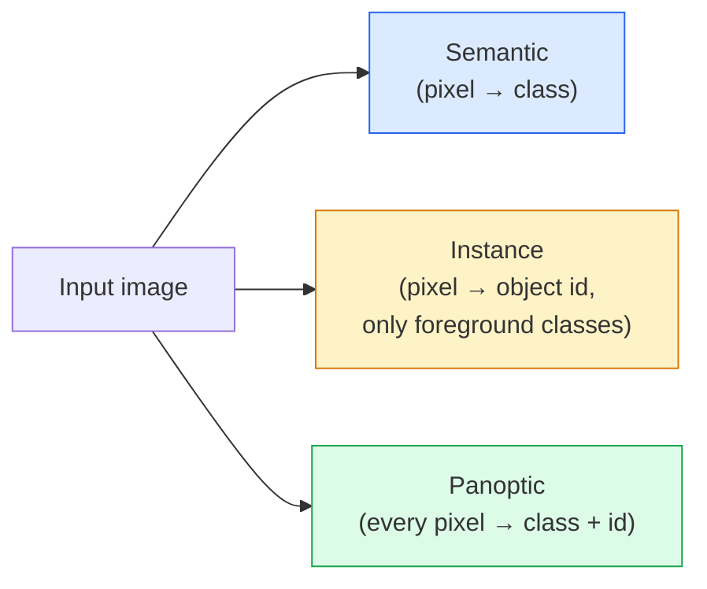
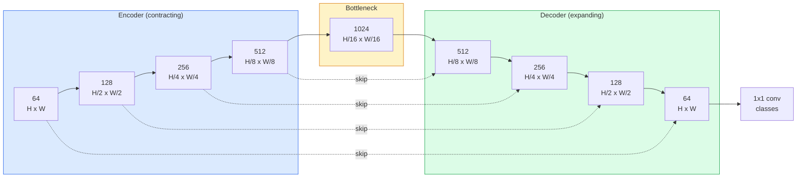

# 語意分割：U-Net (Semantic Segmentation — U-Net)

> Segmentation 就是對每個像素做分類。U-Net 的作法是讓降採樣的 encoder 搭配升採樣的 decoder，並在兩者之間接上 skip connection。

**Type:** Build
**Languages:** Python
**Prerequisites:** Phase 4 Lesson 03 (CNNs), Phase 4 Lesson 04 (Image Classification)
**Time:** ~75 分鐘

## 學習目標 (Learning Objectives)

- 區分 semantic、instance 與 panoptic segmentation，並為給定的問題挑選正確的任務
- 在 PyTorch 中從零建立 U-Net，包含 encoder block、bottleneck、使用 transposed convolution 的 decoder，以及 skip connection
- 實作逐像素的 cross-entropy、Dice loss，以及目前醫學與工業 segmentation 預設使用的組合 loss
- 讀取每個類別的 IoU 與 Dice 指標，診斷分數不佳是來自小物體的 recall、邊界精準度，還是類別不平衡

## 問題 (The Problem)

分類每張影像輸出一個標籤。Detection 每張影像輸出少數幾個 box。Segmentation 每個像素輸出一個標籤。對大小 `H x W` 的輸入，輸出是 shape 為 `H x W`（semantic）或 `H x W x N_instances`（instance）的 tensor。這是每張影像數百萬個預測，不是一個。

Segmentation 的結構，正是它驅動幾乎所有 dense-prediction 視覺產品的原因：醫學影像（腫瘤遮罩）、自動駕駛（道路、車道、障礙物）、衛星（建築物輪廓、農作物邊界）、文件解析（版面區域）、機器人（可抓取區域）。這些任務都不是在物體周圍畫個框就能解決的；它們需要精確的輪廓。

這個架構問題很容易敘述，但不容易解決：你需要網路同時看到影像的全域脈絡（這是什麼樣的場景），以及局部的像素細節（到底哪個像素是道路、哪個是人行道）。標準 CNN 為了取得脈絡而在空間上壓縮，這會丟掉細節。U-Net 是兩者兼得的設計。

## 核心概念 (The Concept)

### Semantic、instance 與 panoptic (Semantic vs instance vs panoptic)



- **Semantic** 說「這個像素是道路，那個像素是車」。相鄰的兩輛車會糊成同一團。
- **Instance** 說「這個像素是車 #3，那個像素是車 #5」。忽略背景的 stuff（「stuff」= 天空、道路、草地）。
- **Panoptic** 把兩者統一：每個像素都有類別標籤，每個 instance 都有唯一的 id，stuff 和 things 都做 segmentation。

這堂課涵蓋 semantic。下一堂課（Mask R-CNN）涵蓋 instance。

### U-Net 的形狀 (The U-Net shape)



Encoder 把空間解析度減半四次，並把通道加倍。Decoder 相反：把空間解析度加倍四次，並把通道減半。Skip connection 在每個解析度上，把對應的 encoder 特徵與 decoder 特徵 concatenate 起來。最後的 1x1 conv 在完整解析度上把 `64 -> num_classes`。

為什麼 skip connection 是必要的：decoder 到了要輸出像素層級預測的時候，只看過小的 feature map。沒有 skip 的話，它沒辦法準確定位邊緣，因為那些資訊在 encoder 裡已經被壓縮掉了。Skip connection 把 encoder 在往下走的途中算出的高解析度 feature map 交給它。

### Transposed 對 bilinear 升採樣 (Transposed vs bilinear upsample)

Decoder 必須擴張空間維度。有兩個選項：

- **Transposed convolution**（`nn.ConvTranspose2d`）：可學習的升採樣。歷史上 U-Net 的預設。如果 stride 和 kernel size 無法整除，可能會產生棋盤格 (checkerboard) 瑕疵。
- **Bilinear upsample + 3x3 conv**：平滑的升採樣，接著一個 conv。瑕疵較少、參數較少，現在是現代的預設。

兩者在實務上都會看到。第一次做 U-Net，bilinear 比較安全。

### 像素網格上的 cross-entropy (Cross-entropy on a pixel grid)

對有 $C$ 個類別的 semantic segmentation，模型輸出是 `(N, C, H, W)`。目標是 `(N, H, W)`，內容是整數類別 ID。Cross-entropy 與分類的情況完全相同，只是套用在每個空間位置：

```math
\text{Loss} = \mathop{\mathrm{mean}}\limits_{(n, h, w)} \left[ -\log\left( \mathop{\mathrm{softmax}}(\text{logits}[n, :, h, w])[\text{target}[n, h, w]] \right) \right]
```

PyTorch 的 `F.cross_entropy` 原生處理這個 shape。不需要 reshape。

### Dice loss 以及為什麼你需要它 (Dice loss and why you need it)

Cross-entropy 把每個像素一視同仁。當某個類別主宰整個畫面時（醫學影像：99% 背景、1% 腫瘤），這是錯的。網路可以在每個地方都預測背景，拿到 99% 準確率，卻毫無用處。

Dice loss 直接最佳化預測遮罩與真實遮罩之間的重疊來解決這個問題：

```math
\begin{aligned}
\mathop{\mathrm{Dice}}(p, y) &= \frac{2 \sum (p \cdot y)}{\sum p + \sum y + \epsilon} \\
\text{Dice}_{\text{loss}} &= 1 - \text{Dice}
\end{aligned}
```

其中 `p` 是某個類別的 sigmoid/softmax 機率圖，`y` 是二元的 ground-truth 遮罩。只有在重疊完美時 loss 才為零。因為它是基於比值，所以類別不平衡就無關緊要。

實務上，使用 **組合 loss**：

```math
L = L_{\text{cross\_entropy}} + \lambda \cdot L_{\text{dice}} \qquad (\lambda \approx 1)
```

Cross-entropy 在訓練初期提供穩定的 gradient；Dice 則在訓練後段專注於真正貼合遮罩的形狀。這個組合是醫學影像的預設，在任何類別不平衡的資料集上都很難被超越。

### 評估指標 (Evaluation metrics)

- **Pixel accuracy**：預測正確的像素百分比。便宜。在不平衡資料上會壞掉，原因與分類中的 accuracy 相同。
- **每類 IoU (IoU per class)**：每個類別遮罩的交集除以聯集；對類別取平均 = mIoU。
- **Dice（像素上的 F1）**：與 IoU 類似；$\text{Dice} = 2 \cdot \text{IoU} / (1 + \text{IoU})$。醫學影像偏好 Dice，自駕社群偏好 IoU；兩者是單調相關的。
- **Boundary F1**：衡量預測邊界與 ground-truth 邊界有多接近，連很小的位移都會被扣分。對半導體檢測這類高精度任務很重要。

要回報每個類別的 IoU，不只是 mIoU。當另外九個類別是 85% 時，平均 IoU 會掩蓋一個 15% 的類別。

### 輸入解析度的取捨 (Input resolution trade-off)

U-Net 的 encoder 把解析度減半四次，所以只有輸入能被 16 整除時，skip connection 才會剛好對齊。其他大小需要 padding，或在 up block 中 resize（步驟 2）。醫學影像常常是 512x512 或 1024x1024。自動駕駛的裁切是 2048x1024。U-Net 的記憶體成本隨 `H * W * C_max` 增長，在 1024x1024 且 bottleneck 有 1024 個通道時，forward pass 就已經用掉好幾 GB 的 VRAM。

兩個標準的因應方式：

1. 把輸入切塊 (tile)：處理有重疊的 256x256 區塊再拼接起來。
2. 用 dilated convolution 取代 bottleneck，讓空間解析度維持較高，但 receptive field 變寬（DeepLab 系列）。

第一個模型的話，256x256 輸入搭配 64 通道基底的 U-Net，在 8 GB VRAM 上訓練很輕鬆。

```figure
segmentation-flood
```

## 動手做 (Build It)

### 步驟 1：Encoder block (Step 1: Encoder block)

兩個 3x3 conv，搭配 batch norm 和 ReLU。第一個 conv 改變通道數；第二個維持不變。

```python
import torch
import torch.nn as nn
import torch.nn.functional as F

class DoubleConv(nn.Module):
    def __init__(self, in_c, out_c):
        super().__init__()
        self.net = nn.Sequential(
            nn.Conv2d(in_c, out_c, kernel_size=3, padding=1, bias=False),
            nn.BatchNorm2d(out_c),
            nn.ReLU(inplace=True),
            nn.Conv2d(out_c, out_c, kernel_size=3, padding=1, bias=False),
            nn.BatchNorm2d(out_c),
            nn.ReLU(inplace=True),
        )

    def forward(self, x):
        return self.net(x)
```

這個 block 會到處重複使用。用 `bias=False` 是因為 BN 的 beta 已經負責 bias。

### 步驟 2：Down 與 up block (Step 2: Down and up blocks)

```python
class Down(nn.Module):
    def __init__(self, in_c, out_c):
        super().__init__()
        self.net = nn.Sequential(
            nn.MaxPool2d(2),
            DoubleConv(in_c, out_c),
        )

    def forward(self, x):
        return self.net(x)


class Up(nn.Module):
    def __init__(self, in_c, out_c):
        super().__init__()
        self.up = nn.Upsample(scale_factor=2, mode="bilinear", align_corners=False)
        self.conv = DoubleConv(in_c, out_c)

    def forward(self, x, skip):
        x = self.up(x)
        if x.shape[-2:] != skip.shape[-2:]:
            x = F.interpolate(x, size=skip.shape[-2:], mode="bilinear", align_corners=False)
        x = torch.cat([skip, x], dim=1)
        return self.conv(x)
```

只檢查空間維度的 shape（`shape[-2:]`），可以處理維度不能被 16 整除的輸入；安全的 `F.interpolate` 會在 concat 之前先對齊 tensor。如果比較完整的 shape，通道數不同時也會觸發，而那應該是明顯的錯誤，不是默默地做 interpolate。

### 步驟 3：U-Net (Step 3: The U-Net)

```python
class UNet(nn.Module):
    def __init__(self, in_channels=3, num_classes=2, base=64):
        super().__init__()
        self.inc = DoubleConv(in_channels, base)
        self.d1 = Down(base, base * 2)
        self.d2 = Down(base * 2, base * 4)
        self.d3 = Down(base * 4, base * 8)
        self.d4 = Down(base * 8, base * 16)
        self.u1 = Up(base * 16 + base * 8, base * 8)
        self.u2 = Up(base * 8 + base * 4, base * 4)
        self.u3 = Up(base * 4 + base * 2, base * 2)
        self.u4 = Up(base * 2 + base, base)
        self.outc = nn.Conv2d(base, num_classes, kernel_size=1)

    def forward(self, x):
        x1 = self.inc(x)
        x2 = self.d1(x1)
        x3 = self.d2(x2)
        x4 = self.d3(x3)
        x5 = self.d4(x4)
        x = self.u1(x5, x4)
        x = self.u2(x, x3)
        x = self.u3(x, x2)
        x = self.u4(x, x1)
        return self.outc(x)

net = UNet(in_channels=3, num_classes=2, base=32)
x = torch.randn(1, 3, 256, 256)
print(f"output: {net(x).shape}")
print(f"params: {sum(p.numel() for p in net.parameters()):,}")
```

輸出 shape `(1, 2, 256, 256)`：空間大小與輸入相同，有 `num_classes` 個通道。在 `base=32` 時約 770 萬個參數。

### 步驟 4：Loss (Step 4: Losses)

```python
def dice_loss(logits, targets, num_classes, eps=1e-6):
    probs = F.softmax(logits, dim=1)
    targets_one_hot = F.one_hot(targets, num_classes).permute(0, 3, 1, 2).float()
    dims = (0, 2, 3)
    intersection = (probs * targets_one_hot).sum(dim=dims)
    denom = probs.sum(dim=dims) + targets_one_hot.sum(dim=dims)
    dice = (2 * intersection + eps) / (denom + eps)
    return 1 - dice.mean()


def combined_loss(logits, targets, num_classes, lam=1.0):
    ce = F.cross_entropy(logits, targets)
    dc = dice_loss(logits, targets, num_classes)
    return ce + lam * dc, {"ce": ce.item(), "dice": dc.item()}
```

Dice 是先對每個類別計算再取平均（macro Dice）。`eps` 避免在 batch 中沒有出現的類別上除以零。

### 步驟 5：IoU 指標 (Step 5: IoU metric)

```python
@torch.no_grad()
def iou_per_class(logits, targets, num_classes):
    preds = logits.argmax(dim=1)
    ious = torch.zeros(num_classes)
    for c in range(num_classes):
        pred_c = (preds == c)
        true_c = (targets == c)
        inter = (pred_c & true_c).sum().float()
        union = (pred_c | true_c).sum().float()
        ious[c] = (inter / union) if union > 0 else torch.tensor(float("nan"))
    return ious
```

回傳長度為 C 的向量。`nan` 標記 batch 中沒有出現的類別，計算 mIoU 時不要把它們算進平均。

### 步驟 6：用於端到端驗證的合成資料集 (Step 6: Synthetic dataset for end-to-end verification)

在有顏色的背景上產生形狀，讓網路必須學形狀，而不是像素顏色。

```python
import numpy as np
from torch.utils.data import Dataset, DataLoader

def synthetic_segmentation(num_samples=200, size=64, seed=0):
    rng = np.random.default_rng(seed)
    images = np.zeros((num_samples, size, size, 3), dtype=np.float32)
    masks = np.zeros((num_samples, size, size), dtype=np.int64)
    for i in range(num_samples):
        bg = rng.uniform(0, 1, (3,))
        images[i] = bg
        masks[i] = 0
        num_shapes = rng.integers(1, 4)
        for _ in range(num_shapes):
            cls = int(rng.integers(1, 3))
            color = rng.uniform(0, 1, (3,))
            cx, cy = rng.integers(10, size - 10, size=2)
            r = int(rng.integers(4, 12))
            yy, xx = np.meshgrid(np.arange(size), np.arange(size), indexing="ij")
            if cls == 1:
                mask = (xx - cx) ** 2 + (yy - cy) ** 2 < r ** 2
            else:
                mask = (np.abs(xx - cx) < r) & (np.abs(yy - cy) < r)
            images[i][mask] = color
            masks[i][mask] = cls
        images[i] += rng.normal(0, 0.02, images[i].shape)
        images[i] = np.clip(images[i], 0, 1)
    return images, masks


class SegDataset(Dataset):
    def __init__(self, images, masks):
        self.images = images
        self.masks = masks

    def __len__(self):
        return len(self.images)

    def __getitem__(self, i):
        img = torch.from_numpy(self.images[i]).permute(2, 0, 1).float()
        mask = torch.from_numpy(self.masks[i]).long()
        return img, mask
```

三個類別：背景 (0)、圓形 (1)、方形 (2)。網路必須學會區分形狀。

### 步驟 7：訓練迴圈 (Step 7: Training loop)

```python
def train_one_epoch(model, loader, optimizer, device, num_classes):
    model.train()
    loss_sum, total = 0.0, 0
    iou_sum = torch.zeros(num_classes)
    for x, y in loader:
        x, y = x.to(device), y.to(device)
        logits = model(x)
        loss, _ = combined_loss(logits, y, num_classes)
        optimizer.zero_grad()
        loss.backward()
        optimizer.step()
        loss_sum += loss.item() * x.size(0)
        total += x.size(0)
        iou_sum += iou_per_class(logits, y, num_classes).nan_to_num(0)
    return loss_sum / total, iou_sum / len(loader)
```

在合成資料集上跑 10 到 30 個 epoch，看形狀類別的 mIoU 爬過 0.9。注意 `nan_to_num(0)` 把 batch 中沒有出現的類別當成零；要得到準確的每類 IoU，請依類別是否出現做遮罩，並在評估時對各 batch 用 `torch.nanmean`，而不是在這裡取平均。

## 實際使用 (Use It)

在正式環境中，`segmentation_models_pytorch`（"smp"）把所有標準 segmentation 架構，搭配任何 torchvision 或 timm backbone 包起來。三行：

```python
import segmentation_models_pytorch as smp

model = smp.Unet(
    encoder_name="resnet34",
    encoder_weights="imagenet",
    in_channels=3,
    classes=3,
)
```

做真實工作時也值得知道：

- **DeepLabV3+** 用 dilated conv 取代以 max-pool 為基礎的降採樣，讓 bottleneck 保持解析度；在衛星與駕駛資料上，邊界更快。
- **SegFormer** 把 conv encoder 換成階層式 transformer；在許多 benchmark 上是目前的 SOTA。
- **Mask2Former** / **OneFormer** 把 semantic、instance 與 panoptic segmentation 統一在單一架構中。

這三個在 `smp` 或 `transformers` 中都可以直接替換，用相同的 data loader。

## 交付 (Ship It)

這堂課會產出：

- `outputs/prompt-segmentation-task-picker.md`：一個 prompt，在 semantic、instance 與 panoptic segmentation 之間挑選，並為給定的任務指出適用的架構。
- `outputs/skill-segmentation-mask-inspector.md`：一個 skill，回報類別分布、預測遮罩的統計，以及被低估或邊界模糊的類別。

## 練習 (Exercises)

1. **（簡單）** 為二元 segmentation 任務（前景對背景）實作 `bce_dice_loss`。在合成的雙類別資料集上驗證：當前景只佔 5% 像素時，組合 loss 比單獨的 BCE 收斂得更快。
2. **（中等）** 把 `nn.Upsample + conv` 的 up-block 換成 `nn.ConvTranspose2d` 的 up-block。在合成資料集上訓練兩者並比較 mIoU。觀察 transposed-conv 版本中棋盤格瑕疵出現在哪裡。
3. **（困難）** 取一個真實的 segmentation 資料集（Oxford-IIIT Pets、Cityscapes mini split 或醫學子集），把 U-Net 訓練到與 `smp.Unet` 參考結果相差 2 個 IoU 點以內。回報每個類別的 IoU，並找出哪些類別在 loss 中加入 Dice 後受益最多。

## 關鍵術語 (Key Terms)

| 術語 | 大家常說的 | 實際意義 |
|------|----------------|----------------------|
| Semantic segmentation | 「幫每個像素貼標籤」 | 把每個像素分類成 C 個類別之一；同一類別的 instance 會合併 |
| Instance segmentation | 「幫每個物體貼標籤」 | 區分同一類別的不同 instance；只處理前景 |
| Panoptic segmentation | 「Semantic + instance」 | 每個像素都有類別；每個 thing instance 還有唯一的 id |
| Skip connection | 「U-Net 的橋」 | 把 encoder 特徵 concatenate 到解析度相符的 decoder 特徵；保留高頻細節 |
| Transposed conv | 「Deconvolution」 | 可學習的升採樣；可能產生棋盤格瑕疵 |
| Dice loss | 「重疊 loss」 | 1 - 2|A ∩ B| / (|A| + |B|)；直接最佳化遮罩重疊，且對類別不平衡很穩健 |
| mIoU | 「平均交集除以聯集」 | 對各類別的 IoU 取平均；segmentation 的社群標準指標 |
| Boundary F1 | 「邊界準確度」 | 只在邊界像素上計算的 F1 score；對精度要求高的任務很重要 |

## 延伸閱讀 (Further Reading)

- [U-Net: Convolutional Networks for Biomedical Image Segmentation (Ronneberger et al., 2015)](https://arxiv.org/abs/1505.04597)：原始論文；大家都在複製的那張圖在第 2 頁
- [Fully Convolutional Networks (Long et al., 2015)](https://arxiv.org/abs/1411.4038)：第一篇讓 segmentation 成為端到端 conv 問題的論文
- [segmentation_models_pytorch](https://github.com/qubvel/segmentation_models.pytorch)：正式環境 segmentation 的參考；每個標準架構加上每個標準 loss
- [iafoss, Unet34 submission with TTA (Kaggle notebook)](https://www.kaggle.com/code/iafoss/unet34-submission-tta-0-699-new-public-lb)：在真實 segmentation 競賽中，對 U-Net 做 test-time augmentation
