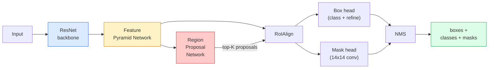

# 實例分割：Mask R-CNN (Instance Segmentation — Mask R-CNN)

> 在 Faster R-CNN detector 上加一個小小的 mask 分支，就得到 instance segmentation。難的部分是 RoIAlign，而且比看起來更難。

**Type:** Build + Learn
**Languages:** Python
**Prerequisites:** Phase 4 Lesson 06 (YOLO), Phase 4 Lesson 07 (U-Net)
**Time:** ~75 分鐘

## 學習目標 (Learning Objectives)

- 端到端追蹤 Mask R-CNN 的架構：backbone、FPN、RPN、RoIAlign、box head、mask head
- 從零實作 RoIAlign，並解釋為什麼不再使用 RoIPool
- 使用 torchvision 的 `maskrcnn_resnet50_fpn_v2` 預訓練模型產生正式環境品質的 instance mask，並正確讀取它的輸出格式
- 在小型自訂資料集上 fine-tune Mask R-CNN：替換 box 與 mask head，並保持 backbone 凍結

## 問題 (The Problem)

Semantic segmentation 給你每個類別一個 mask。Instance segmentation 給你每個物體一個 mask，即使兩個物體屬於同一類別。計算個體數量、跨影格追蹤，以及測量東西（牆上每塊磚的 bounding box、顯微鏡影像中的每個細胞），都需要 instance segmentation。

Mask R-CNN（He et al., 2017）把 instance segmentation 重新定義為 detection 加上一個 mask，解決了這個問題。這個設計非常乾淨，以至於接下來五年，幾乎每篇 instance segmentation 論文都是 Mask R-CNN 的變體，而 torchvision 的實作至今仍是中小型資料集的正式預設選擇。

真正困難的工程問題是取樣：當 proposal box 的角落沒有對齊像素邊界時，你要怎麼從裡面裁出固定大小的 feature 區域？做錯的話，到處都會損失零點幾個 mAP。RoIAlign 就是答案。

## 核心概念 (The Concept)

### 架構 (The architecture)



要理解五個部分：

1. **Backbone**：在 ImageNet 上訓練的 ResNet-50 或 ResNet-101。產生 stride 4、8、16、32 的階層式 feature map。
2. **FPN (Feature Pyramid Network)**：由上而下加上橫向連接，讓每個層級都有 C 個通道、語意豐富的特徵。Detection 會查詢與物體大小相符的 FPN 層級。
3. **RPN (Region Proposal Network)**：一個小的 conv head，在每個 anchor 位置預測「這裡有物體嗎？」和「我該怎麼修正 box？」。每張影像產生約 1000 個 proposal。
4. **RoIAlign**：從任何 FPN 層級上的任何 box，取樣出固定大小（例如 7x7）的 feature patch。使用 bilinear 取樣，沒有量化。
5. **Heads**：兩層的 box head 負責修正 box 並選出類別，另外有一個小的 conv head，為每個 proposal 輸出 `28x28` 的二元 mask。

### 為什麼用 RoIAlign，而不是 RoIPool (Why RoIAlign, not RoIPool)

原始的 Fast R-CNN 使用 RoIPool，它把 proposal box 切成 grid，取每個 cell 中的最大 feature，並把所有座標都四捨五入成整數。這個四捨五入會讓 feature map 與輸入像素座標最多錯位一整個 feature-map 像素：在 224x224 的影像上很小，但當 feature map 的 stride 是 32 時就是災難。

```
RoIPool:
  box (34.7, 51.3, 98.2, 142.9)
  round -> (34, 51, 98, 142)
  split grid -> round each cell boundary
  misalignment accumulates at every step

RoIAlign:
  box (34.7, 51.3, 98.2, 142.9)
  sample at exact float coordinates using bilinear interpolation
  no rounding anywhere
```

RoIAlign 免費讓 COCO 上的 mask AP 提升 3 到 4 個點。現在每個在意定位的 detector 都使用它，包括 YOLOv7 seg、RT-DETR、Mask2Former。

### 一段話講完 RPN (The RPN in one paragraph)

在 feature map 的每個位置，放 K 個不同大小與形狀的 anchor box。對每個 anchor 預測一個 objectness score，以及一個回歸偏移量，把 anchor 變成更貼合的 box。依分數保留前約 1,000 個 box，用 IoU 0.7 套用 NMS，再把倖存者交給 head。RPN 以它自己的小型 loss 訓練，結構和第 6 課的 YOLO loss 相同，只是只有兩個類別（有物體 / 沒物體）。

### Mask head

對每個 proposal（經過 RoIAlign 之後），mask head 是一個很小的 FCN：四個 3x3 conv、一個 2x deconv、最後一個 1x1 conv，在 `28x28` 的解析度產生 `num_classes` 個輸出通道。只保留對應預測類別的通道，其他都忽略。這把 mask 預測和分類解耦。

把 28x28 的 mask 升採樣到 proposal 原本的像素大小，就產生最終的二元 mask。

### Loss

Mask R-CNN 把五個 loss 加在一起：

```math
L = L_{\text{rpn\_cls}} + L_{\text{rpn\_box}} + L_{\text{box\_cls}} + L_{\text{box\_reg}} + L_{\text{mask}}
```

- `L_rpn_cls`、`L_rpn_box`：RPN proposal 的 objectness 和 box regression。
- `L_box_cls`：head 分類器上，對 (C+1) 個類別（包含 background）的 cross-entropy。
- `L_box_reg`：head 的 box 修正上的 smooth L1。
- `L_mask`：28x28 mask 輸出上的逐像素二元 cross-entropy。

每個 loss 都有自己的預設權重；torchvision 的實作把它們公開為建構子參數。

### 輸出格式 (Output format)

`torchvision.models.detection.maskrcnn_resnet50_fpn_v2` 回傳一個 dict 的 list，每張影像一個：

```
{
    "boxes":  (N, 4) in (x1, y1, x2, y2) pixel coordinates,
    "labels": (N,) class IDs, 0 = background so indices are 1-based,
    "scores": (N,) confidence scores,
    "masks":  (N, 1, H, W) float masks in [0, 1] — threshold at 0.5 for binary,
}
```

mask 已經是完整影像解析度。28x28 的 head 輸出已在內部被升採樣。

```figure
cv3-roialign-sampling
```

## 動手做 (Build It)

### 步驟 1：從零實作 RoIAlign (Step 1: RoIAlign from scratch)

這是 Mask R-CNN 中，看程式碼比看文字更容易理解的一個元件。

```python
import torch
import torch.nn.functional as F

def roi_align_single(feature, box, output_size=7, spatial_scale=1 / 16.0):
    """
    feature: (C, H, W) single-image feature map
    box: (x1, y1, x2, y2) in original image pixel coordinates
    output_size: side of the output grid (7 for box head, 14 for mask head)
    spatial_scale: reciprocal of the feature map stride
    """
    C, H, W = feature.shape
    x1, y1, x2, y2 = [c * spatial_scale - 0.5 for c in box]
    bin_w = (x2 - x1) / output_size
    bin_h = (y2 - y1) / output_size

    grid_y = torch.linspace(y1 + bin_h / 2, y2 - bin_h / 2, output_size)
    grid_x = torch.linspace(x1 + bin_w / 2, x2 - bin_w / 2, output_size)
    yy, xx = torch.meshgrid(grid_y, grid_x, indexing="ij")

    gx = 2 * (xx + 0.5) / W - 1
    gy = 2 * (yy + 0.5) / H - 1
    grid = torch.stack([gx, gy], dim=-1).unsqueeze(0)
    sampled = F.grid_sample(feature.unsqueeze(0), grid, mode="bilinear",
                            align_corners=False)
    return sampled.squeeze(0)
```

每個數字都在 bilinear 取樣的位置上。沒有四捨五入、沒有量化、沒有遺失的 gradient。

### 步驟 2：與 torchvision 的 RoIAlign 比較 (Step 2: Compare to torchvision's RoIAlign)

```python
from torchvision.ops import roi_align

feature = torch.randn(1, 16, 50, 50)
boxes = torch.tensor([[0, 10, 20, 100, 90]], dtype=torch.float32)  # (batch_idx, x1, y1, x2, y2)

ours = roi_align_single(feature[0], boxes[0, 1:].tolist(), output_size=7, spatial_scale=1/4)
theirs = roi_align(feature, boxes, output_size=(7, 7), spatial_scale=1/4, sampling_ratio=1, aligned=True)[0]

print(f"shape ours:   {tuple(ours.shape)}")
print(f"shape theirs: {tuple(theirs.shape)}")
print(f"max|diff|:    {(ours - theirs).abs().max().item():.3e}")
```

在 `sampling_ratio=1` 且 `aligned=True` 時，兩者的差距在 `1e-5` 以內。

### 步驟 3：載入預訓練的 Mask R-CNN (Step 3: Load a pretrained Mask R-CNN)

```python
import torch
from torchvision.models.detection import maskrcnn_resnet50_fpn_v2, MaskRCNN_ResNet50_FPN_V2_Weights

model = maskrcnn_resnet50_fpn_v2(weights=MaskRCNN_ResNet50_FPN_V2_Weights.DEFAULT)
model.eval()
print(f"params: {sum(p.numel() for p in model.parameters()):,}")
print(f"classes (including background): {len(model.roi_heads.box_predictor.cls_score.out_features * [0])}")
```

4,600 萬個參數，91 個類別（COCO）。第一個類別（id 0）是 background；模型實際偵測到的一切都從 id 1 開始。

### 步驟 4：執行推論 (Step 4: Run inference)

```python
with torch.no_grad():
    x = torch.randn(3, 400, 600)
    predictions = model([x])
p = predictions[0]
print(f"boxes:  {tuple(p['boxes'].shape)}")
print(f"labels: {tuple(p['labels'].shape)}")
print(f"scores: {tuple(p['scores'].shape)}")
print(f"masks:  {tuple(p['masks'].shape)}")
```

mask tensor 的 shape 是 `(N, 1, H, W)`。用 0.5 當門檻，就能得到每個物體的二元 mask：

```python
binary_masks = (p['masks'] > 0.5).squeeze(1)  # (N, H, W) boolean
```

### 步驟 5：為自訂類別數量替換 head (Step 5: Swap the heads for a custom class count)

常見的 fine-tune 配方：重用 backbone、FPN 和 RPN；替換兩個分類器 head。

```python
from torchvision.models.detection.faster_rcnn import FastRCNNPredictor
from torchvision.models.detection.mask_rcnn import MaskRCNNPredictor

def build_custom_maskrcnn(num_classes):
    model = maskrcnn_resnet50_fpn_v2(weights=MaskRCNN_ResNet50_FPN_V2_Weights.DEFAULT)
    in_features = model.roi_heads.box_predictor.cls_score.in_features
    model.roi_heads.box_predictor = FastRCNNPredictor(in_features, num_classes)
    in_features_mask = model.roi_heads.mask_predictor.conv5_mask.in_channels
    hidden_layer = 256
    model.roi_heads.mask_predictor = MaskRCNNPredictor(in_features_mask, hidden_layer, num_classes)
    return model

custom = build_custom_maskrcnn(num_classes=5)
print(f"custom cls_score.out_features: {custom.roi_heads.box_predictor.cls_score.out_features}")
```

`num_classes` 必須包含 background 類別，所以有 4 個物體類別的資料集要用 `num_classes=5`。

### 步驟 6：凍結不需要訓練的部分 (Step 6: Freeze what does not need training)

在小型資料集上，凍結 backbone 和 FPN。只有 RPN 的 objectness + regression 以及兩個 head 會學習。

```python
def freeze_backbone_and_fpn(model):
    # torchvision Mask R-CNN packs the FPN inside `model.backbone` (as
    # `model.backbone.fpn`), so iterating `model.backbone.parameters()` covers
    # both the ResNet feature layers and the FPN lateral/output convs.
    for p in model.backbone.parameters():
        p.requires_grad = False
    return model

custom = freeze_backbone_and_fpn(custom)
trainable = sum(p.numel() for p in custom.parameters() if p.requires_grad)
print(f"trainable after freeze: {trainable:,}")
```

在 500 張影像的資料集上，這就是收斂與 overfitting 的差別。

## 實際使用 (Use It)

Mask R-CNN 在 torchvision 中完整的訓練迴圈是 40 行，各個任務之間沒有太大改變：換資料集就能跑。

```python
def train_step(model, images, targets, optimizer):
    model.train()
    loss_dict = model(images, targets)
    losses = sum(loss for loss in loss_dict.values())
    optimizer.zero_grad()
    losses.backward()
    optimizer.step()
    return {k: v.item() for k, v in loss_dict.items()}
```

`targets` list 必須是每張影像一個 dict，包含 `boxes`、`labels` 和 `masks`（以 `(num_instances, H, W)` 的二元 tensor 表示）。模型在訓練時回傳五個 loss 的 dict，在 eval 時回傳預測的 list，由 `model.training` 決定。

`pycocotools` 的 evaluator 會分別對 box 和 mask 產生 mAP@IoU=0.5:0.95；你需要兩個數字，才能知道瓶頸是 box head 還是 mask head。

## 交付 (Ship It)

這堂課會產出：

- `outputs/prompt-instance-vs-semantic-router.md`：一個 prompt，問三個問題，然後在 instance、semantic、panoptic 之間挑選，並給出該從哪個模型開始。
- `outputs/skill-mask-rcnn-head-swapper.md`：一個 skill，給它新的 `num_classes`，就能產生替換任何 torchvision detection 模型 head 的那 10 行程式。

## 練習 (Exercises)

1. **（簡單）** 在 100 個隨機 box 上，拿你的 RoIAlign 和 `torchvision.ops.roi_align` 比對。回報最大絕對差。也跑 RoIPool（2017 年以前的行為），展示它在靠近邊界的 box 上會偏離約 1 到 2 個 feature-map 像素。
2. **（中等）** 在 50 張影像的自訂資料集上 fine-tune `maskrcnn_resnet50_fpn_v2`（任選兩個類別：氣球、魚、坑洞、logo）。凍結 backbone，訓練 20 個 epoch，回報 mask AP@0.5。
3. **（困難）** 把 Mask R-CNN 的 mask head 換成預測 56x56 而不是 28x28 的版本。測量前後的 mAP@IoU=0.75。解釋為什麼增益（或沒有增益）符合預期的邊界精準度 / 記憶體取捨。

## 關鍵術語 (Key Terms)

| 術語 | 大家常說的 | 實際意義 |
|------|----------------|----------------------|
| Mask R-CNN | 「Detection 加 mask」 | Faster R-CNN 加上一個小的 FCN head，為每個 proposal、每個類別預測 28x28 的 mask |
| FPN | 「Feature pyramid」 | 由上而下加橫向連接，讓每個 stride 層級都有 C 個通道、語意豐富的特徵 |
| RPN | 「Region proposer」 | 一個小的 conv head，每張影像產生約 1000 個有物體 / 沒物體的 proposal |
| RoIAlign | 「不四捨五入的裁切」 | 從任何浮點座標的 box，以 bilinear 方式取樣出固定大小的 feature grid |
| RoIPool | 「2017 年以前的裁切」 | 與 RoIAlign 目的相同，但會把 box 座標四捨五入；已經過時 |
| Mask AP | 「Instance mAP」 | 用 mask IoU 而不是 box IoU 計算的 average precision；COCO 的 instance segmentation 指標 |
| Binary mask head | 「每個類別的 mask」 | 對每個 proposal 為每個類別預測一個二元 mask；只保留預測類別的通道 |
| Background class | 「類別 0」 | 包羅萬象的「沒有物體」類別；真實類別的索引從 1 開始 |

## 延伸閱讀 (Further Reading)

- [Mask R-CNN (He et al., 2017)](https://arxiv.org/abs/1703.06870)：論文本身；第 3 節關於 RoIAlign 的部分是必讀
- [FPN: Feature Pyramid Networks (Lin et al., 2017)](https://arxiv.org/abs/1612.03144)：FPN 論文；每個現代 detector 都用它
- [torchvision Mask R-CNN tutorial](https://pytorch.org/tutorials/intermediate/torchvision_tutorial.html)：fine-tune 迴圈的參考資料
- [Detectron2 model zoo](https://github.com/facebookresearch/detectron2/blob/main/MODEL_ZOO.md)：幾乎每種 detection 和 segmentation 變體都有帶訓練權重的正式實作
