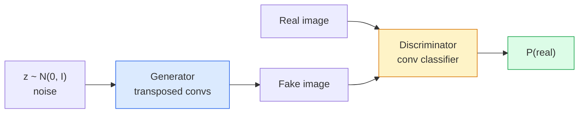
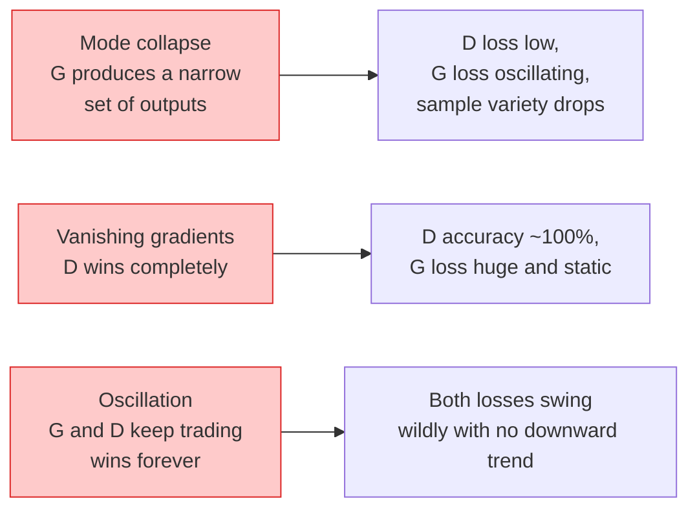

# 影像生成：GAN (Image Generation — GANs)

> GAN 是兩個神經網路在一場固定的遊戲裡。一個負責畫，一個負責批評。它們一起進步，直到畫作騙過評論者。

**Type:** Build
**Languages:** Python
**Prerequisites:** Phase 4 Lesson 03 (CNNs), Phase 3 Lesson 06 (Optimizers), Phase 3 Lesson 07 (Regularization)
**Time:** ~75 分鐘

## 學習目標 (Learning Objectives)

- 解釋 generator 與 discriminator 之間的 minimax 遊戲，以及為什麼均衡點對應 $p_{\text{model}} = p_{\text{data}}$
- 在 PyTorch 中實作 DCGAN，並用不到 60 行讓它生成連貫的 32x32 合成影像
- 用三個標準技巧穩定 GAN 訓練：non-saturating loss、spectral norm、TTUR (two-timescale update rule)
- 讀懂訓練曲線，區分健康的收斂，與 mode collapse、震盪，以及 discriminator 完全獲勝

## 問題 (The Problem)

分類教網路把影像對應到標籤。生成則把問題反過來：取樣出看起來像是來自同一個分布的新影像。這裡沒有可以拿來比對差異的「正確」輸出；只有一個你想模仿的分布。

標準的 loss 函式（MSE、cross-entropy）無法衡量「這個樣本是不是來自真實分布」。最小化逐像素誤差，只會產生模糊的平均值，而不是逼真的樣本。突破點在於學習 loss：訓練第二個網路，任務是分辨真假，並用它的判斷來推動 generator。

GAN（Goodfellow et al., 2014）定義了這個框架。到了 2018 年，StyleGAN 已能產生與照片無法區分的 1024x1024 人臉。Diffusion 模型後來在品質與可控性上坐上王座，但讓 diffusion 變得實用的每個技巧，包括 normalisation 的選擇、latent space、feature loss，都是先在 GAN 上被理解的。

## 核心概念 (The Concept)

### 兩個網路 (The two networks)



**Generator** G 接收一個雜訊向量 `z`，輸出一張影像。**Discriminator** D 接收一張影像，輸出單一純量：影像為真的機率。

### 遊戲 (The game)

G 想讓 D 判斷錯誤。D 想判斷正確。形式上：

```math
\min_G \max_D \; \mathbb{E}_x[\log D(x)] + \mathbb{E}_z[\log(1 - D(G(z)))]
```

從右往左讀：D 在最大化對真實影像（`log D(real)`）和假影像（`log (1 - D(fake))`）的準確率。G 在最小化 D 對假影像的準確率，它希望 `D(G(z))` 很高。

Goodfellow 證明了這個 minimax 有一個全域均衡點：`p_G = p_data`，D 到處輸出 0.5，且生成分布與真實分布之間的 Jensen-Shannon divergence 為零。難的是怎麼走到那裡。

### Non-saturating loss

上面的形式在數值上不穩定。訓練初期，對每個假影像而言 `D(G(z))` 都接近零，所以 `log(1 - D(G(z)))` 對 G 的 gradient 會消失。修正方式：把 G 的 loss 翻轉。

```math
\begin{aligned}
L_D &= -\mathbb{E}_x[\log D(x)] - \mathbb{E}_z[\log(1 - D(G(z)))] \\
L_G &= -\mathbb{E}_z[\log D(G(z))] \qquad \text{(non-saturating)}
\end{aligned}
```

現在當 `D(G(z))` 接近零時，G 的 loss 很大，gradient 也帶有資訊。每個現代 GAN 都用這個變體訓練。

### DCGAN 架構規則 (DCGAN architecture rules)

Radford、Metz、Chintala（2015）把多年失敗的實驗，提煉成讓 GAN 訓練穩定的五條規則：

1. 用 strided conv 取代 pooling（兩個網路都是）。
2. 在 generator 和 discriminator 都用 batch norm，但 G 的輸出和 D 的輸入除外。
3. 在較深的架構中移除全連接層。
4. G 除了輸出之外所有層都用 ReLU（輸出用 tanh，範圍 [-1, 1]）。
5. D 所有層都用 LeakyReLU (negative_slope=0.2)。

每個現代以 conv 為基礎的 GAN（StyleGAN、BigGAN、GigaGAN）仍然從這些規則出發，然後一次替換一個零件。

### 失敗模式與它們的特徵 (Failure modes and their signatures)



- **Mode collapse**：G 找到一張能騙過 D 的影像，然後只產生那一張。修正：加上 minibatch discrimination、spectral norm 或 label-conditioning。
- **Discriminator 獲勝**：D 太快變得太強，G 的 gradient 消失。修正：用較小的 D、較低的 D learning rate，或對真實標籤做 label smoothing。
- **震盪 (Oscillation)**：兩個網路輪流獲勝，卻永遠接近不了均衡。修正：TTUR（D 學得比 G 快 2 到 4 倍），或改用 Wasserstein loss。

### 評估 (Evaluation)

GAN 沒有 ground truth，那你怎麼知道它們有在運作？

- **樣本檢視 (Sample inspection)**：每個 epoch 結束時，直接看 64 個樣本。沒有商量餘地。
- **FID (Fréchet Inception Distance)**：真實集合與生成集合在 Inception-v3 特徵分布之間的距離。越低越好。社群標準。
- **Inception Score**：較舊、較脆弱；請優先用 FID。
- **生成模型的 Precision/Recall**：分別衡量品質（precision）與覆蓋率（recall）。比單獨的 FID 資訊更豐富。

對小型的合成資料實驗來說，樣本檢視就夠了。

```figure
cv-gan-image
```

## 動手做 (Build It)

### 步驟 1：Generator (Step 1: Generator)

一個小型的 DCGAN generator，接收 64 維的雜訊，產生 32x32 的影像。

```python
import torch
import torch.nn as nn

class Generator(nn.Module):
    def __init__(self, z_dim=64, img_channels=3, feat=64):
        super().__init__()
        self.net = nn.Sequential(
            nn.ConvTranspose2d(z_dim, feat * 4, kernel_size=4, stride=1, padding=0, bias=False),
            nn.BatchNorm2d(feat * 4),
            nn.ReLU(inplace=True),
            nn.ConvTranspose2d(feat * 4, feat * 2, kernel_size=4, stride=2, padding=1, bias=False),
            nn.BatchNorm2d(feat * 2),
            nn.ReLU(inplace=True),
            nn.ConvTranspose2d(feat * 2, feat, kernel_size=4, stride=2, padding=1, bias=False),
            nn.BatchNorm2d(feat),
            nn.ReLU(inplace=True),
            nn.ConvTranspose2d(feat, img_channels, kernel_size=4, stride=2, padding=1, bias=False),
            nn.Tanh(),
        )

    def forward(self, z):
        return self.net(z.view(z.size(0), -1, 1, 1))
```

四個 transposed conv，每個都是 `kernel_size=4, stride=2, padding=1`，所以剛好乾淨地把空間大小加倍。輸出 activation 透過 tanh 落在 [-1, 1]。

### 步驟 2：Discriminator (Step 2: Discriminator)

generator 的鏡像。LeakyReLU、strided conv，最後輸出一個純量 logit。

```python
class Discriminator(nn.Module):
    def __init__(self, img_channels=3, feat=64):
        super().__init__()
        self.net = nn.Sequential(
            nn.Conv2d(img_channels, feat, kernel_size=4, stride=2, padding=1),
            nn.LeakyReLU(0.2, inplace=True),
            nn.Conv2d(feat, feat * 2, kernel_size=4, stride=2, padding=1, bias=False),
            nn.BatchNorm2d(feat * 2),
            nn.LeakyReLU(0.2, inplace=True),
            nn.Conv2d(feat * 2, feat * 4, kernel_size=4, stride=2, padding=1, bias=False),
            nn.BatchNorm2d(feat * 4),
            nn.LeakyReLU(0.2, inplace=True),
            nn.Conv2d(feat * 4, 1, kernel_size=4, stride=1, padding=0),
        )

    def forward(self, x):
        return self.net(x).view(-1)
```

最後一個 conv 把 `4x4` 的 feature map 縮減成 `1x1`。每張影像輸出一個純量；sigmoid 只在計算 loss 時才套用。

### 步驟 3：訓練 step (Step 3: Training step)

交替進行：每個 batch，先更新一次 D，再更新一次 G。

```python
import torch.nn.functional as F

def train_step(G, D, real, z, opt_g, opt_d, device):
    real = real.to(device)
    bs = real.size(0)

    # D step
    opt_d.zero_grad()
    d_real = D(real)
    d_fake = D(G(z).detach())
    loss_d = (F.binary_cross_entropy_with_logits(d_real, torch.ones_like(d_real))
              + F.binary_cross_entropy_with_logits(d_fake, torch.zeros_like(d_fake)))
    loss_d.backward()
    opt_d.step()

    # G step
    opt_g.zero_grad()
    d_fake = D(G(z))
    loss_g = F.binary_cross_entropy_with_logits(d_fake, torch.ones_like(d_fake))
    loss_g.backward()
    opt_g.step()

    return loss_d.item(), loss_g.item()
```

D step 中的 `G(z).detach()` 很關鍵：我們不希望在更新 D 的時候，gradient 流進 G。忘記這點是經典的新手 bug。

### 步驟 4：在合成形狀上的完整訓練迴圈 (Step 4: Full training loop on synthetic shapes)

```python
from torch.utils.data import DataLoader, TensorDataset
import numpy as np

def synthetic_images(num=2000, size=32, seed=0):
    rng = np.random.default_rng(seed)
    imgs = np.zeros((num, 3, size, size), dtype=np.float32) - 1.0
    for i in range(num):
        r = rng.uniform(6, 12)
        cx, cy = rng.uniform(r, size - r, size=2)
        yy, xx = np.meshgrid(np.arange(size), np.arange(size), indexing="ij")
        mask = (xx - cx) ** 2 + (yy - cy) ** 2 < r ** 2
        color = rng.uniform(-0.5, 1.0, size=3)
        for c in range(3):
            imgs[i, c][mask] = color[c]
    return torch.from_numpy(imgs)

device = "cuda" if torch.cuda.is_available() else "cpu"
data = synthetic_images()
loader = DataLoader(TensorDataset(data), batch_size=64, shuffle=True)

G = Generator(z_dim=64, img_channels=3, feat=32).to(device)
D = Discriminator(img_channels=3, feat=32).to(device)
opt_g = torch.optim.Adam(G.parameters(), lr=2e-4, betas=(0.5, 0.999))
opt_d = torch.optim.Adam(D.parameters(), lr=2e-4, betas=(0.5, 0.999))

for epoch in range(10):
    for (batch,) in loader:
        z = torch.randn(batch.size(0), 64, device=device)
        ld, lg = train_step(G, D, batch, z, opt_g, opt_d, device)
    print(f"epoch {epoch}  D {ld:.3f}  G {lg:.3f}")
```

`Adam(lr=2e-4, betas=(0.5, 0.999))` 是 DCGAN 的預設值，較低的 beta1 讓 momentum 項不要過度穩定對抗遊戲。

### 步驟 5：取樣 (Step 5: Sampling)

```python
@torch.no_grad()
def sample(G, n=16, z_dim=64, device="cpu"):
    G.eval()
    z = torch.randn(n, z_dim, device=device)
    imgs = G(z)
    imgs = (imgs + 1) / 2
    return imgs.clamp(0, 1)
```

取樣前永遠要切到 eval 模式。對 DCGAN 來說這很重要，因為會改用 batch norm 的 running stats，而不是該 batch 的 stats。

### 步驟 6：Spectral normalisation (Step 6: Spectral normalisation)

在 discriminator 中可以直接取代 BN 的做法，保證網路是 1-Lipschitz。修正大部分「D 贏太多」的失敗。

```python
from torch.nn.utils import spectral_norm

def build_sn_discriminator(img_channels=3, feat=64):
    return nn.Sequential(
        spectral_norm(nn.Conv2d(img_channels, feat, 4, 2, 1)),
        nn.LeakyReLU(0.2, inplace=True),
        spectral_norm(nn.Conv2d(feat, feat * 2, 4, 2, 1)),
        nn.LeakyReLU(0.2, inplace=True),
        spectral_norm(nn.Conv2d(feat * 2, feat * 4, 4, 2, 1)),
        nn.LeakyReLU(0.2, inplace=True),
        spectral_norm(nn.Conv2d(feat * 4, 1, 4, 1, 0)),
    )
```

把 `Discriminator` 換成 `build_sn_discriminator()`，你通常就不需要 TTUR 技巧。Spectral norm 是你能套用的最簡單的單一穩健性升級。

## 實際使用 (Use It)

要做正式的生成，使用預訓練權重，或改用 diffusion。兩個標準函式庫：

- `torch_fidelity` 可以在你的 generator 上計算 FID / IS，不用自己寫評估程式。
- `pytorch-gan-zoo`（舊版）和 `StudioGAN` 提供經過測試的 DCGAN、WGAN-GP、SN-GAN、StyleGAN 和 BigGAN 實作。

在 2026 年，GAN 仍然是以下情境的最佳選擇：即時影像生成（延遲 <10 ms）、風格轉換、需要精確控制的 image-to-image 轉換（Pix2Pix、CycleGAN）。Diffusion 則在照片般的真實感與文字條件控制上獲勝。

## 交付 (Ship It)

這堂課會產出：

- `outputs/prompt-gan-training-triage.md`：一個 prompt，讀取訓練曲線的描述，判斷失敗模式（mode collapse、D 獲勝、震盪），並給出建議的單一修正。
- `outputs/skill-dcgan-scaffold.md`：一個 skill，根據 `z_dim`、目標 `image_size` 和 `num_channels` 寫出 DCGAN 的骨架，包含訓練迴圈與樣本儲存器。

## 練習 (Exercises)

1. **（簡單）** 在合成的圓形資料集上訓練上面的 DCGAN，並在每個 epoch 結束時儲存 16 個樣本的 grid。到第幾個 epoch，生成的圓形才明顯變圓？
2. **（中等）** 把 discriminator 的 batch norm 換成 spectral norm。並排訓練兩個版本。哪一個收斂得比較快？哪一個在三個 seed 之間的變異比較小？
3. **（困難）** 實作 conditional DCGAN：把類別標籤同時餵進 G 和 D（在 G 中把 one-hot concat 到雜訊上，在 D 中 concat 一個類別 embedding 通道）。在第 7 課的合成「圓形 vs 方形」資料集上訓練，並用指定標籤取樣，來展示類別條件控制有效。

## 關鍵術語 (Key Terms)

| 術語 | 大家常說的 | 實際意義 |
|------|----------------|----------------------|
| Generator (G) | 「負責畫東西的網路」 | 把雜訊對應成影像；訓練目標是騙過 discriminator |
| Discriminator (D) | 「評論者」 | 二元分類器；訓練目標是分辨真實與生成的影像 |
| Minimax | 「那場遊戲」 | 對 G 取 min、對 D 取 max 的對抗 loss；均衡點是 $p_G = p_{\text{data}}$ |
| Non-saturating loss | 「數值上合理的版本」 | G 的 loss 用 $-\log(D(G(z)))$，而不是 $\log(1 - D(G(z)))$，以避免訓練初期 gradient 消失 |
| Mode collapse | 「Generator 只會做一種東西」 | G 只產生資料分布的一小部分子集；用 SN、minibatch discrimination 或更大的 batch 修正 |
| TTUR | 「兩個 learning rate」 | D 學得比 G 快，通常快 2 到 4 倍；穩定訓練 |
| Spectral norm | 「1-Lipschitz 層」 | 一種權重 normalisation，限制每一層的 Lipschitz 常數；防止 D 變得任意陡峭 |
| FID | 「Fréchet Inception Distance」 | 真實集合與生成集合在 Inception-v3 特徵分布之間的距離；標準的評估指標 |

## 延伸閱讀 (Further Reading)

- [Generative Adversarial Networks (Goodfellow et al., 2014)](https://arxiv.org/abs/1406.2661)：一切的起點
- [DCGAN (Radford, Metz, Chintala, 2015)](https://arxiv.org/abs/1511.06434)：讓 GAN 變得可訓練的架構規則
- [Spectral Normalization for GANs (Miyato et al., 2018)](https://arxiv.org/abs/1802.05957)：最有用的單一穩定化技巧
- [StyleGAN3 (Karras et al., 2021)](https://arxiv.org/abs/2106.12423)：SOTA 的 GAN；讀起來像是過去十年每個技巧的精選輯
