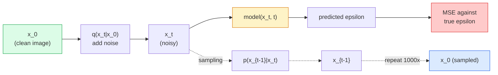

# 影像生成：Diffusion 模型 (Image Generation — Diffusion Models)

> Diffusion 模型學的是去噪。訓練它從帶雜訊的影像中移除一點點雜訊，再倒著重複一千次，你就有了影像生成器。

**Type:** Build
**Languages:** Python
**Prerequisites:** Phase 4 Lesson 07 (U-Net), Phase 1 Lesson 06 (Probability), Phase 3 Lesson 06 (Optimizers)
**Time:** ~75 分鐘

## 學習目標 (Learning Objectives)

- 推導正向加噪過程 `x_0 -> x_1 -> ... -> x_T`，並解釋為什麼閉合形式的 `q(x_t | x_0)` 對任意 t 都成立
- 實作 DDPM 風格的訓練目標（回歸每一步加入的雜訊），以及一個從純雜訊一路走回影像的 sampler
- 建立一個以時間為條件的 U-Net（小到可以在 CPU 上訓練），能對任意 timestep 預測雜訊
- 解釋 DDPM 與 DDIM 取樣的差異，以及各自適用的時機（第 23 課會深入涵蓋 flow matching 與 rectified flow）

## 問題 (The Problem)

GAN 是一次到位的生成：雜訊進去，影像出來，一次 forward pass。它們很快，但很難訓練。Diffusion 模型則是迭代式生成：從純雜訊開始，分小步去噪，影像逐漸浮現。它們很慢，但很容易訓練。過去五年，後者的特性佔了上風：任何小團隊都能訓練 diffusion 模型並得到不錯的樣本；GAN 訓練則是一門要靠多年失敗實驗才學得會的手藝。

除了訓練穩定之外，diffusion 的迭代結構，正是解鎖現代影像生成所有功能的關鍵：文字條件控制、inpainting、影像編輯、super-resolution、可控的風格。取樣迴圈的每一步，都是注入新限制的地方。這個切入點，就是為什麼 Stable Diffusion、Imagen、DALL-E 3、Midjourney，以及你會用到的每個可控影像模型，全都是以 diffusion 為基礎。

這堂課建立最小的 DDPM：正向加噪、反向去噪、訓練迴圈。下一堂課（Stable Diffusion）會把它接進一個含有 VAE、文字 encoder 與 classifier-free guidance 的正式系統。

## 核心概念 (The Concept)

### 正向過程 (The forward process)

取一張影像 `x_0`。加入極少量的 Gaussian noise 得到 `x_1`。再加一點點得到 `x_2`。持續 $T$ 步，直到 `x_T` 幾乎和純 Gaussian noise 無法區分。

```math
q(x_t \mid x_{t-1}) = \mathcal{N}\left(x_t; \sqrt{1 - \beta_t} \, x_{t-1}, \; \beta_t I\right)
```

`beta_t` 是一個小的 variance schedule，通常在 $T=1000$ 步內從 0.0001 線性增加到 0.02。每一步都稍微縮小訊號，並注入新的雜訊。

### 閉合形式的跳躍 (The closed-form jump)

一步一步加雜訊是一條 Markov chain，但數學上可以折疊：你可以一步就從 `x_0` 直接取樣出 `x_t`。

```math
\begin{aligned}
&\text{Define } \alpha_t = 1 - \beta_t \\
&\text{Define } \bar{\alpha}_t = \prod_{s=1}^{t} \alpha_s \\[6pt]
&\text{Then: } q(x_t \mid x_0) = \mathcal{N}\left(x_t; \sqrt{\bar{\alpha}_t} \, x_0, \; (1 - \bar{\alpha}_t) I\right) \\[6pt]
&\text{Equivalently: } x_t = \sqrt{\bar{\alpha}_t} \, x_0 + \sqrt{1 - \bar{\alpha}_t} \, \epsilon \quad \text{where } \epsilon \sim \mathcal{N}(0, I)
\end{aligned}
```

這一條式子就是 diffusion 能夠實用的全部原因。訓練時你隨機挑一個 `t`，直接從 `x_0` 取樣出 `x_t`，一步完成訓練，不需要模擬整條 Markov chain。

### 反向過程 (The reverse process)

正向過程是固定的。反向過程 `p(x_{t-1} | x_t)` 才是神經網路要學的。Diffusion 模型不直接預測 `x_{t-1}`；它們預測第 $t$ 步加入的雜訊 `epsilon`，再由數學推導出 `x_{t-1}`。



### 訓練 loss (The training loss)

每個訓練 step：

1. 取樣一張真實影像 `x_0`。
2. 從 $[1, T]$ 均勻取樣一個 timestep `t`。
3. 取樣雜訊 `epsilon ~ N(0, I)`。
4. 計算 `x_t = sqrt(alpha_bar_t) * x_0 + sqrt(1 - alpha_bar_t) * epsilon`。
5. 用網路預測 `epsilon_theta(x_t, t)`。
6. 最小化 `|| epsilon - epsilon_theta(x_t, t) ||^2`。

就這樣。神經網路學會在任何 timestep 預測雜訊。Loss 是 MSE。沒有對抗遊戲、沒有 collapse、沒有震盪。

### Sampler (DDPM)

要生成：從 `x_T ~ N(0, I)` 開始，一次往回走一步。

```
for t = T, T-1, ..., 1:
    eps = model(x_t, t)
    x_{t-1} = (1 / sqrt(alpha_t)) * (x_t - (beta_t / sqrt(1 - alpha_bar_t)) * eps) + sqrt(beta_t) * z
    where z ~ N(0, I) if t > 1, else 0
return x_0
```

關鍵在於，雖然一般來說反向條件分布沒有閉合形式，但對這個特定的 Gaussian 正向過程，它是有的。那些看起來很醜的係數，就是 Bayes 規則給你的結果。

### 為什麼是 1000 步 (Why 1000 steps)

正向的雜訊 schedule 是這樣選的：每一步剛好加入足夠的雜訊，讓反向那一步接近 Gaussian。步數太少，反向那一步就離 Gaussian 很遠，網路很難建模。步數太多，取樣就變得昂貴，而收益遞減。$T=1000$ 搭配線性 schedule 是 DDPM 的預設值。

### DDIM：快 20 倍的取樣 (DDIM: 20x faster sampling)

訓練相同，取樣不同。DDIM（Song et al., 2020）定義了一個確定性的反向過程，不必重新訓練就能跳過 timestep。用 DDIM 取樣 50 步，就能得到接近 1000 步 DDPM 的品質。每個正式系統都用 DDIM 或更快的變體（DPM-Solver、Euler ancestral）。

### 時間條件 (Time conditioning)

網路 `epsilon_theta(x_t, t)` 需要知道自己正在對哪個 timestep 去噪。現代 diffusion 模型透過 sinusoidal time embedding（與 transformer 中 positional encoding 的概念相同）注入 `t`，並把它加到 U-Net 每一層的 feature map 上。

```
t_embedding = sinusoidal(t)
feature_map += MLP(t_embedding)
```

沒有時間條件的話，網路必須從影像本身猜出雜訊等級，這行得通，但樣本效率差很多。

```figure
cv-diffusion-image
```

## 動手做 (Build It)

### 步驟 1：雜訊 schedule (Step 1: Noise schedule)

```python
import torch

def linear_beta_schedule(T=1000, beta_start=1e-4, beta_end=2e-2):
    return torch.linspace(beta_start, beta_end, T)


def precompute_schedule(betas):
    alphas = 1.0 - betas
    alphas_cumprod = torch.cumprod(alphas, dim=0)
    return {
        "betas": betas,
        "alphas": alphas,
        "alphas_cumprod": alphas_cumprod,
        "sqrt_alphas_cumprod": torch.sqrt(alphas_cumprod),
        "sqrt_one_minus_alphas_cumprod": torch.sqrt(1.0 - alphas_cumprod),
        "sqrt_recip_alphas": torch.sqrt(1.0 / alphas),
    }

schedule = precompute_schedule(linear_beta_schedule(T=1000))
```

只預先計算一次，訓練和取樣時用 index 取值。

### 步驟 2：正向 diffusion (q_sample) (Step 2: Forward diffusion (q_sample))

```python
def q_sample(x0, t, noise, schedule):
    sqrt_a = schedule["sqrt_alphas_cumprod"][t].view(-1, 1, 1, 1)
    sqrt_one_minus_a = schedule["sqrt_one_minus_alphas_cumprod"][t].view(-1, 1, 1, 1)
    return sqrt_a * x0 + sqrt_one_minus_a * noise
```

一行的閉合形式。`t` 是一個 batch 的 timestep，batch 中每張影像各一個。

### 步驟 3：小型、以時間為條件的 U-Net (Step 3: A tiny time-conditioned U-Net)

```python
import torch.nn as nn
import torch.nn.functional as F
import math

def timestep_embedding(t, dim=64):
    half = dim // 2
    freqs = torch.exp(-math.log(10000) * torch.arange(half, device=t.device) / half)
    args = t[:, None].float() * freqs[None]
    emb = torch.cat([args.sin(), args.cos()], dim=-1)
    return emb


class TinyUNet(nn.Module):
    def __init__(self, img_channels=3, base=32, t_dim=64):
        super().__init__()
        self.t_mlp = nn.Sequential(
            nn.Linear(t_dim, base * 4),
            nn.SiLU(),
            nn.Linear(base * 4, base * 4),
        )
        self.t_dim = t_dim
        self.enc1 = nn.Conv2d(img_channels, base, 3, padding=1)
        self.enc2 = nn.Conv2d(base, base * 2, 4, stride=2, padding=1)
        self.mid = nn.Conv2d(base * 2, base * 2, 3, padding=1)
        self.dec1 = nn.ConvTranspose2d(base * 2, base, 4, stride=2, padding=1)
        self.dec2 = nn.Conv2d(base * 2, img_channels, 3, padding=1)
        self.time_proj = nn.Linear(base * 4, base * 2)

    def forward(self, x, t):
        t_emb = timestep_embedding(t, self.t_dim)
        t_emb = self.t_mlp(t_emb)
        t_proj = self.time_proj(t_emb)[:, :, None, None]

        h1 = F.silu(self.enc1(x))
        h2 = F.silu(self.enc2(h1)) + t_proj
        h3 = F.silu(self.mid(h2))
        d1 = F.silu(self.dec1(h3))
        d2 = torch.cat([d1, h1], dim=1)
        return self.dec2(d2)
```

兩層的 U-Net，時間條件在 bottleneck 處注入。處理真實影像時，請加深加寬。

### 步驟 4：訓練迴圈 (Step 4: Training loop)

```python
def train_step(model, x0, schedule, optimizer, device, T=1000):
    model.train()
    x0 = x0.to(device)
    bs = x0.size(0)
    t = torch.randint(0, T, (bs,), device=device)
    noise = torch.randn_like(x0)
    x_t = q_sample(x0, t, noise, schedule)
    pred = model(x_t, t)
    loss = F.mse_loss(pred, noise)
    optimizer.zero_grad()
    loss.backward()
    optimizer.step()
    return loss.item()
```

這就是完整的訓練迴圈。沒有 GAN 遊戲、沒有特殊的 loss，只有一次 MSE 呼叫。

### 步驟 5：Sampler (DDPM) (Step 5: Sampler (DDPM))

```python
@torch.no_grad()
def sample(model, schedule, shape, T=1000, device="cpu"):
    model.eval()
    x = torch.randn(shape, device=device)
    betas = schedule["betas"].to(device)
    sqrt_one_minus_a = schedule["sqrt_one_minus_alphas_cumprod"].to(device)
    sqrt_recip_alphas = schedule["sqrt_recip_alphas"].to(device)

    for t in reversed(range(T)):
        t_batch = torch.full((shape[0],), t, dtype=torch.long, device=device)
        eps = model(x, t_batch)
        coef = betas[t] / sqrt_one_minus_a[t]
        mean = sqrt_recip_alphas[t] * (x - coef * eps)
        if t > 0:
            x = mean + torch.sqrt(betas[t]) * torch.randn_like(x)
        else:
            x = mean
    return x
```

要產生一個 batch 的樣本需要 1000 次 forward pass。在真實程式中，你會把它換成 DDIM 50 步的 sampler。

### 步驟 6：DDIM sampler（確定性，約快 20 倍）(Step 6: DDIM sampler (deterministic, ~20x faster))

```python
@torch.no_grad()
def sample_ddim(model, schedule, shape, steps=50, T=1000, device="cpu", eta=0.0):
    model.eval()
    x = torch.randn(shape, device=device)
    alphas_cumprod = schedule["alphas_cumprod"].to(device)

    ts = torch.linspace(T - 1, -1, steps + 1).round().long()
    for i in range(steps):
        t = ts[i]
        t_prev = ts[i + 1]
        t_batch = torch.full((shape[0],), t, dtype=torch.long, device=device)
        eps = model(x, t_batch)
        a_t = alphas_cumprod[t]
        a_prev = alphas_cumprod[t_prev] if t_prev >= 0 else torch.tensor(1.0, device=device)
        x0_pred = (x - torch.sqrt(1 - a_t) * eps) / torch.sqrt(a_t)
        sigma = eta * torch.sqrt((1 - a_prev) / (1 - a_t) * (1 - a_t / a_prev))
        dir_xt = torch.sqrt(1 - a_prev - sigma ** 2) * eps
        noise = sigma * torch.randn_like(x) if eta > 0 else 0
        x = torch.sqrt(a_prev) * x0_pred + dir_xt + noise
    return x
```

Schedule 以 `t_prev = -1` 結束，所以最後一步使用 `a_prev = 1.0`，並回傳乾淨的 `x0_pred`，沒有殘留雜訊。`eta=0` 是完全確定性的（相同的雜訊輸入永遠產生相同輸出）。`eta=1` 在 schedule 走過每個 timestep 時（`steps=T`）會還原成 DDPM。

## 實際使用 (Use It)

做正式的工作，使用 `diffusers`：

```python
from diffusers import DDPMScheduler, UNet2DModel

unet = UNet2DModel(sample_size=32, in_channels=3, out_channels=3, layers_per_block=2)
scheduler = DDPMScheduler(num_train_timesteps=1000)
```

這個函式庫提供現成的 scheduler（DDPM、DDIM、DPM-Solver、Euler、Heun）、可設定的 U-Net、text-to-image 和 image-to-image 的 pipeline，以及 LoRA fine-tuning 的 helper。

做研究的話，`k-diffusion`（Katherine Crowson）有最忠實的參考實作，以及最好的取樣變體。

## 交付 (Ship It)

這堂課會產出：

- `outputs/prompt-diffusion-sampler-picker.md`：一個 prompt，依據品質目標、延遲預算與條件控制類型，挑選 DDPM / DDIM / DPM-Solver / Euler。
- `outputs/skill-noise-schedule-designer.md`：一個 skill，給定 T 與目標的破壞程度，產生 linear、cosine 或 sigmoid 的 beta schedule，並附上 signal-to-noise ratio 隨時間變化的診斷圖。

## 練習 (Exercises)

1. **（簡單）** 視覺化正向過程：取一張影像，畫出 `t in [0, 100, 250, 500, 750, 1000]` 的 `x_t`。驗證 `x_1000` 看起來像純 Gaussian noise。
2. **（中等）** 在合成圓形資料集上訓練 TinyUNet 20 個 epoch，並取樣 16 個圓。比較 DDPM（1000 步）與 DDIM（50 步）的取樣，從相同的雜訊 seed 出發，它們會產生相似的影像嗎？
3. **（困難）** 實作 cosine 雜訊 schedule（Nichol & Dhariwal, 2021）：`alpha_bar_t = cos^2((t/T + s) / (1 + s) * pi / 2)`。用 linear 與 cosine schedule 訓練同一個模型，並證明 cosine 在低步數下產生更好的樣本。

## 關鍵術語 (Key Terms)

| 術語 | 大家常說的 | 實際意義 |
|------|----------------|----------------------|
| Forward process | 「隨時間加雜訊」 | 固定的 Markov chain，在 $T$ 步內把影像破壞成 Gaussian noise |
| Reverse process | 「一步一步去噪」 | 學習得到的分布，從雜訊一路走回影像 |
| Epsilon prediction | 「預測雜訊」 | 訓練目標：`epsilon_theta(x_t, t)` 預測第 $t$ 步加入的雜訊 |
| Beta schedule | 「雜訊量」 | 由 $T$ 個小 variance 組成的序列，定義每一步加入多少雜訊 |
| $\bar{\alpha}_t$ | 「累積保留係數」 | 到時間 $t$ 為止 $(1 - \beta_s)$ 的連乘積；$t$ 越大，剩下的訊號越少 |
| DDPM sampler | 「Ancestral、隨機」 | 從每個 $x_{t-1}$ 的條件 Gaussian 取樣；1000 步 |
| DDIM sampler | 「確定性、快速」 | 把取樣改寫成確定性的 ODE；20 到 100 步即可達到相近品質 |
| Time conditioning | 「告訴模型是哪個 t」 | 把 $t$ 的 sinusoidal embedding 注入 U-Net，讓它知道雜訊等級 |

## 延伸閱讀 (Further Reading)

- [Denoising Diffusion Probabilistic Models (Ho et al., 2020)](https://arxiv.org/abs/2006.11239)：讓 diffusion 變得實用，並在 FID 上擊敗 GAN 的論文
- [Improved DDPM (Nichol & Dhariwal, 2021)](https://arxiv.org/abs/2102.09672)：cosine schedule 與 v-parameterisation
- [DDIM (Song, Meng, Ermon, 2020)](https://arxiv.org/abs/2010.02502)：讓即時推論成為可能的確定性 sampler
- [Elucidating the Design Space of Diffusion (Karras et al., 2022)](https://arxiv.org/abs/2206.00364)：對每個 diffusion 設計選擇的統一觀點；目前最好的參考資料
