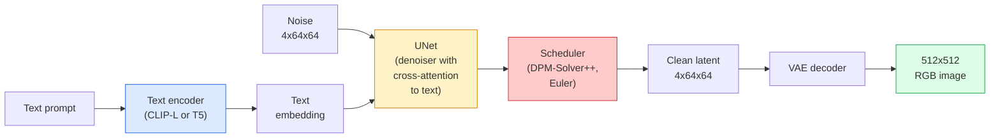

# Stable Diffusion：架構與 Fine-Tuning (Stable Diffusion — Architecture & Fine-Tuning)

> Stable Diffusion 是一個在預訓練 VAE 的 latent space 中執行的 DDPM，透過 cross-attention 以文字為條件，用快速的確定性 ODE solver 取樣，並由 classifier-free guidance 來引導。

**Type:** Learn + Use
**Languages:** Python
**Prerequisites:** Phase 4 Lesson 10 (Diffusion), Phase 7 Lesson 02 (Self-Attention)
**Time:** ~75 分鐘

## 學習目標 (Learning Objectives)

- 追蹤 Stable Diffusion pipeline 的五個部分：VAE、文字 encoder、U-Net、scheduler、safety checker，以及它們各自實際做什麼
- 解釋 latent diffusion，以及為什麼在 4x64x64 的 latent space（而不是 3x512x512 的影像）中訓練，可以在不損失品質的情況下把運算量降低 48 倍
- 使用 `diffusers` 生成影像、執行 image-to-image、inpainting，以及由 ControlNet 引導的生成
- 用 LoRA 在小型自訂資料集上 fine-tune Stable Diffusion，並在推論時載入 LoRA adapter

## 問題 (The Problem)

直接在 512x512 的 RGB 影像上訓練 DDPM 很昂貴。每個訓練 step 都要對一個看到 3x512x512 = 786,432 個輸入值的 U-Net 做 backprop，而取樣則要通過同一個 U-Net 50 次以上的 forward pass。以 Stable Diffusion 1.5（2022 年發布）的品質水準來說，pixel-space 的 diffusion 大約需要 256 個 GPU 月的訓練，在消費級 GPU 上每張影像要 10 到 30 秒。

讓開放權重的 text-to-image 變得實用的技巧是 **latent diffusion**（Rombach et al., CVPR 2022）。訓練一個 VAE，把 3x512x512 的影像對應到 4x64x64 的 latent tensor 再轉回來，然後在那個 latent space 裡做 diffusion。運算量下降 `(3*512*512)/(4*64*64) = 48x`。在同一張 GPU 上，取樣時間從幾十秒降到兩秒以內。

幾乎每個現代影像生成模型，包括 SDXL、SD3、FLUX、HunyuanDiT、Wan-Video，都是 latent diffusion 模型，只是在 autoencoder、denoiser（U-Net 或 DiT）與文字條件控制上有所變化。學會 Stable Diffusion，你就學會了這個模板。

## 核心概念 (The Concept)

### Pipeline



- **VAE**：凍結的 autoencoder。Encoder 把影像轉成 latent（用於 img2img 和訓練）。Decoder 把 latent 轉回影像。
- **Text encoder**：CLIP 文字 encoder（SD 1.x/2.x）、CLIP-L + CLIP-G（SDXL），或 T5-XXL（SD3/FLUX）。產生一串 token embedding。
- **U-Net**：denoiser。有 cross-attention 層，在每個解析度層級上，從 latent 對文字 embedding 做 attention。
- **Scheduler**：取樣演算法（DDIM、Euler、DPM-Solver++）。挑選 sigma，並把預測的雜訊混回 latent。
- **Safety checker**：對輸出影像做的可選 NSFW / 違法內容過濾器。

### Classifier-free guidance (CFG)

單純的文字條件控制，會對每個 prompt `c` 學習 `epsilon_theta(x_t, t, c)`。CFG 訓練同一個網路時，有 10% 的機率把 `c` 丟掉（換成空的 embedding），讓單一模型同時預測有條件與無條件的雜訊。推論時：

```math
\epsilon = \epsilon_{\text{uncond}} + w \cdot (\epsilon_{\text{cond}} - \epsilon_{\text{uncond}})
```

`w` 是 guidance scale。`w=0` 是無條件，`w=1` 是單純的有條件，`w>1` 會把輸出推向「更受 prompt 影響」，代價是多樣性。SD 的預設值是 `w=7.5`。

CFG 就是 text-to-image 能達到正式品質的原因。沒有它，prompt 對輸出的影響很微弱；有了它，prompt 就佔主導地位。

### Latent space 的幾何 (Latent space geometry)

VAE 的 4 通道 latent 不只是壓縮過的影像。它是一個 manifold，在這裡的算術大致對應語意上的編輯（prompt engineering 和內插都發生在這裡），而 diffusion U-Net 也被訓練成把全部的建模預算花在這裡。解碼一個隨機的 4x64x64 latent 並不會產生看起來隨機的影像，只會產生垃圾，因為只有 latent 的某個特定子 manifold 才能解碼成有效的影像。

兩個結果：

1. **Img2img** = 把影像 encode 成 latent、加入部分雜訊、執行 denoiser、再 decode。影像結構得以保留，因為 encoding 近乎可逆；內容則依 prompt 而改變。
2. **Inpainting** = 和 img2img 相同，但 denoiser 只更新被遮罩的區域；未被遮罩的區域保持在 encode 後的 latent。

### U-Net 架構 (The U-Net architecture)

SD 的 U-Net 是第 10 課 TinyUNet 的大型版本，多了三樣東西：

- 每個空間解析度都有 **Transformer block**，包含 self-attention 與對文字 embedding 的 cross-attention。
- **Time embedding**：對 sinusoidal encoding 做 MLP。
- 在對應解析度的 encoder 與 decoder 之間有 **Skip connection**。

SD 1.5 的總參數量：約 8.6 億。SDXL：約 26 億。FLUX：約 120 億。參數的躍升主要發生在 attention 層。

### LoRA fine-tuning

對 Stable Diffusion 做完整 fine-tuning 需要 20 GB 以上的 VRAM，並更新 8.6 億個參數。LoRA (Low-Rank Adaptation) 保持基礎模型凍結，並在 attention 層注入小的低秩分解矩陣。SD 的 LoRA adapter 通常是 10 到 50 MB，在單張消費級 GPU 上訓練 10 到 60 分鐘，並在推論時像插件一樣載入。

```
Original: W_q : (d_in, d_out)   frozen
LoRA:     W_q + alpha * (A @ B)   where A : (d_in, r), B : (r, d_out)

r is typically 4-32.
```

LoRA 是幾乎所有社群 fine-tune 的散布方式。CivitAI 和 Hugging Face 上放著數百萬個。

### 你會看到的 scheduler (Schedulers you will see)

- **DDIM**：確定性、約 50 步、簡單。
- **Euler ancestral**：隨機、30 到 50 步，樣本稍微更有創意。
- **DPM-Solver++ 2M Karras**：確定性、20 到 30 步，正式環境的預設。
- **LCM / TCD / Turbo**：consistency model 與蒸餾變體；1 到 4 步，代價是損失一些品質。

在 `diffusers` 中換 scheduler 只要改一行，有時不需任何重新訓練就能修好樣本的問題。

```figure
cv3-latent-compression
```

## 動手做 (Build It)

這堂課從頭到尾使用 `diffusers`，而不是從零重建 Stable Diffusion。你需要重建的那些部分（VAE、文字 encoder、U-Net、scheduler）本身就是獨立課程的主題；這裡的目標是熟練掌握正式環境的 API。

### 步驟 1：Text-to-image (Step 1: Text-to-image)

```python
import torch
from diffusers import StableDiffusionPipeline

pipe = StableDiffusionPipeline.from_pretrained(
    "runwayml/stable-diffusion-v1-5",
    torch_dtype=torch.float16,
).to("cuda")

image = pipe(
    prompt="a dog riding a skateboard in tokyo, studio ghibli style",
    guidance_scale=7.5,
    num_inference_steps=25,
    generator=torch.Generator("cuda").manual_seed(42),
).images[0]
image.save("dog.png")
```

`float16` 讓 VRAM 減半，且肉眼看不出品質損失。`num_inference_steps=25` 搭配預設的 DPM-Solver++，與 `num_inference_steps=50` 搭配 DDIM 的品質相當。

### 步驟 2：換 scheduler (Step 2: Swap the scheduler)

```python
from diffusers import DPMSolverMultistepScheduler, EulerAncestralDiscreteScheduler

pipe.scheduler = DPMSolverMultistepScheduler.from_config(pipe.scheduler.config)
pipe.scheduler = EulerAncestralDiscreteScheduler.from_config(pipe.scheduler.config)
```

Scheduler 的狀態與 U-Net 權重是解耦的。你可以用 DDPM 訓練，再用任何 scheduler 取樣。

### 步驟 3：Image-to-image (Step 3: Image-to-image)

```python
from diffusers import StableDiffusionImg2ImgPipeline
from PIL import Image

img2img = StableDiffusionImg2ImgPipeline.from_pretrained(
    "runwayml/stable-diffusion-v1-5",
    torch_dtype=torch.float16,
).to("cuda")

init_image = Image.open("dog.png").convert("RGB").resize((512, 512))
out = img2img(
    prompt="a dog riding a skateboard, oil painting",
    image=init_image,
    strength=0.6,
    guidance_scale=7.5,
).images[0]
```

`strength` 是去噪之前要加入多少雜訊（0.0 = 不變，1.0 = 完全重新生成）。0.5 到 0.7 是風格轉換的標準範圍。

### 步驟 4：Inpainting (Step 4: Inpainting)

```python
from diffusers import StableDiffusionInpaintPipeline

inpaint = StableDiffusionInpaintPipeline.from_pretrained(
    "runwayml/stable-diffusion-inpainting",
    torch_dtype=torch.float16,
).to("cuda")

image = Image.open("dog.png").convert("RGB").resize((512, 512))
mask = Image.open("dog_mask.png").convert("L").resize((512, 512))

out = inpaint(
    prompt="a cat",
    image=image,
    mask_image=mask,
    guidance_scale=7.5,
).images[0]
```

遮罩中的白色像素是要重新生成的區域。黑色像素則被保留。

### 步驟 5：載入 LoRA (Step 5: LoRA loading)

```python
pipe.load_lora_weights(
    "artificialguybr/studioghibli-redmond-1-5v-studio-ghibli-lora-for-liberteredmond-sd-1-5",
    weight_name="StudioGhibliRedmond-15V-LiberteRedmond-StdGBRedmAF-StudioGhibli.safetensors",
)
pipe.fuse_lora(lora_scale=0.8)

image = pipe(prompt="a village square, StdGBRedmAF, Studio Ghibli").images[0]
```

model card 中的觸發片語（`StdGBRedmAF, Studio Ghibli`）會把該風格打開。`lora_scale` 控制強度；0.0 = 沒有效果，1.0 = 完整效果。`fuse_lora` 為了速度，直接把 adapter 烘進權重裡，但這樣就無法抽換。載入另一個 adapter 之前，要先呼叫 `pipe.unfuse_lora()`。

### 步驟 6：LoRA 訓練（草稿）(Step 6: LoRA training (sketch))

真正的 LoRA 訓練在 `peft` 或 `diffusers.training` 裡。大綱如下：

```python
# Pseudocode
for step, batch in enumerate(dataloader):
    images, prompts = batch
    latents = vae.encode(images).latent_dist.sample() * 0.18215

    t = torch.randint(0, num_train_timesteps, (batch_size,))
    noise = torch.randn_like(latents)
    noisy_latents = scheduler.add_noise(latents, noise, t)

    text_emb = text_encoder(tokenizer(prompts))

    pred_noise = unet(noisy_latents, t, text_emb)  # LoRA weights injected here

    loss = F.mse_loss(pred_noise, noise)
    loss.backward()
    optimizer.step()
```

只有 LoRA 矩陣會接收 gradient；基礎的 U-Net、VAE 和文字 encoder 都是凍結的。batch size 為 1 並搭配 gradient checkpointing 時，可以塞進 8 GB 的 VRAM。

## 實際使用 (Use It)

在正式環境中，你實際會做的決定：

- **模型系列**：SD 1.5 適用於開源社群的 fine-tune，SDXL 適用於更高的擬真度，SD3 / FLUX 適用於 state of the art 以及嚴格的授權需求。
- **Scheduler**：20 到 30 步用 DPM-Solver++ 2M Karras，延遲低於 1 秒時用 LCM-LoRA。
- **精度**：4080/4090 上用 `float16`，A100 與更新的卡用 `bfloat16`，VRAM 吃緊時用 `int8`（透過 `bitsandbytes`）。
- **條件控制**：單純文字就能運作；若要更強的控制，在基礎 pipeline 上加 ControlNet（canny、depth、pose）。

批次生成的話，`AUTO1111` / `ComfyUI` 是社群工具；正式 API 則用 `diffusers` + `accelerate`，或搭配 TensorRT 編譯的 `optimum-nvidia`。

## 交付 (Ship It)

這堂課會產出：

- `outputs/prompt-sd-pipeline-planner.md`：一個 prompt，根據延遲預算、擬真度目標與授權限制，挑選 SD 1.5 / SDXL / SD3 / FLUX，以及 scheduler 和精度。
- `outputs/skill-lora-training-setup.md`：一個 skill，為自訂資料集寫出完整的 LoRA 訓練設定，包括 caption、rank、batch size 和 learning rate。

## 練習 (Exercises)

1. **（簡單）** 用 `guidance_scale` 為 `[1, 3, 5, 7.5, 10, 15]` 生成同一個 prompt。描述影像如何變化。在哪個 guidance 值開始出現瑕疵？
2. **（中等）** 取任何一張真實照片，用 `strength` 為 `[0.2, 0.4, 0.6, 0.8, 1.0]` 跑過 `StableDiffusionImg2ImgPipeline`。哪個 strength 在改變風格的同時保留構圖？為什麼 1.0 會完全忽略輸入？
3. **（困難）** 用單一主體（寵物、logo、角色）的 10 到 20 張影像訓練一個 LoRA，並生成包含該主體的新場景。回報在不對輸入影像 overfitting 的前提下，產生最佳身分保留效果的 LoRA rank 與訓練步數。

## 關鍵術語 (Key Terms)

| 術語 | 大家常說的 | 實際意義 |
|------|----------------|----------------------|
| Latent diffusion | 「在 latent 中做 diffusion」 | 把整個 DDPM 放在 VAE 的 latent space（4x64x64）而不是 pixel space（3x512x512）中執行；省下 48 倍運算 |
| VAE scale factor | 「0.18215」 | 把 VAE 原始 latent 重新縮放到大約單位 variance 的常數；寫死在每個 SD pipeline 中 |
| Classifier-free guidance | 「CFG」 | 混合有條件與無條件的雜訊預測；影響最大的單一推論旋鈕 |
| Scheduler | 「Sampler」 | 把雜訊加上模型預測，轉成去噪後 latent 軌跡的演算法 |
| LoRA | 「低秩 adapter」 | 小的低秩分解矩陣，在不動基礎權重的情況下 fine-tune attention 層 |
| Cross-attention | 「文字與影像之間的 attention」 | 從 latent token 對文字 token 的 attention；在 U-Net 的每一層注入 prompt 資訊 |
| ControlNet | 「結構條件控制」 | 獨立訓練的 adapter，用額外輸入（canny、depth、pose、segmentation）來引導 SD |
| DPM-Solver++ | 「預設的 scheduler」 | 二階確定性 ODE solver；2026 年在低步數（20 到 30）下品質最佳 |

## 延伸閱讀 (Further Reading)

- [High-Resolution Image Synthesis with Latent Diffusion (Rombach et al., 2022)](https://arxiv.org/abs/2112.10752)：Stable Diffusion 論文；包含為設計背書的每一項 ablation
- [Classifier-Free Diffusion Guidance (Ho & Salimans, 2022)](https://arxiv.org/abs/2207.12598)：CFG 論文
- [LoRA: Low-Rank Adaptation of Large Language Models (Hu et al., 2021)](https://arxiv.org/abs/2106.09685)：LoRA 最初是 NLP 的東西；幾乎不用改就轉移到了 SD
- [diffusers documentation](https://huggingface.co/docs/diffusers)：每個 SD / SDXL / SD3 / FLUX pipeline 的參考資料
