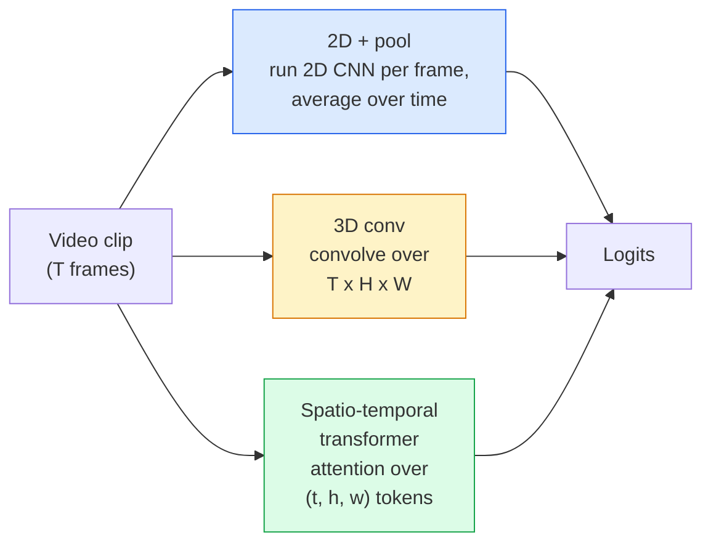

# 影片理解：時間建模 (Video Understanding — Temporal Modeling)

> 影片是一串影像，加上把它們連起來的物理規則。每個影片模型要不是把時間當成額外的一個軸（3D conv），就是當成一段要做 attention 的序列（transformer），或是當成一次萃取後再 pool 的特徵（2D+pool）。

**Type:** Learn + Build
**Languages:** Python
**Prerequisites:** Phase 4 Lesson 03 (CNNs), Phase 4 Lesson 04 (Image Classification)
**Time:** ~45 分鐘

## 學習目標 (Learning Objectives)

- 區分三種主要的影片建模方式（2D+pool、3D conv、spatio-temporal transformer），並預測它們在成本與準確率上的取捨
- 在 PyTorch 中實作 frame sampling、temporal pooling，以及 2D+pool 的 baseline 分類器
- 解釋為什麼 I3D 的「inflated」3D kernel 能從 ImageNet 權重良好地轉移，以及 factorised (2+1)D conv 做了什麼不同的事
- 讀懂標準的動作辨識資料集與指標：Kinetics-400/600、UCF101、Something-Something V2；clip 層級與 video 層級的 top-1 準確率

## 問題 (The Problem)

30 fps 的 30 秒影片有 900 張影像。天真地說，影片分類就是把影像分類跑 900 次，再做某種聚合。當動作在幾乎每一個影格都看得到時（運動、烹飪、健身影片），這樣行得通；當動作是由運動本身定義時，這會慘敗：「把東西從左推到右」在每一個單獨的影格裡，看起來都只是兩個靜止的物體。

每個影片架構的核心問題是：時間結構在什麼時候被建模，又是怎麼建模的？這個答案決定了其他一切，包括運算成本、預訓練策略、能不能重用 ImageNet 權重，以及模型用什麼資料集訓練。

這堂課刻意比靜態影像的課程短。核心的影像機制都已經就位，影片理解主要是關於時間這條線：取樣、建模與聚合。

## 核心概念 (The Concept)

### 三個架構系列 (The three architectural families)



### 2D + pool

取一個 2D CNN（ResNet、EfficientNet、ViT）。在每個取樣的影格上獨立執行。對每個影格的 embedding 取平均（或 max-pool，或 attention-pool）。把 pool 後的向量餵給分類器。

優點：

- ImageNet 預訓練可以直接轉移。
- 最容易實作。
- 便宜：T 個影格 * 單張影像的推論成本。

缺點：

- 無法對運動建模。動作 = 外觀的聚合。
- Temporal pooling 與順序無關；「開門」和「關門」看起來一樣。

何時使用：重外觀的任務、小型影片資料集上的 transfer learning、最初的 baseline。

### 3D convolution (3D convolutions)

把 2D (H, W) kernel 換成 3D (T, H, W) kernel。網路同時對空間和時間做 convolution。早期的系列：C3D、I3D、SlowFast。

I3D 的技巧：取一個預訓練的 2D ImageNet 模型，沿著新的時間軸複製每個 2D kernel 來「inflate」它。3x3 的 2D conv 變成 3x3x3 的 3D conv。這讓 3D 模型有強大的預訓練權重，而不是從零開始訓練。

優點：

- 直接對運動建模。
- I3D inflation 免費提供 transfer learning。

缺點：

- FLOPs 大約是逐影格執行 2D 網路的 3 倍，因為每個 3x3 kernel 變成 3x3x3。
- 時間方向的 kernel 很小；長距離的運動需要 pyramid 或 dual-stream 的做法。

何時使用：運動就是訊號的動作辨識（Something-Something V2、運動量大的 Kinetics 類別）。

### Spatio-temporal transformer

把影片 token 化成時空 patch 的 grid，並對所有 patch 做 attention。TimeSformer、ViViT、Video Swin、VideoMAE。

重要的 attention 模式：

- **Joint**：對 (t, h, w) 做一次大的 attention。對 `T*H*W` 是二次方；很昂貴。
- **Divided**：每個 block 兩個 attention：一個對時間，一個對空間。近似線性縮放。
- **Factorised**：時間 attention 與空間 attention 在各個 block 之間交替。

優點：

- 在每個主要 benchmark 上都是 SOTA 準確率。
- 透過 patch inflation 從影像 transformer (ViT) 轉移。
- 透過 sparse attention 支援長 context 的影片。

缺點：

- 很吃算力。
- 需要仔細選擇 attention 模式，否則 runtime 會暴增。

何時使用：大型資料集、高擬真度的影片理解、多模態的影片 + 文字任務。

### Frame sampling

30 fps 的 10 秒 clip 有 300 個影格；把 300 個全部餵給任何模型都很浪費。標準策略：

- **Uniform sampling**：在 clip 中均勻挑 T 個影格。2D+pool 的預設。
- **Dense sampling**：隨機的連續 T 影格視窗。3D conv 常用，因為運動需要相鄰影格。
- **Multi-clip**：從同一支影片取樣多個 T 影格視窗，各自分類，測試時對預測取平均。

T 通常是 8、16、32 或 64。T 越高 = 時間訊號越多，算力也越多。

### 評估 (Evaluation)

兩個層級：

- **Clip 層級準確率**：模型看到一個 T 影格的 clip，回報 top-k。
- **Video 層級準確率**：對每支影片的多個 clip 層級預測取平均；更高也更穩定。

兩個都要回報。一個 clip 78% / video 82% 的模型，嚴重依賴測試時的平均；一個 80% / 81% 的模型，每個 clip 都更穩健。

### 你會遇到的資料集 (Datasets you will meet)

- **Kinetics-400 / 600 / 700**：通用的動作資料集。40 萬個 clip；YouTube URL（現在很多已經失效）。
- **Something-Something V2**：由運動定義的動作（「把 X 從左移到右」）。無法用 2D+pool 解決。
- **UCF-101**、**HMDB-51**：較舊、較小，仍有人回報。
- **AVA**：在空間和時間上做動作 *定位*；比分類更難。

```figure
v4-video-temporal
```

## 動手做 (Build It)

### 步驟 1：Frame sampler (Step 1: Frame sampler)

適用於影格 list（或影片 tensor）的 uniform 和 dense sampler。

```python
import numpy as np

def sample_uniform(num_frames_total, T):
    if num_frames_total <= T:
        return list(range(num_frames_total)) + [num_frames_total - 1] * (T - num_frames_total)
    step = num_frames_total / T
    return [int(i * step) for i in range(T)]


def sample_dense(num_frames_total, T, rng=None):
    rng = rng or np.random.default_rng()
    if num_frames_total <= T:
        return list(range(num_frames_total)) + [num_frames_total - 1] * (T - num_frames_total)
    start = int(rng.integers(0, num_frames_total - T + 1))
    return list(range(start, start + T))
```

兩者都回傳 `T` 個 index，你用它們來切片影片 tensor。

### 步驟 2：2D+pool baseline (Step 2: A 2D+pool baseline)

在每個影格上執行 2D ResNet-18，對特徵做 average-pool，然後分類。

```python
import torch
import torch.nn as nn
from torchvision.models import resnet18, ResNet18_Weights

class FramePool(nn.Module):
    def __init__(self, num_classes=400, pretrained=True):
        super().__init__()
        weights = ResNet18_Weights.IMAGENET1K_V1 if pretrained else None
        backbone = resnet18(weights=weights)
        self.features = nn.Sequential(*(list(backbone.children())[:-1]))  # global avg pool kept
        self.head = nn.Linear(512, num_classes)

    def forward(self, x):
        # x: (N, T, 3, H, W)
        N, T = x.shape[:2]
        x = x.view(N * T, *x.shape[2:])
        feats = self.features(x).view(N, T, -1)
        pooled = feats.mean(dim=1)
        return self.head(pooled)

model = FramePool(num_classes=10)
x = torch.randn(2, 8, 3, 224, 224)
print(f"output: {model(x).shape}")
print(f"params: {sum(p.numel() for p in model.parameters()):,}")
```

1,100 萬個參數、ImageNet 預訓練、逐影格執行、取平均、分類。在重外觀的任務上，這個 baseline 常常與正規的 3D 模型相差 5 到 10 個點以內，有時甚至更好，因為它重用了更強的 ImageNet backbone。

### 步驟 3：I3D 風格的 inflated 3D conv (Step 3: An I3D-style inflated 3D conv)

沿著新的時間軸重複權重，把單一個 2D conv 變成 3D conv。

```python
def inflate_2d_to_3d(conv2d, time_kernel=3):
    out_c, in_c, kh, kw = conv2d.weight.shape
    weight_3d = conv2d.weight.data.unsqueeze(2)  # (out, in, 1, kh, kw)
    weight_3d = weight_3d.repeat(1, 1, time_kernel, 1, 1) / time_kernel
    conv3d = nn.Conv3d(in_c, out_c, kernel_size=(time_kernel, kh, kw),
                        padding=(time_kernel // 2, conv2d.padding[0], conv2d.padding[1]),
                        stride=(1, conv2d.stride[0], conv2d.stride[1]),
                        bias=False)
    conv3d.weight.data = weight_3d
    return conv3d

conv2d = nn.Conv2d(3, 64, kernel_size=3, padding=1, bias=False)
conv3d = inflate_2d_to_3d(conv2d, time_kernel=3)
print(f"2D weight shape:  {tuple(conv2d.weight.shape)}")
print(f"3D weight shape:  {tuple(conv3d.weight.shape)}")
x = torch.randn(1, 3, 8, 56, 56)
print(f"3D output shape:  {tuple(conv3d(x).shape)}")
```

除以 `time_kernel` 能讓 activation 的幅度大致保持不變，這對第一次 pass 時不要破壞 batch-norm 統計值很重要。

### 步驟 4：Factorised (2+1)D conv (Step 4: Factorised (2+1)D conv)

把 3D conv 拆成一個 2D（空間）和一個 1D（時間）的 conv。Receptive field 相同、參數更少，在某些 benchmark 上準確率更好。

```python
class Conv2Plus1D(nn.Module):
    def __init__(self, in_c, out_c, kernel_size=3):
        super().__init__()
        mid_c = (in_c * out_c * kernel_size * kernel_size * kernel_size) \
                // (in_c * kernel_size * kernel_size + out_c * kernel_size)
        self.spatial = nn.Conv3d(in_c, mid_c, kernel_size=(1, kernel_size, kernel_size),
                                 padding=(0, kernel_size // 2, kernel_size // 2), bias=False)
        self.bn = nn.BatchNorm3d(mid_c)
        self.act = nn.ReLU(inplace=True)
        self.temporal = nn.Conv3d(mid_c, out_c, kernel_size=(kernel_size, 1, 1),
                                  padding=(kernel_size // 2, 0, 0), bias=False)

    def forward(self, x):
        return self.temporal(self.act(self.bn(self.spatial(x))))

c = Conv2Plus1D(3, 64)
x = torch.randn(1, 3, 8, 56, 56)
print(f"(2+1)D output: {tuple(c(x).shape)}")
```

完整的 R(2+1)D 網路，就是把 ResNet-18 的每個 3x3 conv 換成 `Conv2Plus1D`。

## 實際使用 (Use It)

兩個函式庫涵蓋正式環境的影片工作：

- `torchvision.models.video`：R(2+1)D、MViT、Swin3D，附有 Kinetics 預訓練權重。API 與影像模型相同。
- `pytorchvideo`（Meta）：model zoo、Kinetics / SSv2 / AVA 的 data loader、標準 transform。

對 Vision-Language 影片模型（影片 captioning、影片 QA），使用 `transformers`（`VideoMAE`、`VideoLLaMA`、`InternVideo`）。

## 交付 (Ship It)

這堂課會產出：

- `outputs/prompt-video-architecture-picker.md`：一個 prompt，依據外觀與運動的比重、資料集大小與算力預算，挑選 2D+pool / I3D / (2+1)D / transformer。
- `outputs/skill-frame-sampler-auditor.md`：一個 skill，檢查影片 pipeline 的 sampler 並標出常見 bug：off-by-one 的 index、`num_frames < T` 時的不均勻取樣、缺少保持長寬比的裁切，等等。

## 練習 (Exercises)

1. **（簡單）** 計算 T=8 的 FramePool 與 T=8 的 I3D 風格 3D ResNet 的（大約）FLOPs。說明為什麼 2D+pool 便宜 3 到 5 倍。
2. **（中等）** 產生一個合成影片資料集：隨機的球朝隨機方向移動，依運動方向貼標籤（「由左到右」、「由右到左」、「斜向上」）。在上面訓練 FramePool。展示它只達到接近隨機猜測的準確率，證明光靠外觀不足以處理運動任務。
3. **（困難）** 把 ResNet-18 中的每個 Conv2d 換成 `Conv2Plus1D`，建立 R(2+1)D-18。用 ImageNet 預訓練 ResNet-18 的權重 inflate 第一個 conv。在練習 2 的運動資料集上訓練，並擊敗 FramePool。

## 關鍵術語 (Key Terms)

| 術語 | 大家常說的 | 實際意義 |
|------|----------------|----------------------|
| 2D + pool | 「逐影格分類器」 | 在每個取樣的影格上執行 2D CNN，沿時間對特徵做 average-pool，再分類 |
| 3D convolution | 「時空 kernel」 | 對 (T, H, W) 做 convolution 的 kernel；可以原生地對運動建模 |
| Inflation | 「把 2D 權重提升到 3D」 | 沿新的時間軸重複 2D conv 的權重來初始化 3D conv 權重，再除以 kernel_T 以保持 activation 的尺度 |
| (2+1)D | 「Factorised conv」 | 把 3D 拆成 2D 空間加 1D 時間；參數較少，中間還多一個非線性 |
| Divided attention | 「先時間再空間」 | 每層有兩個 attention 的 Transformer block：一個對同一影格內的 token，一個對同一位置的 token |
| Clip | 「T 影格視窗」 | 取樣出的 T 個影格的子序列；影片模型消耗的單位 |
| Clip vs video accuracy | 「兩種評估設定」 | Clip = 每支影片一個樣本，video = 對多個取樣 clip 取平均 |
| Kinetics | 「影片界的 ImageNet」 | 400 到 700 個動作類別、30 萬個以上的 YouTube clip，標準的影片預訓練語料 |

## 延伸閱讀 (Further Reading)

- [I3D: Quo Vadis, Action Recognition (Carreira & Zisserman, 2017)](https://arxiv.org/abs/1705.07750)：引入 inflation 與 Kinetics 資料集
- [R(2+1)D: A Closer Look at Spatiotemporal Convolutions (Tran et al., 2018)](https://arxiv.org/abs/1711.11248)：factorised conv，至今仍是強大的 baseline
- [TimeSformer: Is Space-Time Attention All You Need? (Bertasius et al., 2021)](https://arxiv.org/abs/2102.05095)：第一個強大的影片 transformer
- [VideoMAE (Tong et al., 2022)](https://arxiv.org/abs/2203.12602)：影片的 masked autoencoder 預訓練；目前主流的預訓練配方
