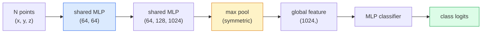

# 3D 視覺：點雲與 NeRF (3D Vision — Point Clouds & NeRFs)

> 3D 視覺有兩種風味。點雲 (point cloud) 是感測器的原始輸出。NeRF 是學出來的體積場 (volumetric field)。兩者都在回答「空間中什麼東西在哪裡」。

**Type:** Learn + Build
**Languages:** Python
**Prerequisites:** Phase 4 Lesson 03 (CNNs), Phase 1 Lesson 12 (Tensor Operations)
**Time:** ~45 分鐘

## 學習目標 (Learning Objectives)

- 區分顯式（point cloud、mesh、voxel）與隱式（signed distance field、NeRF）的 3D 表示方式，以及各自的使用時機
- 理解 PointNet 的對稱函式技巧，如何讓神經網路對無序的點集合具有 permutation-invariant 的性質
- 追蹤 NeRF 的 forward pass：ray casting、volumetric rendering、positional encoding、MLP 的 density+colour head
- 使用 `nerfstudio` 或 `instant-ngp`，從少量有姿態 (posed) 的影像做預訓練的 3D 重建

## 問題 (The Problem)

相機產生 2D 影像。LIDAR 產生一組沒有順序的 3D 點。Structure-from-motion pipeline 產生稀疏的 3D 關鍵點雲。NeRF 從少數幾張有姿態的影像重建整個 3D 場景。這些都是「視覺」，但沒有一個長得像 CNN 想要的稠密 tensor。

3D 視覺很重要，因為幾乎每個高價值的機器人任務都在 3D 中進行：抓取、避障、導航、AR 遮擋、3D 內容擷取。只懂 2D 影像的視覺工程師，會被擋在這個領域成長最快的那一塊之外（AR/VR 內容、機器人、自動駕駛技術堆疊、用於房地產或營建的 NeRF 3D 重建）。

這兩種表示方式各自因不同的原因而佔優勢。點雲是感測器免費給你的東西。NeRF 與它的後繼者（3D Gaussian splatting、neural SDF），是你要求神經網路去學習一個場景時得到的東西。

## 核心概念 (The Concept)

### 點雲 (Point clouds)

點雲是 $\mathbb{R}^3$ 中 $N$ 個點的無序集合，每個點可以選擇性地附帶特徵（顏色、強度、法向量）。

```
cloud = [
  (x1, y1, z1, r1, g1, b1),
  (x2, y2, z2, r2, g2, b2),
  ...
  (xN, yN, zN, rN, gN, bN),
]
```

沒有 grid，沒有連接關係。兩個性質讓它對神經網路很難：

- **Permutation invariance**：輸出不能依賴點的順序。
- **可變的 N**：單一模型必須能處理不同大小的點雲。

PointNet（Qi et al., 2017）用一個想法同時解決了兩者：對每個點套用共用的 MLP，再用對稱函式（max pool）聚合。結果是一個固定大小、且不依賴順序的向量。

```math
f(P) = \max_{p \in P} \mathop{\mathrm{MLP}}(p)
```

這就是 PointNet 的整個核心。更深的變體（PointNet++、Point Transformer）加入階層式取樣與局部聚合，但對稱函式的技巧沒有改變。

### PointNet 架構 (The PointNet architecture)



「Shared MLP」的意思是同一個 MLP 獨立地在每個點上執行。為了效率，實作成沿點維度的 1x1 conv。

### Neural Radiance Fields (NeRFs)

NeRF（Mildenhall et al., 2020）拿「我們能不能從 N 張照片重建 3D 場景？」這個問題，用一個本身就是場景的神經網路來回答。這個網路把 `(x, y, z, viewing_direction)` 對應到 `(density, colour)`。渲染新視角，就是在這個網路上跑一個 ray-casting 迴圈。

```
NeRF MLP:  (x, y, z, theta, phi) -> (sigma, r, g, b)

To render a pixel (u, v) of a new view:
  1. Cast a ray from the camera through pixel (u, v)
  2. Sample points along the ray at distances t_1, t_2, ..., t_N
  3. Query the MLP at each point
  4. Composite the colours weighted by (1 - exp(-sigma * dt))
  5. The sum is the rendered pixel colour
```

Loss 把渲染出的像素與訓練照片中的 ground-truth 像素做比較。透過 rendering 步驟做 backprop 來更新 MLP。沒有 3D ground truth，沒有顯式的幾何，場景就存放在 MLP 的權重裡。

### NeRF 中的 positional encoding (Positional encoding in NeRF)

直接在 `(x, y, z)` 上用普通的 MLP，無法表示高頻細節，因為 MLP 在頻譜上偏向低頻。NeRF 在進入 MLP 之前，先把每個座標編碼成 Fourier feature 向量來修正這一點：

```math
\gamma(p) = \left(\sin(2^0 \pi p), \cos(2^0 \pi p), \sin(2^1 \pi p), \cos(2^1 \pi p), \ldots\right)
```

最多到 $L=10$ 個頻率層級。這和 transformer 對位置使用的技巧相同，在 diffusion 的時間條件控制（第 10 課）中也會再次出現。沒有它，NeRF 看起來會很模糊。

### Volumetric rendering

```math
\begin{aligned}
C(r) &= \sum_i T_i \left(1 - \exp(-\sigma_i \delta_i)\right) c_i \\[4pt]
T_i &= \exp\left(-\sum_{j<i} \sigma_j \delta_j\right) \\
\delta_i &= t_{i+1} - t_i
\end{aligned}
```

`T_i` 是 transmittance，也就是有多少光能存活到點 $i$。`(1 - exp(-sigma_i * delta_i))` 是點 $i$ 的不透明度。`c_i` 是顏色。最終的像素，是沿著射線的加權總和。

### 後來取代 NeRF 的東西 (What replaced NeRFs)

純 NeRF 訓練很慢（數小時），渲染也很慢（每張影像數秒）。之後的演進脈絡：

- **Instant-NGP**（2022）：用 hash-grid encoding 取代 MLP 的位置輸入；幾秒內就能訓練完。
- **Mip-NeRF 360**：處理無邊界的場景與抗鋸齒。
- **3D Gaussian Splatting**（2023）：用數百萬個 3D Gaussian 取代體積場；幾分鐘內訓練完，即時渲染。目前正式環境的預設。

2026 年幾乎每個真正的 NeRF 產品，其實都是 3D Gaussian splatting。心智模型仍然是 NeRF。

### 資料集與 benchmark (Datasets and benchmarks)

- **ShapeNet**：把 3D CAD 模型當成點雲，做分類與 segmentation。
- **ScanNet**：真實室內掃描，用於 segmentation。
- **KITTI**：自動駕駛用的戶外 LIDAR 點雲。
- **NeRF Synthetic** / **Blended MVS**：用於 view synthesis 的有姿態影像資料集。
- **Mip-NeRF 360** 資料集：無邊界的真實場景。

```figure
nerf-rays
```

## 動手做 (Build It)

### 步驟 1：PointNet 分類器 (Step 1: PointNet classifier)

```python
import torch
import torch.nn as nn

class PointNet(nn.Module):
    def __init__(self, num_classes=10):
        super().__init__()
        self.mlp1 = nn.Sequential(
            nn.Conv1d(3, 64, 1),    nn.BatchNorm1d(64),   nn.ReLU(inplace=True),
            nn.Conv1d(64, 64, 1),   nn.BatchNorm1d(64),   nn.ReLU(inplace=True),
        )
        self.mlp2 = nn.Sequential(
            nn.Conv1d(64, 128, 1),  nn.BatchNorm1d(128),  nn.ReLU(inplace=True),
            nn.Conv1d(128, 1024, 1), nn.BatchNorm1d(1024), nn.ReLU(inplace=True),
        )
        self.head = nn.Sequential(
            nn.Linear(1024, 512),   nn.BatchNorm1d(512),  nn.ReLU(inplace=True),
            nn.Dropout(0.3),
            nn.Linear(512, 256),    nn.BatchNorm1d(256),  nn.ReLU(inplace=True),
            nn.Dropout(0.3),
            nn.Linear(256, num_classes),
        )

    def forward(self, x):
        # x: (N, 3, num_points) — transposed for Conv1d
        x = self.mlp1(x)
        x = self.mlp2(x)
        x = torch.max(x, dim=-1)[0]       # (N, 1024)
        return self.head(x)

pts = torch.randn(4, 3, 1024)
net = PointNet(num_classes=10)
print(f"output: {net(pts).shape}")
print(f"params: {sum(p.numel() for p in net.parameters()):,}")
```

約 160 萬個參數。每個點雲執行 1,024 個點。

### 步驟 2：Positional encoding (Step 2: Positional encoding)

```python
def positional_encoding(x, L=10):
    """
    x: (..., D) -> (..., D * 2 * L)
    """
    freqs = 2.0 ** torch.arange(L, dtype=x.dtype, device=x.device)
    args = x.unsqueeze(-1) * freqs * 3.141592653589793
    sinc = torch.cat([args.sin(), args.cos()], dim=-1)
    return sinc.reshape(*x.shape[:-1], -1)

x = torch.randn(5, 3)
y = positional_encoding(x, L=10)
print(f"input:  {x.shape}")
print(f"encoded: {y.shape}     # (5, 60)")
```

乘上 `2^l * pi` 會得到逐步升高的頻率。

### 步驟 3：小型 NeRF MLP (Step 3: Tiny NeRF MLP)

```python
class TinyNeRF(nn.Module):
    def __init__(self, L_pos=10, L_dir=4, hidden=128):
        super().__init__()
        self.L_pos = L_pos
        self.L_dir = L_dir
        pos_dim = 3 * 2 * L_pos
        dir_dim = 3 * 2 * L_dir
        self.trunk = nn.Sequential(
            nn.Linear(pos_dim, hidden), nn.ReLU(inplace=True),
            nn.Linear(hidden, hidden),  nn.ReLU(inplace=True),
            nn.Linear(hidden, hidden),  nn.ReLU(inplace=True),
            nn.Linear(hidden, hidden),  nn.ReLU(inplace=True),
        )
        self.sigma = nn.Linear(hidden, 1)
        self.color = nn.Sequential(
            nn.Linear(hidden + dir_dim, hidden // 2), nn.ReLU(inplace=True),
            nn.Linear(hidden // 2, 3), nn.Sigmoid(),
        )

    def forward(self, x, d):
        x_enc = positional_encoding(x, self.L_pos)
        d_enc = positional_encoding(d, self.L_dir)
        h = self.trunk(x_enc)
        sigma = torch.relu(self.sigma(h)).squeeze(-1)
        rgb = self.color(torch.cat([h, d_enc], dim=-1))
        return sigma, rgb

nerf = TinyNeRF()
x = torch.randn(128, 3)
d = torch.randn(128, 3)
s, c = nerf(x, d)
print(f"sigma: {s.shape}   rgb: {c.shape}")
```

相較於原始的 NeRF（有 2 個深度為 8 的 MLP 主幹）非常小。足以展示這個架構。

### 步驟 4：沿著射線做 volumetric rendering (Step 4: Volumetric rendering along a ray)

```python
def volumetric_render(sigma, rgb, t_vals):
    """
    sigma: (..., N_samples)
    rgb:   (..., N_samples, 3)
    t_vals: (N_samples,) distances along the ray
    """
    delta = torch.cat([t_vals[1:] - t_vals[:-1], torch.full_like(t_vals[:1], 1e10)])
    alpha = 1.0 - torch.exp(-sigma * delta)
    trans = torch.cumprod(torch.cat([torch.ones_like(alpha[..., :1]), 1.0 - alpha + 1e-10], dim=-1), dim=-1)[..., :-1]
    weights = alpha * trans
    rendered = (weights.unsqueeze(-1) * rgb).sum(dim=-2)
    depth = (weights * t_vals).sum(dim=-1)
    return rendered, depth, weights


N = 64
t_vals = torch.linspace(2.0, 6.0, N)
sigma = torch.rand(N) * 0.5
rgb = torch.rand(N, 3)
rendered, depth, weights = volumetric_render(sigma, rgb, t_vals)
print(f"rendered colour: {rendered.tolist()}")
print(f"depth:           {depth.item():.2f}")
```

一條射線、64 個樣本，合成為單一個 RGB 像素與一個深度。

## 實際使用 (Use It)

做真實的工作：

- `nerfstudio`（Tancik et al.）：目前 NeRF / Instant-NGP / Gaussian Splatting 的參考函式庫。命令列加上網頁檢視器。
- `pytorch3d`（Meta）：可微分渲染、點雲工具、mesh 運算。
- `open3d`：點雲處理、配準 (registration)、視覺化。

在部署上，3D Gaussian splatting 已大致取代純 NeRF，因為它渲染快 100 倍。重建品質相當。

## 交付 (Ship It)

這堂課會產出：

- `outputs/prompt-3d-task-router.md`：一個 prompt，根據任務與輸入資料，把工作導向正確的 3D 表示方式（point cloud、mesh、voxel、NeRF、Gaussian splat）。
- `outputs/skill-point-cloud-loader.md`：一個 skill，為 .ply / .pcd / .xyz 檔案寫出 PyTorch `Dataset`，並包含正確的 normalisation、置中與點取樣。

## 練習 (Exercises)

1. **（簡單）** 證明 PointNet 是 permutation-invariant：把同一個點雲跑兩次，其中一次把點打亂。驗證兩次輸出在浮點雜訊範圍內完全相同。
2. **（中等）** 實作一個最小的射線產生函式：給定相機內參與姿態，為 H x W 影像的每個像素產生射線原點與方向。
3. **（困難）** 在彩色立方體的渲染視角合成資料集上訓練 TinyNeRF（透過可微分渲染或簡單的 ray tracer 產生）。回報第 1、10、100 個 epoch 的渲染 loss。模型在第幾個 epoch 才能產生可辨識的視角？

## 關鍵術語 (Key Terms)

| 術語 | 大家常說的 | 實際意義 |
|------|----------------|----------------------|
| Point cloud | 「LIDAR 的 3D 點」 | 無序的 (x, y, z) 集合，每個點可附帶選用的特徵 |
| PointNet | 「第一個作用在點雲上的神經網路」 | 每個點共用的 MLP 加上對稱的 (max) pool；結構上就具有 permutation-invariant 的性質 |
| NeRF | 「本身就是場景的 MLP」 | 把 (x, y, z, dir) 對應到 (density, colour) 的網路；透過 ray casting 渲染 |
| Positional encoding | 「Fourier feature」 | 把每個座標編碼成多個頻率的 sin/cos，以克服 MLP 偏向低頻的特性 |
| Volumetric rendering | 「射線積分」 | 利用 transmittance 與 alpha，把沿著射線的樣本合成為單一個像素 |
| Instant-NGP | 「Hash-grid NeRF」 | 用多解析度 hash grid 取代 NeRF 的座標 MLP；快 100 到 1000 倍 |
| 3D Gaussian splatting | 「數百萬個 Gaussian」 | 場景 = 3D Gaussian 的集合；即時渲染，幾分鐘訓練完 |
| SDF | 「Signed distance field」 | 回傳到最近表面的有號距離的函式；另一種隱式表示 |

## 延伸閱讀 (Further Reading)

- [PointNet (Qi et al., 2017)](https://arxiv.org/abs/1612.00593)：permutation-invariant 的分類器
- [NeRF (Mildenhall et al., 2020)](https://arxiv.org/abs/2003.08934)：讓從照片做 3D 重建變成神經網路問題的論文
- [Instant-NGP (Müller et al., 2022)](https://arxiv.org/abs/2201.05989)：hash grid，1000 倍加速
- [3D Gaussian Splatting (Kerbl et al., 2023)](https://arxiv.org/abs/2308.04079)：在正式環境中取代 NeRF 的架構
