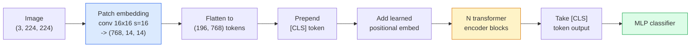

# Vision Transformer (ViT)

> 把影像切成 patch，把每個 patch 當成一個詞，跑標準的 transformer。不要回頭。

**Type:** Build
**Languages:** Python
**Prerequisites:** Phase 7 Lesson 02 (Self-Attention), Phase 4 Lesson 04 (Image Classification)
**Time:** ~45 分鐘

## 學習目標 (Learning Objectives)

- 從零實作 patch embedding、可學習的 positional embedding、class token 與 transformer encoder block，建立最小的 ViT
- 解釋為什麼在 DeiT 和 MAE 證明並非如此之前，大家都認為 ViT 需要大量的預訓練資料
- 就架構先驗（無、局部視窗 attention、conv backbone）比較 ViT、Swin 與 ConvNeXt
- 使用 `timm` 與標準的 linear-probe / fine-tune 配方，在小型資料集上 fine-tune 預訓練的 ViT

## 問題 (The Problem)

十年來，convolution 與電腦視覺幾乎是同義詞。CNN 有很強的 inductive bias，包括區域性、translation equivariance，沒有人認為你能取代它們。然後 Dosovitskiy et al.（2020）證明，把普通的 transformer 套用在攤平的影像 patch 上，完全沒有任何 convolutional 機制，在大規模下就能追平甚至擊敗最好的 CNN。

陷阱在於「在大規模下」。在 ImageNet-1k 上的 ViT 輸給 ResNet。在 ImageNet-21k 或 JFT-300M 上預訓練、再於 ImageNet-1k 上 fine-tune 的 ViT 才擊敗它。結論是：transformer 缺乏有用的先驗，但可以從足夠多的資料中學到。後續的研究（DeiT、MAE、DINO）顯示，只要有對的訓練配方，包括強力的 augmentation、self-supervised 預訓練、distillation，ViT 在小資料上也能訓練得很好。

到了 2026 年，純 CNN 在邊緣裝置上仍有競爭力（ConvNeXt 最強），但 transformer 主宰其他一切：segmentation（Mask2Former、SegFormer）、detection（DETR、RT-DETR）、多模態（CLIP、SigLIP）、影片（VideoMAE、VJEPA）。ViT 的 block 結構是必須知道的那個。

## 核心概念 (The Concept)

### Pipeline



七個步驟。Patch -> token -> attention -> 分類器。每個變體（DeiT、Swin、ConvNeXt、MAE 預訓練）都只改變七個之中的一兩個，其餘保持不動。

### Patch embedding

第一個 conv 是祕密所在。Kernel size 16、stride 16，所以 224x224 的影像變成 14x14 的 16x16 patch grid，每個 patch 被投影成 768 維的 embedding。這一個 conv 同時完成切 patch 和線性投影。

```
Input:  (3, 224, 224)
Conv (3 -> 768, k=16, s=16, no padding):
Output: (768, 14, 14)
Flatten spatial: (196, 768)
```

196 個 patch = 196 個 token。每個 token 的特徵維度是 768 (ViT-B)、1024 (ViT-L) 或 1280 (ViT-H)。

### Class token

一個放在序列最前面的、可學習的單一向量：

```
tokens = [CLS; patch_1; patch_2; ...; patch_196]   shape (197, 768)
```

經過 N 個 transformer block 之後，`[CLS]` 的輸出就是整張影像的全域表示。分類 head 只讀這一個向量。

### Positional embedding

Transformer 沒有內建的空間位置概念。對每個 token 加上一個可學習的向量：

```
tokens = tokens + learned_pos_embedding   (also shape (197, 768))
```

這個 embedding 是模型的參數；以 gradient 為基礎的訓練會讓它適應 2D 影像結構。也有 sinusoidal 2D 的替代方案，但實務上很少用。

### Transformer encoder block

標準做法。Multi-head self-attention、MLP、residual connection、pre-LayerNorm。

```
x = x + MSA(LN(x))
x = x + MLP(LN(x))

MLP is two-layer with GELU: Linear(d -> 4d) -> GELU -> Linear(4d -> d)
```

ViT-B/16 堆疊 12 個這樣的 block，每個有 12 個 attention head，總共 8,600 萬個參數。

### 為什麼用 pre-LN (Why pre-LN)

早期的 transformer 用 post-LN（`x = LN(x + sublayer(x))`），沒有 warmup 的話，超過 6 到 8 層就很難訓練。Pre-LN（`x = x + sublayer(LN(x))`）不需要 warmup 就能穩定地訓練更深的網路。每個 ViT 和每個現代 LLM 都用 pre-LN。

### Patch size 的取捨 (Patch size trade-off)

- 16x16 patch -> 196 個 token，標準。
- 32x32 patch -> 49 個 token，較快但解析度較低。
- 8x8 patch -> 784 個 token，較細緻，但 $O(n^2)$ 的 attention 成本擴展得很差。

Patch 越大 = token 越少 = 越快，但空間細節越少。SwinV2 在階層式視窗中使用 4x4 的 patch。

### DeiT 在 ImageNet-1k 上訓練 ViT 的配方 (DeiT's recipe for training ViT on ImageNet-1k)

原始的 ViT 需要 JFT-300M 才能擊敗 CNN。DeiT（Touvron et al., 2020）只用 ImageNet-1k，靠四個改變就把 ViT-B 訓練到 81.8% top-1：

1. 大量 augmentation：RandAugment、Mixup、CutMix、Random Erasing。
2. Stochastic depth（訓練時隨機丟掉整個 block）。
3. Repeated augmentation（同一張影像在每個 batch 中取樣 3 次）。
4. 從 CNN teacher 做 distillation（可選，能進一步提升準確率）。

每個現代 ViT 的訓練配方都源自 DeiT。

### Swin 對 ConvNeXt (Swin vs ConvNeXt)

- **Swin**（Liu et al., 2021）：以視窗為基礎的 attention。每個 block 在局部視窗內做 attention；交替的 block 會位移視窗，以便在視窗之間混合資訊。在保留 attention 運算的同時，帶回類似 CNN 的區域性先驗。
- **ConvNeXt**（Liu et al., 2022）：重新設計的 CNN，採用與 Swin 相同的架構選擇（depthwise conv、LayerNorm、GELU、inverted bottleneck）。顯示差距並不是「attention 對 convolution」，而是「現代訓練配方 + 架構」。

在 2026 年，ConvNeXt-V2 和 Swin-V2 都達到正式環境等級；正確的選擇取決於你的推論技術堆疊（ConvNeXt 對邊緣的編譯效果較好）與預訓練語料。

### MAE 預訓練 (MAE pretraining)

Masked Autoencoder（He et al., 2022）：隨機遮住 75% 的 patch，訓練 encoder 只處理可見的 25%，再訓練一個小的 decoder，從 encoder 的輸出重建被遮住的 patch。預訓練之後，丟掉 decoder，再 fine-tune encoder。

MAE 讓 ViT 只靠 ImageNet-1k 就能訓練、達到 SOTA，也是目前預設的 self-supervised 配方。

```figure
batchnorm-inference
```

## 動手做 (Build It)

### 步驟 1：Patch embedding (Step 1: Patch embedding)

```python
import torch
import torch.nn as nn

class PatchEmbedding(nn.Module):
    def __init__(self, in_channels=3, patch_size=16, dim=192, image_size=64):
        super().__init__()
        assert image_size % patch_size == 0
        self.proj = nn.Conv2d(in_channels, dim, kernel_size=patch_size, stride=patch_size)
        num_patches = (image_size // patch_size) ** 2
        self.num_patches = num_patches

    def forward(self, x):
        x = self.proj(x)
        return x.flatten(2).transpose(1, 2)
```

一個 conv、一個 flatten、一個 transpose。這就是整個影像轉 token 的步驟。

### 步驟 2：Transformer block (Step 2: Transformer block)

Pre-LN、multi-head self-attention、搭配 GELU 的 MLP、residual connection。

```python
class Block(nn.Module):
    def __init__(self, dim, num_heads, mlp_ratio=4, dropout=0.0):
        super().__init__()
        self.ln1 = nn.LayerNorm(dim)
        self.attn = nn.MultiheadAttention(dim, num_heads, dropout=dropout, batch_first=True)
        self.ln2 = nn.LayerNorm(dim)
        self.mlp = nn.Sequential(
            nn.Linear(dim, dim * mlp_ratio),
            nn.GELU(),
            nn.Dropout(dropout),
            nn.Linear(dim * mlp_ratio, dim),
            nn.Dropout(dropout),
        )

    def forward(self, x):
        a, _ = self.attn(self.ln1(x), self.ln1(x), self.ln1(x), need_weights=False)
        x = x + a
        x = x + self.mlp(self.ln2(x))
        return x
```

`nn.MultiheadAttention` 處理拆成多個 head、scaled dot-product，以及輸出投影。`batch_first=True` 所以 shape 是 `(N, seq, dim)`。

### 步驟 3：ViT (Step 3: The ViT)

```python
class ViT(nn.Module):
    def __init__(self, image_size=64, patch_size=16, in_channels=3,
                 num_classes=10, dim=192, depth=6, num_heads=3, mlp_ratio=4):
        super().__init__()
        self.patch = PatchEmbedding(in_channels, patch_size, dim, image_size)
        num_patches = self.patch.num_patches
        self.cls_token = nn.Parameter(torch.zeros(1, 1, dim))
        self.pos_embed = nn.Parameter(torch.zeros(1, num_patches + 1, dim))
        self.blocks = nn.ModuleList([
            Block(dim, num_heads, mlp_ratio) for _ in range(depth)
        ])
        self.ln = nn.LayerNorm(dim)
        self.head = nn.Linear(dim, num_classes)
        nn.init.trunc_normal_(self.pos_embed, std=0.02)
        nn.init.trunc_normal_(self.cls_token, std=0.02)

    def forward(self, x):
        x = self.patch(x)
        cls = self.cls_token.expand(x.size(0), -1, -1)
        x = torch.cat([cls, x], dim=1)
        x = x + self.pos_embed
        for blk in self.blocks:
            x = blk(x)
        x = self.ln(x[:, 0])
        return self.head(x)

vit = ViT(image_size=64, patch_size=16, num_classes=10, dim=192, depth=6, num_heads=3)
x = torch.randn(2, 3, 64, 64)
print(f"output: {vit(x).shape}")
print(f"params: {sum(p.numel() for p in vit.parameters()):,}")
```

約 280 萬個參數，是個在 CPU 上就能處理的小型 ViT。真正的 ViT-B 是 8,600 萬；使用相同的 class 定義，只要設 `dim=768, depth=12, num_heads=12`。

### 步驟 4：健全性檢查，單張影像推論 (Step 4: Sanity check — single image inference)

```python
logits = vit(torch.randn(1, 3, 64, 64))
print(f"logits: {logits}")
print(f"probs:  {logits.softmax(-1)}")
```

應該能無錯誤地執行。機率總和為 1。

## 實際使用 (Use It)

`timm` 提供每個 ViT 變體，並附有 ImageNet 預訓練權重。一行就好：

```python
import timm

model = timm.create_model("vit_base_patch16_224", pretrained=True, num_classes=10)
```

`timm` 是 2026 年 vision transformer 的正式環境預設。在同一套 API 下支援 ViT、DeiT、Swin、Swin-V2、ConvNeXt、ConvNeXt-V2、MaxViT、MViT、EfficientFormer，以及其他數十種模型。

做多模態（影像 + 文字）工作時，`transformers` 提供 CLIP、SigLIP、BLIP-2、LLaVA。這些模型的影像 encoder 都是 ViT 變體。

## 交付 (Ship It)

這堂課會產出：

- `outputs/prompt-vit-vs-cnn-picker.md`：一個 prompt，依據資料集大小、算力與推論技術堆疊，在 ViT、ConvNeXt 與 Swin 之間挑選。
- `outputs/skill-vit-patch-and-pos-embed-inspector.md`：一個 skill，驗證 ViT 的 patch embedding 與 positional embedding 的 shape 是否符合模型預期的序列長度，抓出最常見的移植 bug。

## 練習 (Exercises)

1. **（簡單）** 印出上面小型 ViT 的 forward pass 中，每個中間 tensor 的 shape。確認：輸入 `(N, 3, 64, 64)` -> patch `(N, 16, 192)` -> 加上 CLS 後 `(N, 17, 192)` -> 分類器輸入 `(N, 192)` -> 輸出 `(N, num_classes)`。
2. **（中等）** 在第 4 課的合成 CIFAR 資料集上 fine-tune 預訓練的 `timm` ViT-S/16。與在相同資料上 fine-tune ResNet-18 做比較。回報訓練時間與最終準確率。
3. **（困難）** 為小型 ViT 實作 MAE 預訓練：遮住 75% 的 patch，訓練 encoder 加一個小 decoder 來重建被遮住的 patch。在合成資料上評估預訓練前後的 linear-probe 準確率。

## 關鍵術語 (Key Terms)

| 術語 | 大家常說的 | 實際意義 |
|------|----------------|----------------------|
| Patch embedding | 「第一個 conv」 | Kernel size = stride = patch size 的 conv；把影像變成 token embedding 的 grid |
| Class token | 「[CLS]」 | 放在 token 序列最前面的可學習向量；它最後的輸出就是整張影像的全域表示 |
| Positional embedding | 「可學習的位置」 | 加到每個 token 上的可學習向量，讓 transformer 知道每個 patch 來自哪裡 |
| Pre-LN | 「在 sublayer 之前做 LayerNorm」 | 穩定的 transformer 變體：`x + sublayer(LN(x))`，而不是 `LN(x + sublayer(x))` |
| Multi-head attention | 「平行的 attention」 | 把標準 transformer attention 拆成 num_heads 個獨立子空間，之後再 concat |
| ViT-B/16 | 「Base，patch 16」 | 標準規格：dim=768、depth=12、heads=12、patch_size=16、image=224；約 8,600 萬參數 |
| DeiT | 「資料效率高的 ViT」 | 只用 ImageNet-1k 搭配強力 augmentation 訓練的 ViT；證明並不一定需要大型預訓練資料集 |
| MAE | 「Masked autoencoder」 | Self-supervised 預訓練：遮住 75% 的 patch 並重建；主流的 ViT 預訓練配方 |

## 延伸閱讀 (Further Reading)

- [An Image is Worth 16x16 Words (Dosovitskiy et al., 2020)](https://arxiv.org/abs/2010.11929)：ViT 論文
- [DeiT: Data-efficient Image Transformers (Touvron et al., 2020)](https://arxiv.org/abs/2012.12877)：如何只用 ImageNet-1k 訓練 ViT
- [Masked Autoencoders are Scalable Vision Learners (He et al., 2022)](https://arxiv.org/abs/2111.06377)：MAE 預訓練
- [timm documentation](https://huggingface.co/docs/timm)：你在正式環境會用到的每個 vision transformer 的參考資料
