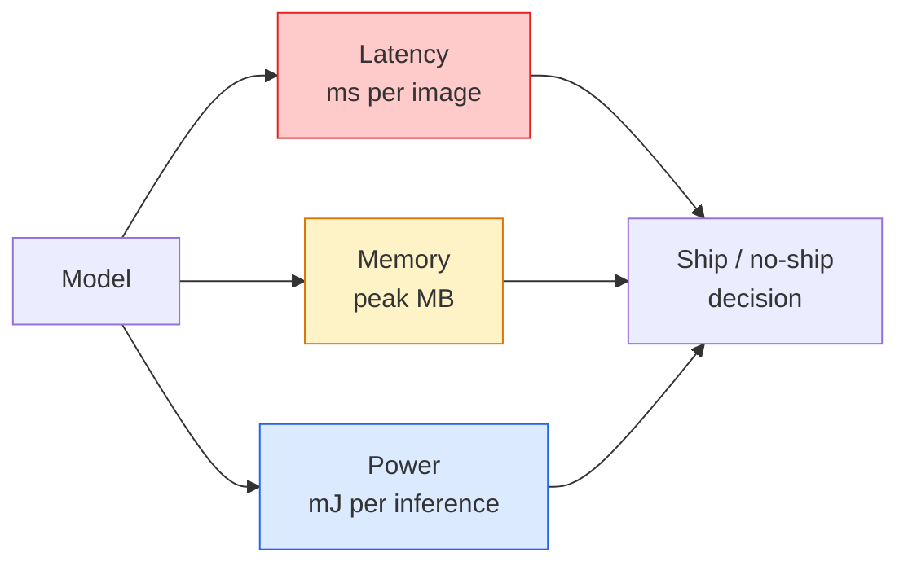

# 即時視覺：邊緣部署 (Real-Time Vision — Edge Deployment)

> 邊緣推論是一門讓 90% 準確率的模型，在只有 2 GB RAM 的裝置上以 30 fps 執行的學問。每一個百分點的準確率，都要拿毫秒級的延遲來交換。

**Type:** Learn + Build
**Languages:** Python
**Prerequisites:** Phase 4 Lesson 04 (Image Classification), Phase 10 Lesson 11 (Quantization)
**Time:** ~75 分鐘

## 學習目標 (Learning Objectives)

- 測量任何 PyTorch 模型的推論延遲、峰值記憶體與吞吐量，並讀懂 FLOPs / 參數 / 延遲之間的取捨
- 用 PyTorch 的 post-training quantisation 把視覺模型量化成 INT8，並驗證準確率損失 < 1%
- 匯出成 ONNX，並用 ONNX Runtime 或 TensorRT 編譯；說出三個最常見的匯出失敗及其修正方式
- 說明在邊緣限制下，什麼時候該選 MobileNetV3、EfficientNet-Lite、ConvNeXt-Tiny 或 MobileViT

## 問題 (The Problem)

訓練階段的視覺模型是個浮點數怪獸。1 億個參數、每次 forward pass 10 GFLOPs、2 GB 的 VRAM。這些都塞不進手機、汽車的資訊娛樂單元、工業相機或無人機。交付一個視覺系統，意味著要把同樣的預測塞進小 100 倍的預算裡。

三個旋鈕做了大部分的工作：模型選擇（用同樣配方的較小架構）、quantisation（用 INT8 取代 FP32），以及推論 runtime（ONNX Runtime、TensorRT、Core ML、TFLite）。把它們做對，就是在工作站上跑的 demo，和能在 30 美元的相機模組上出貨的產品之間的差別。

這堂課先建立測量的紀律（你無法最佳化你無法測量的東西），再依序走過這三個旋鈕。目標不是學會每一個邊緣 runtime，而是知道有哪些槓桿，以及如何驗證每一個都做到你以為的事。

## 核心概念 (The Concept)

### 三個預算 (The three budgets)



- **延遲 (Latency)**：p50、p95、p99。只回報 p50（或平均值），會掩蓋對即時系統很重要的長尾行為。
- **峰值記憶體 (Peak memory)**：裝置曾經看到過的最大值，不是穩態平均。這很重要，因為 OOM 在嵌入式目標上是致命的。
- **功耗 / 能量 (Power / energy)**：電池供電裝置上，每次推論的毫焦耳。常用 CPU/GPU 使用率 * 時間來代替。

(model, latency, memory, accuracy) 的表格，是做出邊緣決策的依據。每一格都要在目標裝置上測量，不是在工作站上。

### 測量的紀律 (Measurement discipline)

每個邊緣 profile 都該遵守的三條規則：

1. 測量前先用 5 到 10 次假的 forward pass **暖機 (warm up)** 模型。冷快取和 JIT 編譯會產生不具代表性的第一個數字。
2. 在計時區塊前後，用 `torch.cuda.synchronize()` **同步 (synchronise)** GPU 工作。沒有這個，你測到的是 kernel 的派發，不是 kernel 的執行。
3. 把輸入大小 **固定** 在正式環境的解析度。224x224 的延遲，不是 512x512 的延遲。

### 以 FLOPs 作為代理指標 (FLOPs as a proxy)

FLOPs（每次推論的浮點運算數）是一個便宜、與裝置無關的延遲代理指標。適合用來比較架構，但作為絕對的實際時間會誤導人。一個 FLOPs 多 10% 的模型，實務上可能快 2 倍，因為它用了對硬體友善的運算（depthwise conv 編譯得很好，大的 7x7 conv 則不然）。

規則：用 FLOPs 做架構搜尋，用裝置上的延遲做部署決策。

### 一段話講完 quantisation (Quantisation in one paragraph)

把 FP32 的權重與 activation 換成 INT8。模型大小縮小 4 倍，記憶體頻寬降低 4 倍，在有 INT8 kernel 的硬體（每個現代手機 SoC、每張有 Tensor Core 的 NVIDIA GPU）上，運算降低 2 到 4 倍。使用 post-training static quantisation，視覺任務上的準確率損失通常是 0.1 到 1 個百分點。

種類：

- **Dynamic**：把權重量化成 INT8，activation 以浮點計算。簡單，加速幅度小。
- **Static (post-training)**：量化權重，並在小型校準集上校準 activation 的範圍。比 dynamic 快很多。
- **Quantisation-aware training (QAT)**：在訓練期間模擬 quantisation，讓模型學著適應它。準確率最好，需要有標籤的資料。

對視覺來說，post-training static quantisation 用 5% 的努力就能拿到 95% 的好處。只有當 PTQ 造成的準確率損失無法接受時，才使用 QAT。

### Pruning 與 distillation (Pruning and distillation)

- **Pruning**：移除不重要的權重（以 magnitude 為基礎）或通道（structured）。對過度參數化的模型效果好；對本來就很精簡的架構比較沒用。
- **Distillation**：訓練一個小的 student 去模仿大的 teacher 的 logits。通常能挽回縮小模型所損失的大部分準確率。是正式邊緣模型的標準做法。

### 推論 runtime (The inference runtimes)

- **PyTorch eager**：慢，不適合部署。只用於開發。
- **TorchScript**：舊的做法。已被 `torch.compile` 和 ONNX 匯出取代。
- **ONNX Runtime**：中立的 runtime。CPU、CUDA、CoreML、TensorRT、OpenVINO 都有 ONNX provider。從這裡開始。
- **TensorRT**：NVIDIA 的 compiler。在 NVIDIA GPU（工作站與 Jetson）上延遲最佳。可與 ONNX Runtime 整合，也能單獨使用。
- **Core ML**：Apple 的 iOS/macOS runtime。需要 `.mlmodel` 或 `.mlpackage`。
- **TFLite**：Google 的 Android/ARM runtime。需要 `.tflite`。
- **OpenVINO**：Intel 的 CPU/VPU runtime。需要 `.xml` + `.bin`。

實務上：匯出 PyTorch -> ONNX -> 為目標選擇 runtime。ONNX 是通用語言。

### 邊緣架構挑選器 (Edge architecture picker)

| 預算 | 模型 | 原因 |
|--------|-------|-----|
| < 3M 參數 | MobileNetV3-Small | 到處都能編譯，好的 baseline |
| 3-10M | EfficientNet-Lite-B0 | TFLite 上每個參數的準確率最佳 |
| 10-20M | ConvNeXt-Tiny | 每個參數的準確率最佳，對 CPU 友善 |
| 20-30M | MobileViT-S 或 EfficientViT | 具備 ImageNet 準確率的 transformer |
| 30-80M | Swin-V2-Tiny | 如果技術堆疊支援視窗 attention |

除非有特殊理由，否則把這些全都量化成 INT8。

```figure
cnn-param-count
```

## 動手做 (Build It)

### 步驟 1：正確地測量延遲 (Step 1: Measure latency correctly)

```python
import time
import torch

def measure_latency(model, input_shape, device="cpu", warmup=10, iters=50):
    model = model.to(device).eval()
    x = torch.randn(input_shape, device=device)
    with torch.no_grad():
        for _ in range(warmup):
            model(x)
        if device == "cuda":
            torch.cuda.synchronize()
        times = []
        for _ in range(iters):
            if device == "cuda":
                torch.cuda.synchronize()
            t0 = time.perf_counter()
            model(x)
            if device == "cuda":
                torch.cuda.synchronize()
            times.append((time.perf_counter() - t0) * 1000)
    times.sort()
    return {
        "p50_ms": times[len(times) // 2],
        "p95_ms": times[int(len(times) * 0.95)],
        "p99_ms": times[int(len(times) * 0.99)],
        "mean_ms": sum(times) / len(times),
    }
```

暖機、同步，使用 `time.perf_counter()`。回報百分位數，不只是平均值。

### 步驟 2：參數與 FLOP 的計數 (Step 2: Parameter and FLOP counts)

```python
def parameter_count(model):
    return sum(p.numel() for p in model.parameters())

def flops_estimate(model, input_shape):
    """
    Rough FLOP count for a conv/linear-only model. For production use `fvcore` or `ptflops`.
    """
    total = 0
    def conv_hook(m, inp, out):
        nonlocal total
        c_out, c_in, kh, kw = m.weight.shape
        h, w = out.shape[-2:]
        total += 2 * c_in * c_out * kh * kw * h * w
    def linear_hook(m, inp, out):
        nonlocal total
        total += 2 * m.in_features * m.out_features
    hooks = []
    for m in model.modules():
        if isinstance(m, torch.nn.Conv2d):
            hooks.append(m.register_forward_hook(conv_hook))
        elif isinstance(m, torch.nn.Linear):
            hooks.append(m.register_forward_hook(linear_hook))
    model.eval()
    with torch.no_grad():
        model(torch.randn(input_shape))
    for h in hooks:
        h.remove()
    return total
```

做真正的專案時，使用 `fvcore.nn.FlopCountAnalysis` 或 `ptflops`；它們能正確處理每種 module 類型。

### 步驟 3：Post-training static quantisation (Step 3: Post-training static quantisation)

```python
def quantise_ptq(model, calibration_loader, backend="x86"):
    import torch.ao.quantization as tq
    model = model.eval().cpu()
    model.qconfig = tq.get_default_qconfig(backend)
    tq.prepare(model, inplace=True)
    with torch.no_grad():
        for x, _ in calibration_loader:
            model(x)
    tq.convert(model, inplace=True)
    return model
```

三個步驟：設定、prepare（插入 observer）、用真實資料校準，以及 convert（融合 + 量化）。需要模型已經融合（`Conv -> BN -> ReLU` -> `ConvBnReLU`），這由 `torch.ao.quantization.fuse_modules` 處理。

### 步驟 4：匯出成 ONNX (Step 4: Export to ONNX)

```python
def export_onnx(model, sample_input, path="model.onnx"):
    model = model.eval()
    torch.onnx.export(
        model,
        sample_input,
        path,
        input_names=["input"],
        output_names=["output"],
        dynamic_axes={"input": {0: "batch"}, "output": {0: "batch"}},
        opset_version=17,
    )
    return path
```

`opset_version=17` 是 2026 年安全的預設值。`dynamic_axes` 讓你可以用任意的 batch size 執行這個 ONNX 模型。

### 步驟 5：Benchmark 並比較各種模式 (Step 5: Benchmark and compare regimes)

```python
import torch.nn as nn
from torchvision.models import mobilenet_v3_small

def compare_regimes():
    model = mobilenet_v3_small(weights=None, num_classes=10)
    params = parameter_count(model)
    flops = flops_estimate(model, (1, 3, 224, 224))
    lat_fp32 = measure_latency(model, (1, 3, 224, 224), device="cpu")
    print(f"FP32 MobileNetV3-Small: {params:,} params  {flops/1e9:.2f} GFLOPs  "
          f"p50={lat_fp32['p50_ms']:.2f}ms  p95={lat_fp32['p95_ms']:.2f}ms")
```

對 `resnet50`、`efficientnet_v2_s` 和 `convnext_tiny` 執行同一個函式，你就有了做部署決策所需的比較表。

## 實際使用 (Use It)

正式的技術堆疊會收斂到三條路徑之一：

- **Web / serverless**：PyTorch -> ONNX -> ONNX Runtime（CPU 或 CUDA provider）。最簡單，對大多數情況夠用。
- **NVIDIA 邊緣（Jetson、GPU 伺服器）**：PyTorch -> ONNX -> TensorRT。延遲最佳，工程投入最大。
- **行動裝置**：PyTorch -> ONNX -> Core ML (iOS) 或 TFLite (Android)。匯出前先量化。

測量方面，`torch-tb-profiler`、`nvprof` / `nsys`，以及 macOS 上的 Instruments 可提供逐層的細項。`benchmark_app`（OpenVINO）和 `trtexec`（TensorRT）則提供獨立的 CLI 數字。

## 交付 (Ship It)

這堂課會產出：

- `outputs/prompt-edge-deployment-planner.md`：一個 prompt，根據目標裝置與延遲 SLA，挑選 backbone、quantisation 策略與 runtime。
- `outputs/skill-latency-profiler.md`：一個 skill，寫出完整的延遲 benchmark 腳本，包含暖機、同步、百分位數與記憶體追蹤。

## 練習 (Exercises)

1. **（簡單）** 在 CPU 上以 224x224 測量 `resnet18`、`mobilenet_v3_small`、`efficientnet_v2_s` 和 `convnext_tiny` 的 p50 延遲。回報該表格，並找出哪個架構的每毫秒準確率最佳。
2. **（中等）** 對 `mobilenet_v3_small` 套用 post-training static quantisation。在 CIFAR-10 或類似資料集保留的子集上，回報 FP32 與 INT8 的延遲與準確率損失。
3. **（困難）** 把 `convnext_tiny` 匯出成 ONNX，用 `CPUExecutionProvider` 透過 `onnxruntime` 執行，並與 PyTorch eager baseline 比較延遲。找出 ONNX Runtime 開始比較快的第一層，並解釋原因。

## 關鍵術語 (Key Terms)

| 術語 | 大家常說的 | 實際意義 |
|------|----------------|----------------------|
| Latency | 「有多快」 | 從輸入到輸出的時間；用 p50/p95/p99 百分位數，不是平均值 |
| FLOPs | 「模型大小」 | 每次 forward pass 的浮點運算數；運算成本的粗略代理指標 |
| INT8 quantisation | 「8-bit」 | 把 FP32 權重/activation 換成 8-bit 整數；約小 4 倍、快 2 到 4 倍 |
| PTQ | 「Post-training quantisation」 | 不需重新訓練就量化已訓練好的模型；簡單，通常就夠了 |
| QAT | 「Quantisation-aware training」 | 在訓練期間模擬 quantisation；準確率最好，需要有標籤的資料 |
| ONNX | 「中立的格式」 | 每個主流推論 runtime 都支援的模型交換格式 |
| TensorRT | 「NVIDIA compiler」 | 把 ONNX 編譯成針對 NVIDIA GPU 最佳化的 engine |
| Distillation | 「Teacher -> student」 | 訓練小模型去模仿大模型的 logits；挽回大部分損失的準確率 |

## 延伸閱讀 (Further Reading)

- [EfficientNet (Tan & Le, 2019)](https://arxiv.org/abs/1905.11946)：高效架構的 compound scaling
- [MobileNetV3 (Howard et al., 2019)](https://arxiv.org/abs/1905.02244)：以行動裝置為優先的架構，使用 h-swish 與 squeeze-excite
- [Accelerating Inference Up to 6x Faster in PyTorch with Torch-TensorRT (NVIDIA)](https://developer.nvidia.com/blog/accelerating-inference-up-to-6x-faster-in-pytorch-with-torch-tensorrt/)：如何真正拿到論文裡的吞吐量數字
- [ONNX Runtime docs](https://onnxruntime.ai/docs/)：quantisation、graph 最佳化、provider 選擇
