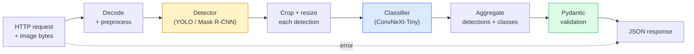

# 建立完整的視覺 Pipeline：Capstone (Build a Complete Vision Pipeline — Capstone)

> 正式環境的視覺系統，是一串用資料契約縫合起來的模型與規則。零件在這個階段 (phase) 裡都已經有了；capstone 把它們端到端串起來。

**Type:** Build
**Languages:** Python
**Prerequisites:** Phase 4 Lessons 01-15
**Time:** ~120 分鐘

## 學習目標 (Learning Objectives)

- 設計一個正式環境的視覺 pipeline，能偵測物體、分類它們，並輸出結構化的 JSON，且每條失敗路徑都有處理
- 把 detector（Mask R-CNN 或 YOLO）、分類器（ConvNeXt-Tiny）與資料契約 (Pydantic) 接成一個服務
- 對端到端 pipeline 做 benchmark，並找出第一個瓶頸（通常是前處理，其次是 detector）
- 交付一個最小的 FastAPI 服務，接受影像上傳、執行 pipeline，並回傳帶有分類結果的偵測

## 問題 (The Problem)

單獨的視覺模型很有用；視覺產品則是它們組成的鏈。零售貨架稽核是一個 detector 加上產品分類器，再加上價格 OCR pipeline。自動駕駛是 2D detector 加 3D detector 加 segmenter 加 tracker 加 planner。醫學的初步篩檢是一個 segmenter 加區域分類器，再加臨床醫師的 UI。

把這些鏈串起來，是區分 ML 原型與產品的部分。模型之間的每個介面，都是新的 bug 溫床。每一次座標轉換、每一次 normalisation、每一次 mask resize，都可能默默失敗。Pipeline 的強度取決於它最弱的介面。

這個 capstone 建立最小可行的 pipeline：detection + classification + 結構化輸出 + 一個 serving 層。第 4 階段的其他一切都可以嵌進這個骨架：把 Mask R-CNN 換成 YOLOv8、加一個 OCR head、加一個 segmentation 分支、加一個 tracker。架構是穩定的；零件是可抽換的。

## 核心概念 (The Concept)

### Pipeline



七個階段。兩個模型階段很昂貴；另外五個階段是 bug 藏身之處。

### 用 Pydantic 做資料契約 (Data contracts with Pydantic)

每個模型邊界都變成有型別的物件。這會把默默的失敗變成響亮的失敗。

```
Detection(
    box: tuple[float, float, float, float],   # (x1, y1, x2, y2), absolute pixels
    score: float,                              # [0, 1]
    class_id: int,                             # from detector's label map
    mask_rle: Optional[str],                   # RLE string if present
)

PipelineResult(
    image_id: str,
    detections: list[Detection],
    classifications: list[Classification],
    inference_ms: float,
)
```

當 detector 回傳的 box 是 `(cx, cy, w, h)` 而不是 `(x1, y1, x2, y2)` 時，Pydantic 的驗證會在邊界處失敗，你立刻就會知道，而不是去除錯一個默默回傳空區域的下游裁切。

### 延遲花在哪裡 (Where latency goes)

三個事實幾乎在每個視覺 pipeline 中都成立：

1. **前處理常常是最大的單一區塊。** 解碼 JPEG、轉換色彩空間、resize，這些都受限於 CPU，而且很容易被忘記。
2. **Detector 主宰 GPU 時間。** 70 到 90% 的 GPU 時間花在 detection 的 forward pass。
3. **後處理（NMS、RLE 編碼/解碼）在 GPU 上便宜，在 CPU 上昂貴。** 永遠用實際的目標去 profile。

知道分布，才能把最佳化變成一份有優先順序的清單。

### 失敗模式 (Failure modes)

- **空的偵測結果**：回傳空 list，不要崩潰。記錄 log。
- **超出邊界的 box**：裁切之前先 clamp 到影像大小。
- **很小的裁切**：對小於分類器最小輸入的 box，跳過分類。
- **損毀的上傳**：回應 400 並附上特定的錯誤代碼，不是 500。
- **模型載入失敗**：在服務啟動時失敗，不是在第一個請求時。

正式的 pipeline 處理這每一種情況，而不是寫一個會掩蓋失敗的通用 `try/except`。每個失敗都有一個命名的代碼和一個回應。

### Batching

正式的服務會服務多個 client。跨請求對 detection 和分類做 batching，可以讓吞吐量成倍增加。取捨是：等待 batch 填滿會多出額外的延遲。典型的設定：蒐集最多 20ms 的請求，一起 batch、處理，再分發回應。`torchserve` 和 `triton` 原生支援這個；負載可預測的小型服務則自己做 micro-batcher。

```figure
v4-vision-pipeline
```

## 動手做 (Build It)

### 步驟 1：資料契約 (Step 1: Data contracts)

```python
from pydantic import BaseModel, Field
from typing import List, Optional, Tuple

class Detection(BaseModel):
    box: Tuple[float, float, float, float]
    score: float = Field(ge=0, le=1)
    class_id: int = Field(ge=0)
    mask_rle: Optional[str] = None


class Classification(BaseModel):
    detection_index: int
    class_id: int
    class_name: str
    score: float = Field(ge=0, le=1)


class PipelineResult(BaseModel):
    image_id: str
    detections: List[Detection]
    classifications: List[Classification]
    inference_ms: float
```

任何嚴肅的 pipeline，五秒鐘的程式碼能省下一小時的除錯時間。

### 步驟 2：最小的 Pipeline class (Step 2: A minimal Pipeline class)

```python
import time
import numpy as np
import torch
from PIL import Image

class VisionPipeline:
    def __init__(self, detector, classifier, class_names,
                 device="cpu", min_crop=32):
        self.detector = detector.to(device).eval()
        self.classifier = classifier.to(device).eval()
        self.class_names = class_names
        self.device = device
        self.min_crop = min_crop

    def preprocess(self, image):
        """
        image: PIL.Image or np.ndarray (H, W, 3) uint8
        returns: CHW float tensor on device
        """
        if isinstance(image, Image.Image):
            image = np.asarray(image.convert("RGB"))
        tensor = torch.from_numpy(image).permute(2, 0, 1).float() / 255.0
        return tensor.to(self.device)

    @torch.no_grad()
    def detect(self, image_tensor):
        return self.detector([image_tensor])[0]

    @torch.no_grad()
    def classify(self, crops):
        if len(crops) == 0:
            return []
        batch = torch.stack(crops).to(self.device)
        logits = self.classifier(batch)
        probs = logits.softmax(-1)
        scores, cls = probs.max(-1)
        return list(zip(cls.tolist(), scores.tolist()))

    def run(self, image, image_id="anonymous"):
        t0 = time.perf_counter()
        tensor = self.preprocess(image)
        det = self.detect(tensor)

        crops = []
        detections = []
        valid_indices = []
        for i, (box, score, cls) in enumerate(zip(det["boxes"], det["scores"], det["labels"])):
            x1, y1, x2, y2 = [max(0, int(b)) for b in box.tolist()]
            x2 = min(x2, tensor.shape[-1])
            y2 = min(y2, tensor.shape[-2])
            detections.append(Detection(
                box=(x1, y1, x2, y2),
                score=float(score),
                class_id=int(cls),
            ))
            if (x2 - x1) < self.min_crop or (y2 - y1) < self.min_crop:
                continue
            crop = tensor[:, y1:y2, x1:x2]
            crop = torch.nn.functional.interpolate(
                crop.unsqueeze(0),
                size=(224, 224),
                mode="bilinear",
                align_corners=False,
            )[0]
            crops.append(crop)
            valid_indices.append(i)

        class_preds = self.classify(crops)

        classifications = []
        for valid_idx, (cls_id, cls_score) in zip(valid_indices, class_preds):
            classifications.append(Classification(
                detection_index=valid_idx,
                class_id=int(cls_id),
                class_name=self.class_names[cls_id],
                score=float(cls_score),
            ))

        return PipelineResult(
            image_id=image_id,
            detections=detections,
            classifications=classifications,
            inference_ms=(time.perf_counter() - t0) * 1000,
        )
```

每個介面都有型別。每條失敗路徑都有明確的處理決策。

### 步驟 3：接上 detector 與分類器 (Step 3: Wire a detector and a classifier)

```python
from torchvision.models.detection import maskrcnn_resnet50_fpn_v2
from torchvision.models import convnext_tiny

# Use ImageNet-pretrained weights for a realistic pipeline without training
detector = maskrcnn_resnet50_fpn_v2(weights="DEFAULT")
classifier = convnext_tiny(weights="DEFAULT")
class_names = [f"imagenet_class_{i}" for i in range(1000)]

pipe = VisionPipeline(detector, classifier, class_names)

# Smoke test with a synthetic image
test_image = (np.random.rand(400, 600, 3) * 255).astype(np.uint8)
result = pipe.run(test_image, image_id="demo")
print(result.model_dump_json(indent=2)[:500])
```

### 步驟 4：FastAPI 服務 (Step 4: FastAPI service)

```python
from fastapi import FastAPI, UploadFile, HTTPException
from io import BytesIO

app = FastAPI()
pipe = None  # initialised on startup

@app.on_event("startup")
def load():
    global pipe
    detector = maskrcnn_resnet50_fpn_v2(weights="DEFAULT").eval()
    classifier = convnext_tiny(weights="DEFAULT").eval()
    pipe = VisionPipeline(detector, classifier, class_names=[f"c{i}" for i in range(1000)])

@app.post("/detect")
async def detect_endpoint(file: UploadFile):
    if file.content_type not in {"image/jpeg", "image/png", "image/webp"}:
        raise HTTPException(status_code=400, detail="unsupported image type")
    data = await file.read()
    try:
        img = Image.open(BytesIO(data)).convert("RGB")
    except Exception:
        raise HTTPException(status_code=400, detail="cannot decode image")
    result = pipe.run(img, image_id=file.filename or "upload")
    return result.model_dump()
```

用 `uvicorn main:app --host 0.0.0.0 --port 8000` 執行。用 `curl -F 'file=@dog.jpg' http://localhost:8000/detect` 測試。

### 步驟 5：對 pipeline 做 benchmark (Step 5: Benchmark the pipeline)

```python
import time

def benchmark(pipe, num_runs=20, image_size=(400, 600)):
    img = (np.random.rand(*image_size, 3) * 255).astype(np.uint8)
    pipe.run(img)  # warm up

    stages = {"preprocess": [], "detect": [], "classify": [], "total": []}
    for _ in range(num_runs):
        t0 = time.perf_counter()
        tensor = pipe.preprocess(img)
        t1 = time.perf_counter()
        det = pipe.detect(tensor)
        t2 = time.perf_counter()
        crops = []
        for box in det["boxes"]:
            x1, y1, x2, y2 = [max(0, int(b)) for b in box.tolist()]
            x2 = min(x2, tensor.shape[-1])
            y2 = min(y2, tensor.shape[-2])
            if (x2 - x1) >= pipe.min_crop and (y2 - y1) >= pipe.min_crop:
                crop = tensor[:, y1:y2, x1:x2]
                crop = torch.nn.functional.interpolate(
                    crop.unsqueeze(0), size=(224, 224), mode="bilinear", align_corners=False
                )[0]
                crops.append(crop)
        pipe.classify(crops)
        t3 = time.perf_counter()
        stages["preprocess"].append((t1 - t0) * 1000)
        stages["detect"].append((t2 - t1) * 1000)
        stages["classify"].append((t3 - t2) * 1000)
        stages["total"].append((t3 - t0) * 1000)

    for stage, times in stages.items():
        times.sort()
        print(f"{stage:12s}  p50={times[len(times)//2]:7.1f} ms  p95={times[int(len(times)*0.95)]:7.1f} ms")
```

CPU 上的典型輸出：前處理約 3 ms、detect 300 到 500 ms、classify 20 到 40 ms，總計 350 到 550 ms。在 GPU 上，detect 是 20 到 40 ms，前處理與 classify 在相對比例上開始變得更重要。

## 實際使用 (Use It)

正式環境的模板會收斂到相同的結構，另外還有：

- **模型版本管理**：永遠在回應中記錄模型名稱與權重的 hash。
- **每個請求的 trace ID**：記錄每個請求每個階段的耗時，這樣你就能把慢的回應與階段對應起來。
- **Fallback 路徑**：如果分類器逾時，回傳沒有分類的偵測結果，而不是讓整個請求失敗。
- **安全過濾器**：NSFW / PII 過濾器在分類之後、回應離開服務之前執行。
- **Batch endpoint**：一個接受影像 URL list 做大量處理的 `/detect_batch`。

做正式 serving 時，`torchserve`、`Triton Inference Server` 和 `BentoML` 開箱即用地處理 batching、版本管理、metrics 和 health check。直接執行 `FastAPI` 對原型和小規模產品是可以的。

## 交付 (Ship It)

這堂課會產出：

- `outputs/prompt-vision-service-shape-reviewer.md`：一個 prompt，檢視視覺服務的程式碼是否違反契約 / 回應 shape，並指出第一個會壞掉的 bug。
- `outputs/skill-pipeline-budget-planner.md`：一個 skill，給定目標延遲與吞吐量，為每個 pipeline 階段分配時間預算，並標出哪個階段最先超出預算。

## 練習 (Exercises)

1. **（簡單）** 在任何開放資料集的 10 張影像上執行 pipeline。回報每個階段的平均耗時，以及每張影像偵測數量的分布。
2. **（中等）** 在 `Detection` 加一個 mask 輸出欄位，並以 RLE 編碼。驗證即使是有 10 個物體的影像，JSON 也維持在 1MB 以下。
3. **（困難）** 在分類器前面加一個 micro-batcher：蒐集最多 10 ms 的裁切，在一次 GPU 呼叫中全部分類，再依請求回傳結果。測量每秒 5 個並行請求下的吞吐量增益，以及增加的延遲。

## 關鍵術語 (Key Terms)

| 術語 | 大家常說的 | 實際意義 |
|------|----------------|----------------------|
| Pipeline | 「那個系統」 | 前處理、推論與後處理步驟組成的有序鏈，每對步驟之間都有帶型別的介面 |
| Data contract | 「Schema」 | 每個階段輸入與輸出都必須符合的 Pydantic / dataclass 定義；在邊界處抓出整合 bug |
| Preprocessing | 「模型之前」 | 解碼、色彩轉換、resize、normalising；通常是最大的 CPU 時間消耗者 |
| Postprocessing | 「模型之後」 | NMS、mask resize、threshold、RLE 編碼；GPU 上便宜，CPU 上昂貴 |
| Microbatcher | 「先蒐集再 forward」 | 等待固定時間視窗內的多個請求、執行單一批次 forward pass 的聚合器 |
| Trace ID | 「請求 id」 | 在每個階段都記錄的每個請求識別碼，讓慢的請求能被端到端追蹤 |
| Failure code | 「具名錯誤」 | 每種失敗類別使用特定的錯誤代碼，而不是通用的 500；讓 client 能做重試邏輯 |
| Health check | 「Readiness probe」 | 一個便宜的 endpoint，回報服務是否能回應；load balancer 仰賴它 |

## 延伸閱讀 (Further Reading)

- [Full Stack Deep Learning — Deploying Models](https://fullstackdeeplearning.com/course/2022/lecture-5-deployment/)：正式環境 ML 部署的經典概覽
- [BentoML docs](https://docs.bentoml.com)：具備 batching、版本管理與 metrics 的 serving 框架
- [torchserve docs](https://pytorch.org/serve/)：PyTorch 官方的 serving 函式庫
- [NVIDIA Triton Inference Server](https://developer.nvidia.com/triton-inference-server)：具備 batching 與多模型支援的高吞吐量 serving
