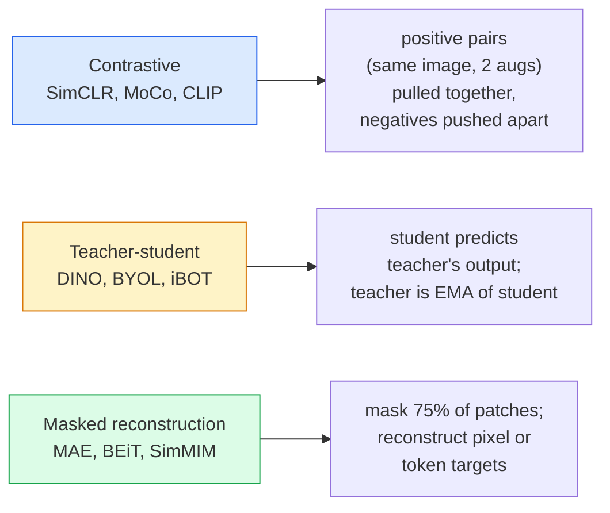

# 自監督視覺：SimCLR、DINO、MAE (Self-Supervised Vision — SimCLR, DINO, MAE)

> 標籤是監督式視覺的瓶頸。自監督預訓練把它們移除：從 1 億張沒有標籤的影像學習視覺特徵，再用 1 萬張有標籤的影像 fine-tune。

**Type:** Learn + Build
**Languages:** Python
**Prerequisites:** Phase 4 Lesson 04 (Image Classification), Phase 4 Lesson 14 (ViT)
**Time:** ~75 分鐘

## 學習目標 (Learning Objectives)

- 追蹤三個主要的自監督系列：contrastive (SimCLR)、teacher-student (DINO)、masked reconstruction (MAE)，並說明各自最佳化什麼
- 從零實作 InfoNCE loss，並解釋為什麼 512 的 batch 可行，而 32 的 batch 會失敗
- 解釋為什麼 MAE 的 75% masking 比例不是隨意選的，以及它和 BERT 對文字用的 15% 有何不同
- 使用 DINOv2 或 MAE 的 ImageNet checkpoint 做 linear probing 與 zero-shot retrieval

## 問題 (The Problem)

監督式的 ImageNet 有 130 萬張有標籤的影像，據估計標註成本達 1,000 萬美元。醫學與工業資料集更小，標註也更貴。每個視覺團隊都會問：我們能不能在便宜的、沒有標籤的資料上預訓練，例如 YouTube 影格、網路爬取、webcam 影像、衛星掃描，然後再用小量有標籤的資料 fine-tune？

自監督學習就是答案。現代在 LAION 或 JFT 上訓練的自監督 ViT，fine-tune 之後能追平甚至超越監督式 ImageNet 的準確率。它轉移到下游任務（detection、segmentation、depth）的效果，也比監督式預訓練更好。DINOv2（Meta, 2023）和 MAE（Meta, 2022）是目前可轉移視覺特徵的正式環境預設選擇。

概念上的轉變在於：pretext task，也就是模型被訓練去做的事，不必是下游任務。重要的是它逼模型學到有用的特徵。預測灰階影像的顏色、旋轉影像並要求模型分類旋轉角度、遮住 patch 並重建它們，這些都曾經有效。能擴展的三種做法是 contrastive learning、teacher-student distillation 和 masked reconstruction。

## 核心概念 (The Concept)

### 三個系列 (Three families)



### Contrastive learning (SimCLR)

取一張影像，套用兩次隨機 augmentation，得到兩個 view。把兩個都送進同一個 encoder 加上一個 projection head。最小化一個 loss，內容是「這兩個 embedding 應該靠近」以及「這個 embedding 應該遠離 batch 中其他每張影像的 embedding」。

```
Loss for positive pair (z_i, z_j) among 2N views per batch:

   L_ij = -log( exp(sim(z_i, z_j) / tau) / sum_k in batch \ {i} exp(sim(z_i, z_k) / tau) )

sim = cosine similarity
tau = temperature (0.1 standard)
```

這就是 InfoNCE loss。它需要每個 positive 搭配很多 negative，所以 batch size 很重要：SimCLR 需要 512 到 8192。MoCo 引入了過去 batch 的 momentum queue，把 negative 的數量與 batch size 解耦。

### Teacher-student (DINO)

兩個架構相同的網路：student 和 teacher。Teacher 是 student 權重的 exponential moving average (EMA)。兩者都看到影像的 augmented view。Student 的輸出被訓練去匹配 teacher 的，沒有明確的 negative。

```
loss = CE( student_output(view_1),  teacher_output(view_2) )
     + CE( student_output(view_2),  teacher_output(view_1) )

teacher_weights = m * teacher_weights + (1 - m) * student_weights   (m ≈ 0.996)
```

為什麼它不會崩塌成「預測一個常數」：teacher 的輸出會被置中 (centred，減去每個維度的平均) 和銳化 (sharpened，除以很小的 temperature)。置中防止單一維度主宰；銳化防止輸出崩塌成均勻分布。

DINOv2 就是 DINO 在 1.42 億張精選影像上放大的版本。得到的特徵是目前 zero-shot 視覺檢索與 dense prediction 的 SOTA。

### Masked reconstruction (MAE)

遮住 ViT 輸入 75% 的 patch。只讓可見的 25% 通過 encoder。一個小的 decoder 接收 encoder 的輸出，加上被遮住位置的 mask token，並被訓練去重建被遮住 patch 的像素。

```
Encoder:  visible 25% of patches -> features
Decoder:  features + mask tokens at masked positions -> reconstructed pixels
Loss:     MSE between reconstructed and original pixels on masked patches only
```

讓 MAE 有效的關鍵設計選擇：

- **75% 的 mask 比例**：很高。逼 encoder 學習語意特徵；重建 25% 幾乎是微不足道的（相鄰像素的相關性很高，連 CNN 都能做得很好）。
- **不對稱的 encoder/decoder**：大型 ViT encoder 只看可見的 patch；小的 decoder（8 層、512 維）負責重建。預訓練比天真的 BEiT 快 3 倍。
- **像素空間的重建目標**：比 BEiT 的 tokenised 目標簡單，在 ViT 上效果更好。

預訓練之後，丟掉 decoder。Encoder 就是特徵萃取器。

### 為什麼是 75% 而不是 15% (Why 75% and not 15%)

BERT 遮住 15% 的 token。MAE 遮住 75%。差別在於資訊密度。

- 自然語言每個 token 的 entropy 很高。預測 15% 的 token 仍然很難，因為每個被遮住的位置都有許多合理的補全。
- 影像 patch 的 entropy 很低，未被遮住的鄰近區域，常常幾乎完全決定了被遮住 patch 的像素。要讓預測需要語意理解，你必須大幅度地遮。

75% 高到簡單的空間外插無法解決這個任務；encoder 必須表示影像內容。

### Linear-probe 評估 (Linear-probe evaluation)

自監督預訓練之後，標準的評估是 **linear probe**：凍結 encoder，在上面用 ImageNet 標籤訓練單一個 linear 分類器。回報 top-1 準確率。

- SimCLR ResNet-50：約 71%（2020）
- DINO ViT-S/16：約 77%（2021）
- MAE ViT-L/16：約 76%（2022）
- DINOv2 ViT-g/14：約 86%（2023）

Linear probe 是特徵品質的純粹衡量；fine-tune 通常能多加 2 到 5 個點，但也混入了重新訓練 head 的效果。

```figure
data-augmentation
```

## 動手做 (Build It)

### 步驟 1：雙 view 的 augmentation pipeline (Step 1: Two-view augmentation pipeline)

```python
import torch
import torchvision.transforms as T

two_view_train = lambda: T.Compose([
    T.RandomResizedCrop(96, scale=(0.2, 1.0)),
    T.RandomHorizontalFlip(),
    T.ColorJitter(0.4, 0.4, 0.4, 0.1),
    T.RandomGrayscale(p=0.2),
    T.ToTensor(),
])


class TwoViewDataset(torch.utils.data.Dataset):
    def __init__(self, base):
        self.base = base
        self.aug = two_view_train()

    def __len__(self):
        return len(self.base)

    def __getitem__(self, i):
        img, _ = self.base[i]
        v1 = self.aug(img)
        v2 = self.aug(img)
        return v1, v2
```

每次 __getitem__ 回傳同一張影像的兩個 augmented view；不需要標籤。

### 步驟 2：InfoNCE loss (Step 2: InfoNCE loss)

```python
import torch.nn.functional as F

def info_nce(z1, z2, tau=0.1):
    """
    z1, z2: (N, D) L2-normalised embeddings of paired views
    """
    N, D = z1.shape
    z = torch.cat([z1, z2], dim=0)  # (2N, D)
    sim = z @ z.T / tau              # (2N, 2N)

    mask = torch.eye(2 * N, dtype=torch.bool, device=z.device)
    sim = sim.masked_fill(mask, float("-inf"))

    targets = torch.cat([torch.arange(N, 2 * N), torch.arange(0, N)]).to(z.device)
    return F.cross_entropy(sim, targets)
```

呼叫之前先對 embedding 做 L2-normalise。`tau=0.1` 是 SimCLR 的預設值；更低會讓 loss 更尖銳，也需要更多 negative。

### 步驟 3：InfoNCE 的健全性檢查 (Step 3: Sanity check InfoNCE)

```python
z1 = F.normalize(torch.randn(16, 32), dim=-1)
z2 = z1.clone()
loss_same = info_nce(z1, z2, tau=0.1).item()
z2_random = F.normalize(torch.randn(16, 32), dim=-1)
loss_random = info_nce(z1, z2_random, tau=0.1).item()
print(f"InfoNCE with identical pairs:  {loss_same:.3f}")
print(f"InfoNCE with random pairs:     {loss_random:.3f}")
```

完全相同的配對應該給出低 loss（對大 batch 和低 temperature 來說接近 0）。隨機配對在 16 對的 batch 下，應該給出 $\log(2N-1) \approx \log(31) \approx 3.4$。

### 步驟 4：MAE 風格的 masking (Step 4: MAE-style masking)

```python
def random_mask_indices(num_patches, mask_ratio=0.75, seed=0):
    g = torch.Generator().manual_seed(seed)
    n_keep = int(num_patches * (1 - mask_ratio))
    perm = torch.randperm(num_patches, generator=g)
    visible = perm[:n_keep]
    masked = perm[n_keep:]
    return visible.sort().values, masked.sort().values


num_patches = 196
visible, masked = random_mask_indices(num_patches, mask_ratio=0.75)
print(f"visible: {len(visible)} / {num_patches}")
print(f"masked:  {len(masked)} / {num_patches}")
```

簡單、快速，且對給定的 seed 是確定性的。真正的 MAE 實作會把這個 batch 化，並保留每個樣本各自的 mask。

## 實際使用 (Use It)

DINOv2 是 2026 年的正式環境標準：

```python
import torch
from transformers import AutoImageProcessor, AutoModel

processor = AutoImageProcessor.from_pretrained("facebook/dinov2-base")
model = AutoModel.from_pretrained("facebook/dinov2-base")
model.eval()

# Per-image embeddings for zero-shot retrieval
with torch.no_grad():
    inputs = processor(images=[pil_image], return_tensors="pt")
    outputs = model(**inputs)
    embedding = outputs.last_hidden_state[:, 0]  # CLS token
```

得到的 768 維 embedding 是現代影像檢索、dense correspondence 和 zero-shot 轉移 pipeline 的骨幹。在下游任務上 fine-tune，很少需要超過一個 linear head。

對影像-文字 embedding 來說，SigLIP 或 OpenCLIP 是對應的選擇；對 MAE 風格的 fine-tune，`timm` repo 提供每個 MAE checkpoint。

## 交付 (Ship It)

這堂課會產出：

- `outputs/prompt-ssl-pretraining-picker.md`：一個 prompt，根據資料集大小、算力與下游任務，挑選 SimCLR / MAE / DINOv2。
- `outputs/skill-linear-probe-runner.md`：一個 skill，為任何凍結的 encoder 加上有標籤的資料集，寫出 linear-probe 評估。

## 練習 (Exercises)

1. **（簡單）** 驗證對於對齊良好的 embedding，降低 temperature 時 InfoNCE loss 會下降；對於隨機 embedding，降低 temperature 時 loss 會上升。畫出 `tau in [0.05, 0.1, 0.2, 0.5]` 對 loss 的圖。
2. **（中等）** 實作 DINO 風格的 centre buffer。證明沒有置中的話，student 會在幾個 epoch 內崩塌成常數向量。
3. **（困難）** 以第 10 課的 TinyUNet 作為 backbone，在 CIFAR-100 上訓練 MAE。回報 10、50 和 200 個 epoch 時的 linear-probe 準確率。證明在同一個 1,000 張影像的子集上，MAE 預訓練的 linear probe 勝過從頭訓練的監督式 linear probe。

## 關鍵術語 (Key Terms)

| 術語 | 大家常說的 | 實際意義 |
|------|----------------|----------------------|
| Self-supervised | 「不需要標籤」 | 一個 pretext task，能從沒有標籤的資料產生有用的表示 (representation) |
| Pretext task | 「假的任務」 | SSL 期間使用的目標（重建 patch、匹配 view）；預訓練後就丟掉 |
| Linear probe | 「凍結的 encoder 加 linear head」 | 標準的 SSL 評估：只在凍結的特徵上訓練一個 linear 分類器 |
| InfoNCE | 「Contrastive loss」 | 對 cosine 相似度做 softmax；positive 配對是目標類別，其他全是 negative |
| EMA teacher | 「移動平均的 teacher」 | 權重是 student 權重的 exponential moving average 的 teacher；BYOL、MoCo、DINO 都使用 |
| Mask ratio | 「被隱藏的 patch 百分比」 | MAE 期間被遮住的 patch 比例；視覺是 75%，文字是 15% |
| Representation collapse | 「常數輸出」 | SSL 的失敗模式：encoder 對所有輸入輸出同一個常數向量；用置中、銳化或 negative 來防止 |
| DINOv2 | 「正式環境的 SSL backbone」 | Meta 在 2023 年推出的自監督 ViT；2026 年最強的通用影像特徵 |

## 延伸閱讀 (Further Reading)

- [SimCLR (Chen et al., 2020)](https://arxiv.org/abs/2002.05709)：contrastive learning 的參考資料
- [DINO (Caron et al., 2021)](https://arxiv.org/abs/2104.14294)：搭配 momentum、置中與銳化的 teacher-student
- [MAE (He et al., 2022)](https://arxiv.org/abs/2111.06377)：ViT 的 masked autoencoder 預訓練
- [DINOv2 (Oquab et al., 2023)](https://arxiv.org/abs/2304.07193)：把自監督 ViT 擴展到正式環境的特徵
