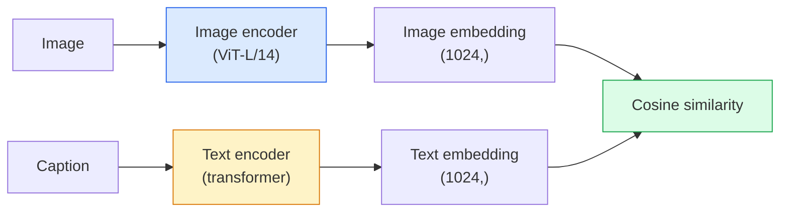

# 開放詞彙視覺：CLIP (Open-Vocabulary Vision — CLIP)

> 一起訓練影像 encoder 和文字 encoder，讓互相匹配的 (影像, 說明文字) 配對，落在共用空間中的同一個點。整個訣竅就是這樣。

**Type:** Build + Use
**Languages:** Python
**Prerequisites:** Phase 4 Lesson 14 (ViT), Phase 4 Lesson 17 (Self-Supervised)
**Time:** ~45 分鐘

## 學習目標 (Learning Objectives)

- 解釋 CLIP 的 two-tower 架構與 contrastive 訓練目標
- 使用預訓練的 CLIP（或 SigLIP）做 zero-shot 分類，不需要任何任務專屬的訓練
- 從零實作 zero-shot 分類：編碼類別 prompt、計算 cosine 相似度、取 argmax
- 區分 CLIP、SigLIP、OpenCLIP 與 LLaVA/LLaMA-vision 模型，以及它們在 2026 年各自的用途

## 問題 (The Problem)

傳統的分類器是封閉詞彙的：一個 1000 類的 ImageNet 模型只能預測 1000 個標籤。每個新類別都需要有標籤的資料和重新訓練的 head。

CLIP（Radford et al., OpenAI 2021）證明，在從網路爬取的 4 億組 (影像, 說明文字) 配對上訓練，得到的模型可以在推論時分類成任何一組類別，而且這些類別純粹用自然語言描述。你只要寫一個句子，就給了它一個新類別。

這種能力，也就是 zero-shot transfer，正是每個現代視覺系統都從 CLIP 系列 checkpoint 開始的原因。Detection（Grounding DINO、OWL-ViT）、segmentation（CLIPSeg、SAM）、retrieval、內容審核、VLM 和 text-to-image 生成，全都建立在 CLIP 風格的聯合 embedding 上。

## 核心概念 (The Concept)

### 兩座塔 (Two towers)



兩個 encoder 最後都接一個線性投影，投影到相同的 embedding 維度（CLIP-B/32 是 512，CLIP-L/14 是 1024）。做 L2-normalise，然後計算 cosine 相似度。

### 目標函式 (The objective)

給定一個有 $N$ 組 (影像, 說明文字) 配對的 batch，建立一個 $N \times N$ 的相似度矩陣。訓練兩個 encoder，讓對角線（匹配的配對）有高相似度，非對角線（不匹配的）有低相似度。

```
sim_matrix = image_embeddings @ text_embeddings.T / tau

loss_i2t = cross_entropy(sim_matrix,       targets=arange(N))
loss_t2i = cross_entropy(sim_matrix.T,     targets=arange(N))
loss = (loss_i2t + loss_t2i) / 2
```

之所以對稱，是因為 image-to-text 和 text-to-image 的檢索都應該有效。`tau`（temperature）通常學成一個純量參數，初始化為 0.07。

### SigLIP：更好的 loss (SigLIP: a better loss)

SigLIP（Zhai et al., 2023）把 softmax 換成逐對的 sigmoid：

```math
\begin{aligned}
\text{loss} &= \mathop{\mathrm{mean}}\limits_{\text{pairs}} \log\left(1 + \exp(-y_{ij} \cdot \text{sim}_{ij})\right) \\
y_{ij} &= \begin{cases} +1 & \text{if matching} \\ -1 & \text{otherwise} \end{cases}
\end{aligned}
```

逐對的 loss 消除了 CLIP 所需的 batch 層級 normalisation。SigLIP 在小 batch size 下訓練得更好，在相同資料量下追平或超越 CLIP。

### Zero-shot 分類 (Zero-shot classification)

給定一個訓練好的 CLIP：

1. 對每個類別，組出一個 prompt：「a photo of a {class}」。
2. 用文字 encoder 編碼所有類別 prompt -> `T`，shape (C, d)。
3. 編碼測試影像 -> `I`，shape (1, d)。
4. 相似度 = `I @ T.T`，shape (1, C)。
5. Argmax -> 預測的類別。

Prompt engineering 很重要。OpenAI 針對 ImageNet 公開了 80 個 prompt 模板（"a photo of a {}"、"a blurry photo of a {}"、"a sketch of a {}"，...）。對每個類別，把所有模板的 embedding 取平均，可以多拿到 1 到 3% 的 top-1 準確率。

### 2026 年 CLIP 風格模型的使用處 (Where CLIP-style models are used in 2026)

- **Zero-shot 分類**：直接使用。
- **影像檢索**：一次編碼所有影像，推論時 embed 查詢。
- **以文字為條件的 detection**：Grounding DINO、OWL-ViT 在 detector 外面包一座 CLIP 文字塔。
- **以文字為條件的 segmentation**：CLIPSeg；SAM 透過 CLIP 使用文字 prompt 輸入。
- **VLM**：LLaVA、Qwen-VL、InternVL 把 CLIP 系列的視覺 encoder 接到 LLM 上。
- **Text-to-image 生成**：Stable Diffusion、DALL-E 3 以 CLIP 文字 embedding 為條件。

一旦有了共用的 embedding 空間，每個視覺+語言任務都變成距離計算。

```figure
clip-contrastive
```

## 動手做 (Build It)

### 步驟 1：小型的 two-tower 模型 (Step 1: A tiny two-tower model)

真正的 CLIP 是 ViT + transformer。這堂課的兩座塔是作用在預先萃取好的特徵上的小型 MLP，讓訓練訊號在 CPU 上就看得到。

```python
import torch
import torch.nn as nn
import torch.nn.functional as F


class TwoTower(nn.Module):
    def __init__(self, img_in=128, txt_in=64, emb=64):
        super().__init__()
        self.image_proj = nn.Sequential(nn.Linear(img_in, 128), nn.ReLU(), nn.Linear(128, emb))
        self.text_proj = nn.Sequential(nn.Linear(txt_in, 128), nn.ReLU(), nn.Linear(128, emb))
        self.logit_scale = nn.Parameter(torch.ones([]) * 2.6592)  # ln(1/0.07)

    def forward(self, img_feats, txt_feats):
        i = F.normalize(self.image_proj(img_feats), dim=-1)
        t = F.normalize(self.text_proj(txt_feats), dim=-1)
        return i, t, self.logit_scale.exp()
```

兩個投影、共用維度的輸出、可學習的 temperature。與真正的 CLIP API 形狀相同。

### 步驟 2：Contrastive loss (Step 2: Contrastive loss)

```python
def clip_loss(image_emb, text_emb, logit_scale):
    N = image_emb.size(0)
    sim = logit_scale * image_emb @ text_emb.T
    targets = torch.arange(N, device=sim.device)
    l_i = F.cross_entropy(sim, targets)
    l_t = F.cross_entropy(sim.T, targets)
    return (l_i + l_t) / 2
```

對稱。logit_scale 越高 = softmax 越尖銳 = 越有信心，但有不穩定的風險。

### 步驟 3：Zero-shot 分類器 (Step 3: Zero-shot classifier)

```python
@torch.no_grad()
def zero_shot_classify(model, image_feats, class_text_feats, class_names):
    """
    image_feats:      (N, img_in)
    class_text_feats: (C, txt_in)   one averaged embedding per class
    """
    i = F.normalize(model.image_proj(image_feats), dim=-1)
    t = F.normalize(model.text_proj(class_text_feats), dim=-1)
    sim = i @ t.T
    pred = sim.argmax(dim=-1)
    return [class_names[p] for p in pred.tolist()]
```

每個步驟一行。這正是用於正式 CLIP checkpoint 的 zero-shot 程序。

### 步驟 4：健全性檢查 (Step 4: Sanity check)

```python
torch.manual_seed(0)
model = TwoTower()

img = torch.randn(8, 128)
txt = torch.randn(8, 64)
i, t, scale = model(img, txt)
loss = clip_loss(i, t, scale)
print(f"batch size: {i.size(0)}   loss: {loss.item():.3f}")
```

對隨機初始化的模型，loss 應該接近 `log(N) = log(8) = 2.08`，也就是還沒學到任何結構時，對稱 cross-entropy 的目標值。

## 實際使用 (Use It)

OpenCLIP 是 2026 年的社群預設：

```python
import open_clip
import torch
from PIL import Image

model, _, preprocess = open_clip.create_model_and_transforms("ViT-B-32", pretrained="laion2b_s34b_b79k")
tokenizer = open_clip.get_tokenizer("ViT-B-32")

image = preprocess(Image.open("dog.jpg")).unsqueeze(0)
text = tokenizer(["a photo of a dog", "a photo of a cat", "a photo of a car"])

with torch.no_grad():
    image_features = model.encode_image(image)
    text_features = model.encode_text(text)
    image_features = image_features / image_features.norm(dim=-1, keepdim=True)
    text_features = text_features / text_features.norm(dim=-1, keepdim=True)
    probs = (100.0 * image_features @ text_features.T).softmax(dim=-1)

print(probs)
```

SigLIP 較新、在小規模下訓練得更好，新的工作建議優先使用：`google/siglip-base-patch16-224`。Hugging Face 兩者都有提供。

## 交付 (Ship It)

這堂課會產出：

- `outputs/prompt-zero-shot-class-picker.md`：一個 prompt，給定類別清單與領域，設計 zero-shot CLIP 的類別模板。
- `outputs/skill-image-text-retriever.md`：一個 skill，用任何 CLIP checkpoint 建立影像 embedding 索引，支援以文字查詢與以影像查詢。

## 練習 (Exercises)

1. **（簡單）** 使用預訓練的 OpenCLIP ViT-B/32，用 80 個模板的 prompt 集，在 CIFAR-10 上做 zero-shot 分類。回報 top-1 準確率；應該在 85 到 90% 左右。
2. **（中等）** 在同一個 CIFAR-10 任務上，比較單一模板（"a photo of a {}"）與 80 個模板取平均的 embedding。量化差距，並解釋為什麼模板有幫助。
3. **（困難）** 建立 zero-shot 影像檢索索引：用 CLIP embed 1,000 張影像，建立 FAISS 索引，並用自然語言描述來查詢。對你手寫的 20 個保留查詢，回報檢索的 recall@5。

## 關鍵術語 (Key Terms)

| 術語 | 大家常說的 | 實際意義 |
|------|----------------|----------------------|
| Two-tower | 「Dual encoder」 | 分開的影像與文字 encoder，最後接共用維度的投影 head |
| Zero-shot | 「沒有任務專屬訓練」 | 在推論時分類成只用文字描述的類別；完全沒碰過標籤 |
| Temperature / logit_scale | 「tau」 | 在 softmax 之前縮放相似度矩陣的可學習純量 |
| Prompt template | 「A photo of a {}」 | 包住類別名稱的自然語言包裝；把許多模板取平均能提升 zero-shot 準確率 |
| CLIP | 「影像+文字模型」 | 2021 年 OpenAI 的模型；2026 年這個領域的共通語彙 |
| SigLIP | 「Sigmoid CLIP」 | 把 softmax 換成逐對的 sigmoid；在小 batch 下訓練得更好 |
| OpenCLIP | 「開放的重現版本」 | 在 LAION 上由社群訓練的 CLIP 變體；開源 pipeline 的正式環境預設 |
| VLM | 「視覺-語言模型」 | CLIP 系列 encoder 加上 LLM，訓練成能回答關於影像的問題 |

## 延伸閱讀 (Further Reading)

- [CLIP: Learning Transferable Visual Models from Natural Language Supervision (Radford et al., 2021)](https://arxiv.org/abs/2103.00020)
- [SigLIP: Sigmoid Loss for Language-Image Pre-Training (Zhai et al., 2023)](https://arxiv.org/abs/2303.15343)
- [OpenCLIP](https://github.com/mlfoundations/open_clip)：社群的程式碼庫
- [Oquab et al. (2023). DINOv2: Learning Robust Visual Features without Supervision](https://arxiv.org/abs/2304.07193)：論文本身，包含與 CLIP 風格和 MAE 風格模型的特徵 benchmark 比較
