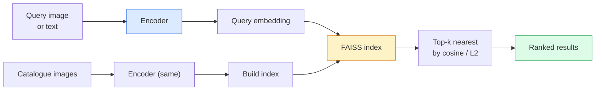

# 影像檢索與 Metric Learning (Image Retrieval & Metric Learning)

> 檢索系統依據 embedding 空間中的距離為候選項目排序。Metric learning 這門學問，就是把那個空間塑造成讓距離的意義符合你的需求。

**Type:** Build
**Languages:** Python
**Prerequisites:** Phase 4 Lesson 14 (ViT), Phase 4 Lesson 18 (CLIP)
**Time:** ~45 分鐘

## 學習目標 (Learning Objectives)

- 解釋 triplet、contrastive 與 proxy-based 的 metric learning loss，並為給定的資料集挑選正確的那一種
- 正確實作 L2-normalisation 與 cosine similarity，並稽核「同一個物品」與「同一個類別」檢索之間的差異
- 建立 FAISS 索引，用文字和影像查詢它，並為保留的查詢集回報 recall@K
- 使用 DINOv2、CLIP 與 SigLIP 作為現成的 embedding backbone，並知道各自何時勝出

## 問題 (The Problem)

檢索在正式環境的視覺中無所不在：重複偵測、以圖搜圖、視覺搜尋（「找出相似的商品」）、人臉重新辨識、監控用的行人 re-ID、電商的 instance 層級比對。產品的問題永遠相同：「給定這張查詢影像，為我的型錄排序。」

兩個設計決策塑造了整個系統。Embedding，也就是由什麼模型產生向量。索引，也就是如何在大規模下找出最近鄰。兩者在 2026 年都已商品化（embedding 用 DINOv2，索引用 FAISS），這也提高了門檻：困難的部分是，為你的應用定義 *什麼才算相似*，然後塑造 embedding 空間，讓距離與之相符。

這種塑造就是 metric learning。這是一門小而槓桿很高的學問。

## 核心概念 (The Concept)

### 檢索一覽 (Retrieval at a glance)



### 四個 loss 系列 (The four loss families)

| Loss | 需要 | 優點 | 缺點 |
|------|----------|------|------|
| **Contrastive** | (anchor, positive) + negatives | 簡單，適用於任何配對標籤 | 沒有很多 negative 時收斂很慢 |
| **Triplet** | (anchor, positive, negative) | 直觀；直接控制 margin | Hard-triplet mining 很昂貴 |
| **NT-Xent / InfoNCE** | 配對 + 從 batch 挖掘的 negative | 可擴展到大 batch | 需要大 batch 或 momentum queue |
| **Proxy-based (ProxyNCA)** | 只需類別標籤 | 快速、穩定、不需 mining | 在小資料集上可能對 proxy overfit |

對大多數正式環境的使用情境，先從預訓練的 backbone 開始，只有當現成的 embedding 在你的測試集上表現不佳時，才加上 metric-learning fine-tune。

### 正式說明 triplet loss (Triplet loss formally)

```math
L = \max\left(0, \lVert f(a) - f(p) \rVert^2 - \lVert f(a) - f(n) \rVert^2 + \text{margin}\right)
```

把 anchor `a` 拉近 positive `p`，推離 negative `n`，並用 `margin` 確保有一個間隔。這個三張影像的結構，可以推廣到任何相似度排序。

Mining 很重要：簡單的 triplet（`n` 已經離 `a` 很遠）貢獻的 loss 為零；只有困難的 triplet 才能教網路東西。Semi-hard mining（`n` 比 `p` 遠，但在 margin 之內）是 2016 年的 FaceNet 配方，至今仍佔主導地位。

### Cosine similarity 對 L2 (Cosine similarity vs L2)

兩個度量，兩種慣例：

- **Cosine**：向量之間的夾角。需要 L2-normalised 的 embedding。
- **L2**：Euclidean 距離。可用於原始或 normalised 的 embedding，但通常搭配 L2-normalised + 平方 L2。

對大多數現代網路來說，兩者是等價的：當 `||a|| = ||b|| = 1` 時，`||a - b||^2 = 2 - 2 cos(a, b)`。挑選與你的 embedding 訓練相符的慣例；混用會默默改變「最近」的意義。

### Recall@K

標準的檢索指標：

```
recall@K = fraction of queries where at least one correct match is in the top K results
```

並排回報 recall@1、@5、@10。recall@10 高於 0.95 而 recall@1 低於 0.5，代表 embedding 空間的結構是對的，但排序有雜訊，試試更長的 fine-tune 或加一個 re-ranking 步驟。

對重複偵測來說，precision@K 更重要，因為每個 false positive 都是使用者看得到的錯誤。對視覺搜尋來說，recall@K 才是產品的訊號。

### 一段話講完 FAISS (FAISS in one paragraph)

Facebook AI Similarity Search。最近鄰搜尋的事實標準函式庫。三種索引選擇：

- `IndexFlatIP` / `IndexFlatL2`：暴力搜尋、精確、不需訓練。用於最多約 100 萬個向量。
- `IndexIVFFlat`：切分成 K 個 cell，只搜尋最近的幾個 cell。近似、快速，需要訓練資料。
- `IndexHNSW`：以 graph 為基礎，對大量查詢最快，索引大小很大。

對 10 萬個向量，你大概會想要在 cosine similarity 上用 `IndexFlatIP`。對 1,000 萬個，你會想要 `IndexIVFFlat`。對 1 億以上，則要搭配 product quantisation（`IndexIVFPQ`）。

### Instance 層級對類別層級的檢索 (Instance-level vs category-level retrieval)

兩個非常不同的問題，卻有相同的名字：

- **類別層級 (Category-level)**：「在我的型錄裡找出貓。」類別條件的相似度；現成的 CLIP / DINOv2 embedding 表現良好。
- **Instance 層級 (Instance-level)**：「在我的型錄裡找出 *這個確切的商品*。」需要在同類別中視覺相似的物體之間做細緻的辨別；現成的 embedding 表現不佳；用 metric learning fine-tune 才重要。

在挑選模型之前，永遠先問清楚你在解決哪一個。

```figure
metric-embedding
```

## 動手做 (Build It)

### 步驟 1：Triplet loss (Step 1: Triplet loss)

```python
import torch
import torch.nn.functional as F

def triplet_loss(anchor, positive, negative, margin=0.2):
    d_ap = F.pairwise_distance(anchor, positive, p=2)
    d_an = F.pairwise_distance(anchor, negative, p=2)
    return F.relu(d_ap - d_an + margin).mean()
```

一行。可用於 L2-normalised 或原始的 embedding。

### 步驟 2：Semi-hard mining (Step 2: Semi-hard mining)

給定一個 batch 的 embedding 與標籤，為每個 anchor 找出最難的 semi-hard negative。

```python
def semi_hard_negatives(emb, labels, margin=0.2):
    dist = torch.cdist(emb, emb)
    same_class = labels[:, None] == labels[None, :]
    diff_class = ~same_class
    N = emb.size(0)

    positives = dist.clone()
    positives[~same_class] = float("-inf")
    positives.fill_diagonal_(float("-inf"))
    pos_idx = positives.argmax(dim=1)

    semi_hard = dist.clone()
    semi_hard[same_class] = float("inf")
    d_ap = dist[torch.arange(N), pos_idx].unsqueeze(1)
    semi_hard[dist <= d_ap] = float("inf")
    neg_idx = semi_hard.argmin(dim=1)

    fallback_mask = semi_hard[torch.arange(N), neg_idx] == float("inf")
    if fallback_mask.any():
        hardest = dist.clone()
        hardest[same_class] = float("inf")
        neg_idx = torch.where(fallback_mask, hardest.argmin(dim=1), neg_idx)
    return pos_idx, neg_idx
```

每個 anchor 都會拿到同類別中最難的 positive，以及一個比 positive 遠、但在 margin 之內的 semi-hard negative。

### 步驟 3：Recall@K (Step 3: Recall@K)

```python
def recall_at_k(query_emb, gallery_emb, query_labels, gallery_labels, k=1):
    sim = query_emb @ gallery_emb.T
    _, top_k = sim.topk(k, dim=-1)
    matches = (gallery_labels[top_k] == query_labels[:, None]).any(dim=-1)
    return matches.float().mean().item()
```

在 L2-normalised 的 embedding 上，用內積取 top-k 等於用 cosine 取 top-k。回報至少有一個正確鄰居的查詢所佔的平均比例。

### 步驟 4：組合起來 (Step 4: Putting it together)

```python
import torch
import torch.nn as nn
from torch.optim import Adam

class Encoder(nn.Module):
    def __init__(self, in_dim=128, emb_dim=64):
        super().__init__()
        self.net = nn.Sequential(
            nn.Linear(in_dim, 128), nn.ReLU(),
            nn.Linear(128, emb_dim),
        )

    def forward(self, x):
        return F.normalize(self.net(x), dim=-1)

torch.manual_seed(0)
num_classes = 6
protos = F.normalize(torch.randn(num_classes, 128), dim=-1)

def sample_batch(bs=32):
    labels = torch.randint(0, num_classes, (bs,))
    x = protos[labels] + 0.15 * torch.randn(bs, 128)
    return x, labels

enc = Encoder()
opt = Adam(enc.parameters(), lr=3e-3)

for step in range(200):
    x, y = sample_batch(32)
    emb = enc(x)
    pos_idx, neg_idx = semi_hard_negatives(emb, y)
    loss = triplet_loss(emb, emb[pos_idx], emb[neg_idx])
    opt.zero_grad(); loss.backward(); opt.step()
```

幾百個 step 之後，embedding 的叢集會形成每個類別一個 cluster。

## 實際使用 (Use It)

2026 年的正式環境技術堆疊：

- **DINOv2 + FAISS**：通用的視覺檢索。開箱即用。
- **CLIP + FAISS**：當查詢是文字時。
- **Fine-tune 過的 DINOv2 + FAISS**：instance 層級檢索、人臉 re-ID、時尚、電商。
- **Milvus / Weaviate / Qdrant**：包在 FAISS 或 HNSW 外面的託管向量資料庫。

要達到 SOTA 的 instance 檢索，配方是：DINOv2 backbone、加一個 embedding head、在有 instance 標籤的配對上用 triplet 或 InfoNCE loss fine-tune，再用 FAISS 建索引。

## 交付 (Ship It)

這堂課會產出：

- `outputs/prompt-retrieval-loss-picker.md`：一個 prompt，為給定的檢索問題挑選 triplet / InfoNCE / ProxyNCA。
- `outputs/skill-recall-at-k-runner.md`：一個 skill，寫出乾淨的 recall@K 評估框架，包含 train/val/gallery 切分與正確的資料契約。

## 練習 (Exercises)

1. **（簡單）** 執行上面的 toy 範例。在訓練前後用 PCA 畫出 embedding，看六個叢集形成。
2. **（中等）** 加入 ProxyNCA loss 的實作：每個類別一個可學習的「proxy」，在 cosine similarity 上用標準 cross-entropy。在 toy 資料上，與 triplet loss 比較收斂速度。
3. **（困難）** 取 1,000 張 ImageNet validation 影像，透過 HuggingFace 用 DINOv2 做 embedding，建立 FAISS flat 索引，並回報 recall@{1, 5, 10}：一次以同樣的影像當查詢（應該是 1.0），一次對保留的切分，並以 ImageNet 標籤當 ground truth。

## 關鍵術語 (Key Terms)

| 術語 | 大家常說的 | 實際意義 |
|------|----------------|----------------------|
| Metric learning | 「塑造空間」 | 訓練 encoder，讓它輸出空間中的距離反映目標相似度 |
| Triplet loss | 「拉與推」 | $L = \max(0, d(a, p) - d(a, n) + \text{margin})$；經典的 metric-learning loss |
| Semi-hard mining | 「有用的 negative」 | 比 positive 離 anchor 更遠、但在 margin 之內的 negative；經驗上資訊量最大 |
| Proxy-based loss | 「類別原型」 | 每個類別一個可學習的 proxy；對與 proxy 的相似度做 cross-entropy；不需配對 mining |
| Recall@K | 「Top-K 命中率」 | 前 K 個結果中至少有一個正確結果的查詢所佔的比例 |
| Instance retrieval | 「找出這個確切的東西」 | 細緻的比對；現成的特徵通常表現不佳 |
| FAISS | 「那個最近鄰函式庫」 | Facebook 的最近鄰函式庫；支援精確與近似索引 |
| HNSW | 「Graph 索引」 | Hierarchical navigable small world；快速的近似最近鄰，記憶體額外負擔小 |

## 延伸閱讀 (Further Reading)

- [FaceNet: A Unified Embedding for Face Recognition (Schroff et al., 2015)](https://arxiv.org/abs/1503.03832)：triplet loss / semi-hard mining 的論文
- [In Defense of the Triplet Loss for Person Re-Identification (Hermans et al., 2017)](https://arxiv.org/abs/1703.07737)：triplet fine-tune 的實用指南
- [FAISS documentation](https://github.com/facebookresearch/faiss/wiki)：每種索引、每個取捨
- [SMoT: Metric Learning Taxonomy (Kim et al., 2021)](https://arxiv.org/abs/2010.06927)：現代 loss 及其關聯的綜述
