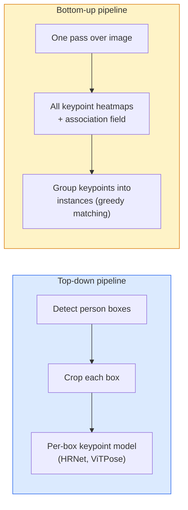

# 關鍵點偵測與姿態估計 (Keypoint Detection & Pose Estimation)

> 姿態 (pose) 是一組有順序的關鍵點。關鍵點偵測器就是一個 heatmap 回歸器。其他都只是記帳。

**Type:** Build
**Languages:** Python
**Prerequisites:** Phase 4 Lesson 06 (Detection), Phase 4 Lesson 07 (U-Net)
**Time:** ~45 分鐘

## 學習目標 (Learning Objectives)

- 區分 top-down 與 bottom-up 的姿態估計，並說明各自的使用時機
- 以每個關鍵點一個 Gaussian 為目標，對 K 個關鍵點回歸 heatmap，並在推論時萃取關鍵點座標
- 解釋 Part Affinity Fields (PAF)，以及 bottom-up pipeline 如何把關鍵點關聯到各個 instance
- 使用 MediaPipe Pose 或 MMPose 做正式環境的關鍵點估計，並理解它們的輸出格式

## 問題 (The Problem)

關鍵點任務有很多名字：人體姿態（17 個身體關節）、臉部 landmark（68 或 478 個點）、手（21 個點）、動物姿態、機器人的物體姿態、醫學解剖 landmark。它們每一個都有相同的結構：在物體上偵測 K 個離散的點，並輸出它們的 (x, y) 座標。

姿態估計是動作捕捉、健身 app、運動分析、手勢控制、動畫、AR 試穿和機器人抓取的基礎。2D 的情況已經成熟；3D 姿態（從單一相機估計世界座標中的關節位置）是目前的研究前沿。

工程上的問題是規模。單張影像、單人姿態是 20ms 的問題。在人群中以 30 fps 做多人姿態，是另一個問題，需要不同的架構。

## 核心概念 (The Concept)

### Top-down 對 bottom-up (Top-down vs bottom-up)



- **Top-down**：先偵測人，再對每個裁切跑每人一次的關鍵點模型。準確率最高；隨人數線性擴展。
- **Bottom-up**：一次 forward pass 預測所有關鍵點，加上一個關聯場；再把它們分組。無論人群大小，時間都是常數。

Top-down（HRNet、ViTPose）是準確率的領先者；bottom-up（OpenPose、HigherHRNet）是擁擠場景中吞吐量的領先者。

### Heatmap 回歸 (Heatmap regression)

與其直接回歸 `(x, y)`，不如為每個關鍵點預測一個 `H x W` 的 heatmap，在真實位置上有一個 Gaussian 斑點。

```math
\text{target}[k, y, x] = \exp\left(-\frac{(x - \mathit{cx}_k)^2 + (y - \mathit{cy}_k)^2}{2 \sigma^2}\right)
```

推論時，每個 heatmap 的 argmax 就是預測的關鍵點位置。

為什麼 heatmap 比直接回歸效果好：網路的空間結構（conv feature map）自然地與空間輸出對齊。Gaussian 目標也有 regularise 的效果，小的定位誤差只會產生小的 loss，而不是零。

### Sub-pixel 定位 (Sub-pixel localisation)

Argmax 給的是整數座標。要得到 sub-pixel 的精度，可以對 argmax 與其鄰居擬合拋物線，或像程式碼那樣，用 `dx = 0.25 * (heatmap[y, x+1] - heatmap[y, x-1])` 把 argmax 往較高的鄰居位移，`dy` 同理。

### Part Affinity Fields (PAF)

OpenPose 為 bottom-up 關聯所用的技巧。對每一對相連的關鍵點（例如左肩到左手肘），預測一個 2 通道的場，編碼從一個指向另一個的單位向量。要把肩膀與它的手肘關聯起來，沿著連接候選配對的線積分 PAF；積分最高的配對就是被匹配的那一對。

```
For each connection (limb):
  PAF channels: 2 (unit vector x, y)
  Line integral: sum over sample points of (PAF . line_direction)
  Higher integral = stronger match
```

優雅，而且不需要每人一次的裁切，就能擴展到任意的人群大小。

### COCO 關鍵點 (COCO keypoints)

標準的身體姿態資料集：每人 17 個關鍵點，指標為 PCK (Percentage of Correct Keypoints) 和 OKS (Object Keypoint Similarity)。OKS 是關鍵點版本的 IoU，也是 COCO mAP@OKS 所回報的內容。

### 2D 對 3D (2D vs 3D)

- **2D 姿態**：影像座標；已經解決到正式環境的品質（MediaPipe、HRNet、ViTPose）。
- **3D 姿態**：世界 / 相機座標；仍是活躍的研究。常見做法：
  - 用小型 MLP 把 2D 預測提升到 3D（VideoPose3D）。
  - 直接從影像做 3D 回歸（PyMAF、MHFormer）。
  - 多視角設置（CMU Panoptic）以取得 ground truth。

```figure
cv3-pose-heatmap
```

## 動手做 (Build It)

### 步驟 1：Gaussian heatmap 目標 (Step 1: Gaussian heatmap target)

```python
import numpy as np
import torch

def gaussian_heatmap(size, cx, cy, sigma=2.0):
    yy, xx = np.meshgrid(np.arange(size), np.arange(size), indexing="ij")
    return np.exp(-((xx - cx) ** 2 + (yy - cy) ** 2) / (2 * sigma ** 2)).astype(np.float32)

hm = gaussian_heatmap(64, 32, 32, sigma=2.0)
print(f"peak: {hm.max():.3f} at ({hm.argmax() % 64}, {hm.argmax() // 64})")
```

每個關鍵點的 heatmap 沿著通道軸堆疊，就得到完整的目標 tensor。

### 步驟 2：小型關鍵點 head (Step 2: Tiny keypoint head)

輸出 K 個 heatmap 通道的 U-Net 風格模型。

```python
import torch.nn as nn
import torch.nn.functional as F

class TinyKeypointNet(nn.Module):
    def __init__(self, num_keypoints=4, base=16):
        super().__init__()
        self.down1 = nn.Sequential(nn.Conv2d(3, base, 3, 2, 1), nn.ReLU(inplace=True))
        self.down2 = nn.Sequential(nn.Conv2d(base, base * 2, 3, 2, 1), nn.ReLU(inplace=True))
        self.mid = nn.Sequential(nn.Conv2d(base * 2, base * 2, 3, 1, 1), nn.ReLU(inplace=True))
        self.up1 = nn.ConvTranspose2d(base * 2, base, 2, 2)
        self.up2 = nn.ConvTranspose2d(base, num_keypoints, 2, 2)

    def forward(self, x):
        h1 = self.down1(x)
        h2 = self.down2(h1)
        h3 = self.mid(h2)
        u1 = self.up1(h3)
        return self.up2(u1)
```

輸入 `(N, 3, H, W)`，輸出 `(N, K, H, W)`。Loss 是相對於 Gaussian 目標的逐像素 MSE。

### 步驟 3：推論，萃取關鍵點座標 (Step 3: Inference — extract keypoint coordinates)

```python
def heatmap_to_coords(heatmaps):
    """
    heatmaps: (N, K, H, W)
    returns:  (N, K, 2) float coordinates in image pixels
    """
    N, K, H, W = heatmaps.shape
    hm = heatmaps.reshape(N, K, -1)
    idx = hm.argmax(dim=-1)
    ys = (idx // W).float()
    xs = (idx % W).float()
    return torch.stack([xs, ys], dim=-1)

coords = heatmap_to_coords(torch.randn(2, 4, 32, 32))
print(f"coords: {coords.shape}")  # (2, 4, 2)
```

推論時一行。要做 sub-pixel 的精煉，就在 argmax 周圍做內插。

### 步驟 4：合成的關鍵點資料集 (Step 4: Synthetic keypoint dataset)

簡單：在白色畫布上畫四個點，然後學著預測它們。

```python
def make_synthetic_sample(size=64):
    img = np.ones((3, size, size), dtype=np.float32)
    rng = np.random.default_rng()
    kps = rng.integers(8, size - 8, size=(4, 2))
    for cx, cy in kps:
        img[:, cy - 2:cy + 2, cx - 2:cx + 2] = 0.0
    hms = np.stack([gaussian_heatmap(size, cx, cy) for cx, cy in kps])
    return img, hms, kps
```

簡單到小模型一分鐘就能學會。

### 步驟 5：訓練 (Step 5: Training)

```python
model = TinyKeypointNet(num_keypoints=4)
opt = torch.optim.Adam(model.parameters(), lr=3e-3)

for step in range(200):
    batch = [make_synthetic_sample() for _ in range(16)]
    imgs = torch.from_numpy(np.stack([b[0] for b in batch]))
    hms = torch.from_numpy(np.stack([b[1] for b in batch]))
    pred = model(imgs)
    # Upsample pred to full resolution
    pred = F.interpolate(pred, size=hms.shape[-2:], mode="bilinear", align_corners=False)
    loss = F.mse_loss(pred, hms)
    opt.zero_grad(); loss.backward(); opt.step()
```

## 實際使用 (Use It)

- **MediaPipe Pose**：Google 的正式環境姿態估計器；提供 WebGL 與行動裝置的 runtime，延遲低於 10ms。
- **MMPose**（OpenMMLab）：完整的研究程式碼庫；每個 SOTA 架構都附預訓練權重。
- **YOLOv8-pose**：單次 forward pass 最快的即時多人姿態。
- **transformers HumanDPT / PoseAnything**：較新的視覺-語言方法，用於開放詞彙的姿態（任何物體、任何關鍵點集合）。

## 交付 (Ship It)

這堂課會產出：

- `outputs/prompt-pose-stack-picker.md`：一個 prompt，根據延遲、人群大小，以及需要 2D 還是 3D，挑選 MediaPipe / YOLOv8-pose / HRNet / ViTPose。
- `outputs/skill-heatmap-to-coords.md`：一個 skill，寫出每個正式環境姿態模型都在用的 sub-pixel heatmap 轉座標的常式。

## 練習 (Exercises)

1. **（簡單）** 在合成的 4 點資料集上訓練小型關鍵點模型。回報 200 個 step 後，預測與真實關鍵點之間的平均 L2 誤差。
2. **（中等）** 加入 sub-pixel 精煉：給定 argmax 位置，用鄰近的像素在 x 和 y 上擬合一維拋物線。回報相對於整數 argmax 的準確率增益。
3. **（困難）** 建立雙人合成資料集，每張影像顯示 4 關鍵點 pattern 的兩個 instance。訓練一個用 PAF 預測哪個關鍵點屬於哪個 instance 的 bottom-up pipeline，並評估 OKS。

## 關鍵術語 (Key Terms)

| 術語 | 大家常說的 | 實際意義 |
|------|----------------|----------------------|
| Keypoint | 「Landmark」 | 物體上特定、有順序的點（關節、角點、特徵） |
| Pose | 「骨架」 | 屬於同一個 instance 的、有順序的關鍵點集合 |
| Top-down | 「先偵測再姿態」 | 兩階段 pipeline：人物 detector + 每個裁切一次的關鍵點模型；準確率最高 |
| Bottom-up | 「先姿態，後分組」 | 單次預測所有關鍵點 + 分組；在人群大小上時間為常數 |
| Heatmap | 「Gaussian 目標」 | 每個關鍵點一個 H x W 的 tensor，峰值在真實位置；偏好的回歸目標 |
| PAF | 「Part Affinity Field」 | 編碼肢體方向的 2 通道單位向量場；用來把關鍵點分組到各個 instance |
| OKS | 「關鍵點的 IoU」 | Object Keypoint Similarity；COCO 的姿態指標 |
| HRNet | 「High-Resolution Net」 | 主流的 top-down 關鍵點架構；全程保留高解析度特徵 |

## 延伸閱讀 (Further Reading)

- [OpenPose (Cao et al., 2017)](https://arxiv.org/abs/1812.08008)：搭配 PAF 的 bottom-up；至今仍是這個做法最好的說明文章
- [HRNet (Sun et al., 2019)](https://arxiv.org/abs/1902.09212)：top-down 的參考架構
- [ViTPose (Xu et al., 2022)](https://arxiv.org/abs/2204.12484)：用單純的 ViT 作為姿態 backbone；目前在許多 benchmark 上是 SOTA
- [MediaPipe Pose](https://developers.google.com/mediapipe/solutions/vision/pose_landmarker)：正式環境的即時姿態；2026 年部署最快的技術堆疊
