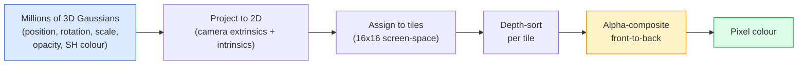

# 從零實作 3D Gaussian Splatting (3D Gaussian Splatting from Scratch)

> 場景就是數百萬個 3D Gaussian 組成的雲。每一個都有位置、方向、尺度、不透明度，以及隨觀看方向而變的顏色。把它們 rasterise，對 rasterisation 做 backprop，完成。

**Type:** Build
**Languages:** Python
**Prerequisites:** Phase 4 Lesson 13 (3D Vision & NeRF), Phase 1 Lesson 12 (Tensor Operations), Phase 4 Lesson 10 (Diffusion basics optional)
**Time:** ~90 分鐘

## 學習目標 (Learning Objectives)

- 解釋為什麼 3D Gaussian Splatting 在 2026 年取代 NeRF，成為擬真 3D 重建的正式環境預設
- 說出每個 Gaussian 的六個參數（位置、旋轉 quaternion、尺度、不透明度、spherical harmonics 顏色、可選的 feature），以及各自貢獻多少個 float
- 用 `alpha` compositing 從零實作 2D Gaussian splatting rasterizer，再展示 3D 的情況如何投影到同一個迴圈
- 使用 `nerfstudio`、`gsplat` 或 `SuperSplat`，從 20 到 50 張照片重建場景，並匯出成 `KHR_gaussian_splatting` glTF 擴充，或 OpenUSD 26.03 的 `UsdVolParticleField3DGaussianSplat` schema

## 問題 (The Problem)

NeRF 把場景存成 MLP 的權重。每個渲染出的像素，都是沿著射線做上百次 MLP 查詢。訓練要花數小時，渲染要花數秒，而且權重無法編輯，如果你想在場景裡移動一張椅子，就得重新訓練。

3D Gaussian Splatting（Kerbl、Kopanas、Leimkühler、Drettakis，SIGGRAPH 2023）取代了這一切。場景是一組明確的 3D Gaussian。渲染是 100+ fps 的 GPU rasterisation。訓練只要幾分鐘。編輯很直接：平移一部分 Gaussian，椅子就移動了。到了 2026 年，Khronos Group 已經批准了 Gaussian splat 的 glTF 擴充，OpenUSD 26.03 提供了 Gaussian splat schema，Zillow 和 Apartments.com 用它們來呈現房地產，而大多數關於 3D 重建的新研究論文，都是核心 3DGS 想法的變體。

心智模型很簡單，數學則有足夠多的活動部件，以至於大多數入門介紹都從 rasterisation 開始，跳過投影與 spherical harmonics。這堂課建立整個東西：先做 2D 版本，再做 3D 的延伸。

## 核心概念 (The Concept)

### 一個 Gaussian 攜帶什麼 (What a Gaussian carries)

一個 3D Gaussian 是空間中的參數化斑點，帶有這些屬性：

```
position         mu         (3,)    centre in world coordinates
rotation         q          (4,)    unit quaternion encoding orientation
scale            s          (3,)    log-scales per axis (exponentiated at render time)
opacity          alpha      (1,)    post-sigmoid opacity [0, 1]
SH coefficients  c_lm       (3 * (L+1)^2,)   view-dependent colour
```

旋轉 + 尺度建構出一個 3x3 的 covariance：`Sigma = R S S^T R^T`。這就是 Gaussian 在 3D 中的形狀。Spherical harmonics 讓顏色隨觀看方向改變，包括鏡面高光、細微的光澤、隨視角變化的光暈，而不需要儲存每個視角的紋理。使用 SH degree 3 時，每個顏色通道有 16 個係數，光是顏色，每個 Gaussian 就有 48 個 float。

一個場景通常有 100 萬到 500 萬個 Gaussian。每個大約儲存 60 個 float (3 + 4 + 3 + 1 + 48 + 其他)。500 萬個 Gaussian 的場景是 240 MB，遠小於每個點都帶紋理的等價點雲，也比以高解析度重新渲染的 NeRF 的 MLP 權重小一個數量級。

### 是 Rasterisation，不是 ray marching (Rasterisation, not ray marching)



五個步驟，都對 GPU 友善。每個像素不需要 MLP 查詢。單張 RTX 3080 Ti 能以 147 fps 渲染 600 萬個 splat。

### 投影步驟 (The projection step)

世界座標位置為 `mu`、3D covariance 為 `Sigma` 的 3D Gaussian，投影成螢幕位置 `mu'`、2D covariance 為 `Sigma'` 的 2D Gaussian：

```math
\begin{aligned}
\mu' &= \mathop{\mathrm{project}}(\mu) \\
\Sigma' &= J W \Sigma W^T J^T \qquad (2 \times 2) \\[6pt]
W &= \text{viewing transform (rotation + translation of camera)} \\
J &= \text{Jacobian of the perspective projection at } \mu'
\end{aligned}
```

2D Gaussian 的覆蓋範圍 (footprint) 是一個橢圓，它的軸是 `Sigma'` 的 eigenvector。橢圓內的每個像素都會接收這個 Gaussian 的貢獻，權重為 `exp(-0.5 * (p - mu')^T Sigma'^-1 (p - mu'))`。

### Alpha-compositing 規則 (The alpha-compositing rule)

對於一個像素，覆蓋它的 Gaussian 會由後往前排序（或等價地，用反過來的公式由前往後）。顏色用的合成方程式，與 1980 年代以來每個半透明 rasteriser 相同：

```math
\begin{aligned}
C_{\text{pixel}} &= \sum_i \alpha_i T_i c_i \\[6pt]
T_i &= \prod_{j < i} (1 - \alpha_j) && \text{transmittance up to } i \\
\alpha_i &= \text{opacity}_i \cdot \exp\left(-0.5 \, d^T \Sigma'^{-1} d\right) && \text{local contribution} \\
c_i &= \mathop{\mathrm{eval\_SH}}(\text{SH}_i, \text{view\_direction}) && \text{view-dependent colour}
\end{aligned}
```

這和 **NeRF 的 volumetric render 是同一個方程式**，只是作用在一組明確且稀疏的 Gaussian 上，而不是沿射線的稠密樣本。這個等價性，就是渲染品質能匹敵 NeRF 的原因：兩者積分的都是同一個 radiance-field 方程式。

### 為什麼這是可微分的 (Why this is differentiable)

每一步，包括投影、tile 指派、alpha compositing、SH 求值，都對 Gaussian 參數可微分。給定 ground-truth 影像，計算渲染像素的 loss，對 rasteriser 做 backprop，以 gradient descent 更新所有的 `(mu, q, s, alpha, c_lm)`。經過約 30,000 次迭代，Gaussian 會找到它們正確的位置、尺度與顏色。

### Densification 與 pruning (Densification and pruning)

固定的一組 Gaussian 無法涵蓋複雜的場景。訓練包含兩個自適應機制：

- 當某個 Gaussian 的 gradient 大小很高、但尺度很小時，在目前位置 **Clone** 它，代表重建在這裡需要更多細節。
- 當大尺度 Gaussian 的 gradient 很高時，把它 **Split** 成兩個較小的，因為一個大 Gaussian 太平滑，無法擬合這個區域。
- **Prune** 不透明度掉到門檻以下的 Gaussian，它們沒有貢獻。

Densification 每 $N$ 次迭代執行一次。場景通常會從約 10 萬個初始 Gaussian（以 SfM 的點為種子），成長到訓練結束時的 100 萬到 500 萬個。

### 一段話講完 spherical harmonics (Spherical harmonics in one paragraph)

隨視角變化的顏色，是單位球面上的函式 `c(direction)`。Spherical harmonics 是球面的 Fourier 基底。在 degree `L` 截斷，每個通道會得到 `(L+1)^2` 個基底函式。為新視角計算顏色，就是學到的 SH 係數與在觀看方向上求值的基底之間的內積。Degree 0 = 一個係數 = 固定顏色。Degree 3 = 16 個係數 = 足以捕捉 Lambertian 著色、鏡面反射與輕微的反射。SD Gaussian Splatting 的論文預設使用 degree 3。

### 2026 年的正式環境技術堆疊 (The 2026 production stack)

```
1. Capture         smartphone / DJI drone / handheld scanner
2. SfM / MVS       COLMAP or GLOMAP derives camera poses + sparse points
3. Train 3DGS      nerfstudio / gsplat / inria official / PostShot (~10-30 min on RTX 4090)
4. Edit            SuperSplat / SplatForge (clean floaters, segment)
5. Export          .ply -> glTF KHR_gaussian_splatting or .usd (OpenUSD 26.03)
6. View            Cesium / Unreal / Babylon.js / Three.js / Vision Pro
```

### 4D 與生成式的變體 (4D and generative variants)

- **4D Gaussian Splatting**：Gaussian 是時間的函式；用於體積式影片（Superman 2026、A$AP Rocky 的 "Helicopter"）。
- **生成式 splat**：text-to-splat 模型（World Labs 的 Marble），能幻想出整個場景。
- **3D Gaussian Unscented Transform**：NVIDIA NuRec 針對自動駕駛模擬的變體。

```figure
cv3-gaussian-splat
```

## 動手做 (Build It)

### 步驟 1：2D Gaussian (Step 1: A 2D Gaussian)

我們先建立 2D rasteriser。3D 的情況在投影之後就化約成它。

```python
import torch
import torch.nn as nn
import torch.nn.functional as F


def eval_2d_gaussian(means, covs, points):
    """
    means:  (G, 2)      centres
    covs:   (G, 2, 2)   covariance matrices
    points: (H, W, 2)   pixel coordinates
    returns: (G, H, W)  density at every pixel for every Gaussian
    """
    G = means.size(0)
    H, W, _ = points.shape
    flat = points.view(-1, 2)
    inv = torch.linalg.inv(covs)
    diff = flat[None, :, :] - means[:, None, :]
    d = torch.einsum("gpi,gij,gpj->gp", diff, inv, diff)
    density = torch.exp(-0.5 * d)
    return density.view(G, H, W)
```

`einsum` 對每一組 (Gaussian, 像素) 計算二次型 `diff^T Sigma^-1 diff`。

### 步驟 2：2D splatting rasteriser (Step 2: 2D splatting rasteriser)

由前往後的 alpha-compositing。2D 中的深度沒有意義，所以我們用每個 Gaussian 一個可學習的純量來決定順序。

```python
def rasterise_2d(means, covs, colours, opacities, depths, image_size):
    """
    means:     (G, 2)
    covs:      (G, 2, 2)
    colours:   (G, 3)
    opacities: (G,)     in [0, 1]
    depths:    (G,)     per-Gaussian scalar used for ordering
    image_size: (H, W)
    returns:   (H, W, 3) rendered image
    """
    H, W = image_size
    yy, xx = torch.meshgrid(
        torch.arange(H, dtype=torch.float32, device=means.device),
        torch.arange(W, dtype=torch.float32, device=means.device),
        indexing="ij",
    )
    points = torch.stack([xx, yy], dim=-1)

    densities = eval_2d_gaussian(means, covs, points)
    alphas = opacities[:, None, None] * densities
    alphas = alphas.clamp(0.0, 0.99)

    order = torch.argsort(depths)
    alphas = alphas[order]
    colours_sorted = colours[order]

    T = torch.ones(H, W, device=means.device)
    out = torch.zeros(H, W, 3, device=means.device)
    for i in range(means.size(0)):
        a = alphas[i]
        out += (T * a)[..., None] * colours_sorted[i][None, None, :]
        T = T * (1.0 - a)
    return out
```

不快（真正的實作使用以 tile 為基礎的 CUDA kernel），但數學完全正確，而且完全可微分。

### 步驟 3：可訓練的 2D splat 場景 (Step 3: A trainable 2D splat scene)

```python
class Splats2D(nn.Module):
    def __init__(self, num_splats=128, image_size=64, seed=0):
        super().__init__()
        g = torch.Generator().manual_seed(seed)
        H, W = image_size, image_size
        self.means = nn.Parameter(torch.rand(num_splats, 2, generator=g) * torch.tensor([W, H]))
        self.log_scale = nn.Parameter(torch.ones(num_splats, 2) * math.log(2.0))
        self.rot = nn.Parameter(torch.zeros(num_splats))  # single angle in 2D
        self.colour_logits = nn.Parameter(torch.randn(num_splats, 3, generator=g) * 0.5)
        self.opacity_logit = nn.Parameter(torch.zeros(num_splats))
        self.depth = nn.Parameter(torch.rand(num_splats, generator=g))

    def covs(self):
        s = torch.exp(self.log_scale)
        c, si = torch.cos(self.rot), torch.sin(self.rot)
        R = torch.stack([
            torch.stack([c, -si], dim=-1),
            torch.stack([si, c], dim=-1),
        ], dim=-2)
        S = torch.diag_embed(s ** 2)
        return R @ S @ R.transpose(-1, -2)

    def forward(self, image_size):
        covs = self.covs()
        colours = torch.sigmoid(self.colour_logits)
        opacities = torch.sigmoid(self.opacity_logit)
        return rasterise_2d(self.means, covs, colours, opacities, self.depth, image_size)
```

`log_scale`、`opacity_logit` 和 `colour_logits` 都是不受限的參數，在渲染時才透過正確的 activation 映射。這是每個 3DGS 實作的標準模式。

### 步驟 4：把 2D Gaussian 擬合到目標影像 (Step 4: Fit 2D Gaussians to a target image)

```python
import math
import numpy as np

def make_target(size=64):
    yy, xx = np.meshgrid(np.arange(size), np.arange(size), indexing="ij")
    img = np.zeros((size, size, 3), dtype=np.float32)
    # Red circle
    mask = (xx - 20) ** 2 + (yy - 20) ** 2 < 10 ** 2
    img[mask] = [1.0, 0.2, 0.2]
    # Blue square
    mask = (np.abs(xx - 45) < 8) & (np.abs(yy - 40) < 8)
    img[mask] = [0.2, 0.3, 1.0]
    return torch.from_numpy(img)


target = make_target(64)
model = Splats2D(num_splats=64, image_size=64)
opt = torch.optim.Adam(model.parameters(), lr=0.05)

for step in range(200):
    pred = model((64, 64))
    loss = F.mse_loss(pred, target)
    opt.zero_grad(); loss.backward(); opt.step()
    if step % 40 == 0:
        print(f"step {step:3d}  mse {loss.item():.4f}")
```

經過 200 個 step，64 個 Gaussian 會落定成那兩個形狀。這就是整個想法：對明確的幾何基本元素做 gradient descent。

### 步驟 5：從 2D 到 3D (Step 5: From 2D to 3D)

3D 的延伸保持相同的迴圈。新增的部分：

1. 每個 Gaussian 的旋轉是 quaternion，而不是單一角度。
2. Covariance 是 `R S S^T R^T`，其中 `R` 由 quaternion 建構，`S = diag(exp(log_scale))`。
3. 投影 `(mu, Sigma) -> (mu', Sigma')` 使用相機外參，以及透視投影在 `mu` 處的 Jacobian。
4. 顏色變成 spherical-harmonics 展開；在觀看方向上求值。
5. 深度排序用的是實際的相機空間 z，而不是可學習的純量。

每個正式環境的實作（`gsplat`、`inria/gaussian-splatting`、`nerfstudio`）都在 GPU 上用以 tile 為基礎的 CUDA kernel 做完全一樣的事。

### 步驟 6：Spherical harmonics 求值 (Step 6: Spherical harmonics evaluation)

到 degree 3 為止的 SH 基底，每個通道有 16 項。求值：

```python
def eval_sh_degree_3(sh_coeffs, dirs):
    """
    sh_coeffs: (..., 16, 3)   last dim is RGB channels
    dirs:      (..., 3)       unit vectors
    returns:   (..., 3)
    """
    C0 = 0.282094791773878
    C1 = 0.488602511902920
    C2 = [1.092548430592079, 1.092548430592079,
          0.315391565252520, 1.092548430592079,
          0.546274215296039]
    x, y, z = dirs[..., 0], dirs[..., 1], dirs[..., 2]
    x2, y2, z2 = x * x, y * y, z * z
    xy, yz, xz = x * y, y * z, x * z

    result = C0 * sh_coeffs[..., 0, :]
    result = result - C1 * y[..., None] * sh_coeffs[..., 1, :]
    result = result + C1 * z[..., None] * sh_coeffs[..., 2, :]
    result = result - C1 * x[..., None] * sh_coeffs[..., 3, :]

    result = result + C2[0] * xy[..., None] * sh_coeffs[..., 4, :]
    result = result + C2[1] * yz[..., None] * sh_coeffs[..., 5, :]
    result = result + C2[2] * (2.0 * z2 - x2 - y2)[..., None] * sh_coeffs[..., 6, :]
    result = result + C2[3] * xz[..., None] * sh_coeffs[..., 7, :]
    result = result + C2[4] * (x2 - y2)[..., None] * sh_coeffs[..., 8, :]

    # degree 3 terms omitted here for brevity; full 16-coefficient version in the code file
    return result
```

學到的 `sh_coeffs` 儲存該 Gaussian「各個方向上的顏色」。渲染時，你對目前的觀看方向求值，得到 3 維的 RGB 向量。

## 實際使用 (Use It)

做真正的 3DGS 工作，使用 `gsplat`（Meta）或 `nerfstudio`：

```bash
pip install nerfstudio gsplat
ns-download-data example
ns-train splatfacto --data path/to/data
```

`splatfacto` 是 nerfstudio 的 3DGS 訓練器。對典型的場景，在 RTX 4090 上執行需要 10 到 30 分鐘。

2026 年重要的匯出選項：

- `.ply`：原始的 Gaussian 雲（可攜、檔案最大）。
- `.splat`：PlayCanvas / SuperSplat 量化後的格式。
- glTF `KHR_gaussian_splatting`：Khronos 標準，可跨 viewer 攜帶（2026 年 2 月 RC）。
- OpenUSD `UsdVolParticleField3DGaussianSplat`：USD 原生，用於 NVIDIA Omniverse 和 Vision Pro 的 pipeline。

對 4D / 動態場景，`4DGS` 和 `Deformable-3DGS` 用隨時間變化的 mean 與不透明度，延伸同一套機制。

## 交付 (Ship It)

這堂課會產出：

- `outputs/prompt-3dgs-capture-planner.md`：一個 prompt，針對給定的場景類型，規劃拍攝作業（照片數量、相機路徑、光線）。
- `outputs/skill-3dgs-export-router.md`：一個 skill，依據下游的 viewer 或引擎，挑選正確的匯出格式（`.ply` / `.splat` / glTF / USD）。

## 練習 (Exercises)

1. **（簡單）** 在另一張合成影像上執行上面的 2D splat 訓練器。讓 `num_splats` 在 `[16, 64, 256]` 之間變化，並畫出每個設定的 MSE 對 step 圖。找出報酬遞減的點。
2. **（中等）** 擴充 2D rasteriser，讓每個 Gaussian 的 RGB 顏色透過 degree-2 的 harmonic，依賴一個純量的「視角角度」。在一對目標影像上訓練，並驗證模型重建了兩者。
3. **（困難）** Clone `nerfstudio`，並在你手邊任何場景（桌子、植物、臉、房間）的 20 張照片上訓練 `splatfacto`。匯出成 glTF `KHR_gaussian_splatting`，並在 viewer 中開啟（Three.js `GaussianSplats3D`、SuperSplat、Babylon.js V9）。回報訓練時間、Gaussian 的數量，以及渲染的 fps。

## 關鍵術語 (Key Terms)

| 術語 | 大家常說的 | 實際意義 |
|------|----------------|----------------------|
| 3DGS | 「Gaussian splat」 | 把場景明確表示為數百萬個 3D Gaussian，每個都有位置、旋轉、尺度、不透明度、SH 顏色 |
| Covariance | 「Gaussian 的形狀」 | `Sigma = R S S^T R^T`；單一 Gaussian 的方向與各向異性尺度 |
| Alpha compositing | 「由後往前混合」 | 與 NeRF 的 volumetric render 相同的方程式，現在作用在明確的稀疏集合上 |
| Densification | 「Clone 與 split」 | 在重建欠擬合的地方，自適應地加入新的 Gaussian |
| Pruning | 「刪除低不透明度的」 | 移除訓練期間崩塌到接近零不透明度的 Gaussian |
| Spherical harmonics | 「隨視角變化的顏色」 | 球面上的 Fourier 基底；把顏色儲存成觀看方向的函式 |
| Splatfacto | 「nerfstudio 的 3DGS」 | 2026 年訓練 3DGS 最簡單的路徑 |
| `KHR_gaussian_splatting` | 「glTF 標準」 | Khronos 2026 年的擴充，讓 3DGS 能跨 viewer 與引擎攜帶 |

## 延伸閱讀 (Further Reading)

- [3D Gaussian Splatting for Real-Time Radiance Field Rendering (Kerbl et al., SIGGRAPH 2023)](https://repo-sam.inria.fr/fungraph/3d-gaussian-splatting/)：原始論文
- [gsplat (Meta/nerfstudio)](https://github.com/nerfstudio-project/gsplat)：正式環境品質的 CUDA rasteriser
- [nerfstudio Splatfacto](https://docs.nerf.studio/nerfology/methods/splat.html)：參考的訓練配方
- [Khronos KHR_gaussian_splatting extension](https://github.com/KhronosGroup/glTF/blob/main/extensions/2.0/Khronos/KHR_gaussian_splatting/README.md)：2026 年的可攜格式
- [OpenUSD 26.03 release notes](https://openusd.org/release/)：`UsdVolParticleField3DGaussianSplat` schema
- [THE FUTURE 3D State of Gaussian Splatting 2026](https://www.thefuture3d.com/blog-0/2026/4/4/state-of-gaussian-splatting-2026)：產業概覽
