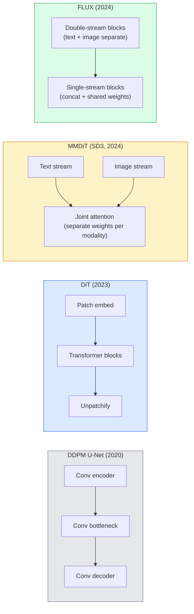

# Diffusion Transformer 與 Rectified Flow (Diffusion Transformers & Rectified Flow)

> U-Net 不是 diffusion 的祕密。把它換成 transformer，把 noise schedule 換成直線的 flow，突然之間你就有了 SD3、FLUX，以及每個 2026 年的 text-to-image 模型。

**Type:** Learn + Build
**Languages:** Python
**Prerequisites:** Phase 4 Lesson 10 (Diffusion DDPM), Phase 4 Lesson 14 (ViT), Phase 7 Lesson 02 (Self-Attention)
**Time:** ~75 分鐘

## 學習目標 (Learning Objectives)

- 追蹤從 U-Net DDPM（第 10 課）到 Diffusion Transformer (DiT)、MMDiT (SD3)，以及 single+double-stream DiT (FLUX) 的演進
- 解釋 rectified flow：為什麼雜訊與資料之間的直線軌跡，能讓模型用 20 步而不是 1000 步取樣
- 實作一個小型 DiT block 與 rectified-flow 訓練迴圈，各自不超過 100 行
- 依據架構、參數量與授權，區分各模型變體（SD3、FLUX.1-dev、FLUX.1-schnell、Z-Image、Qwen-Image）

## 問題 (The Problem)

第 10 課用 U-Net denoiser 建立了 DDPM。這套配方主宰了 2020 到 2023 年：U-Net + beta schedule + noise-prediction loss。它造就了 Stable Diffusion 1.5 和 2.1，以及 DALL-E 2。

每個 2026 年的 state-of-the-art text-to-image 模型都已經超越它。Stable Diffusion 3、FLUX、SD4、Z-Image、Qwen-Image、Hunyuan-Image，沒有一個用 U-Net。它們使用 Diffusion Transformer (DiT)。SD3 和 FLUX 也把 DDPM 的 noise schedule 換成 rectified flow，讓雜訊到資料的路徑變直，並搭配 consistency 或蒸餾變體，做到 1 到 4 步的推論。

這個轉變之所以重要，是因為它是以 diffusion 為基礎的影像生成變得可控、能精準遵循 prompt（SD3/SD4 解決了文字渲染）、並且在正式環境中夠快的原因。理解 DiT + rectified flow，就是理解 2026 年的生成式影像技術堆疊。

## 核心概念 (The Concept)

### 從 U-Net 到 transformer (From U-Net to transformer)



- **DiT**（Peebles & Xie, 2023）：把 U-Net 換成作用在 latent patch 上、類似 ViT 的 transformer。透過 adaptive layer norm (AdaLN) 做條件控制。
- **MMDiT**（SD3, Esser et al., 2024）：文字與影像 token 各有一條權重獨立的串流，共用聯合 attention。
- **FLUX**（Black Forest Labs, 2024）：前 N 個 block 像 SD3 一樣是雙串流，後面的 block 為了在更深時提高效率，把串流 concat 起來並共用權重（單串流）。
- **Z-Image**（2025）：一個 60 億參數的高效單串流 DiT，挑戰「不計代價地擴大規模」的做法。

### 一段話講完 rectified flow (Rectified flow in one paragraph)

DDPM 把正向過程定義為一個帶雜訊的 SDE，其中 `x_t` 越來越被破壞。學到的反向過程是第二個 SDE，用 1000 個小步驟求解。

Rectified flow 在乾淨資料與純雜訊之間定義 **直線** 內插：

```math
x_t = (1 - t) \, x_0 + t \, \epsilon, \qquad t \in [0, 1]
```

訓練網路預測速度 `v_theta(x_t, t) = epsilon - x_0`，也就是沿著從乾淨資料到雜訊的直線路徑的正向方向 (`dx_t/dt`)。取樣時，你把這個速度往回積分，從雜訊一步步走向資料。得到的 ODE 更接近直線，所以取樣需要的積分步數少得多。

SD3 稱之為 **Rectified Flow Matching**。FLUX、Z-Image 和大多數 2026 年的模型都使用相同的目標。典型的推論：20 到 30 個 Euler 步（確定性），相對於舊 DDPM 體系下 50 個以上的 DDIM 步。蒸餾 / turbo / schnell / LCM 變體把它降到 1 到 4 步。

### AdaLN 條件控制 (AdaLN conditioning)

DiT 透過 **adaptive layer norm** 以 timestep 和類別/文字為條件：從條件向量預測 `scale` 和 `shift`，並在 LayerNorm 之後套用。比 U-Net 中 FiLM 風格的調變乾淨得多，也是每個現代 DiT 的預設。

```
cond -> MLP -> (scale, shift, gate)
norm(x) * (1 + scale) + shift, then residual add * gate
```

### SD3 和 FLUX 中的文字 encoder (Text encoders in SD3 and FLUX)

- **SD3** 使用三個文字 encoder：兩個 CLIP 模型 + T5-XXL。Embedding 被 concat 起來，作為文字條件餵給影像串流。
- **FLUX** 使用一個 CLIP-L + T5-XXL。
- **Qwen-Image / Z-Image** 的變體使用自家與其基礎 LLM 對齊的文字 encoder。

文字 encoder 是 SD3/FLUX 對 prompt 的推理能力遠勝 SD1.5 的一大原因。光 T5-XXL 就有 47 億個參數。

### Classifier-free guidance 依然成立 (Classifier-free guidance still holds)

Rectified flow 改變的是 sampler，不是條件控制。Classifier-free guidance（訓練時以 10% 機率丟掉文字，推論時混合有條件與無條件的預測）在 rectified flow 上的運作方式完全相同。大多數 2026 年的模型使用 3.5 到 5 的 guidance scale，比 SD1.5 的 7.5 低，因為 rectified-flow 模型預設就更緊密地遵循 prompt。

### Consistency、Turbo、Schnell、LCM

同一個想法的四個名字：把慢速的多步模型蒸餾成快速的少步模型。

- **LCM (Latent Consistency Model)**：訓練一個 student，一步就從任何中間的 `x_t` 預測最終的 `x_0`。
- **SDXL Turbo / FLUX schnell**：用 adversarial diffusion distillation 訓練的 1 到 4 步模型。
- **SD Turbo**：把 OpenAI 風格的 Consistency Model 改造到 latent diffusion。

任何新模型的正式 serving，都會同時推出「完整品質」的 checkpoint 和「turbo / schnell」變體。Schnell（德文的「快」，Black Forest Labs 的命名慣例）以 1 到 4 步執行，適合即時 pipeline。

### 2026 年的模型版圖 (Model landscape in 2026)

| 模型 | 大小 | 架構 | 授權 |
|-------|------|--------------|---------|
| Stable Diffusion 3 Medium | 2B | MMDiT | SAI Community |
| Stable Diffusion 3.5 Large | 8B | MMDiT | SAI Community |
| FLUX.1-dev | 12B | Double + Single Stream DiT | 非商用 |
| FLUX.1-schnell | 12B | 相同，蒸餾版 | Apache 2.0 |
| FLUX.2 | — | 迭代版 FLUX.1 | 混合 |
| Z-Image | 6B | S3-DiT (Scalable Single-Stream) | 寬鬆 |
| Qwen-Image | ~20B | DiT + Qwen 文字塔 | Apache 2.0 |
| Hunyuan-Image-3.0 | ~80B | DiT | 研究用 |
| SD4 Turbo | 3B | DiT + 蒸餾 | SAI Commercial |

FLUX.1-schnell 是 2026 年開源的預設。Z-Image 是效率的領先者。FLUX.2 和 SD4 是目前品質的頂尖。

### 為什麼這次階段轉移很重要 (Why this phase shift matters)

DDPM + U-Net 行得通。DiT + rectified flow 行得通 **而且更好、更快、擴展得更乾淨**。這個轉變與 NLP 中從 RNN 到 transformer 的轉變類似：兩種架構解決同一個問題，但 transformer 能擴展，現在佔主導地位。2026 年每篇關於影像、影片或 3D 生成的論文，都使用 DiT 形狀的 denoiser，通常還搭配 rectified flow 目標。U-Net DDPM 現在主要是教學用途（第 10 課）。

```figure
cv3-rectified-flow
```

## 動手做 (Build It)

### 步驟 1：帶有 AdaLN 的 DiT block (Step 1: A DiT block with AdaLN)

```python
import torch
import torch.nn as nn


class AdaLNZero(nn.Module):
    """
    Adaptive LayerNorm with a gate. Predicts (scale, shift, gate) from the conditioning.
    Init such that the whole block starts as identity ("zero init").
    """

    def __init__(self, dim, cond_dim):
        super().__init__()
        self.norm = nn.LayerNorm(dim, elementwise_affine=False)
        self.mlp = nn.Linear(cond_dim, dim * 3)
        nn.init.zeros_(self.mlp.weight)
        nn.init.zeros_(self.mlp.bias)

    def forward(self, x, cond):
        scale, shift, gate = self.mlp(cond).chunk(3, dim=-1)
        h = self.norm(x) * (1 + scale.unsqueeze(1)) + shift.unsqueeze(1)
        return h, gate.unsqueeze(1)


class DiTBlock(nn.Module):
    def __init__(self, dim=192, heads=3, mlp_ratio=4, cond_dim=192):
        super().__init__()
        self.adaln1 = AdaLNZero(dim, cond_dim)
        self.attn = nn.MultiheadAttention(dim, heads, batch_first=True)
        self.adaln2 = AdaLNZero(dim, cond_dim)
        self.mlp = nn.Sequential(
            nn.Linear(dim, dim * mlp_ratio),
            nn.GELU(),
            nn.Linear(dim * mlp_ratio, dim),
        )

    def forward(self, x, cond):
        h, gate1 = self.adaln1(x, cond)
        a, _ = self.attn(h, h, h, need_weights=False)
        x = x + gate1 * a
        h, gate2 = self.adaln2(x, cond)
        x = x + gate2 * self.mlp(h)
        return x
```

`AdaLNZero` 一開始是恆等映射，因為它的 MLP 權重被初始化為零。訓練會把 block 推離恆等；這大幅穩定了深層 transformer diffusion 模型。

### 步驟 2：小型 DiT (Step 2: A tiny DiT)

```python
def timestep_embedding(t, dim):
    import math
    half = dim // 2
    freqs = torch.exp(-math.log(10000) * torch.arange(half, device=t.device) / half)
    args = t[:, None].float() * freqs[None]
    return torch.cat([args.sin(), args.cos()], dim=-1)


class TinyDiT(nn.Module):
    def __init__(self, image_size=16, patch_size=2, in_channels=3, dim=96, depth=4, heads=3):
        super().__init__()
        self.patch_size = patch_size
        self.num_patches = (image_size // patch_size) ** 2
        self.patch = nn.Conv2d(in_channels, dim, kernel_size=patch_size, stride=patch_size)
        self.pos = nn.Parameter(torch.zeros(1, self.num_patches, dim))
        self.time_mlp = nn.Sequential(
            nn.Linear(dim, dim * 2),
            nn.SiLU(),
            nn.Linear(dim * 2, dim),
        )
        self.blocks = nn.ModuleList([DiTBlock(dim, heads, cond_dim=dim) for _ in range(depth)])
        self.norm_out = nn.LayerNorm(dim, elementwise_affine=False)
        self.head = nn.Linear(dim, patch_size * patch_size * in_channels)

    def forward(self, x, t):
        n = x.size(0)
        x = self.patch(x)
        x = x.flatten(2).transpose(1, 2) + self.pos
        t_emb = self.time_mlp(timestep_embedding(t, self.pos.size(-1)))
        for blk in self.blocks:
            x = blk(x, t_emb)
        x = self.norm_out(x)
        x = self.head(x)
        return self._unpatchify(x, n)

    def _unpatchify(self, x, n):
        p = self.patch_size
        h = w = int(self.num_patches ** 0.5)
        x = x.view(n, h, w, p, p, -1).permute(0, 5, 1, 3, 2, 4).reshape(n, -1, h * p, w * p)
        return x
```

### 步驟 3：Rectified flow 訓練 (Step 3: Rectified flow training)

```python
import torch.nn.functional as F

def rectified_flow_train_step(model, x0, optimizer, device):
    model.train()
    x0 = x0.to(device)
    n = x0.size(0)
    t = torch.rand(n, device=device)
    epsilon = torch.randn_like(x0)
    x_t = (1 - t[:, None, None, None]) * x0 + t[:, None, None, None] * epsilon

    target_velocity = epsilon - x0
    pred_velocity = model(x_t, t)

    loss = F.mse_loss(pred_velocity, target_velocity)
    optimizer.zero_grad()
    loss.backward()
    optimizer.step()
    return loss.item()
```

與 DDPM 的 noise-prediction loss（第 10 課）比較：結構相同，目標不同。我們預測的不是雜訊 `epsilon`，而是 **速度** `epsilon - x_0`，它沿著直線內插從資料指向雜訊。

### 步驟 4：Euler sampler (Step 4: Euler sampler)

Rectified flow 是個 ODE。Euler 方法最簡單，而對訓練良好的 rectified-flow 模型，在 20 步以上時，準確度幾乎和高階 solver 一樣。

```python
@torch.no_grad()
def rectified_flow_sample(model, shape, steps=20, device="cpu"):
    model.eval()
    x = torch.randn(shape, device=device)
    dt = 1.0 / steps
    t = torch.ones(shape[0], device=device)
    for _ in range(steps):
        v = model(x, t)
        x = x - dt * v
        t = t - dt
    return x
```

20 步。在訓練好的模型上，這能產生與 1000 步 DDPM 相當的樣本。

### 步驟 5：端到端的煙霧測試 (Step 5: End-to-end smoke test)

```python
import numpy as np

def synthetic_blobs(num=200, size=16, seed=0):
    rng = np.random.default_rng(seed)
    out = np.zeros((num, 3, size, size), dtype=np.float32)
    yy, xx = np.meshgrid(np.arange(size), np.arange(size), indexing="ij")
    for i in range(num):
        cx, cy = rng.uniform(4, size - 4, size=2)
        r = rng.uniform(2, 4)
        mask = (xx - cx) ** 2 + (yy - cy) ** 2 < r ** 2
        colour = rng.uniform(-1, 1, size=3)
        for c in range(3):
            out[i, c][mask] = colour[c]
    return torch.from_numpy(out)
```

用 rectified flow 在這上面訓練 `TinyDiT`。500 個 step 之後，取樣的輸出應該看起來像淡淡的色塊。

## 實際使用 (Use It)

要做真正的 FLUX / SD3 / Z-Image 影像生成，`diffusers` 以統一的 API 提供每一個：

```python
from diffusers import FluxPipeline, StableDiffusion3Pipeline
import torch

pipe = FluxPipeline.from_pretrained(
    "black-forest-labs/FLUX.1-schnell",
    torch_dtype=torch.bfloat16,
).to("cuda")

out = pipe(
    prompt="a golden retriever surfing a tsunami, hyperrealistic, studio lighting",
    guidance_scale=0.0,           # schnell was trained without CFG
    num_inference_steps=4,
    max_sequence_length=256,
).images[0]
out.save("surf.png")
```

三行。`FLUX.1-schnell` 四步完成。把 model id 換成 `black-forest-labs/FLUX.1-dev`，搭配 CFG 在 20 到 30 步下可得到更高的品質。

對 SD3：

```python
pipe = StableDiffusion3Pipeline.from_pretrained(
    "stabilityai/stable-diffusion-3.5-large",
    torch_dtype=torch.bfloat16,
).to("cuda")
out = pipe(prompt, guidance_scale=3.5, num_inference_steps=28).images[0]
```

## 交付 (Ship It)

這堂課會產出：

- `outputs/prompt-dit-model-picker.md`：根據品質、延遲與授權限制，在 SD3、FLUX.1-dev、FLUX.1-schnell、Z-Image、SD4 Turbo 之間挑選。
- `outputs/skill-rectified-flow-trainer.md`：寫出使用 AdaLN DiT 與 Euler 取樣的完整 rectified flow 訓練迴圈。

## 練習 (Exercises)

1. **（簡單）** 在合成的色塊資料集上訓練上面的 TinyDiT 500 個 step。比較用 10、20 和 50 個 Euler 步產生的樣本。
2. **（中等）** 把可學習的類別 embedding concat 到時間 embedding 上來加入文字條件控制（以顏色區分 10 個色塊「類別」）。用類別 0、5 和 9 取樣，並驗證顏色相符。
3. **（困難）** 計算 rectified-flow 與 DDPM 版本的 Fréchet distance（FID 的替代指標）：兩者是相同大小的網路，用相同資料訓練相同的步數，比較生成的樣本。回報哪一個收斂得比較快。

## 關鍵術語 (Key Terms)

| 術語 | 大家常說的 | 實際意義 |
|------|----------------|----------------------|
| DiT | 「Diffusion transformer」 | 取代 U-Net 作為 diffusion denoiser 的 transformer；作用在切成 patch 的 latent 上 |
| AdaLN | 「Adaptive layer norm」 | 透過在 LayerNorm 之後套用學到的 scale、shift、gate 來做 timestep/文字條件控制；每個現代 DiT 的標準 |
| MMDiT | 「Multi-modal DiT (SD3)」 | 文字與影像 token 各有一條獨立的權重串流，共用聯合 self-attention |
| Single-stream / double-stream | 「FLUX 的技巧」 | 前 $N$ 個 block 是雙串流（每種模態各自的權重），後面的 block 為了效率改為單串流（concat + 共用權重） |
| Rectified flow | 「雜訊到資料的直線」 | 資料與雜訊之間的線性內插；網路預測速度；推論時需要的 ODE 步數更少 |
| Velocity target | 「epsilon - x_0」 | Rectified flow 中的回歸目標；從乾淨資料指向雜訊 |
| CFG guidance | 「classifier-free guidance」 | 混合有條件與無條件的預測；rectified-flow 模型中仍在使用 |
| Schnell / turbo / LCM | 「1 到 4 步蒸餾」 | 從完整品質模型蒸餾出的少步變體；正式環境的即時應用 |

## 延伸閱讀 (Further Reading)

- [Scalable Diffusion Models with Transformers (Peebles & Xie, 2023)](https://arxiv.org/abs/2212.09748)：DiT 論文
- [Scaling Rectified Flow Transformers (Esser et al., SD3 paper)](https://arxiv.org/abs/2403.03206)：大規模的 MMDiT 與 rectified flow
- [FLUX.1 model card and technical report (Black Forest Labs)](https://huggingface.co/black-forest-labs/FLUX.1-dev)：double + single-stream 的細節
- [Z-Image: Efficient Image Generation Foundation Model (2025)](https://arxiv.org/html/2511.22699v1)：60 億參數的單串流 DiT
- [Elucidating the Design Space of Diffusion (Karras et al., 2022)](https://arxiv.org/abs/2206.00364)：每個 diffusion 設計取捨的參考資料
- [Latent Consistency Models (Luo et al., 2023)](https://arxiv.org/abs/2310.04378)：LCM-LoRA 如何讓你做到 4 步推論
