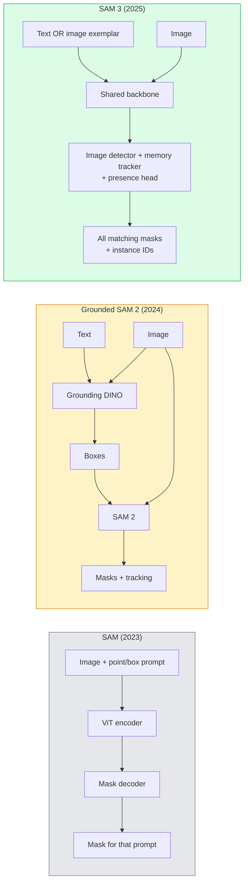

# SAM 3 與開放詞彙分割 (SAM 3 & Open-Vocabulary Segmentation)

> 給模型一個文字 prompt 和一張影像，就能得到每個匹配物體的 mask。SAM 3 讓這件事變成單次 forward pass。

**Type:** Use + Build
**Languages:** Python
**Prerequisites:** Phase 4 Lesson 07 (U-Net), Phase 4 Lesson 08 (Mask R-CNN), Phase 4 Lesson 18 (CLIP)
**Time:** ~60 分鐘

## 學習目標 (Learning Objectives)

- 區分 SAM（只有視覺 prompt）、Grounded SAM / SAM 2（detector + SAM），以及 SAM 3（透過 Promptable Concept Segmentation 原生支援文字 prompt）
- 解釋 SAM 3 的架構：共用 backbone + 影像 detector + 以記憶為基礎的影片 tracker + presence head + 解耦的 detector-tracker 設計
- 使用 Hugging Face `transformers` 的 SAM 3 整合，做以文字為 prompt 的偵測、分割與影片追蹤
- 依據延遲、概念複雜度與部署目標，在 SAM 3、Grounded SAM 2、YOLO-World 與 SAM-MI 之間挑選

## 問題 (The Problem)

2023 年的 SAM 是只支援視覺 prompt 的模型：你點一個點或畫一個框，它回傳一個 mask。若要「給我這張照片裡所有的橘子」，你需要一個 detector（Grounding DINO）產生 box，再用 SAM 去分割每一個。Grounded SAM 把這變成一條 pipeline，但那是兩個凍結模型的串接，無可避免地會累積誤差。

SAM 3（Meta，2025 年 11 月，ICLR 2026）把這個串接壓縮掉了。它接受一個簡短的名詞片語或影像範例作為 prompt，並在單次 forward pass 中回傳所有匹配的 mask 與 instance ID。這就是 **Promptable Concept Segmentation (PCS)**。搭配 2026 年 3 月的 Object Multiplex 更新 (SAM 3.1)，它能在影片中有效率地追蹤同一概念的多個 instance。

這堂課談的是這件事所代表的結構性轉變。2D 的 segmentation、detection 和文字-影像 grounding 已經合併成一個模型。正式環境的問題不再是「我該串接哪條 pipeline」，而是「哪個可 prompt 的模型能端到端處理我的使用情境」。

## 核心概念 (The Concept)

### 三個世代 (The three generations)



### Promptable Concept Segmentation

「概念 prompt」是一個簡短的名詞片語（`"yellow school bus"`、`"striped red umbrella"`、`"hand holding a mug"`）或一個影像範例。模型會為影像中每個符合該概念的 instance 回傳 segmentation mask，並為每個匹配給一個唯一的 instance ID。

這與經典的視覺 prompt SAM 有三點不同：

1. 不需要對每個 instance 單獨 prompt：一個文字 prompt 就回傳所有匹配。
2. 開放詞彙：概念可以是任何能用自然語言描述的東西。
3. 一次回傳多個 instance，而不是每個 prompt 一個 mask。

### 關鍵的架構元件 (Key architectural pieces)

- **共用 backbone**：單一個 ViT 處理影像。Detector head 和以記憶為基礎的 tracker 都從它讀取。
- **Presence head**：預測概念是否存在於影像中。把「這裡有嗎？」與「在哪裡？」解耦。減少對不存在概念的 false positive。
- **解耦的 detector-tracker**：影像層級的 detection 與影片層級的 tracking 有各自的 head，所以彼此不會干擾。
- **Memory bank**：儲存跨影格的每個 instance 特徵，用於影片追蹤（與 SAM 2 使用的機制相同）。

### 大規模訓練 (Training at scale)

SAM 3 在 **400 萬個獨特概念** 上訓練，這些概念由一個 data engine 透過 AI + 人工審查迭代標註與修正而來。新的 **SA-CO benchmark** 包含 27 萬個獨特概念，比先前的 benchmark 大 50 倍。SAM 3 在 SA-CO 上達到人類表現的 75 到 80%，在影像 + 影片的 PCS 上是現有系統的兩倍。

### SAM 3.1 Object Multiplex

2026 年 3 月的更新：**Object Multiplex** 引入共用記憶機制，可同時聯合追蹤同一概念的許多 instance。以前，追蹤 N 個 instance 需要 N 個獨立的 memory bank。Multiplex 把它壓縮成一個共用記憶，搭配每個 instance 的 query。結果：多物體追蹤大幅加快，且不犧牲準確率。

### Grounded SAM 在 2026 年仍然重要的地方 (Where Grounded SAM still matters in 2026)

- 當你需要換進特定的開放詞彙 detector（DINO-X、Florence-2）時。
- 當 SAM 3 的授權（在 HF 上需申請）成為阻礙時。
- 當你需要比 SAM 3 所提供的更多 detector 門檻控制時。
- 針對 detector 元件的研究 / ablation 工作。

模組化的 pipeline 仍有一席之地。對大多數正式環境的工作，SAM 3 是比較簡單的答案。

### YOLO-World 對 SAM 3 (YOLO-World vs SAM 3)

- **YOLO-World**：只有開放詞彙的 detector（沒有 mask）。即時。當你需要高 fps 的 box 時最佳。
- **SAM 3**：完整的 segmentation + tracking。較慢，但輸出更豐富。

正式環境的分工：YOLO-World 用於快速、只做 detection 的 pipeline（機器人導航、快速儀表板），SAM 3 用於任何需要 mask 或 tracking 的情況。

### SAM-MI 的效率 (SAM-MI efficiency)

SAM-MI（2025-2026）處理 SAM 的 decoder 瓶頸。關鍵想法：

- **稀疏點 prompt**：使用少數幾個精心挑選的點，而不是稠密的 prompt；把 decoder 呼叫減少 96%。
- **淺層 mask 聚合**：把粗略的 mask 預測合併成一個更銳利的 mask。
- **解耦的 mask 注入**：decoder 接收預先計算好的 mask 特徵，而不是重新執行。

結果：在開放詞彙 benchmark 上，比 Grounded-SAM 快約 1.6 倍。

### 三個模型的輸出格式 (Output format for the three models)

全部都回傳相同的大致結構（box + label + score + mask + ID），這很有幫助：你下游的 pipeline 不必依據執行的是哪個模型而分支。

```figure
cv3-open-vocab
```

## 動手做 (Build It)

### 步驟 1：建構 prompt (Step 1: Prompt construction)

建立一個 helper，把使用者的句子轉成 SAM 3 概念 prompt 的 list。這是「使用者輸入了什麼」與「模型消耗什麼」交會的邊界。

```python
def split_concepts(sentence):
    """
    Heuristic splitter for multi-concept prompts.
    Returns list of short noun phrases.
    """
    for sep in [",", ";", "and", "or", "&"]:
        if sep in sentence:
            parts = [p.strip() for p in sentence.replace("and ", ",").split(",")]
            return [p for p in parts if p]
    return [sentence.strip()]

print(split_concepts("cats, dogs and balloons"))
```

SAM 3 每次 forward pass 接受一個概念；對於多概念的查詢，用迴圈或 batch 處理。

### 步驟 2：後處理 helper (Step 2: Post-processing helpers)

把 SAM 3 的原始輸出，轉成符合我們第 4 階段第 16 課 pipeline 契約的乾淨偵測 list。

```python
from dataclasses import dataclass
from typing import List

@dataclass
class ConceptDetection:
    concept: str
    instance_id: int
    box: tuple          # (x1, y1, x2, y2)
    score: float
    mask_rle: str       # run-length encoded


def rle_encode(binary_mask):
    flat = binary_mask.flatten().astype("uint8")
    runs = []
    prev, count = flat[0], 0
    for v in flat:
        if v == prev:
            count += 1
        else:
            runs.append((int(prev), count))
            prev, count = v, 1
    runs.append((int(prev), count))
    return ";".join(f"{v}x{c}" for v, c in runs)
```

即使有許多高解析度的 mask，RLE 也能讓回應的 payload 保持很小。同樣的格式適用於 SAM 2、SAM 3、Grounded SAM 2。

### 步驟 3：統一的開放詞彙分割介面 (Step 3: A unified open-vocab segmentation interface)

把你手上的任何 backend（SAM 3、Grounded SAM 2、YOLO-World + SAM 2）包在單一個方法後面。當 backend 改變時，你的下游程式碼不用變。

```python
from abc import ABC, abstractmethod
import numpy as np

class OpenVocabSeg(ABC):
    @abstractmethod
    def detect(self, image: np.ndarray, concept: str) -> List[ConceptDetection]:
        ...


class StubOpenVocabSeg(OpenVocabSeg):
    """
    Deterministic stub used for pipeline testing when real models are not loaded.
    """
    def detect(self, image, concept):
        h, w = image.shape[:2]
        return [
            ConceptDetection(
                concept=concept,
                instance_id=0,
                box=(w * 0.2, h * 0.3, w * 0.5, h * 0.8),
                score=0.89,
                mask_rle="0x100;1x50;0x200",
            ),
            ConceptDetection(
                concept=concept,
                instance_id=1,
                box=(w * 0.55, h * 0.25, w * 0.85, h * 0.75),
                score=0.74,
                mask_rle="0x80;1x40;0x220",
            ),
        ]
```

真正的 `SAM3OpenVocabSeg` 子類別會包住 `transformers.Sam3Model` 和 `Sam3Processor`。

### 步驟 4：Hugging Face SAM 3 的用法（參考）(Step 4: Hugging Face SAM 3 usage (reference))

對於實際的模型，使用 `transformers` 整合：

```python
from transformers import Sam3Processor, Sam3Model
import torch

processor = Sam3Processor.from_pretrained("facebook/sam3")
model = Sam3Model.from_pretrained("facebook/sam3").eval()

inputs = processor(images=pil_image, return_tensors="pt")
inputs = processor.set_text_prompt(inputs, "yellow school bus")

with torch.no_grad():
    outputs = model(**inputs)

masks = processor.post_process_masks(
    outputs.masks, inputs.original_sizes, inputs.reshaped_input_sizes
)
boxes = outputs.boxes
scores = outputs.scores
```

一個 prompt，所有匹配在單次呼叫中回傳。

### 步驟 5：衡量 Grounded SAM 2 免費給你的東西 (Step 5: Measure what Grounded SAM 2 gave you for free)

一個誠實的 benchmark：在真實 pipeline 中把 Grounded SAM 2 換成 SAM 3，會發生什麼事？

- 延遲：SAM 3 少一次 forward pass（沒有獨立的 detector），但模型本身比較重；通常淨效果持平或略有加速。
- 準確率：SAM 3 在稀有或組合式的概念（"striped red umbrella"）上好很多。在常見的單詞概念上相近。
- 彈性：Grounded SAM 2 讓你替換 detector（DINO-X、Florence-2、Grounding DINO 1.5）；SAM 3 是一體成形的。

結論：SAM 3 是 2026 年開放詞彙 seg 的預設選擇。當你需要 detector 的彈性或不同的授權條款時，Grounded SAM 2 仍是正確答案。

## 實際使用 (Use It)

正式環境的部署模式：

- **即時標註**：SAM 3 + CVAT 的 label-as-text-prompt 功能。標註者選一個標籤名稱；SAM 3 預先標註每個匹配的 instance。審核並修正。
- **影片分析**：用 SAM 3.1 Object Multiplex 做多物體追蹤；把影格餵給以記憶為基礎的 tracker。
- **機器人**：用 SAM 3 做開放詞彙的操作（「拿起紅色的杯子」）；作為規劃的基本元件執行。
- **醫學影像**：在醫學概念上 fine-tune 的 SAM 3；需要在 HF 上申請存取。

Ultralytics 在它的 Python 套件中包裝了 SAM 3：

```python
from ultralytics import SAM

model = SAM("sam3.pt")
results = model(image_path, prompts="yellow school bus")
```

與 YOLO 和 SAM 2 介面相同。

## 交付 (Ship It)

這堂課會產出：

- `outputs/prompt-open-vocab-stack-picker.md`：一個 prompt，依據延遲、概念複雜度與授權，挑選 SAM 3 / Grounded SAM 2 / YOLO-World / SAM-MI。
- `outputs/skill-concept-prompt-designer.md`：一個 skill，把使用者的說法轉成格式良好的 SAM 3 概念 prompt（拆分、消除歧義、fallback）。

## 練習 (Exercises)

1. **（簡單）** 用你挑選的概念 prompt，在 10 張影像上執行 SAM 3。與 SAM 2 + Grounding DINO 1.5 在同樣的影像上比較。回報每個模型漏掉哪些概念。
2. **（中等）** 在 SAM 3 之上建立「點擊納入 / 點擊排除」的 UI：文字 prompt 回傳候選 instance；使用者點擊以保留哪些算是 positive。把最終的概念集合輸出成 JSON。
3. **（困難）** 在自訂的概念集合（例如 5 種電子元件，每種 20 張有標註的影像）上 fine-tune SAM 3。與 zero-shot SAM 3 在相同的測試集上比較；測量 mask IoU 的提升。

## 關鍵術語 (Key Terms)

| 術語 | 大家常說的 | 實際意義 |
|------|----------------|----------------------|
| Open-vocabulary segmentation | 「用文字做分割」 | 為用自然語言描述的物體產生 mask，而不是固定的標籤集合 |
| PCS | 「Promptable Concept Segmentation」 | SAM 3 的核心任務：給定名詞片語或影像範例，分割所有匹配的 instance |
| Concept prompt | 「文字輸入」 | 簡短的名詞片語或影像範例；不是完整的句子 |
| Presence head | 「這裡有嗎？」 | SAM 3 的模組，在定位之前先決定概念是否存在於影像中 |
| SA-CO | 「SAM 3 benchmark」 | 27 萬個概念的開放詞彙 segmentation benchmark；比先前的開放詞彙 benchmark 大 50 倍 |
| Object Multiplex | 「SAM 3.1 更新」 | 共用記憶的多物體追蹤；快速聯合追蹤許多 instance |
| Grounded SAM 2 | 「模組化 pipeline」 | Detector + SAM 2 的串接；當 detector 替換很重要時仍有意義 |
| SAM-MI | 「高效的 SAM 變體」 | 用 Mask Injection 比 Grounded-SAM 快 1.6 倍 |

## 延伸閱讀 (Further Reading)

- [SAM 3: Segment Anything with Concepts (arXiv 2511.16719)](https://arxiv.org/abs/2511.16719)
- [SAM 3.1 Object Multiplex (Meta AI, March 2026)](https://ai.meta.com/blog/segment-anything-model-3/)
- [SAM 3 model page on Hugging Face](https://huggingface.co/facebook/sam3)
- [Grounded SAM 2 tutorial (PyImageSearch)](https://pyimagesearch.com/2026/01/19/grounded-sam-2-from-open-set-detection-to-segmentation-and-tracking/)
- [Ultralytics SAM 3 docs](https://docs.ultralytics.com/models/sam-3/)
- [SAM3-I: Instruction-aware SAM (arXiv 2512.04585)](https://arxiv.org/abs/2512.04585)
