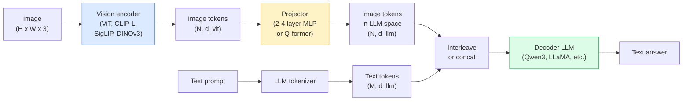

# 視覺-語言模型：ViT-MLP-LLM 模式 (Vision-Language Models — The ViT-MLP-LLM Pattern)

> 視覺 encoder 把影像轉成 token。MLP projector 把這些 token 對應到 LLM 的 embedding 空間。其餘由語言模型完成。這個模式，也就是 ViT-MLP-LLM，就是 2026 年每個正式環境的 VLM。

**Type:** Learn + Use
**Languages:** Python
**Prerequisites:** Phase 4 Lesson 14 (ViT), Phase 4 Lesson 18 (CLIP), Phase 7 Lesson 02 (Self-Attention)
**Time:** ~75 分鐘

## 學習目標 (Learning Objectives)

- 說明 ViT-MLP-LLM 架構，並解釋這三個元件各自的貢獻
- 就參數量、context 長度與 benchmark 表現，比較 Qwen3-VL、InternVL3.5、LLaVA-Next 與 GLM-4.6V
- 解釋 DeepStack：為什麼多層級的 ViT 特徵，比單一最後一層的特徵更能收緊視覺-語言的對齊
- 在正式環境中用 Cross-Modal Error Rate (CMER) 衡量 VLM 的幻覺，並根據這個訊號採取行動

## 問題 (The Problem)

CLIP（第 4 階段第 18 課）給你影像與文字的共用 embedding 空間，這對 zero-shot 分類與檢索已經足夠。但它無法回答「這張影像裡有幾輛紅色的車？」，因為 CLIP 不會生成文字，它只會對相似度打分數。

視覺-語言模型 (VLM)，包括 Qwen3-VL、InternVL3.5、LLaVA-Next、GLM-4.6V，把 CLIP 系列的影像 encoder 接到完整的語言模型上。模型看到一張影像加上一個問題，然後生成答案。在 2026 年，開源 VLM 在多模態 benchmark（MMMU、MMBench、DocVQA、ChartQA、MathVista、OSWorld）上，已能匹敵或擊敗 GPT-5 和 Gemini-2.5-Pro。

這三個元件（ViT、projector、LLM）是標準配備。模型之間的差異在於用哪個 ViT、哪個 projector、哪個 LLM、訓練資料，以及對齊的配方。一旦你理解這個模式，替換任何元件都只是機械式的工作。

## 核心概念 (The Concept)

### ViT-MLP-LLM 架構 (The ViT-MLP-LLM architecture)



1. **視覺 encoder**：預訓練的 ViT（CLIP-L/14、SigLIP、DINOv3，或 fine-tune 過的變體）。產生 patch token。
2. **Projector**：小型模組（2 到 4 層的 MLP，或 Q-former），把視覺 token 對應到 LLM 的 embedding 維度。大部分的 fine-tune 都發生在這裡。
3. **LLM**：decoder-only 的語言模型（Qwen3、Llama、Mistral、GLM、InternLM）。依序讀取視覺 + 文字 token，生成文字。

原則上這三個元件都可以訓練。實務上，視覺 encoder 和 LLM 大多保持凍結，只訓練 projector，用幾十億參數的訊號，成本卻很低。

### DeepStack

一般的投影只使用 ViT 的最後一層。DeepStack（Qwen3-VL）從多個 ViT 深度取樣特徵並疊起來。較深的層攜帶高層語意；較淺的層攜帶細緻的空間與紋理資訊。把兩者都餵給 LLM，能縮小「影像包含什麼」（語意）與「確切在哪裡」（空間 grounding）之間的差距。

### 三個訓練階段 (Three training stages)

現代 VLM 分階段訓練：

1. **對齊 (Alignment)**：凍結 ViT 和 LLM。只在影像-說明文字配對上訓練 projector。教會 projector 把視覺空間對應到語言空間。
2. **預訓練 (Pre-training)**：全部解凍。在大規模交錯的影像-文字資料（5 億對以上）上訓練。建立模型的視覺知識。
3. **指令微調 (Instruction tuning)**：在精選的 (影像, 問題, 答案) 三元組上 fine-tune。教會對話行為與任務格式。這是把「具備視覺感知的 LM」變成可用助理的步驟。

大多數 LoRA fine-tune 以階段 3 為目標，使用小型有標註的資料集。

### 模型系列比較（2026 年初）(Model family comparison (early 2026))

| 模型 | 參數 | 視覺 encoder | LLM | Context | 強項 |
|-------|--------|----------------|-----|---------|-----------|
| Qwen3-VL-235B-A22B (MoE) | 235B (22B active) | custom ViT + DeepStack | Qwen3 | 256K | 通用 SOTA、GUI agent |
| Qwen3-VL-30B-A3B (MoE) | 30B (3B active) | custom ViT + DeepStack | Qwen3 | 256K | 較小的 MoE 替代方案 |
| Qwen3-VL-8B (dense) | 8B | custom ViT | Qwen3 | 128K | 正式環境的 dense 預設 |
| InternVL3.5-38B | 38B | InternViT-6B | Qwen3 + GPT-OSS | 128K | MMBench / MMVet 表現強 |
| InternVL3.5-241B-A28B | 241B (28B active) | InternViT-6B | Qwen3 | 128K | 可與 GPT-4o 競爭 |
| LLaVA-Next 72B | 72B | SigLIP | Llama-3 | 32K | 開放、容易 fine-tune |
| GLM-4.6V | ~70B | custom | GLM | 64K | 開源、OCR 強 |
| MiniCPM-V-2.6 | 8B | SigLIP | MiniCPM | 32K | 適合邊緣裝置 |

### 視覺 agent (Visual agents)

Qwen3-VL-235B 在 OSWorld 上達到全球頂尖的表現，這是一個針對操作 GUI（桌面、行動裝置、網頁）的 **視覺 agent** 的 benchmark。模型看到螢幕截圖、理解 UI，並輸出動作（點擊、輸入、捲動）。搭配工具，它能閉合常見桌面任務的迴圈。2026 年大多數「AI PC」的 demo，底層跑的就是這個。

### Agent 能力 + RoPE 變體 (Agentic capabilities + RoPE variants)

VLM 需要知道影格在影片中的 **什麼時候**。Qwen3-VL 從 T-RoPE（temporal rotary position embedding）演進到 **以文字為基礎的時間對齊**：明確的時間戳文字 token 與影片影格交錯放置。模型看到「`<timestamp 00:32>` 影格, prompt」，就能推理時間上的關係。

### 對齊問題 (The alignment problem)

在爬取的資料集中，12% 的影像-文字配對包含沒有完全以影像為依據的描述。在這種資料上訓練的 VLM 會默默學會幻覺：捏造物體、讀錯數字、發明關係。在正式環境中，這是最主要的失敗模式。

Skywork.ai 引入了 **Cross-Modal Error Rate (CMER)** 來追蹤它：

```
CMER = fraction of outputs where the text confidence is high but the image-text similarity (via a CLIP-family checker) is low
```

高 CMER 代表模型很有把握地說出沒有以影像為依據的內容。監控 CMER 並把它當作正式環境的 KPI，讓他們部署中的幻覺率降低了約 35%。訣竅不是「修好模型」，而是「把高 CMER 的輸出導向人工審核」。

### 用 LoRA / QLoRA fine-tune (Fine-tuning with LoRA / QLoRA)

對大多數團隊來說，完整 fine-tune 700 億參數的 VLM 遙不可及。在 attention + projector 層上用 LoRA（rank 16 到 64），或搭配 4-bit 基礎權重的 QLoRA，可以塞進單張 A100 / H100。成本：5,000 到 50,000 個範例、100 到 5,000 美元的運算費、2 到 10 小時的訓練。

### 空間推理仍然偏弱 (Spatial reasoning is still weak)

目前的 VLM 在空間推理 benchmark（上下、左右、計數、距離）上得分 50 到 60%。如果你的使用情境依賴「哪個物體在哪個物體上面」，要大量驗證，一般 VLM 的表現低於人類。對純空間任務，比 VLM 更好的替代方案：專門的關鍵點 / 姿態估計器、深度模型，或後處理 box 幾何的 detection 模型。

```figure
v4-vlm-projector
```

## 動手做 (Build It)

### 步驟 1：Projector (Step 1: The projector)

你最常訓練的部分。2 到 4 層、帶 GELU 的 MLP。

```python
import torch
import torch.nn as nn


class Projector(nn.Module):
    def __init__(self, vit_dim=768, llm_dim=4096, hidden=4096):
        super().__init__()
        self.net = nn.Sequential(
            nn.Linear(vit_dim, hidden),
            nn.GELU(),
            nn.Linear(hidden, llm_dim),
        )

    def forward(self, x):
        return self.net(x)
```

輸入是 `(N_patches, d_vit)` 的 token tensor。輸出是 `(N_patches, d_llm)`。LLM 把每一列輸出都當成另一個 token。

### 步驟 2：端到端組裝 ViT-MLP-LLM (Step 2: Assemble ViT-MLP-LLM end-to-end)

最小 VLM 的 forward pass 骨架。真正的程式碼使用 `transformers`；這是概念上的配置。

```python
class MinimalVLM(nn.Module):
    def __init__(self, vit, projector, llm, image_token_id):
        super().__init__()
        self.vit = vit
        self.projector = projector
        self.llm = llm
        self.image_token_id = image_token_id  # placeholder token in text prompt

    def forward(self, image, input_ids, attention_mask):
        # 1. vision features
        vision_tokens = self.vit(image)                     # (B, N_patches, d_vit)
        vision_embeds = self.projector(vision_tokens)       # (B, N_patches, d_llm)

        # 2. text embeddings
        text_embeds = self.llm.get_input_embeddings()(input_ids)  # (B, M, d_llm)

        # 3. replace image placeholder tokens with vision embeds
        merged = self._merge(text_embeds, vision_embeds, input_ids)

        # 4. run LLM
        return self.llm(inputs_embeds=merged, attention_mask=attention_mask)

    def _merge(self, text_embeds, vision_embeds, input_ids):
        out = text_embeds.clone()
        expected = vision_embeds.size(1)
        for b in range(input_ids.size(0)):
            positions = (input_ids[b] == self.image_token_id).nonzero(as_tuple=True)[0]
            if len(positions) != expected:
                raise ValueError(
                    f"batch item {b} has {len(positions)} image tokens but vision_embeds has {expected} patches."
                    " Every sample in the batch must be pre-padded to the same number of image placeholder tokens.")
            out[b, positions] = vision_embeds[b]
        return out
```

文字中的 `<image>` 佔位 token 會被換成真正的影像 embedding，這和 LLaVA、Qwen-VL 與 InternVL 使用的模式相同。

### 步驟 3：計算 CMER (Step 3: CMER computation)

一個輕量的執行階段檢查。

```python
import torch.nn.functional as F


def cross_modal_error_rate(image_emb, text_emb, text_confidence, sim_threshold=0.25, conf_threshold=0.8):
    """
    image_emb, text_emb: embeddings of image and generated text (normalised internally)
    text_confidence:     mean per-token probability in [0, 1]
    Returns:             fraction of high-confidence outputs with low image-text alignment
    """
    image_emb = F.normalize(image_emb, dim=-1)
    text_emb = F.normalize(text_emb, dim=-1)
    sim = (image_emb * text_emb).sum(dim=-1)        # cosine similarity
    high_conf_low_sim = (text_confidence > conf_threshold) & (sim < sim_threshold)
    return high_conf_low_sim.float().mean().item()
```

把 CMER 當作正式環境的 KPI。按 endpoint、按 prompt 類型、按客戶來監控。CMER 上升代表模型開始在某些輸入分布上幻覺。

### 步驟 4：玩具 VLM 分類器（可執行）(Step 4: Toy VLM classifier (runnable))

展示 projector 是可以訓練的。假的「ViT 特徵」進去；一個小型 LLM 風格的 token 預測類別。

```python
class ToyVLM(nn.Module):
    def __init__(self, vit_dim=32, llm_dim=64, num_classes=5):
        super().__init__()
        self.projector = Projector(vit_dim, llm_dim, hidden=64)
        self.head = nn.Linear(llm_dim, num_classes)

    def forward(self, vision_tokens):
        projected = self.projector(vision_tokens)
        pooled = projected.mean(dim=1)
        return self.head(pooled)
```

可以在合成的 (特徵, 類別) 配對上，用不到 200 個 step 擬合這個，足以展示 projector 模式有效。

## 實際使用 (Use It)

2026 年正式環境團隊使用 VLM 的三種方式：

- **託管 API**：OpenAI Vision、Anthropic Claude Vision、Google Gemini Vision。零基礎設施，有供應商風險。
- **開源自行託管**：透過 `transformers` 和 `vllm` 使用 Qwen3-VL 或 InternVL3.5。完全掌控，前期投入較高。
- **針對領域 fine-tune**：載入 Qwen2.5-VL-7B 或 LLaVA-1.6-7B，在 5k 到 50k 的自訂範例上做 LoRA，用 `vllm` 或 `TGI` 提供服務。

```python
from transformers import AutoProcessor, AutoModelForVision2Seq
import torch
from PIL import Image

model_id = "Qwen/Qwen3-VL-8B-Instruct"
processor = AutoProcessor.from_pretrained(model_id)
model = AutoModelForVision2Seq.from_pretrained(model_id, torch_dtype=torch.bfloat16, device_map="auto")

messages = [{
    "role": "user",
    "content": [
        {"type": "image", "image": Image.open("plot.png")},
        {"type": "text", "text": "What does this chart show?"},
    ],
}]
inputs = processor.apply_chat_template(messages, add_generation_prompt=True, tokenize=True, return_dict=True, return_tensors="pt").to("cuda")
generated = model.generate(**inputs, max_new_tokens=256)
answer = processor.decode(generated[0][inputs["input_ids"].shape[1]:], skip_special_tokens=True)
```

`apply_chat_template` 隱藏了 `<image>` 佔位符的 tokenisation；模型在內部處理合併。

## 交付 (Ship It)

這堂課會產出：

- `outputs/prompt-vlm-selector.md`：根據準確率、延遲、context 長度與預算，挑選 Qwen3-VL / InternVL3.5 / LLaVA-Next / API。
- `outputs/skill-cmer-monitor.md`：輸出為正式環境的 VLM endpoint 加上 cross-modal error rate、每個 endpoint 的儀表板與警示門檻的程式碼。

## 練習 (Exercises)

1. **（簡單）** 用任何開源 VLM，在五張影像上跑三個 prompt（「這是什麼？」、「數出物體」、「描述場景」）。手動把每個答案評為正確 / 部分正確 / 幻覺。計算第一版類似 CMER 的比率。
2. **（中等）** 用 LoRA（rank 16）在 500 張目標領域、附有說明文字的影像上 fine-tune Qwen2.5-VL-3B 或 LLaVA-1.6-7B。比較 zero-shot 與 fine-tune 後 MMBench 風格的準確率。
3. **（困難）** 把 VLM 的影像 encoder 換成 DINOv3，而不是它預設的 SigLIP/CLIP。只重新訓練 projector（LLM 凍結 + DINOv3 凍結）。測量 dense-prediction 任務（計數、空間推理）是否改善。

## 關鍵術語 (Key Terms)

| 術語 | 大家常說的 | 實際意義 |
|------|----------------|----------------------|
| ViT-MLP-LLM | 「VLM 模式」 | 視覺 encoder + projector + 語言模型；2026 年的每個 VLM |
| Projector | 「橋」 | 2 到 4 層的 MLP（或 Q-former），把視覺 token 對應到 LLM 的 embedding 空間 |
| DeepStack | 「Qwen3-VL 的特徵技巧」 | 疊起多層級的 ViT 特徵，而不是只用最後一層 |
| Image token | 「<image> 佔位符」 | 文字串流中的特殊 token，被投影後的視覺 embedding 取代 |
| CMER | 「幻覺 KPI」 | Cross-Modal Error Rate；當文字信心高但影像-文字相似度低時會升高 |
| Visual agent | 「會點擊的 VLM」 | 透過 tool call 操作 GUI（OSWorld、行動裝置、網頁）的 VLM |
| Q-former | 「固定數量 token 的橋」 | BLIP-2 風格的 projector，產生固定數量的視覺 query token |
| Alignment / pre-training / instruction tuning | 「三個階段」 | 標準的 VLM 訓練 pipeline |

## 延伸閱讀 (Further Reading)

- [Qwen3-VL Technical Report (arXiv 2511.21631)](https://arxiv.org/abs/2511.21631)
- [InternVL3.5 Advancing Open-Source Multimodal Models (arXiv 2508.18265)](https://arxiv.org/html/2508.18265v1)
- [LLaVA-Next series](https://llava-vl.github.io/blog/2024-05-10-llava-next-stronger-llms/)
- [BentoML: Best Open-Source VLMs 2026](https://www.bentoml.com/blog/multimodal-ai-a-guide-to-open-source-vision-language-models)
- [MMMU: Multi-discipline Multimodal Understanding benchmark](https://mmmu-benchmark.github.io/)
- [VLMs in manufacturing (Robotics Tomorrow, March 2026)](https://www.roboticstomorrow.com/story/2026/03/when-machines-learn-to-see-like-experts-the-rise-of-vision-language-models-in-manufacturing/26335/)
