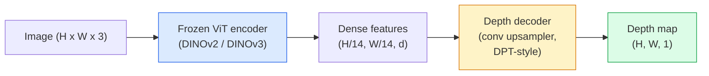

# 單眼深度與幾何估計 (Monocular Depth & Geometry Estimation)

> Depth map 是單通道影像，每個像素代表到相機的距離。以前沒有 stereo 或 LiDAR，就不可能從單一 RGB 影格預測它。到了 2026 年，凍結的 ViT encoder 加上輕量的 head，就能做到與 ground truth 相差幾個百分點以內。

**Type:** Build + Use
**Languages:** Python
**Prerequisites:** Phase 4 Lesson 14 (ViT), Phase 4 Lesson 17 (Self-Supervised Vision), Phase 4 Lesson 07 (U-Net)
**Time:** ~60 分鐘

## 學習目標 (Learning Objectives)

- 區分 relative depth 與 metric depth，並說明各個正式環境的模型（MiDaS、Marigold、Depth Anything V3、ZoeDepth）解決的是哪一種
- 使用 Depth Anything V3（DINOv2 backbone），在不需校準的情況下，對任意單張影像預測深度
- 解釋為什麼單一影像就能做出單眼深度（透視線索、紋理梯度、學到的先驗），以及它無法還原什麼（絕對尺度、被遮擋的幾何）
- 利用 depth map 與針孔相機內參，把 2D 偵測提升成 3D 點

## 問題 (The Problem)

深度是 2D 電腦視覺中缺少的那個軸。給定 RGB，你知道東西出現在影像平面的哪裡，但不知道它們有多遠。深度感測器（stereo 設備、LiDAR、time-of-flight）能直接解決這件事，但昂貴、脆弱，而且距離有限。

單眼深度估計，也就是從單一 RGB 影格預測深度，過去產生的結果模糊又不可靠。到了 2026 年，大型預訓練 encoder 改變了這一點：Depth Anything V3 使用凍結的 DINOv2 backbone，產生的 depth map 能泛化到室內、戶外、醫學與衛星領域。Marigold 把深度重新定義為條件式 diffusion 問題。ZoeDepth 則回歸真實的公尺距離。

深度也是 2D detection 與 3D 理解之間的橋樑：把偵測到的 box 中的像素乘上深度，你就把 2D 物體提升成 3D 點雲。這是每個 AR 遮擋系統、每個避障 pipeline，以及每個「拿起杯子」機器人的核心。

## 核心概念 (The Concept)

### Relative 對 metric 深度 (Relative vs metric depth)

- **Relative depth**：有順序的 `z` 值，沒有真實世界的單位。「像素 A 比像素 B 近，但距離的比例並未錨定到公尺。」
- **Metric depth**：到相機的絕對距離，單位為公尺。需要模型學到影像線索與真實距離之間的統計關係。

MiDaS 和 Depth Anything V3 產生 relative depth。Marigold 產生 relative depth。ZoeDepth、UniDepth 和 Metric3D 產生 metric depth。Metric 模型對相機內參很敏感；relative 模型則不會。

### Encoder-decoder 模式 (The encoder-decoder pattern)



Depth Anything V3 凍結 encoder，只訓練 DPT 風格的 decoder。Encoder 提供豐富的特徵；decoder 把它們內插回影像解析度並回歸深度。

### 為什麼單一影像就能產生深度 (Why a single image produces depth at all)

2D 影像包含許多與深度相關的單眼線索：

- **透視 (Perspective)**：3D 中的平行線在 2D 中會收斂。
- **紋理梯度 (Texture gradient)**：遠處的表面紋理更小、更密。
- **遮擋順序 (Occlusion order)**：較近的物體遮住較遠的。
- **大小恆常性 (Size constancy)**：已知的物體（車、人）提供大約的尺度。
- **大氣透視 (Atmospheric perspective)**：戶外場景中，遠處的物體看起來更朦朧、更藍。

在數十億張影像上訓練的 ViT 會內化這些線索。有足夠的資料和強大的 backbone，單眼深度不需任何明確的 3D 監督，也能達到合理的準確率。

### 單眼深度做不到的事 (What monocular depth cannot do)

- 沒有內參或場景中已知物體時，無法得到 **絕對的 metric 尺度**。網路可以預測「杯子的距離是湯匙的兩倍」，卻不知道杯子是在 1 公尺還是 10 公尺外。
- **被遮擋的幾何**：椅子的背面看不到，無法可靠地推論。
- **真正沒有紋理 / 反光的表面**：鏡子、玻璃、均勻的牆。網路會回報看似合理但錯誤的深度。

### 2026 年的 Depth Anything V3 (Depth Anything V3 in 2026)

- 以原版 DINOv2 ViT-L/14 作為 encoder（凍結）。
- DPT decoder。
- 在來自多種來源的有姿態影像配對上訓練（除了光度一致性之外，不需要明確的深度監督）。
- 能從 **任意數量的視覺輸入（無論相機姿態已知與否）** 預測空間一致的幾何。
- 在單眼深度、任意視角幾何、視覺渲染、相機姿態估計上都是 SOTA。

這是 2026 年你需要深度時，可以直接呼叫的模型。

### Marigold：用 diffusion 做深度 (Marigold — diffusion for depth)

Marigold（Ke et al., CVPR 2024）把深度估計重新定義為條件式 image-to-image diffusion。條件：RGB。目標：depth map。以預訓練的 Stable Diffusion 2 U-Net 為 backbone。輸出的 depth map 在物體邊界上特別銳利。取捨：推論比 feed-forward 模型慢（10 到 50 個去噪步）。

### 內參與針孔相機 (Intrinsics and the pinhole camera)

要把深度為 `d` 的像素 `(u, v)` 提升為相機座標中的 3D 點 `(X, Y, Z)`：

```math
\begin{aligned}
f_x, f_y, c_x, c_y &= \text{camera intrinsics} \\
X &= (u - c_x) \cdot d / f_x \\
Y &= (v - c_y) \cdot d / f_y \\
Z &= d
\end{aligned}
```

內參來自 EXIF metadata、校準圖樣，或單眼內參估計器（Perspective Fields、UniDepth）。沒有內參時，你仍可假設 60 到 70° 的 FOV 且主點在影像中心來渲染點雲。這可用於視覺化，但不能用於測量。

### 評估 (Evaluation)

兩個標準指標：

- **AbsRel**（絕對相對誤差）：`mean(|d_pred - d_gt| / d_gt)`。越低越好。正式環境模型是 0.05 到 0.1。
- **delta < 1.25**（門檻準確率）：`max(d_pred/d_gt, d_gt/d_pred) < 1.25` 的像素比例。越高越好。SOTA 是 0.9 以上。

對 relative depth（Depth Anything V3、MiDaS），評估使用兩個指標的 scale-and-shift 不變版本。

```figure
depth-sweep
```

## 動手做 (Build It)

### 步驟 1：深度指標 (Step 1: Depth metrics)

```python
import torch

def abs_rel_error(pred, target, mask=None):
    if mask is not None:
        pred = pred[mask]
        target = target[mask]
    return (torch.abs(pred - target) / target.clamp(min=1e-6)).mean().item()


def delta_accuracy(pred, target, threshold=1.25, mask=None):
    if mask is not None:
        pred = pred[mask]
        target = target[mask]
    ratio = torch.maximum(pred / target.clamp(min=1e-6), target / pred.clamp(min=1e-6))
    return (ratio < threshold).float().mean().item()
```

評估之前，永遠要先遮掉無效的深度像素（零、NaN、飽和）。

### 步驟 2：Scale-and-shift 對齊 (Step 2: Scale-and-shift alignment)

對 relative-depth 模型，在計算指標之前，先把預測值對齊到 ground truth。對 `a * pred + b = target` 做最小平方擬合：

```python
def align_scale_shift(pred, target, mask=None):
    if mask is not None:
        p = pred[mask]
        t = target[mask]
    else:
        p = pred.flatten()
        t = target.flatten()
    A = torch.stack([p, torch.ones_like(p)], dim=1)
    coeffs, *_ = torch.linalg.lstsq(A, t.unsqueeze(-1))
    a, b = coeffs[:2, 0]
    return a * pred + b
```

評估 MiDaS / Depth Anything 時，在 `abs_rel_error` 之前先執行 `align_scale_shift`。

### 步驟 3：把深度提升成點雲 (Step 3: Lift depth to a point cloud)

```python
import numpy as np

def depth_to_point_cloud(depth, intrinsics):
    H, W = depth.shape
    fx, fy, cx, cy = intrinsics
    v, u = np.meshgrid(np.arange(H), np.arange(W), indexing="ij")
    z = depth
    x = (u - cx) * z / fx
    y = (v - cy) * z / fy
    return np.stack([x, y, z], axis=-1)


depth = np.random.uniform(0.5, 4.0, (240, 320))
intr = (320.0, 320.0, 160.0, 120.0)
pc = depth_to_point_cloud(depth, intr)
print(f"point cloud shape: {pc.shape}  (H, W, 3)")
```

一個函式，涵蓋每個 3D 提升的應用。把點雲匯出成 `.ply`，用 MeshLab 或 CloudCompare 開啟。

### 步驟 4：用合成深度場景做煙霧測試 (Step 4: Smoke test with a synthetic depth scene)

```python
def synthetic_depth(size=96):
    yy, xx = np.meshgrid(np.arange(size), np.arange(size), indexing="ij")
    # Floor: linear gradient from near (top) to far (bottom)
    depth = 1.0 + (yy / size) * 4.0
    # Box in the middle: closer
    mask = (np.abs(xx - size / 2) < size / 6) & (np.abs(yy - size * 0.6) < size / 6)
    depth[mask] = 2.0
    return depth.astype(np.float32)


gt = torch.from_numpy(synthetic_depth(96))
pred = gt + 0.3 * torch.randn_like(gt)  # simulated prediction
aligned = align_scale_shift(pred, gt)
print(f"before align  absRel = {abs_rel_error(pred, gt):.3f}")
print(f"after align   absRel = {abs_rel_error(aligned, gt):.3f}")
```

### 步驟 5：Depth Anything V2 用法（參考）(Step 5: Depth Anything V2 usage (reference))

```python
import numpy as np
from transformers import pipeline
from PIL import Image

pipe = pipeline(task="depth-estimation", model="depth-anything/Depth-Anything-V2-Large-hf")

image = Image.open("street.jpg").convert("RGB")
out = pipe(image)
depth_np = np.array(out["depth"])
```

三行。`out["depth"]` 是 PIL 灰階影像；做數學運算時轉成 numpy。Depth Anything 3（2025 年 11 月）無法透過這個 pipeline 載入。它有自己的 `depth_anything_3` 套件：`DepthAnything3.from_pretrained("depth-anything/DA3MONO-LARGE")` 載入 relative 單眼模型，而 `model.inference(images).depth` 回傳 `[N, H, W]` 的深度陣列。

## 實際使用 (Use It)

- **Depth Anything V3**（Meta AI / ByteDance，2024-2026）：relative depth 的預設選擇。正式環境中最快的 ViT-large backbone 模型。
- **Marigold**（ETH，2024）：視覺品質最高，推論慢。
- **UniDepth**（ETH，2024）：附帶相機內參估計的 metric depth。
- **ZoeDepth**（Intel，2023）：metric depth；較舊，仍然可靠。
- **MiDaS v3.1**：舊款但穩定；是比較用的好 baseline。

典型的整合模式：

1. RGB 影格進來。
2. 深度模型產生 depth map。
3. Detector 產生 box。
4. 透過深度把 box 的中心點提升到 3D；如果有點雲就合併。
5. 下游：AR 遮擋、路徑規劃、物體大小估計、取代 stereo。

即時使用時，Depth Anything V2 Small（INT8 量化）在消費級 GPU 上以 518x518 可達約 30 fps。

## 交付 (Ship It)

這堂課會產出：

- `outputs/prompt-depth-model-picker.md`：根據延遲、需要 metric 還是 relative，以及場景類型，在 Depth Anything V3、Marigold、UniDepth、MiDaS 之間挑選。
- `outputs/skill-depth-to-pointcloud.md`：一個 skill，用正確的內參處理，從 depth map 建立點雲並匯出成 `.ply`。

## 練習 (Exercises)

1. **（簡單）** 在你桌面的任意 10 張影像上執行 Depth Anything V2。把深度存成灰階 PNG 並檢查。找出一個預測深度看起來錯誤的物體，並解釋單眼線索為何失效。
2. **（中等）** 給定來自 Depth Anything V2 的 RGB + depth，提升成點雲並用 `open3d` 渲染。比較兩個場景（室內 / 室外），並指出哪個看起來更可信。
3. **（困難）** 取五組只差在已知物體位置的影像配對（例如瓶子靠近 30 公分）。用 UniDepth 對兩者預測 metric depth。回報預測的距離差與真實的 30 公分。

## 關鍵術語 (Key Terms)

| 術語 | 大家常說的 | 實際意義 |
|------|----------------|----------------------|
| Monocular depth | 「單張影像深度」 | 從單一 RGB 影格估計深度，不用 stereo 或 LiDAR |
| Relative depth | 「有順序的深度」 | 有順序的 z 值，沒有真實世界單位 |
| Metric depth | 「絕對距離」 | 以公尺為單位的深度；需要校準，或以 metric 監督訓練的模型 |
| AbsRel | 「絕對相對誤差」 | $\lvert d_{\text{pred}} - d_{\text{gt}} \rvert / d_{\text{gt}}$ 的平均值；標準的深度指標 |
| Delta accuracy | 「delta < 1.25」 | 預測值落在 ground truth 25% 以內的像素比例 |
| Pinhole camera | 「fx, fy, cx, cy」 | 用來把 (u, v, d) 提升成 (X, Y, Z) 的相機模型 |
| DPT | 「Dense Prediction Transformer」 | 疊在凍結 ViT encoder 上、用於深度的 conv 式 decoder |
| DINOv2 backbone | 「它能運作的原因」 | 不需深度標籤就能跨領域泛化的自監督特徵 |

## 延伸閱讀 (Further Reading)

- [Depth Anything V3 paper page](https://depth-anything.github.io/)：使用 DINOv2 encoder 的 SOTA 單眼深度
- [Marigold (Ke et al., CVPR 2024)](https://marigoldmonodepth.github.io/)：以 diffusion 為基礎的深度估計
- [UniDepth (Piccinelli et al., 2024)](https://arxiv.org/abs/2403.18913)：附內參的 metric depth
- [MiDaS v3.1 (Intel ISL)](https://github.com/isl-org/MiDaS)：經典的 relative-depth baseline
- [DINOv3 blog post (Meta)](https://ai.meta.com/blog/dinov3-self-supervised-vision-model/)：提升深度準確率的 encoder 系列
