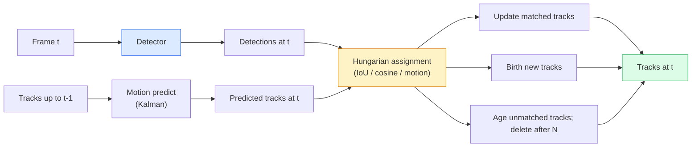

# 多物體追蹤與影片記憶 (Multi-Object Tracking & Video Memory)

> 追蹤就是偵測加上關聯。每個影格都偵測。把這個影格的偵測，依 ID 對應到上一個影格的 track。

**Type:** Build
**Languages:** Python
**Prerequisites:** Phase 4 Lesson 06 (YOLO Detection), Phase 4 Lesson 08 (Mask R-CNN), Phase 4 Lesson 24 (SAM 3)
**Time:** ~60 分鐘

## 學習目標 (Learning Objectives)

- 區分 tracking-by-detection 與 query-based tracking，並說出演算法家族（SORT、DeepSORT、ByteTrack、BoT-SORT、SAM 2 memory tracker、SAM 3.1 Object Multiplex）
- 從零實作 IoU + Hungarian assignment，做經典的 tracking-by-detection
- 解釋 SAM 2 的 memory bank，以及為什麼它處理遮擋比基於 IoU 的關聯更好
- 讀懂三個追蹤指標（MOTA、IDF1、HOTA），並為特定使用情境選出重要的那個

## 問題 (The Problem)

Detector 告訴你物體在單一影格中的位置。Tracker 告訴你影格 `t` 的哪個偵測，與影格 `t-1` 的某個偵測是同一個物體。沒有它，你就無法計算穿越一條線的物體數量、追蹤被遮擋的球，或是知道「車 #4 已經在車道上待了 8 秒」。

追蹤對每個面向影片的產品都是必要的：運動分析、監控、自動駕駛、醫學影片分析、野生動物監測、字標計數。核心的建構元件是共通的：逐影格的 detector、運動模型（Kalman filter 或更豐富的東西）、關聯步驟（對 IoU / cosine / 學到的特徵做 Hungarian algorithm），以及 track 的生命週期（誕生、更新、死亡）。

2026 年帶來兩種新模式：**SAM 2 以記憶為基礎的追蹤**（用特徵記憶取代運動模型的關聯），以及 **SAM 3.1 Object Multiplex**（同一概念的許多 instance 共用記憶）。這堂課先走過經典的技術堆疊，再走過以記憶為基礎的做法。

## 核心概念 (The Concept)

### Tracking-by-detection



你在 2026 年會遇到的每個 tracker，都是這個迴圈的變體。差異在於：

- **SORT**（2016）：Kalman filter + IoU Hungarian。簡單、快速，沒有外觀模型。
- **DeepSORT**（2017）：SORT + 每個 track 一個基於 CNN 的外觀特徵（ReID embedding）。更能處理交錯的情況。
- **ByteTrack**（2021）：把低信心度的偵測當作第二階段來關聯；不需要外觀特徵，卻是 MOT17 上的最佳表現者。
- **BoT-SORT**（2022）：Byte + 相機運動補償 + ReID。
- **StrongSORT / OC-SORT**：ByteTrack 的後代，運動和外觀都更好。

### 一段話講完 Kalman filter (Kalman filter in one paragraph)

Kalman filter 為每個 track 維護一個帶有 covariance 的狀態 `(x, y, w, h, dx, dy, dw, dh)`。每個影格，先用等速模型 **predict** 狀態，再用匹配到的偵測做 **update**。當 predict 的不確定性高時，update 會更信任偵測。這讓軌跡平滑，並且能讓 track 在短暫遮擋（1 到 5 個影格）中繼續下去。

每個經典 tracker 都在運動預測步驟中使用 Kalman filter。

### Hungarian algorithm

給定一個 `M x N` 的成本矩陣（track x 偵測），找出總成本最小的一對一指派。成本通常是 `1 - IoU(track_bbox, detection_bbox)` 或外觀特徵的負 cosine 相似度。執行時間是 $O((M+N)^3)$；對 $M, N$ 最多約 1000，透過 `scipy.optimize.linear_sum_assignment` 在 Python 裡夠快。

### ByteTrack 的關鍵想法 (ByteTrack's key idea)

標準 tracker 會丟掉低信心度（< 0.5）的偵測。ByteTrack 把它們留著當作 **第二階段候選**：在把 track 匹配到高信心度偵測之後，沒匹配到的 track 會用稍微寬鬆的 IoU 門檻，嘗試匹配低信心度的偵測。能恢復短暫遮擋，以及人群附近的 ID 切換。

### SAM 2 以記憶為基礎的追蹤 (SAM 2 memory-based tracking)

SAM 2 透過維護一個 **memory bank**，存放每個 instance 的時空特徵來處理影片。給定某個影格上的 prompt（點擊、box 或 mask），它把 instance 編碼進記憶。在後續影格中，記憶會與新影格的特徵做 cross-attention，decoder 再為新影格中同一個 instance 產生 mask。

沒有 Kalman filter，沒有 Hungarian assignment。關聯隱含在 memory-attention 運算中。

優點：

- 對大幅度遮擋很穩健（記憶能跨許多影格攜帶 instance 的身分）。
- 搭配 SAM 3 的文字 prompt 時是開放詞彙。
- 不需要獨立的運動模型。

缺點：

- 追蹤許多物體時比 ByteTrack 慢。
- Memory bank 會成長；限制了 context 視窗。

### SAM 3.1 Object Multiplex

先前的 SAM 2 / SAM 3 追蹤為每個 instance 維護獨立的 memory bank。50 個物體就有 50 個 memory bank。Object Multiplex（2026 年 3 月）把它們壓縮成一個共用記憶，搭配 **每個 instance 的 query token**。成本隨 instance 數量呈次線性成長。

Multiplex 是 2026 年人群追蹤的新預設：演唱會人群、倉庫工人、交通路口。

### 要知道的三個指標 (Three metrics to know)

- **MOTA (Multi-Object Tracking Accuracy)**：1 - (FN + FP + ID switches) / GT。依錯誤類型加權；單一指標，混合了偵測與關聯的失敗。
- **IDF1 (ID F1)**：ID precision 與 recall 的調和平均。專門聚焦於每個 ground-truth track 隨時間保持其 ID 的程度。對在意 ID 切換的任務比 MOTA 更好。
- **HOTA (Higher Order Tracking Accuracy)**：分解成偵測準確率 (DetA) 與關聯準確率 (AssA)。2020 年以來的社群標準；最全面。

對監控（誰是誰）：回報 IDF1。對運動分析（計算傳球次數）：HOTA。對一般學術比較：HOTA。

```figure
cv3-track-assoc
```

## 動手做 (Build It)

### 步驟 1：基於 IoU 的成本矩陣 (Step 1: IoU-based cost matrix)

```python
import numpy as np


def bbox_iou(a, b):
    """
    a, b: (N, 4) arrays of [x1, y1, x2, y2].
    Returns (N_a, N_b) IoU matrix.
    """
    ax1, ay1, ax2, ay2 = a[:, 0], a[:, 1], a[:, 2], a[:, 3]
    bx1, by1, bx2, by2 = b[:, 0], b[:, 1], b[:, 2], b[:, 3]
    inter_x1 = np.maximum(ax1[:, None], bx1[None, :])
    inter_y1 = np.maximum(ay1[:, None], by1[None, :])
    inter_x2 = np.minimum(ax2[:, None], bx2[None, :])
    inter_y2 = np.minimum(ay2[:, None], by2[None, :])
    inter = np.clip(inter_x2 - inter_x1, 0, None) * np.clip(inter_y2 - inter_y1, 0, None)
    area_a = (ax2 - ax1) * (ay2 - ay1)
    area_b = (bx2 - bx1) * (by2 - by1)
    union = area_a[:, None] + area_b[None, :] - inter
    return inter / np.clip(union, 1e-8, None)
```

### 步驟 2：最小的 SORT 風格 tracker (Step 2: Minimal SORT-style tracker)

為了簡潔，省略固定的等速 Kalman，這裡使用簡單的 IoU 關聯；在正式環境中，Kalman predict 是必要的。`sort` Python 套件提供完整版本。

```python
from scipy.optimize import linear_sum_assignment


class Track:
    def __init__(self, tid, bbox, frame):
        self.id = tid
        self.bbox = bbox
        self.last_frame = frame
        self.hits = 1

    def update(self, bbox, frame):
        self.bbox = bbox
        self.last_frame = frame
        self.hits += 1


class SimpleTracker:
    def __init__(self, iou_threshold=0.3, max_age=5):
        self.tracks = []
        self.next_id = 1
        self.iou_threshold = iou_threshold
        self.max_age = max_age

    def step(self, detections, frame):
        if not self.tracks:
            for d in detections:
                self.tracks.append(Track(self.next_id, d, frame))
                self.next_id += 1
            return [(t.id, t.bbox) for t in self.tracks]

        track_boxes = np.array([t.bbox for t in self.tracks])
        det_boxes = np.array(detections) if len(detections) else np.empty((0, 4))

        iou = bbox_iou(track_boxes, det_boxes) if len(det_boxes) else np.zeros((len(track_boxes), 0))
        cost = 1 - iou
        cost[iou < self.iou_threshold] = 1e6

        matched_track = set()
        matched_det = set()
        if cost.size > 0:
            row, col = linear_sum_assignment(cost)
            for r, c in zip(row, col):
                if cost[r, c] < 1.0:
                    self.tracks[r].update(det_boxes[c], frame)
                    matched_track.add(r); matched_det.add(c)

        for i, d in enumerate(det_boxes):
            if i not in matched_det:
                self.tracks.append(Track(self.next_id, d, frame))
                self.next_id += 1

        self.tracks = [t for t in self.tracks if frame - t.last_frame <= self.max_age]
        return [(t.id, t.bbox) for t in self.tracks]
```

60 行。接收逐影格的偵測，回傳逐影格的 track ID。真正的系統會加上 Kalman predict、ByteTrack 的第二階段重新匹配，以及外觀特徵。

### 步驟 3：合成軌跡測試 (Step 3: Synthetic trajectory test)

```python
def synthetic_frames(num_frames=20, num_objects=3, H=240, W=320, seed=0):
    rng = np.random.default_rng(seed)
    starts = rng.uniform(20, 200, size=(num_objects, 2))
    velocities = rng.uniform(-5, 5, size=(num_objects, 2))
    frames = []
    for f in range(num_frames):
        dets = []
        for i in range(num_objects):
            cx, cy = starts[i] + f * velocities[i]
            dets.append([cx - 10, cy - 10, cx + 10, cy + 10])
        frames.append(dets)
    return frames


tracker = SimpleTracker()
for f, dets in enumerate(synthetic_frames()):
    tracks = tracker.step(dets, f)
```

三個沿直線移動的物體，應該在全部 20 個影格中保持它們的 ID。

### 步驟 4：ID 切換指標 (Step 4: ID-switch metric)

```python
def count_id_switches(tracks_per_frame, gt_per_frame):
    """
    tracks_per_frame:  list of list of (track_id, bbox)
    gt_per_frame:      list of list of (gt_id, bbox)
    Returns number of ID switches.
    """
    prev_assignment = {}
    switches = 0
    for tracks, gts in zip(tracks_per_frame, gt_per_frame):
        if not tracks or not gts:
            continue
        t_boxes = np.array([b for _, b in tracks])
        g_boxes = np.array([b for _, b in gts])
        iou = bbox_iou(g_boxes, t_boxes)
        for g_idx, (gt_id, _) in enumerate(gts):
            j = iou[g_idx].argmax()
            if iou[g_idx, j] > 0.5:
                t_id = tracks[j][0]
                if gt_id in prev_assignment and prev_assignment[gt_id] != t_id:
                    switches += 1
                prev_assignment[gt_id] = t_id
    return switches
```

這是簡化的、類似 IDF1 的指標：計算 ground-truth 物體被指派的預測 track ID 改變了幾次。真正的 MOTA / IDF1 / HOTA 工具在 `py-motmetrics` 和 `TrackEval` 裡。

## 實際使用 (Use It)

2026 年的正式環境 tracker：

- `ultralytics`：YOLOv8 + 內建的 ByteTrack / BoT-SORT。`results = model.track(source, tracker="bytetrack.yaml")`。預設選擇。
- `supervision`（Roboflow）：ByteTrack 包裝加上標註工具。
- SAM 2 / SAM 3.1：透過 `processor.track()` 做以記憶為基礎的追蹤。
- 自訂技術堆疊：detector（YOLOv8 / RT-DETR）+ `sort-tracker` / `OC-SORT` / `StrongSORT`。

挑選：

- 30+ fps 的行人 / 車輛 / 箱子：**ultralytics 搭配 ByteTrack**。
- 人群中同一類別的許多 instance：**SAM 3.1 Object Multiplex**。
- 外觀可辨識的嚴重遮擋：**DeepSORT / StrongSORT**（ReID 特徵）。
- 運動 / 複雜互動：**BoT-SORT** 或學習式 tracker（MOTRv3）。

## 交付 (Ship It)

這堂課會產出：

- `outputs/prompt-tracker-picker.md`：根據場景類型、遮擋模式與延遲預算，挑選 SORT / ByteTrack / BoT-SORT / SAM 2 / SAM 3.1。
- `outputs/skill-mot-evaluator.md`：針對 ground-truth track，寫出完整的 MOTA / IDF1 / HOTA 評估框架。

## 練習 (Exercises)

1. **（簡單）** 用 3、10 和 30 個物體執行上面的合成 tracker。回報每種情況下的 ID 切換次數。找出單純 IoU 關聯開始失敗的地方。
2. **（中等）** 在關聯之前加入等速 Kalman predict 步驟。證明短暫（2 到 3 個影格）的遮擋不再造成 ID 切換。
3. **（困難）** 整合 SAM 2 以記憶為基礎的 tracker（透過 `transformers`）作為替代的 tracker backend。在一段 30 秒的人群 clip 上同時執行 SimpleTracker 和 SAM 2，並比較 ID 切換次數，手動標註 5 個顯眼人物的 ground-truth ID。

## 關鍵術語 (Key Terms)

| 術語 | 大家常說的 | 實際意義 |
|------|----------------|----------------------|
| Tracking-by-detection | 「先偵測再關聯」 | 逐影格的 detector + 對 IoU / 外觀做 Hungarian assignment |
| Kalman filter | 「運動預測」 | 線性動態加 covariance，用於平滑的 track 預測與遮擋處理 |
| Hungarian algorithm | 「最佳指派」 | 解最小成本二分匹配問題；`scipy.optimize.linear_sum_assignment` |
| ByteTrack | 「低信心度第二輪」 | 把沒匹配到的 track 重新匹配到低信心度的偵測，以恢復短暫遮擋 |
| DeepSORT | 「SORT + 外觀」 | 加上 ReID 特徵做跨影格匹配；更能保持 ID |
| Memory bank | 「SAM 2 的技巧」 | 跨影格儲存的每個 instance 時空特徵；以 cross-attention 取代明確的關聯 |
| Object Multiplex | 「SAM 3.1 共用記憶」 | 單一共用記憶搭配每個 instance 的 query，快速追蹤許多物體 |
| HOTA | 「現代追蹤指標」 | 分解成偵測與關聯準確率；社群標準 |

## 延伸閱讀 (Further Reading)

- [SORT (Bewley et al., 2016)](https://arxiv.org/abs/1602.00763)：最小的 tracking-by-detection 論文
- [DeepSORT (Wojke et al., 2017)](https://arxiv.org/abs/1703.07402)：加入外觀特徵
- [ByteTrack (Zhang et al., 2022)](https://arxiv.org/abs/2110.06864)：低信心度第二輪
- [BoT-SORT (Aharon et al., 2022)](https://arxiv.org/abs/2206.14651)：相機運動補償
- [HOTA (Luiten et al., 2020)](https://arxiv.org/abs/2009.07736)：分解式的追蹤指標
- [SAM 2 video segmentation (Meta, 2024)](https://ai.meta.com/sam2/)：以記憶為基礎的 tracker
- [SAM 3.1 Object Multiplex (Meta, March 2026)](https://ai.meta.com/blog/segment-anything-model-3/)
