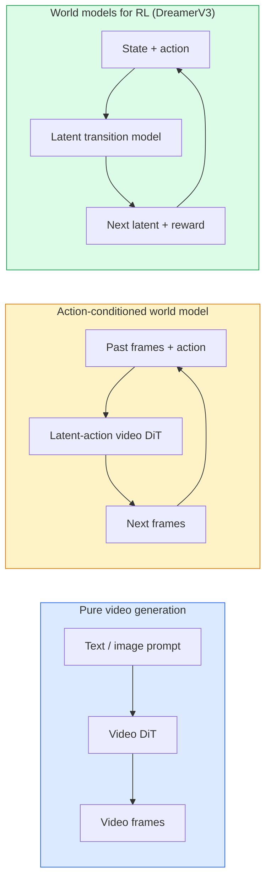

# World Model 與影片 Diffusion (World Models & Video Diffusion)

> 能預測場景接下來幾秒的影片模型，就是世界模擬器。把這個預測以動作為條件，你就得到一個學習出來的遊戲引擎。

**Type:** Learn + Build
**Languages:** Python
**Prerequisites:** Phase 4 Lesson 10 (Diffusion), Phase 4 Lesson 12 (Video Understanding), Phase 4 Lesson 23 (DiT + Rectified Flow)
**Time:** ~75 分鐘

## 學習目標 (Learning Objectives)

- 解釋純影片生成模型（Sora 2）與以動作為條件的 world model（Genie 3、DreamerV3）之間的差異
- 描述影片 DiT：時空 patch、3D 位置編碼、跨 (T, H, W) token 的聯合 attention
- 追蹤 world model 如何接進機器人：VLM 規劃 → 影片模型模擬 → inverse dynamics 輸出動作
- 針對給定的使用情境（創意影片、互動式模擬、自動駕駛合成），在 Sora 2、Genie 3、Runway GWM-1 Worlds、Wan-Video 與 HunyuanVideo 之間挑選

## 問題 (The Problem)

影片生成與 world modelling 在 2026 年匯流了。一個能生成連貫一分鐘影片的模型，某種意義上已經學會了世界如何運動：物體恆存性、重力、因果關係、風格。如果你把預測以動作（向左走、開門）為條件，影片模型就變成一個可學習的模擬器，能取代遊戲引擎、駕駛模擬器或機器人環境。

利害關係很具體。Genie 3 能從單一影像生成可玩的環境。Runway GWM-1 Worlds 合成無限可探索的場景。Sora 2 產生長達一分鐘、帶同步音訊與物理建模的影片。NVIDIA Cosmos-Drive、Wayve Gaia-2 和 Tesla DrivingWorld 為自駕車訓練資料生成逼真的駕駛影片。World model 典範正悄悄接管機器人的 sim-to-real。

這堂課是第 4 階段的「大局」課程。它把影像生成、影片理解與 agentic 推理，連接到主流研究正在邁向的架構模式。

## 核心概念 (The Concept)

### World-modelling 的三個系列 (Three families of world-modelling)



- **Sora 2** 是以 prompt 為條件的純影片生成。沒有動作介面。你無法在 rollout 中途「操控」它。
- **Genie 3**、**GWM-1 Worlds**、**Mirage / Magica** 是以動作為條件的 world model。從觀察到的影片推論 latent action，再讓未來影格的預測以動作為條件。可互動：你按按鍵或移動相機，場景會回應。
- **DreamerV3** 與經典的 RL world-model 系列，在 latent space 中預測並明確以動作為條件，用 reward 訊號訓練。視覺性較低；對 sample-efficient 的 RL 更有用。

### 影片 DiT 架構 (Video DiT architecture)

```
Video latent:          (C, T, H, W)
Patchify (spatial):    grid of P_h x P_w patches per frame
Patchify (temporal):   group P_t frames into a temporal patch
Resulting tokens:      (T / P_t) * (H / P_h) * (W / P_w) tokens
```

位置編碼是 3D 的：每個 (t, h, w) 座標一個 rotary 或可學習的 embedding。Attention 可以是：

- **Full joint**：所有 token 對所有 token 做 attention。$N$ 個 token 時為 $O(N^2)$。對長影片過於昂貴。
- **Divided**：交替進行時間 attention（相同空間位置，跨時間：`(H*W) * T^2`）與空間 attention（相同 timestep，跨空間：`T * (H*W)^2`）。TimeSformer 與大多數影片 DiT 使用。
- **Window**：在 (t, h, w) 中的局部視窗。Video Swin 使用。

2026 年每個影片 diffusion 模型，都使用這三種模式之一，加上 AdaLN 條件控制（第 23 課）和 rectified flow。

### 以動作為條件：latent action 模型 (Conditioning on actions: latent action models)

Genie 透過判別式地預測一對連續影格之間的動作，為每個影格學習一個 **latent action**。模型的 decoder 接著以推論出的 latent action 為條件，而不是明確的鍵盤按鍵。推論時，使用者可以指定 latent action（或從新的先驗取樣一個），模型就會生成與該動作一致的下一個影格。

Sora 完全跳過動作介面。它的 decoder 從過去的時空 token 預測下一個時空 token。Prompt 決定起點；生成途中沒有任何東西能操控它。

### 物理合理性 (Physical plausibility)

Sora 2 的 2026 年版本明確強調 **物理合理性**：重量、平衡、物體恆存性、因果關係。團隊用人工評分的合理性分數衡量；相較 Sora 1，模型在掉落物體、角色碰撞，以及刻意的失敗（沒跳過去）上明顯改善。

合理性仍然是最主要的失敗模式。2024-2025 年人們吃義大利麵或用杯子喝水的影片，揭露了模型缺乏持續的物體表示。2026 年的模型（Sora 2、Runway Gen-5、HunyuanVideo）減少但沒有消除這些問題。

### 自動駕駛 world model (Autonomous driving world models)

駕駛 world model 以軌跡、bounding box 或導航地圖為條件，生成逼真的道路場景。用途：

- **Cosmos-Drive-Dreams**（NVIDIA）：為 RL 訓練生成數分鐘的駕駛影片。
- **Gaia-2**（Wayve）：以軌跡為條件的場景合成，用於策略評估。
- **DrivingWorld**（Tesla）：模擬各種天氣、時段、交通狀況。
- **Vista**（ByteDance）：反應式的駕駛場景合成。

它們取代了對 corner case 昂貴的真實世界資料蒐集，例如夜間行人違規穿越、結冰的路口、不尋常的車輛類型，這些原本需要數百萬英里的駕駛。

### 機器人技術堆疊：VLM + 影片模型 + inverse dynamics (Robotics stack: VLM + video model + inverse dynamics)

正在成形的三元件機器人迴圈：

1. **VLM** 解析目標（「拿起紅色的杯子」），規劃高階動作序列。
2. **影片生成模型** 模擬執行每個動作會是什麼樣子，預測 N 個影格之後的觀察。
3. **Inverse dynamics 模型** 萃取能產生這些觀察的具體馬達指令。

這取代了 reward shaping 與依賴大量樣本的 RL。World model 負責想像；inverse dynamics 在執行端閉合迴圈。Genie Envisioner 是其中一個實例；許多研究團隊正匯流到這個結構。

### 評估 (Evaluation)

- **視覺品質**：FVD (Fréchet Video Distance)、使用者研究。
- **Prompt 對齊**：逐影格的 CLIPScore、VQA 風格的評估。
- **物理合理性**：在 benchmark 套件上人工評分（Sora 2 的內部 benchmark、VBench）。
- **可控性**（針對互動式 world model）：動作 → 觀察的一致性；你能回到先前的狀態嗎？

### 2026 年的模型版圖 (Model landscape in 2026)

| 模型 | 用途 | 參數 | 輸出 | 授權 |
|-------|-----|------------|--------|---------|
| Sora 2 | text-to-video、音訊 | — | 1 分鐘 1080p + 音訊 | 僅 API |
| Runway Gen-5 | text/image-to-video | — | 10 秒 clip | API |
| Runway GWM-1 Worlds | 互動式世界 | — | 無限 3D rollout | API |
| Genie 3 | 從影像生成互動式世界 | 11B+ | 可玩的影格 | 研究預覽 |
| Wan-Video 2.1 | 開放 text-to-video | 14B | 高品質 clip | 非商用 |
| HunyuanVideo | 開放 text-to-video | 13B | 10 秒 clip | 寬鬆 |
| Cosmos / Cosmos-Drive | 自動駕駛模擬 | 7-14B | 駕駛場景 | NVIDIA 開放 |
| Magica / Mirage 2 | AI 原生遊戲引擎 | — | 可修改的世界 | 產品 |

```figure
v4-world-rollout
```

## 動手做 (Build It)

### 步驟 1：影片的 3D patchify (Step 1: 3D patchify for video)

```python
import torch
import torch.nn as nn


class VideoPatch3D(nn.Module):
    def __init__(self, in_channels=4, dim=64, patch_t=2, patch_h=2, patch_w=2):
        super().__init__()
        self.proj = nn.Conv3d(
            in_channels, dim,
            kernel_size=(patch_t, patch_h, patch_w),
            stride=(patch_t, patch_h, patch_w),
        )
        self.patch_t = patch_t
        self.patch_h = patch_h
        self.patch_w = patch_w

    def forward(self, x):
        # x: (N, C, T, H, W)
        x = self.proj(x)
        n, c, t, h, w = x.shape
        tokens = x.reshape(n, c, t * h * w).transpose(1, 2)
        return tokens, (t, h, w)
```

stride 等於 kernel 的 3D conv，就是時空 patchifier。`(T, H, W) -> (T/2, H/2, W/2)` 的 token grid。

### 步驟 2：3D rotary 位置編碼 (Step 2: 3D rotary position encoding)

Rotary Position Embedding (RoPE) 分別沿著 `t`、`h`、`w` 軸套用：

```python
def rope_3d(tokens, t_dim, h_dim, w_dim, grid):
    """
    tokens: (N, T*H*W, D)
    grid: (T, H, W) sizes
    t_dim + h_dim + w_dim == D
    """
    T, H, W = grid
    n, seq, d = tokens.shape
    if t_dim + h_dim + w_dim != d:
        raise ValueError(f"t_dim+h_dim+w_dim ({t_dim}+{h_dim}+{w_dim}) must equal D={d}")
    assert seq == T * H * W
    t_idx = torch.arange(T, device=tokens.device).repeat_interleave(H * W)
    h_idx = torch.arange(H, device=tokens.device).repeat_interleave(W).repeat(T)
    w_idx = torch.arange(W, device=tokens.device).repeat(T * H)
    # Simplified: just scale channels by frequencies. Real RoPE rotates pairs.
    freqs_t = torch.exp(-torch.log(torch.tensor(10000.0)) * torch.arange(t_dim // 2, device=tokens.device) / (t_dim // 2))
    freqs_h = torch.exp(-torch.log(torch.tensor(10000.0)) * torch.arange(h_dim // 2, device=tokens.device) / (h_dim // 2))
    freqs_w = torch.exp(-torch.log(torch.tensor(10000.0)) * torch.arange(w_dim // 2, device=tokens.device) / (w_dim // 2))
    emb_t = torch.cat([torch.sin(t_idx[:, None] * freqs_t), torch.cos(t_idx[:, None] * freqs_t)], dim=-1)
    emb_h = torch.cat([torch.sin(h_idx[:, None] * freqs_h), torch.cos(h_idx[:, None] * freqs_h)], dim=-1)
    emb_w = torch.cat([torch.sin(w_idx[:, None] * freqs_w), torch.cos(w_idx[:, None] * freqs_w)], dim=-1)
    return tokens + torch.cat([emb_t, emb_h, emb_w], dim=-1)
```

簡化的加法形式。真正的 RoPE 以不同頻率旋轉成對的通道；位置資訊是相同的。

### 步驟 3：Divided attention block (Step 3: Divided attention block)

```python
class DividedAttentionBlock(nn.Module):
    def __init__(self, dim=64, heads=2):
        super().__init__()
        self.time_attn = nn.MultiheadAttention(dim, heads, batch_first=True)
        self.space_attn = nn.MultiheadAttention(dim, heads, batch_first=True)
        self.ln1 = nn.LayerNorm(dim)
        self.ln2 = nn.LayerNorm(dim)
        self.ln3 = nn.LayerNorm(dim)
        self.mlp = nn.Sequential(nn.Linear(dim, 4 * dim), nn.GELU(), nn.Linear(4 * dim, dim))

    def forward(self, x, grid):
        T, H, W = grid
        n, seq, d = x.shape
        # time attention: same (h, w), across t
        xt = x.view(n, T, H * W, d).permute(0, 2, 1, 3).reshape(n * H * W, T, d)
        a, _ = self.time_attn(self.ln1(xt), self.ln1(xt), self.ln1(xt), need_weights=False)
        xt = (xt + a).reshape(n, H * W, T, d).permute(0, 2, 1, 3).reshape(n, seq, d)
        # space attention: same t, across (h, w)
        xs = xt.view(n, T, H * W, d).reshape(n * T, H * W, d)
        a, _ = self.space_attn(self.ln2(xs), self.ln2(xs), self.ln2(xs), need_weights=False)
        xs = (xs + a).reshape(n, T, H * W, d).reshape(n, seq, d)
        xs = xs + self.mlp(self.ln3(xs))
        return xs
```

時間 attention 在每個空間位置內跨時間做 attention；空間 attention 在每個影格內跨位置做 attention。兩個 $O(T^2 + (HW)^2)$ 的運算，而不是一個 $O((THW)^2)$。這是 TimeSformer 與每個現代影片 DiT 的核心。

### 步驟 4：組成小型影片 DiT (Step 4: Compose a tiny video DiT)

```python
class TinyVideoDiT(nn.Module):
    def __init__(self, in_channels=4, dim=64, depth=2, heads=2):
        super().__init__()
        self.patch = VideoPatch3D(in_channels=in_channels, dim=dim, patch_t=2, patch_h=2, patch_w=2)
        self.blocks = nn.ModuleList([DividedAttentionBlock(dim, heads) for _ in range(depth)])
        self.out = nn.Linear(dim, in_channels * 2 * 2 * 2)

    def forward(self, x):
        tokens, grid = self.patch(x)
        for blk in self.blocks:
            tokens = blk(tokens, grid)
        return self.out(tokens), grid
```

不是能用的影片生成器；是個結構性的 demo，確認每個零件的 shape 都正確。

### 步驟 5：檢查 shape (Step 5: Check shapes)

```python
vid = torch.randn(1, 4, 8, 16, 16)  # (N, C, T, H, W)
model = TinyVideoDiT()
out, grid = model(vid)
print(f"input  {tuple(vid.shape)}")
print(f"tokens grid {grid}")
print(f"output {tuple(out.shape)}")
```

預期 patch 之後是 `grid = (4, 8, 8)` 和 `out = (1, 256, 32)`；head 接著投影成每個 token 的時空 patch，準備好還原 (un-patchify) 回影片。

## 實際使用 (Use It)

2026 年正式環境的存取模式：

- **Sora 2 API**（OpenAI）：text-to-video、同步音訊。高價位。
- **Runway Gen-5 / GWM-1**（Runway）：image-to-video、互動式世界。
- **Wan-Video 2.1 / HunyuanVideo**：開源自行託管。
- **Cosmos / Cosmos-Drive**（NVIDIA）：駕駛模擬的開放權重。
- **Genie 3**：研究預覽，需申請存取。

要建立互動式 world-model demo：先用 Wan-Video 取得品質，再疊加 latent-action adapter 取得互動性。要做自動駕駛模擬：Cosmos-Drive 是 2026 年的開放參考。

對機器人來說，實際運作的技術堆疊：

1. 語言目標 -> VLM (Qwen3-VL) -> 高階計畫。
2. 計畫 -> latent-action 影片模型 -> 想像的 rollout。
3. Rollout -> inverse dynamics 模型 -> 低階動作。
4. 執行動作 -> 觀察回饋到步驟 1。

## 交付 (Ship It)

這堂課會產出：

- `outputs/prompt-video-model-picker.md`：根據任務、授權與延遲，在 Sora 2 / Runway / Wan / HunyuanVideo / Cosmos 之間挑選。
- `outputs/skill-physical-plausibility-checks.md`：一個 skill，定義在出貨前對任何生成影片執行的自動檢查（物體恆存性、重力、連續性）。

## 練習 (Exercises)

1. **（簡單）** 計算 5 秒 360p 影片在 patch-t=2、patch-h=8、patch-w=8 下的 token 數量。推算這個大小下 attention 的記憶體。
2. **（中等）** 把上面的 divided attention block 換成 full joint attention block，並測量 shape 與參數量。解釋為什麼真實的影片模型需要 divided attention。
3. **（困難）** 建立最小的 latent-action 影片模型：取 (frame_t, action_t, frame_{t+1}) 三元組的資料集（任何簡單的 2D 遊戲），訓練一個以動作 embedding 為條件的小型影片 DiT，並展示不同動作會產生不同的下一個影格。

## 關鍵術語 (Key Terms)

| 術語 | 大家常說的 | 實際意義 |
|------|----------------|----------------------|
| World model | 「學習出來的模擬器」 | 給定狀態與動作，預測未來觀察的模型 |
| Video DiT | 「時空 transformer」 | 具有 3D patchification 與 divided attention 的 diffusion transformer |
| Latent action | 「推論出來的控制」 | 從影格配對推論出來的離散或連續動作 latent；用來作為下一個影格生成的條件 |
| Divided attention | 「先時間再空間」 | 每個 block 兩個 attention 運算（先跨時間再跨空間），讓 $O(N^2)$ 保持在可控範圍 |
| Object permanence | 「東西保持真實」 | 影片模型必須學會的場景性質；在食物、玻璃器皿上是典型的失敗模式 |
| FVD | 「Fréchet Video Distance」 | 影片版的 FID；主要的視覺品質指標 |
| Inverse dynamics model | 「從觀察到動作」 | 給定（狀態, 下一個狀態），輸出連接兩者的動作；閉合機器人迴圈 |
| Cosmos-Drive | 「NVIDIA 駕駛模擬」 | 用於 RL 與評估的開放權重自動駕駛 world model |

## 延伸閱讀 (Further Reading)

- [Sora technical report (OpenAI)](https://openai.com/index/video-generation-models-as-world-simulators/)
- [Genie: Generative Interactive Environments (Bruce et al., 2024)](https://arxiv.org/abs/2402.15391)：latent action world model
- [TimeSformer (Bertasius et al., 2021)](https://arxiv.org/abs/2102.05095)：影片 transformer 的 divided attention
- [DreamerV3 (Hafner et al., 2023)](https://arxiv.org/abs/2301.04104)：用於 RL 的 world model
- [Cosmos-Drive-Dreams (NVIDIA, 2025)](https://research.nvidia.com/labs/toronto-ai/cosmos-drive-dreams/)：駕駛 world model
- [Top 10 Video Generation Models 2026 (DataCamp)](https://www.datacamp.com/blog/top-video-generation-models)
- [From Video Generation to World Model — survey repo](https://github.com/ziqihuangg/Awesome-From-Video-Generation-to-World-Model/)
