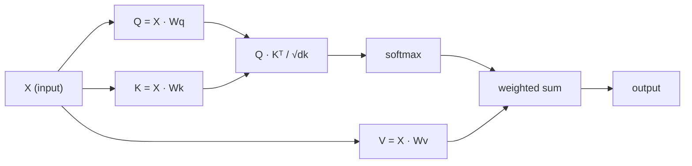

# 從零開始實作 Self-Attention (Self-Attention from Scratch)

> Attention 是一張查找表，每個字都問：「誰對我重要？」而且它會學會答案。

**Type:** Build
**Languages:** Python
**Prerequisites:** Phase 3 (Deep Learning Core), Phase 5 Lesson 10 (Sequence-to-Sequence)
**Time:** ~90 分鐘

## 學習目標 (Learning Objectives)

- 只用 NumPy，從零實作 scaled dot-product self-attention，包含 query/key/value projection 與 softmax 加權和
- 建構 multi-head attention 層：拆分 head、平行計算 attention，再把結果 concatenate 起來
- 追蹤 attention 矩陣如何捕捉 token 之間的關係，並解釋為什麼除以 $\sqrt{d_k}$ 可以避免 softmax 飽和
- 套用 causal masking，把雙向 attention 轉成 autoregressive（decoder 風格）的 attention

## 問題 (The Problem)

RNN 一次處理序列中的一個 token。等你走到第 50 個 token，第 1 個 token 的資訊已經被壓縮了 50 次。長距離依賴被擠進固定大小的 hidden state，這個瓶頸再多的 LSTM gating 也無法完全解決。

2014 年 Bahdanau 的 attention 論文提出了解法：讓 decoder 回頭看每個 encoder 位置，並決定哪些位置對目前這一步重要。但它仍然是接在 RNN 上。2017 年的 "Attention Is All You Need" 問了一個更尖銳的問題：如果 attention 是*唯一*的機制呢？沒有 recurrence。沒有 convolution。只有 attention。

Self-attention 讓序列中的每個位置，在單一平行步驟中 attend 到其他所有位置。這就是 transformer 又快、又能 scale、又稱霸的原因。

## 核心概念 (The Concept)

### 資料庫查找的類比 (The Database Lookup Analogy)

把 attention 想成一種軟性的資料庫查找：

```
Traditional database:
  Query: "capital of France"  -->  exact match  -->  "Paris"

Attention:
  Query: "capital of France"  -->  similarity to ALL keys  -->  weighted blend of ALL values
```

每個 token 會產生三個向量：
- **Query (Q)**：「我在找什麼？」
- **Key (K)**：「我包含什麼？」
- **Value (V)**：「如果我被選中，我提供什麼資訊？」

Query 與所有 key 的 dot product 會產生 attention score。分數高代表「這個 key 符合我的 query」。這些分數用來對 value 加權。輸出就是 value 的加權和。

### Q、K、V 的計算 (Q, K, V Computation)

每個 token embedding 會經過三個學習得來的權重矩陣投影：

```
Input embeddings (sequence of n tokens, each d-dimensional):

  X = [x1, x2, x3, ..., xn]       shape: (n, d)

Three weight matrices:

  Wq  shape: (d, dk)
  Wk  shape: (d, dk)
  Wv  shape: (d, dv)

Projections:

  Q = X @ Wq    shape: (n, dk)      each token's query
  K = X @ Wk    shape: (n, dk)      each token's key
  V = X @ Wv    shape: (n, dv)      each token's value
```

以單一 token 來看：

```
             Wq
  x_i ------[*]------> q_i    "What am I looking for?"
       |
       |     Wk
       +----[*]------> k_i    "What do I contain?"
       |
       |     Wv
       +----[*]------> v_i    "What do I offer?"
```

### Attention 矩陣 (The Attention Matrix)

有了所有 token 的 Q、K、V 之後，attention score 會組成一個矩陣：

```
Scores = Q @ K^T    shape: (n, n)

              k1    k2    k3    k4    k5
        +-----+-----+-----+-----+-----+
   q1   | 2.1 | 0.3 | 0.1 | 0.8 | 0.2 |   <- how much q1 attends to each key
        +-----+-----+-----+-----+-----+
   q2   | 0.4 | 1.9 | 0.7 | 0.1 | 0.3 |
        +-----+-----+-----+-----+-----+
   q3   | 0.2 | 0.6 | 2.3 | 0.5 | 0.1 |
        +-----+-----+-----+-----+-----+
   q4   | 0.9 | 0.1 | 0.4 | 1.7 | 0.6 |
        +-----+-----+-----+-----+-----+
   q5   | 0.1 | 0.3 | 0.2 | 0.5 | 2.0 |
        +-----+-----+-----+-----+-----+

Each row: one token's attention over the entire sequence
```

一次看一個 query 掃過所有 key：每一列為每個 token 打分，softmax 把分數轉成權重，而 context 向量就是 value 的加權混合。

```figure
attention-matrix
```

### 為什麼要縮放？ (Why Scale?)

Dot product 會隨著維度 $d_k$ 變大。如果 $d_k = 64$，dot product 的範圍可以到幾十，把 softmax 推進 gradient 消失的區域。解法：除以 $\sqrt{d_k}$。

```math
\text{Scaled scores} = \frac{Q K^T}{\sqrt{d_k}}
```

這能讓數值維持在 softmax 還能產生有用 gradient 的範圍內。

### Softmax 把分數變成權重 (Softmax Turns Scores into Weights)

Softmax 把原始分數轉換成每一列上的機率分布：

```
Raw scores for q1:   [2.1, 0.3, 0.1, 0.8, 0.2]
                            |
                         softmax
                            |
Attention weights:   [0.52, 0.09, 0.07, 0.14, 0.08]   (sums to ~1.0)
```

現在每個 token 都有一組權重，說明該對其他每個 token 投入多少注意力。

### Value 的加權和 (Weighted Sum of Values)

每個 token 的最終輸出，是所有 value 向量的加權和：

```
output_i = sum( attention_weight[i][j] * v_j  for all j )

For token 1:
  output_1 = 0.52 * v1 + 0.09 * v2 + 0.07 * v3 + 0.14 * v4 + 0.08 * v5
```

### 完整流程 (Full Pipeline)



一行寫完的公式：

```math
\text{Attention}(Q, K, V) = \mathop{\mathrm{softmax}}\left( \frac{Q K^T}{\sqrt{d_k}} \right) V
```

```figure
softmax-attention-scaling
```

## 動手做 (Build It)

```figure
iso-machine {"machine":"self-attention"}
```

### 步驟 1：從零實作 Softmax (Softmax from scratch)

Softmax 把原始 logit 轉成機率。先減去最大值以維持數值穩定。

```python
import numpy as np

def softmax(x):
    shifted = x - np.max(x, axis=-1, keepdims=True)
    exp_x = np.exp(shifted)
    return exp_x / np.sum(exp_x, axis=-1, keepdims=True)

logits = np.array([2.0, 1.0, 0.1])
print(f"logits:  {logits}")
print(f"softmax: {softmax(logits)}")
print(f"sum:     {softmax(logits).sum():.4f}")
```

### 步驟 2：Scaled dot-product attention (Scaled dot-product attention)

核心函式。接收 Q、K、V 矩陣，回傳 attention 輸出以及權重矩陣。

```python
def scaled_dot_product_attention(Q, K, V):
    dk = Q.shape[-1]
    scores = Q @ K.T / np.sqrt(dk)
    weights = softmax(scores)
    output = weights @ V
    return output, weights
```

### 步驟 3：帶有學習式 projection 的 Self-attention 類別 (Self-attention class with learned projections)

完整的 self-attention 模組，Wq、Wk、Wv 權重矩陣以類似 Xavier 的縮放方式初始化。

```python
class SelfAttention:
    def __init__(self, d_model, dk, dv, seed=42):
        rng = np.random.default_rng(seed)
        scale = np.sqrt(2.0 / (d_model + dk))
        self.Wq = rng.normal(0, scale, (d_model, dk))
        self.Wk = rng.normal(0, scale, (d_model, dk))
        scale_v = np.sqrt(2.0 / (d_model + dv))
        self.Wv = rng.normal(0, scale_v, (d_model, dv))
        self.dk = dk

    def forward(self, X):
        Q = X @ self.Wq
        K = X @ self.Wk
        V = X @ self.Wv
        output, weights = scaled_dot_product_attention(Q, K, V)
        return output, weights
```

### 步驟 4：在一個句子上執行 (Run it on a sentence)

為一個句子建立假的 embedding，然後觀察 attention 權重。

```python
sentence = ["The", "cat", "sat", "on", "the", "mat"]
n_tokens = len(sentence)
d_model = 8
dk = 4
dv = 4

rng = np.random.default_rng(42)
X = rng.normal(0, 1, (n_tokens, d_model))

attn = SelfAttention(d_model, dk, dv, seed=42)
output, weights = attn.forward(X)

print("Attention weights (each row: where that token looks):\n")
print(f"{'':>6}", end="")
for token in sentence:
    print(f"{token:>6}", end="")
print()

for i, token in enumerate(sentence):
    print(f"{token:>6}", end="")
    for j in range(n_tokens):
        w = weights[i][j]
        print(f"{w:6.3f}", end="")
    print()
```

### 步驟 5：用 ASCII 熱圖視覺化 attention (Visualize attention with ASCII heatmap)

把 attention 權重對應到字元，快速看出分布。

```python
def ascii_heatmap(weights, tokens, chars=" ░▒▓█"):
    n = len(tokens)
    print(f"\n{'':>6}", end="")
    for t in tokens:
        print(f"{t:>6}", end="")
    print()

    for i in range(n):
        print(f"{tokens[i]:>6}", end="")
        for j in range(n):
            level = int(weights[i][j] * (len(chars) - 1) / weights.max())
            level = min(level, len(chars) - 1)
            print(f"{'  ' + chars[level] + '   '}", end="")
        print()

ascii_heatmap(weights, sentence)
```

## 實際使用 (Use It)

PyTorch 的 `nn.MultiheadAttention` 做的事和我們建的一樣，另外加上 multi-head 拆分與輸出 projection：

```python
import torch
import torch.nn as nn

d_model = 8
n_heads = 2
seq_len = 6

mha = nn.MultiheadAttention(embed_dim=d_model, num_heads=n_heads, batch_first=True)

X_torch = torch.randn(1, seq_len, d_model)

output, attn_weights = mha(X_torch, X_torch, X_torch)

print(f"Input shape:            {X_torch.shape}")
print(f"Output shape:           {output.shape}")
print(f"Attention weight shape: {attn_weights.shape}")
print(f"\nAttn weights (averaged over heads):")
print(attn_weights[0].detach().numpy().round(3))
```

關鍵差異：multi-head attention 會平行執行多個 attention 函式，每個都有自己大小為 $d_k = d_{\text{model}} / n_{\text{heads}}$ 的 Q、K、V projection，然後把結果 concatenate 起來。這讓模型可以同時 attend 到不同類型的關係。

## 交付 (Ship It)

這堂課會產出：
- `outputs/prompt-attention-explainer.md` - 一個 prompt，用資料庫查找的類比來解釋 attention

## 練習 (Exercises)

1. 修改 `scaled_dot_product_attention`，讓它接受一個選用的 mask 矩陣，在 softmax 之前把特定位置設為負無限大（causal/decoder masking 就是這樣運作的）
2. 從零實作 multi-head attention：把 Q、K、V 拆成 `n_heads` 份，對每份執行 attention，concatenate 起來，再通過最後一個權重矩陣 Wo 做 projection
3. 取兩個長度相同但內容不同的句子，餵給同一個 SelfAttention 實例，比較它們的 attention 模式。什麼改變了？什麼維持不變？

## 關鍵術語 (Key Terms)

| 術語 | 一般說法 | 實際意義 |
|------|----------------|----------------------|
| Query (Q) | 「問題向量」 | 輸入的一種學習式 projection，代表這個 token 在尋找什麼資訊 |
| Key (K) | 「標籤向量」 | 一種學習式 projection，代表這個 token 包含什麼資訊，用來和 query 比對 |
| Value (V) | 「內容向量」 | 一種學習式 projection，攜帶實際的資訊，依 attention score 被聚合 |
| Scaled dot-product attention | 「attention 公式」 | $\mathop{\mathrm{softmax}}(QK^T / \sqrt{d_k}) V$ - 縮放可避免高維度下 softmax 飽和 |
| Self-attention | 「token 看自己也看別人」 | Q、K、V 都來自同一個序列的 attention，讓每個位置都能 attend 到其他所有位置 |
| Attention weights | 「投入多少注意力」 | 各位置上的機率分布，由縮放後的 dot product 經 softmax 產生 |
| Multi-head attention | 「平行的 attention」 | 用不同 projection 執行多個 attention 函式，再 concatenate 結果，得到更豐富的表示 |

## 延伸閱讀 (Further Reading)

- [Attention Is All You Need (Vaswani et al., 2017)](https://arxiv.org/abs/1706.03762) - 最初的 transformer 論文
- [The Illustrated Transformer (Jay Alammar)](https://jalammar.github.io/illustrated-transformer/) - 完整架構最好的視覺化導覽
- [The Annotated Transformer (Harvard NLP)](https://nlp.seas.harvard.edu/annotated-transformer/) - 逐行解說的 PyTorch 實作
