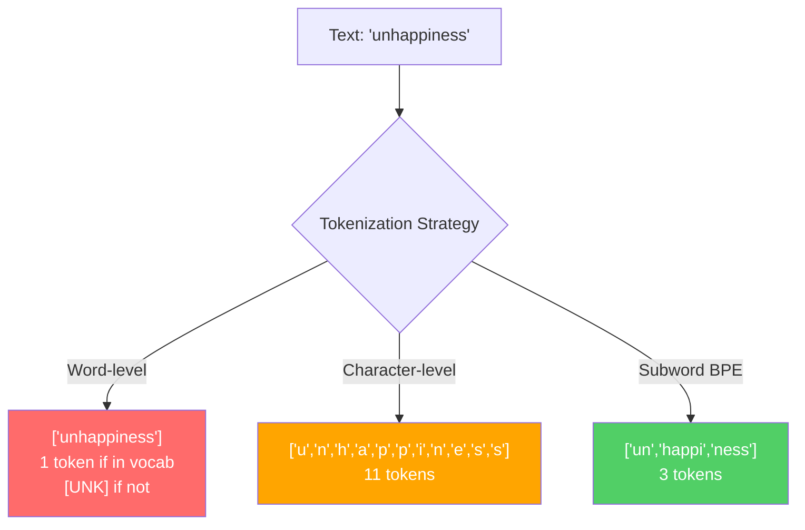
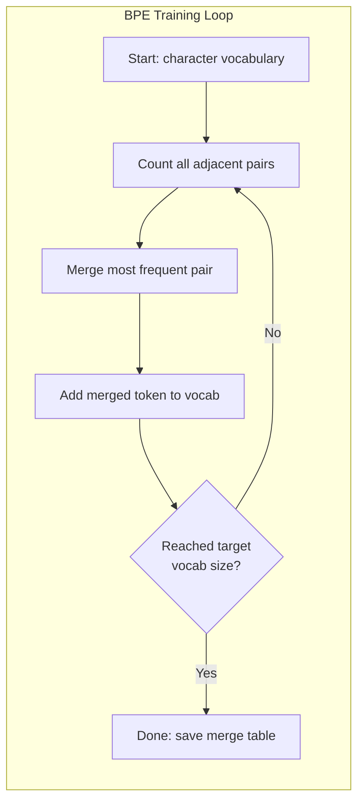
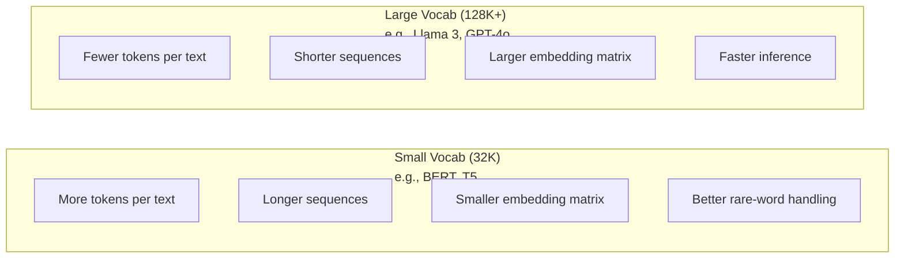

# Tokenizer：BPE、WordPiece、SentencePiece (Tokenizers: BPE, WordPiece, SentencePiece)

> 你的 LLM 不讀英文，它讀的是整數。這些整數是承載了意義，還是浪費掉了，全由 tokenizer 決定。

**Type:** Build
**Languages:** Python
**Prerequisites:** Phase 05 (NLP Foundations)
**Time:** ~90 分鐘

## 學習目標 (Learning Objectives)

- 從零實作 BPE、WordPiece 與 Unigram tokenization 演算法，並比較它們的 merge 策略
- 說明 vocabulary size 如何影響模型效率：太小會讓序列變長，太大會浪費 embedding 參數
- 分析不同語言與程式碼的 tokenization 瑕疵，找出特定 tokenizer 在哪些地方表現不佳
- 使用 tiktoken 與 sentencepiece 函式庫對文字做 tokenization，並檢視產生的 token ID

## 問題 (The Problem)

你的 LLM 不讀英文，也不讀任何語言。它讀的是數字。

"Hello, world!" 和 [15496, 11, 995, 0] 之間的落差，就是 tokenizer。每個字、每個空格、每個標點符號，都必須先轉成整數，模型才能處理。這個轉換並不中立。它會把一些假設烙進模型裡，之後再也無法撤銷。

如果做錯了，模型就會浪費容量，用好幾個 token 去編碼常見的字。"unfortunately" 變成四個 token，而不是一個。對於多音節單字很多的文字，你的 128K context window 瞬間縮水 75%。如果做對了，同樣的 context window 可以裝下兩倍的意義。「這個模型很會處理程式碼」和「這個模型一碰 Python 就卡住」之間的差別，往往就在 tokenizer 是怎麼訓練的。

你每次呼叫 GPT-4 或 Claude 的 API，都是按 token 計價。模型每產生一個 token 都要花運算資源。表示一段輸出所需的 token 越少，端到端的推論就越快。Tokenization 不是前處理，它是架構的一部分。

## 核心概念 (The Concept)

### 三種失敗的做法（以及一個勝出的）(Three Approaches That Failed (and One That Won))

把文字轉成數字，有三種顯而易見的方法。其中兩種無法在大規模下運作。

**Word-level tokenization** 依空格與標點切分。"The cat sat" 變成 ["The", "cat", "sat"]。簡單。但 "tokenization" 呢？或 "GPT-4o"？或像 "Geschwindigkeitsbegrenzung" 這種德文複合字呢？Word-level 需要一個巨大的 vocabulary，才能涵蓋每種語言的每個字。漏掉一個字，你就會得到可怕的 `[UNK]` token，也就是模型在說「我完全不知道這是什麼」。光是英文就有超過一百萬種字詞形式。再加上程式碼、URL、科學記號和另外 100 種語言，你需要的 vocabulary 就是無限大。

**Character-level tokenization** 走向另一個極端。"hello" 變成 ["h", "e", "l", "l", "o"]。Vocabulary 很小（幾百個字元），永遠不會有未知 token。但序列會變得極長。一個 word-level 只要 10 個 token 的句子，會變成 50 個 character-level token。模型得學會 "t"、"h"、"e" 湊在一起就是 "the"，把 attention 的容量耗在人類三歲就會的事情上。

**Subword tokenization** 找到了最佳平衡點。常見的字保持完整："the" 就是一個 token。罕見的字會被拆成有意義的片段："unhappiness" 變成 ["un", "happi", "ness"]。Vocabulary 大小維持在可控範圍（30K 到 128K 個 token）。序列也維持短。未知 token 基本上消失了，因為任何字都能用 subword 片段組出來。

所有現代 LLM 都使用 subword tokenization。GPT-2、GPT-4、BERT、Llama 3、Claude，全部都是。問題只在於用哪種演算法。



### BPE：Byte Pair Encoding (BPE: Byte Pair Encoding)

BPE 是一種貪婪式 (greedy) 壓縮演算法，被拿來做 tokenization。它的概念簡單到可以寫在一張索引卡上。

從單一字元開始。數出訓練語料中每一對相鄰字元的出現次數。把最常出現的那一對合併成一個新的 token。重複這個步驟，直到達到目標的 vocabulary size。

```figure
tokenizer-bpe
```

下面是 BPE 在一個很小的語料上執行的過程，語料中有 "lower"、"lowest" 和 "newest" 這幾個字：

```
Corpus (with word frequencies):
  "lower"  x5
  "lowest" x2
  "newest" x6

Step 0 -- Start with characters:
  l o w e r       (x5)
  l o w e s t     (x2)
  n e w e s t     (x6)

Step 1 -- Count adjacent pairs:
  (e,s): 8    (s,t): 8    (l,o): 7    (o,w): 7
  (w,e): 13   (e,r): 5    (n,e): 6    ...

Step 2 -- Merge most frequent pair (w,e) -> "we":
  l o we r        (x5)
  l o we s t      (x2)
  n e we s t      (x6)

Step 3 -- Recount and merge (e,s) -> "es":
  l o we r        (x5)
  l o we s t      (x2)    <- 'es' only forms from 'e'+'s', not 'we'+'s'
  n e we s t      (x6)    <- wait, the 'e' before 'we' and 's' after 'we'

Actually tracking this precisely:
  After "we" merge, remaining pairs:
  (l,o): 7   (o,we): 7   (we,r): 5   (we,s): 8
  (s,t): 8   (n,e): 6    (e,we): 6

Step 3 -- Merge (we,s) -> "wes" or (s,t) -> "st" (tied at 8, pick first):
  Merge (we,s) -> "wes":
  l o we r        (x5)
  l o wes t       (x2)
  n e wes t       (x6)

Step 4 -- Merge (wes,t) -> "west":
  l o we r        (x5)
  l o west        (x2)
  n e west        (x6)

...continue until target vocab size reached.
```

Merge table 就是 tokenizer 本身。要編碼新文字時，依照學到 merge 的順序逐一套用。訓練語料決定了有哪些 merge，而這個選擇會永久塑造模型看到的世界。



### Byte-Level BPE（GPT-2、GPT-3、GPT-4）(Byte-Level BPE (GPT-2, GPT-3, GPT-4))

標準 BPE 以 Unicode 字元為單位運作。Byte-level BPE 則以原始 byte（0-255）為單位。這讓你的基礎 vocabulary 剛好是 256，能處理任何語言或編碼，而且永遠不會產生未知 token。

GPT-2 率先採用這個做法。基礎 vocabulary 涵蓋所有可能的 byte，BPE 的 merge 則建立在它之上。OpenAI 的 tiktoken 函式庫實作了 byte-level BPE，各版本的 vocabulary size 如下：

- GPT-2：50,257 個 token
- GPT-3.5/GPT-4：約 100,256 個 token（cl100k_base 編碼）
- GPT-4o：200,019 個 token（o200k_base 編碼）

### WordPiece（BERT）(WordPiece (BERT))

WordPiece 看起來和 BPE 很像，但挑選 merge 的方式不同。它不看原始頻率，而是最大化訓練資料的 likelihood：

```
BPE merge criterion:      count(A, B)
WordPiece merge criterion: count(AB) / (count(A) * count(B))
```

BPE 問的是：「哪一對出現得最頻繁？」WordPiece 問的是：「哪一對一起出現的次數，比隨機碰巧發生的預期更多？」這個細微的差異會產生不同的 vocabulary。WordPiece 偏好那些共現出人意料的 merge，而不只是頻繁的 merge。

WordPiece 也會對接續的 subword 加上 "##" 前綴：

```
"unhappiness" -> ["un", "##happi", "##ness"]
"embedding"   -> ["em", "##bed", "##ding"]
```

"##" 前綴表示這個片段是接在前一個 token 後面。BERT 使用 WordPiece，vocabulary 為 30,522 個 token。所有 BERT 的變體也是如此，不過 DistilBERT 和 RoBERTa 的 tokenizer 其實是 BPE，只有 BERT 本身是 WordPiece。

### SentencePiece（Llama、T5）(SentencePiece (Llama, T5))

SentencePiece 把輸入當成一串原始的 Unicode 字元流，空白也算在內。沒有 pre-tokenization 步驟，也沒有任何針對特定語言的斷詞規則。這讓它真正做到與語言無關，對中文、日文、泰文這些不用空格分隔單字的語言也能運作。

SentencePiece 支援兩種演算法：
- **BPE 模式**：與標準 BPE 的 merge 邏輯相同，只是套用在原始字元序列上
- **Unigram 模式**：從一個很大的 vocabulary 開始，反覆移除對整體 likelihood 影響最小的 token。和 BPE 相反，是做剪枝 (prune) 而不是合併 (merge)。

Llama 2 使用 SentencePiece BPE，vocabulary 為 32,000 個 token。T5 使用 SentencePiece Unigram，同樣是 32,000 個 token。注意：Llama 3 改用以 tiktoken 為基礎的 byte-level BPE tokenizer，vocabulary 為 128,256 個 token。

### Vocabulary Size 的取捨 (Vocabulary Size Tradeoffs)

這是一個真實的工程決策，而且後果可以量測。



具體數字如下。以 128K vocabulary 搭配 4,096 維的 embedding 來說，光是 embedding 矩陣就有 128,000 x 4,096 = 5.24 億個參數。如果是 32K vocabulary，則是 1.31 億個參數。單單因為 tokenizer 的選擇，就差了 4 億個參數。

不過，較大的 vocabulary 壓縮文字的力道更強。同一段英文，用 32K vocabulary 可能要 100 個 token，用 128K vocabulary 可能只要 70 個。這代表生成時少了 30% 的 forward pass。對一個服務數百萬次請求的模型來說，這直接降低了運算成本。

趨勢很明顯：vocabulary size 越來越大。GPT-2 用 50,257，GPT-4 用約 100K，Llama 3 用 128K，GPT-4o 用 200K。

| 模型 | Vocab Size | Tokenizer 類型 | 每個英文單字平均 Token 數 |
|-------|-----------|----------------|---------------------------|
| BERT | 30,522 | WordPiece | ~1.4 |
| GPT-2 | 50,257 | Byte-level BPE | ~1.3 |
| Llama 2 | 32,000 | SentencePiece BPE | ~1.4 |
| GPT-4 | ~100,256 | Byte-level BPE | ~1.2 |
| Llama 3 | 128,256 | Byte-level BPE (tiktoken) | ~1.1 |
| GPT-4o | 200,019 | Byte-level BPE | ~1.0 |

### 多語言稅 (The Multilingual Tax)

主要用英文訓練的 tokenizer，對其他語言非常不友善。韓文在 GPT-2 的 tokenizer 裡，平均每個字要 2 到 3 個 token。中文可能更糟。這代表韓文使用者實際擁有的 context window 只有英文使用者的一半，付一樣的錢，卻得到較低的資訊密度。

這就是 Llama 3 把 vocabulary 從 32K 擴大四倍到 128K 的原因。有更多 token 分配給非英文的文字系統，各語言之間的壓縮就更公平。

```figure
tokenizer-tradeoff
```

## 動手做 (Build It)

### 步驟 1：Character-Level Tokenizer (Step 1: Character-Level Tokenizer)

從最基礎開始。Character-level tokenizer 把每個字元對應到它的 Unicode code point。不需要訓練，沒有未知 token，只是一個直接的對應。

```python
class CharTokenizer:
    def encode(self, text):
        return [ord(c) for c in text]

    def decode(self, tokens):
        return "".join(chr(t) for t in tokens)
```

"hello" 變成 [104, 101, 108, 108, 111]。每個字元都是自己的 token。這就是我們要改進的基準線。

### 步驟 2：從零寫出 BPE Tokenizer (Step 2: BPE Tokenizer from Scratch)

真正的實作。我們在原始 byte 上訓練（像 GPT-2 一樣），數出各個 pair，合併最頻繁的那一對，並依序記錄每一次 merge。Merge table 就是 tokenizer。

```python
from collections import Counter

class BPETokenizer:
    def __init__(self):
        self.merges = {}
        self.vocab = {}

    def _get_pairs(self, tokens):
        pairs = Counter()
        for i in range(len(tokens) - 1):
            pairs[(tokens[i], tokens[i + 1])] += 1
        return pairs

    def _merge_pair(self, tokens, pair, new_token):
        merged = []
        i = 0
        while i < len(tokens):
            if i < len(tokens) - 1 and tokens[i] == pair[0] and tokens[i + 1] == pair[1]:
                merged.append(new_token)
                i += 2
            else:
                merged.append(tokens[i])
                i += 1
        return merged

    def train(self, text, num_merges):
        tokens = list(text.encode("utf-8"))
        self.vocab = {i: bytes([i]) for i in range(256)}

        for i in range(num_merges):
            pairs = self._get_pairs(tokens)
            if not pairs:
                break
            best_pair = max(pairs, key=pairs.get)
            new_token = 256 + i
            tokens = self._merge_pair(tokens, best_pair, new_token)
            self.merges[best_pair] = new_token
            self.vocab[new_token] = self.vocab[best_pair[0]] + self.vocab[best_pair[1]]

        return self

    def encode(self, text):
        tokens = list(text.encode("utf-8"))
        for pair, new_token in self.merges.items():
            tokens = self._merge_pair(tokens, pair, new_token)
        return tokens

    def decode(self, tokens):
        byte_sequence = b"".join(self.vocab[t] for t in tokens)
        return byte_sequence.decode("utf-8", errors="replace")
```

訓練迴圈是 BPE 的核心：數 pair、合併贏家、重複。每次 merge 都會減少 token 總數。經過 `num_merges` 輪之後，vocabulary 會從 256（基礎 byte）成長到 256 + num_merges。

編碼時，要嚴格依照學到的順序套用 merge。這很重要。如果 merge 1 產生了 "th"，merge 5 產生了 "the"，編碼時就必須先套用 merge 1，這樣 merge 5 才能用 "th" + "e" 組出 "the"。

解碼則是反過來：查出每個 token ID 在 vocabulary 裡對應的內容，把 byte 串接起來，再解碼成 UTF-8。

### 步驟 3：編碼與解碼的往返測試 (Step 3: Encode and Decode Roundtrip)

```python
corpus = (
    "The cat sat on the mat. The cat ate the rat. "
    "The dog sat on the log. The dog ate the frog. "
    "Natural language processing is the study of how computers "
    "understand and generate human language. "
    "Tokenization is the first step in any NLP pipeline."
)

tokenizer = BPETokenizer()
tokenizer.train(corpus, num_merges=40)

test_sentences = [
    "The cat sat on the mat.",
    "Natural language processing",
    "tokenization pipeline",
    "unhappiness",
]

for sentence in test_sentences:
    encoded = tokenizer.encode(sentence)
    decoded = tokenizer.decode(encoded)
    raw_bytes = len(sentence.encode("utf-8"))
    ratio = len(encoded) / raw_bytes
    print(f"'{sentence}'")
    print(f"  Tokens: {len(encoded)} (from {raw_bytes} bytes) -- ratio: {ratio:.2f}")
    print(f"  Roundtrip: {'PASS' if decoded == sentence else 'FAIL'}")
```

Compression ratio 告訴你 tokenizer 的效率有多好。0.50 的比率代表 tokenizer 把文字壓縮到只剩原始 byte 數的一半 token。越低越好。在訓練語料上，這個比率會很漂亮。但對於語料外的文字，例如 "unhappiness"（它沒有出現在語料中），比率就會變差，因為 tokenizer 遇到沒看過的模式時，會退回 character-level 編碼。

### 步驟 4：與 tiktoken 比較 (Step 4: Compare with tiktoken)

```python
import tiktoken

enc = tiktoken.get_encoding("cl100k_base")

texts = [
    "The cat sat on the mat.",
    "unhappiness",
    "Hello, world!",
    "def fibonacci(n): return n if n < 2 else fibonacci(n-1) + fibonacci(n-2)",
    "Geschwindigkeitsbegrenzung",
]

for text in texts:
    our_tokens = tokenizer.encode(text)
    tiktoken_tokens = enc.encode(text)
    tiktoken_pieces = [enc.decode([t]) for t in tiktoken_tokens]
    print(f"'{text}'")
    print(f"  Our BPE:   {len(our_tokens)} tokens")
    print(f"  tiktoken:  {len(tiktoken_tokens)} tokens -> {tiktoken_pieces}")
```

tiktoken 使用完全相同的演算法，只是用數百 GB 的文字訓練，做了 100,000 次 merge。演算法是一樣的，差別在於訓練資料和 merge 的次數。你用一段文字、40 次 merge 訓練出來的 tokenizer，比不過 tiktoken 在龐大語料上的 100K 次 merge。但背後的機制是一樣的。

### 步驟 5：Vocabulary 分析 (Step 5: Vocabulary Analysis)

```python
def analyze_vocabulary(tokenizer, test_texts):
    total_tokens = 0
    total_chars = 0
    token_usage = Counter()

    for text in test_texts:
        encoded = tokenizer.encode(text)
        total_tokens += len(encoded)
        total_chars += len(text)
        for t in encoded:
            token_usage[t] += 1

    print(f"Vocabulary size: {len(tokenizer.vocab)}")
    print(f"Total tokens across all texts: {total_tokens}")
    print(f"Total characters: {total_chars}")
    print(f"Avg tokens per character: {total_tokens / total_chars:.2f}")

    print(f"\nMost used tokens:")
    for token_id, count in token_usage.most_common(10):
        token_bytes = tokenizer.vocab[token_id]
        display = token_bytes.decode("utf-8", errors="replace")
        print(f"  Token {token_id:4d}: '{display}' (used {count} times)")

    unused = [t for t in tokenizer.vocab if t not in token_usage]
    print(f"\nUnused tokens: {len(unused)} out of {len(tokenizer.vocab)}")
```

這揭露了你的 vocabulary 中的 Zipf 分布。少數 token 佔了絕大多數（空格、"the"、"e"），大部分 token 很少被用到。正式的 tokenizer 會針對這種分布做最佳化：常見的模式拿到較短的 token ID，罕見的模式則用較長的表示法。

## 實際使用 (Use It)

你從零寫的 BPE 能運作了。現在來看看正式的工具長什麼樣子。

### tiktoken (OpenAI)

```python
import tiktoken

enc = tiktoken.get_encoding("cl100k_base")

text = "Tokenizers convert text to integers"
tokens = enc.encode(text)
print(f"Tokens: {tokens}")
print(f"Pieces: {[enc.decode([t]) for t in tokens]}")
print(f"Roundtrip: {enc.decode(tokens)}")
```

tiktoken 以 Rust 撰寫，並提供 Python binding。它每秒可編碼數百萬個 token。同樣的 BPE 演算法，但是工業級的實作。

### Hugging Face tokenizers

```python
from tokenizers import Tokenizer
from tokenizers.models import BPE
from tokenizers.trainers import BpeTrainer
from tokenizers.pre_tokenizers import ByteLevel

tokenizer = Tokenizer(BPE())
tokenizer.pre_tokenizer = ByteLevel()

trainer = BpeTrainer(vocab_size=1000, special_tokens=["<pad>", "<eos>", "<unk>"])
tokenizer.train(["corpus.txt"], trainer)

output = tokenizer.encode("The cat sat on the mat.")
print(f"Tokens: {output.tokens}")
print(f"IDs: {output.ids}")
```

Hugging Face 的 tokenizers 函式庫底層也是 Rust。它可以在幾秒內，對 GB 等級的語料訓練 BPE。當你要訓練自己的模型時，就是用這個。

### 載入 Llama 的 Tokenizer (Loading Llama's Tokenizer)

```python
from transformers import AutoTokenizer

tokenizer = AutoTokenizer.from_pretrained("meta-llama/Llama-3.1-8B")

text = "Tokenizers are the unsung heroes of LLMs"
tokens = tokenizer.encode(text)
print(f"Token IDs: {tokens}")
print(f"Tokens: {tokenizer.convert_ids_to_tokens(tokens)}")
print(f"Vocab size: {tokenizer.vocab_size}")

multilingual = ["Hello world", "Hola mundo", "Bonjour le monde"]
for text in multilingual:
    ids = tokenizer.encode(text)
    print(f"'{text}' -> {len(ids)} tokens")
```

Llama 3 的 128K vocabulary 在壓縮非英文文字上，明顯比 GPT-2 的 50K vocabulary 好。你可以自己驗證：把同一個句子用多種語言編碼，然後數 token 數。

## 交付 (Ship It)

這堂課會產生 `outputs/prompt-tokenizer-analyzer.md`，這是一個可重複使用的 prompt，用來分析任何文字與模型組合的 tokenization 效率。給它一段文字樣本，它就會告訴你哪個模型的 tokenizer 處理得最好。

## 練習 (Exercises)

1. 修改 BPE tokenizer，讓它在每個 merge 步驟印出 vocabulary。觀察 "t" + "h" 如何變成 "th"，接著 "th" + "e" 如何變成 "the"。追蹤常見的英文單字是如何一片一片組起來的。

2. 為 BPE tokenizer 加入 special token（`<pad>`、`<eos>`、`<unk>`）。把它們的 ID 指定為 0、1、2，並將其他所有 token 相應往後移。實作一個 pre-tokenization 步驟，在執行 BPE 之前先依空白切分。

3. 實作 WordPiece 的 merge 準則（用 likelihood ratio 取代頻率）。用同一份語料、相同的 merge 次數，分別訓練 BPE 與 WordPiece。比較兩者產生的 vocabulary：哪一個產生的 subword 在語言學上更有意義？

4. 建立一個多語言 tokenizer 效率的 benchmark。取英文、西班牙文、中文、韓文和阿拉伯文各 10 個句子，用 tiktoken (cl100k_base) 對每個句子做 tokenization，並量測每個字元的平均 token 數。量化每種語言的「多語言稅」。

5. 用更大的語料（下載一篇 Wikipedia 文章）訓練你的 BPE tokenizer。調整 merge 次數，讓 compression ratio 落在 tiktoken 在同一段文字上的 10% 以內。這會逼你理解語料大小、merge 次數與壓縮品質之間的關係。

## 關鍵術語 (Key Terms)

| 術語 | 一般說法 | 實際意義 |
|------|----------------|----------------------|
| Token | 「一個字」 | 模型 vocabulary 裡的一個單位，可能是字元、subword、單字，或多個字組成的片段 |
| BPE | 「某種壓縮的東西」 | Byte Pair Encoding，反覆合併最常出現的相鄰 token pair，直到達到目標 vocabulary size |
| WordPiece | 「BERT 的 tokenizer」 | 和 BPE 類似，但 merge 是最大化 likelihood ratio count(AB)/(count(A)*count(B))，而不是原始頻率 |
| SentencePiece | 「某個 tokenizer 函式庫」 | 與語言無關的 tokenizer，直接處理原始 Unicode、不做 pre-tokenization，支援 BPE 與 Unigram 演算法 |
| Vocabulary size | 「它認識多少字」 | 不重複 token 的總數：GPT-2 是 50,257，BERT 是 30,522，Llama 3 是 128,256 |
| Fertility | 「不是 tokenizer 的術語」 | 每個單字的平均 token 數，用來衡量 tokenizer 跨語言的效率（1.0 是完美，3.0 代表模型要多做三倍的工） |
| Byte-level BPE | 「GPT 的 tokenizer」 | 以原始 byte（0-255）而非 Unicode 字元為單位的 BPE，保證任何輸入都不會出現未知 token |
| Merge table | 「tokenizer 檔案」 | 訓練時學到的 pair merge 有序清單。它就是 tokenizer，而且順序很重要 |
| Pre-tokenization | 「依空格切分」 | 在 subword tokenization 之前套用的規則：空白切分、數字分離、標點處理 |
| Compression ratio | 「tokenizer 有多有效率」 | 產生的 token 數除以輸入的 byte 數，越低代表壓縮越好、推論越快 |

## 延伸閱讀 (Further Reading)

- [Sennrich et al., 2016 -- "Neural Machine Translation of Rare Words with Subword Units"](https://arxiv.org/abs/1508.07909)：把 BPE 引入 NLP 的論文，讓 1994 年的壓縮演算法成為現代 tokenization 的基礎
- [Kudo & Richardson, 2018 -- "SentencePiece: A simple and language independent subword tokenizer"](https://arxiv.org/abs/1808.06226)：與語言無關的 tokenization，讓多語言模型變得可行
- [OpenAI tiktoken repository](https://github.com/openai/tiktoken)：以 Rust 撰寫、附 Python binding 的正式 BPE 實作，用於 GPT-3.5/4/4o
- [Hugging Face Tokenizers documentation](https://huggingface.co/docs/tokenizers)：具備 Rust 效能的正式級 tokenizer 訓練
