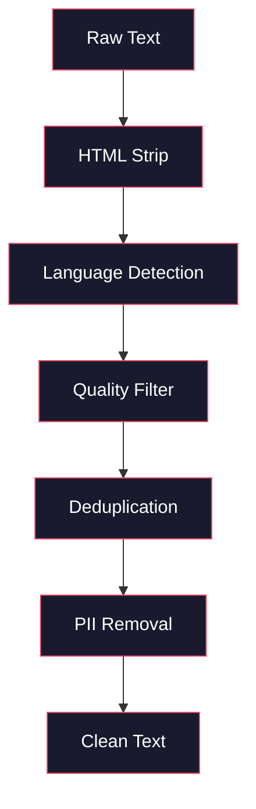
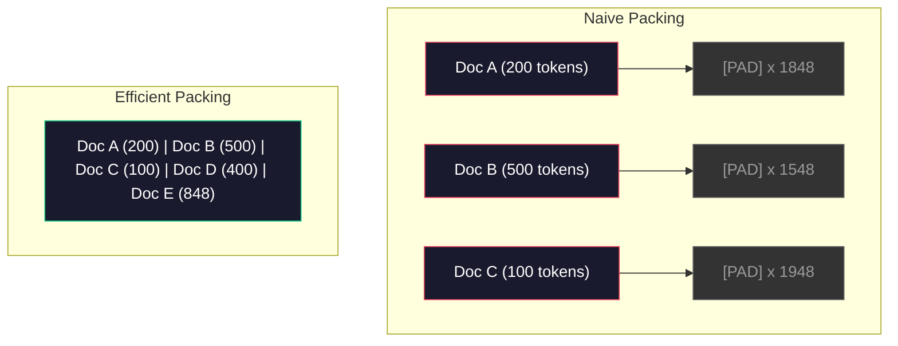

# Pre-Training 的資料管線 (Data Pipelines for Pre-Training)

> 模型是一面鏡子，餵它什麼資料，它就反映什麼。餵它垃圾，它就用完美流暢的語句反映垃圾。

**Type:** Build
**Languages:** Python
**Prerequisites:** Phase 10, Lessons 01-02 (Tokenizers, Building a Tokenizer)
**Time:** ~90 分鐘

## 學習目標 (Learning Objectives)

- 建立串流式資料管線，對 TB 等級的文字做 tokenize、切塊、shuffle 與 batch，而不必全部載入記憶體
- 實作真實 pre-training 管線中使用的資料品質過濾器（去重、語言偵測、內容過濾）
- 建立固定長度的訓練序列，並正確處理 attention mask 與文件邊界
- 分析管線吞吐量，確保 dataloader 跟得上 GPU 的訓練速度

## 問題 (The Problem)

你已經有 tokenizer 了。現在你需要資料。

不是一個 dataset，也不是一個 CSV 檔。而是 TB 等級的文字：經過清理、去重、品質過濾，被 tokenize 成固定長度的序列，並以隨機化的 batch 供應，而且速度要快到你的 8-GPU 叢集永遠不用等下一個 batch。

大多數人以為訓練 LLM 的重點是模型架構。其實不是。Llama 3 用了 15.6 兆個 token。GPT-3 用了 3,000 億個。DeepSeek-V2 用了 8.1 兆個。這三者的架構大致相同：堆疊的 transformer block，加上 attention 與 feedforward 層。輸出品質的差異，絕大部分來自資料。

DeepMind 的 Chinchilla 論文把這件事講得很精確。在給定的運算預算下，模型參數量與訓練 token 數之間有一個最佳比例。Chinchilla 指出，2022 年的大多數模型都嚴重訓練不足，也就是參數太多、看過的資料卻太少。一個用 1.4 兆個 token 訓練的 70B 參數模型（Chinchilla-optimal），表現勝過用 3,000 億個 token 訓練的 280B 模型（Gopher）。

你的資料管線決定了模型學到的是語言，還是雜訊。

## 核心概念 (The Concept)

### 資料從哪裡來 (Where the Data Comes From)

每個大型語言模型都是用多種來源混合訓練的。對大多數實驗室來說，確切的組成是高度機密，但我們知道的已足以理解這些類別。

| 來源 | 大小 | 品質 | 使用者 |
|--------|------|---------|---------|
| Common Crawl | 原始約 250 TB | 低（需要大量過濾） | GPT-3、Llama、大多數開放模型 |
| Wikipedia | 約 20 GB | 高 | 每個主要 LLM |
| GitHub code | 約 1 TB+ | 中（大量重複與無用程式碼） | StarCoder、CodeLlama、DeepSeek-Coder |
| 書籍 (BookCorpus, Pile) | 約 100 GB | 高 | GPT-2、GPT-3、早期模型 |
| 學術論文 (arXiv, S2ORC) | 約 100 GB | STEM 領域高 | Llama、Galactica |
| StackOverflow, Reddit | 約 100 GB | 中 | Llama、Falcon |
| 精選網頁 (C4, RefinedWeb) | 約 5 TB | 中高（已預先過濾） | T5、Falcon |

Llama 3 公開了它的資料組成：大約 50% 網頁資料、25% 程式碼、13% 書籍與學術論文、8% 數學資料，以及 4% 多語言網頁資料。總計 15.6 兆個 token，來自超過 5 TB 的原始文字。

比例和總量一樣重要。網頁資料太多，模型會變成 Reddit 鸚鵡。程式碼太少，它就不會寫程式。數學太少，推理就會失敗。把這個配比調對，是訓練 LLM 最困難的部分之一，而且沒有公式，需要靠實驗與評估。

### 資料清理 (Data Cleaning)

原始的網頁資料非常髒。一份典型的 Common Crawl dump 包含：

- HTML 標籤與 JavaScript
- 重複出現的頁首、頁尾、導覽選單
- 重複頁面（完全重複與近似重複）
- 機器產生的垃圾內容
- 個人可識別資訊 (PII)
- 低品質文字（關鍵字清單、SEO 垃圾內容）
- 被編碼成文字的非文字內容

清理這些不是可有可無的。這決定了你得到的是能產生連貫段落的模型，還是輸出 HTML 標籤夾雜商品清單的模型。



每個步驟都會排除一類雜訊：

**HTML stripping：** 移除所有標記，只保留看得見的文字內容。像 `trafilatura` 或 `readability` 這類函式庫，可以擷取文章內容，同時丟掉導覽列、廣告和樣板文字。

**Language detection：** 用 fastText 的語言辨識模型 (lid.176.bin) 對每份文件分類，再過濾出你的目標語言。一份被分類為英文、但信心低於 0.8 的文件，大概不是乾淨的英文。

**Quality filtering：** 這部分最有趣。RefinedWeb（Falcon 背後的資料集）使用以 perplexity 為基礎的過濾器：先用 Wikipedia 訓練一個小型語言模型，再替每份文件打分數。高 perplexity 代表這份文件和 Wikipedia 不像，很可能是垃圾內容、關鍵字清單或機器產生的內容。Perplexity 超過門檻的文件會被移除。

**Deduplication：** 影響最大的單一清理步驟。Common Crawl 含有大量重複的頁面，像是法律免責聲明、cookie 通知、服務條款。用重複資料訓練會浪費運算資源，也可能讓模型把特定段落一字不差地記下來再吐出來。

**PII removal：** 姓名、電子郵件地址、電話號碼、身分證字號。結構化的 PII 用 regex 偵測，上下文中的姓名則用 NER 模型。

### 用 MinHash 去重 (Deduplication with MinHash)

完全重複的去重很簡單：對每份文件做 hash，移除重複者。但近似重複才是真正的問題。同一篇新聞報導的兩份副本，周圍的廣告略有不同，就是近似重複。內容有 95% 一樣，但逐 byte 比對卻不同。

MinHash 加上 Locality-Sensitive Hashing (LSH) 可以有效率地解決這個問題。


概念如下：

1. **Shingling：** 把每份文件轉成 n-gram 的集合（例如單字或字元的 5-gram）。"the quick brown fox" 以 3 個字為單位的 shingle，會變成 {"the quick brown", "quick brown fox"}。

2. **MinHash：** 對每份文件的 shingle 集合，計算 k 個 hash 值。每個 hash 值，是在不同 hash function 下，所有 shingle 中最小的 hash。這會產生一個固定大小的「簽章」，可以近似任兩份文件之間的 Jaccard similarity。

3. **LSH：** 依據 MinHash 簽章的各個 band，把文件分到不同的 bucket。落在同一個 bucket 的文件，就是候選的近似重複。這樣就不用比較每一對，只要比較候選者。

4. **Verify：** 對每個候選配對，計算精確的 Jaccard similarity。如果相似度超過門檻（通常是 0.8），就移除其中一份。

Llama 團隊回報，他們透過去重移除了大約 38% 的網頁資料。這不是小數字。Common Crawl 有超過三分之一是重複或近似重複的內容。

### Sequence Packing (Sequence Packing)

你的模型期待固定長度的輸入序列，而你的文件長度不一。有的只有 50 個 token，有的有 50,000 個 token。

天真的做法：把每份文件都 padding 到最大序列長度。這會把大量運算浪費在對學習毫無貢獻的 padding token 上。

比較好的做法：把多份文件 pack 進同一條序列，中間用 end-of-sequence token 隔開。一條 2048 個 token 的序列，可能包含三份短文件，彼此以 [EOS] token 串接。



Attention mask 必須設定正確。同一條 packed 序列中，文件 A 的 token 不應該 attend 到文件 B 的 token。這需要 block-diagonal attention mask。

過長的文件會在序列邊界被截斷或切成多塊。切分點很重要：從句子中間切開，會讓模型看到不完整的想法。有些管線會盡可能把切分點對齊段落或句子的邊界。

### Chinchilla Scaling Law (The Chinchilla Scaling Law)

在固定的運算預算 $C$（以 FLOPs 計算）下，最佳的模型大小 $N$ 與資料集大小 $D$ 遵循：

```math
\begin{aligned}
N_{\text{opt}} &\sim C^{0.5} \\
D_{\text{opt}} &\sim C^{0.5}
\end{aligned}
```

實務上，這代表你應該讓模型大小與資料集大小大致等比例成長。參數多 10 倍的模型，需要大約多 10 倍的訓練 token，才能達到相同的 loss。

| 模型 | 參數量 | 訓練 Token 數 | Chinchilla-Optimal？ |
|-------|-----------|----------------|-------------------|
| GPT-3 | 175B | 300B | 否（訓練不足 3-4 倍） |
| Chinchilla | 70B | 1.4T | 是（設計如此） |
| Llama 2 | 70B | 2T | Overtrained（刻意為之） |
| Llama 3 | 70B | 15T | 嚴重 overtrained |

Llama 3 刻意違反 Chinchilla law。Meta 發現，用遠超 compute-optimal 比例的更多資料做 overtraining，能得到推論時表現更好的模型。額外的訓練成本只付一次，但較小的模型在長期服務上永遠比較便宜。這有時被稱為「inference-optimal」scaling 做法，自 2024 年起已成為業界標準。

```figure
l5-data-pipeline
```

## 動手做 (Build It)

### 步驟 1：文字清理 (Step 1: Text Cleaning)

移除 HTML、正規化空白、移除非文字內容。我們會用公有領域的文字 (Project Gutenberg) 當作小型語料。

```python
import re

def clean_text(text):
    text = re.sub(r"<[^>]+>", "", text)
    text = re.sub(r"http\S+", "", text)
    text = re.sub(r"[^\x20-\x7E\n]", "", text)
    text = re.sub(r"\n{3,}", "\n\n", text)
    text = re.sub(r" {2,}", " ", text)
    return text.strip()

def quality_filter(text, min_words=50, max_ratio_caps=0.3, max_ratio_special=0.1):
    words = text.split()
    if len(words) < min_words:
        return False
    caps_ratio = sum(1 for w in words if w.isupper()) / len(words)
    if caps_ratio > max_ratio_caps:
        return False
    special_chars = sum(1 for c in text if not c.isalnum() and not c.isspace())
    if special_chars / max(len(text), 1) > max_ratio_special:
        return False
    return True
```

品質過濾器會抓出 SEO 垃圾內容（全大寫）、機器產生的雜訊（特殊字元比例過高）以及空殼頁面（太短）。光是這三項檢查，就能從網頁爬取資料中移除出乎意料多的垃圾。

### 步驟 2：MinHash 去重 (Step 2: MinHash Deduplication)

從零實作 MinHash。不需要外部函式庫，只用 `hashlib`。

```python
import hashlib
from collections import defaultdict

def get_shingles(text, k=5):
    words = text.lower().split()
    if len(words) < k:
        return set()
    return {" ".join(words[i:i+k]) for i in range(len(words) - k + 1)}

def minhash_signature(shingles, num_hashes=128):
    signature = []
    for i in range(num_hashes):
        min_hash = float("inf")
        for shingle in shingles:
            h = int(hashlib.sha256(f"{i}:{shingle}".encode()).hexdigest(), 16)
            min_hash = min(min_hash, h)
        signature.append(min_hash)
    return signature

def lsh_buckets(signature, bands=16):
    rows_per_band = len(signature) // bands
    buckets = []
    for b in range(bands):
        start = b * rows_per_band
        band_data = tuple(signature[start:start + rows_per_band])
        bucket_hash = hashlib.md5(str(band_data).encode()).hexdigest()
        buckets.append((b, bucket_hash))
    return buckets

def deduplicate(documents, threshold=0.8, num_hashes=128, bands=16):
    signatures = []
    shingle_sets = []
    for doc in documents:
        shingles = get_shingles(doc)
        shingle_sets.append(shingles)
        signatures.append(minhash_signature(shingles, num_hashes))

    bucket_map = defaultdict(list)
    for doc_idx, sig in enumerate(signatures):
        for band_id, bucket_hash in lsh_buckets(sig, bands):
            bucket_map[(band_id, bucket_hash)].append(doc_idx)

    duplicate_pairs = set()
    for bucket_docs in bucket_map.values():
        if len(bucket_docs) < 2:
            continue
        for i in range(len(bucket_docs)):
            for j in range(i + 1, len(bucket_docs)):
                duplicate_pairs.add((bucket_docs[i], bucket_docs[j]))

    removed = set()
    for i, j in duplicate_pairs:
        if i in removed or j in removed:
            continue
        s1, s2 = shingle_sets[i], shingle_sets[j]
        if not s1 or not s2:
            continue
        jaccard = len(s1 & s2) / len(s1 | s2)
        if jaccard >= threshold:
            removed.add(j)

    return [doc for idx, doc in enumerate(documents) if idx not in removed], len(removed)
```

`num_hashes=128` 和 `bands=16` 這兩個參數控制 precision 與 recall 的取捨。hash 越多，相似度的估計越準確。band 越多，recall 越高（抓到更多重複），代價是更多的 false positive。這些值對一般網頁文字效果不錯。

### 步驟 3：Tokenize 並 Pack 序列 (Step 3: Tokenize and Pack Sequences)

取得乾淨、去重後的文字，做 tokenize，再 pack 成固定長度的序列供訓練使用。

```python
def tokenize_corpus(documents, tokenizer):
    all_tokens = []
    for doc in documents:
        tokens = tokenizer.encode(doc)
        all_tokens.extend(tokens)
        all_tokens.append(tokenizer.eos_id)
    return all_tokens

def pack_sequences(token_ids, seq_length, pad_id=0):
    sequences = []
    attention_masks = []
    for i in range(0, len(token_ids), seq_length):
        seq = token_ids[i:i + seq_length]
        mask = [1] * len(seq)
        if len(seq) < seq_length:
            pad_count = seq_length - len(seq)
            seq = seq + [pad_id] * pad_count
            mask = mask + [0] * pad_count
        sequences.append(seq)
        attention_masks.append(mask)
    return sequences, attention_masks
```

### 步驟 4：訓練用的 DataLoader (Step 4: DataLoader for Training)

產出隨機化的 packed 序列 batch。訓練迴圈消耗的就是這個。

```python
import random

class PreTrainingDataLoader:
    def __init__(self, sequences, attention_masks, batch_size, shuffle=True):
        self.sequences = sequences
        self.attention_masks = attention_masks
        self.batch_size = batch_size
        self.shuffle = shuffle

    def __len__(self):
        return (len(self.sequences) + self.batch_size - 1) // self.batch_size

    def __iter__(self):
        indices = list(range(len(self.sequences)))
        if self.shuffle:
            random.shuffle(indices)
        for start in range(0, len(indices), self.batch_size):
            batch_idx = indices[start:start + self.batch_size]
            batch_seqs = [self.sequences[i] for i in batch_idx]
            batch_masks = [self.attention_masks[i] for i in batch_idx]
            yield batch_seqs, batch_masks
```

### 步驟 5：資料集統計 (Step 5: Dataset Statistics)

計算重要的數字：總 token 數、不重複 token 數、compression ratio、文件長度分布。

```python
from collections import Counter

def compute_statistics(documents, token_ids, sequences, tokenizer_vocab_size):
    total_chars = sum(len(d) for d in documents)
    total_tokens = len(token_ids)
    unique_tokens = len(set(token_ids))
    compression_ratio = total_chars / total_tokens

    doc_lengths = [len(d.split()) for d in documents]
    avg_doc_length = sum(doc_lengths) / max(len(doc_lengths), 1)
    max_doc_length = max(doc_lengths) if doc_lengths else 0
    min_doc_length = min(doc_lengths) if doc_lengths else 0

    token_counts = Counter(token_ids)
    top_tokens = token_counts.most_common(10)

    non_pad_tokens = sum(sum(1 for t in seq if t != 0) for seq in sequences)
    total_positions = sum(len(seq) for seq in sequences)
    utilization = non_pad_tokens / max(total_positions, 1)

    stats = {
        "total_documents": len(documents),
        "total_characters": total_chars,
        "total_tokens": total_tokens,
        "unique_tokens": unique_tokens,
        "vocab_utilization": unique_tokens / tokenizer_vocab_size,
        "compression_ratio": compression_ratio,
        "avg_doc_length_words": avg_doc_length,
        "max_doc_length_words": max_doc_length,
        "min_doc_length_words": min_doc_length,
        "num_sequences": len(sequences),
        "sequence_utilization": utilization,
        "top_10_tokens": top_tokens,
    }
    return stats
```

Compression ratio 告訴你 tokenizer 在這份語料上的效率。英文文字通常壓縮到每個 token 約 3 到 4 個字元。如果你看到每個 token 只有 1.5 個字元，代表 tokenizer 切得太細了。如果看到 8 個以上，代表它學到了非常偏向特定領域的 merge。

Sequence utilization 告訴你 packed 序列中，有多少是真正的資料、多少是 padding。低於 90% 代表你的 packing 沒效率，你把運算浪費在 padding token 上。

## 實際使用 (Use It)

### 與 HuggingFace Datasets 比較 (Compare With HuggingFace Datasets)

透過 HuggingFace 的 datasets 函式庫載入同一份語料，比較管線速度。

```python
from datasets import load_dataset
from transformers import AutoTokenizer

ds = load_dataset("wikitext", "wikitext-2-raw-v1", split="train")
tokenizer = AutoTokenizer.from_pretrained("meta-llama/Meta-Llama-3-8B")

import time

start = time.time()
tokenized = ds.map(
    lambda x: tokenizer(x["text"], truncation=True, max_length=2048),
    batched=True,
    num_proc=4,
)
hf_time = time.time() - start
total_tokens = sum(len(t) for t in tokenized["input_ids"])
print(f"HuggingFace: {total_tokens:,} tokens in {hf_time:.2f}s ({total_tokens/hf_time:,.0f} tokens/sec)")
```

HuggingFace 的管線底層使用 Rust tokenizer，並在 4 個核心上平行處理。你的純 Python 管線會慢 10 到 50 倍。這個差距就是正式團隊使用編譯式 tokenizer 的原因。演算法相同，差別在於實作的語言。

## 交付 (Ship It)

這堂課會產出一個 prompt，用來驗證與除錯 LLM 訓練管線中的資料品質。請見 `outputs/prompt-data-quality-checker.md`。

## 練習 (Exercises)

1. **簡單：** 用簡單的啟發式方法（字元集分析）為清理管線加入語言偵測。只保留英文文件，並計算有多少文件被移除。
2. **中等：** 在 MinHash 近似去重之外，另外用 SHA-256 hash 實作完全重複的去重。在網頁爬取的語料上，比較兩種方法各自抓到的重複數量。
3. **困難：** 建立以 perplexity 為基礎的品質過濾器。用 Wikipedia 文字訓練一個小型 bigram 語言模型，依 perplexity 替每份文件打分數，並移除最差的 20%。比較用過濾前與過濾後的資料訓練時，模型輸出的品質。

## 關鍵術語 (Key Terms)

| 術語 | 一般說法 | 實際意義 |
|------|----------------|----------------------|
| Common Crawl | 「網際網路」 | 一個每月爬取網頁的非營利組織，原始資料約 250TB，是大多數 LLM 訓練資料的起點 |
| MinHash | 「某種 hash 技巧」 | 用固定大小的簽章來估計集合之間 Jaccard similarity 的技術，讓大規模的近似重複偵測成為可能 |
| LSH | 「Locality-Sensitive Hashing」 | 把相似項目分到同一個 bucket 的方法，將兩兩比較的次數從 $O(n^2)$ 降到接近線性 |
| Sequence packing | 「把文件串起來」 | 在正確的 attention mask 下，把多份文件塞進固定長度的序列，消除 padding 的浪費 |
| Chinchilla scaling | 「用更多資料訓練」 | 在固定運算預算下，要達到最佳表現，需要讓模型大小與訓練 token 數大致等比例成長 |
| Fertility | 「每個字的 token 數」 | 每個單字的平均 token 數，GPT-4 的英文約 1.3，非拉丁文字更高 |
| Data mixing | 「挑選訓練資料」 | 程式碼、文字、數學與多語言資料的比例，沒有公式，需要實驗 |
| Perplexity filter | 「品質評分」 | 用小型語言模型替文件評分，高 perplexity 代表文字和乾淨的參考資料不像 |
| Deduplication | 「移除副本」 | 排除完全重複與近似重複的文件，通常會移除 30-40% 的原始網頁資料 |
| Attention mask | 「該看哪些 token」 | 一個二元 mask，防止 packed 序列中的 attention 跨越文件邊界 |

## 延伸閱讀 (Further Reading)

- [Hoffmann et al., 2022 -- Training Compute-Optimal Large Language Models (Chinchilla)](https://arxiv.org/abs/2203.15556)：改變我們對資料規模看法的論文
- [Penedo et al., 2023 -- The RefinedWeb Dataset for Falcon LLM](https://arxiv.org/abs/2306.01116)：如何把 Common Crawl 過濾成高品質資料
- [Touvron et al., 2023 -- Llama 2: Open Foundation and Fine-Tuned Chat Models](https://arxiv.org/abs/2307.09288)：Llama 2 資料管線的細節
- [Lee et al., 2022 -- Deduplicating Training Data Makes Language Models Better](https://arxiv.org/abs/2107.06499)：為什麼去重比你想的更重要
- [Broder, 1997 -- On the Resemblance and Containment of Documents](https://ieeexplore.ieee.org/document/666900)：MinHash 的原始論文
- [Meta, 2024 -- Llama 3 Technical Report](https://arxiv.org/abs/2407.21783)：15.6T token、資料混合比例、過濾管線
