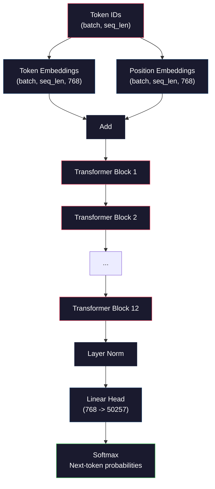
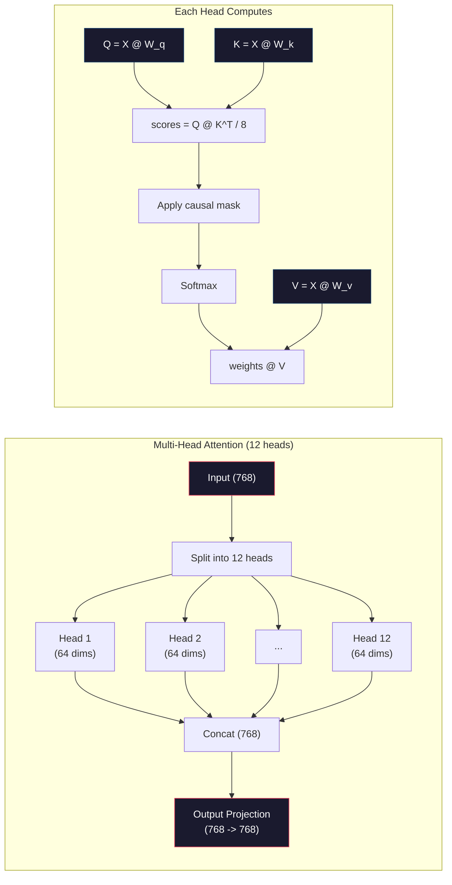
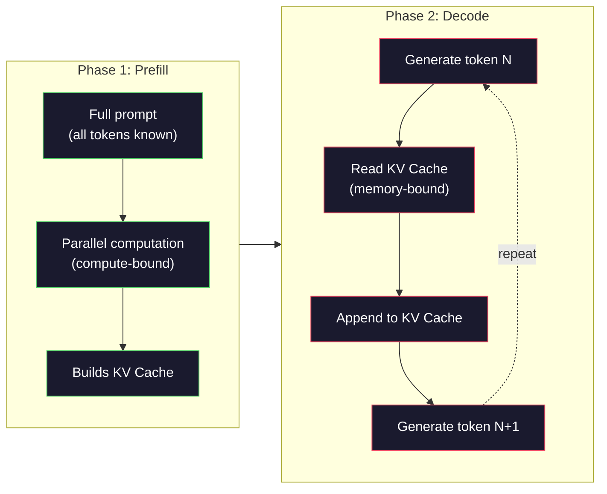

# Pre-Training 一個 Mini GPT（124M 參數）(Pre-Training a Mini GPT (124M Parameters))

> GPT-2 Small 有 1.24 億個參數，包含 12 層 transformer、12 個 attention head，以及 768 維的 embedding。你可以在單張 GPU 上，花幾個小時從零訓練它。大多數人從來沒做過，他們直接用 pre-trained checkpoint。但如果你沒有自己訓練過一個，你就不是真的了解，你拿來做產品的那個模型，內部到底發生了什麼事。

**Type:** Build
**Languages:** Python (with numpy)
**Prerequisites:** Phase 10, Lessons 01-03 (Tokenizers, Building a Tokenizer, Data Pipelines)
**Time:** ~120 分鐘

## 學習目標 (Learning Objectives)

- 從零實作完整的 GPT-2 架構（124M 參數）：token embedding、positional embedding、transformer block 與 language model head
- 用 next-token prediction 搭配 cross-entropy loss，在文字語料上訓練 GPT 模型
- 實作自迴歸 (autoregressive) 文字生成，包含 temperature sampling 與 top-k/top-p 過濾
- 監控訓練 loss 曲線，並驗證模型確實學到連貫的語言模式

## 問題 (The Problem)

你知道 transformer 是什麼。你看過那些圖。你能背出 "attention is all you need"，也能在白板上畫出標著 "Multi-Head Attention" 的方框。

但這些都不代表你懂模型在生成文字時，到底發生了什麼事。

GPT-2 Small 有 124,438,272 個參數（含 weight tying）。每一個參數，都是跑訓練迴圈設定出來的：forward pass、計算 loss、backward pass、更新權重。十二個 transformer block。每個 block 有十二個 attention head。768 維的 embedding 空間。50,257 個 token 的 vocabulary。模型每產生一個 token，這 1.24 億個參數都會參與同一條矩陣乘法鏈，把一串 token ID 轉成下一個 token 的機率分布。

如果你從來沒有自己打造過這個，你面對的就是一個黑盒子。你可以用 API，可以做 fine-tuning。但當事情出錯時，比如模型產生幻覺 (hallucinate)、重複自己的話、拒絕遵守指令，你對於*為什麼*會這樣，完全沒有心智模型。

這堂課要從零打造 GPT-2 Small。不用 PyTorch，用 numpy。每一個矩陣乘法都看得見，每一個 gradient 都由你的程式計算。你會清楚看到，這 1.24 億個數字是如何一起合作，預測下一個字。

## 核心概念 (The Concept)

### GPT 架構 (The GPT Architecture)

GPT 是一個自迴歸語言模型。「自迴歸」的意思是它一次產生一個 token，每個 token 都以前面所有的 token 為條件。這個架構是一疊 transformer decoder block。

下面是從 token ID 到下一個 token 機率的完整計算圖：

1. Token ID 進來。Shape：(batch_size, seq_len)。
2. 查 token embedding。每個 ID 對應到一個 768 維向量。Shape：(batch_size, seq_len, 768)。
3. 查 position embedding。每個位置（0, 1, 2, ...）對應到一個 768 維向量。Shape 相同。
4. 把 token embedding 與 position embedding 相加。
5. 通過 12 個 transformer block。
6. 最後一層 layer normalization。
7. 線性投影到 vocabulary 大小。Shape：(batch_size, seq_len, vocab_size)。
8. 用 softmax 得到機率。

這就是整個模型。沒有 convolution，沒有 recurrence。只有 embedding、attention、feedforward network 與 layer norm，堆疊 12 次。



### Transformer Block (The Transformer Block)

12 個 block 都遵循同樣的模式。採用 pre-norm 架構（GPT-2 用 pre-norm，不像最初的 transformer 用 post-norm）：

1. LayerNorm
2. Multi-Head Self-Attention
3. Residual connection（把輸入加回來）
4. LayerNorm
5. Feed-Forward Network (MLP)
6. Residual connection（把輸入加回來）

Residual connection 至關重要。沒有它，backpropagation 時 gradient 在傳到 block 1 之前就已經消失了。有了它，gradient 可以透過「skip」路徑，直接從 loss 流向任何一層。這就是為什麼你可以堆疊 12、32，甚至 96 個 block（傳聞 GPT-4 用了 120 個）。

### Attention：核心機制 (Attention: The Core Mechanism)

Self-attention 讓每個 token 去看前面的每個 token，並決定要對每一個投入多少注意力。數學如下。

對每個 token 位置，從輸入計算出三個向量：
- **Query (Q)**：「我在找什麼？」
- **Key (K)**：「我包含什麼？」
- **Value (V)**：「我帶有什麼資訊？」

```
Q = input @ W_q    (768 -> 768)
K = input @ W_k    (768 -> 768)
V = input @ W_v    (768 -> 768)

attention_scores = Q @ K^T / sqrt(d_k)
attention_scores = mask(attention_scores)   # causal mask: -inf for future positions
attention_weights = softmax(attention_scores)
output = attention_weights @ V
```

Causal mask 讓 GPT 成為自迴歸模型。位置 5 可以 attend 到位置 0-5，但不能 attend 到 6、7、8 等等。這避免模型在訓練時偷看未來的 token 來「作弊」。

**Multi-head attention** 把 768 維的空間切成 12 個 head，每個 64 維。每個 head 學習不同的 attention 模式。某個 head 可能追蹤語法關係（主詞與動詞的一致性），另一個可能追蹤語意相似性（同義詞），再一個可能追蹤位置的鄰近性（相鄰的字）。12 個 head 的輸出會被串接起來，再投影回 768 維。



除以 $\sqrt{d_k}$（也就是 $\sqrt{64} = 8$）是縮放 (scaling)。沒有它，高維向量的內積會變得很大，把 softmax 推進 gradient 幾乎為零的區域。這是最初的 "Attention Is All You Need" 論文中的關鍵洞見之一。

### KV Cache：為什麼推論很快 (KV Cache: Why Inference Is Fast)

訓練時，你一次處理整條序列。推論時，你一次產生一個 token。如果不做最佳化，產生第 $N$ 個 token 需要重新計算前面 $N-1$ 個 token 的 attention。每產生一個 token 是 $O(N^2)$，長度為 $N$ 的序列總共就是 $O(N^3)$。

KV Cache 解決了這個問題。算出每個 token 的 K 和 V 之後，把它們存起來。產生第 $N+1$ 個 token 時，你只需要為新 token 計算 Q，並查找先前所有 token 已快取的 K 和 V。這讓 K 和 V 的每個 token 計算成本從 $O(N)$ 降到 $O(1)$。Attention 分數的計算仍然是 $O(N)$，因為你要 attend 到所有先前的位置，但你避免了對輸入做重複的矩陣乘法。

對於 12 層、12 個 head 的 GPT-2，KV cache 每個 token 要存 2 (K + V) x 12 層 x 12 個 head x 64 維 = 18,432 個值。對於 1024 個 token 的序列，以 FP32 計算大約是 75MB。對於 128 層的 Llama 3 405B，單一序列的 KV cache 可能超過 10GB。這就是長 context 推論受限於記憶體 (memory-bound) 的原因。

### Prefill 與 Decode：推論的兩個階段 (Prefill vs Decode: Two Phases of Inference)

當你把 prompt 送給 LLM 時，推論分成兩個截然不同的階段。

**Prefill** 平行處理你的整個 prompt。所有 token 都已知，所以模型可以同時計算所有位置的 attention。這個階段受限於運算 (compute-bound)，GPU 全速做矩陣乘法。對 A100 上一個 1000 個 token 的 prompt，prefill 大約花 20-50ms。

**Decode** 一次產生一個 token。每個新 token 都依賴前面所有的 token。這個階段受限於記憶體 (memory-bound)：瓶頸在於從 GPU 記憶體讀取模型權重與 KV cache，而不是矩陣運算本身。GPU 的運算核心大部分時間都閒著，等記憶體讀取。以 GPT-2 來說，不管 matmul 需要多少 FLOPs，每個 decode 步驟花的時間大致相同，因為限制在記憶體頻寬。

這個區別對正式系統很重要。Prefill 的吞吐量隨 GPU 運算能力成長（FLOPS 越多，prefill 越快）。Decode 的吞吐量則隨記憶體頻寬成長（記憶體越快，decode 越快）。這就是為什麼 NVIDIA 的 H100 相較 A100，把重點放在記憶體頻寬的提升，因為這直接加快 token 的生成。



### 訓練迴圈 (The Training Loop)

訓練 LLM 就是 next-token prediction。給定 token [0, 1, 2, ..., N-1]，預測 token [1, 2, 3, ..., N]。Loss function 是模型預測的機率分布與實際下一個 token 之間的 cross-entropy。

一個訓練步驟：

1. **Forward pass**：讓 batch 通過全部 12 個 block，得到每個位置的 logit（softmax 之前的分數）。
2. **計算 loss**：logit 與目標 token（輸入位移一個位置）之間的 cross-entropy。
3. **Backward pass**：用 backpropagation 計算全部 124M 個參數的 gradient。
4. **Optimizer step**：更新權重。GPT-2 使用 Adam，搭配 learning rate warmup 與 cosine decay。

Learning rate 的排程比你想的更重要。GPT-2 在前 2,000 步把 learning rate 從 0 暖機 (warmup) 到峰值，然後依 cosine 曲線衰減。一開始就用高 learning rate 會讓模型發散。一直維持高 learning rate 則會在後期訓練造成震盪。先 warmup 再 decay 的模式，被每個主要 LLM 採用。

### GPT-2 Small：各項數字 (GPT-2 Small: The Numbers)

| 元件 | Shape | 參數量 |
|-----------|-------|------------|
| Token embeddings | (50257, 768) | 38,597,376 |
| Position embeddings | (1024, 768) | 786,432 |
| 每個 block 的 attention ($W_q, W_k, W_v, W_{\text{out}}$) | 4 x (768, 768) | 2,359,296 |
| 每個 block 的 FFN (up + down) | (768, 3072) + (3072, 768) | 4,718,592 |
| 每個 block 的 LayerNorm (2x) | 2 x 768 x 2 | 3,072 |
| 最後的 LayerNorm | 768 x 2 | 1,536 |
| **每個 block 合計** | | **7,080,960** |
| **總計（12 個 block）** | | **85,054,464 + 39,383,808 = 124,438,272** |

輸出投影（logits head）與 token embedding 矩陣共用權重。這稱為 weight tying，它讓參數量減少 38M，也提升表現，因為它迫使模型對輸入與輸出使用同一個表示空間。

## 動手做 (Build It)

```figure
iso-machine {"machine":"mini-gpt"}
```

### 步驟 1：Embedding 層 (Step 1: Embedding Layer)

Token embedding 把 50,257 個可能的 token 各自對應到一個 768 維向量。Position embedding 加入每個 token 在序列中所處位置的資訊。兩者相加。

```python
import numpy as np

class Embedding:
    def __init__(self, vocab_size, embed_dim, max_seq_len):
        self.token_embed = np.random.randn(vocab_size, embed_dim) * 0.02
        self.pos_embed = np.random.randn(max_seq_len, embed_dim) * 0.02

    def forward(self, token_ids):
        seq_len = token_ids.shape[-1]
        tok_emb = self.token_embed[token_ids]
        pos_emb = self.pos_embed[:seq_len]
        return tok_emb + pos_emb
```

初始化用的標準差 0.02 來自 GPT-2 論文。太大的話，最初的 forward pass 會產生極端值，使訓練不穩定。太小的話，初始輸出對所有輸入幾乎都一樣，讓早期的 gradient 訊號毫無用處。

### 步驟 2：帶 Causal Mask 的 Self-Attention (Step 2: Self-Attention with Causal Mask)

先做單一 head 的 attention。Causal mask 在 softmax 之前，把未來位置設為負無限大，確保每個位置只能 attend 到自己和更早的位置。

```python
def attention(Q, K, V, mask=None):
    d_k = Q.shape[-1]
    scores = Q @ K.transpose(0, -1, -2 if Q.ndim == 4 else 1) / np.sqrt(d_k)
    if mask is not None:
        scores = scores + mask
    weights = np.exp(scores - scores.max(axis=-1, keepdims=True))
    weights = weights / weights.sum(axis=-1, keepdims=True)
    return weights @ V
```

Softmax 的實作在取指數之前，先減去最大值。沒有這一步，exp(很大的數字) 會溢位成無限大。這是一個數值穩定性的技巧，不會改變輸出，因為對任何常數 $c$，都有 $\mathop{\mathrm{softmax}}(x - c) = \mathop{\mathrm{softmax}}(x)$。

### 步驟 3：Multi-Head Attention (Step 3: Multi-Head Attention)

把 768 維的輸入切成 12 個 head，每個 64 維。每個 head 獨立計算 attention。把結果串接起來，再投影回 768 維。

```python
class MultiHeadAttention:
    def __init__(self, embed_dim, num_heads):
        self.num_heads = num_heads
        self.head_dim = embed_dim // num_heads
        self.W_q = np.random.randn(embed_dim, embed_dim) * 0.02
        self.W_k = np.random.randn(embed_dim, embed_dim) * 0.02
        self.W_v = np.random.randn(embed_dim, embed_dim) * 0.02
        self.W_out = np.random.randn(embed_dim, embed_dim) * 0.02

    def forward(self, x, mask=None):
        batch, seq_len, d = x.shape
        Q = (x @ self.W_q).reshape(batch, seq_len, self.num_heads, self.head_dim).transpose(0, 2, 1, 3)
        K = (x @ self.W_k).reshape(batch, seq_len, self.num_heads, self.head_dim).transpose(0, 2, 1, 3)
        V = (x @ self.W_v).reshape(batch, seq_len, self.num_heads, self.head_dim).transpose(0, 2, 1, 3)

        scores = Q @ K.transpose(0, 1, 3, 2) / np.sqrt(self.head_dim)
        if mask is not None:
            scores = scores + mask
        weights = np.exp(scores - scores.max(axis=-1, keepdims=True))
        weights = weights / weights.sum(axis=-1, keepdims=True)
        attn_out = weights @ V

        attn_out = attn_out.transpose(0, 2, 1, 3).reshape(batch, seq_len, d)
        return attn_out @ self.W_out
```

reshape、transpose、再 reshape 這一連串動作，是 multi-head attention 最令人困惑的地方。實際發生的事是：(batch, seq_len, 768) 的 tensor 變成 (batch, seq_len, 12, 64)，再變成 (batch, 12, seq_len, 64)。現在 12 個 head 各自有一個 (seq_len, 64) 的矩陣可以跑 attention。Attention 之後，我們把過程反過來：(batch, 12, seq_len, 64) 變成 (batch, seq_len, 12, 64)，再變成 (batch, seq_len, 768)。

### 步驟 4：Transformer Block (Step 4: Transformer Block)

一個完整的 transformer block：LayerNorm、帶 residual 的 multi-head attention、LayerNorm、帶 residual 的 feedforward。

```python
class LayerNorm:
    def __init__(self, dim, eps=1e-5):
        self.gamma = np.ones(dim)
        self.beta = np.zeros(dim)
        self.eps = eps

    def forward(self, x):
        mean = x.mean(axis=-1, keepdims=True)
        var = x.var(axis=-1, keepdims=True)
        return self.gamma * (x - mean) / np.sqrt(var + self.eps) + self.beta


class FeedForward:
    def __init__(self, embed_dim, ff_dim):
        self.W1 = np.random.randn(embed_dim, ff_dim) * 0.02
        self.b1 = np.zeros(ff_dim)
        self.W2 = np.random.randn(ff_dim, embed_dim) * 0.02
        self.b2 = np.zeros(embed_dim)

    def forward(self, x):
        h = x @ self.W1 + self.b1
        h = np.maximum(0, h)  # GELU approximation: ReLU for simplicity
        return h @ self.W2 + self.b2


class TransformerBlock:
    def __init__(self, embed_dim, num_heads, ff_dim):
        self.ln1 = LayerNorm(embed_dim)
        self.attn = MultiHeadAttention(embed_dim, num_heads)
        self.ln2 = LayerNorm(embed_dim)
        self.ffn = FeedForward(embed_dim, ff_dim)

    def forward(self, x, mask=None):
        x = x + self.attn.forward(self.ln1.forward(x), mask)
        x = x + self.ffn.forward(self.ln2.forward(x))
        return x
```

Feedforward network 把 768 維的輸入擴展到 3,072 維（4 倍），套用非線性函數，再投影回 768。這種先擴張再收縮的模式，讓模型在每個位置都有一個「更寬」的內部表示可以使用。GPT-2 使用 GELU activation，但我們這裡為了簡單用 ReLU。對理解架構來說，兩者差異不大。

### 步驟 5：完整的 GPT 模型 (Step 5: Full GPT Model)

堆疊 12 個 transformer block。前面加上 embedding 層，後面加上輸出投影。

```python
class MiniGPT:
    def __init__(self, vocab_size=50257, embed_dim=768, num_heads=12,
                 num_layers=12, max_seq_len=1024, ff_dim=3072):
        self.embedding = Embedding(vocab_size, embed_dim, max_seq_len)
        self.blocks = [
            TransformerBlock(embed_dim, num_heads, ff_dim)
            for _ in range(num_layers)
        ]
        self.ln_f = LayerNorm(embed_dim)
        self.vocab_size = vocab_size
        self.embed_dim = embed_dim

    def forward(self, token_ids):
        seq_len = token_ids.shape[-1]
        mask = np.triu(np.full((seq_len, seq_len), -1e9), k=1)

        x = self.embedding.forward(token_ids)
        for block in self.blocks:
            x = block.forward(x, mask)
        x = self.ln_f.forward(x)

        logits = x @ self.embedding.token_embed.T
        return logits

    def count_parameters(self):
        total = 0
        total += self.embedding.token_embed.size
        total += self.embedding.pos_embed.size
        for block in self.blocks:
            total += block.attn.W_q.size + block.attn.W_k.size
            total += block.attn.W_v.size + block.attn.W_out.size
            total += block.ffn.W1.size + block.ffn.b1.size
            total += block.ffn.W2.size + block.ffn.b2.size
            total += block.ln1.gamma.size + block.ln1.beta.size
            total += block.ln2.gamma.size + block.ln2.beta.size
        total += self.ln_f.gamma.size + self.ln_f.beta.size
        return total
```

注意 weight tying：`logits = x @ self.embedding.token_embed.T`。輸出投影重複使用 token embedding 矩陣（轉置後）。這不只是省參數的技巧，它代表模型用同一個向量空間來理解 token（embedding）和預測 token（輸出）。

### 步驟 6：訓練迴圈 (Step 6: Training Loop)

要真的訓練 124M 參數，你需要 GPU 和 PyTorch。這個訓練迴圈用一個可以在純 numpy 上跑的小模型，示範其中的機制。我們用一個很小的模型（4 層、4 個 head、128 維），讓它可以順利執行。

```python
def cross_entropy_loss(logits, targets):
    batch, seq_len, vocab_size = logits.shape
    logits_flat = logits.reshape(-1, vocab_size)
    targets_flat = targets.reshape(-1)

    max_logits = logits_flat.max(axis=-1, keepdims=True)
    log_softmax = logits_flat - max_logits - np.log(
        np.exp(logits_flat - max_logits).sum(axis=-1, keepdims=True)
    )

    loss = -log_softmax[np.arange(len(targets_flat)), targets_flat].mean()
    return loss


def train_mini_gpt(text, vocab_size=256, embed_dim=128, num_heads=4,
                   num_layers=4, seq_len=64, num_steps=200, lr=3e-4):
    tokens = np.array(list(text.encode("utf-8")[:2048]))
    model = MiniGPT(
        vocab_size=vocab_size, embed_dim=embed_dim, num_heads=num_heads,
        num_layers=num_layers, max_seq_len=seq_len, ff_dim=embed_dim * 4
    )

    print(f"Model parameters: {model.count_parameters():,}")
    print(f"Training tokens: {len(tokens):,}")
    print(f"Config: {num_layers} layers, {num_heads} heads, {embed_dim} dims")
    print()

    for step in range(num_steps):
        start_idx = np.random.randint(0, max(1, len(tokens) - seq_len - 1))
        batch_tokens = tokens[start_idx:start_idx + seq_len + 1]

        input_ids = batch_tokens[:-1].reshape(1, -1)
        target_ids = batch_tokens[1:].reshape(1, -1)

        logits = model.forward(input_ids)
        loss = cross_entropy_loss(logits, target_ids)

        if step % 20 == 0:
            print(f"Step {step:4d} | Loss: {loss:.4f}")

    return model
```

Loss 起始值接近 ln(vocab_size)。以 256 個 token 的 byte-level vocabulary 來說，就是 ln(256) = 5.55。隨機模型會給每個 token 相同的機率。隨著訓練進行，loss 會下降，因為模型學會預測常見的模式："t" 之後接 "h"、句號之後接空格，諸如此類。

在正式環境中，你會使用 Adam optimizer，搭配 gradient accumulation、learning rate warmup 與 gradient clipping。forward pass、loss、backward、update 的迴圈是一樣的，只是 optimizer 更精密。

### 步驟 7：文字生成 (Step 7: Text Generation)

生成時，用訓練好的模型一次預測一個 token。每次預測都從輸出分布中取樣（或貪婪地取 argmax）。

```python
def generate(model, prompt_tokens, max_new_tokens=100, temperature=0.8):
    tokens = list(prompt_tokens)
    seq_len = model.embedding.pos_embed.shape[0]

    for _ in range(max_new_tokens):
        context = np.array(tokens[-seq_len:]).reshape(1, -1)
        logits = model.forward(context)
        next_logits = logits[0, -1, :]

        next_logits = next_logits / temperature
        probs = np.exp(next_logits - next_logits.max())
        probs = probs / probs.sum()

        next_token = np.random.choice(len(probs), p=probs)
        tokens.append(next_token)

    return tokens
```

Temperature 控制隨機性。Temperature 1.0 使用原始分布。Temperature 0.5 讓分布更尖銳（更確定性，模型更常選它的首選）。Temperature 1.5 讓分布更平坦（更隨機，低機率的 token 有更大的機會）。Temperature 0.0 是貪婪解碼 (greedy decoding)，永遠選機率最高的 token。

`tokens[-seq_len:]` 這個視窗是必要的，因為模型有最大的 context 長度（GPT-2 是 1024）。一旦超過，你就必須丟掉最舊的 token。這就是大家常說的「context window」。

```figure
sampling-decoder
```

## 實際使用 (Use It)

### 完整的訓練與生成示範 (Full Training and Generation Demo)

```python
corpus = """The transformer architecture has revolutionized natural language processing.
Attention mechanisms allow the model to focus on relevant parts of the input.
Self-attention computes relationships between all pairs of positions in a sequence.
Multi-head attention splits the representation into multiple subspaces.
Each attention head can learn different types of relationships.
The feedforward network provides nonlinear transformations at each position.
Residual connections enable gradient flow through deep networks.
Layer normalization stabilizes training by normalizing activations.
Position embeddings give the model information about token ordering.
The causal mask ensures autoregressive generation during training.
Pre-training on large text corpora teaches the model general language understanding.
Fine-tuning adapts the pre-trained model to specific downstream tasks."""

model = train_mini_gpt(corpus, num_steps=200)

prompt = list("The transformer".encode("utf-8"))
output_tokens = generate(model, prompt, max_new_tokens=100, temperature=0.8)
generated_text = bytes(output_tokens).decode("utf-8", errors="replace")
print(f"\nGenerated: {generated_text}")
```

用小型語料搭配小型模型，生成的文字最多只能算半連貫。它會從訓練文字中學到一些 byte 層級的模式，但無法像 GPT-2 那樣泛化，後者用了 40GB 的訓練資料與完整的 124M 參數架構。重點不在輸出品質，而在於你可以追蹤每一個步驟：embedding 查找、attention 計算、feedforward 轉換、logit 投影、softmax 與取樣。每個運算都看得見。

## 交付 (Ship It)

這堂課會產出 `outputs/prompt-gpt-architecture-analyzer.md`，這是一個用來分析任何 GPT 風格模型架構選擇的 prompt。把 model card 或技術報告餵給它，它就會拆解參數的配置、attention 設計與 scaling 決策。

## 練習 (Exercises)

1. 修改模型，改用 24 層、16 個 head，而不是 12/12。計算參數量。把深度加倍，和把寬度（embedding 維度）加倍相比，有何差異？

2. 實作 GELU activation function $(\mathop{\mathrm{GELU}}(x) = x \cdot 0.5 \cdot (1 + \mathop{\mathrm{erf}}(x / \sqrt{2})))$，並取代 feedforward network 裡的 ReLU。分別用兩種 activation 訓練 500 步，比較最終的 loss。

3. 為生成函式加入 KV cache。在第一次 forward pass 之後，儲存每一層的 K 和 V tensor，並在後續 token 中重複使用。量測加速幅度：分別在有 cache 與沒有 cache 的情況下生成 200 個 token，比較實際花費的時間。

4. 實作 top-k sampling（只考慮機率最高的 k 個 token）與 top-p sampling（nucleus sampling：考慮累積機率超過 p 的最小 token 集合）。比較在 temperature 0.8 下，top-k=50 與 top-p=0.95 的輸出品質。

5. 建立訓練 loss 曲線的繪圖工具。訓練模型 1000 步，並畫出 loss 對步數的圖。找出三個階段：快速的初期下降（學習常見的 byte）、較慢的中段（學習 byte 模式），以及平穩期（在小語料上 overfitting）。不管你訓練的是 128 維的模型還是 GPT-4，這條曲線的形狀都是一樣的。

## 關鍵術語 (Key Terms)

| 術語 | 一般說法 | 實際意義 |
|------|----------------|----------------------|
| Autoregressive | 「它一次產生一個字」 | 每個輸出 token 都以前面所有 token 為條件，模型預測的是 P(token_n \| token_0, ..., token_{n-1}) |
| Causal mask | 「它看不到未來」 | 由 -infinity 組成的上三角矩陣，在訓練時防止 attention 看到未來的位置 |
| Multi-head attention | 「多種 attention 模式」 | 把 Q、K、V 切成平行的 head（例如 GPT-2 是 12 個各 64 維的 head），讓每個 head 學習不同類型的關係 |
| KV Cache | 「為了速度而快取」 | 儲存先前 token 已算出的 Key 與 Value tensor，避免自迴歸生成時重複運算 |
| Prefill | 「處理 prompt」 | 推論的第一階段，所有 prompt token 平行處理，受限於 GPU 的 FLOPS (compute-bound) |
| Decode | 「生成 token」 | 推論的第二階段，一次產生一個 token，受限於 GPU 的頻寬 (memory-bound) |
| Weight tying | 「共用 embedding」 | 輸入 token embedding 與輸出投影 head 使用同一個矩陣，在 GPT-2 中省下 38M 個參數 |
| Residual connection | 「跳接」 | 把輸入直接加到子層的輸出 (x + sublayer(x))，讓 gradient 能在深層網路中流動 |
| Layer normalization | 「正規化 activation」 | 沿著特徵維度正規化成平均 0、變異數 1，並帶有可學習的 scale 與 bias 參數 |
| Cross-entropy loss | 「預測錯得多離譜」 | $-\log(\text{分配給正確下一個 token 的機率})$，對所有位置取平均，是標準的 LLM 訓練目標 |

## 延伸閱讀 (Further Reading)

- [Radford et al., 2019 -- "Language Models are Unsupervised Multitask Learners" (GPT-2)](https://cdn.openai.com/better-language-models/language_models_are_unsupervised_multitask_learners.pdf)：介紹 124M 到 1.5B 參數系列的 GPT-2 論文
- [Vaswani et al., 2017 -- "Attention Is All You Need"](https://arxiv.org/abs/1706.03762)：原始的 transformer 論文，提出 scaled dot-product attention 與 multi-head attention
- [Llama 3 Technical Report](https://arxiv.org/abs/2407.21783)：Meta 如何用 16K 張 GPU，把 GPT 架構擴展到 405B 參數
- [Pope et al., 2022 -- "Efficiently Scaling Transformer Inference"](https://arxiv.org/abs/2211.05102)：將 prefill 與 decode 及 KV cache 分析正式化的論文
