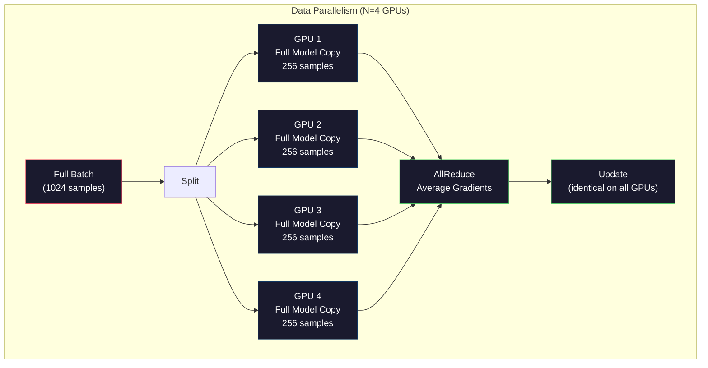
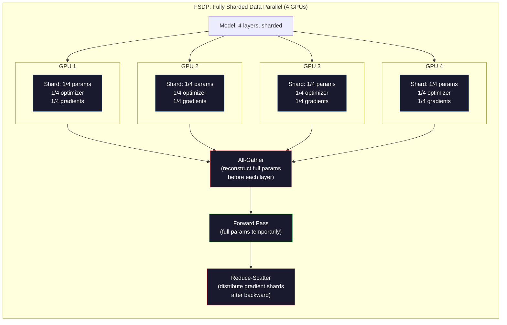
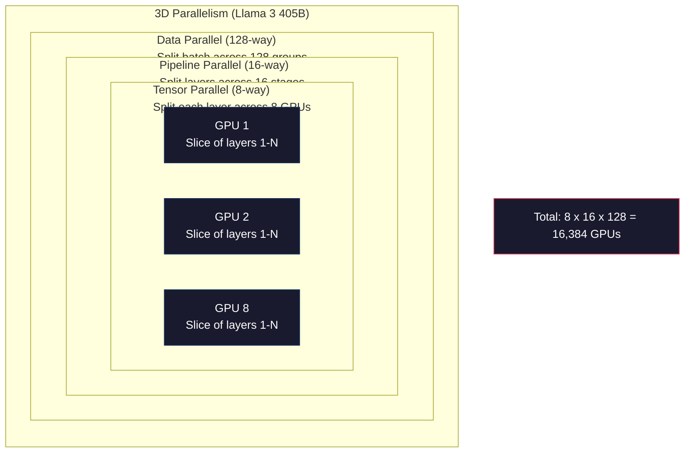

# Scaling：分散式訓練、FSDP、DeepSpeed (Scaling: Distributed Training, FSDP, DeepSpeed)

> 你的 124M 模型在一張 GPU 上就訓練完了。現在試試 70 億參數。模型塞不進記憶體，資料在單機上要跑好幾週。規模一大，分散式訓練就不是選項，而是唯一的出路。

**Type:** Build
**Languages:** Python
**Prerequisites:** Phase 10, Lesson 04 (Pre-Training a Mini GPT)
**Time:** ~120 分鐘

## 學習目標 (Learning Objectives)

- 說明三種平行化方式（data、tensor、pipeline），以及依模型與叢集大小，各自在什麼時候是必要的
- 使用 PyTorch DDP 實作 data-parallel 訓練，並在多張 GPU 之間同步 gradient
- 計算特定模型大小的記憶體預算（權重 + optimizer state + gradient + activation），以決定最低硬體需求
- 設定 FSDP 或 DeepSpeed ZeRO 的各個 stage，把模型狀態分片到多張 GPU 上，裝下超過單張 GPU 記憶體的模型

## 問題 (The Problem)

一個 7B 參數的模型，用 FP16 光是權重就要 14GB。Adam optimizer 會為每個參數另外存兩份副本（一階與二階 moment 估計值），又是 28GB。Backpropagation 時的 gradient 再加 14GB。還沒存任何一個 activation，你就已經用了 56GB。

一張 NVIDIA A100 有 80GB 的記憶體。

80GB 用掉 56GB，只剩下 24GB 給 activation，也就是 forward pass 中算出、必須保留到 backpropagation 的中間值。對於 2048 個 token 的序列、4096 維的模型，單一層的 activation 約使用 64MB。32 層就是每個樣本 2GB。Batch size 為 8 需要 16GB。你有 24GB。Batch size 到 12 就爆了。

現在試試 70B 參數。光是權重：FP16 下就是 140GB。一張 GPU 放不下。光是放權重，你就至少需要 2 張 A100（2 x 80GB = 160GB）。再加上 optimizer state 和 gradient，需要的更多：最少 3 張以上，依分片策略不同，實際上是 8 到 16 張。

Llama 3 405B 是在 16,384 張 NVIDIA H100 GPU 上訓練的。這次訓練估計花了 1 億美元的運算成本。DeepSeek V3 靠著在架構上的巧思（Mixture of Experts 代表每個 token 只啟動一小部分參數）與訓練效率，用大約 560 萬美元訓練出相當等級的模型。

這堂課涵蓋讓大規模訓練成為可能的四種策略：data parallelism、tensor parallelism、pipeline parallelism，以及 fully sharded data parallelism。在你碰到任何分散式訓練框架之前，你會先用純 Python 模擬每一種，理解其中的機制。

## 核心概念 (The Concept)

### 為什麼需要分散 (Why Distribution is Required)

以下是真實模型的記憶體計算。每個數字都是算出來的，不是估計。

| 模型 | 參數量 | 權重 (FP16) | Adam States | Gradient (FP16) | 總計（不含 activation） |
|-------|--------|----------------|-------------|------------------|----------------------|
| GPT-2 Small | 124M | 248 MB | 992 MB | 248 MB | 1.5 GB |
| Llama 3 8B | 8B | 16 GB | 64 GB | 16 GB | 96 GB |
| Llama 3 70B | 70B | 140 GB | 560 GB | 140 GB | 840 GB |
| Llama 3 405B | 405B | 810 GB | 3,240 GB | 810 GB | 4,860 GB |

「Adam States」這一欄是致命傷。Adam 為每個參數存一個移動平均 (m) 和一個移動變異數 (v)，兩者都是 FP32。以 70B 模型來說，就是 70B x 4 bytes x 2 = 560GB。光 optimizer 就需要七張 A100。

單張 H100 有 80GB。Llama 3 405B 至少需要 61 張 H100，才能放下權重、optimizer 和 gradient。再加上 activation，數量還會更多。Meta 用 16,384 張 GPU 並不是因為想用，而是不得不用。

### Data Parallelism (Data Parallelism)

最簡單的分散式策略。把整個模型複製到 N 張 GPU 上。把每個訓練 batch 切成 N 等份。每張 GPU 對自己那份資料做 forward 和 backward pass。Backward pass 之後，把所有 GPU 的 gradient 取平均。每張 GPU 都用相同的平均 gradient 更新自己的權重副本，讓所有副本保持同步。

**優點：** 吞吐量線性成長。N 張 GPU 每一步處理的資料是 N 倍。通訊僅限於 gradient 平均，而且可以與運算重疊進行。

**缺點：** 每張 GPU 都持有完整的模型、optimizer state 與 gradient 副本。以 70B 模型來說，每張 GPU 需要 840GB。Data parallelism 對減少每張 GPU 的記憶體毫無幫助，它只縮短訓練時間。

**數學：** 有效 batch size = 每張 GPU 的 batch size x N。當 N=64 張 GPU、每張 GPU 的 batch 為 16 時，有效 batch 是 1,024。Llama 3 使用的有效 batch size 是每步 1,600 萬個 token。



### Tensor Parallelism (Tensor Parallelism)

把單一層切開，分散到多張 GPU。單一個矩陣乘法由多張 GPU 分攤，每張計算結果的一部分。

以 feedforward 層中 shape 為 (8192, 8192) 的權重矩陣為例。使用 4-way tensor parallelism 時，每張 GPU 持有一個 (8192, 2048) 的分片。每張 GPU 用輸入乘上自己的分片，產生部分結果。這些部分結果再透過 all-reduce 或 all-gather 合併，得到完整輸出。

**優點：** 降低每張 GPU 上模型權重的記憶體。70B 模型切到 8 張 GPU，代表每張 GPU 持有約 8.75B 參數的權重。

**缺點：** 每一層之後都需要快速的 GPU 間通訊。每次 matmul 後的 all-reduce 都會增加延遲。這在 NVLink（同一節點內 GPU 之間 900 GB/s）上效果很好，但在以 InfiniBand（400 Gb/s，約 50 GB/s）連接的跨節點環境中表現很差。Tensor parallelism 幾乎總是限制在單一節點內（8 張 GPU）。

**實際使用：** Megatron-LM 開創了 tensor parallelism。Llama 3 405B 在每個節點內使用 8-way tensor parallelism。

### Pipeline Parallelism (Pipeline Parallelism)

依層切分模型。GPU 1 執行第 1-8 層。GPU 2 執行第 9-16 層。GPU 3 執行第 17-24 層。GPU 4 執行第 25-32 層。資料在 pipeline 中流動：GPU 1 算完自己的層，把 activation 送給 GPU 2，GPU 2 算完自己的層再送給 GPU 3，依此類推。

**優點：** GPU 之間的通訊極少，只有層邊界的 activation，相較於 gradient 或權重要小得多。可以跨節點運作，因為頻寬需求很低。

**缺點：** Pipeline bubble。當 GPU 4 在對 micro-batch 1 做 forward pass 時，GPU 1、2、3 都在閒置（它們已經轉送完自己那部分）。Backward pass 時，模式反過來。若是天真的 pipelining，N 個 pipeline stage 的 GPU 使用率只有 1/N。

**GPipe 與 PipeDream** 透過把 batch 切成 micro-batch 來解決 bubble 問題。GPU 1 一完成 micro-batch 1 的 forward，就立刻開始 micro-batch 2。這讓各個 pipeline stage 的運算重疊。有 M 個 micro-batch 與 N 個 stage 時，bubble 比例降到 (N-1)/M。用 M=16 個 micro-batch、N=4 個 stage，bubble 就是 3/16 = 18.75% 的閒置時間。

### FSDP：Fully Sharded Data Parallel (FSDP: Fully Sharded Data Parallel)

FSDP 結合了 data parallelism 的擴展性與分片 (sharding) 的記憶體效率。不再是每張 GPU 持有完整的模型副本，而是每張 GPU 只持有參數、gradient 和 optimizer state 的 1/N。

在某一層的 forward pass 之前，FSDP 會執行 **all-gather**，把所有 GPU 上的完整參數收集到每張 GPU 的記憶體中。Forward pass 之後，每張 GPU 丟棄非本地的參數。Backward 時，all-gather 會再跑一次，重建參數以進行 gradient 計算。Backward pass 之後，**reduce-scatter** 會分發 gradient 分片，讓每張 GPU 只儲存 1/N 的 gradient。

**8 張 GPU 上 70B 模型的計算：**

| 元件 | 沒有 FSDP | 有 FSDP |
|-----------|-------------|-----------|
| 權重 (FP16) | 每張 GPU 140 GB | 每張 GPU 17.5 GB |
| Adam States (FP32) | 每張 GPU 560 GB | 每張 GPU 70 GB |
| Gradient (FP16) | 每張 GPU 140 GB | 每張 GPU 17.5 GB |
| **總計** | **每張 GPU 840 GB** | **每張 GPU 105 GB** |

沒有 FSDP，你無法把 70B 模型塞進單張 80GB 的 GPU。用 8 張 GPU 搭配 FSDP，每張 GPU 用 105GB。等等，這樣還是放不下。你至少需要 16 張 GPU，才能讓每張低於 80GB，或是把 FSDP 與 activation checkpointing 搭配使用（在 backward 時重新計算 activation，而不是儲存它們）。

通訊成本比單純的 data parallelism 高，因為每層之前都要做 all-gather。但記憶體的節省，讓原本不可能的訓練變得可行。



### DeepSpeed ZeRO (DeepSpeed ZeRO)

DeepSpeed 的 ZeRO (Zero Redundancy Optimizer) 在概念上與 FSDP 相同，但是由 Microsoft 獨立開發。它定義了三個 stage，每個 stage 分片得更積極：

| Stage | 分片內容 | 記憶體節省 | 通訊 |
|-------|--------|---------------|---------------|
| ZeRO-1 | 只有 optimizer state | 約 4 倍減少 | 與 data parallel 相同 |
| ZeRO-2 | + Gradient | 約 8 倍減少 | 稍微多一些 |
| ZeRO-3 | + 參數 | 約 N 倍減少（N 張 GPU） | 每層 all-gather |

ZeRO-3 等同於 FSDP。命名不同，機制相同。在 DeepSpeed 證明了這個概念之後，PyTorch 才加入 FSDP 作為原生實作。

DeepSpeed 還推出了 ZeRO-Offload（把 optimizer state 卸載到 CPU RAM，那更便宜也更大）以及 ZeRO-Infinity（卸載到 NVMe SSD）。這些做法用運算速度換記憶體容量：被卸載的運算比較慢，但能釋放 GPU 記憶體。

### Mixed Precision Training (Mixed Precision Training)

現代訓練同時使用多種浮點格式：

- **Forward pass**：FP16 或 BF16（16-bit）。記憶體只有 FP32 的一半。在 tensor core 上 matmul 快 2 倍。
- **Master weights**：FP32（32-bit）。由 optimizer 維護，確保更新權重時的數值精度。
- **Loss scaling**：在 backward pass 之前，把 loss 乘上一個大常數，避免 FP16 的 gradient underflow 成零。在 optimizer step 之前再除以同一個常數。

BF16 (Brain Float 16) 的指數範圍與 FP32 相同（8 個 exponent bit），但精度較低（7 個 mantissa bit，FP32 則是 23 個）。它很少需要 loss scaling，因為它能表示相同範圍的值。FP16 有 5 個 exponent bit 和 10 個 mantissa bit，可以表示細微的值，但在極端數量級會 overflow/underflow。

Google 的 TPU 原生使用 BF16。NVIDIA 的 A100 和 H100 同時支援 FP16 與 BF16。業界已經大致轉向 BF16，因為它免去了 loss scaling 的麻煩。

**7B 模型的記憶體比較：**

| 精度 | 權重 | Optimizer | Gradient | 總計 |
|-----------|---------|-----------|-----------|-------|
| 全部 FP32 | 28 GB | 56 GB | 28 GB | 112 GB |
| Mixed（BF16 + FP32 master） | 14 GB | 56 GB | 14 GB | 84 GB |

Mixed precision 在這個模型上省下 28GB。Optimizer state 不論如何都維持 FP32，大部分的記憶體都花在這裡。

### Megatron-LM 與 3D Parallelism (Megatron-LM and 3D Parallelism)

真正的大規模訓練會把三種平行化結合起來：

- 跨節點群組的 **Data parallelism**（擴大 batch size）
- 節點內的 **Tensor parallelism**（把層切到 8 張 GPU 上）
- 跨節點的 **Pipeline parallelism**（把層群組切到不同機器上）

Llama 3 405B 在 16,384 張 H100 上：
- 每個節點內 8-way tensor parallelism（每個節點 8 張 GPU）
- 跨節點 16-way pipeline parallelism（16 個 pipeline stage）
- 剩餘維度上 128-way data parallelism（16,384 / 8 / 16 = 128）

這種 3D 分解（8 x 16 x 128 = 16,384）就是你擴展到數千張 GPU 的方法。每張 GPU 看到不同的資料分片（data parallel），持有每一層的一個切片（tensor parallel），並計算不同的層集合（pipeline parallel）。

DeepSeek V3 採取了不同的做法。它的 Mixture of Experts 架構，每個 token 只啟動 671B 參數中的 37B。這代表每張 GPU 只需要計算（並儲存 activation）被啟用的參數。他們在 2,048 張 H800 GPU 上訓練，不到 Meta GPU 數量的 1/8，成本是 560 萬美元，Meta 則估計為 1 億美元。



```figure
paged-kv-cache
```

## 動手做 (Build It)

### 步驟 1：模擬 Data Parallelism (Step 1: Simulate Data Parallelism)

把 batch 切到模擬的 GPU 上。每張 GPU 對自己的分片計算 forward pass。對「gradient」取平均（我們用 loss 值來模擬）。

```python
import numpy as np

def simulate_data_parallelism(data, num_gpus, model_fn):
    batch_size = len(data)
    shard_size = batch_size // num_gpus
    remainder = batch_size % num_gpus

    gpu_losses = []
    gpu_gradients = []

    offset = 0
    for gpu_id in range(num_gpus):
        extra = 1 if gpu_id < remainder else 0
        shard = data[offset:offset + shard_size + extra]
        offset += shard_size + extra

        loss, grad = model_fn(shard)
        gpu_losses.append(loss)
        gpu_gradients.append(grad)

    avg_loss = np.mean(gpu_losses)
    avg_gradient = np.mean(gpu_gradients, axis=0)

    return avg_loss, avg_gradient
```

All-reduce 運算（對 gradient 取平均）是 data parallelism 中唯一的通訊。實務上，在 NVIDIA GPU 上會使用 NCCL 函式庫，它實作了 ring all-reduce：每張 GPU 把自己 gradient 的 1/N 送給鄰居，從另一個鄰居接收 1/N，經過 N-1 步之後，每張 GPU 都有完整的平均值。總通訊量：2 x gradient_size x (N-1)/N，當 N 很大時趨近於 gradient 大小的 2 倍。

### 步驟 2：模擬 Tensor Parallelism (Step 2: Simulate Tensor Parallelism)

把權重矩陣切到多張 GPU 上。每張 GPU 計算部分的矩陣乘法。再把結果合併。

```python
def simulate_tensor_parallelism(input_data, weight_matrix, num_gpus):
    d_in, d_out = weight_matrix.shape
    assert d_out % num_gpus == 0, f"d_out {d_out} not divisible by num_gpus {num_gpus}"
    shard_size = d_out // num_gpus

    partial_results = []
    for gpu_id in range(num_gpus):
        start = gpu_id * shard_size
        end = start + shard_size
        weight_shard = weight_matrix[:, start:end]

        partial = input_data @ weight_shard
        partial_results.append(partial)

    full_output = np.concatenate(partial_results, axis=-1)

    direct_output = input_data @ weight_matrix
    error = np.abs(full_output - direct_output).max()

    return full_output, error
```

誤差應該剛好是零（或 machine epsilon）。Tensor parallelism 在數學上是精確的，它產生的結果與在單張 GPU 上計算完整 matmul 相同。切分是沿著輸出維度進行，所以每張 GPU 產生不同的欄位區塊，串接起來就能重建完整結果。

對於 column-parallel 的線性層（切分輸出維度），你要串接 (concatenate)。對於 row-parallel（切分輸入維度），你要加總 (sum)。在 transformer 的 FFN 中，第一個線性層（擴張）使用 column-parallel，第二個線性層（收縮）使用 row-parallel。這樣可以避免兩層之間的 all-reduce。

### 步驟 3：模擬 Pipeline Parallelism (Step 3: Simulate Pipeline Parallelism)

把模型的各層切到虛擬 GPU 上。展示 bubble 問題：前面的 stage 閒置，後面的 stage 在計算。

```python
def simulate_pipeline_parallelism(num_layers, num_stages, num_microbatches):
    layers_per_stage = num_layers // num_stages

    timeline = {}
    clock = 0

    for mb in range(num_microbatches):
        for stage in range(num_stages):
            start_time = max(
                timeline.get((stage, mb - 1, "fwd"), (0, 0))[1] if mb > 0 else 0,
                timeline.get((stage - 1, mb, "fwd"), (0, 0))[1] if stage > 0 else 0,
            )
            end_time = start_time + layers_per_stage
            timeline[(stage, mb, "fwd")] = (start_time, end_time)

    last_fwd_end = max(v[1] for v in timeline.values())

    for mb in range(num_microbatches - 1, -1, -1):
        for stage in range(num_stages - 1, -1, -1):
            deps = [last_fwd_end]
            if mb < num_microbatches - 1 and (stage, mb + 1, "bwd") in timeline:
                deps.append(timeline[(stage, mb + 1, "bwd")][1])
            if stage < num_stages - 1 and (stage + 1, mb, "bwd") in timeline:
                deps.append(timeline[(stage + 1, mb, "bwd")][1])
            start_time = max(deps)
            end_time = start_time + layers_per_stage
            timeline[(stage, mb, "bwd")] = (start_time, end_time)

    total_time = max(v[1] for v in timeline.values())
    compute_time = num_microbatches * num_stages * layers_per_stage * 2
    bubble_fraction = 1.0 - compute_time / (total_time * num_stages)

    return timeline, total_time, bubble_fraction
```

4 個 stage 搭配 1 個 micro-batch 時，bubble 比例是 75%，也就是任何時間點四張 GPU 中有三張閒置。用 16 個 micro-batch 時，會降到約 19%。消除 bubble 的代價是記憶體：你必須同時儲存所有進行中的 micro-batch 的 activation。

### 步驟 4：記憶體計算器 (Step 4: Memory Calculator)

計算訓練任何模型大小所需的精確記憶體。

```python
def memory_calculator(
    params_billions,
    precision_bytes=2,
    optimizer="adam",
    num_gpus=1,
    sharding="none",
    sequence_length=2048,
    batch_size_per_gpu=1,
    hidden_dim=None,
    num_layers=None,
):
    params = params_billions * 1e9

    weight_memory = params * precision_bytes

    if optimizer == "adam":
        optimizer_memory = params * 4 * 2
    elif optimizer == "sgd":
        optimizer_memory = params * 4
    else:
        optimizer_memory = 0

    gradient_memory = params * precision_bytes

    total_no_activation = weight_memory + optimizer_memory + gradient_memory

    if hidden_dim and num_layers:
        activation_per_layer = (
            sequence_length * batch_size_per_gpu * hidden_dim * precision_bytes * 4
        )
        activation_memory = activation_per_layer * num_layers
    else:
        activation_memory = params * precision_bytes * 0.5

    if sharding == "fsdp" or sharding == "zero3":
        weight_memory /= num_gpus
        optimizer_memory /= num_gpus
        gradient_memory /= num_gpus
    elif sharding == "zero2":
        optimizer_memory /= num_gpus
        gradient_memory /= num_gpus
    elif sharding == "zero1":
        optimizer_memory /= num_gpus

    per_gpu_total = weight_memory + optimizer_memory + gradient_memory + activation_memory

    return {
        "params_billions": params_billions,
        "weights_gb": weight_memory / 1e9,
        "optimizer_gb": optimizer_memory / 1e9,
        "gradients_gb": gradient_memory / 1e9,
        "activations_gb": activation_memory / 1e9,
        "per_gpu_total_gb": per_gpu_total / 1e9,
        "total_across_gpus_gb": per_gpu_total * num_gpus / 1e9,
        "fits_on_80gb": per_gpu_total / 1e9 <= 80,
        "num_gpus": num_gpus,
        "sharding": sharding,
    }
```

這個計算器回答了每個 ML 工程師都會問的問題：「我需要多少張 GPU？」輸入模型大小，看看放不放得下。調整分片策略，直到每張 GPU 的總量降到 80GB 以下。

### 步驟 5：Mixed Precision 模擬 (Step 5: Mixed Precision Simulation)

比較 FP32、FP16 與 mixed precision 訓練的記憶體用量。

```python
def mixed_precision_comparison(params_billions):
    params = params_billions * 1e9

    fp32_weights = params * 4
    fp32_optimizer = params * 4 * 2
    fp32_gradients = params * 4
    fp32_total = fp32_weights + fp32_optimizer + fp32_gradients

    fp16_weights = params * 2
    fp16_master = params * 4
    fp16_optimizer = params * 4 * 2
    fp16_gradients = params * 2
    fp16_total = fp16_weights + fp16_master + fp16_optimizer + fp16_gradients

    mixed_weights = params * 2
    mixed_optimizer = params * 4 * 2
    mixed_gradients = params * 2
    mixed_total = mixed_weights + mixed_optimizer + mixed_gradients

    return {
        "fp32_total_gb": fp32_total / 1e9,
        "fp16_with_master_gb": fp16_total / 1e9,
        "mixed_bf16_gb": mixed_total / 1e9,
        "savings_vs_fp32": 1 - mixed_total / fp32_total,
    }
```

大多數人最意外的是：mixed precision 並不會讓記憶體減半。Optimizer state（Adam 的 m 和 v）不論精度設定如何，都維持 FP32。對 7B 模型來說，FP32 訓練用 112GB，mixed precision 用 84GB。這是 25% 的減少，不是 50%。Optimizer 才是大宗。

## 實際使用 (Use It)

### 執行所有模擬 (Run All Simulations)

```python
def run_all_demos():
    print("=" * 70)
    print("DATA PARALLELISM SIMULATION")
    print("=" * 70)

    np.random.seed(42)
    data = np.random.randn(64, 32)
    weight = np.random.randn(32, 16)

    def model_fn(batch):
        output = batch @ weight
        loss = np.mean(output ** 2)
        grad = 2 * batch.T @ (batch @ weight) / len(batch)
        return loss, grad

    for n_gpus in [1, 2, 4, 8]:
        loss, grad = simulate_data_parallelism(data, n_gpus, model_fn)
        print(f"  {n_gpus} GPUs: loss={loss:.4f}, grad_norm={np.linalg.norm(grad):.4f}")

    print()
    print("=" * 70)
    print("TENSOR PARALLELISM SIMULATION")
    print("=" * 70)

    x = np.random.randn(4, 8192)
    W = np.random.randn(8192, 8192)

    for n_gpus in [1, 2, 4, 8]:
        output, error = simulate_tensor_parallelism(x, W, n_gpus)
        print(f"  {n_gpus} GPUs: output_shape={output.shape}, max_error={error:.2e}")

    print()
    print("=" * 70)
    print("PIPELINE PARALLELISM SIMULATION")
    print("=" * 70)

    for n_mb in [1, 4, 8, 16, 32]:
        _, total_t, bubble = simulate_pipeline_parallelism(32, 4, n_mb)
        print(f"  {n_mb:2d} micro-batches: total_time={total_t:4d}, bubble={bubble:.1%}")

    print()
    print("=" * 70)
    print("MEMORY CALCULATOR")
    print("=" * 70)

    configs = [
        (7, "none", 1),
        (7, "fsdp", 8),
        (70, "none", 1),
        (70, "fsdp", 8),
        (70, "fsdp", 16),
        (405, "fsdp", 64),
        (405, "fsdp", 128),
    ]

    print(f"  {'Model':>8} {'Sharding':>8} {'GPUs':>5} {'Per-GPU':>10} {'Fits 80GB':>10}")
    print("  " + "-" * 50)
    for params, shard, gpus in configs:
        result = memory_calculator(params, num_gpus=gpus, sharding=shard)
        fits = "Yes" if result["fits_on_80gb"] else "No"
        print(f"  {params:>6}B {shard:>8} {gpus:>5} {result['per_gpu_total_gb']:>8.1f}GB {fits:>10}")

    print()
    print("=" * 70)
    print("MIXED PRECISION COMPARISON")
    print("=" * 70)

    for params_b in [7, 13, 70, 405]:
        result = mixed_precision_comparison(params_b)
        print(f"  {params_b}B: FP32={result['fp32_total_gb']:.0f}GB, "
              f"Mixed BF16={result['mixed_bf16_gb']:.0f}GB, "
              f"Savings={result['savings_vs_fp32']:.0%}")
```

## 交付 (Ship It)

這堂課會產出 `outputs/prompt-distributed-training-planner.md`，這是一個 prompt，輸入模型大小與可用硬體，就會產出完整的分散式訓練計畫：平行化策略、記憶體預算、通訊開銷與預期吞吐量。

## 練習 (Exercises)

1. 修改記憶體計算器，加入 activation checkpointing。使用 checkpointing 時，只在每 K 層儲存一次 activation（典型是 K=1，代表全部重新計算）。展示記憶體與運算之間的取捨：checkpointing 省下多少記憶體？又讓訓練慢多少（完整 checkpointing 大約多出 33% 的運算）？

2. 擴充 pipeline parallelism 的模擬，實作 PipeDream 使用的 1F1B（one forward, one backward）排程。在 4 個 stage 與 8 個 micro-batch 的情況下，比較它和天真排程的 bubble 比例。1F1B 排程的尖峰記憶體應該更小，因為它更早開始 backward pass。

3. 實作 gradient accumulation 模擬器。不要在每個 micro-batch 之後都做 all-reduce，而是在本地累積 gradient K 步，再做 all-reduce。展示這如何將通訊減少 K 倍，卻產生相同的最終 gradient（因此訓練結果也相同）。

4. 建立成本估算器。給定模型大小、目標 token 數、GPU 類型（A100 每小時 $2，H100 每小時 $3.50）與平行化策略，估算以美元計的總訓練成本。用已知成本驗證：據報導 Llama 3 405B 花費約 $100M，DeepSeek V3 花費約 $5.6M。

5. 把 ZeRO-Offload 加進記憶體計算器。假設每個節點的 CPU RAM 是 512GB，NVMe 是 2TB。展示把 optimizer state 卸載到 CPU 後，70B 模型如何能用 4 張 GPU 而非 16 張來訓練，代價是 optimizer step 慢 30-50%。

## 關鍵術語 (Key Terms)

| 術語 | 一般說法 | 實際意義 |
|------|----------------|----------------------|
| Data parallelism | 「把模型複製到每張 GPU」 | 每張 GPU 處理不同的資料分片，每一步之後透過 all-reduce 對 gradient 取平均 |
| Tensor parallelism | 「把一層切到多張 GPU」 | 切分權重矩陣，讓每張 GPU 計算 matmul 的一部分，需要快速的 NVLink 互連 |
| Pipeline parallelism | 「把各層切到多張 GPU」 | 每張 GPU 執行不同的層群組，資料以 micro-batch 流經 pipeline 以減少 bubble |
| FSDP | 「全部分片」 | Fully Sharded Data Parallel，每張 GPU 持有權重、gradient 與 optimizer state 的 1/N，運算前先 all-gather |
| ZeRO | 「DeepSpeed 版本的 FSDP」 | Zero Redundancy Optimizer，分三個 stage：分片 optimizer（Stage 1）、+ gradient（Stage 2）、+ 參數（Stage 3） |
| All-reduce | 「在 GPU 間取平均」 | 一種集體運算，每張 GPU 最後都得到所有 GPU 輸入的總和（或平均），通常以 ring all-reduce 實作 |
| All-gather | 「從所有 GPU 收集」 | 一種集體運算，每張 GPU 最後都得到所有 GPU 資料的串接結果，FSDP 用它來重建完整參數 |
| Reduce-scatter | 「加總並分發」 | 一種集體運算，先對資料做 reduce（加總），再把不同區塊分散到不同 GPU，FSDP 用它來做 gradient 分片 |
| Mixed precision | 「用半精度訓練」 | forward/backward 用 FP16/BF16，optimizer state 用 FP32，省下約 25% 記憶體而非 50%，因為 optimizer 佔大宗 |
| Pipeline bubble | 「pipeline 中的閒置時間」 | GPU 閒置、等待前一個 stage 資料的時間比例，用更多 micro-batch 可以減少 |

## 延伸閱讀 (Further Reading)

- [Rajbhandari et al., 2020 -- "ZeRO: Memory Optimizations Toward Training Trillion Parameter Models"](https://arxiv.org/abs/1910.02054)：定義三個分片 stage 的 DeepSpeed ZeRO 論文
- [Shoeybi et al., 2020 -- "Megatron-LM: Training Multi-Billion Parameter Language Models Using Model Parallelism"](https://arxiv.org/abs/1909.08053)：NVIDIA 針對 transformer 的 tensor parallelism
- [Narayanan et al., 2021 -- "Efficient Large-Scale Language Model Training on GPU Clusters Using Megatron-LM"](https://arxiv.org/abs/2104.04473)：結合 data、tensor 與 pipeline 的 3D parallelism
- [Zhao et al., 2023 -- "PyTorch FSDP: Experiences on Scaling Fully Sharded Data Parallel"](https://arxiv.org/abs/2304.11277)：PyTorch 原生的 FSDP 實作
- [Llama 3 Technical Report](https://arxiv.org/abs/2407.21783)：16,384 張 GPU 訓練與 3D parallelism 的細節
- [DeepSeek-V3 Technical Report](https://arxiv.org/abs/2412.19437)：MoE 架構如何將訓練成本降低一個數量級
