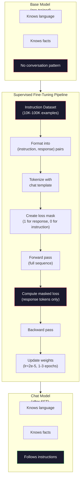

# Instruction Tuning (SFT) (Instruction Tuning (SFT))

> Base model 只會預測下一個 token，就這樣。它不會遵循指令、回答問題，也不會拒絕有害的請求。SFT 是連接 token 預測器與實用助理之間的橋樑。你聊過的每一個模型，不管是 Claude、GPT 還是 Llama Chat，都經過這一步。

**Type:** Build
**Languages:** Python (with numpy)
**Prerequisites:** Phase 10, Lesson 04 (Pre-Training a Mini GPT)
**Time:** ~90 分鐘

## 學習目標 (Learning Objectives)

- 實作 supervised fine-tuning (SFT)，把 base language model 轉成會遵循指令的助理
- 用包含 system、user、assistant 角色的 chat template 格式化訓練資料，並對非 assistant 的 token 遮罩 loss
- 說明為什麼需要 SFT：base model 是接續文字，而不是回答問題
- 在保留的指令集上比較 base model 與 fine-tuned model 的回應，藉此評估 SFT 的品質

## 問題 (The Problem)

你在 Lesson 04 訓練了一個模型。給它一串序列，它能預測下一個 token。餵它 "The transformer architecture"，它可能接著說 "has revolutionized natural language processing."。以一個 next-token 預測器來說，這很了不起。

現在試試這個：餵它 "What is the capital of France?" Base model 不會回答 "Paris."。它會延續模式。它可能產生 "What is the capital of Germany? What is the capital of Spain?"，因為它從包含一長串問題的文件中學到了這種樣式。或者它可能產生 "is a question that many people ask"，因為這是一個合理的 next-token 接續。模型根本沒有*回答*的概念，它只知道*接續*。

這就是 GPT-3（base model，2020 年 6 月發布）與 ChatGPT（經過 instruction tuning，2022 年 11 月發布）之間的差距。同樣的架構，同樣的 pre-training。差別在於 20,000 到 100,000 組精心設計的（指令, 回應）配對，教會了模型遵循對話的模式。

Stanford Alpaca 證明了你不需要數百萬筆範例。2023 年 3 月，他們只用 GPT-3.5 產生的 52,000 組指令-回應配對，就 fine-tune 了 Llama 7B。總成本：$600。結果是一個能遵循指令、回答問題、進行對話的聊天機器人。不如 ChatGPT，但以 $600 和幾個小時的訓練來說，已經接近得令人驚訝。

Meta 的 Llama 2 Chat 在最初的 SFT 階段只用了約 27,000 筆高品質範例。關鍵洞見：品質比數量重要。27,000 筆由熟練標註者撰寫的範例，勝過從網路上爬來的 100 萬筆雜訊範例。

## 核心概念 (The Concept)

### SFT 實際上做了什麼 (What SFT Actually Does)

Supervised Fine-Tuning 延續 pre-training 的同一個訓練迴圈：forward pass、計算 loss、backward pass、更新權重，只是用的是不同類型的資料。你訓練的不再是原始文字，而是結構化的對話：

```json
{
  "system": "You are a helpful assistant.",
  "user": "What is the capital of France?",
  "assistant": "The capital of France is Paris."
}
```

模型早就知道巴黎是法國的首都。它在 pre-training 時，從 Wikipedia、教科書和網頁學到了這件事。SFT 並不是教模型新的事實，而是教模型一種新的*行為*：看到問題，就產生答案。看到指令，就產生完成的結果。看到有害的請求，就產生拒絕。

可以這樣想：pre-training 給模型知識，SFT 給模型禮貌。

### 資料格式 (Data Formats)

業界主要有三種格式。每種格式編碼的都是相同的資訊：誰說了什麼，只是用的分隔符號不同。

**Alpaca 格式**（Stanford，2023 年 3 月）：

```json
{
  "instruction": "Summarize the following article in 3 sentences.",
  "input": "The European Central Bank raised interest rates...",
  "output": "The ECB increased rates by 25 basis points..."
}
```

簡單且被廣泛使用。`input` 欄位是選填的，許多指令不需要額外的上下文。Stanford 以這種格式釋出了 52,000 筆範例，由 GPT-3.5 產生，花費 $600。這點燃了開源的 instruction tuning 運動。

**ShareGPT 格式**（社群，2023）：

```json
{
  "conversations": [
    {"from": "system", "value": "You are a helpful assistant."},
    {"from": "human", "value": "What causes tides?"},
    {"from": "gpt", "value": "Tides are caused by the gravitational pull of the Moon..."},
    {"from": "human", "value": "How often do they occur?"},
    {"from": "gpt", "value": "Most coastal areas experience two high tides and two low tides per day..."}
  ]
}
```

支援多輪對話。"from" 欄位依慣例使用 "human" 和 "gpt"，不管實際上是哪個模型。Vicuna 就是用 70,000 筆 ShareGPT 對話訓練的，這些對話是從使用者分享的 ChatGPT 對話紀錄中爬取而來。

**ChatML 格式**（OpenAI，被許多開源模型使用）：

```
<|im_start|>system
You are a helpful assistant.<|im_end|>
<|im_start|>user
What is the capital of France?<|im_end|>
<|im_start|>assistant
The capital of France is Paris.<|im_end|>
```

使用 special token（`<|im_start|>`、`<|im_end|>`）來界定角色。這些 token 會在 fine-tuning 期間被加入 tokenizer 的 vocabulary。Qwen、Yi 和許多其他模型都使用 ChatML。

這三種格式達成的是同一件事：告訴模型「這是指令，這是回應，學會這個模式」。

### 為什麼有效 (Why It Works)

模型在 pre-training 就已經懂語言了。它看過數十億筆問題後面接答案、指令後面接完成結果，以及人與人之間對話的範例。這些模式早就編碼在權重裡了。

SFT 把這種潛在能力集中起來。模型不再需要從上下文判斷應該回答問題還是接續文件，SFT 直接針對對話模式訓練。經過幾千筆範例之後，模型學會：看到 assistant 角色標記，就產生有幫助的回應。

這就是為什麼 27,000 筆範例就夠了。你不是在教模型英文，也不是在教它世界上的事實。你是在教它一個簡單的行為：回應指令。知識本來就在那裡了。

### 被遮罩的 Loss (The Masked Loss)

這是 SFT 中最重要的技術細節，大多數教學都略過了。

Pre-training 時，你對每個 token 計算 loss。模型學習預測序列中的每一個下一個 token。SFT 時，你只對*回應* token 計算 loss。指令 token 只是提供上下文，模型在「預測」它們時預測錯誤，並不會受到懲罰。

為什麼？因為你不希望模型學會去*產生*指令，你希望它學會*回應*指令。如果你對指令 token 計算 loss，就等於在訓練模型預測 "What is the capital of France?"，彷彿它自己是提問的那一方。這會浪費 gradient 訊號，也可能讓模型搞不清楚自己的角色。

實務上，你會建立一個 loss mask：回應 token 是 1，指令 token 是 0。在取平均之前，把每個 token 的 loss 乘上這個 mask。

```
Tokens:    [SYS] You are helpful [USER] What is the capital? [ASST] Paris is the capital [EOS]
Loss mask:   0    0    0     0      0     0   0  0     0       1     1    1   1     1      1
```

只有 `[ASST]` 之後的 token 會對 loss 有貢獻。模型在 forward pass 時看得到完整對話（它需要指令才能產生正確的回應），但只根據它預測回應的好壞來更新權重。

### 訓練超參數 (Training Hyperparameters)

SFT 使用的超參數與 pre-training 截然不同。你不是從頭訓練，而是在調整一個已經能運作的模型。

| 參數 | Pre-Training (Llama 2 7B) | SFT (Llama 2 Chat) |
|-----------|---------------------------|---------------------|
| Learning rate | 3e-4（峰值） | 2e-5 |
| Epochs | 1（對資料只過一遍） | 2 |
| Batch size | 4M tokens | 64 筆範例 |
| Warmup steps | 2,000 | 0-100 |
| Weight decay | 0.1 | 0.0-0.1 |
| 資料量 | 2T tokens | 27,000 筆範例 |

SFT 的 learning rate 低了 15 倍。這點非常關鍵。Fine-tuning 時用過高的 learning rate 會破壞 pre-trained 的知識。模型會「忘記」學過的東西，並對小型的 fine-tuning 資料集 overfit。這就是 catastrophic forgetting。

兩個 epoch 代表模型看每筆訓練範例兩次。在小資料集上超過 3 個 epoch，會導致死記：模型開始逐字重現訓練範例，而不是泛化。

### Catastrophic Forgetting (Catastrophic Forgetting)

Fine-tuning 可能會摧毀一般能力。在遵循指令的資料上訓練太久，模型會失去寫程式、做數學或產生創意文字的能力。它會變得非常擅長訓練資料的特定格式，卻在其他方面一塌糊塗。

三種緩解方式：

1. **低 learning rate。** 1e-5 到 5e-5。更新幅度越小，對 pre-trained 特徵的破壞就越少。

2. **訓練時間短。** 1-3 個 epoch。在模型 overfit 之前停止。

3. **混入 pre-training 資料。** Llama 2 Chat 在 SFT 資料集中混入一小部分（2-5%）的原始 pre-training 資料。這能在學習新的遵循指令行為時，「提醒」模型它的一般能力。

### 實際數字 (Real Numbers)

在單張 NVIDIA A100 80GB GPU 上，用 10,000 組高品質指令配對 fine-tune 一個 7B 模型，大約需要 1 小時。計算如下：

- 10,000 筆範例 x 平均 512 個 token = 5.12M tokens
- 2 個 epoch = 總共 10.24M tokens
- A100 對 7B 模型 fine-tuning 的吞吐量：約 3,000 tokens/秒
- 10.24M / 3,000 = 約 3,400 秒 = 約 57 分鐘

對我們的 mini GPT（4 層、128 維）來說，訓練幾乎是瞬間完成。重點在於理解機制，而不是規模。



```figure
loss-masking
```

## 動手做 (Build It)

### 步驟 1：指令資料集 (Step 1: Instruction Dataset)

建立一個合成的指令資料集。在正式環境中，像 Scale AI 和 Anthropic 這樣的公司會聘請人類標註者來撰寫這些資料。我們用程式產生，以示範格式。

```python
import numpy as np

INSTRUCTION_DATA = [
    {
        "instruction": "What is the capital of France?",
        "response": "The capital of France is Paris."
    },
    {
        "instruction": "Explain gravity in one sentence.",
        "response": "Gravity is the force that attracts objects with mass toward each other."
    },
    {
        "instruction": "Write a haiku about the ocean.",
        "response": "Waves crash on the shore, salt and foam beneath the sun, endless blue expanse."
    },
    {
        "instruction": "What is 15 multiplied by 7?",
        "response": "15 multiplied by 7 is 105."
    },
    {
        "instruction": "Name three programming languages.",
        "response": "Three programming languages are Python, Rust, and TypeScript."
    },
    {
        "instruction": "Summarize photosynthesis.",
        "response": "Photosynthesis converts sunlight, water, and carbon dioxide into glucose and oxygen."
    },
    {
        "instruction": "What year did World War II end?",
        "response": "World War II ended in 1945."
    },
    {
        "instruction": "Define machine learning.",
        "response": "Machine learning is a field where algorithms learn patterns from data to make predictions."
    },
]
```

八筆範例很少。Stanford Alpaca 用了 52,000 筆。但不管你有 8 筆還是 52,000 筆，機制都是一樣的：tokenize、遮罩、只對回應計算 loss。

### 步驟 2：用 Chat Template 做 Tokenize (Step 2: Tokenize with Chat Template)

把指令-回應配對轉成帶有角色標記的 token 序列。這些標記告訴模型指令在哪裡結束、回應從哪裡開始。

```python
SPECIAL_TOKENS = {
    "INST_START": 253,
    "INST_END": 254,
    "RESP_START": 255,
}


def tokenize_instruction_pair(instruction, response, vocab_size=256):
    inst_tokens = list(instruction.encode("utf-8"))
    resp_tokens = list(response.encode("utf-8"))

    inst_tokens = [min(t, vocab_size - 4) for t in inst_tokens]
    resp_tokens = [min(t, vocab_size - 4) for t in resp_tokens]

    tokens = (
        [SPECIAL_TOKENS["INST_START"]]
        + inst_tokens
        + [SPECIAL_TOKENS["INST_END"]]
        + [SPECIAL_TOKENS["RESP_START"]]
        + resp_tokens
    )

    return tokens


def create_loss_mask(tokens):
    mask = np.zeros(len(tokens), dtype=np.float32)
    in_response = False

    for i, token in enumerate(tokens):
        if token == SPECIAL_TOKENS["RESP_START"]:
            in_response = True
            continue
        if in_response:
            mask[i] = 1.0

    return mask
```

Loss mask 對指令 token 全是 0，對回應 token 全是 1。`RESP_START` token 本身的 mask 是 0，因為它是分隔符號，不是回應內容的一部分。

### 步驟 3：被遮罩的 Cross-Entropy Loss (Step 3: Masked Cross-Entropy Loss)

標準的 cross-entropy，但要乘上 loss mask。只有回應 token 對 gradient 有貢獻。

```python
def masked_cross_entropy_loss(logits, targets, loss_mask):
    batch, seq_len, vocab_size = logits.shape
    logits_flat = logits.reshape(-1, vocab_size)
    targets_flat = targets.reshape(-1)
    mask_flat = loss_mask.reshape(-1)

    max_logits = logits_flat.max(axis=-1, keepdims=True)
    log_softmax = logits_flat - max_logits - np.log(
        np.exp(logits_flat - max_logits).sum(axis=-1, keepdims=True)
    )

    per_token_loss = -log_softmax[np.arange(len(targets_flat)), targets_flat]

    masked_loss = per_token_loss * mask_flat
    num_response_tokens = mask_flat.sum()
    if num_response_tokens == 0:
        return 0.0
    loss = masked_loss.sum() / num_response_tokens

    return loss
```

分母是 `num_response_tokens`，不是 `seq_len`。如果你除以整條序列的長度，較長的指令會稀釋 gradient 訊號。除以回應 token 的數量，則能確保不論指令長度，每個回應 token 的權重都相等。

### 步驟 4：SFT 訓練迴圈 (Step 4: SFT Training Loop)

重複使用 Lesson 04 的 MiniGPT。訓練迴圈看起來幾乎和 pre-training 一樣，只是多了指令格式化與被遮罩的 loss。

```python
import sys
import os
sys.path.insert(0, os.path.join(os.path.dirname(__file__), "..", "..", "04-pre-training-mini-gpt", "code"))
from main import MiniGPT, LayerNorm, FeedForward, MultiHeadAttention, TransformerBlock, Embedding


def sft_train(model, dataset, num_epochs=2, lr=2e-5, seq_len=64):
    formatted_data = []
    for example in dataset:
        tokens = tokenize_instruction_pair(example["instruction"], example["response"])
        mask = create_loss_mask(tokens)
        formatted_data.append((tokens, mask))

    print(f"SFT Training: {len(formatted_data)} examples, {num_epochs} epochs, lr={lr}")
    print(f"Total tokens: {sum(len(t) for t, _ in formatted_data):,}")
    print()

    losses = []

    for epoch in range(num_epochs):
        epoch_loss = 0.0
        num_batches = 0

        indices = np.random.permutation(len(formatted_data))

        for idx in indices:
            tokens, mask = formatted_data[idx]

            if len(tokens) < 3:
                continue
            if len(tokens) > seq_len:
                tokens = tokens[:seq_len]
                mask = mask[:seq_len]

            input_ids = np.array(tokens[:-1]).reshape(1, -1)
            target_ids = np.array(tokens[1:]).reshape(1, -1)
            loss_mask = np.array(mask[1:]).reshape(1, -1)

            logits = model.forward(input_ids)
            loss = masked_cross_entropy_loss(logits, target_ids, loss_mask)

            batch_size, s_len, v_size = logits.shape
            probs = np.exp(logits - logits.max(axis=-1, keepdims=True))
            probs = probs / probs.sum(axis=-1, keepdims=True)
            dlogits = probs.copy()
            dlogits[np.arange(batch_size)[:, None], np.arange(s_len), target_ids] -= 1.0

            mask_expanded = loss_mask[:, :, np.newaxis]
            num_resp = loss_mask.sum()
            if num_resp > 0:
                dlogits = dlogits * mask_expanded / num_resp

            for block in model.blocks:
                block.ffn.W1 -= lr * np.random.randn(*block.ffn.W1.shape) * 0.01
                block.ffn.W2 -= lr * np.random.randn(*block.ffn.W2.shape) * 0.01
                block.ffn.b1 -= lr * np.random.randn(*block.ffn.b1.shape) * 0.01
                block.ffn.b2 -= lr * np.random.randn(*block.ffn.b2.shape) * 0.01

            epoch_loss += loss
            num_batches += 1
            losses.append(loss)

        avg_loss = epoch_loss / max(num_batches, 1)
        print(f"Epoch {epoch + 1}/{num_epochs} | Avg Loss: {avg_loss:.4f}")

    return model, losses
```

Learning rate 是 2e-5，與 Llama 2 Chat 一致。拿它和 pre-training 用的 3e-4 比較，小了 15 倍。Gradient 是被遮罩的：指令 token 產生的 gradient 為零，只有回應 token 會推動權重。

### 步驟 5：比較 Base 與 SFT 模型 (Step 5: Compare Base vs SFT Model)

SFT 的重點就是行為上的改變。我們來衡量它：看看模型對指令格式的輸入，和對原始文字接續的反應有何不同。

```python
def generate_response(model, prompt_tokens, max_new_tokens=50, temperature=0.8):
    tokens = list(prompt_tokens)
    seq_len = model.embedding.pos_embed.shape[0]

    for _ in range(max_new_tokens):
        context = np.array(tokens[-seq_len:]).reshape(1, -1)
        logits = model.forward(context)
        next_logits = logits[0, -1, :]

        next_logits = next_logits / max(temperature, 1e-8)
        probs = np.exp(next_logits - next_logits.max())
        probs = probs / probs.sum()
        probs = np.clip(probs, 1e-10, 1.0)
        probs = probs / probs.sum()

        next_token = np.random.choice(len(probs), p=probs)
        tokens.append(int(next_token))

    return tokens


def evaluate_instruction_following(model, instructions):
    print("Evaluating instruction following:")
    print("-" * 50)

    for instruction in instructions:
        tokens = (
            [SPECIAL_TOKENS["INST_START"]]
            + [min(t, 252) for t in list(instruction.encode("utf-8"))]
            + [SPECIAL_TOKENS["INST_END"]]
            + [SPECIAL_TOKENS["RESP_START"]]
        )

        output = generate_response(model, tokens, max_new_tokens=30, temperature=0.6)
        response_start = len(tokens)
        response_tokens = output[response_start:]
        response_bytes = bytes([t for t in response_tokens if t < 128])
        response_text = response_bytes.decode("utf-8", errors="replace")

        print(f"  Q: {instruction}")
        print(f"  A: {response_text[:80]}")
        print()
```

在只有 8 筆範例的小模型上，回應不會有意義，這是預期中的事。重要的是*結構*：模型學會在回應標記之後產生輸出，而不是繼續產生更多指令。

### 步驟 6：衡量 Catastrophic Forgetting (Step 6: Measure Catastrophic Forgetting)

比較 SFT 前後模型的 next-token 預測能力。如果 SFT 損害了一般能力，原始文字上的 loss 就會上升。

```python
def measure_forgetting(model, test_text, seq_len=64):
    tokens = np.array(list(test_text.encode("utf-8")[:512]))

    total_loss = 0.0
    num_windows = 0

    for start in range(0, len(tokens) - seq_len - 1, seq_len):
        input_ids = tokens[start:start + seq_len].reshape(1, -1)
        target_ids = tokens[start + 1:start + seq_len + 1].reshape(1, -1)

        logits = model.forward(input_ids)

        batch, s_len, vocab_size = logits.shape
        logits_flat = logits.reshape(-1, vocab_size)
        targets_flat = target_ids.reshape(-1)

        max_logits = logits_flat.max(axis=-1, keepdims=True)
        log_softmax = logits_flat - max_logits - np.log(
            np.exp(logits_flat - max_logits).sum(axis=-1, keepdims=True)
        )

        loss = -log_softmax[np.arange(len(targets_flat)), targets_flat].mean()
        total_loss += loss
        num_windows += 1

    return total_loss / max(num_windows, 1)
```

在真正的 fine-tuning 中，你會在整個訓練過程追蹤這個指標。如果原始文字的 loss 上升超過 10-15%，代表你的 SFT 太激進了。降低 learning rate 或減少 epoch 數。

## 實際使用 (Use It)

### 完整 SFT 管線示範 (Full SFT Pipeline Demo)

```python
if __name__ == "__main__":
    np.random.seed(42)

    test_text = """The transformer architecture processes sequences through self-attention.
Each layer applies multi-head attention followed by a feedforward network.
Residual connections and layer normalization stabilize deep networks.
The model learns to predict the next token given all previous tokens."""

    print("=" * 70)
    print("INSTRUCTION TUNING (SFT) DEMO")
    print("=" * 70)
    print()

    model = MiniGPT(
        vocab_size=256, embed_dim=128, num_heads=4,
        num_layers=4, max_seq_len=128, ff_dim=512
    )
    print(f"Model: {model.count_parameters():,} parameters")
    print(f"Config: 4 layers, 4 heads, 128 dims (mini GPT from Lesson 04)")
    print()

    print("PRE-SFT: Measuring base model loss on raw text")
    base_loss = measure_forgetting(model, test_text)
    print(f"  Base model loss: {base_loss:.4f}")
    print()

    print("=" * 70)
    print("SFT TRAINING")
    print("=" * 70)

    model, losses = sft_train(
        model, INSTRUCTION_DATA, num_epochs=3, lr=2e-5, seq_len=128
    )

    print()
    print("POST-SFT: Measuring fine-tuned model loss on raw text")
    sft_loss = measure_forgetting(model, test_text)
    print(f"  SFT model loss: {sft_loss:.4f}")
    print(f"  Change: {((sft_loss - base_loss) / base_loss * 100):+.1f}%")
    if abs(sft_loss - base_loss) / base_loss < 0.15:
        print("  Minimal forgetting (< 15% change)")
    else:
        print("  Significant forgetting detected")
    print()

    print("=" * 70)
    print("INSTRUCTION FOLLOWING EVALUATION")
    print("=" * 70)
    print()

    test_instructions = [
        "What is the capital of France?",
        "Name a programming language.",
        "Define gravity.",
    ]
    evaluate_instruction_following(model, test_instructions)

    print("=" * 70)
    print("DATA FORMAT EXAMPLES")
    print("=" * 70)
    print()

    for i, example in enumerate(INSTRUCTION_DATA[:3]):
        tokens = tokenize_instruction_pair(example["instruction"], example["response"])
        mask = create_loss_mask(tokens)
        resp_count = int(mask.sum())
        total_count = len(tokens)
        print(f"  Example {i + 1}: {total_count} tokens, {resp_count} response tokens ({resp_count/total_count:.0%} of sequence)")
        print(f"    Instruction: {example['instruction']}")
        print(f"    Response: {example['response']}")
        print()

    print("=" * 70)
    print("TRAINING LOSS CURVE")
    print("=" * 70)
    print()

    if losses:
        window = max(1, len(losses) // 5)
        for i in range(0, len(losses), window):
            chunk = losses[i:i + window]
            avg = sum(chunk) / len(chunk)
            print(f"  Steps {i:3d}-{i + len(chunk) - 1:3d}: avg loss = {avg:.4f}")
```

## 交付 (Ship It)

這堂課會產出 `outputs/prompt-sft-data-curator.md`，這是一個協助你設計與整理 SFT 指令資料集的 prompt。給定目標能力（程式碼生成、數學、對話），它會產出資料蒐集計畫，包含格式規格、品質標準與多樣性需求。

## 練習 (Exercises)

1. 加入 system prompt 支援。修改 `tokenize_instruction_pair`，讓它接受 system 訊息，並把它放在指令前面。建立 5 筆使用不同 system prompt 的範例（"You are a poet"、"You are a math tutor"），並驗證模型在訓練時看到的是不同的 system prompt。

2. 實作資料混合。建立一個函式，接收 SFT 資料集與原始文字語料，然後產生訓練 batch，其中 5% 的範例是原始文字（不遮罩），95% 是指令配對（遮罩）。跑 3 個 epoch，並與純 SFT 訓練比較 forgetting 指標。

3. 建立資料品質評分器。對每組指令-回應配對，計算：(a) 回應長度（以 token 計）、(b) 指令與回應的比例、(c) 詞彙多樣性（不重複 token 數 / 總 token 數）。過濾掉回應長度 < 10 個 token 或多樣性 < 0.3 的範例。展示過濾如何影響最終的 loss。

4. 實作多輪對話訓練。擴充 tokenization，讓它能處理 3 輪對話（user-assistant-user-assistant-user-assistant）。Loss mask 應涵蓋三個 assistant 回合。印出其中一筆範例的 token 與 mask 對齊情形，驗證 mask 是否正確。

5. 比較 learning rate。用 lr=1e-4、lr=2e-5 和 lr=1e-6 訓練同一個模型三次。畫出 loss 曲線。1e-4 的那次應該一開始快速下降，但最終 loss 較高（overfitting）。1e-6 的那次幾乎不會動。2e-5 的那次應該是最佳點。

## 關鍵術語 (Key Terms)

| 術語 | 一般說法 | 實際意義 |
|------|----------------|----------------------|
| SFT | 「在對話上做 fine-tuning」 | Supervised Fine-Tuning：在（指令, 回應）配對上繼續訓練，只對回應 token 計算 loss |
| Instruction tuning | 「教模型遵循指令」 | 在明確的指令-回應配對上訓練，讓 base model 學會對話模式，而不是新知識 |
| Loss masking | 「忽略 prompt」 | 把指令 token 的 loss 設為零，讓 gradient 只來自回應 token 的預測 |
| ChatML | 「Chat Markup Language」 | 一種 token 格式，使用 `<\|im_start\|>` 和 `<\|im_end\|>` 分隔符號，在對話資料中標記說話者角色 |
| Alpaca format | 「Stanford 的格式」 | 含 instruction/input/output 欄位的 JSON 格式，用於 52K 筆由 GPT-3.5 產生、花費 $600 的範例 |
| Catastrophic forgetting | 「模型變笨了」 | Fine-tuning 破壞 pre-trained 的能力，因為 gradient 更新用特定任務的模式覆蓋了一般知識 |
| Weight tying | 「共用 embedding」 | 輸入 token embedding 與輸出預測 head 使用同一個矩陣，節省參數並提升連貫性 |
| Chat template | 「如何格式化 prompt」 | 為模型建構對話結構的特定 token 序列（角色標記、分隔符號） |

## 延伸閱讀 (Further Reading)

- [Ouyang et al., 2022 -- "Training language models to follow instructions with human feedback" (InstructGPT)](https://arxiv.org/abs/2203.02155)：OpenAI 提出 instruction tuning + RLHF 的論文
- [Taori et al., 2023 -- "Stanford Alpaca: An Instruction-following LLaMA Model"](https://github.com/tatsu-lab/stanford_alpaca)：花 $600 取得 52K 筆指令範例，證明 SFT 在小資料集上也有效
- [Touvron et al., 2023 -- "Llama 2: Open Foundation and Fine-Tuned Chat Models"](https://arxiv.org/abs/2307.09288)：Meta 以 27K 筆高品質範例進行的 SFT + RLHF 管線
- [Chiang et al., 2023 -- "Vicuna: An Open-Source Chatbot Impressing GPT-4"](https://lmsys.org/blog/2023-03-30-vicuna/)：用 70K 筆 ShareGPT 對話訓練
- [Zhou et al., 2023 -- "LIMA: Less Is More for Alignment"](https://arxiv.org/abs/2305.11206)：證明 1,000 筆精心整理的範例，就能媲美在大得多的資料集上做的 SFT
