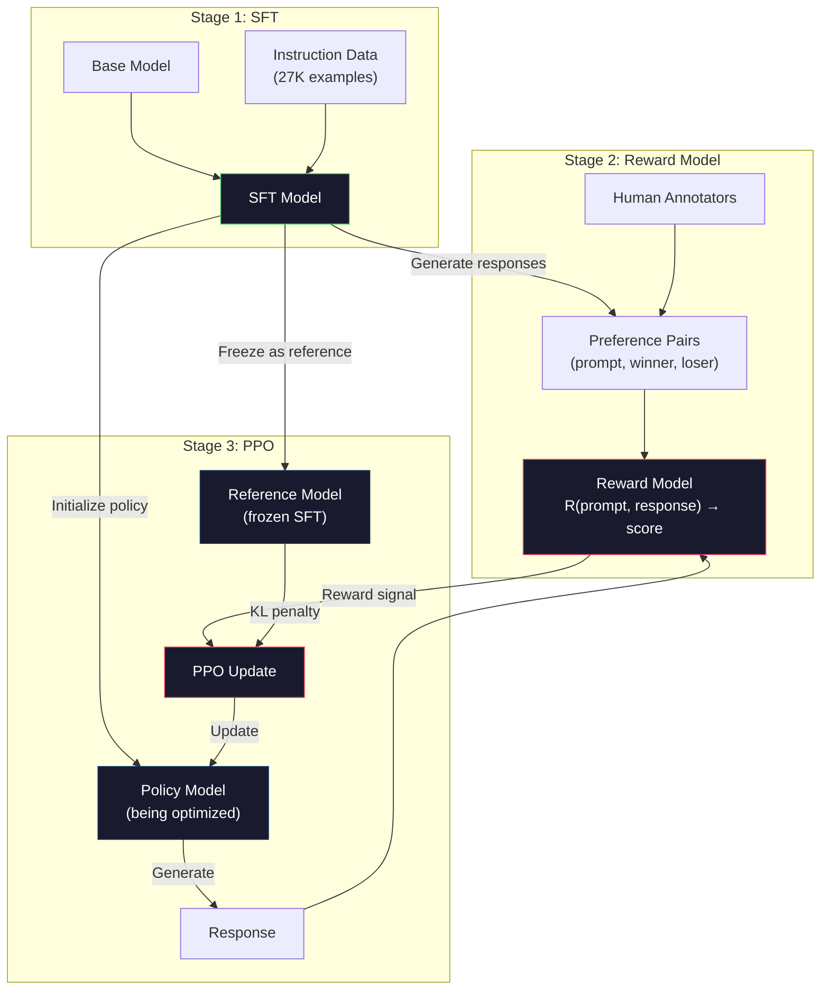
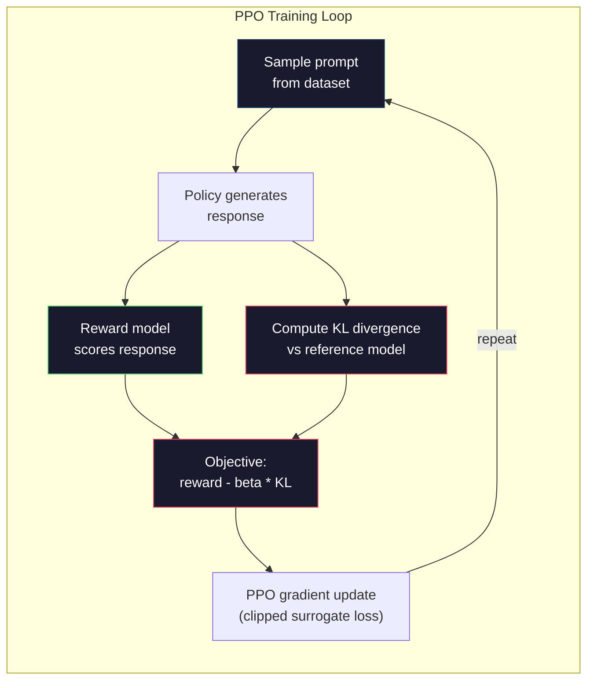

# RLHF：Reward Model + PPO (RLHF: Reward Model + PPO)

> SFT 教模型遵循指令，但它沒有教模型哪個回應*比較好*。兩個文法正確、事實也準確的答案，在實用程度上可能天差地別。RLHF 就是把人類的判斷編碼進模型行為的方法。它讓 Claude 樂於助人，讓 GPT 彬彬有禮。

**Type:** Build
**Languages:** Python (with numpy)
**Prerequisites:** Phase 10, Lesson 06 (Instruction Tuning / SFT)
**Time:** ~90 分鐘

## 學習目標 (Learning Objectives)

- 建立 reward model，根據人類偏好配對（chosen 與 rejected）為回應品質打分數
- 實作 PPO 訓練迴圈，在帶有 KL penalty 的情況下，針對 reward model 最佳化 language model 的 policy
- 說明為什麼 RLHF 需要三個模型（SFT、reward、policy），以及 KL 限制如何防止 reward hacking
- 比較偏好最佳化前後的回應品質，評估 RLHF 的效果

## 問題 (The Problem)

問模型「Explain quantum computing」，它可能產生：

**回應 A：** "Quantum computing uses qubits that can exist in superposition, meaning they can be 0, 1, or both simultaneously. This allows quantum computers to process certain calculations exponentially faster than classical computers. Key algorithms include Shor's algorithm for factoring large numbers and Grover's algorithm for searching unsorted databases."

**回應 B：** "Quantum computing is a type of computing that uses quantum mechanical phenomena. It was first proposed in the 1980s. Richard Feynman suggested that quantum systems could be simulated by quantum computers. The field has grown significantly since then. Many companies are now working on quantum computers. IBM, Google, and others have made progress. Quantum supremacy was claimed by Google in 2019."

兩個回應在事實上都正確，文法也都沒問題，都遵循了指令。但回應 A 明顯比較好。它更簡潔、資訊量更多、結構也更好。人類每次都會選 A。

SFT 無法捕捉這種區別。它用「正確的」回應來訓練模型，但沒有任何機制可以說「這個回應比那個好」。它把每一筆訓練範例都視為同樣好。如果 A 和 B 都出現在 SFT 資料集中，模型會同等地從兩者學習。

RLHF 解決了這個問題。它訓練一個 reward model 來預測人類會偏好哪個回應，再用這個 reward 訊號把 language model 推向更高品質的輸出。InstructGPT（ChatGPT 的前身）用 RLHF 大幅提升了 GPT-3 的實用性、真實性與無害性。OpenAI 內部的評估者有 85% 的時候，偏好 InstructGPT 的輸出勝過 GPT-3 的輸出，儘管 InstructGPT 小了 135 倍（1.3B 對 175B 參數）。

## 核心概念 (The Concept)

### 三個階段 (The Three Stages)

RLHF 不是單一一次訓練，而是三個循序階段組成的管線，每個階段都建立在前一個之上。

**階段 1：SFT。** 在指令-回應配對上訓練 base model（Lesson 06）。這會得到一個能遵循指令、但不知道哪些回應比較好的模型。

**階段 2：Reward Model。** 蒐集人類偏好資料：給標註者看同一個 prompt 的兩個回應，問「哪個比較好？」訓練一個模型來預測這些偏好。Reward model 以 (prompt, response) 為輸入，輸出一個純量分數。

**階段 3：PPO。** 用 reward model 為 language model 產生訓練訊號。Language model 產生回應，reward model 為其打分數，PPO 更新 language model，讓它產生分數更高的回應。KL divergence penalty 則避免 language model 偏離 SFT checkpoint 太遠。



### Reward Model (The Reward Model)

Reward model 是被改造成評分器的 language model。取 SFT 模型，把 language modeling head（輸出 vocabulary 上的分布）換成純量 head（輸出單一數字）。直到最後一層之前，架構都完全相同。

輸入：串接 prompt 與回應。輸出：單一個純量 reward 分數。

訓練資料是人類偏好配對。對每個 prompt，標註者看到兩個回應並選出比較好的那個。這樣就產生了訓練用的三元組：(prompt, preferred_response, rejected_response)。

Loss function 使用成對偏好的 Bradley-Terry 模型：

```math
\text{loss} = -\log\big(\mathop{\mathrm{sigmoid}}(\text{reward}(\text{preferred}) - \text{reward}(\text{rejected}))\big)
```

這是關鍵的公式。`sigmoid(reward(A) - reward(B))` 給出回應 A 優於回應 B 的機率。這個 loss 推動 reward model 給被偏好的回應較高的分數。

為什麼用成對比較，而不是絕對分數？因為人類很不擅長給出絕對的品質分數（「這個回應是 10 分的 7.3 還是 7.5？」），卻很擅長相對比較（「A 比 B 好嗎？」）。Bradley-Terry 模型把相對比較轉換成一致的絕對評分系統。

**InstructGPT 的數字：** OpenAI 從 40 位外包人員蒐集了 33,000 組比較配對。每次比較約花 5 分鐘。這相當於為 reward model 的訓練資料投入了 2,750 小時的人力。

### PPO：Proximal Policy Optimization (PPO: Proximal Policy Optimization)

PPO 是一種強化學習演算法。在 RLHF 中，「環境」是 reward model，「agent」是 language model，「動作」則是產生一個 token。

目標函數：

```math
\text{maximize:} \quad \mathbb{E}[R(\text{prompt}, \text{response})] - \beta \cdot \mathrm{KL}(\text{policy} \,\|\, \text{reference})
```

第一項推動模型產生高 reward 的回應。第二項（KL divergence penalty）避免模型偏離 SFT checkpoint 太遠。

為什麼需要 KL penalty？沒有它，模型會找到退化的解。Reward model 是用有限的人類偏好資料集訓練的，它有盲點。Language model 會利用這些盲點，找出在 reward model 上得高分、實際上卻毫無意義的輸出。經典的例子：

- 重複 "I'm so helpful and harmless!" 會在有用性/無害性的 reward model 上得到高分
- 產生冗長、聽起來很正式但內容空洞的回應，因為模式符合「高品質」
- 利用訓練資料中碰巧與高 reward 相關的特定片語

KL penalty 的意思是：你可以進步，但不能變成一個完全不同的模型。留在 SFT 版本附近，它本來就已經夠合理。偏離太遠，KL 的成本就會壓過 reward。

**InstructGPT 的數字：** PPO 訓練使用 lr=1.5e-5、KL 係數 $\beta=0.02$、256K 個 episode（prompt-回應配對），以及每個 batch 4 個 PPO epoch。整個 RLHF 管線在 GPU 叢集上花了好幾天。



### PPO 目標函數詳解 (The PPO Objective in Detail)

PPO 使用「clipped surrogate objective」來避免過大的更新。新舊 policy 機率之間的比值，會被限制在 $[1 - \epsilon, 1 + \epsilon]$ 的範圍內，其中 $\epsilon$ 通常是 0.2。

```math
\begin{aligned}
\text{ratio} &= \pi_{\text{new}}(\text{action} \mid \text{state}) / \pi_{\text{old}}(\text{action} \mid \text{state}) \\
\text{clipped\_ratio} &= \mathop{\mathrm{clip}}(\text{ratio}, 1 - \epsilon, 1 + \epsilon) \\
\text{loss} &= -\min(\text{ratio} \cdot \text{advantage}, \text{clipped\_ratio} \cdot \text{advantage})
\end{aligned}
```

Advantage function 估計目前的回應比預期品質好多少。在 RLHF 中：

```
advantage = reward(prompt, response) - baseline
```

Baseline 通常是近期回應的平均 reward。正的 advantage 代表回應比平均好，負的 advantage 代表比平均差。PPO 會提高高於平均的回應的機率，降低低於平均的回應的機率。

Clipping 防止災難性的更新。如果某個回應得到異常高的 reward，沒被 clip 的比值可能非常大，使模型劇烈地轉向那個回應。Clipping 限制了更新幅度，維持訓練穩定。

### Reward Hacking (Reward Hacking)

RLHF 的黑暗面。Language model 是針對 reward model 在做最佳化，而 reward model 只是人類偏好的不完美替代品。隨著 language model 越來越擅長最大化 reward，它開始利用 reward model 的弱點。

常見的失敗模式：

| 失敗 | 發生什麼事 | 原因 |
|---------|-------------|-----|
| 冗長 (Verbosity) | 模型產生越來越長的回應 | 人類標註者常常偏好較長、較詳細的回應，所以 reward model 給長度較高的分數 |
| 諂媚 (Sycophancy) | 模型同意使用者說的所有話 | 標註者偏好同意問題前提的回應 |
| 模稜兩可 (Hedging) | 模型不肯對答案做出承諾 | 模稜兩可的回應（「這是個複雜的話題，有許多觀點...」）很少被標記為錯誤 |
| 格式投機 (Format gaming) | 模型過度使用項目符號與標題 | 有格式的回應對標註者來說看起來更「精緻」 |

緩解策略：更強的 KL penalty（避免模型偏離到足以利用弱點的程度）、用對抗性範例訓練 reward model（修補已知的失敗模式），以及使用多個不同架構的 reward model（要同時 hack 全部更困難）。

### 真實的 RLHF 管線 (Real RLHF Pipelines)

| 模型 | 比較配對數 | 標註者 | RM 大小 | PPO 步數 | KL 係數 |
|-------|-----------------|------------|---------|-----------|----------|
| InstructGPT | 33K | 40 | 6B | 256K | 0.02 |
| Llama 2 Chat | ~1M | 未公開 | 70B | 未公開 | 0.01 |
| Claude | 未公開 | 未公開 | 未公開 | 未公開 | 未公開 |
| Anthropic RLHF paper | 22K | 20 | 52B | 50K | 0.001 |

Anthropic 2022 年的論文，用 22,000 組比較訓練了一個 52B 的 reward model。越大的 reward model 產生的訊號越可靠，讓 PPO 訓練更穩定。用小型 reward model 去訓練大型 language model 是有風險的，因為 reward model 沒有足夠的容量去捕捉好壞回應之間的細微差異。

```figure
rlhf-pipeline
```

## 動手做 (Build It)

### 步驟 1：合成的偏好資料 (Step 1: Synthetic Preference Data)

在正式環境中，由人類標註者建立偏好資料。我們建立合成配對，其中「被偏好」的回應客觀上比較好（更簡潔、更準確、更有幫助）。

```python
import numpy as np

PREFERENCE_DATA = [
    {
        "prompt": "What is the capital of France?",
        "preferred": "The capital of France is Paris.",
        "rejected": "France is a country in Europe. It has many cities. The capital is Paris. Paris is known for the Eiffel Tower.",
    },
    {
        "prompt": "Explain gravity in one sentence.",
        "preferred": "Gravity is the force that attracts objects with mass toward each other.",
        "rejected": "Gravity is something that makes things fall down when you drop them.",
    },
    {
        "prompt": "What is 15 times 7?",
        "preferred": "15 times 7 is 105.",
        "rejected": "Let me think about this. 15 times 7. Well, 10 times 7 is 70, and 5 times 7 is 35, so the answer might be around 105.",
    },
    {
        "prompt": "Name three programming languages.",
        "preferred": "Python, Rust, and TypeScript.",
        "rejected": "There are many programming languages. Some popular ones include various languages like Python and others.",
    },
    {
        "prompt": "What year did World War II end?",
        "preferred": "World War II ended in 1945.",
        "rejected": "World War II was a major global conflict. It involved many countries. The war ended in the mid-1940s, specifically in 1945.",
    },
    {
        "prompt": "Define machine learning.",
        "preferred": "Machine learning is a field where algorithms learn patterns from data to make predictions without being explicitly programmed.",
        "rejected": "Machine learning is a type of AI. AI stands for artificial intelligence. Machine learning uses data to learn.",
    },
]
```

被偏好的回應簡潔直接。被拒絕的回應則呈現常見的失敗模式：不必要的贅字、模稜兩可、冗餘的解釋，以及不精確。這正是 SFT 無法捕捉、而 RLHF 可以的那種區別。

### 步驟 2：Reward Model 架構 (Step 2: Reward Model Architecture)

Reward model 重複使用 mini GPT 的 transformer 架構，但把 vocabulary 大小的輸出 head，換成單一的純量投影。

```python
import sys
import os
sys.path.insert(0, os.path.join(os.path.dirname(__file__), "..", "..", "04-pre-training-mini-gpt", "code"))
from main import MiniGPT, LayerNorm, Embedding, TransformerBlock


class RewardModel:
    def __init__(self, vocab_size=256, embed_dim=128, num_heads=4,
                 num_layers=4, max_seq_len=128, ff_dim=512):
        self.embedding = Embedding(vocab_size, embed_dim, max_seq_len)
        self.blocks = [
            TransformerBlock(embed_dim, num_heads, ff_dim)
            for _ in range(num_layers)
        ]
        self.ln_f = LayerNorm(embed_dim)
        self.reward_head = np.random.randn(embed_dim) * 0.02

    def forward(self, token_ids):
        seq_len = token_ids.shape[-1]
        mask = np.triu(np.full((seq_len, seq_len), -1e9), k=1)

        x = self.embedding.forward(token_ids)
        for block in self.blocks:
            x = block.forward(x, mask)
        x = self.ln_f.forward(x)

        last_hidden = x[:, -1, :]
        reward = last_hidden @ self.reward_head

        return reward
```

Reward model 取*最後一個* token 位置的 hidden state，並把它投影成純量。為什麼是最後一個 token？因為 causal attention mask 的緣故，最後一個位置已經 attend 到前面每一個 token。它擁有整個 (prompt, response) 序列最完整的表示。

### 步驟 3：Bradley-Terry Loss (Step 3: Bradley-Terry Loss)

用 Bradley-Terry 成對 loss，在偏好配對上訓練 reward model。

```python
def tokenize_for_reward(prompt, response, vocab_size=256):
    prompt_tokens = [min(t, vocab_size - 1) for t in list(prompt.encode("utf-8"))]
    response_tokens = [min(t, vocab_size - 1) for t in list(response.encode("utf-8"))]
    return prompt_tokens + [0] + response_tokens


def sigmoid(x):
    return np.where(
        x >= 0,
        1.0 / (1.0 + np.exp(-x)),
        np.exp(x) / (1.0 + np.exp(x))
    )


def bradley_terry_loss(reward_preferred, reward_rejected):
    diff = reward_preferred - reward_rejected
    loss = -np.log(sigmoid(diff) + 1e-8)
    return loss


def train_reward_model(rm, preference_data, num_epochs=10, lr=1e-4, max_seq_len=128):
    print(f"Training Reward Model: {len(preference_data)} preference pairs, {num_epochs} epochs")
    print()

    losses = []
    accuracies = []

    for epoch in range(num_epochs):
        epoch_loss = 0.0
        epoch_correct = 0
        num_pairs = 0

        indices = np.random.permutation(len(preference_data))

        for idx in indices:
            pair = preference_data[idx]

            preferred_tokens = tokenize_for_reward(pair["prompt"], pair["preferred"])
            rejected_tokens = tokenize_for_reward(pair["prompt"], pair["rejected"])

            preferred_tokens = preferred_tokens[:max_seq_len]
            rejected_tokens = rejected_tokens[:max_seq_len]

            preferred_ids = np.array(preferred_tokens).reshape(1, -1)
            rejected_ids = np.array(rejected_tokens).reshape(1, -1)

            r_preferred = rm.forward(preferred_ids)[0]
            r_rejected = rm.forward(rejected_ids)[0]

            loss = bradley_terry_loss(r_preferred, r_rejected)

            if r_preferred > r_rejected:
                epoch_correct += 1

            diff = r_preferred - r_rejected
            grad = sigmoid(diff) - 1.0

            rm.reward_head -= lr * grad * rm.ln_f.forward(
                rm.embedding.forward(preferred_ids)
            )[:, -1, :].flatten()

            epoch_loss += loss
            num_pairs += 1

        avg_loss = epoch_loss / max(num_pairs, 1)
        accuracy = epoch_correct / max(num_pairs, 1)
        losses.append(avg_loss)
        accuracies.append(accuracy)

        if epoch % 2 == 0:
            print(f"  Epoch {epoch + 1:3d} | Loss: {avg_loss:.4f} | Accuracy: {accuracy:.1%}")

    return rm, losses, accuracies
```

Accuracy 指標很直接：reward model 對偏好配對的排序，有多少比例是正確的？隨機模型是 50%。在乾淨資料上訓練良好的 reward model 應該超過 70%。InstructGPT 的 reward model 在保留的比較資料上達到約 72% 的準確率，聽起來偏低，其實已經很好，因為許多偏好配對連人類都很難判斷（標註者之間的一致性約為 73%）。

### 步驟 4：簡化的 PPO 迴圈 (Step 4: Simplified PPO Loop)

完整的 PPO 很複雜。這個實作抓住了核心機制：產生回應、打分數、計算 advantage，並在帶有 KL penalty 的情況下更新 policy。

```python
def compute_kl_divergence(policy_logits, reference_logits):
    policy_probs = np.exp(policy_logits - policy_logits.max(axis=-1, keepdims=True))
    policy_probs = policy_probs / policy_probs.sum(axis=-1, keepdims=True)
    policy_probs = np.clip(policy_probs, 1e-10, 1.0)

    ref_probs = np.exp(reference_logits - reference_logits.max(axis=-1, keepdims=True))
    ref_probs = ref_probs / ref_probs.sum(axis=-1, keepdims=True)
    ref_probs = np.clip(ref_probs, 1e-10, 1.0)

    kl = np.sum(policy_probs * np.log(policy_probs / ref_probs), axis=-1)
    return kl.mean()


def generate_response(model, prompt_tokens, max_new_tokens=30, temperature=0.8, max_seq_len=128):
    tokens = list(prompt_tokens)

    for _ in range(max_new_tokens):
        context = np.array(tokens[-max_seq_len:]).reshape(1, -1)
        logits = model.forward(context)
        next_logits = logits[0, -1, :]

        next_logits = next_logits / max(temperature, 1e-8)
        probs = np.exp(next_logits - next_logits.max())
        probs = probs / probs.sum()
        probs = np.clip(probs, 1e-10, 1.0)
        probs = probs / probs.sum()

        next_token = np.random.choice(len(probs), p=probs)
        tokens.append(int(next_token))

    return tokens


def copy_model_weights(source, target):
    target.embedding.token_embed = source.embedding.token_embed.copy()
    target.embedding.pos_embed = source.embedding.pos_embed.copy()
    target.ln_f.gamma = source.ln_f.gamma.copy()
    target.ln_f.beta = source.ln_f.beta.copy()
    for s_block, t_block in zip(source.blocks, target.blocks):
        t_block.attn.W_q = s_block.attn.W_q.copy()
        t_block.attn.W_k = s_block.attn.W_k.copy()
        t_block.attn.W_v = s_block.attn.W_v.copy()
        t_block.attn.W_out = s_block.attn.W_out.copy()
        t_block.ffn.W1 = s_block.ffn.W1.copy()
        t_block.ffn.W2 = s_block.ffn.W2.copy()
        t_block.ffn.b1 = s_block.ffn.b1.copy()
        t_block.ffn.b2 = s_block.ffn.b2.copy()
        t_block.ln1.gamma = s_block.ln1.gamma.copy()
        t_block.ln1.beta = s_block.ln1.beta.copy()
        t_block.ln2.gamma = s_block.ln2.gamma.copy()
        t_block.ln2.beta = s_block.ln2.beta.copy()


def ppo_training(policy_model, reference_model, reward_model, prompts,
                 num_episodes=20, lr=1.5e-5, kl_coeff=0.02, max_seq_len=128):
    print(f"PPO Training: {num_episodes} episodes, lr={lr}, KL coeff={kl_coeff}")
    print()

    rewards_history = []
    kl_history = []

    for episode in range(num_episodes):
        prompt_text = prompts[episode % len(prompts)]
        prompt_tokens = [min(t, 252) for t in list(prompt_text.encode("utf-8"))]

        response_tokens = generate_response(
            policy_model, prompt_tokens,
            max_new_tokens=20, temperature=0.8, max_seq_len=max_seq_len
        )

        response_ids = np.array(response_tokens[:max_seq_len]).reshape(1, -1)
        reward = reward_model.forward(response_ids)[0]

        policy_logits = policy_model.forward(response_ids)
        ref_logits = reference_model.forward(response_ids)
        kl = compute_kl_divergence(policy_logits, ref_logits)

        total_reward = reward - kl_coeff * kl

        rewards_history.append(float(reward))
        kl_history.append(float(kl))

        for block in policy_model.blocks:
            update_scale = lr * total_reward
            block.ffn.W1 += update_scale * np.random.randn(*block.ffn.W1.shape) * 0.01
            block.ffn.W2 += update_scale * np.random.randn(*block.ffn.W2.shape) * 0.01

        if episode % 5 == 0:
            avg_reward = np.mean(rewards_history[-5:]) if rewards_history else 0
            avg_kl = np.mean(kl_history[-5:]) if kl_history else 0
            print(f"  Episode {episode:3d} | Reward: {reward:.4f} | KL: {kl:.4f} | "
                  f"Avg Reward: {avg_reward:.4f}")

    return policy_model, rewards_history, kl_history
```

核心迴圈：(1) 抽樣一個 prompt，(2) 產生回應，(3) 用 reward model 打分數，(4) 對凍結的 reference 計算 KL divergence，(5) 計算調整後的 reward（reward 減去 KL penalty），(6) 更新 policy。當 policy 偏離 reference 時，KL penalty 會增加，自動防止 reward hacking。

### 步驟 5：Reward 分數比較 (Step 5: Reward Score Comparison)

RLHF 之後，policy 模型的回應在 reward model 上的得分，應該比原始 SFT 模型的回應更高。

```python
def compare_models(sft_model, rlhf_model, reward_model, prompts, max_seq_len=128):
    print("Model Comparison (reward scores)")
    print("-" * 60)
    print(f"  {'Prompt':<35} {'SFT':>10} {'RLHF':>10}")
    print("  " + "-" * 55)

    sft_total = 0.0
    rlhf_total = 0.0

    for prompt in prompts:
        prompt_tokens = [min(t, 252) for t in list(prompt.encode("utf-8"))]

        sft_response = generate_response(
            sft_model, prompt_tokens,
            max_new_tokens=20, temperature=0.6, max_seq_len=max_seq_len
        )
        rlhf_response = generate_response(
            rlhf_model, prompt_tokens,
            max_new_tokens=20, temperature=0.6, max_seq_len=max_seq_len
        )

        sft_ids = np.array(sft_response[:max_seq_len]).reshape(1, -1)
        rlhf_ids = np.array(rlhf_response[:max_seq_len]).reshape(1, -1)

        sft_reward = reward_model.forward(sft_ids)[0]
        rlhf_reward = reward_model.forward(rlhf_ids)[0]

        sft_total += sft_reward
        rlhf_total += rlhf_reward

        truncated_prompt = prompt[:33] + ".." if len(prompt) > 35 else prompt
        print(f"  {truncated_prompt:<35} {sft_reward:>10.4f} {rlhf_reward:>10.4f}")

    n = len(prompts)
    print("  " + "-" * 55)
    print(f"  {'Average':<35} {sft_total/n:>10.4f} {rlhf_total/n:>10.4f}")

    return sft_total / n, rlhf_total / n
```

## 實際使用 (Use It)

### 完整 RLHF 管線示範 (Full RLHF Pipeline Demo)

```python
if __name__ == "__main__":
    np.random.seed(42)

    print("=" * 70)
    print("RLHF PIPELINE: REWARD MODEL + PPO")
    print("=" * 70)
    print()

    print("STAGE 1: SFT Model (from Lesson 06)")
    print("-" * 40)
    sft_model = MiniGPT(
        vocab_size=256, embed_dim=128, num_heads=4,
        num_layers=4, max_seq_len=128, ff_dim=512
    )
    print(f"  Parameters: {sft_model.count_parameters():,}")
    print()

    print("STAGE 2: Train Reward Model")
    print("-" * 40)
    rm = RewardModel(
        vocab_size=256, embed_dim=128, num_heads=4,
        num_layers=4, max_seq_len=128, ff_dim=512
    )

    rm, rm_losses, rm_accuracies = train_reward_model(rm, PREFERENCE_DATA, num_epochs=10, lr=1e-4)
    print()

    print("Reward Model Evaluation:")
    print("-" * 40)
    correct = 0
    for pair in PREFERENCE_DATA:
        pref_tokens = tokenize_for_reward(pair["prompt"], pair["preferred"])[:128]
        rej_tokens = tokenize_for_reward(pair["prompt"], pair["rejected"])[:128]

        r_pref = rm.forward(np.array(pref_tokens).reshape(1, -1))[0]
        r_rej = rm.forward(np.array(rej_tokens).reshape(1, -1))[0]

        if r_pref > r_rej:
            correct += 1
        print(f"  Preferred: {r_pref:+.4f} | Rejected: {r_rej:+.4f} | {'Correct' if r_pref > r_rej else 'Wrong'}")

    print(f"\n  Accuracy: {correct}/{len(PREFERENCE_DATA)} = {correct/len(PREFERENCE_DATA):.1%}")
    print()

    print("STAGE 3: PPO Training")
    print("-" * 40)

    policy_model = MiniGPT(
        vocab_size=256, embed_dim=128, num_heads=4,
        num_layers=4, max_seq_len=128, ff_dim=512
    )
    reference_model = MiniGPT(
        vocab_size=256, embed_dim=128, num_heads=4,
        num_layers=4, max_seq_len=128, ff_dim=512
    )

    copy_model_weights(sft_model, policy_model)
    copy_model_weights(sft_model, reference_model)

    train_prompts = [pair["prompt"] for pair in PREFERENCE_DATA]

    policy_model, rewards, kls = ppo_training(
        policy_model, reference_model, rm,
        train_prompts, num_episodes=20, lr=1.5e-5, kl_coeff=0.02
    )
    print()

    print("=" * 70)
    print("COMPARISON: SFT vs RLHF")
    print("=" * 70)
    print()

    eval_prompts = [
        "What is the capital of France?",
        "Explain gravity.",
        "Name three programming languages.",
    ]

    sft_avg, rlhf_avg = compare_models(sft_model, policy_model, rm, eval_prompts)
    print()

    print("=" * 70)
    print("KL DIVERGENCE ANALYSIS")
    print("=" * 70)
    print()

    if kls:
        print(f"  Initial KL: {kls[0]:.4f}")
        print(f"  Final KL:   {kls[-1]:.4f}")
        print(f"  Max KL:     {max(kls):.4f}")
        kl_threshold = 0.1
        print(f"  KL > {kl_threshold}: {'Yes (model drifted significantly)' if max(kls) > kl_threshold else 'No (model stayed close to reference)'}")
```

## 交付 (Ship It)

這堂課會產出 `outputs/prompt-reward-model-designer.md`，這是一個用來設計 reward model 訓練管線的 prompt。給定目標行為（實用性、寫程式能力、安全性），它會產出資料蒐集規範、標註者指引與 reward model 評估標準。

## 練習 (Exercises)

1. 修改 reward model，改用所有 hidden state 的平均，而不只是最後一個位置。比較準確率。Mean pooling 的做法讓每個 token 的權重相等，而最後位置的做法則依賴 causal attention 來彙整資訊。在 6 組偏好配對上測試，並回報哪種做法的準確率較高。

2. 實作 reward model 校準。訓練之後，讓所有偏好配對通過 reward model，並計算：(a) 被偏好回應的平均 reward、(b) 被拒絕回應的平均 reward、(c) 差距 (margin)（被偏好減去被拒絕）。校準良好的模型應該有明顯的差距。然後再加入 4 組新的偏好配對，檢查差距在沒看過的資料上是否仍然成立。

3. 模擬 reward hacking。建立一個對長回應給高分的 reward model（reward = len(response) / 100）。用這個有缺陷的 reward model 執行 PPO，觀察 policy 模型產生越來越長、重複的輸出。然後加入 0.1 的 KL penalty，展示它如何避免退化的行為。

4. 實作多目標 reward。訓練兩個 reward model，一個針對實用性，一個針對簡潔性。把它們組合成 $R = 0.7 \cdot R_{\text{helpful}} + 0.3 \cdot R_{\text{concise}}$。展示組合後的目標，會產生既有幫助又簡潔的回應，避開單一實用性 reward 的冗長陷阱。

5. 比較不同的 KL 係數。用 $\beta=0.001$（太低，reward hacking）、$\beta=0.02$（標準）和 $\beta=0.5$（太高，沒學到東西）執行 PPO。畫出每一組的 reward 曲線與 KL 曲線。$\beta=0.02$ 那組應該顯示 reward 穩定提升，且 KL 有界。

## 關鍵術語 (Key Terms)

| 術語 | 一般說法 | 實際意義 |
|------|----------------|----------------------|
| RLHF | 「用人類回饋來訓練」 | Reinforcement Learning from Human Feedback：三階段管線（SFT、reward model、PPO），利用人類偏好訊號最佳化 language model 的輸出 |
| Reward model | 「替回應打分數的模型」 | 帶有純量輸出 head 的 transformer，使用 Bradley-Terry loss 在成對的人類偏好上訓練 |
| Bradley-Terry | 「比較模型」 | 一種機率模型，其中 $P(A > B) = \mathop{\mathrm{sigmoid}}(\text{score}(A) - \text{score}(B))$，將成對偏好轉換成一致的評分函數 |
| PPO | 「那個 RL 演算法」 | Proximal Policy Optimization：更新 policy 以最大化 reward，同時限制更新幅度以避免不穩定 |
| KL divergence | 「兩個分布差多少」 | 衡量 policy 模型與 reference 模型 token 分布之間差異的指標，用作防止 reward hacking 的 penalty |
| KL penalty | 「模型的牽繩」 | 從 reward 訊號中減去 $\beta \cdot \mathrm{KL}(\text{policy} \Vert \text{reference})$，避免 policy 偏離 SFT checkpoint 太遠 |
| Reward hacking | 「鑽 reward 的漏洞」 | Policy 利用 reward model 的弱點，找到退化卻高 reward 的輸出，而不是真正進步 |
| Preference pair | 「A 和 B 哪個比較好？」 | 由 (prompt, preferred_response, rejected_response) 組成的訓練範例，是 RLHF 訓練資料的基本單位 |
| Reference model | 「凍結的 SFT checkpoint」 | SFT 模型的副本，權重永不改變，作為計算 KL divergence 的錨點 |

## 延伸閱讀 (Further Reading)

- [Ouyang et al., 2022 -- "Training language models to follow instructions with human feedback" (InstructGPT)](https://arxiv.org/abs/2203.02155)：讓 RLHF 對大型 language model 變得可行的論文
- [Schulman et al., 2017 -- "Proximal Policy Optimization Algorithms"](https://arxiv.org/abs/1707.06347)：OpenAI 的原始 PPO 論文
- [Bai et al., 2022 -- "Training a Helpful and Harmless Assistant with Reinforcement Learning from Human Feedback"](https://arxiv.org/abs/2204.05862)：Anthropic 的 RLHF 論文，詳細分析 reward hacking 與 KL penalty
- [Stiennon et al., 2020 -- "Learning to summarize with human feedback"](https://arxiv.org/abs/2009.01325)：將 RLHF 應用於摘要，顯示 reward model 能捕捉細膩的品質判斷
- [Christiano et al., 2017 -- "Deep reinforcement learning from human preferences"](https://arxiv.org/abs/1706.03741)：從人類比較中學習 reward function 的奠基性研究
