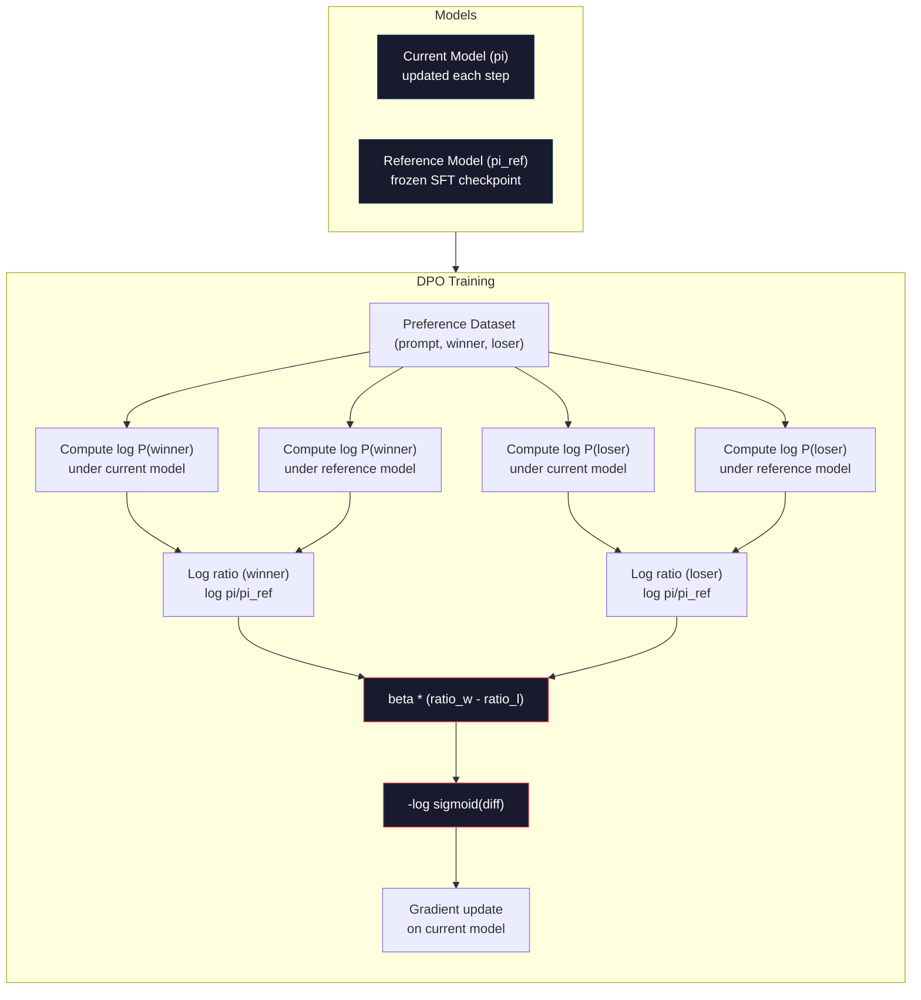

# DPO：Direct Preference Optimization (DPO: Direct Preference Optimization)

> RLHF 有效，但它需要訓練三個模型（SFT、reward model、policy）、處理 PPO 的不穩定，還要調整 KL penalty。DPO 問：如果可以把這些全部跳過呢？DPO 直接在偏好配對上最佳化 language model。沒有 reward model，沒有 PPO，只有一個訓練迴圈，卻能得到相同的結果。

**Type:** Build
**Languages:** Python (with numpy)
**Prerequisites:** Phase 10, Lesson 07 (RLHF)
**Time:** ~90 分鐘

## 學習目標 (Learning Objectives)

- 實作 DPO 訓練，不需要獨立的 reward model，直接在偏好配對上最佳化 language model
- 推導 DPO 的 loss function，並說明它如何透過 policy 的 log probability 隱含地表示 reward model
- 從訓練穩定性、運算成本與所需模型數量，比較 DPO 與 RLHF
- 調整 beta 參數，控制訓練後的 policy 偏離 reference model 的程度

## 問題 (The Problem)

你在 Lesson 07 建了一條 RLHF 管線。三個階段，三個模型。SFT 模型、reward model，以及用 PPO 最佳化的 policy 模型。光是 reward model 就需要數千組人類偏好配對，以及獨立的訓練迴圈。PPO 則需要仔細調整 KL 係數、learning rate、clip ratio 和 epoch 數。

實務上，PPO 訓練出了名的不穩定。超參數稍微改變，訓練就會發散。Reward model 是人類偏好的不完美替代品，而 policy 會找到利用其弱點的方法。KL penalty 有幫助，但它本身也需要調整：太低會 reward hacking，太高模型又幾乎學不到東西。

這種複雜度，就是為什麼在 InstructGPT 發表之後的好幾年間，大多數開源模型都在 RLHF 上苦苦掙扎。這個三階段管線很脆弱。每個階段都有自己的失敗模式，而且錯誤會層層累積。

2023 年 5 月，Stanford 的 Rafael Rafailov、Archit Sharma 與同事發表了「Direct Preference Optimization: Your Language Model is Secretly a Reward Model」。關鍵洞見：你不需要另外的 reward model。最佳的 reward function 在數學上，是由 language model 自己的 token 機率所決定的。你可以完全跳過 reward model，直接在偏好配對上最佳化 language model。

DPO 把 RLHF 簡化成單一的 supervised learning 步驟。一個模型，一個 loss function，一個訓練迴圈，沒有強化學習。Zephyr-7B 是最早大規模使用 DPO 的模型之一，在多項 benchmark 上追平甚至超越以完整 RLHF 訓練的模型。Meta 把 DPO 作為 Llama 3 對齊管線的一部分。Anthropic 也在其對齊研究中提到 DPO 風格的方法。

## 核心概念 (The Concept)

### 關鍵洞見 (The Key Insight)

RLHF 最佳化的是這個目標：

```math
\text{maximize:} \quad \mathbb{E}[R(x, y)] - \beta \cdot \mathrm{KL}(\pi \,\|\, \pi_{\text{ref}})
```

其中 $R$ 是 reward model，$\pi$ 是 policy，$\pi_{\text{ref}}$ 是 reference model，$\beta$ 是 KL 係數。

DPO 論文證明這個目標有封閉形式的最佳解。對任何 reward function $R$，最佳的 policy 是：

```math
\pi^*(y \mid x) = \pi_{\text{ref}}(y \mid x) \cdot \exp(R(x, y) / \beta) / Z(x)
```

其中 $Z(x)$ 是正規化常數。重新整理後：

```math
R(x, y) = \beta \log \frac{\pi^*(y \mid x)}{\pi_{\text{ref}}(y \mid x)} + \beta \log Z(x)
```

這就是突破。Reward 完全可以用 policy 模型的機率與 reference 模型的機率來表達。你不需要訓練獨立的 reward model。Reward *隱含*在機率比值之中。

把它代入 Bradley-Terry 偏好模型：

```math
\begin{aligned}
P(y_w > y_l \mid x) &= \mathop{\mathrm{sigmoid}}(R(x, y_w) - R(x, y_l)) \\
&= \mathop{\mathrm{sigmoid}}\left(\beta \left(\log \frac{\pi(y_w \mid x)}{\pi_{\text{ref}}(y_w \mid x)} - \log \frac{\pi(y_l \mid x)}{\pi_{\text{ref}}(y_l \mid x)}\right)\right)
\end{aligned}
```

$Z(x)$ 項會相消，因為兩個回應都是以同一個 prompt $x$ 為條件。剩下的，就只是 policy 模型與 reference 模型，在被偏好與被拒絕回應上的 log probability 的函數。

### DPO Loss (The DPO Loss)

```math
L_{\text{DPO}} = -\log \mathop{\mathrm{sigmoid}}\left(\beta \left(\log \frac{\pi(y_w \mid x)}{\pi_{\text{ref}}(y_w \mid x)} - \log \frac{\pi(y_l \mid x)}{\pi_{\text{ref}}(y_l \mid x)}\right)\right)
```

我們逐項拆解：

- **$y_w$** = 被偏好（勝出）的回應
- **$y_l$** = 被拒絕（落敗）的回應
- **$x$** = prompt
- **$\pi$** = 目前的模型（正在訓練）
- **$\pi_{\text{ref}}$** = reference model（凍結的 SFT checkpoint）
- **$\beta$** = 控制偏離 reference 程度的 temperature 參數（通常是 0.1 到 0.5）

`log pi(y|x) / pi_ref(y|x)` 這個比值就是 log probability ratio。比值為正，代表目前的模型對回應 $y$ 給的機率比 reference 高。為負，則代表目前的模型給的機率較低。

DPO loss 推動模型提高被偏好回應的 log probability ratio，並降低被拒絕回應的。Beta 參數控制模型能偏離 reference 的積極程度：beta 小代表允許大幅偏離，beta 大則讓模型貼近 reference。



### 為什麼 DPO 比較簡單 (Why DPO is Simpler)

| 面向 | RLHF (PPO) | DPO |
|--------|-----------|-----|
| 要訓練的模型 | 3 個（SFT + reward + policy） | 1 個（只有 policy） |
| 訓練迴圈 | 3 個（SFT、RM 訓練、PPO） | 2 個（SFT、DPO） |
| 超參數 | lr、KL 係數、clip ratio、RM lr、epochs x3 | lr、beta、epochs |
| Reward model | 必要（另外訓練） | 隱含在模型機率中 |
| RL 演算法 | PPO（複雜、不穩定） | Supervised learning（穩定） |
| GPU 記憶體 | PPO 期間記憶體中有 3-4 個模型 | 2 個模型（目前 + reference） |
| 訓練穩定性 | 對超參數敏感 | 穩健，類似 SFT |

DPO 訓練期間，記憶體中需要兩個模型：目前的模型與凍結的 reference。RLHF 需要三或四個：policy、reference、reward model，以及選用的 value function baseline。以 70B 模型來說，每份副本在 FP16 下佔 140GB。省下 reward model 所節省的記憶體相當可觀。

### DPO 何時勝過 RLHF (When DPO Beats RLHF)

**小型資料集。** 在 5,000-20,000 組偏好配對下，DPO 通常追平或超越 RLHF。RLHF 中的 reward model 需要足夠的資料才能泛化，資料有限時，它會 overfit 並產生不可靠的 reward 訊號。DPO 因為完全不需要 reward model，繞過了這個問題。

**有限的運算資源。** DPO 需要的運算量約為完整 RLHF 的三分之一（一個訓練迴圈，而不是三個）。對沒有大型 GPU 叢集的團隊來說，這是實際的選擇。

**快速迭代。** 想試 10 種不同的偏好資料集，看哪一個能訓練出最好的模型？DPO 讓你每個實驗在幾小時內就能跑完。RLHF 則每換一個資料集，就得重新訓練 reward model。

### RLHF 何時勝過 DPO (When RLHF Beats DPO)

**大規模訓練。** 在 GPT-4 或 Claude 的規模下，RLHF 獨立的 reward model 能捕捉更細膩的偏好訊號。Reward model 就像一個學習得來的 loss function，能適應複雜的品質標準。

**複雜的 reward 訊號。** 當「更好」牽涉多個面向（實用性、無害性、誠實性）時，reward model 可以學到這種多目標的取捨。DPO 把每組偏好配對視為二元訊號，一個比較好、一個比較差，卻沒有對原因建模。

**迭代式對齊。** RLHF 管線可以用目前的 policy 產生新的回應，請人類評分，並在線上迴圈中重新訓練 reward model。DPO 則是在固定的偏好配對資料集上運作。Constitutional AI（Anthropic 的做法）大量運用了 RLHF 的這種迭代特性。

### 超越 DPO：KTO、ORPO、SimPO (Beyond DPO: KTO, ORPO, SimPO)

DPO 啟發了一整個簡化對齊方法的家族。

**KTO（Kahneman-Tversky Optimization，2024）：** 你甚至不需要配對。KTO 可以用不成對的回饋，只要把每個回應標成「好」或「壞」，不用和另一個選項比較。這大幅簡化了資料蒐集。不用給標註者看兩個回應問「哪個比較好？」，而是給他們看一個回應，問「這個好嗎？」Loss function 套用了展望理論 (prospect theory) 的損失趨避：壞回應受到的懲罰，比好回應得到的獎勵更重。

**ORPO（Odds Ratio Preference Optimization，2024）：** 把 SFT 與對齊合併成單一訓練步驟。不是先做 SFT 再做 DPO，ORPO 修改 SFT 的 loss，納入偏好訊號。Loss 有兩項：對被偏好回應的標準 next-token prediction loss，加上一個 odds ratio 項，擴大被偏好與被拒絕回應機率之間的差距。一個訓練迴圈，取代兩個。

**SimPO（Simple Preference Optimization，2024）：** 完全消除 reference model。不再對凍結的 reference 計算 log probability ratio，SimPO 以回應的平均 log probability（以長度正規化）作為隱含的 reward。這節省了記憶體（不需要 reference model），也簡化了訓練。長度正規化避免模型偏好較短的回應。

| 方法 | 年份 | 記憶體中的模型數 | 需要配對？ | 需要 Reference？ | 訓練迴圈 |
|--------|------|-----------------|-------------|-----------------|----------------|
| RLHF | 2022 | 3-4 | 是（為了 RM） | 是 | 3 |
| DPO | 2023 | 2 | 是 | 是 | 2 |
| KTO | 2024 | 2 | 否（不成對） | 是 | 2 |
| ORPO | 2024 | 1 | 是 | 否 | 1 |
| SimPO | 2024 | 1 | 是 | 否 | 1 |

趨勢很明顯：每個方法都再消除一塊複雜度。RLHF 需要 reward model 和 PPO。DPO 兩者都去掉了。KTO 去掉了成對資料。ORPO 去掉了獨立的 SFT 階段。SimPO 去掉了 reference model。Alignment tax，也就是從 base model 走到對齊模型所需的運算與複雜度成本，持續下降。

### 真實的 DPO 部署 (Real DPO Deployments)

**Zephyr-7B（HuggingFace，2023 年 10 月）：** 以 Mistral 7B base 為基礎，先在 UltraChat（200K 筆範例）上做 SFT，再於 UltraFeedback（60K 組偏好配對）上做 DPO。在 MT-Bench 上得到 6.47 分，是當時最高分的 7B 模型。作為對照，Llama 2 Chat 70B 得 6.86 分，代表 Zephyr 只靠 DPO 對齊，就逼近了一個大它 10 倍的模型，差距在 6% 以內。

**Llama 3（Meta，2024 年 4 月）：** 在最初的 RLHF 階段之後使用 DPO。這個組合顯示 DPO 與 RLHF 可以互補：RLHF 負責廣泛的對齊，DPO 負責針對性的微調。

**Neural Magic / nm-chat（2024）：** 對多個開源模型套用 DPO，在對齊 benchmark 上相較僅用 SFT 的 baseline，一致顯示出 5-15% 的進步。

```figure
dpo-loss
```

## 動手做 (Build It)

### 步驟 1：偏好資料集 (Step 1: Preference Dataset)

格式與 RLHF 相同，都是 (prompt, preferred, rejected) 三元組。DPO 直接使用這些資料，不需要中間的 reward model。

```python
import numpy as np
import sys
import os
sys.path.insert(0, os.path.join(os.path.dirname(__file__), "..", "..", "04-pre-training-mini-gpt", "code"))
from main import MiniGPT, LayerNorm, Embedding, TransformerBlock

PREFERENCE_DATA = [
    {
        "prompt": "What is the capital of France?",
        "preferred": "The capital of France is Paris.",
        "rejected": "France is a country in Europe. It has many cities. The capital is Paris. Paris is known for the Eiffel Tower.",
    },
    {
        "prompt": "Explain gravity in one sentence.",
        "preferred": "Gravity is the force that attracts objects with mass toward each other.",
        "rejected": "Gravity is something that makes things fall down when you drop them.",
    },
    {
        "prompt": "What is 15 times 7?",
        "preferred": "15 times 7 is 105.",
        "rejected": "Let me think about this. 15 times 7. Well, 10 times 7 is 70, and 5 times 7 is 35, so the answer might be around 105.",
    },
    {
        "prompt": "Name three programming languages.",
        "preferred": "Python, Rust, and TypeScript.",
        "rejected": "There are many programming languages. Some popular ones include various languages like Python and others.",
    },
    {
        "prompt": "What year did World War II end?",
        "preferred": "World War II ended in 1945.",
        "rejected": "World War II was a major global conflict. It involved many countries. The war ended in the mid-1940s, specifically in 1945.",
    },
    {
        "prompt": "Define machine learning.",
        "preferred": "Machine learning is a field where algorithms learn patterns from data to make predictions without being explicitly programmed.",
        "rejected": "Machine learning is a type of AI. AI stands for artificial intelligence. Machine learning uses data to learn.",
    },
]
```

### 步驟 2：序列的 Log-Probability (Step 2: Sequence Log-Probability)

DPO loss 需要計算在給定 prompt 的情況下，一個回應的總 log probability。這代表要讓模型跑過完整的 (prompt + response) 序列，並把每個回應 token 的 log probability 加總。

```python
def tokenize_sequence(text, vocab_size=256):
    return [min(t, vocab_size - 1) for t in list(text.encode("utf-8"))]


def compute_sequence_log_prob(model, prompt_tokens, response_tokens, max_seq_len=128):
    full_sequence = prompt_tokens + response_tokens
    if len(full_sequence) > max_seq_len:
        full_sequence = full_sequence[:max_seq_len]

    if len(full_sequence) < 2:
        return 0.0

    input_ids = np.array(full_sequence[:-1]).reshape(1, -1)
    target_ids = np.array(full_sequence[1:])

    logits = model.forward(input_ids)
    logits = logits[0]

    max_logits = logits.max(axis=-1, keepdims=True)
    log_probs = logits - max_logits - np.log(
        np.exp(logits - max_logits).sum(axis=-1, keepdims=True)
    )

    prompt_len = len(prompt_tokens)
    response_start = max(0, prompt_len - 1)
    response_end = len(target_ids)

    if response_start >= response_end:
        return 0.0

    response_log_probs = log_probs[response_start:response_end, :]
    response_targets = target_ids[response_start:response_end]

    total_log_prob = 0.0
    for i, target in enumerate(response_targets):
        total_log_prob += response_log_probs[i, target]

    return total_log_prob
```

這個函式是 DPO 的主力。對每組偏好配對，它會執行四次：模型對被偏好回應、模型對被拒絕回應、reference 對被偏好回應、reference 對被拒絕回應。每筆訓練範例要 4 次 forward pass，相較之下 RLHF 要做生成 + reward 評分 + value 估計 + PPO 更新。更簡單、更快、更穩定。

### 步驟 3：DPO Loss (Step 3: The DPO Loss)

論文的核心，用程式碼表達。一個函式，一個 loss，沒有 reward model。

```python
def sigmoid(x):
    return np.where(
        x >= 0,
        1.0 / (1.0 + np.exp(-x)),
        np.exp(x) / (1.0 + np.exp(x))
    )


def dpo_loss(policy_logprob_preferred, policy_logprob_rejected,
             ref_logprob_preferred, ref_logprob_rejected, beta=0.1):
    preferred_ratio = policy_logprob_preferred - ref_logprob_preferred
    rejected_ratio = policy_logprob_rejected - ref_logprob_rejected

    logit = beta * (preferred_ratio - rejected_ratio)

    loss = -np.log(sigmoid(logit) + 1e-8)

    preferred_reward = beta * preferred_ratio
    rejected_reward = beta * rejected_ratio

    return loss, {
        "preferred_ratio": float(preferred_ratio),
        "rejected_ratio": float(rejected_ratio),
        "logit": float(logit),
        "implicit_preferred_reward": float(preferred_reward),
        "implicit_rejected_reward": float(rejected_reward),
        "reward_margin": float(preferred_reward - rejected_reward),
    }
```

`preferred_ratio` 和 `rejected_ratio` 是 DPO 推導出的 log probability ratio。當目前的模型對被偏好回應給的機率比 reference 高（相對於 reference），並且對被拒絕回應給的機率較低時，logit 為正，loss 就低。訓練訊號推動模型朝著這個方向前進。

`implicit_preferred_reward` 和 `implicit_rejected_reward` 是 DPO loss 隱含指派的 reward。你可以把它們取出來，驗證訓練是否有效：被偏好與被拒絕 reward 之間的差距，應該隨著訓練增加。

### 步驟 4：DPO 訓練迴圈 (Step 4: DPO Training Loop)

標準的 supervised 訓練迴圈。沒有 PPO，沒有 reward model，只有 forward pass 與 gradient 更新。

```python
def copy_model_weights(source, target):
    target.embedding.token_embed = source.embedding.token_embed.copy()
    target.embedding.pos_embed = source.embedding.pos_embed.copy()
    target.ln_f.gamma = source.ln_f.gamma.copy()
    target.ln_f.beta = source.ln_f.beta.copy()
    for s_block, t_block in zip(source.blocks, target.blocks):
        t_block.attn.W_q = s_block.attn.W_q.copy()
        t_block.attn.W_k = s_block.attn.W_k.copy()
        t_block.attn.W_v = s_block.attn.W_v.copy()
        t_block.attn.W_out = s_block.attn.W_out.copy()
        t_block.ffn.W1 = s_block.ffn.W1.copy()
        t_block.ffn.W2 = s_block.ffn.W2.copy()
        t_block.ffn.b1 = s_block.ffn.b1.copy()
        t_block.ffn.b2 = s_block.ffn.b2.copy()
        t_block.ln1.gamma = s_block.ln1.gamma.copy()
        t_block.ln1.beta = s_block.ln1.beta.copy()
        t_block.ln2.gamma = s_block.ln2.gamma.copy()
        t_block.ln2.beta = s_block.ln2.beta.copy()


def dpo_train(policy_model, reference_model, preference_data,
              num_epochs=5, lr=5e-6, beta=0.1, max_seq_len=128):
    print(f"DPO Training: {len(preference_data)} pairs, {num_epochs} epochs, "
          f"lr={lr}, beta={beta}")
    print()

    losses = []
    margins = []

    for epoch in range(num_epochs):
        epoch_loss = 0.0
        epoch_margin = 0.0
        num_examples = 0

        indices = np.random.permutation(len(preference_data))

        for idx in indices:
            pair = preference_data[idx]

            prompt_tokens = tokenize_sequence(pair["prompt"])
            preferred_tokens = tokenize_sequence(pair["preferred"])
            rejected_tokens = tokenize_sequence(pair["rejected"])

            pi_logprob_w = compute_sequence_log_prob(
                policy_model, prompt_tokens, preferred_tokens, max_seq_len
            )
            pi_logprob_l = compute_sequence_log_prob(
                policy_model, prompt_tokens, rejected_tokens, max_seq_len
            )
            ref_logprob_w = compute_sequence_log_prob(
                reference_model, prompt_tokens, preferred_tokens, max_seq_len
            )
            ref_logprob_l = compute_sequence_log_prob(
                reference_model, prompt_tokens, rejected_tokens, max_seq_len
            )

            loss, metrics = dpo_loss(
                pi_logprob_w, pi_logprob_l,
                ref_logprob_w, ref_logprob_l, beta
            )

            update_direction = 1.0 if metrics["logit"] < 0 else -0.1
            for block in policy_model.blocks:
                block.ffn.W1 += lr * update_direction * np.random.randn(*block.ffn.W1.shape) * 0.01
                block.ffn.W2 += lr * update_direction * np.random.randn(*block.ffn.W2.shape) * 0.01

            epoch_loss += loss
            epoch_margin += metrics["reward_margin"]
            num_examples += 1
            losses.append(float(loss))
            margins.append(metrics["reward_margin"])

        avg_loss = epoch_loss / max(num_examples, 1)
        avg_margin = epoch_margin / max(num_examples, 1)

        print(f"  Epoch {epoch + 1}/{num_epochs} | Loss: {avg_loss:.4f} | "
              f"Avg Margin: {avg_margin:.4f}")

    return policy_model, losses, margins
```

和 RLHF 相比，這個訓練迴圈簡單得令人耳目一新。對每組偏好配對：計算四個 log probability（兩個模型、兩個回應），代入 DPO loss，計算 gradient，更新 policy。沒有生成步驟，沒有 reward model 推論，沒有 advantage 估計，也沒有 clipping。

### 步驟 5：比較 DPO 與 RLHF (Step 5: Compare DPO vs RLHF)

衡量隱含的 reward 差距與 log probability 的變化，將 DPO 與 Lesson 07 的 RLHF 模型做比較。

```python
def evaluate_preference_accuracy(model, reference_model, preference_data, beta=0.1, max_seq_len=128):
    correct = 0
    total = 0

    for pair in preference_data:
        prompt_tokens = tokenize_sequence(pair["prompt"])
        preferred_tokens = tokenize_sequence(pair["preferred"])
        rejected_tokens = tokenize_sequence(pair["rejected"])

        pi_w = compute_sequence_log_prob(model, prompt_tokens, preferred_tokens, max_seq_len)
        pi_l = compute_sequence_log_prob(model, prompt_tokens, rejected_tokens, max_seq_len)
        ref_w = compute_sequence_log_prob(reference_model, prompt_tokens, preferred_tokens, max_seq_len)
        ref_l = compute_sequence_log_prob(reference_model, prompt_tokens, rejected_tokens, max_seq_len)

        preferred_reward = beta * (pi_w - ref_w)
        rejected_reward = beta * (pi_l - ref_l)

        if preferred_reward > rejected_reward:
            correct += 1
        total += 1

    return correct / max(total, 1)


def analyze_implicit_rewards(model, reference_model, preference_data, beta=0.1, max_seq_len=128):
    print("Implicit Reward Analysis:")
    print("-" * 65)
    print(f"  {'Prompt':<30} {'Pref Reward':>12} {'Rej Reward':>12} {'Margin':>10}")
    print("  " + "-" * 60)

    for pair in preference_data:
        prompt_tokens = tokenize_sequence(pair["prompt"])
        preferred_tokens = tokenize_sequence(pair["preferred"])
        rejected_tokens = tokenize_sequence(pair["rejected"])

        pi_w = compute_sequence_log_prob(model, prompt_tokens, preferred_tokens, max_seq_len)
        pi_l = compute_sequence_log_prob(model, prompt_tokens, rejected_tokens, max_seq_len)
        ref_w = compute_sequence_log_prob(reference_model, prompt_tokens, preferred_tokens, max_seq_len)
        ref_l = compute_sequence_log_prob(reference_model, prompt_tokens, rejected_tokens, max_seq_len)

        pref_reward = beta * (pi_w - ref_w)
        rej_reward = beta * (pi_l - ref_l)
        margin = pref_reward - rej_reward

        truncated = pair["prompt"][:28] + ".." if len(pair["prompt"]) > 30 else pair["prompt"]
        print(f"  {truncated:<30} {pref_reward:>12.4f} {rej_reward:>12.4f} {margin:>10.4f}")

    print()
```

### 步驟 6：Beta 敏感度分析 (Step 6: Beta Sensitivity Analysis)

Beta 參數相當於 RLHF 中的 KL 係數。它控制模型能偏離 reference 多遠。這個實驗展示它的影響。

```python
def beta_sensitivity_analysis(sft_model, preference_data, betas, max_seq_len=128):
    print("Beta Sensitivity Analysis")
    print("-" * 60)
    print(f"  {'Beta':>8} {'Final Loss':>12} {'Final Margin':>14} {'Accuracy':>10}")
    print("  " + "-" * 55)

    results = []

    for beta in betas:
        policy = MiniGPT(
            vocab_size=256, embed_dim=128, num_heads=4,
            num_layers=4, max_seq_len=max_seq_len, ff_dim=512
        )
        reference = MiniGPT(
            vocab_size=256, embed_dim=128, num_heads=4,
            num_layers=4, max_seq_len=max_seq_len, ff_dim=512
        )
        copy_model_weights(sft_model, policy)
        copy_model_weights(sft_model, reference)

        policy, losses, margins_list = dpo_train(
            policy, reference, preference_data,
            num_epochs=3, lr=5e-6, beta=beta, max_seq_len=max_seq_len
        )

        accuracy = evaluate_preference_accuracy(
            policy, reference, preference_data, beta, max_seq_len
        )

        final_loss = losses[-1] if losses else 0
        final_margin = margins_list[-1] if margins_list else 0

        print(f"  {beta:>8.3f} {final_loss:>12.4f} {final_margin:>14.4f} {accuracy:>10.1%}")
        results.append({
            "beta": beta,
            "final_loss": final_loss,
            "final_margin": final_margin,
            "accuracy": accuracy,
        })

        print()

    return results
```

小的 beta（0.01）讓模型自由偏離 reference，學得快，但有退化解的風險。大的 beta（1.0）讓模型貼近 reference，穩定但學得慢。對大多數應用來說，最佳點在 0.1 到 0.3。

## 實際使用 (Use It)

### 完整 DPO 管線示範 (Full DPO Pipeline Demo)

```python
if __name__ == "__main__":
    np.random.seed(42)

    print("=" * 70)
    print("DPO: DIRECT PREFERENCE OPTIMIZATION")
    print("=" * 70)
    print()

    print("STEP 1: Initialize SFT Model (from Lesson 06)")
    print("-" * 50)
    sft_model = MiniGPT(
        vocab_size=256, embed_dim=128, num_heads=4,
        num_layers=4, max_seq_len=128, ff_dim=512
    )
    print(f"  Parameters: {sft_model.count_parameters():,}")
    print()

    print("STEP 2: DPO Training")
    print("-" * 50)

    policy_model = MiniGPT(
        vocab_size=256, embed_dim=128, num_heads=4,
        num_layers=4, max_seq_len=128, ff_dim=512
    )
    reference_model = MiniGPT(
        vocab_size=256, embed_dim=128, num_heads=4,
        num_layers=4, max_seq_len=128, ff_dim=512
    )
    copy_model_weights(sft_model, policy_model)
    copy_model_weights(sft_model, reference_model)

    policy_model, losses, margins = dpo_train(
        policy_model, reference_model, PREFERENCE_DATA,
        num_epochs=5, lr=5e-6, beta=0.1
    )
    print()

    print("=" * 70)
    print("STEP 3: Evaluate")
    print("=" * 70)
    print()

    pre_accuracy = evaluate_preference_accuracy(
        sft_model, reference_model, PREFERENCE_DATA, beta=0.1
    )
    post_accuracy = evaluate_preference_accuracy(
        policy_model, reference_model, PREFERENCE_DATA, beta=0.1
    )

    print(f"  Preference accuracy (pre-DPO):  {pre_accuracy:.1%}")
    print(f"  Preference accuracy (post-DPO): {post_accuracy:.1%}")
    print()

    analyze_implicit_rewards(policy_model, reference_model, PREFERENCE_DATA, beta=0.1)

    print("=" * 70)
    print("STEP 4: Training Dynamics")
    print("=" * 70)
    print()

    if losses:
        print("  Loss curve:")
        window = max(1, len(losses) // 5)
        for i in range(0, len(losses), window):
            chunk = losses[i:i + window]
            avg = sum(chunk) / len(chunk)
            print(f"    Steps {i:3d}-{i + len(chunk) - 1:3d}: loss = {avg:.4f}")
        print()

    if margins:
        print("  Reward margin curve:")
        window = max(1, len(margins) // 5)
        for i in range(0, len(margins), window):
            chunk = margins[i:i + window]
            avg = sum(chunk) / len(chunk)
            print(f"    Steps {i:3d}-{i + len(chunk) - 1:3d}: margin = {avg:.4f}")
        print()

    print("=" * 70)
    print("STEP 5: Beta Sensitivity")
    print("=" * 70)
    print()

    beta_results = beta_sensitivity_analysis(
        sft_model, PREFERENCE_DATA, betas=[0.01, 0.1, 0.3, 1.0]
    )

    print("=" * 70)
    print("DPO vs RLHF COMPARISON")
    print("=" * 70)
    print()
    print("  DPO advantages:")
    print("    - 1 training loop (vs 3 for RLHF)")
    print("    - 2 models in memory (vs 3-4 for RLHF)")
    print("    - Supervised learning (vs RL, more stable)")
    print("    - No reward model to train or maintain")
    print()
    print("  RLHF advantages:")
    print("    - Separate reward model captures complex preferences")
    print("    - Online learning: generate, rate, retrain")
    print("    - Better for multi-objective alignment")
    print("    - Proven at largest scales (GPT-4, Claude)")
    print()
    print("  Practical guidance:")
    print("    - Start with DPO. It's simpler and often sufficient.")
    print("    - Switch to RLHF if DPO plateaus on your eval metrics.")
    print("    - Many production systems use both: RLHF first, DPO to refine.")
```

## 交付 (Ship It)

這堂課會產出 `outputs/prompt-alignment-method-selector.md`，這是一個協助你為使用情境選擇合適對齊方法（SFT、RLHF、DPO、KTO、ORPO、SimPO）的 prompt。給定你的資料可得性、運算預算與對齊目標，它會推薦一個方法與訓練計畫。

## 練習 (Exercises)

1. 實作 KTO (Kahneman-Tversky Optimization)。KTO 不需要配對，只要把每個回應標成「好」或「壞」。好回應的 loss 是 `-log(sigmoid(beta * log_ratio))`，壞回應的 loss 是 `-log(1 - sigmoid(beta * log_ratio))`，並對壞回應的 loss 乘上損失趨避係數（通常是 1.5 倍）。用相同的資料訓練（把 preferred 視為「好」、rejected 視為「壞」，各自獨立處理），並比較與 DPO 的準確率。

2. 實作長度正規化的 DPO。不使用原始的 log probability，而是除以回應 token 的數量：`normalized_logprob = total_logprob / num_tokens`。這能避免模型偏好較短的回應（較短的回應總 log prob 較高）。比較有無正規化時的隱含 reward 差距。

3. 建立 ORPO 風格的組合 loss。在 DPO loss 之外，加上對被偏好回應的標準 next-token prediction loss：`L = L_sft(preferred) + alpha * L_dpo`。嘗試 alpha 為 0.1、0.5 和 1.0。組合後的 loss 應該產生一個既能遵循指令（來自 SFT 項）、又偏好較佳回應（來自 DPO 項）的模型，不再需要獨立的 SFT 階段。

4. 實作迭代式 DPO。執行 3 個 epoch 的 DPO，然後用訓練好的模型產生新的回應，與原本被偏好的回應配成新的偏好配對，再次執行 DPO。這種「self-play」流程做兩輪。比較第 1 輪與第 2 輪後的偏好準確率，看看迭代式精煉是否有幫助。

5. 用不同的 reference model 比較 DPO。不使用 SFT checkpoint 作為 reference，改試：(a) base model（SFT 之前）、(b) DPO 第 1 個 epoch 的 checkpoint、(c) policy 模型的指數移動平均。回報哪一個 reference 能得到最高的偏好準確率與最穩定的訓練曲線。

## 關鍵術語 (Key Terms)

| 術語 | 一般說法 | 實際意義 |
|------|----------------|----------------------|
| DPO | 「沒有 RL 的 RLHF」 | Direct Preference Optimization：一種 supervised learning 演算法，直接在偏好配對上最佳化 language model，繞過 reward model 與 PPO |
| Implicit reward | 「reward 就在模型裡」 | Reward function 由 policy 與 reference 模型之間的 log probability ratio 決定，不需要獨立的 reward model |
| Beta (DPO) | 「temperature」 | 控制 policy 能偏離 reference model 多遠，beta 小允許大幅偏離，beta 大則讓模型貼近 reference |
| Log-probability ratio | 「模型改變了多少」 | $\log \pi(y \mid x) - \log \pi_{\text{ref}}(y \mid x)$，為正代表目前的模型給的機率比 reference 高 |
| Reference model | 「凍結的 checkpoint」 | SFT 模型的副本，權重永不改變，作為計算機率比值的錨點 |
| KTO | 「不用配對的 DPO」 | Kahneman-Tversky Optimization：使用不成對的「好」或「壞」標籤，而不需要偏好配對 |
| ORPO | 「一步到位的對齊」 | Odds Ratio Preference Optimization：在 SFT loss 加入偏好項，把 SFT 與對齊合併成單一訓練迴圈 |
| SimPO | 「不需要 reference」 | Simple Preference Optimization：以長度正規化的平均 log probability 作為隱含 reward，消除 reference model |
| Alignment tax | 「讓模型安全的成本」 | 從 base model 走到對齊模型所需的額外運算、資料與複雜度，DPO 大幅降低了這項成本 |

## 延伸閱讀 (Further Reading)

- [Rafailov et al., 2023 -- "Direct Preference Optimization: Your Language Model is Secretly a Reward Model"](https://arxiv.org/abs/2305.18290)：把對齊從 RLHF 簡化成 supervised learning 的 DPO 論文
- [Tunstall et al., 2023 -- "Zephyr: Direct Distillation of LM Alignment"](https://arxiv.org/abs/2310.16944)：Zephyr-7B，顯示在 UltraFeedback 上的 DPO 在 benchmark 上追平 RLHF
- [Ethayarajh et al., 2024 -- "KTO: Model Alignment as Prospect Theoretic Optimization"](https://arxiv.org/abs/2402.01306)：消除對成對偏好的需求
- [Hong et al., 2024 -- "ORPO: Monolithic Preference Optimization without Reference Model"](https://arxiv.org/abs/2403.07691)：把 SFT 與對齊合併成一步
- [Meng et al., 2024 -- "SimPO: Simple Preference Optimization with a Reference-Free Reward"](https://arxiv.org/abs/2405.14734)：完全消除 reference model
- [Llama 3 Technical Report](https://arxiv.org/abs/2407.21783)：Meta 結合 RLHF 與 DPO 的對齊管線
