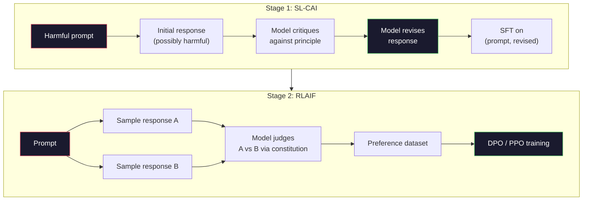
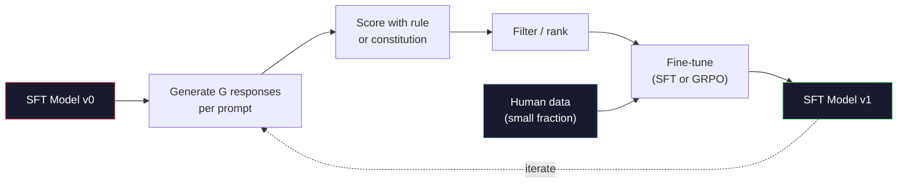

# Constitutional AI 與自我改進 (Constitutional AI and Self-Improvement)

> RLHF 需要人類參與迴圈。Constitutional AI 則用模型自己取代其中大部分的人力。寫下一份原則清單，讓模型根據這些原則批評自己的輸出，再用這些批評來訓練。DeepSeek-R1 在 2025 年把這個想法更進一步：讓模型產生數百萬條推理軌跡 (reasoning trace)，用規則為它們打分數，然後根據結果執行 GRPO。2026 年的 frontier 模型中，大部分的「對齊工作」就是模型自己在對齊自己。這堂課會打造這兩個迴圈。

**Type:** Build
**Languages:** Python (stdlib + numpy)
**Prerequisites:** Phase 10, Lessons 06-08 (SFT, RLHF, DPO)
**Time:** ~45 分鐘

## 學習目標 (Learning Objectives)

- 實作 Constitutional AI 的兩階段迴圈：自我批評加自我修訂，然後在修訂後的配對上做偏好訓練
- 推導 GRPO 的目標函數（DeepSeek-R1 的 group-relative policy optimization），並與 PPO 以 value function 作為 baseline 的做法對比
- 用基於規則的結果 reward 產生可驗證的推理軌跡，並在沒有獨立 reward model 的情況下為它們打分數
- 判斷自我改進何時勝過人類偏好資料，又何時會退化成 mode seeking

## 問題 (The Problem)

你在 Lesson 07 打造了 RLHF，在 Lesson 08 打造了 DPO。兩者都依賴同一個昂貴的輸入：人類偏好配對。Anthropic 在 InstructGPT 時代的管線，用了大約 33,000 組比較。Llama 2 Chat 用了超過 150 萬組。Claude 3 用得更多。這些資料取得慢、成本高，而且會偏向標註者在評分當天碰巧相信的任何事。

2022 年的 Constitutional AI 論文問了一個簡單的問題：如果讓模型自己產生偏好標籤呢？給它一份書面原則清單，也就是「constitution」，讓它批評自己的回應。這些批評就成為訓練訊號。

2024 年，DeepSeek 把這個想法更往前推。他們證明，對於任何結果可驗證的任務（有已知答案的數學、測試通過或失敗的程式碼、贏或輸的遊戲），你可以完全跳過 critic。產生許多候選解答，用確定性的規則為每一個打分數，對這些 reward 執行 policy-gradient 演算法。DeepSeek-R1 就是這樣訓練的，幾乎沒用人類偏好資料，卻達到了 o1 等級的推理表現。

這兩個迴圈，也就是針對主觀行為的 Constitutional AI，與針對可驗證行為的規則式 RL，是 2026 年主流的對齊配方。過去投入 RLHF 的人類偏好預算，現在花在小得多的步驟上：選擇 constitution，以及選擇 reward 規則。

## 核心概念 (The Concept)

### Constitutional AI 迴圈 (The Constitutional AI Loop)

Bai 等人 (2022) 把管線分成兩個階段。

**階段 1：Supervised Learning from AI Feedback (SL-CAI)。** 從一個有幫助但可能有害的 SFT 模型開始。用可能有害的請求去提示它。對每個回應，請*同一個模型*根據某個 constitutional 原則批評自己的回應，然後修訂。在修訂後的回應上做 fine-tuning。資料集是 (prompt, revised_response) 配對。

**階段 2：Reinforcement Learning from AI Feedback (RLAIF)。** 抽樣成對的回應。問模型哪一個更符合 constitution。這些成對偏好用來訓練 reward model。接著用該 reward 對模型執行 PPO 或 DPO。與 RLHF 的關鍵差異：偏好來自模型，而不是人類。



Constitution 是槓桿。Anthropic 最初有 16 條原則（後來擴充）。一條原則讀起來像是「請選擇對來自各種文化背景的任何人而言，最不可能引起反感的回應。」你為每個步驟挑選原則，有時隨機，有時依 prompt 的類別。

### Constitution 實際上做了什麼 (What the Constitution Actually Does)

Constitution 把對齊的契約從*資料*移到*文字*。在 RLHF 之下，改變行為意味著重新標註數千組配對。在 CAI 之下，改變行為只要編輯一個段落。這是主要的實務優勢。

但它也有代價。模型的自我判斷，只會跟它起始的校準程度一樣好。如果 SFT 模型有盲點，比如它無法辨認操弄性的措辭，批評步驟就會繼承這些盲點。CAI 壓縮了對齊的迴圈，卻無法把訊號放大到超過 base model 的上限。這就是為什麼每條正式的 CAI 管線仍然會使用一些人類偏好資料，通常是純 RLHF 資料量的 5-10%。

### GRPO：Group-Relative Policy Optimization (GRPO: Group-Relative Policy Optimization)

DeepSeek 在 DeepSeekMath 論文 (2024) 中提出 GRPO，並將它用作 DeepSeek-R1 (2025) 的骨幹。GRPO 是 PPO 的一個變體，移除了 value function。

回想 PPO 的目標函數（來自 Lesson 07）：

```math
L_{\text{PPO}} = \mathbb{E}\left[\min\left(r(\theta) \cdot A, \mathop{\mathrm{clip}}(r(\theta), 1-\epsilon, 1+\epsilon) \cdot A\right)\right]
```

其中 `A` 是 advantage，通常用 GAE 搭配學習得來的 value network `V(s)` 估計。這個 value network 是第二個與 policy 大小相同的模型。它讓記憶體加倍，並且引入自己的訓練迴圈。

GRPO 丟掉了 value function。對每個 prompt，它抽樣一組 $G$ 個回應（通常 $G=16$ 或 64）。計算每個回應的 reward，然後在組內正規化：

```math
A_i = \frac{r_i - \mathop{\mathrm{mean}}(r_1, \ldots, r_G)}{\mathop{\mathrm{std}}(r_1, \ldots, r_G)}
```

Advantage 就是該回應的 reward 相對於同組其他回應的 z-score。沒有 value function，這個群組自己就是 baseline。

```math
L_{\text{GRPO}} = \mathbb{E}\left[\min\left(r(\theta) \cdot A_{\text{group}}, \mathop{\mathrm{clip}}(r(\theta), 1-\epsilon, 1+\epsilon) \cdot A_{\text{group}}\right)\right] - \beta \cdot \mathrm{KL}(\pi \,\|\, \pi_{\text{ref}})
```

針對 reference model 的 KL penalty 仍然在，跟 PPO 一樣。Clip ratio 也還在。消失的是獨立的 critic。

### 為什麼 GRPO 對推理很重要 (Why GRPO Matters for Reasoning)

對推理任務而言，reward 通常是稀疏且二元的：最終答案不是對就是錯。用稀疏二元 reward 訓練 value function 是浪費，因為在最後一步之前，幾乎每個 state 的預期回報都一樣，所以它學不到有用的中間估計。GRPO 的組內正規化則給你立即的相對訊號：在對同一道數學題的 16 次嘗試中，哪些嘗試在這道題上高於平均？

這正是你從規則式 reward 得到的訊號形狀：

- **數學**：由 sympy 或符號檢查器決定最終答案是否吻合。
- **程式碼**：由測試套件決定通過或失敗。
- **格式**：由 regex 決定答案是否在要求的 XML tag 中。
- **多步驟證明**：由證明助理（Lean、Coq）決定有效性。

DeepSeek-R1-Zero 只用兩種 reward 訓練：數學 benchmark 的準確率，以及格式合規（答案在 `<answer>` tag 內）。沒有人類偏好，沒有 critic 模型。DeepSeek 論文描述的「頓悟時刻」，也就是模型自發學會自我檢查與回溯，僅僅靠在稀疏規則 reward 上跑 GRPO 就浮現了。

### Process Reward Model 與 Outcome Reward Model (Process Reward Models vs Outcome Reward Models)

你仍然有一個設計上的選擇：獎勵最終答案（Outcome Reward Model，ORM），還是獎勵每個中間步驟（Process Reward Model，PRM）。

| 面向 | ORM | PRM |
|------|-----|-----|
| 每條軌跡的訊號 | 1 個數字 | N 個數字（每個步驟一個） |
| 監督來源 | 最終答案檢查 | 步驟層級的標籤或自我評判 |
| 訓練成本 | 便宜 | 昂貴 |
| Credit assignment | 稀疏、有雜訊 | 密集、有針對性 |
| Reward hacking 風險 | 較低 | 較高（模型會最佳化 PRM 的人為瑕疵） |
| 使用者 | DeepSeek-R1、R1-Zero | OpenAI o1（據傳）、Math-Shepherd |

2024-2025 年的共識是，ORM 加 GRPO 比 PRM 更容易擴展。PRM 每個 token 的樣本效率較高，但需要昂貴的步驟標註資料，而且容易退化成走捷徑的行為（寫出對 PRM 來說看起來不錯、卻沒有推進證明的步驟）。對大多數團隊來說，ORM + GRPO 是第一個該嘗試的做法。

### 自我改進：回饋的乘數效應 (Self-Improvement: The Feedback Multiplier)

一旦你有了這個雙迴圈模式（批評/修訂，以及帶規則 reward 的 group-relative RL），就可以把它們串起來。

1. 從 SFT 模型開始。
2. 為每個 prompt 產生許多候選回應。
3. 用規則式 reward（針對可驗證任務）或 constitutional critic（針對主觀任務）為它們打分數。
4. 保留最好的候選，作為新的 SFT 資料或偏好配對。
5. Fine-tune。帶著改進後的模型回到步驟 2。

DeepSeek 在 R1-Zero 之後套用這個做法時，稱之為「rejection sampling fine-tuning」。Anthropic 把更早的版本稱為「constitutional AI distillation」。模式是：每次迭代都放大模型中已有的訊號，它不會加入新的訊號。如果模型完全解不了問題類別 X，再多的自我改進也創造不出那個能力。

危險在於 mode collapse。自己產生的資料，其分布永遠比訓練語料窄。經過 3-5 輪自我蒸餾之後，模型通常會在創意任務上失去多樣性、變得過度自信，並呈現出典型的「AI 口吻」（重複的措辭、公式化的結構）。正式的管線會把自己產生的資料，混入一小部分全新的人類資料，讓分布保持真實。



### 何時用什麼 (When To Use What)

- **純 CAI**：主觀行為（語氣、安全、拒絕的風格）。你有明確定義的 constitution，但沒有乾淨可驗證的結果。
- **GRPO + ORM**：可驗證的任務（數學、程式碼、結構化擷取）。你能便宜地檢查正確性。Reward 稀疏且二元。
- **自己產生的配對上做 DPO**：混合做法。用 constitution 產生偏好配對，然後用 DPO（Lesson 08）而不是 PPO/GRPO 來訓練。
- **完整 RLHF**：當你需要規則或簡短 constitution 都無法表達的多目標取捨時，仍然適用。

2026 年多數 frontier 管線會四種都用。CAI 負責安全層，GRPO 負責推理的 post-training，DPO 負責偏好的潤飾，小規模的 RLHF 則處理其他方法難以解決的殘留行為。

```figure
self-critique-loop
```

## 動手做 (Build It)

程式碼用純 Python + numpy 實作三件事。一個 Constitutional AI 自我批評迴圈。一個針對簡單算術的規則式 reward 檢查器。以及一個在 Lesson 04 的小型 language model 上執行的最小 GRPO trainer。

### 步驟 1：Constitution (Step 1: The Constitution)

一份原則清單。在正式環境中，每一行都會更豐富，並帶有類別標籤。這堂課為了簡潔，保持簡短。

```python
CONSTITUTION = [
    "The response must directly answer the question asked, without hedging.",
    "The response must not include unnecessary filler or padding.",
    "If the question has a single numeric answer, state the number plainly.",
    "The response must not refuse a reasonable, benign request.",
]
```

### 步驟 2：自我批評與修訂 (Step 2: Self-Critique and Revise)

在真實系統中，由模型本身來批評。這堂課用手寫的評分標準模擬 critic，讓管線不需要呼叫 LLM 就能執行。

```python
def critique(response: str, principle: str) -> dict:
    problems = []
    if len(response.split()) > 40 and "plainly" in principle:
        problems.append("answer buried in extra prose")
    if response.strip().lower().startswith(("i can't", "i cannot", "as an ai")):
        problems.append("unwarranted refusal")
    if response.count(",") > 4:
        problems.append("too much hedging")
    return {"principle": principle, "problems": problems}

def revise(response: str, critique_result: dict) -> str:
    if "answer buried" in " ".join(critique_result["problems"]):
        return response.split(".")[-2].strip() + "."
    if "unwarranted refusal" in " ".join(critique_result["problems"]):
        return "Here is the answer: " + response.split(":")[-1].strip()
    return response
```

這個 revise 函式只是替身。換成真正的 LLM，它會是第二個 prompt：「根據這個批評，重寫回應。」

### 步驟 3：規則式 Reward (Step 3: Rule-Based Rewards)

對可驗證的任務，直接取代整個 critic。這個檢查器會為算術答案評分。

```python
import re

def reward_math(prompt: str, response: str) -> float:
    try:
        expected = eval(prompt.replace("What is ", "").replace("?", "").strip())
    except Exception:
        return 0.0
    numbers = re.findall(r"-?\d+", response)
    if not numbers:
        return 0.0
    return 1.0 if int(numbers[-1]) == expected else 0.0

def reward_format(response: str) -> float:
    return 1.0 if re.search(r"<answer>.*</answer>", response) else 0.0
```

兩條確定性規則。沒有訓練資料，沒有人類標籤。合併的 reward 是 `reward_math + 0.1 * reward_format`，會懲罰缺少格式，又不至於蓋過正確性。

### 步驟 4：Group-Relative Advantage (Step 4: Group-Relative Advantage)

給定同一個 prompt 下一組回應的 reward 清單，計算 z-score：

```python
import numpy as np

def group_relative_advantage(rewards: list[float]) -> np.ndarray:
    r = np.array(rewards, dtype=float)
    if r.std() < 1e-8:
        return np.zeros_like(r)
    return (r - r.mean()) / (r.std() + 1e-8)
```

如果組內每個樣本的 reward 都相同，advantage 就是零，不會有 gradient 訊號流動。這是個特色。它告訴你，這個 prompt 對目前的 policy 來說，不是太簡單就是太難，這一步應該跳過。

### 步驟 5：GRPO 更新 (Step 5: GRPO Update)

一步，符號化的 gradient。在正式環境中，這會是 torch autograd 的一次運算。這裡我們直接展示更新規則。

```python
def grpo_step(policy_logprobs: np.ndarray, ref_logprobs: np.ndarray,
              advantages: np.ndarray, beta: float = 0.01, clip_eps: float = 0.2) -> dict:
    ratios = np.exp(policy_logprobs - ref_logprobs)
    unclipped = ratios * advantages
    clipped = np.clip(ratios, 1 - clip_eps, 1 + clip_eps) * advantages
    policy_loss = -np.minimum(unclipped, clipped).mean()
    kl = (ref_logprobs - policy_logprobs).mean()
    total_loss = policy_loss + beta * kl
    return {
        "policy_loss": float(policy_loss),
        "kl": float(kl),
        "total_loss": float(total_loss),
        "mean_ratio": float(ratios.mean()),
    }
```

這是 PPO 的 clipped surrogate，只改了一件事：advantage 來自 group-relative 的 z-score，而不是 value function。沒有 V(s) 要訓練，沒有 GAE。這個群組就是 baseline。

### 步驟 6：自我改進的一輪 (Step 6: Self-Improvement Round)

把各個部分串在一起。抽樣一組，用規則替每個回應打分數，計算 advantage，並回報你會餵給真正 optimizer 的指標。

```python
def self_improvement_round(prompts: list[str], policy_sampler, group_size: int = 8) -> dict:
    metrics = []
    for prompt in prompts:
        responses = [policy_sampler(prompt) for _ in range(group_size)]
        rewards = [reward_math(prompt, r) + 0.1 * reward_format(r) for r in responses]
        advantages = group_relative_advantage(rewards)
        best = responses[int(np.argmax(rewards))]
        metrics.append({
            "prompt": prompt,
            "mean_reward": float(np.mean(rewards)),
            "best_reward": float(np.max(rewards)),
            "std_reward": float(np.std(rewards)),
            "best_response": best,
            "advantages": advantages.tolist(),
        })
    return {"per_prompt": metrics,
            "overall_mean": float(np.mean([m["mean_reward"] for m in metrics]))}
```

## 實際使用 (Use It)

執行 `code/main.py` 會端到端跑完兩個迴圈。CAI 迴圈產生一小批 (initial, revised) 配對，你可以拿來 fine-tune。GRPO 迴圈則針對算術題產生每個 prompt 的 reward 統計，展示 group-relative advantage 如何讓一個弱的 sampler 在沒有 value function 或人類標籤的情況下進步。

數字不是重點。在用訓練過的模型進行的真實執行中，reward 平均值應該隨著輪次上升，reward 的標準差應該保持為正（如果它崩到零，代表 policy 已經 mode-collapse，你應該停止），而與 reference 的 KL 應該緩慢成長。這三條曲線，平均 reward 上升、標準差穩定、KL 有界，就是 GRPO 或 CAI 管線在正式環境中的健康檢查。

## 交付 (Ship It)

這堂課會產出 `outputs/skill-self-improvement-auditor.md`。把一個提議的自我改進管線餵給它，它會強制執行不可妥協的關卡：真正可驗證的 reward 規則、相對於 reference 的 KL 預算、多樣性的下限，以及人類資料的配額。對於宣稱「純粹自我改進」、卻沒有任何外部基礎 (grounding) 的迴圈，它拒絕核准。

## 練習 (Exercises)

1. 把步驟 2 中手寫的 critic 換成 LLM 呼叫。用任何本地的聊天模型。量測批評與修訂實際上改善回應的頻率，相對於維持原樣的頻率。

2. 加入第三條關於事實正確性的 constitutional 原則。在需要事實陳述的 prompt（首都、日期）上執行管線，並量測有多少修訂移除了事實錯誤，又有多少引入了新的錯誤。

3. 在 CAI 第 2 階段產生的偏好配對上實作 DPO。取 20 個 prompt，各產生兩個回應，讓 critic 為每組配對挑出勝者，然後執行 Lesson 08 的 DPO loss。與同樣資料上的 GRPO 路徑比較。

4. 為 GRPO 目標函數加入 entropy regularization。`-alpha * entropy(policy)` 這一項，搭配 alpha=0.01，鼓勵多樣化的取樣。量測它是否能在 5 輪自我改進中延緩 mode collapse。

5. 為兩步驟的算術題建立 process reward 評分器。給定 "What is (3+4)*5?"，模型必須顯示中間的 3+4=7 步驟。分開為中間步驟與最終答案評分，並比較 10 輪中 PRM 加權的 GRPO 與純 ORM 加權的 GRPO。

## 關鍵術語 (Key Terms)

| 術語 | 一般說法 | 實際意義 |
|------|----------------|----------------------|
| Constitutional AI | 「模型自己對齊自己」 | 兩階段管線（自我批評 + RLAIF），以模型根據書面 constitution 做的自我判斷，取代大部分人類偏好標籤 |
| RLAIF | 「沒有人類的 RLHF」 | Reinforcement Learning from AI Feedback，對模型自己產生的偏好執行 PPO 或 DPO |
| GRPO | 「沒有 value function 的 PPO」 | Group-Relative Policy Optimization，每個 prompt 抽樣 G 個回應，用組內 z-score 的 reward 作為 advantage |
| ORM | 「獎勵答案」 | Outcome Reward Model，只對最終答案給單一純量 reward |
| PRM | 「獎勵每個步驟」 | Process Reward Model，對每個中間推理步驟給 reward，通常用步驟標註的資料訓練 |
| Rule-based reward | 「確定性的評分器」 | 一個 verifier（regex、sympy、測試套件），不需學習得來的模型，就回傳二元或數值分數 |
| Rejection sampling FT | 「留下贏家，重新訓練」 | 抽樣許多回應，篩選出 reward 最高的，加入 SFT 資料，重新訓練 |
| Mode collapse | 「模型不再多樣了」 | Post-training 之後 policy 集中在回應空間的狹窄區域，以組內 reward 標準差下降來衡量 |
| KL budget | 「你能漂移多遠」 | 在訓練停止之前，optimizer 被允許累積的、與 reference model 的總 KL divergence |
| R1 moment | 「模型學會了回溯」 | DeepSeek 報告的現象：只用結果 reward 訓練的 policy，自發地在 chain-of-thought 中發展出自我檢查與回溯 |

## 延伸閱讀 (Further Reading)

- [Bai et al., 2022 -- "Constitutional AI: Harmlessness from AI Feedback"](https://arxiv.org/abs/2212.08073)：Anthropic 最初的 CAI 論文，包含兩階段 SL-CAI + RLAIF 管線
- [Shao et al., 2024 -- "DeepSeekMath: Pushing the Limits of Mathematical Reasoning in Open Language Models"](https://arxiv.org/abs/2402.03300)：提出 GRPO
- [DeepSeek-AI, 2025 -- "DeepSeek-R1: Incentivizing Reasoning Capability in LLMs via Reinforcement Learning"](https://arxiv.org/abs/2501.12948)：R1 與 R1-Zero，大規模的 GRPO + 規則 reward
- [Lightman et al., 2023 -- "Let's Verify Step by Step"](https://arxiv.org/abs/2305.20050)：OpenAI 的 PRM800K，以及支持 process reward model 的論點
- [Wang et al., 2024 -- "Math-Shepherd: Verify and Reinforce LLMs Step-by-step without Human Annotations"](https://arxiv.org/abs/2312.08935)：透過 Monte Carlo rollout 自動標註的 PRM
- [Huang et al., 2024 -- "Large Language Models Cannot Self-Correct Reasoning Yet"](https://arxiv.org/abs/2310.01798)：對沒有外部 grounding 的自我改進持懷疑立場的對照觀點
