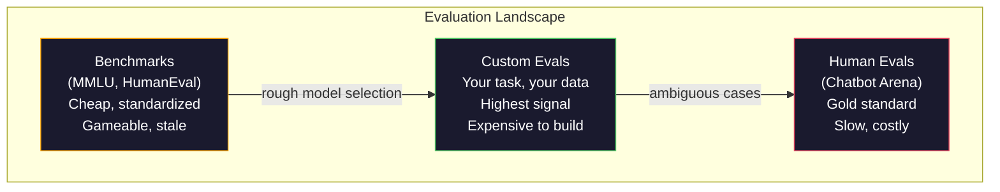
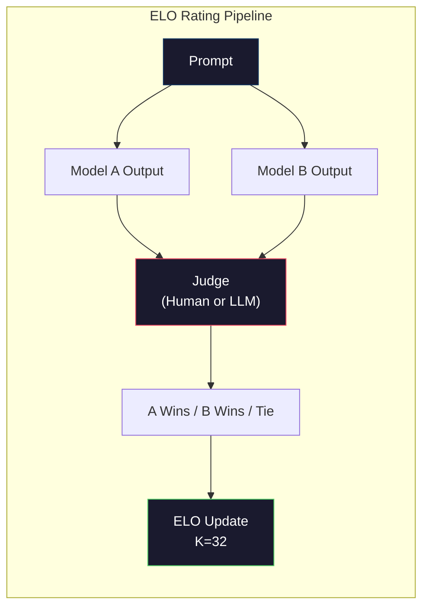

# Evaluation：Benchmark、Eval、LM Harness (Evaluation: Benchmarks, Evals, LM Harness)

> Goodhart 定律：當一個指標變成目標，它就不再是好的指標。每個 frontier 實驗室都在鑽 benchmark 的漏洞。MMLU 分數一路上升，模型卻仍然沒辦法穩定數出 "strawberry" 裡有幾個 R。唯一重要的 eval，是*你的* eval，針對*你的*任務、用*你的*資料。

**Type:** Build
**Languages:** Python
**Prerequisites:** Phase 10, Lessons 01-05 (LLMs from Scratch)
**Time:** ~90 分鐘

## 學習目標 (Learning Objectives)

- 建立自訂的評估框架 (evaluation harness)，對 language model 執行選擇題與開放式的 benchmark
- 說明為什麼標準 benchmark（MMLU、HumanEval）會飽和，無法區分 frontier 模型
- 用適當的指標實作針對特定任務的 eval：exact match、F1、BLEU 與 LLM-as-judge 評分
- 針對你的特定使用情境設計自訂的評估套件，而不是只仰賴公開排行榜

## 問題 (The Problem)

MMLU 在 2020 年發表，涵蓋 57 個科目、共 15,908 道題。三年內，frontier 模型就把它刷到飽和。GPT-4 得 86.4%。Claude 3 Opus 得 86.8%。Llama 3 405B 得 88.6%。排行榜被壓縮到 3 分的範圍內，其中的差異是統計雜訊，不是真正的能力差距。

同時，這些模型卻在 10 歲小孩不假思索就能處理的任務上失敗。在 MMLU 得到 88.7% 的 Claude 3.5 Sonnet，最初無法數出 "strawberry" 裡的字母數，這個任務不需要任何世界知識，也不需要推理，只要逐字元迭代。HumanEval 用 164 道題測試程式碼生成。模型在上面得分 90% 以上，卻仍然產生會在邊界情況下當掉的程式碼，而任何初階開發者都會發現這些問題。

Benchmark 表現與真實世界可靠性之間的落差，是 LLM 評估的核心問題。Benchmark 只告訴你模型在這個 benchmark 上表現如何。對於這個模型在你的特定任務、你的特定資料、你的特定失敗模式下會有什麼表現，它幾乎什麼都沒告訴你。如果你在做客服機器人，MMLU 與你無關。如果你在做程式碼助理，HumanEval 只涵蓋函式層級的生成，對於除錯、重構、跨檔案解釋程式碼，它完全沒有說明。

你需要自訂的 eval。不是因為 benchmark 沒用（它們對粗略的模型選擇很有用），而是因為最終的評估必須與你的部署條件完全吻合。

## 核心概念 (The Concept)

### Eval 的全貌 (The Eval Landscape)

評估分為三類，成本與訊號品質各不相同。

**Benchmark** 是標準化的測試套件。MMLU、HumanEval、SWE-bench、MATH、ARC、HellaSwag。你讓模型跑過 benchmark，得到一個分數。優點：大家用同一份測驗，所以可以比較模型。缺點：模型與訓練資料越來越常汙染這些 benchmark。實驗室用包含 benchmark 題目的資料來訓練。分數上升。能力不一定。

**自訂 eval** 是你為特定使用情境建立的測試套件。你定義輸入、預期輸出與評分函式。法律文件摘要器要用法律文件評估。SQL 產生器要用你的資料庫 schema 評估。這些建立起來成本很高，但它們是唯一能預測正式環境表現的評估。

**人工評估 (Human eval)** 聘請標註者，根據實用性、正確性、流暢度與安全性等標準，判斷模型輸出。這是自動評分失效的開放式任務的黃金標準。Chatbot Arena 已經蒐集了超過 200 萬筆人類偏好投票，涵蓋 100 多個模型。缺點是成本（每次判斷 $0.10-$2.00）和速度（數小時到數天）。



### Benchmark 為什麼會失效 (Why Benchmarks Break)

三個機制導致 benchmark 分數不再反映真實能力。

**資料汙染 (Data contamination)。** 訓練語料會爬取網際網路。Benchmark 的題目就在網際網路上。模型在訓練時看過答案。這並非傳統意義上的作弊，實驗室並不是故意納入 benchmark 資料。但網路規模的爬取，使得幾乎不可能排除它們。

**針對考試教學 (Teaching to the test)。** 實驗室會針對 benchmark 表現最佳化訓練的混合比例。如果訓練資料中有 5% 是 MMLU 風格的選擇題，模型就會學到這種格式和答案的分布。MMLU 是四選一。模型學到答案分布在 A/B/C/D 之間大致是均勻的，即使模型不知道答案，這也有幫助。

**飽和 (Saturation)。** 當每個 frontier 模型在某個 benchmark 上都得到 85-90%，這個 benchmark 就失去了區辨力。剩下的 10-15% 題目可能含糊、標錯，或需要冷門的領域知識。在 MMLU 上從 87% 進步到 89%，可能只代表模型多背了兩道冷門題，不代表它變聰明了。

### Perplexity：快速的健康檢查 (Perplexity: A Quick Health Check)

Perplexity 衡量模型對一串 token 有多「驚訝」。正式的定義是平均負對數 likelihood 的指數：

```math
\text{PPL} = \exp\left(-\frac{1}{N} \sum_i \log P(\text{token}_i \mid \text{context})\right)
```

Perplexity 為 10 代表模型在每個 token 位置，平均而言就像是在 10 個選項中均勻選擇一樣不確定。越低越好。GPT-2 在 WikiText-103 上的 perplexity 約為 30。GPT-3 約為 20。Llama 3 8B 約為 7。

Perplexity 適合用來在同一份測試集上比較模型，但它有盲點。模型可能因為擅長預測常見的模式而有低 perplexity，卻對罕見但重要的模式表現很差。它也完全無法說明指令遵循、推理或事實正確性。把它當成合理性檢查，而不是最終判決。

### LLM-as-Judge (LLM-as-Judge)

用強的模型來評估弱的模型的輸出。概念很簡單：請 GPT-4o 或 Claude Sonnet，以 1 到 5 分為回應的正確性、實用性與安全性打分數。用 GPT-4o-mini 的話，每次判斷約花 $0.01，而且與人類判斷的相關性出奇地高，在大多數任務上約有 80% 的一致性。

評分的 prompt 比模型更重要。含糊的 prompt（「為這個回應評分」）會產生雜訊很大的分數。帶有評分標準的結構化 prompt（「如果答案事實正確且引用來源，給 5 分；正確但沒有來源，給 4 分；部分正確，給 3 分...」）則會產生一致、可重現的分數。

失敗模式：裁判模型會有位置偏誤 (position bias，在成對比較中偏好第一個回應)、冗長偏誤 (verbosity bias，偏好較長的回應)，以及自我偏好 (self-preference，GPT-4 給 GPT-4 輸出的分數，比給同等水準的 Claude 輸出更高)。緩解方式：隨機化順序、對長度做正規化、使用與被評估模型不同的裁判。

### 成對比較得出的 ELO 評分 (ELO Ratings from Pairwise Comparisons)

這是 Chatbot Arena 的做法。對同一個 prompt，展示來自不同模型的兩個回應。由人類（或 LLM 裁判）選出比較好的。從數千次這樣的比較中，為每個模型計算 ELO 評分，這和西洋棋使用的系統相同。

ELO 的優點：相對排名比絕對評分更可靠、能優雅地處理平手，而且比起獨立為每個輸出打分數，用更少的比較就能收斂。截至 2026 年初，Chatbot Arena 的排名顯示，GPT-4o、Claude 3.5 Sonnet 與 Gemini 1.5 Pro 在頂端的 ELO 差距不超過 20 分。



### Eval 框架 (Eval Frameworks)

**lm-evaluation-harness**（EleutherAI）：標準的開源 eval 框架。支援 200 多個 benchmark。用一個指令就能讓任何 Hugging Face 模型跑 MMLU、HellaSwag、ARC 等。Open LLM Leaderboard 使用它。

**RAGAS**：專門用於 RAG 管線的評估框架。衡量 faithfulness（答案是否符合檢索到的內容？）、relevance（檢索到的內容是否與問題相關？）以及答案正確性。

**promptfoo**：以設定檔驅動的 prompt engineering eval。用 YAML 定義測試案例，對多個模型執行，得到通過/失敗報告。適合對 prompt 做回歸測試，確保改動 prompt 不會弄壞既有的測試案例。

### 建立自訂 Eval (Building Custom Evals)

這是正式環境中唯一重要的 eval。流程如下：

1. **定義任務。** 模型到底該做什麼？要精確。「回答問題」太籠統。「給定一封客訴電子郵件，擷取產品名稱、問題類別與情緒」才是你可以評估的任務。

2. **建立測試案例。** 原型 eval 至少 50 個，正式環境 200 個以上。每個測試案例是一組 (input, expected_output)。要包含邊界情況：空的輸入、對抗性輸入、含糊的輸入、其他語言的輸入。

3. **定義評分。** 結構化輸出用 exact match。文字相似度用 BLEU/ROUGE。開放式品質用 LLM-as-judge。擷取任務用 F1。用權重組合多種指標。

4. **自動化。** 每個 eval 都用一個指令執行。沒有手動步驟。以能隨時間比較的格式儲存結果。

5. **隨時間追蹤。** 單獨一個 eval 分數沒有意義。你需要趨勢線。上次改 prompt 之後，分數有進步嗎？換模型之後有退步嗎？把你的 eval 與 prompt 一起做版本管理。

| Eval 類型 | 每次判斷成本 | 與人類的一致性 | 最適合 |
|-----------|------------------|----------------------|----------|
| Exact match | ~$0 | 100%（適用時） | 結構化輸出、分類 |
| BLEU/ROUGE | ~$0 | ~60% | 翻譯、摘要 |
| LLM-as-judge | ~$0.01 | ~80% | 開放式生成 |
| Human eval | $0.10-$2.00 | 不適用（它就是 ground truth） | 含糊、高風險的任務 |

```figure
perplexity-loss
```

## 動手做 (Build It)

### 步驟 1：最小的 Eval 框架 (Step 1: A Minimal Eval Framework)

定義核心抽象。一個 eval case 有輸入、預期輸出與選用的 metadata dict。Scorer 接收一個預測與一個參考答案，回傳 0 到 1 之間的分數。

```python
import json
from collections import Counter

class EvalCase:
    def __init__(self, input_text, expected, metadata=None):
        self.input_text = input_text
        self.expected = expected
        self.metadata = metadata or {}

class EvalSuite:
    def __init__(self, name, cases, scorers):
        self.name = name
        self.cases = cases
        self.scorers = scorers

    def run(self, model_fn):
        results = []
        for case in self.cases:
            prediction = model_fn(case.input_text)
            scores = {}
            for scorer_name, scorer_fn in self.scorers.items():
                scores[scorer_name] = scorer_fn(prediction, case.expected)
            results.append({
                "input": case.input_text,
                "expected": case.expected,
                "prediction": prediction,
                "scores": scores,
            })
        return results
```

### 步驟 2：評分函式 (Step 2: Scoring Functions)

建立 exact match、token F1，以及模擬的 LLM-as-judge 評分器。

```python
def exact_match(prediction, expected):
    return 1.0 if prediction.strip().lower() == expected.strip().lower() else 0.0

def token_f1(prediction, expected):
    pred_tokens = set(prediction.lower().split())
    exp_tokens = set(expected.lower().split())
    if not pred_tokens or not exp_tokens:
        return 0.0
    common = pred_tokens & exp_tokens
    precision = len(common) / len(pred_tokens)
    recall = len(common) / len(exp_tokens)
    if precision + recall == 0:
        return 0.0
    return 2 * (precision * recall) / (precision + recall)

def llm_judge_simulated(prediction, expected):
    pred_words = set(prediction.lower().split())
    exp_words = set(expected.lower().split())
    if not exp_words:
        return 0.0
    overlap = len(pred_words & exp_words) / len(exp_words)
    length_penalty = min(1.0, len(prediction) / max(len(expected), 1))
    return round(overlap * 0.7 + length_penalty * 0.3, 3)
```

### 步驟 3：ELO 評分系統 (Step 3: ELO Rating System)

實作帶有 ELO 更新的成對比較。這正是 Chatbot Arena 用來為模型排名的系統。

```python
class ELOTracker:
    def __init__(self, k=32, initial_rating=1500):
        self.ratings = {}
        self.k = k
        self.initial_rating = initial_rating
        self.history = []

    def _ensure_player(self, name):
        if name not in self.ratings:
            self.ratings[name] = self.initial_rating

    def expected_score(self, rating_a, rating_b):
        return 1 / (1 + 10 ** ((rating_b - rating_a) / 400))

    def record_match(self, player_a, player_b, outcome):
        self._ensure_player(player_a)
        self._ensure_player(player_b)

        ea = self.expected_score(self.ratings[player_a], self.ratings[player_b])
        eb = 1 - ea

        if outcome == "a":
            sa, sb = 1.0, 0.0
        elif outcome == "b":
            sa, sb = 0.0, 1.0
        else:
            sa, sb = 0.5, 0.5

        self.ratings[player_a] += self.k * (sa - ea)
        self.ratings[player_b] += self.k * (sb - eb)

        self.history.append({
            "a": player_a, "b": player_b,
            "outcome": outcome,
            "rating_a": round(self.ratings[player_a], 1),
            "rating_b": round(self.ratings[player_b], 1),
        })

    def leaderboard(self):
        return sorted(self.ratings.items(), key=lambda x: -x[1])
```

### 步驟 4：計算 Perplexity (Step 4: Perplexity Calculation)

用 token 機率計算 perplexity。實務上你會從模型的 logit 取得這些機率。這裡我們用機率分布來模擬。

```python
import numpy as np

def perplexity(log_probs):
    if not log_probs:
        return float("inf")
    avg_neg_log_prob = -np.mean(log_probs)
    return float(np.exp(avg_neg_log_prob))

def token_log_probs_simulated(text, model_quality=0.8):
    np.random.seed(hash(text) % 2**31)
    tokens = text.split()
    log_probs = []
    for i, token in enumerate(tokens):
        base_prob = model_quality
        if len(token) > 8:
            base_prob *= 0.6
        if i == 0:
            base_prob *= 0.7
        prob = np.clip(base_prob + np.random.normal(0, 0.1), 0.01, 0.99)
        log_probs.append(float(np.log(prob)))
    return log_probs
```

### 步驟 5：彙整結果 (Step 5: Aggregate Results)

對一次 eval 執行計算摘要統計：平均值、中位數、在某個門檻下的通過率，以及各指標的細項。

```python
def summarize_results(results, threshold=0.8):
    all_scores = {}
    for r in results:
        for metric, score in r["scores"].items():
            all_scores.setdefault(metric, []).append(score)

    summary = {}
    for metric, scores in all_scores.items():
        arr = np.array(scores)
        summary[metric] = {
            "mean": round(float(np.mean(arr)), 3),
            "median": round(float(np.median(arr)), 3),
            "std": round(float(np.std(arr)), 3),
            "min": round(float(np.min(arr)), 3),
            "max": round(float(np.max(arr)), 3),
            "pass_rate": round(float(np.mean(arr >= threshold)), 3),
            "n": len(scores),
        }
    return summary

def print_summary(summary, suite_name="Eval"):
    print(f"\n{'=' * 60}")
    print(f"  {suite_name} Summary")
    print(f"{'=' * 60}")
    for metric, stats in summary.items():
        print(f"\n  {metric}:")
        print(f"    Mean:      {stats['mean']:.3f}")
        print(f"    Median:    {stats['median']:.3f}")
        print(f"    Std:       {stats['std']:.3f}")
        print(f"    Range:     [{stats['min']:.3f}, {stats['max']:.3f}]")
        print(f"    Pass rate: {stats['pass_rate']:.1%} (threshold >= 0.8)")
        print(f"    N:         {stats['n']}")
```

### 步驟 6：執行完整管線 (Step 6: Run the Full Pipeline)

把所有東西接起來。定義任務、建立測試案例、模擬兩個模型、執行 eval、從成對比較計算 ELO，並印出排行榜。

```python
def demo_model_good(prompt):
    responses = {
        "What is the capital of France?": "Paris",
        "What is 2 + 2?": "4",
        "Who wrote Hamlet?": "William Shakespeare",
        "What language is PyTorch written in?": "Python and C++",
        "What is the boiling point of water?": "100 degrees Celsius",
    }
    return responses.get(prompt, "I don't know")

def demo_model_bad(prompt):
    responses = {
        "What is the capital of France?": "Paris is the capital city of France",
        "What is 2 + 2?": "The answer is four",
        "Who wrote Hamlet?": "Shakespeare",
        "What language is PyTorch written in?": "Python",
        "What is the boiling point of water?": "212 Fahrenheit",
    }
    return responses.get(prompt, "Unknown")

cases = [
    EvalCase("What is the capital of France?", "Paris"),
    EvalCase("What is 2 + 2?", "4"),
    EvalCase("Who wrote Hamlet?", "William Shakespeare"),
    EvalCase("What language is PyTorch written in?", "Python and C++"),
    EvalCase("What is the boiling point of water?", "100 degrees Celsius"),
]

suite = EvalSuite(
    name="General Knowledge",
    cases=cases,
    scorers={
        "exact_match": exact_match,
        "token_f1": token_f1,
        "llm_judge": llm_judge_simulated,
    },
)

results_good = suite.run(demo_model_good)
results_bad = suite.run(demo_model_bad)

print_summary(summarize_results(results_good), "Model A (concise)")
print_summary(summarize_results(results_bad), "Model B (verbose)")
```

「好」模型給出精確的答案。「壞」模型給出冗長的改述。Exact match 會嚴厲懲罰冗長的模型。Token F1 與 LLM-as-judge 則較寬容。這說明了為什麼指標的選擇很重要：同一個模型，依你的評分方式，可能看起來很棒或很糟。

### 步驟 7：ELO 錦標賽 (Step 7: ELO Tournament)

在多輪中，對模型之間進行成對比較。

```python
elo = ELOTracker(k=32)

for case in cases:
    pred_a = demo_model_good(case.input_text)
    pred_b = demo_model_bad(case.input_text)

    score_a = token_f1(pred_a, case.expected)
    score_b = token_f1(pred_b, case.expected)

    if score_a > score_b:
        outcome = "a"
    elif score_b > score_a:
        outcome = "b"
    else:
        outcome = "tie"

    elo.record_match("model_a_concise", "model_b_verbose", outcome)

print("\nELO Leaderboard:")
for name, rating in elo.leaderboard():
    print(f"  {name}: {rating:.0f}")
```

### 步驟 8：Perplexity 比較 (Step 8: Perplexity Comparison)

比較不同品質等級的「模型」之間的 perplexity。

```python
test_text = "The quick brown fox jumps over the lazy dog in the garden"

for quality, label in [(0.9, "Strong model"), (0.7, "Medium model"), (0.4, "Weak model")]:
    log_probs = token_log_probs_simulated(test_text, model_quality=quality)
    ppl = perplexity(log_probs)
    print(f"  {label} (quality={quality}): perplexity = {ppl:.2f}")
```

## 實際使用 (Use It)

### lm-evaluation-harness (EleutherAI)

在任何模型上執行 benchmark 的標準工具。

```python
# pip install lm-eval
# Command line:
# lm_eval --model hf --model_args pretrained=meta-llama/Llama-3.1-8B --tasks mmlu --batch_size 8

# Python API:
# import lm_eval
# results = lm_eval.simple_evaluate(
#     model="hf",
#     model_args="pretrained=meta-llama/Llama-3.1-8B",
#     tasks=["mmlu", "hellaswag", "arc_easy"],
#     batch_size=8,
# )
# print(results["results"])
```

### promptfoo

以設定檔驅動的 prompt engineering eval。用 YAML 定義測試，並對多個供應商執行。

```yaml
# promptfoo.yaml
providers:
  - openai:gpt-4o-mini
  - anthropic:claude-3-haiku

prompts:
  - "Answer in one word: {{question}}"

tests:
  - vars:
      question: "What is the capital of France?"
    assert:
      - type: contains
        value: "Paris"
  - vars:
      question: "What is 2 + 2?"
    assert:
      - type: equals
        value: "4"
```

### 用 RAGAS 評估 RAG (RAGAS for RAG evaluation)

```python
# pip install ragas
# from ragas import evaluate
# from ragas.metrics import faithfulness, answer_relevancy, context_precision
#
# result = evaluate(
#     dataset,
#     metrics=[faithfulness, answer_relevancy, context_precision],
# )
# print(result)
```

RAGAS 衡量一般 eval 會遺漏的東西：模型的答案是否以檢索到的內容為依據，而不只是答案在抽象上是否「正確」。

## 交付 (Ship It)

這堂課會產出 `outputs/prompt-eval-designer.md`，這是一個可重複使用的 prompt，能為任何任務設計自訂的 eval 套件。給它一份任務描述，它就會產生測試案例、評分函式與通過/失敗門檻的建議。

它也會產出 `outputs/skill-llm-evaluation.md`，這是一個決策框架，根據你的任務類型、預算與延遲需求，選擇合適的評估策略。

## 練習 (Exercises)

1. 加入「一致性」評分器，把同一個輸入送進模型 5 次，並衡量輸出相符的頻率。在確定性的輸入上得到不一致的答案，代表 prompt 很脆弱，或 temperature 設得太高。

2. 擴充 ELO 追蹤器，讓它支援多個裁判函式（exact match、F1、LLM-as-judge）並給它們加權。比較重重加權 exact match 與重重加權 F1 時，排行榜有何變化。

3. 為特定任務建立 eval 套件：把電子郵件分成 5 個類別。建立 100 個測試案例，包含多樣化的範例與邊界情況（可能屬於多個類別的郵件、空白郵件、其他語言的郵件）。衡量不同「模型」（規則式、關鍵字比對、模擬的 LLM）的表現。

4. 實作汙染偵測：給定一組 eval 題目與一份訓練語料，檢查有多少百分比的 eval 題目（或相近的改述）出現在訓練資料中。研究人員就是這樣稽核 benchmark 的有效性。

5. 建立「模型 diff」工具。給定兩個模型版本的 eval 結果，標出哪些特定測試案例進步、哪些退步、哪些維持不變。這是 eval 版的程式碼 diff，對於了解一項改動是有幫助還是有害，不可或缺。

## 關鍵術語 (Key Terms)

| 術語 | 一般說法 | 實際意義 |
|------|----------------|----------------------|
| MMLU | 「那個 benchmark」 | Massive Multitask Language Understanding，涵蓋 57 個科目的 15,908 道選擇題，到 2025 年已飽和在 88% 以上 |
| HumanEval | 「程式碼 eval」 | OpenAI 的 164 道 Python 函式補全題，只測試獨立函式的生成 |
| SWE-bench | 「真實的寫程式 eval」 | 來自 12 個 Python repo 的 2,294 個 GitHub issue，衡量端到端的修 bug 能力，包括產生測試 |
| Perplexity | 「模型有多困惑」 | $\exp(-\mathop{\mathrm{avg}}(\log P(\text{token}_i \text{ given context})))$，越低代表模型對實際 token 給的機率越高 |
| ELO rating | 「模型的西洋棋排名」 | 從成對勝負紀錄算出的相對技能評分，Chatbot Arena 用它為 100 多個模型排名 |
| LLM-as-judge | 「用 AI 評分 AI」 | 強的模型根據評分標準為較弱模型的輸出評分，與人類裁判約有 80% 一致性，每次判斷約 $0.01 |
| Data contamination | 「模型看過考題」 | 訓練資料包含 benchmark 的題目，在沒有真正提升能力的情況下讓分數膨脹 |
| Eval suite | 「一堆測試」 | 經過版本管理的 (input, expected_output, scorer) 三元組集合，用來衡量特定的能力 |
| Pass rate | 「答對的百分比」 | 分數超過門檻的 eval case 比例，比平均分數更可行動，因為它衡量的是可靠性 |
| Chatbot Arena | 「模型排名網站」 | LMSYS 的平台，有超過 200 萬筆人類偏好投票，透過 ELO 評分產生最受信任的 LLM 排行榜 |

## 延伸閱讀 (Further Reading)

- [Hendrycks et al., 2021 -- "Measuring Massive Multitask Language Understanding"](https://arxiv.org/abs/2009.03300)：MMLU 論文，儘管已飽和，仍是被引用最多的 LLM benchmark
- [Chen et al., 2021 -- "Evaluating Large Language Models Trained on Code"](https://arxiv.org/abs/2107.03374)：OpenAI 的 HumanEval 論文，確立了程式碼生成的評估方法
- [Zheng et al., 2023 -- "Judging LLM-as-a-Judge"](https://arxiv.org/abs/2306.05685)：系統性分析用 LLM 評估 LLM，包含位置偏誤與冗長偏誤的發現
- [Arena (formerly LMSYS Chatbot Arena)](https://arena.ai/leaderboard)：眾包的模型比較平台，有 200 萬筆以上的投票，是最受信任的真實世界 LLM 排名
