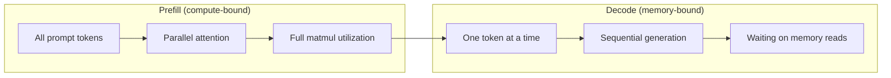
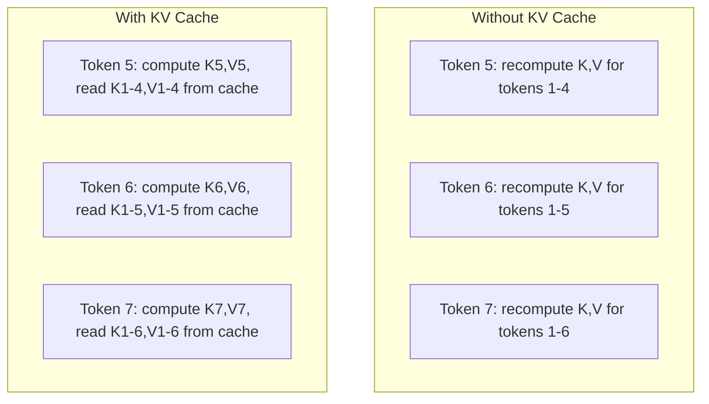
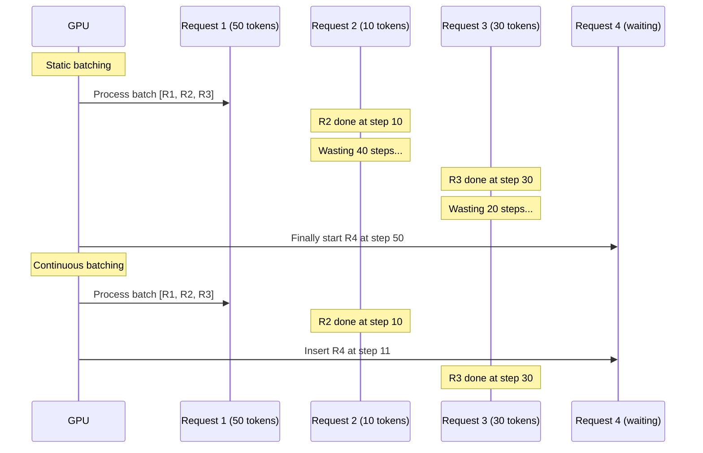
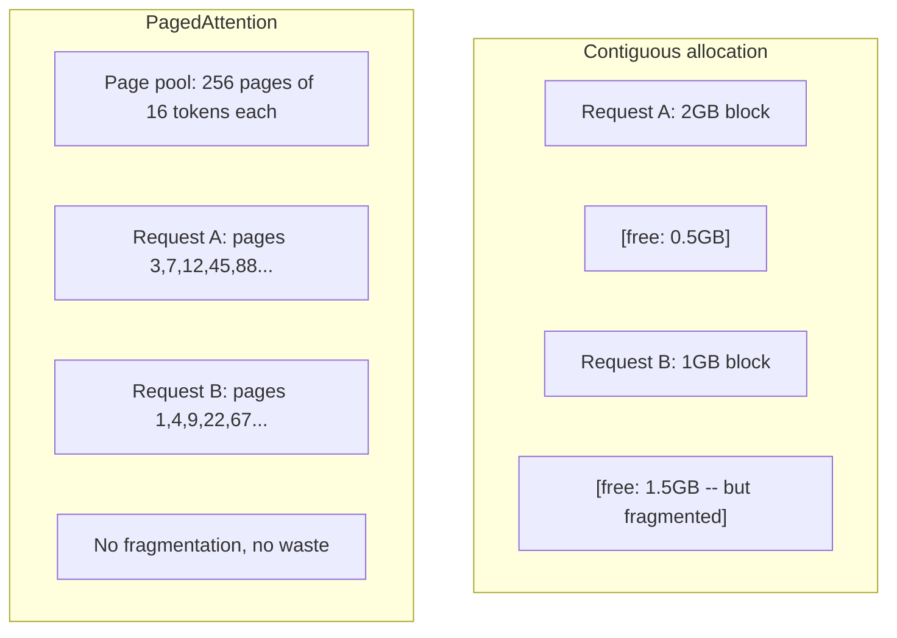
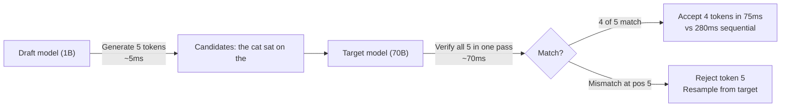

# Inference 最佳化 (Inference Optimization)

> LLM 推論由兩個階段定義。Prefill 平行處理你的 prompt，受限於運算 (compute-bound)。Decode 一次產生一個 token，受限於記憶體 (memory-bound)。每一種最佳化都針對其中一個或兩個。

**Type:** Build
**Languages:** Python
**Prerequisites:** Phase 10, Lessons 01-08 (Transformer architecture, attention)
**Time:** ~120 分鐘

## 學習目標 (Learning Objectives)

- 實作 KV-cache，消除自迴歸 token 生成期間的重複運算
- 說明 LLM 推論的 prefill 與 decode 階段，以及為什麼兩者的瓶頸不同（compute-bound 對 memory-bound）
- 實作 continuous batching 與 PagedAttention 的概念，在並行請求下最大化 GPU 使用率
- 比較各種推論最佳化技術（KV-cache、speculative decoding、flash attention）及其吞吐量/延遲的取捨

## 問題 (The Problem)

你把 Llama 3 70B 部署在 4 張 A100 GPU 上。單一使用者能得到約每秒 50 個 token，感覺很快。然後 100 個使用者同時打進來。吞吐量掉到每位使用者每秒 3 個 token。你每月 $25,000 的 GPU 帳單，回應速度卻比人類打字還慢。

從 1 位使用者到 100 位使用者，模型本身沒有改變。同樣的權重、同樣的架構、同樣的數學。改變的是你如何排程工作。天真的推論浪費了 90% 以上的可用 GPU 運算。一位正在等第 47 個 token 的使用者，會佔住整個 batch 的位置，而 GPU 的記憶體匯流排在 matmul 之間閒置。同時，另一位新使用者 2,000 個 token 的 prompt，本可以用有用的運算填滿這段空檔。

這不是擴展 (scaling) 問題，而是排程問題。這堂課的技術，包括 KV caching、continuous batching、PagedAttention、speculative decoding、prefix caching，正是區分「$25k/月」與「服務同樣流量只要 $5k/月」的推論帳單的關鍵。

vLLM 在 4 張 A100-80GB 上服務 Llama 3 70B，低並行時每位使用者約達 50 tokens/秒，透過 continuous batching 與 PagedAttention，在 100 個並行請求下仍能維持每位使用者 15-25 TPS。沒有這些最佳化，同樣的硬體在該並行量下，每位使用者只有 5 TPS。同樣的 GPU、同樣的模型，吞吐量是 4 倍。

## 核心概念 (The Concept)

### Prefill 與 Decode (Prefill vs Decode)

每個 LLM 推論請求都有兩個截然不同的階段。

**Prefill** 處理整個輸入 prompt。所有 token 都已知，所以 attention 可以在整條序列上平行計算。這是大型矩陣乘法，GPU 核心保持忙碌。瓶頸在運算：你的硬體每秒能提供多少 FLOPS。A100 有 312 TFLOPS (BF16)。在單張 A100 上，70B 模型對 4,096 個 token 的 prompt 做 prefill，約需 400ms。

**Decode** 一次產生一個輸出 token。每個新 token 都會 attend 到所有先前的 token，但每次 forward pass 只產生一個 token。權重矩陣的大小與 prefill 時相同，但你是用單一個向量去乘它們，而不是用矩陣。GPU 核心在幾微秒內就完成，然後等待下一批權重從記憶體傳來。瓶頸在記憶體頻寬：你能多快把模型權重從 HBM 串流到運算單元。A100 的頻寬是 2 TB/s。FP16 的 70B 模型有 140 GB。把整個模型讀一遍要 70ms，這就是單一 decode 步驟的下限。



**ops:byte 比值**（也稱 arithmetic intensity）描述了這個取捨。它衡量你每從記憶體載入一個 byte，執行了多少次運算。

```
ops:byte ratio = FLOPs per token / bytes read from memory
```

在 batch 為 4,096 個 token 的 prefill 期間，每載入一個權重，你會執行約 4,096 次乘加運算。這個比值很高，你是 compute-bound。在 batch size 為 1 的 decode 期間，每載入一個權重你只執行約 1 次運算。這個比值很低，你是 memory-bound。

根本的洞見是：*decode 之所以 memory-bound，是因為你為了產生單一個 token，就得讀取整個模型*。下面的每種最佳化，不是減少你讀取的量，就是增加每次讀取所處理的 token batch，或是完全避免讀取。

### KV Cache (KV Cache)

Attention 期間，每個 token 的 query 都會 attend 到每個先前 token 的 key 與 value 向量。沒有快取的話，產生第 N 個 token 需要重新計算前面 N-1 個 token 的 key 與 value 投影。Token 1 在產生 token 2 時被投影一次，產生 token 3 時再投影一次，產生 token 4 時又一次。到了 token 1,000，你已經把 token 1 投影了總共 999 次。

KV cache 儲存所有先前 token 的 key 與 value 投影。產生第 N 個 token 時，你只需要計算 token N 的 key 與 value，再把它們與快取中 token 1 到 N-1 的 K/V 串接起來。



**KV cache 的記憶體公式：**

```
KV cache size = 2 * num_layers * num_kv_heads * head_dim * seq_len * bytes_per_param
```

對於 Llama 3 70B（80 層、使用 GQA 的 8 個 KV head、head_dim=128、BF16）：

```
per token: 2 * 80 * 8 * 128 * 2 bytes = 327,680 bytes = 320 KB
at 4,096 tokens: 320 KB * 4,096 = 1.28 GB
at 128K tokens: 320 KB * 131,072 = 40 GB
```

Llama 3 70B 的單一個 128K context 對話，就消耗 40 GB 的 KV cache，也就是半張 A100 的記憶體。100 位並行使用者、每人 4K 個 token 時，光是 KV cache 就需要 128 GB。這就是為什麼 KV cache 管理是推論最佳化的核心挑戰。

### Continuous Batching (Continuous Batching)

Static batching 會等到 N 個請求到齊，一起處理，並等*全部*完成才接受新請求。如果一個請求需要 500 個 token，另一個只需要 10 個，短的那個在完成之後，會閒置 490 個 decode 步驟。

Continuous batching（也稱 iteration-level batching）在任一請求完成時，就立刻把新請求插入 batch。每個 decode 步驟都會重新評估 batch。完成了 10 個 token 的請求，立刻被一個等待中的請求取代。



吞吐量的提升取決於輸出長度的變化程度。長度一致時，continuous batching 與 static batching 相當。長度不一時（常見情況），continuous batching 能提供 2-5 倍的吞吐量，因為 GPU 的位置從不閒置。

### PagedAttention (PagedAttention)

每個請求的 KV cache 是一塊連續的記憶體。隨著請求到達與離開，記憶體會碎片化，就像作業系統中的 RAM 碎片化一樣。一個 4K token 的請求需要 1.28 GB 的連續空間。即使你總共有 2 GB 的空閒，也可能沒有 1.28 GB 的*連續*空間。你要不是浪費記憶體，就是拒絕請求。

PagedAttention（來自 vLLM）把作業系統風格的虛擬記憶體套用到 KV cache。它不是為每個請求配置一塊連續的區塊，而是配置固定大小的「頁」(page)（通常每頁 16 個 token）。頁可以位在實體 GPU 記憶體的任何地方。Page table 將每個請求的邏輯序列位置對應到實體頁的位置。



PagedAttention 也為共用的前綴啟用 **copy-on-write**。如果 50 個請求共用同一個 system prompt，該 system prompt 的 KV cache 頁只會儲存一份，並由這 50 個請求共同參照。只有在請求分歧（使用者訊息不同）時，才會取得自己的頁。這對有共用 system prompt 的應用，能大幅減少記憶體使用量。

vLLM 回報，透過 PagedAttention，記憶體浪費接近零（約 4%，而天真配置為 ~60-80%）。

### Speculative Decoding (Speculative Decoding)

Decode 很慢，因為它是循序的：你產生一個 token，把它餵回去，再產生下一個。但如果你能便宜地猜出接下來的 5 個 token，然後一次驗證它們呢？

Speculative decoding 用一個小而快的 **draft model**，產生 K 個候選 token。大的 **target model** 接著在單一次 forward pass 中處理全部 K 個候選（這看起來像 prefill：平行、compute-bound、有效率）。如果 target model 同意 draft model 的預測，你就用一次 target forward pass 的時間接受全部 K 個 token。如果它在位置 j 不同意，你接受 token 1 到 j-1，並丟棄其餘。



加速幅度取決於**接受率 (acceptance rate)**，也就是 draft model 的預測與 target 吻合的頻率。以 Llama 3 8B 作為 Llama 3 70B 的 draft，在自然語言上典型的接受率是 70-85%。這轉換成 2-3 倍的 decode 加速。

Speculative decoding 的三種做法：

| 方法 | Draft 來源 | 接受率 | 開銷 |
|--------|-------------|-----------------|----------|
| Draft-target (Leviathan et al.) | 獨立的小模型 | 70-85% | Draft model 的記憶體 |
| EAGLE (Li et al.) | 附在 target 上的輕量 head | 75-90% | 約 1% 的額外參數 |
| N-gram lookup | Token n-gram 表 | 40-60% | 可忽略 |

**EAGLE** 在 target model 的 hidden state 之上，訓練一個小型自迴歸 head。它利用 target model 倒數第二層的特徵，預測下一個 token 的 embedding。因為它是對 target model 自己的表示運作（而不是另一個模型的），所以用極少的額外記憶體就達到更高的接受率。EAGLE-2 加入了動態的 draft tree，依據上下文調整候選數量。

**N-gram speculative decoding** 維護一份 n-gram 接續表，來源是目前的上下文或預先建好的語料。如果 draft 與同一段對話中先前出現過的內容吻合（重複的模式、程式碼、結構化輸出），它會在沒有任何神經網路開銷的情況下觸發。平均接受率較低，但每次 speculation 的成本基本上是免費的。

Speculative decoding 在*數學上是精確的*，輸出分布與 target model 的分布完全相同。它不是近似。驗證步驟確保每個被接受的 token，其機率恰好等於 target model 會指派的機率。

### Prefix Caching (Prefix Caching)

許多請求共用同一個前綴。聊天機器人的 system prompt。RAG 的 context 區塊。一組 few-shot 範例。沒有 prefix caching 的話，每個請求都要從頭重新計算這些共用 token 的 KV cache。

Prefix caching 儲存常見前綴的 KV cache，並在請求之間重複使用。當新請求帶著已知的前綴到達時，系統會複製（或參照）已快取的 KV 項目，只計算獨有後綴的 KV。

對於所有請求共用的 2,000 個 token 的 system prompt，prefix caching 讓每個請求省下約 400ms 的 prefill。以每秒 100 個請求計算，每秒省下 40 秒的 GPU 運算，超過一張 GPU 的工作量。

SGLang 的 RadixAttention 用 radix tree (trie) 實作 prefix caching，依 token 內容為前綴建立索引。任何符合已儲存前綴的請求，都能免費取得它的 KV cache。這個樹也支援部分前綴比對：如果你與某個已快取項目共用 2,000 個前綴 token 中的 1,500 個，你就重複使用那 1,500 個，只需重新計算 500 個。

### 推論引擎 (Inference Engines)

三個引擎主導了正式的 LLM 服務：

| 引擎 | 關鍵創新 | 最適合 |
|--------|---------------|----------|
| vLLM | PagedAttention、continuous batching | 通用服務，相容性最高 |
| SGLang | RadixAttention（prefix caching）、結構化生成 | 多輪聊天機器人、受限解碼 |
| TensorRT-LLM | NVIDIA kernel fusion、FP8 quantization | 在 NVIDIA 硬體上追求最大的單 GPU 吞吐量 |

**vLLM** 是預設的起點。它支援最廣泛的模型，能在任何 GPU 廠商（NVIDIA、AMD、Intel）上執行，並透過 PagedAttention + continuous batching 達到強勁的吞吐量。與 OpenAI 相容的 API，代表你可以直接把它當成任何 OpenAI API 呼叫的替代品。

**SGLang** 建立在與 vLLM 相同的基礎上，但加入了用於 prefix caching 的 RadixAttention，以及用於結構化 LLM 程式的領域特定語言。如果你的工作負載涉及多輪對話、工具使用或受限解碼（JSON 輸出、regex 導引的生成），SGLang 透過前綴重用，常常比 vLLM 快 2-5 倍。

**TensorRT-LLM** 把模型編譯成最佳化的 NVIDIA GPU kernel。它融合運算（attention + linear + activation 在同一個 kernel 中），在 H100 GPU 上使用 FP8，並與 NVIDIA Triton Inference Server 整合以便正式部署。它在 NVIDIA 硬體上達到最高的單 GPU 吞吐量，但需要更多設定，且只能在 NVIDIA GPU 上運作。

Llama 3 70B 的真實數字（4 張 A100-80GB、BF16）：

| 指標 | vLLM | SGLang | TensorRT-LLM |
|--------|------|--------|---------------|
| 吞吐量（1 位使用者） | ~50 TPS | ~55 TPS | ~65 TPS |
| 吞吐量（100 位使用者） | ~2,500 總 TPS | ~3,200 總 TPS | ~3,000 總 TPS |
| 首個 token 的時間 | ~400ms | ~300ms（前綴命中） | ~350ms |
| 最大 context | 128K | 128K | 128K |

### Ops:Byte 框架 (The Ops:Byte Framework)

你無法最佳化你沒有量測的東西。ops:byte 比值告訴你，你是 compute-bound 還是 memory-bound，進而決定哪些最佳化才重要。

```
Compute roof: peak FLOPS of the GPU
Memory roof:  peak bandwidth * ops:byte ratio
```

當 ops:byte 低時（decode、小 batch），你撞上記憶體頻寬的天花板。增加更多運算（更高的時脈、更多核心）沒有幫助。你需要減少記憶體讀取（quantization、KV cache 壓縮），或增加 batch size，把讀取成本攤到更多有用的工作上。

當 ops:byte 高時（prefill、大 batch），你撞上運算的天花板。記憶體頻寬的最佳化沒有幫助。你需要更快的 GPU、kernel fusion 或降低精度，才能擠出更多 FLOPS。

| 情境 | ops:byte | 受限於 | 最佳化方式 |
|----------|----------|-------|---------------|
| Prefill，batch=1 | ~4,096 | 運算 | Kernel fusion、FP8 |
| Decode，batch=1 | ~1 | 記憶體 | Quantization、KV 壓縮 |
| Decode，batch=32 | ~32 | 記憶體 | 更大的 batch、continuous batching |
| Decode，batch=256 | ~256 | 過渡中 | 兩者都重要 |
| Decode，batch=1024 | ~1,024 | 運算 | Kernel fusion、tensor parallelism |

A100 上的交會點大約在 ops:byte = 156（312 TFLOPS / 2 TB/s）。低於 156 是 memory-bound，高於 156 是 compute-bound。Continuous batching 透過每次迭代塞進更多 token，把 decode 推向這個交會點。

```figure
context-window-slide
```

## 動手做 (Build It)

### 步驟 1：從零寫 KV Cache (Step 1: KV Cache from Scratch)

我們建立一個 multi-head KV cache，依每層、每個 head 儲存 key 與 value 投影，並展示記憶體的成長模式。

```python
import numpy as np

class KVCache:
    def __init__(self, num_layers, num_heads, head_dim, max_seq_len, dtype=np.float16):
        self.num_layers = num_layers
        self.num_heads = num_heads
        self.head_dim = head_dim
        self.max_seq_len = max_seq_len
        self.dtype = dtype

        self.k_cache = np.zeros(
            (num_layers, num_heads, max_seq_len, head_dim), dtype=dtype
        )
        self.v_cache = np.zeros(
            (num_layers, num_heads, max_seq_len, head_dim), dtype=dtype
        )
        self.seq_len = 0

    def update(self, layer_idx, new_keys, new_values):
        num_new = new_keys.shape[1]
        end = self.seq_len + num_new
        self.k_cache[layer_idx, :, self.seq_len:end, :] = new_keys
        self.v_cache[layer_idx, :, self.seq_len:end, :] = new_values
        return (
            self.k_cache[layer_idx, :, :end, :],
            self.v_cache[layer_idx, :, :end, :]
        )

    def advance(self, num_tokens):
        self.seq_len += num_tokens

    def memory_bytes(self):
        return self.k_cache.nbytes + self.v_cache.nbytes

    def used_bytes(self):
        per_token = 2 * self.num_layers * self.num_heads * self.head_dim * np.dtype(self.dtype).itemsize
        return per_token * self.seq_len
```

### 步驟 2：帶 KV Cache 的 Attention (Step 2: Attention with KV Cache)

一個簡化的 multi-head attention，在 decode 步驟中使用 KV cache。

```python
def scaled_dot_product_attention(query, keys, values):
    head_dim = query.shape[-1]
    scores = np.matmul(query, keys.transpose(0, 1, 3, 2)) / np.sqrt(head_dim)
    seq_len_q = scores.shape[-2]
    seq_len_k = scores.shape[-1]
    if seq_len_q > 1:
        mask = np.triu(np.ones((seq_len_q, seq_len_k), dtype=np.float32), k=seq_len_k - seq_len_q + 1)
        scores = scores + mask * (-1e9)
    max_scores = np.max(scores, axis=-1, keepdims=True)
    exp_scores = np.exp(scores - max_scores)
    attn_weights = exp_scores / np.sum(exp_scores, axis=-1, keepdims=True)
    return np.matmul(attn_weights, values)


class MultiHeadAttention:
    def __init__(self, d_model, num_heads):
        self.num_heads = num_heads
        self.head_dim = d_model // num_heads
        scale = np.sqrt(2.0 / d_model)
        self.W_q = np.random.randn(d_model, d_model).astype(np.float32) * scale
        self.W_k = np.random.randn(d_model, d_model).astype(np.float32) * scale
        self.W_v = np.random.randn(d_model, d_model).astype(np.float32) * scale
        self.W_o = np.random.randn(d_model, d_model).astype(np.float32) * scale

    def forward(self, x, kv_cache=None, layer_idx=0):
        batch, seq_len, d_model = x.shape
        Q = np.matmul(x, self.W_q).reshape(batch, seq_len, self.num_heads, self.head_dim).transpose(0, 2, 1, 3)
        K = np.matmul(x, self.W_k).reshape(batch, seq_len, self.num_heads, self.head_dim).transpose(0, 2, 1, 3)
        V = np.matmul(x, self.W_v).reshape(batch, seq_len, self.num_heads, self.head_dim).transpose(0, 2, 1, 3)

        if kv_cache is not None:
            K_full, V_full = kv_cache.update(layer_idx, K[0], V[0])
            K = K_full[np.newaxis, :, :, :]
            V = V_full[np.newaxis, :, :, :]
            if seq_len == 1:
                kv_cache.advance(1)

        attn_out = scaled_dot_product_attention(Q, K, V)
        attn_out = attn_out.transpose(0, 2, 1, 3).reshape(batch, -1, d_model)
        return np.matmul(attn_out, self.W_o)
```

### 步驟 3：Continuous Batching 模擬器 (Step 3: Continuous Batching Simulator)

這個模擬 static batching 與 continuous batching 之間的排程差異。

```python
import heapq

class Request:
    def __init__(self, request_id, prompt_tokens, output_tokens, arrival_step):
        self.request_id = request_id
        self.prompt_tokens = prompt_tokens
        self.output_tokens = output_tokens
        self.arrival_step = arrival_step
        self.tokens_generated = 0
        self.start_step = None
        self.end_step = None

    def is_done(self):
        return self.tokens_generated >= self.output_tokens


def simulate_static_batching(requests, batch_size):
    step = 0
    completed = []
    queue = list(requests)
    queue.sort(key=lambda r: r.arrival_step)

    while queue:
        batch = []
        while queue and len(batch) < batch_size:
            r = queue.pop(0)
            r.start_step = max(step, r.arrival_step)
            batch.append(r)

        if batch:
            step = max(step, max(r.start_step for r in batch))
            max_output = max(r.output_tokens for r in batch)
            for r in batch:
                r.tokens_generated = r.output_tokens
                r.end_step = step + max_output
            step += max_output
            completed.extend(batch)

    return completed


def simulate_continuous_batching(requests, batch_size):
    step = 0
    completed = []
    queue = sorted(requests, key=lambda r: r.arrival_step)
    queue_idx = 0
    active = []
    waiting = []

    while queue_idx < len(queue) or active or waiting:
        while queue_idx < len(queue) and queue[queue_idx].arrival_step <= step:
            waiting.append(queue[queue_idx])
            queue_idx += 1

        while waiting and len(active) < batch_size:
            r = waiting.pop(0)
            r.start_step = step
            active.append(r)

        if not active:
            if waiting:
                step += 1
                continue
            elif queue_idx < len(queue):
                step = queue[queue_idx].arrival_step
                continue
            else:
                break

        for r in active:
            r.tokens_generated += 1

        done = [r for r in active if r.is_done()]
        for r in done:
            r.end_step = step + 1
            completed.append(r)
        active = [r for r in active if not r.is_done()]

        step += 1

    return completed


def batching_stats(completed):
    latencies = [r.end_step - r.arrival_step for r in completed]
    total_time = max(r.end_step for r in completed) - min(r.arrival_step for r in completed)
    total_tokens = sum(r.output_tokens for r in completed)
    return {
        "avg_latency": np.mean(latencies),
        "p50_latency": np.median(latencies),
        "p99_latency": np.percentile(latencies, 99),
        "total_time": total_time,
        "throughput": total_tokens / total_time if total_time > 0 else 0,
    }
```

### 步驟 4：Prefix Cache (Step 4: Prefix Cache)

以 trie 為基礎的 prefix cache，儲存共用前綴的 KV 項目。

```python
class TrieNode:
    def __init__(self):
        self.children = {}
        self.kv_data = None
        self.hit_count = 0


class PrefixCache:
    def __init__(self, max_entries=1000):
        self.root = TrieNode()
        self.max_entries = max_entries
        self.total_entries = 0
        self.hits = 0
        self.misses = 0

    def _walk(self, token_ids):
        node = self.root
        depth = 0
        for tid in token_ids:
            if tid not in node.children:
                break
            node = node.children[tid]
            depth += 1
        return node, depth

    def lookup(self, token_ids):
        node, depth = self._walk(token_ids)
        if depth > 0:
            self.hits += 1
            current = self.root
            for tid in token_ids[:depth]:
                current = current.children[tid]
                current.hit_count += 1
            kv_entries = []
            current = self.root
            for tid in token_ids[:depth]:
                current = current.children[tid]
                if current.kv_data is not None:
                    kv_entries.append(current.kv_data)
            return depth, kv_entries
        self.misses += 1
        return 0, []

    def insert(self, token_ids, kv_per_token):
        node = self.root
        for i, tid in enumerate(token_ids):
            if tid not in node.children:
                if self.total_entries >= self.max_entries:
                    return i
                node.children[tid] = TrieNode()
                self.total_entries += 1
            node = node.children[tid]
            if i < len(kv_per_token):
                node.kv_data = kv_per_token[i]
        return len(token_ids)

    def hit_rate(self):
        total = self.hits + self.misses
        return self.hits / total if total > 0 else 0.0
```

### 步驟 5：Speculative Decoding 模擬器 (Step 5: Speculative Decoding Simulator)

我們模擬 draft-target 的 speculative decoding，接受率可以設定。

```python
class DraftModel:
    def __init__(self, vocab_size, acceptance_rate=0.8):
        self.vocab_size = vocab_size
        self.acceptance_rate = acceptance_rate

    def generate(self, context, num_tokens):
        tokens = np.random.randint(0, self.vocab_size, size=num_tokens)
        return tokens

    def get_probs(self, context, token):
        probs = np.random.dirichlet(np.ones(self.vocab_size))
        return probs


class TargetModel:
    def __init__(self, vocab_size):
        self.vocab_size = vocab_size

    def get_probs(self, context, tokens=None):
        if tokens is not None:
            return [np.random.dirichlet(np.ones(self.vocab_size)) for _ in tokens]
        return np.random.dirichlet(np.ones(self.vocab_size))


def speculative_decode(draft_model, target_model, context, num_speculative=5,
                       draft_cost=1.0, target_cost=10.0, verify_cost=12.0):
    total_tokens = 0
    total_cost = 0.0
    accepted_counts = []
    context = list(context)

    max_tokens = 100

    while total_tokens < max_tokens:
        draft_tokens = draft_model.generate(context, num_speculative)
        total_cost += draft_cost * num_speculative

        target_probs = target_model.get_probs(context, draft_tokens)
        total_cost += verify_cost

        accepted = 0
        for i, token in enumerate(draft_tokens):
            draft_p = draft_model.get_probs(context + list(draft_tokens[:i]), token)
            target_p = target_probs[i]

            r = np.random.random()
            acceptance_prob = min(1.0, target_p[token] / (draft_p[token] + 1e-10))

            if r < draft_model.acceptance_rate:
                accepted += 1
                context.append(token)
                total_tokens += 1
            else:
                new_token = np.random.choice(draft_model.vocab_size, p=target_p)
                context.append(new_token)
                total_tokens += 1
                break

        accepted_counts.append(accepted)

        if accepted == num_speculative:
            bonus_probs = target_model.get_probs(context)
            bonus_token = np.random.choice(draft_model.vocab_size, p=bonus_probs)
            context.append(bonus_token)
            total_tokens += 1

    sequential_cost = total_tokens * target_cost
    return {
        "total_tokens": total_tokens,
        "speculative_cost": total_cost,
        "sequential_cost": sequential_cost,
        "speedup": sequential_cost / total_cost if total_cost > 0 else 1.0,
        "avg_accepted": np.mean(accepted_counts),
        "acceptance_rate": np.mean(accepted_counts) / num_speculative,
    }


def compare_speculation_strategies(vocab_size=1000, num_trials=20):
    results = {}

    for name, acceptance_rate, spec_tokens in [
        ("Draft-target (8B->70B)", 0.78, 5),
        ("EAGLE", 0.85, 6),
        ("N-gram", 0.50, 4),
        ("No speculation", 0.0, 0),
    ]:
        if spec_tokens == 0:
            results[name] = {
                "speedup": 1.0,
                "acceptance_rate": 0.0,
                "avg_accepted": 0.0,
            }
            continue

        trial_results = []
        for _ in range(num_trials):
            draft = DraftModel(vocab_size, acceptance_rate=acceptance_rate)
            target = TargetModel(vocab_size)
            context = list(np.random.randint(0, vocab_size, size=10))
            result = speculative_decode(draft, target, context, num_speculative=spec_tokens)
            trial_results.append(result)

        results[name] = {
            "speedup": np.mean([r["speedup"] for r in trial_results]),
            "acceptance_rate": np.mean([r["acceptance_rate"] for r in trial_results]),
            "avg_accepted": np.mean([r["avg_accepted"] for r in trial_results]),
        }

    return results
```

### 步驟 6：KV Cache 記憶體分析器 (Step 6: KV Cache Memory Profiler)

計算真實模型設定下 KV cache 的記憶體需求。

```python
MODEL_CONFIGS = {
    "Llama-3-8B": {
        "num_layers": 32, "num_kv_heads": 8, "head_dim": 128,
        "model_params_b": 8, "gqa": True,
    },
    "Llama-3-70B": {
        "num_layers": 80, "num_kv_heads": 8, "head_dim": 128,
        "model_params_b": 70, "gqa": True,
    },
    "Llama-3-405B": {
        "num_layers": 126, "num_kv_heads": 8, "head_dim": 128,
        "model_params_b": 405, "gqa": True,
    },
    "Mistral-7B": {
        "num_layers": 32, "num_kv_heads": 8, "head_dim": 128,
        "model_params_b": 7, "gqa": True,
    },
    "GPT-4-est": {
        "num_layers": 120, "num_kv_heads": 96, "head_dim": 128,
        "model_params_b": 1800, "gqa": False,
    },
}


def kv_cache_memory(config, seq_len, dtype_bytes=2):
    per_token = 2 * config["num_layers"] * config["num_kv_heads"] * config["head_dim"] * dtype_bytes
    total = per_token * seq_len
    return {
        "per_token_bytes": per_token,
        "per_token_kb": per_token / 1024,
        "total_bytes": total,
        "total_mb": total / (1024 ** 2),
        "total_gb": total / (1024 ** 3),
    }


def memory_budget(config, gpu_memory_gb, model_dtype_bytes=2, kv_dtype_bytes=2):
    model_memory_gb = config["model_params_b"] * 1e9 * model_dtype_bytes / (1024 ** 3)
    overhead_gb = gpu_memory_gb * 0.1
    available_for_kv = gpu_memory_gb - model_memory_gb - overhead_gb

    if available_for_kv <= 0:
        return {"error": "Model does not fit in GPU memory", "model_memory_gb": model_memory_gb}

    per_token = 2 * config["num_layers"] * config["num_kv_heads"] * config["head_dim"] * kv_dtype_bytes
    max_tokens = int(available_for_kv * (1024 ** 3) / per_token)

    return {
        "gpu_memory_gb": gpu_memory_gb,
        "model_memory_gb": round(model_memory_gb, 1),
        "overhead_gb": round(overhead_gb, 1),
        "available_for_kv_gb": round(available_for_kv, 1),
        "max_total_tokens": max_tokens,
        "max_users_at_2k": max_tokens // 2048,
        "max_users_at_4k": max_tokens // 4096,
        "max_users_at_32k": max_tokens // 32768,
    }
```

## 實際使用 (Use It)

用 vLLM：

```python
from vllm import LLM, SamplingParams

llm = LLM(
    model="meta-llama/Meta-Llama-3-70B-Instruct",
    tensor_parallel_size=4,
    enable_prefix_caching=True,
    max_model_len=8192,
    gpu_memory_utilization=0.9,
)

params = SamplingParams(temperature=0.7, max_tokens=256)
outputs = llm.generate(["Explain inference optimization in one paragraph."], params)
```

用 SGLang 做 prefix caching + 結構化輸出：

```python
import sglang as sgl

@sgl.function
def classify(s, text):
    s += sgl.system("You are a classifier. Output JSON only.")
    s += sgl.user(f"Classify this text: {text}")
    s += sgl.assistant(sgl.gen("result", regex=r'\{"label": "(positive|negative|neutral)"\}'))

runtime = sgl.Runtime(model_path="meta-llama/Meta-Llama-3-70B-Instruct", tp_size=4)
sgl.set_default_backend(runtime)

results = classify.run_batch([
    {"text": "This product is amazing!"},
    {"text": "Terrible experience."},
    {"text": "It was okay I guess."},
])
```

用 TensorRT-LLM：

```python
import tensorrt_llm
from tensorrt_llm.runtime import ModelRunner

runner = ModelRunner.from_dir("./llama-70b-trt-engine/", rank=0)

outputs = runner.generate(
    batch_input_ids=[tokenizer.encode("Explain KV caching.")],
    max_new_tokens=256,
    temperature=0.7,
)
```

## 交付 (Ship It)

這堂課會產出：
- `outputs/skill-inference-optimization.md`，一個用來診斷與最佳化 LLM 推論服務的 skill

## 練習 (Exercises)

1. 修改 KV cache 分析器，比較 FP16、FP8 與 INT4 的 KV cache quantization。對於 4K context 的 Llama 3 70B，計算在 4 張 A100-80GB 上，各自能支援的最大並行使用者數。把 KV quantization 到 INT4，使用者容量大約應提升 4 倍。

2. 擴充 continuous batching 模擬器，追蹤 GPU 使用率（每一步被填滿的 batch 位置比例）。對輸出長度服從 Pareto 分布（shape=1.5、scale=20）的 50 個請求，畫出 static batching 與 continuous batching 的使用率隨時間變化的圖。Continuous batching 應維持 >80% 的使用率。

3. 實作 grouped-query attention (GQA) 版本的 KV cache，其中 `num_kv_heads < num_query_heads`。Llama 3 70B 使用 64 個 query head，但只有 8 個 KV head。計算相較於完整 multi-head attention 所節省的記憶體（KV cache 大小減少 8 倍）。

4. 建立使用 LRU 淘汰機制的 prefix cache。把 max_entries 設為 500，並產生 1,000 個請求，其中 60% 共用 5 個常見前綴之一。量測命中率，並與無上限的 cache 比較。在良好的淘汰機制下，命中率應維持在 55% 以上。

5. 擴充 speculative decoding 模擬器，實作以樹為基礎的 speculation（EAGLE-2 風格）。不是產生由 K 個 draft token 組成的單一鏈，而是產生候選樹（例如 3 層、每層 2 個分支 = 8 個葉節點候選）。比較每輪驗證中總共被接受的 token 數，與線性 speculation 的差異。

## 關鍵術語 (Key Terms)

| 術語 | 一般說法 | 實際意義 |
|------|----------------|----------------------|
| Prefill | 「處理 prompt」 | 平行計算所有輸入 token 的 attention，受限於運算，因為完整的矩陣乘法讓 GPU 核心保持忙碌 |
| Decode | 「生成 token」 | 每次 forward pass 產生一個 token，每次都要讀取完整的模型權重，受限於記憶體，因為運算在下一批權重到達之前就完成了 |
| KV cache | 「快取 attention 狀態」 | 儲存所有先前 token 的 key 與 value 投影，讓它們不必在每個 decode 步驟重新計算，用記憶體換運算 |
| Continuous batching | 「動態 batching」 | 一有請求完成，就把新請求插入執行中的 batch，在每次 decode 迭代時評估，而不是等整個 batch 結束 |
| PagedAttention | 「KV cache 的虛擬記憶體」 | 以固定大小的頁而非連續區塊配置 KV cache，消除記憶體碎片化，並為共用前綴啟用 copy-on-write |
| Speculative decoding | 「草擬再驗證」 | 用快速的 draft model 提出多個 token，再用一次 target model 的 forward pass 全部驗證，數學上精確，加速 2-3 倍 |
| EAGLE | 「自我 speculative decoding」 | Speculative decoding 的變體，在 target model 自己的 hidden state 上訓練輕量 head，接受率比獨立的 draft model 更高 |
| Prefix caching | 「重複使用 system prompt 的 KV」 | 儲存常見前綴（system prompt、few-shot 範例）已計算好的 KV cache 項目，並在請求之間重複使用，跳過多餘的 prefill |
| Ops:byte ratio | 「Arithmetic intensity」 | 運算次數與讀取的記憶體 byte 數的比值，決定工作負載是 compute-bound（比值高）還是 memory-bound（比值低） |
| Time to first token | 「TTFT」 | 從收到請求到產生第一個輸出 token 的延遲，對長 prompt 來說以 prefill 時間為主 |

## 延伸閱讀 (Further Reading)

- Kwon et al., "Efficient Memory Management for Large Language Model Serving with PagedAttention" (2023)：提出分頁式 KV cache 管理的 vLLM 論文，現在是推論服務的業界標準
- Leviathan et al., "Fast Inference from Transformers via Speculative Decoding" (2023)：奠基性論文，證明 draft-verify speculation 能產生精確的 target model 分布，同時達到 2-3 倍加速
- Li et al., "EAGLE: Speculative Sampling Requires Rethinking Feature Uncertainty" (2024)：透過在 target model 自己的特徵上訓練 head，而不是使用獨立的 draft model，達到更高的接受率
- Zheng et al., "SGLang: Efficient Execution of Structured Language Model Programs" (2024)：提出用於 prefix caching 的 RadixAttention，以及用於多次呼叫 LLM 程式的程式設計模型
- Williams et al., "Roofline: An Insightful Visual Performance Model for Multicore Architectures" (2009)：原始的 roofline 論文，正式化了 ops:byte 框架，用來推論運算與記憶體瓶頸
