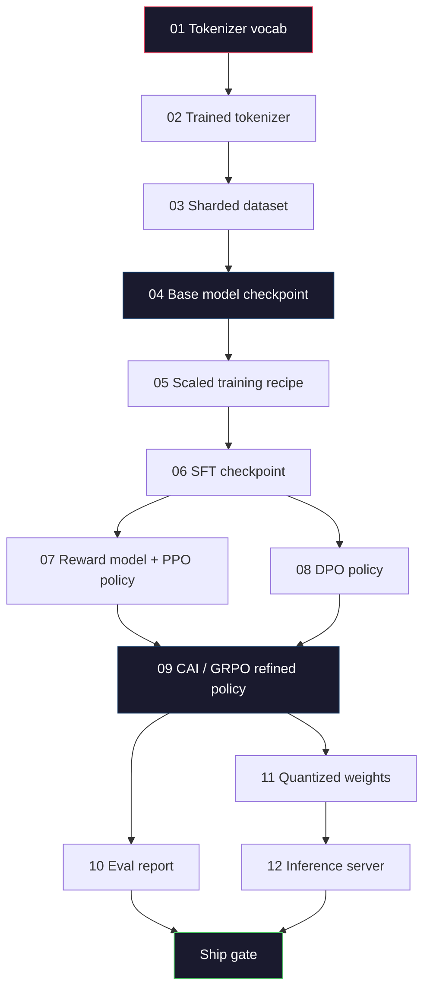
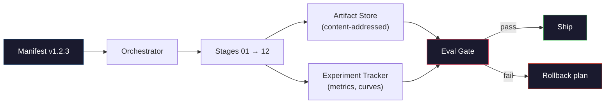

# 打造完整的 LLM 管線 (Building a Complete LLM Pipeline)

> Lesson 01 到 12 的所有內容，都只是同一條管線的其中一個階段。這堂課是把這些階段串成一次端到端執行的骨架：tokenize、pre-train、scale、SFT、align、evaluate、quantize、serve。你不會在筆電上訓練 70B 模型。你會產出 2026 年 frontier 團隊用來決定什麼可以出貨的編排層、manifest、eval 關卡與回滾計畫。這是總結專案 (capstone)。

**Type:** Build
**Languages:** Python (stdlib)
**Prerequisites:** All Phase 10 lessons 01-12
**Time:** ~120 分鐘

## 學習目標 (Learning Objectives)

- 把前面十二堂課（兩堂 tokenizer、資料、pre-training、scaling、SFT、RLHF、DPO、CAI、eval、quantization、inference）組合成單一可重現的管線規格
- 定義各階段之間的 artifact 契約：每個階段消耗什麼、產生什麼，以及下一個階段如何驗證輸入
- 建立能追蹤實驗、對 artifact 做 hash，並依 eval 門檻把關出貨決策的 orchestrator
- 設計回滾計畫：哪些 artifact 重跑成本低、哪些昂貴，以及一個損毀的 checkpoint 要付出什麼代價

## 問題 (The Problem)

前面每一堂課各自都能運作。Tokenizer 訓練好了。小型 GPT pre-train 好了。SFT 資料集組好了。Reward model 訓練好了。DPO 跑完了。Eval 量測完了。量化後的權重匯出了。推論伺服器啟動了。每一個都是一本 notebook。每一個都有自己的慣例、自己的輸出路徑、自己的 seed。

Frontier 的訓練不是 notebook。Llama 3 405B 在大約 54 天內花了 3,000 萬個 H100 小時。DeepSeek-V3 使用了大約 280 萬個 H800 小時。這段期間，一個損毀的 checkpoint、一次資料汙染、一次 eval 退步，都可能讓團隊損失一週的實際時間與一個月的 GPU 預算。團隊靠管線衛生 (pipeline hygiene) 撐過這些：每個階段都有確定性的輸入、確定性的輸出、一份 manifest、一個 hash，以及一道關卡。

這是總結專案。你不會在筆電上端到端執行這條管線。你會寫出協調各階段的 orchestrator、描述這次執行的 manifest、把關出貨決策的 verifier，以及讓第三方只憑一個檔案就能重跑你工作的重播計畫。程式碼很小，紀律卻很大。

這個模式從 100M 到 1T 參數都不用改。同樣四個元件：manifest、orchestrator、eval gate、artifact store，既跑 Llama 3，也跑你的興趣專案 GPT。差別在於每個階段設定裡數字的大小，而不是管線的形狀。

## 核心概念 (The Concept)

### 十二個階段 (The Twelve Stages)

Phase 10 的每一堂課都是一個階段。以下是完整的相依圖。



階段 07 和 08 可以平行執行。其餘全都是硬性相依。階段 02（tokenizer）有改動，會讓所有下游 artifact 失效。階段 10（eval）有改動，則只會讓出貨決策失效。

### Manifest (The Manifest)

Manifest 是一個單一檔案，完整描述一次執行，足以重播它。管線產出的任何東西，都不該依賴不在 manifest 中的狀態。欄位很乏味，但是必填。

```
pipeline_version: 1.2.3
seed: 42
git_commit: a1b2c3d4
stages:
  01_tokenizer:
    recipe: bpe_32k
    input_hash: sha256:...
    output_hash: sha256:...
    wall_clock_sec: 3600
    cost_usd: 12
```

階段 N 的輸出 hash，就是階段 N+1 的輸入 hash。只要有任何偏差，管線就會停止。這是你及早發現資料損毀的方式。這也是遠在另一個大陸的隊友，驗證他們重播某個確定性階段所得到的 artifact，是否與你的相同的方式。

實務上，團隊會使用小型的 YAML schema，加上一個與上一次成功執行做 diff 的 manifest 檢查器。預期欄位（成本、實際耗時）以外的任何差異，都是警訊。

### Artifact 型別 (Artifact Typing)

每個階段的輸出都是具型別的 artifact。不是一包目錄，不是 pickle，而是具有已知 schema 的命名型別。

| 階段 | Artifact 型別 | 關鍵欄位 |
|-------|--------------|-----------|
| 01-02 | Tokenizer | vocab.json、merges.txt、config.json、hash |
| 03 | Dataset | shards[]、資料列數、token 數、去重統計 |
| 04-05 | Checkpoint | weights.safetensors、config.json、optimizer state、step 數 |
| 06 | SFT Model | checkpoint + SFT 配方 + 資料混合比例 |
| 07 | Reward Model | RM checkpoint + 偏好資料 hash |
| 08-09 | Policy | checkpoint + reference hash + beta + 已消耗的 KL 預算 |
| 10 | Eval Report | benchmark 分數 + 退步差異 + eval 資料 hash |
| 11 | Quantized Model | 量化權重 + 校準資料 + 相對於 FP16 的準確度差異 |
| 12 | Server Spec | endpoint + 模型 hash + 設定 + observability hook |

型別化防止了最常見的失敗模式：把階段 08 的輸出當成階段 06 的輸入，讓一個 DPO 訓練過的模型走過 SFT 路徑出貨。具型別的 artifact 與具型別的階段簽章，讓這些錯誤在編譯期就失敗，而不是第五天才爆。

### Eval Gate (The Eval Gate)

出貨不等於「訓練完成」。出貨是「訓練完成，而且 eval gate 通過」。關卡在執行開始之前就已定義。

```
gates:
  mmlu:      >= baseline + 0.5   # no regression
  humaneval: >= baseline + 1.0
  truthfulqa: >= baseline         # no drop
  safety_refusal_rate: <= 0.05
  kl_from_reference: <= 25.0
  cost_total_usd: <= 50000
```

每道關卡都是一個數值門檻。沒有「看起來不錯」的關卡，沒有主觀的簽核。如果所有關卡都通過，artifact 就被標記為可出貨。只要有任何一道關卡失敗，這次執行就會被擱置，等待具名審核者明確覆寫，而這個覆寫本身也會記錄在 manifest 中。

兩道關卡就能攔下大多數災難。*Regression* 關卡（新模型在核心 benchmark 上至少要和前一版一樣好）能抓到訓練錯誤。*KL budget* 關卡（對齊後的 policy 偏離其 reference 不得超過 X）能抓到對齊過度。每條正式的管線都有這兩道關卡。

### Orchestrator (The Orchestrator)

一小段程式碼，讀取 manifest、派送各階段、追蹤 artifact，並在任何契約被違反時停止。這不是 Airflow，也不是 Kubeflow。為了管線衛生，你要的是你自己寫的、乏味的東西。

Orchestrator 的工作範圍很窄：

1. 從 manifest 解析出 DAG。
2. 對每個階段，檢查預期的輸出是否已經存在於正確的 hash（若是就跳過）。
3. 執行該階段，擷取 stdout/stderr，量測實際耗時與成本。
4. 對照下游階段預期的輸入 hash，驗證輸出 hash。
5. 失敗時，寫出一份標明確切失敗階段的部分 manifest，並以非零狀態結束。

這大約是 200 行 Python。它看起來會像這堂課裡的 `code/main.py`。在底層，真正的管線用 `torchrun` 或 `ray` 在叢集上執行各個階段，但 orchestrator 本身跑在單一台機器上。

### 實驗追蹤與 Artifact 儲存 (Experiment Tracking and Artifact Storage)

兩個外部系統撐起這條管線。

**實驗追蹤器（wandb、neptune、mlflow）。** 記錄每個階段的 loss 曲線、eval 指標與系統遙測。三週後，當你需要比較執行 A 和執行 B 時，就要去追蹤器。團隊幾乎都使用託管的追蹤器，自己寫會浪費本該花在訓練上的時間。

**Artifact store（S3、R2、GCS）。** 用於 checkpoint、資料集、tokenizer、eval 報告的不可變物件儲存。Artifact 以 hash 定址，而不是檔名。像 `latest.pt` 這樣的檔名是自找麻煩；`ckpt-7b-step-20000-sha256:abc123.safetensors` 才是契約。

Orchestrator 兩邊都寫。追蹤器是給人看圖表用的。Artifact store 是給下一個階段查找輸入用的。

### 成本估算 (Costing)

Frontier 的訓練都附著一個金額。預算紀律發生在兩個地方。

**執行前估算。** 從 manifest 計算預期 FLOPs（pre-training：6 x params x tokens）、預期 GPU 小時數（FLOPs / 峰值吞吐量 / 使用率），以及依目前租用價格計算的美元成本。如果估算超過預算關卡，管線拒絕啟動。

**執行中追蹤。** 逐階段的實際耗時與成本會記錄到 manifest。每個階段結束後，檢查剩餘預算。如果某個階段超支，下一個階段的關卡就會用新的剩餘預算來評估。你不會等到創投打電話來，才發現錢花光了。

Llama 3 回報的成本是 $61M。DeepSeek-V3 回報主要 pre-training 的成本是 $5.6M。這個比例主要來自硬體效率加上 mixture-of-experts，但具體成本之所以看得見，是因為兩個團隊都是逐階段追蹤，而不是逐次執行追蹤。

### 可重現性與確定性 (Reproducibility vs Determinism)

這兩者不一樣。*可重現 (Reproducible)* 指相同的 manifest 加上相同的程式碼加上相同的基礎設施，會產生下游指標相當的 checkpoint。*確定性 (Deterministic)* 指輸出在 bit 層級完全相同。

現代 LLM 訓練是可重現的，但不是確定性的。分散式訓練的 reduce 順序、GPU kernel 的非確定性（cuBLAS、flash-attn），以及混合精度的四捨五入，加在一起使得每次執行之間，浮點數在 1e-5 的層級上有差異。對最終指標來說這沒問題，指標不會動。但如果你想用 bit 層級的 diff 來除錯，這就是致命的。解法是記錄每個階段的輸入 hash、輸出 hash 與主要指標。在重播時，只有確定性的階段（例如資料處理與 tokenization）的 hash 才會吻合。訓練階段會寫出新的權重，所以它的輸出 hash 會改變。對這些階段來說，只要主要指標吻合，這次執行就算「已重現」，即使權重在 bit 層級並不相同。



### 回滾計畫 (Rollback Plan)

在執行開始之前，寫下每個階段失敗時會發生什麼。分三類。

- **重跑成本低**（數小時）：tokenizer、eval、quantization、推論伺服器。直接重跑。
- **中等**（數天）：SFT、DPO、CAI。保留 base model，只重跑對齊階段。
- **昂貴**（數週與數百萬美元）：pre-training。這裡的回滾計畫不是「重跑」，而是「使用最後一個良好的 checkpoint，並以修訂後的資料重跑成本較低的下游階段」。

因為階段相依是具型別且有 hash 的，orchestrator 可以自動算出回滾集合：讓失敗的階段加上它所有的後代失效。階段 06（SFT）失敗，會讓 06、07、08、09、10、11、12 失效。階段 11（quantization）失敗，只會讓 11 和 12 失效。事先把這些講清楚，可以避免團隊在凌晨 4 點精疲力竭時臨時應變。

### 2026 年觀察到的正式配方 (Production Recipes Observed in 2026)

大多數 frontier 團隊收斂到同一套骨架。

- Tokenizer：128k BPE，帶 byte fallback。在小而平衡的多語言切片上訓練。
- Pre-training：10-20T token，以網頁加程式碼加合成資料為主。Muon 或 AdamW optimizer。FSDP2 或 DeepSpeed ZeRO-3。Gradient checkpointing。BF16 權重，FP32 master。
- SFT：50 萬到 200 萬組指令配對，混合人工與合成資料，並嚴格對 eval 集去重。
- Alignment：DPO 或 CAI + GRPO。只有在偏好訊號對 DPO 來說太多維時才用 RLHF。
- Eval：MMLU-Pro、MATH、HumanEval+、GPQA、SWE-Bench Verified、LiveBench，再加上一個大眾看不到的私有保留集。
- Quantization：服務用 4-bit GPTQ 或 AWQ，在準確度差異很重要的安全 eval 上用 8-bit。
- Serving：vLLM、TensorRT-LLM 或自家方案。Continuous batching。Speculative decoding。KV cache 淘汰。

數字每六個月就會變。骨架不會。

```figure
beam-search
```

## 動手做 (Build It)

這堂課的程式碼是 orchestrator 和 manifest 檢查器，不是十二個訓練腳本。每個階段都用佔位元件模擬，產生形狀與 hash 正確的輸出 artifact。端到端執行 orchestrator，可以在你把 GPU 的錢燒在真正的階段之前，證明管線的管路是通的。

完整實作請見 `code/main.py`。關鍵部分：

- `Manifest` dataclass：管線版本、seed、git commit、各階段、關卡。
- `Stage` dataclass：名稱、型別、輸入（hash）、輸出（hash）、實際耗時、成本。
- `Orchestrator.run()`：解析 DAG、派送各階段、驗證 hash、更新 manifest。
- `EvalGate.check()`：讀取門檻，與最新的 eval 報告比較，回傳通過/失敗。
- `ArtifactStore`（記憶體內的替身）：依 hash 進行 put/get，模擬 S3。
- `CostTracker`：每個階段與累計，超過上限時停止。

`main.py` 裡的管線執行十二個佔位階段，產生一份 manifest，並演練一道失敗的 eval gate，展示被擱置的執行是什麼樣子。把每個佔位元件換成對應課程中真正的訓練腳本，你就擁有真實 frontier 管線所使用的骨架。

## 實際使用 (Use It)

標準的工作流程有三個指令。

```
python code/main.py plan    # validate manifest, compute cost estimate, print DAG
python code/main.py run     # execute stages, writing to manifest.out.yaml
python code/main.py gate    # read manifest.out.yaml, apply eval gates, ship-or-hold
```

每次都先執行 `plan`。大多數管線的 bug 在 plan 階段就會浮現：缺少關卡門檻、過時的 hash、預算超支。執行 `plan` 是免費的。執行 `run` 很昂貴。在便宜的那一側抓出 bug，就能省錢。

`gate` 的輸出不是 `SHIP` 就是 `HOLD: <reason>`。被擱置的執行不是失敗，而是一個決策點。具名審核者要不是覆寫（覆寫會被記錄），就是批准回滾。

## 交付 (Ship It)

這堂課會產出 `outputs/skill-llm-pipeline-reviewer.md`。把一份提議的管線 manifest 餵給它，它會檢查所有契約：階段型別、hash 鏈、關卡、回滾計畫、成本估算。對於缺少 eval gate、KL 預算無上限，或混用 eval 與訓練資料的執行，它拒絕核准。

## 練習 (Exercises)

1. 擴充 orchestrator，支援階段 07 與 08 的平行執行。使用標準函式庫的 `concurrent.futures` 模組。確認最終的 manifest 記錄了兩個階段的輸出，且階段 09 的輸入 hash 是兩者的確定性組合。

2. 加入「汙染檢查」關卡。給定 eval 資料集的 hash 與訓練資料集的 shard，計算重疊程度（完全字串比對或 13-gram 比對）。重疊超過 0.1% 時關卡失敗。餵給它一個被汙染的訓練集，確認關卡會擱置該次執行。

3. 從第一原理實作成本估算器。對階段 04（pre-training），把 FLOPs 估計為 6 x params x tokens，假設在 H100（989 TFLOPs BF16）上有 40% MFU（model FLOPs utilization），價格為每 GPU 小時 $2.50。回報用 2T token 訓練 7B 模型的估算值。與已發表的 Llama 2 數字比較。

4. 建立部分回滾。模擬階段 09（CAI）失敗，然後重跑階段 09 到 12，同時保留 01-08 的快取。Orchestrator 應該依 hash 偵測到已快取的 artifact 並跳過它們。量測相較於完整重跑所節省的實際時間。

5. 加入 observability。為每個階段發出 OpenTelemetry span，附上 params、已看過的 token、loss 與成本等屬性。把 span 導到本地的 collector。重點不在儀表板，而在於每個階段的健康狀況都能透過單一個 trace ID 追蹤。

## 關鍵術語 (Key Terms)

| 術語 | 一般說法 | 實際意義 |
|------|----------------|----------------------|
| Manifest | 「配方檔案」 | 描述管線版本、seed、各階段設定與關卡門檻的 YAML 或 JSON，足以重播一次執行 |
| Content-addressed | 「用 hash 而非名稱」 | Artifact 以其內容的 SHA-256 儲存，所以你絕不會把版本 A 和版本 B 搞混 |
| Eval gate | 「出貨標準」 | 針對 benchmark 指標與安全分數的數值門檻，必須通過才能將 artifact 標記為可出貨 |
| KL budget | 「對齊漂移了多遠」 | 對各對齊階段累計 $\mathrm{KL}(\text{policy} \Vert \text{reference})$ 的上限，以關卡方式強制執行 |
| MFU | 「你用了多少 GPU」 | Model FLOPs Utilization，實際達到的 FLOPs 除以理論峰值。70B 規模典型為 40%，7B 為 55% |
| Rollback plan | 「壞掉時我們怎麼辦」 | 預先寫好的、每個階段失敗時的行動集合：重跑、退回、以修訂後的輸入重新訓練 |
| Orchestrator | 「指揮家」 | 讀取 manifest、派送各階段、驗證 hash，並在任何契約被違反時停止的程序 |
| Artifact store | 「權重用的版本化 S3」 | 不可變、以內容定址的物件儲存，是 checkpoint、資料集、eval 報告的單一事實來源 |
| Reproducible | 「重播時指標相同」 | bit 層級的權重不同，但下游指標相當，是分散式 LLM 訓練務實的目標 |
| Cost gate | 「你不能超過 X」 | 執行前的成本估算加上執行中的追蹤器，估算超過預算時，管線拒絕啟動 |

## 延伸閱讀 (Further Reading)

- [Dubey et al., 2024 -- "The Llama 3 Herd of Models"](https://arxiv.org/abs/2407.21783)：對 frontier 管線最詳盡的公開描述，包含資料、訓練、對齊、eval
- [DeepSeek-AI, 2024 -- "DeepSeek-V3 Technical Report"](https://arxiv.org/abs/2412.19437)：以效率為優先的管線，成本大約只有 Llama 3 等級訓練的十分之一
- [Kaplan et al., 2020 -- "Scaling Laws for Neural Language Models"](https://arxiv.org/abs/2001.08361)：最初的運算-資料-參數 scaling 關係
- [Hoffmann et al., 2022 -- "Training Compute-Optimal Large Language Models (Chinchilla)"](https://arxiv.org/abs/2203.15556)：對 Kaplan 的修正，重新校準了現代的資料預算
- [PyTorch FSDP2 documentation](https://pytorch.org/docs/stable/fsdp.html)：在 PyTorch 2.4+ 取代 FSDP1 的分散式訓練基本元件
- [Weights & Biases LLM Reports](https://wandb.ai/site/solutions/llms/)：開源 LLM 執行的真實 manifest 與實驗追蹤器輸出，可拿來當作可抄用的範本
