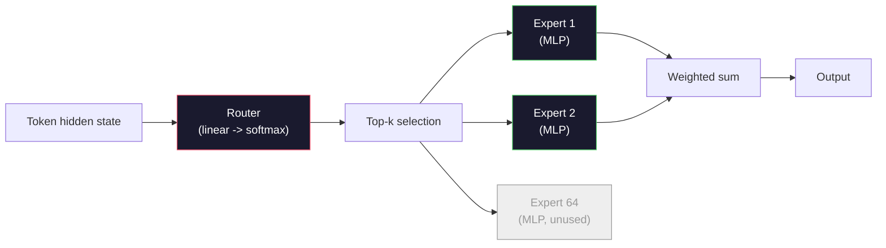

# 開放模型：架構導覽 (Open Models: Architecture Walkthroughs)

> 你在 Lesson 04 從零打造了 GPT-2 Small。2026 年的 frontier 開放模型，是同一個家族，只多了五、六個具體的改動：用 RMSNorm 取代 LayerNorm、用 SwiGLU 取代 GELU、用 RoPE 取代學習式位置編碼、用 GQA 或 MLA 取代完整的 MHA、在大規模時使用 Mixture-of-Experts。你已經知道的數學，涵蓋了其中 95%。這堂課並排閱讀 Llama 3、DeepSeek-V3、Mixtral、Qwen 與 Gemma，並指出每個架構分歧的確切那一行。

**Type:** Learn
**Languages:** Python (stdlib)
**Prerequisites:** Phase 10, Lessons 04, 05, 12 (Pre-training, Scaling, Inference)
**Time:** ~45 分鐘

## 學習目標 (Learning Objectives)

- 閱讀 Llama 3、Mistral、Mixtral、Gemma 2、Qwen 2.5 與 DeepSeek-V3 的 config.json，並說明每個欄位
- 指出每個模型相對於 GPT-2 Small 所做的特定架構改動，並從第一原理說明其理由
- 僅憑 config 就計算任何開放模型的參數量、KV cache 大小與 activation 記憶體
- 在延遲、記憶體與能力的限制下，為部署目標挑選合適的開放模型

## 問題 (The Problem)

在 Lesson 04 中，你寫了 350 行 numpy，得到一個 GPT-2 形狀的模型。Llama 3 405B 有一份 200 頁的技術報告。你的直覺是這是不同的怪獸。其實不是。那 200 頁描述的是同一個物件，加上五、六個動機明確的修改，以及一千個關於 scaling 的實作細節。骨架，也就是 embedding、transformer block、attention、MLP、norm、head，並沒有變。

這堂課是一份 diff。對每個主要的開放模型家族，我們列出相對於 GPT-2 到底改了什麼、為什麼改，以及代價是什麼。學完之後，你可以讀一份全新的 model card，並在腦中把它翻譯回 GPT-2 的 baseline。

實際的好處是：當 Meta 釋出 Llama 5，或 DeepSeek 釋出 V4 時，你不需要新的心智模型。你會看 config，看哪些眾所周知的旋鈕動了，並知道下游的影響是什麼。2026 年的架構是一個有限的工具箱。每個新模型挑選的是不同的子集。

## 核心概念 (The Concept)

### 不變的核心 (The Invariant Core)

所有自迴歸的開放模型都共有：

- Token embedding 矩陣（vocab_size x hidden_dim）。
- N 個 decoder block 的堆疊：norm、self-attention、residual、norm、MLP、residual。
- 最後的 norm 與投影到 vocab_size 的線性 head（通常與 embedding 做 weight tying）。
- Causal mask，next-token cross-entropy loss。

這就是形狀。其餘都是旋鈕。

### 真正會動的六個旋鈕 (The Six Knobs That Actually Move)

在 2024-2026 年每個 frontier 開放模型中，同樣的六個設計選擇被一再挑選：

1. **Normalization。** LayerNorm -> RMSNorm。
2. **位置編碼。** 學習式絕對位置 -> RoPE（加上變體：YaRN、NTK）。
3. **Activation。** GELU -> SwiGLU（或 GeGLU）。
4. **Attention head 共用。** MHA -> GQA -> MQA -> MLA。
5. **Dense 與 sparse MLP。** Dense -> Mixture-of-Experts。
6. **Pre-norm 的位置。** Pre-norm 留下來。Post-norm 已經消失。

其他所有東西（learning rate 排程、資料混合、batch size、context 長度）都屬於訓練設定，不屬於架構。六個旋鈕。

### 旋鈕 1：RMSNorm (Knob 1: RMSNorm)

LayerNorm 會減去平均值、除以標準差、縮放並平移。RMSNorm 只保留縮放：

```math
\mathop{\mathrm{RMSNorm}}(x) = \frac{x}{\sqrt{\mathop{\mathrm{mean}}(x^2) + \epsilon}} \cdot \gamma
```

沒有減去平均值，沒有 bias。每個 token 少一次 matmul。Zhang 與 Sennrich (2019) 主張它在機器翻譯上與 LayerNorm 相當，同時快 10%。每個現代開放模型都使用它。

代價：沒有。好處：小幅的吞吐量提升、更簡單的程式碼。

### 旋鈕 2：RoPE (Knob 2: RoPE)

學習式位置 embedding 在 GPT-2 中是一個 1024 格的查找表。第 1025 個位置超出了表的範圍。模型無法外推到超過其訓練長度的位置。

Rotary Position Embedding（RoPE，Su et al. 2021）在 attention 的內積之前，成對地旋轉每個 Q 與 K 向量，藉此注入位置。旋轉的角度是位置的確定性函數，所以沒有任何要學習的東西，也沒有任何會用完的東西。搭配 scaling 技巧（NTK-aware interpolation、YaRN），在 8k context 上訓練的模型，可以在推論時延伸到 128k，只損失少量準確度。

```
q_rotated = rotate(q, angle(pos))
k_rotated = rotate(k, angle(pos))
score = q_rotated . k_rotated
```

每個 Llama、Mistral、Qwen、DeepSeek 與 Gemma 都使用 RoPE。Gemma 2 使用混合做法（多數層用 RoPE，其他層用局部的 sliding-window attention）。

### 旋鈕 3：SwiGLU (Knob 3: SwiGLU)

GPT-2 的 MLP 是 `x -> gelu(xW1 + b1) -> (...)W2 + b2`。SwiGLU（Shazeer 2020）把 activation 換成閘控 (gated) 的乘積：

```math
\mathop{\mathrm{SwiGLU}}(x) = (xW_1) \cdot \mathop{\mathrm{sigmoid}}(xW_1) \cdot xV
```

兩個平行的投影而不是一個，由 Swish activation 做閘控。以每個參數的 perplexity 來說，經驗上更強。Llama 2 採用它，所有人跟進。MLP 的 hidden 大小通常設定成使總參數量與原本的 dense MLP 相符：如果 GPT-2 使用 `ff_dim = 4 * hidden`，SwiGLU 就使用 `ff_dim = (2/3) * 4 * hidden = 8/3 * hidden`。

### 旋鈕 4：Attention Head 共用 (Knob 4: Attention Head Sharing)

GPT-2 使用 **Multi-Head Attention (MHA)**：每個 head 都有自己的 Q、K、V 投影。

**Multi-Query Attention (MQA, Shazeer 2019)** 讓所有 head 共用一個 K 和一個 V。KV cache 縮小 num_heads 倍，在典型模型上是 12 倍到 32 倍的減少。在困難的 benchmark 上準確度略有下降。

**Grouped-Query Attention (GQA, Ainslie et al. 2023)** 是折衷方案：$G$ 組 Q head 共用一個 K 和一個 V。Llama 3 8B 使用 GQA，有 32 個 Q head 與 8 個 KV head ($G=8$)，所以 KV cache 比完整 MHA 縮小 4 倍。

**Multi-Head Latent Attention (MLA, DeepSeek 2024)** 把 K 和 V 壓縮成共用的低秩潛在表示 (latent)，再為每個 head 投影回去。在保留每個 head 表達力的同時，進一步減少 KV cache。DeepSeek-V2 和 V3 的長 context 表現就仰賴這個。

| 方案 | KV Head 數 | KV Cache | 準確度 |
|--------|----------|----------|----------|
| MHA    | num_heads | 完整 | 最好 |
| GQA    | num_groups (G < num_heads) | 減少 num_heads / G 倍 | 接近 MHA |
| MQA    | 1 | 減少 num_heads 倍 | 小幅下降 |
| MLA    | latent，每個 head 解壓縮 | 比 MQA 更小 | 接近 MHA |

對任何超過約 13B 參數的模型，GQA 或 MLA 實質上是必要的。大規模下用完整的 MHA 是 KV cache 的災難。

### 旋鈕 5：Mixture of Experts (Knob 5: Mixture of Experts)

Dense MLP 會為每個 token 啟用它所有的參數。MoE 的 MLP 在每個 block 有 K 個 expert，以及一個 router，為每個 token 挑出 top-k 個 expert（通常是 top-2）。只有那些 expert 的權重會對該 token 進行 forward pass。

```
router_logits = xW_r
indices, weights = top_k(router_logits, k=2)
output = sum_i weights[i] * expert[indices[i]](x)
```

吸引力在於：你可以擁有 64 個各為 7B 大小的 expert（所以總參數量很龐大），同時每個 token 只執行其中 2 個（所以每個 token 的運算量與 dense 7B 模型相當）。Mixtral 8x7B 總共有 47B 參數，但每個 token 只啟用 13B。DeepSeek-V3 總共有 671B 參數，但每個 token 只啟用 37B。



優點：同樣運算量、更多參數、更好的容量。缺點：expert 的記憶體仍然得放在某個地方（所以服務時需要比 dense 等價模型更多的 VRAM），router 的負載平衡很難，而在對齊期間 fine-tune router 本身就是一個研究領域。

### 旋鈕 6：Pre-norm 留下來 (Knob 6: Pre-norm stays)

最初的 transformer 在每個子層之後套用 layer norm。自 GPT-2 以來的每個開放模型，都把它放在每個子層*之前*。Pre-norm 在深層網路上嚴格來說更容易訓練。沒什麼好爭論的。

### 逐模型的 Diff (Model-by-Model Diff)

這張表讓這一切變得具體。

| 模型 | 年份 | 總參數量 | 活躍參數量 | Norm | Activation | 位置 | Attention | MoE | Context |
|-------|------|-------------|---------------|------|-----------|----------|-----------|-----|---------|
| GPT-2 Small | 2019 | 124M | 124M | LayerNorm | GELU | Learned | MHA (12 heads) | 否 | 1k |
| Llama 3 8B | 2024 | 8B | 8B | RMSNorm | SwiGLU | RoPE | GQA (32/8) | 否 | 128k |
| Llama 3 70B | 2024 | 70B | 70B | RMSNorm | SwiGLU | RoPE | GQA (64/8) | 否 | 128k |
| Llama 3 405B | 2024 | 405B | 405B | RMSNorm | SwiGLU | RoPE | GQA (128/16) | 否 | 128k |
| Mistral 7B | 2023 | 7.2B | 7.2B | RMSNorm | SwiGLU | RoPE | GQA | 否 | 32k |
| Mixtral 8x7B | 2023 | 47B | 13B | RMSNorm | SwiGLU | RoPE | GQA | 是 (8 experts, top-2) | 32k |
| Gemma 2 9B | 2024 | 9B | 9B | RMSNorm (pre+post) | GeGLU | RoPE + sliding | GQA | 否 | 8k |
| Qwen 2.5 72B | 2024 | 72B | 72B | RMSNorm | SwiGLU | RoPE (YaRN) | GQA (64/8) | 否 | 128k |
| DeepSeek V2 236B | 2024 | 236B | 21B | RMSNorm | SwiGLU | RoPE | MLA | 是 (160 experts, top-6) | 128k |
| DeepSeek V3 | 2024 | 671B | 37B | RMSNorm | SwiGLU | RoPE | MLA | 是 (256 experts, top-8) | 128k |
| Spark-X2.5 4B | 2026 | 4.1B | 4.1B | RMSNorm | GeGLU | RoPE + sliding (3:1) | GQA (16/4), gated output | 否 | 1M |

掃過每一欄。RMSNorm 是通用的。SwiGLU 或它的表親 GeGLU 是通用的。RoPE 是通用的。除了被 MLA 取代的情況，GQA 在 7B 以上是通用的。MoE 是頂端規模的差異點。

### 閱讀 config.json (Reading a config.json)

Llama 3 8B 的 config：

```
{
  "hidden_size": 4096,
  "intermediate_size": 14336,
  "num_hidden_layers": 32,
  "num_attention_heads": 32,
  "num_key_value_heads": 8,
  "max_position_embeddings": 131072,
  "rope_theta": 500000.0,
  "rms_norm_eps": 1e-5,
  "vocab_size": 128256
}
```

每個欄位都對應到你已經實作過的東西。
較新的 config 會多出幾個會改變計算的欄位，所以計算器
在這些欄位存在時會讀取它們：

- `head_dim`：當它不等於 `hidden_size / num_attention_heads` 時，會明確設定。Gemma 2 9B 的 hidden 是 3584、有 16 個 head，但 `head_dim` 是 256，所以它的 Q 投影是 3584 x 4096，不是方形。
- `tie_word_embeddings`：LM head 是否重複使用 embedding 矩陣。Llama 3 8B 沒有 tying，如果你只算一次 embedding，就會漏掉 525M 個參數。
- `layer_types` 與 `sliding_window`：哪些層 attend 到完整的 context，哪些只 attend 到最後 W 個 token。

- `hidden_size`：embedding 維度。
- `intermediate_size`：MLP 的 hidden 大小（hidden 的 3.5 倍，這是 SwiGLU 的數學）。
- `num_hidden_layers`：堆疊深度。
- `num_attention_heads`：Q head 數。
- `num_key_value_heads`：KV head 數（GQA）。
- `max_position_embeddings`：訓練時的 context 長度。
- `rope_theta`：RoPE 的基礎頻率。Meta 把它從預設的 10k 調高到 500k，以便長 context 外推。
- `rms_norm_eps`：數值穩定性。
- `vocab_size`：token 數。

光憑這些，你就能計算總參數量、KV cache 與尖峰 activation 記憶體。確切的公式請見 `code/main.py`。

### Activation 記憶體預算 (Activation memory budget)

超過幾十億參數之後，activation 主導了訓練記憶體。Pre-training 的經驗法則（搭配 gradient checkpointing）：

```
activation_mem ~ batch_size * seq_len * hidden_size * num_layers * bytes_per_element
```

對於 batch 1、seq 8192、BF16、32 層、hidden 4096 的 Llama 3 8B：使用 checkpointing 時，光 activation 大約 8 GB，沒有 checkpointing 則是 40 GB。這就是為什麼 flash-attention 與 ring-attention 很重要：它們重寫了 attention 的計算，讓 activation 放得下。

### KV Cache 預算 (KV Cache budget)

對於最大 context 下的推論：

```
kv_cache = 2 * num_layers * num_kv_heads * head_dim * max_seq_len * bytes_per_element
```

Llama 3 8B 在 128k context、BF16、head_dim = hidden / num_heads = 128 下：
`2 * 32 * 8 * 128 * 131072 * 2 = 17.2 GB` 每條序列。

8B 的權重在 BF16 下是 16 GB。單一個 128k 序列的 KV cache 就比權重還大。這就是推動 GQA、MLA 與 KV cache quantization 研究的記憶體壓力。

這個公式假設每一層都快取整條序列。Sliding-window 層只需要最後 W 個 token，所以對於混合模型，要逐層加總：

```
kv_cache = 2 * num_kv_heads * head_dim * bytes_per_element
           * (full_layers * max_seq_len + sliding_layers * min(W, max_seq_len))
```

Spark-X2.5 4B 每一層完整 attention，就搭配三層 sliding-window（$W = 512$）：36 層中有 9 層完整、27 層 sliding。在它 1M token 的 context 下，BF16 每條序列約 38.7 GB (36 GiB)。如果全部 36 層都快取完整 context，會是 154.6 GB (144 GiB)。完整層幾乎承擔了全部的成本，這就是為什麼在長 context 模型上，完整層與 sliding 層的比例是第一個該看的數字。

### 各模型何時勝出 (When Each Model Wins)

- **單張 80GB GPU，不用 MoE**：Llama 3 8B、Mistral 7B、Gemma 2 9B。容易服務，工具生態廣。
- **單一節點 (8x80GB)，大容量**：Llama 3 70B、Qwen 2.5 72B。dense 開放模型中最強的能力。
- **最強的開放能力，接受 MoE 的複雜度**：DeepSeek V3、Mixtral 8x22B。每個活躍 FLOP 的能力最佳。
- **長 context 需求**：Llama 3（搭配 RoPE scaling 達 128k）、DeepSeek（MLA 的優勢）。
- **低延遲服務**：Gemma 2 9B（sliding window 降低長 context 的運算）。
- **小記憶體預算下的長 context**：像 Spark-X2.5 4B 這樣的混合 sliding-window 模型，只有四分之一的層需要為完整 context 付出成本。

```figure
rmsnorm-vs-layernorm
```

## 動手做 (Build It)

這堂課的程式碼是一個計算器。給定任何 config.json，它會印出各元件的參數量、最大 context 下的 KV cache、SwiGLU MLP 比例，以及對該架構的簡短判斷（dense / GQA / MLA / MoE）。

```python
config = {
    "hidden_size": 4096, "intermediate_size": 14336,
    "num_hidden_layers": 32, "num_attention_heads": 32,
    "num_key_value_heads": 8, "vocab_size": 128256,
    "max_position_embeddings": 131072,
}
```

這個腳本逐欄位走過架構，計算 embedding、attention（含 GQA 的縮減，以及當 config 設定時明確的 `head_dim`）、MLP（含 SwiGLU 或 GeGLU 的擴張）、layernorm，以及當 LM head 沒有與 embedding 做 tying 時的 LM head 的參數量。接著它在所述的 context 長度下計算 KV cache，逐層計算，讓 sliding-window 層的上限就是它們的 window，最後印出摘要。

對 dense 模型來說，總數與公開的參數量完全吻合：Llama 3 8B 算出 8,030,261,248，Gemma 2 9B 是 9,241,705,984，Spark-X2.5 4B 是 4,112,079,360。Qwen 2.5 72B 差了 819,200，這就是練習 1。

實作請見 `code/main.py`。

## 實際使用 (Use It)

對腳本內附的 Llama 3 8B、Mistral 7B、Mixtral 8x7B 與 DeepSeek V3 config 執行計算器。比較它們的參數拆解。注意 MoE 模型的總參數量遠遠超過 dense 模型，但活躍參數量往往更小。注意 DeepSeek V3 的 KV cache 比 Llama 3 405B 小，儘管總參數量更多，這就是 MLA 的實際效果。

然後比較 Gemma 2 9B 與 Spark-X2.5 4B。對這兩者，腳本都會印出它實際需要的 KV cache，以及如果每層都是完整 attention 時所需的 KV cache。Gemma 2 以 1:1 交替，context 為 8k，所以節省的幅度不大。Spark-X2.5 是 3:1，搭配 512 token 的 window，在 1M 下節省 4 倍。

接著把你本機上任何模型的 config 放進去，閱讀摘要，並判斷它是否放得進你的 GPU。

## 交付 (Ship It)

這堂課會產出 `outputs/skill-open-model-picker.md`。給定部署目標（GPU 類型、VRAM、context 長度、延遲預算）與任務輪廓（聊天、程式碼、推理、長 context），它會推薦一個開放模型、一個來自 Lesson 11 的 quantization 方案，以及一個來自 Lesson 12 的推論堆疊，並針對六個架構旋鈕提出明確的理由。

## 練習 (Exercises)

1. 從 HuggingFace 讀取 Qwen 2.5 72B 的 config。從頭計算總參數量。與 HF 回報的值比較，並找出任何差異的來源（head dim 的捨入、KV 共用係數等）。

2. DeepSeek V3 使用 256 個 expert，採 top-8 routing。計算被啟用的 expert 與總 expert 的比例，並與 Mixtral 8x7B 的 8 選 2 比較。從稀疏（25%）轉向更稀疏（3%），對每個 FLOP 的容量意味著什麼？

3. 計算 Llama 3 405B 在 128k context 下，FP8 與 BF16 的 KV cache。FP8 是 BF16 數字的一半。在單一 8xH100 節點上（每張 80GB = 總共 640GB，扣掉權重記憶體），你能服務多少條並行序列？

4. Gemma 2 交替使用完整 attention 與 sliding-window attention 的層。寫出當一半的層使用 4096 token 的 sliding window，而不是完整 context 時，KV cache 的數學。在總共 8k context 下，這能省多少記憶體？

5. 找一個在這堂課寫成之後才發布的最新 frontier 開放模型。找出它挑選了六個旋鈕中的哪些，以及它是否引入了第七個旋鈕。新架構一發布，這份課程就會顯得過時，目標是更新你的表格，而不用重建你的心智模型。

## 關鍵術語 (Key Terms)

| 術語 | 一般說法 | 實際意義 |
|------|----------------|----------------------|
| RMSNorm | 「沒有平均值的 LayerNorm」 | 只用 root mean square 做正規化，搭配學習式的 scale，更便宜且與 LayerNorm 相當 |
| RoPE | 「旋轉式位置」 | 以取決於位置的角度，在 2D 配對中旋轉每個 Q 與 K 向量，搭配 scaling 技巧可外推超過訓練長度 |
| SwiGLU | 「新的 MLP activation」 | 帶 Swish 的閘控線性單元：`(xW1) * sigmoid(xW1) * xV`，是 2024 年以後每個開放模型的標準 |
| GQA | 「折衷的 attention」 | Grouped-Query Attention：G 組 Q head 共用一個 K 和一個 V head，縮小 KV cache，又不像 MQA 那樣損失準確度 |
| MLA | 「DeepSeek 的 attention」 | Multi-Head Latent Attention：把 K/V 壓縮成共用的低秩 latent，再為每個 head 解壓縮，是大型模型中最小的 KV cache |
| MoE | 「稀疏 expert」 | Mixture of Experts：每個 block 有 N 個 MLP，router 為每個 token 挑 top-k，總參數量龐大、活躍參數量很小 |
| Top-k routing | 「每個 token 挑 k 個 expert」 | Router 為每個 expert 計算分數，並啟用最高的 k 個，典型的 k 從 2 (Mixtral) 到 8 (DeepSeek) |
| YaRN | 「拉伸 RoPE」 | Yet another RoPE extension，插值旋轉角度，在推論時把 context 從 8k 延伸到 128k 以上 |
| Sliding-window attention | 「不要 attend 所有東西」 | 每個 token 只 attend 到最後 $W$ 個 token，把每個 token 的 attention 成本上限設在 $O(W)$，用於 Gemma 2 和早期的 Mistral |
| Active params | 「每個 token 實際執行的」 | 對 MoE 模型而言，每個 token 會經過 forward pass 的參數量（遠小於總參數量），決定每個 token 的 FLOPs |

## 延伸閱讀 (Further Reading)

- [Dubey et al., 2024 -- "The Llama 3 Herd of Models"](https://arxiv.org/abs/2407.21783)：dense Llama 3 家族的架構與訓練參考資料
- [DeepSeek-AI, 2024 -- "DeepSeek-V3 Technical Report"](https://arxiv.org/abs/2412.19437)：MLA 加上無輔助 loss 的負載平衡，加上 671B 的 MoE
- [Jiang et al., 2024 -- "Mixtral of Experts"](https://arxiv.org/abs/2401.04088)：經典的 MoE 開放模型論文
- [Su et al., 2021 -- "RoFormer: Enhanced Transformer with Rotary Position Embedding"](https://arxiv.org/abs/2104.09864)：RoPE 論文
- [Shazeer, 2020 -- "GLU Variants Improve Transformer"](https://arxiv.org/abs/2002.05202)：SwiGLU、GeGLU 及其同類
- [Ainslie et al., 2023 -- "GQA: Training Generalized Multi-Query Transformer Models"](https://arxiv.org/abs/2305.13245)：GQA 論文
- [Gemma 2 Team, 2024 -- "Gemma 2: Improving Open Language Models at a Practical Size"](https://arxiv.org/abs/2408.00118)：混合完整+sliding attention、pre+post-norm
- [Qwen Team, 2024 -- "Qwen 2.5 Technical Report"](https://arxiv.org/abs/2412.15115)：YaRN 的 context 延伸與長 context 訓練配方
